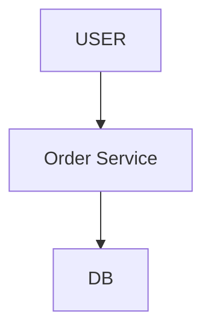
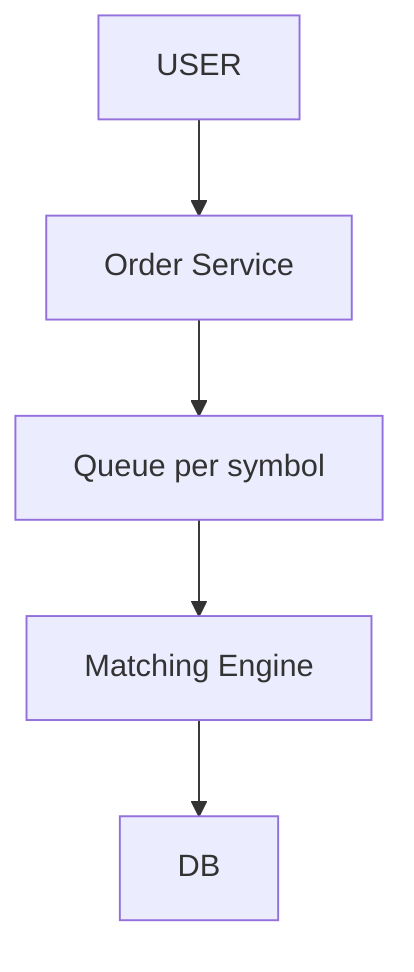
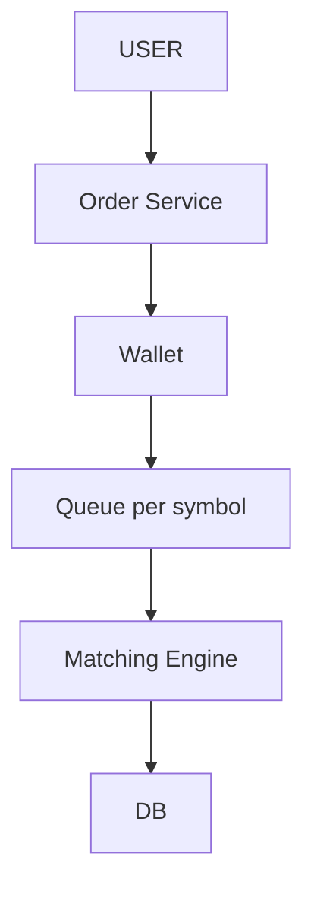
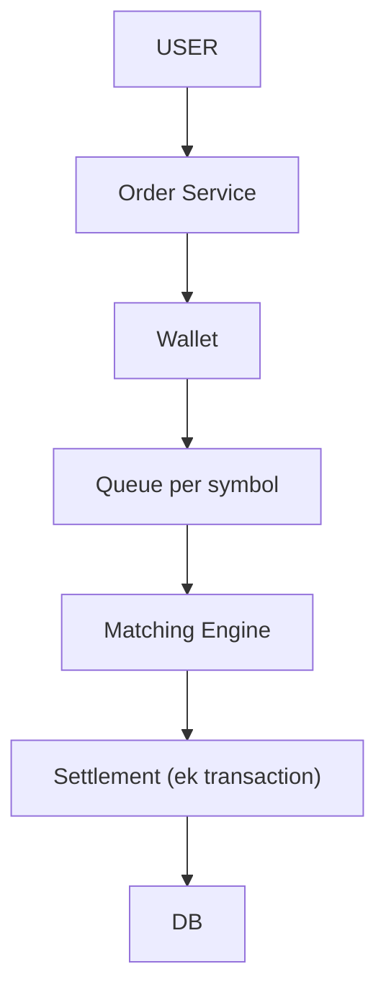
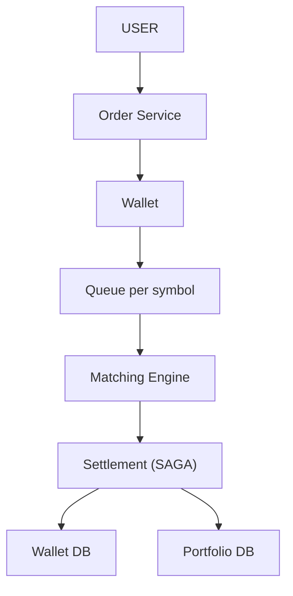
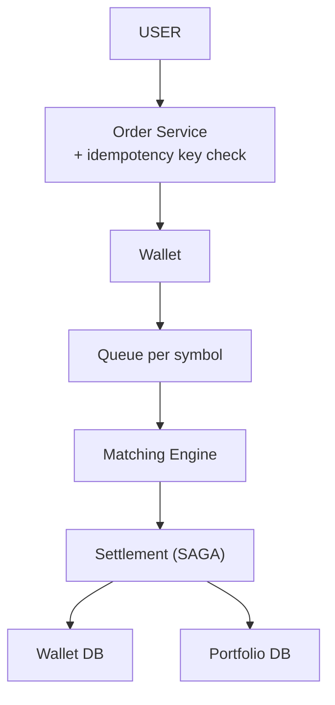
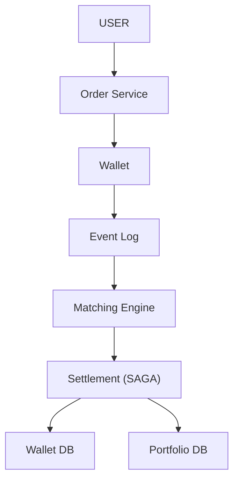
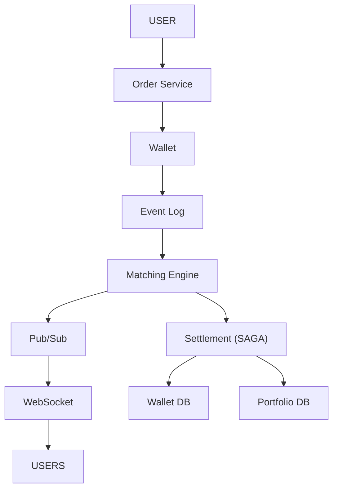
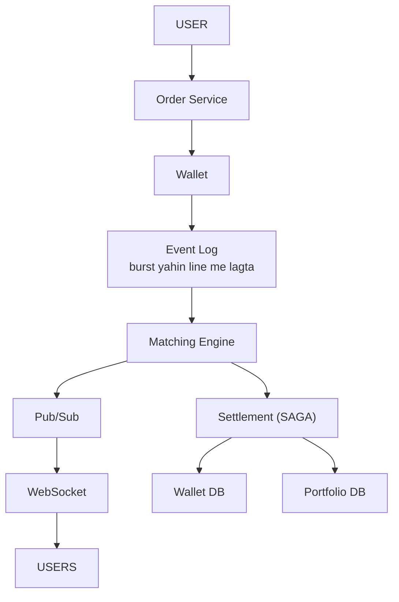

# Stock Broker / Trading Platform

> User BUY / SELL order deta hai -> system order MATCH karta hai -> paisa aur share sahi jagah pahunchte hain -> sabko live price dikhta hai.
> Is design ka dil: **paisa kabhi galat nahi (strong consistency)** + **matching bahut tez (RAM me, microseconds)**.
> Finance interview me (JP / GS) yahi poochte hain: consistency, ACID, idempotency, ledger, audit.

---

## TASVEER (ByteByteGo / Alex Xu · CC BY-NC-ND 4.0)


Source: [Design Stock Exchange](https://bytebytego.com/guides/design-stock-exchange/)


Source: [Low Latency Stock Exchange](https://bytebytego.com/guides/low-latency-stock-exchange/)

---

## SHURU: pehle poocho, phir numbers

```
POOCHO:  "Trading bada hai: matching, price feed, risk, settlement. Kis pe focus karein?"
         -> order MATCHING + paise / share ka SETTLEMENT (len-den poora karna).
            Risk / margin / IPO / mutual fund scope me nahi.
         LIMIT aur MARKET dono order? · aadha bhara (partial fill) chalega?
         hum EXCHANGE hain (khud match karte) ya BROKER (exchange ko order bhejte)?

KYA KARE (FR):    buy / sell · order match · paisa + share move · live price · cancel / status
KAISA CHALE (NFR): paisa hamesha sahi (strong, kabhi "thodi der baad sahi" nahi) · tez
                   · imaandar (jo pehle aaya wo pehle) · har cheez ka record (audit)

NUMBERS (andaaza):
   ~50 lakh user · ~50 lakh order / din, market ~6 ghante (~20,000 second) khulta -> ~250 order / second
   9:15 baje market khulte hi jhatka: 10,000+ order / second
   price dekhne wale bahut zyada: crore baar / second "price kya hai"
   -> matching RAM me · price PUSH karo (har user ka baar-baar poochhna nahi)
   -> jo tez chahiye aur thodi der ka hai (order book) = RAM
   -> jo paisa hai aur hamesha ka hai (wallet / ledger) = SQL DB + ACID
```

---

## ════ MOCK SE PEHLE: SIRF YE CARD PADHO ════

> Har card: DIKKAT (kya toota) -> HAL (kya kiya) -> diagram -> SAWAAL / JAWAB (interviewer yahin ghusta).
> Revise: sirf baayein column padho (DIKKAT, HAL, SAWAAL) -> jawab apne aap yaad aata.

#### DABBA 0: SABSE SIMPLE (yahan se shuru, phir "kahan tootega")
```
Order service har order DB me likhe, aur DB me milta-julta SELL dhoondh ke match kare.
```


#### 0 SHURU: ORDER BOOK KAISE MATCH KARTA
```
DIKKAT   TCS ka share. Kuch log bechna chahte (SELL), kuch khareedna (BUY). Kaun kisse milega?

HAL      Do line (order book):
           Bechne wale   : sabse SASTA upar     3000, 3001, 3005 ...   (min-heap)
           Khareedne wale: sabse MEHNGA upar    2999, 2998 ...         (max-heap)
         Sauda -> jab top khareedar >= top bechne wala.
         Daam  -> jo order pehle se book me pada tha, uska.
         Same daam pe -> jo PEHLE aaya (chhota number) wo pehle.
```
```
SAWAAL   Book DB me rakhoge?
JAWAB    Nahi, RAM me. DB = milliseconds har order, RAM = microseconds.

SAWAAL   RAM me hai, server gira to book gayi?
JAWAB    Nahi, log se wapas banti (card 6).

SAWAAL   Ramesh ko 10 chahiye, bechne wale ke paas sirf 6?
JAWAB    6 ka sauda. Ramesh ke baaki 4 book me pade rehte, un 4 ka paisa ruka rehta.
```

#### 1 DO ORDER EK HI STOCK PE EK SAATH (RACE)
```
DIKKAT   Seller ke paas TCS ke 10 share. Ramesh aur Mohan ne ek saath BUY 10 maara.
         Do thread ne book dekhi, dono ko "10 hai" dikha -> 20 bik gaye, the sirf 10.

HAL      TCS ke saare order ek line me, us line ko sirf EK thread chalata (TCS -> T1, INFY -> T2).
         Pehle Ramesh -> 10 mil gaye. Phir Mohan -> 0 bache -> uska order line me ruka.
         Do order kabhi ek saath match nahi hote -> lock ki zaroorat hi nahi.
```

```
SAWAAL   5000 stock = 5000 thread?
JAWAB    Nahi. Thode thread, har thread kai stock (stock ke naam ka hash % threads). Ek stock = ek thread.

SAWAAL   "DB ka ACID ye rok dega"?
JAWAB    Nahi. Matching DB me hai hi nahi, RAM me hai.

SAWAAL   Wo thread atak gaya (Java ka GC pause)?
JAWAB    Us stock ke order line me ruk jaate. Kam GC wala Java setup + standby jo log padh ke
         uth sake (card 6).
```

#### 2 WALLET ME 50K, 30K-30K KE DO ORDER (DOUBLE SPEND)
```
DIKKAT   Ramesh ke wallet me 50k. Usne ek saath 30k ke DO order daale.
         Dono ne wallet dekha, dono ko 50k dikha, dono pass -> 60k kharch, the 50k.

HAL      Order lagte hi paisa BLOCK karo, aur check + block EK hi query me:
           UPDATE wallet SET blocked = blocked + 30000 WHERE total - blocked >= 30000
         Pehla order -> 30k block, bacha 20k. Doosra -> 0 row badli -> reject.
         Sauda hua -> paisa sach me kato · order cancel -> block hatao.
```

```
SAWAAL   Pehle SELECT se balance padho, phir UPDATE?
JAWAB    Dono order ek saath 50k padh lenge, dono pass. Isliye check + update ek hi query me.

SAWAAL   10 me se sirf 6 ka sauda hua?
JAWAB    6 ka paisa kato, baaki 4 ka blocked rahe.

SAWAAL   Paisa block, order 3 din pada raha?
JAWAB    Order ki umar hoti (day order shaam ko khatam) -> khatam hote hi block hatao.

SAWAAL   Ramesh ne CANCEL kiya, usi pal match ho raha tha?
JAWAB    Cancel bhi usi stock ki line me, order ke peeche jaata. Engine kram se dekhta:
         match pehle ho chuka -> "pura ho gaya" · book me pada -> hatao + jo nahi bika uska block hatao.
```

#### 3 SAUDE KE BEECH CRASH (SETTLEMENT)
```
DIKKAT   Ramesh ne Suresh se 10 TCS khareede (30k). Ramesh ka 30k kata, Suresh ko milne se PEHLE
         server gira -> 30k hawa me.

HAL      Ek hi transaction:
           BEGIN  Ramesh -30k +10 share · Suresh +30k -10 share  COMMIT
         Beech me crash -> DB sab wapas (rollback). Aadha kabhi nahi.
         Khaate (ledger) me 2 line: Ramesh -30k, Suresh +30k -> jod hamesha 0.
```

```
SAWAAL   Har baar balance ledger jod ke nikaloge?
JAWAB    Nahi, dheema. Balance alag column, usi transaction me badalta. Ledger = record + audit.

SAWAAL   Paise me "thodi der baad sahi" chalega?
JAWAB    Nahi. Paisa hamesha turant sahi (strong consistency).

SAWAAL   Asli market me paisa aur share usi pal milte?
JAWAB    Nahi. India me T+1: asli len-den agle din clearing house (NSE ka NSCCL).
         Hamara turant wala hisaab broker ke apne khaate me.
```

#### 4 PAISA WALLET DB ME, SHARE PORTFOLIO DB ME (ALAG DB)
```
DIKKAT   Paisa Wallet DB me, share Portfolio DB me. Do DB pe ek transaction nahi chalta.
         30k Wallet se kata, share daalne se PEHLE crash -> paisa gaya, share nahi aaye.

HAL      Settlement service step-step chalati, har step ka haal apne DB me likhti:
           STARTED -> WALLET_DONE -> PORTFOLIO_DONE
         Share daalna fail -> ulta kaam: Ramesh ko 30k wapas (SAGA).
         Settlement khud gira -> uth ke likha haal dekhti, wahin se aage ya ulta.
```

```
SAWAAL   2PC kyun nahi?
JAWAB    2PC me dono DB lock pakad ke intezaar karte. Coordinator gira = dono atke, har sauda dheema.
         SAGA me lamba lock nahi. Keemat: thodi der galat haalat dikh sakti.

SAWAAL   Ulta kaam (paisa wapas) bhi fail?
JAWAB    Baar-baar koshish (do baar chale to bhi asar ek baar) + alert. Paisa wapas kabhi chhodna nahi.

SAWAAL   Orchestration ya choreography?
JAWAB    Orchestration: paise me saaf dikhta kaunsa step kahan atka.
```

#### 5 BUY DO BAAR DABA / NETWORK NE DOBARA BHEJA
```
DIKKAT   Ramesh ne BUY dabaya, app ghooma, phir daba diya (ya network ne dobara bheja).
         Do order bane, paisa do baar block.

HAL      App har order pe ek id banata (abc-123), dobara bhejne pe bhi WAHI id.
         Server: id table me UNIQUE. Pehli baar -> order lagao + jawab save.
         Doosri baar -> id pehle se -> saved jawab wapas, naya order nahi. (usercrud /pay wala tareeka)
```

```
SAWAAL   Pehli request abhi chal hi rahi, dobara wali aa gayi?
JAWAB    Id ka haal IN_PROGRESS -> "thoda ruko" (409). DONE -> saved jawab.

SAWAAL   Id kitne din rakhoge?
JAWAB    ~24 ghante, phir saaf.
```

#### 6 ORDER BOOK RAM ME, SERVER GIRA = SAB GAYAB
```
DIKKAT   10:15 baje matching server gira. TCS ki book me 4,000 order the, sab RAM me -> sab gayab.
         Logon ka paisa block hai, order ka pata nahi.

HAL      Har order PEHLE log me likho (sirf neeche jodo, kabhi badlo mat), number ke saath (#501, #502).
         PHIR book me daalo. Server gira -> naya server log #1 se kram me chala ke wahi book bana leta.
         Jaise cricket: scoreboard toota, scorer ke register se poora score wapas.
         Yahi log audit bhi hai.
```

```
SAWAAL   Number ki jagah time se kram kyun nahi?
JAWAB    Do server ki ghadi alag, aur do order same millisecond me aa sakte. Number pakka.

SAWAAL   Log me 1 crore order, shuru se padhne me der?
JAWAB    Har kuch minute book ki photo (snapshot). Gira -> photo + uske baad ka log.

SAWAAL   Seconds me wapas chahiye?
JAWAB    Standby server saath-saath log padhta, book RAM me taiyaar, khud sauda nahi karta.
         Pehla gira, tab ye chalne lagta.

SAWAAL   Crash pe kya-kya bachaoge?
JAWAB    Do jagah: matching (RAM) = log se replay · paisa (DB) = rollback / SAGA.
```

#### 7 LAKHON LOG LIVE PRICE DEKH RAHE
```
DIKKAT   10 lakh log har second poochh rahe "TCS ka price kya hai?" -> server mar gaya,
         aur zyadatar jawab tha "wahi purana".

HAL      App ka server se ek connection khula rehta (WebSocket).
         Price badla -> matching Redis pe "price:TCS = 3005" bhejta -> jo server TCS dekhne walon se jude,
         wo apne users ko bhej dete. Har 100 ms sirf aakhri price.
```

```
SAWAAL   Price second me 1000 baar badla, sab bhejoge?
JAWAB    Nahi. Har ~100 ms sirf aakhri price, beech wale bekaar.

SAWAAL   Kafka kyun nahi?
JAWAB    Kafka sab store karta. Yahan purana price bekaar, sirf abhi wala chahiye.

SAWAAL   Connection toota, wapas juda?
JAWAB    Redis pub/sub kuch store nahi karta -> abhi ka price alag se de do.

SAWAAL   Ek WebSocket server kitne user?
JAWAB    Lakh ke aas-paas. Zyada -> aur server, LB se baanto.
```

#### 8 9:15 BAJE AKELE TCS PE LAKHON ORDER
```
DIKKAT   9:15 baje akele TCS pe lakhon order. Ek stock = ek thread (card 1), to TCS ko baant bhi nahi sakte.

HAL      Baantna nahi. Ek thread, RAM me, bina lock -> lakhon order / second nikal leta.
         Bheed zyada -> log order ko line me rok leta, koi phenka nahi jaata, bas thoda der se match.
         Badhana stocks ke BEECH: TCS ek thread, INFY doosra.
```

```
SAWAAL   Order line me pada, Ramesh ko app me kya dikhe?
JAWAB    Do status: ACCEPTED turant (order mil gaya), FILLED jab sauda ho jaaye.
```

```
AAKHRI DABBE (sab dikkat ke baad):
  User -> Order Svc (check + idempotency key) -> Wallet (paisa BLOCK)
  -> Event Log / Kafka (number lagta, key = stock) -> Matching engine (ek stock ek thread, book RAM me)
  -> Settlement (ek transaction, ya alag DB ho to SAGA) -> Wallet DB + Portfolio DB
  price: Matching -> Pub/Sub -> WebSocket -> users

DB:  paisa / order = SQL + ACID · order book = RAM · ledger = append-only (sirf jodo)
     portfolio / history = read replica

END ME POOCHEGA:
  "10x?"             -> Order Svc stateless (machine badhao + LB) · read replica
                        · Matching: ek chalta, standby sirf khada (dono saath kabhi nahi chalte),
                          stock ke hisaab se baanto (TCS ek engine, INFY doosra)
                        · Kafka partition badhao (key = stock) · WebSocket server badhao
  "Matching ek thread kyun?" -> do copy = do book = ek share do baar bike; ek stock ek engine pe
  "Engine gira?"     -> log se number ke kram me replay, book wapas (audit bhi wahi log)
  "Limit ya market?" -> LIMIT = daam pakka, waqt nahi · MARKET = turant, daam jo bhi
```

AAKHRI DABBE ki tasveer:


---

## 10 GUNA TRAFFIC — har dabba alag se

```
Order Service (stateless, kuch yaad nahi rakhta) -> machine badhao + LOAD BALANCER
Portfolio / history  -> READ REPLICA (padhne ke liye DB ki copy)
Matching (book RAM me, yaad rakhta) -> do CHALTI copy nahi (do book = ek share do baar bike);
                     standby log padhta khada rehta, sirf pehla gire tab chalta (card 6)
                     -> stock ke hisaab se baanto: TCS ek engine pe, INFY doosre pe
Kafka                -> partition badhao (key = stock)
Price                -> WebSocket server badhao

POOCHEGA: "How would you scale this to 10x users?"
          (10 guna users ho gaye to kaise badhaoge?)

JAWAB:    Jo service kuch yaad nahi rakhti (order service), uski machine badhao + load balancer. Padhne
          wale data (portfolio, history) ki copy.
          Matching engine book yaad rakhta, do chalti copy nahi bana sakte (do book = gadbad). Standby
          bas khada rehta. Engine ko stock ke hisaab se baanto: TCS ek machine, INFY doosri.
```

---

## POOCHE TO (gehra sawaal aaye tab)

```
ORDER BOOK:  bechne wale: sasta upar (3001, 3003 ...) · khareedne wale: mehnga upar (2998, 2995 ...)
             sauda jab sabse mehnga khareedar >= sabse sasta bechne wala
             pehle behtar daam, same daam pe jo pehle aaya

LIMIT  = "3000 ya isse behtar, warna rukunga"  -> daam pakka
MARKET = "jo bhav hai, abhi do"                -> waqt pakka
kab kya: sahi daam chahiye, jaldi nahi -> LIMIT · turant ghusna / nikalna -> MARKET

AADHA BHARA: Ramesh BUY 10, mile 6 -> 6 ka sauda, 4 pade -> naya seller @3000 aaya -> 4 bhi bhar gaye
             status: FILLED / PARTIALLY FILLED / OPEN (Zerodha / Groww / NSE me yahi)

DB:  paisa / order = SQL + ACID · order book = RAM · ledger = append-only

API: POST /order {stock, side, qty, price, type, idempotencyKey} · DELETE /order/{id} · GET /order/{id}
     WS /prices?symbol=
```

---

## AAKHRI DABBA + WRAP

```
Order Service = check + idempotency · Wallet = paisa BLOCK · Event Log = number + replay + audit
Matching = ek stock ek thread, book RAM me, stock ke hisaab
se baanto · Settlement = ek transaction / alag DB = SAGA
```
```
JAWAB:    Order service check karti aur dobara order rokti (id se). Wallet paisa block karta. Order
          number ke saath log me, phir har stock ka ek-thread matching engine RAM wali book me match karta.
          Sauda = ek transaction, alag DB ho to step-step + ulta kaam. Price WebSocket se. Log se crash
          ke baad book wapas, aur hisaab ka record bhi.
          Aage: stop-loss, risk check, regulator ki report.
```


ARCHETYPE C (transactional) · CONCEPTS: [db-what-when](../../FOUNDATIONS/09_databases_what_when.md) · [CAP](../../FOUNDATIONS/08_cap_theorem.md) · saath: [payment](../06_payment_system/06_payment_system.md) · [← MASTER SHEET](../../00_MASTER_SHEET.md)
