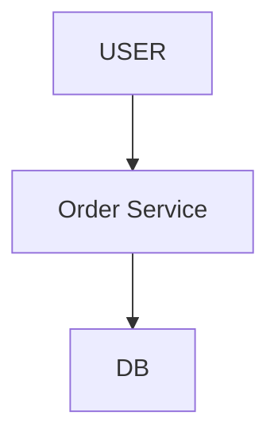
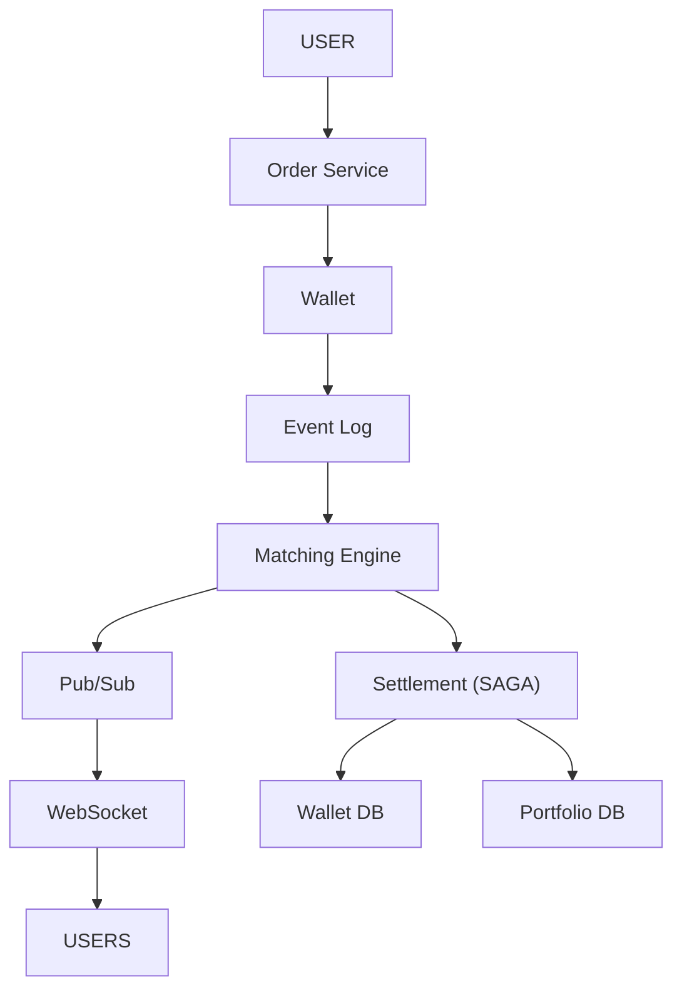
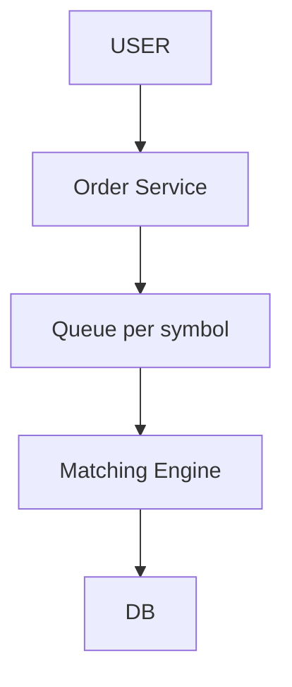
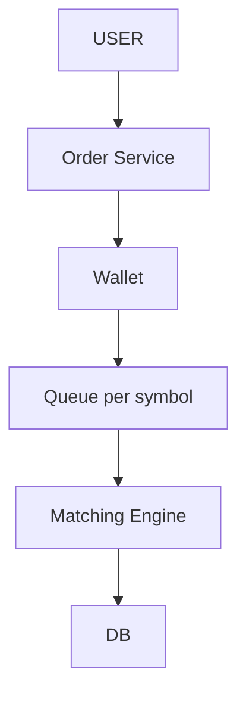
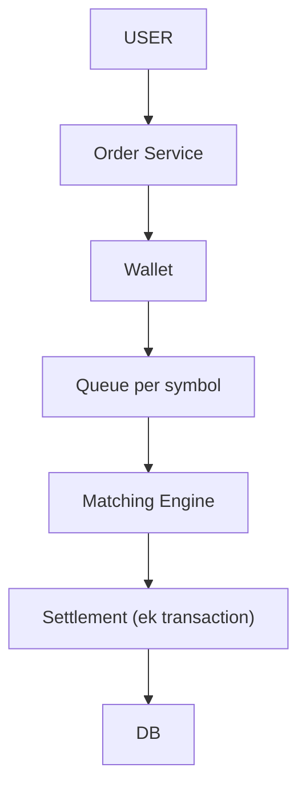
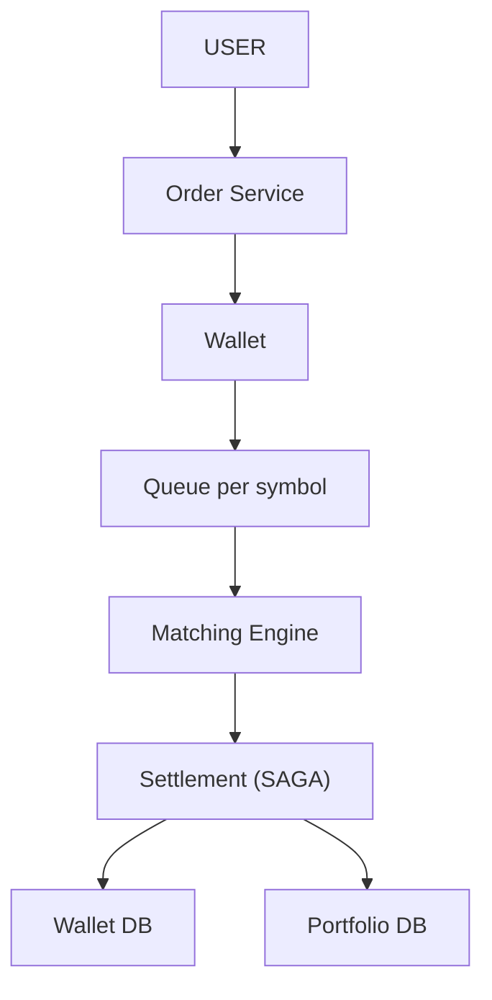
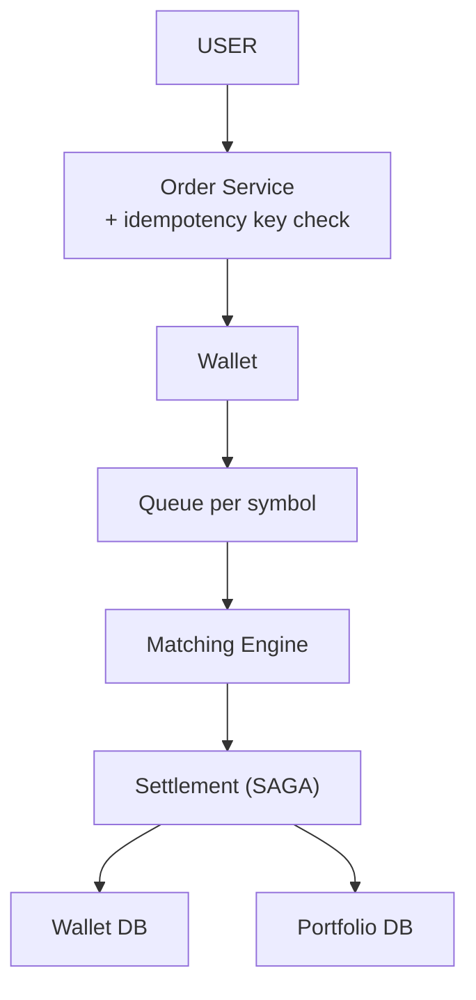
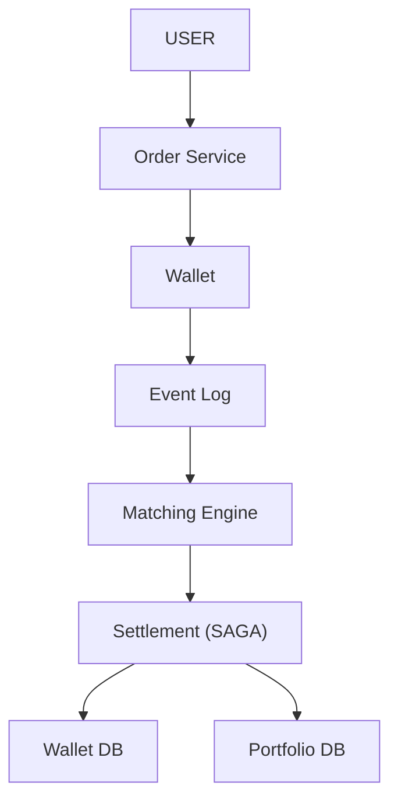
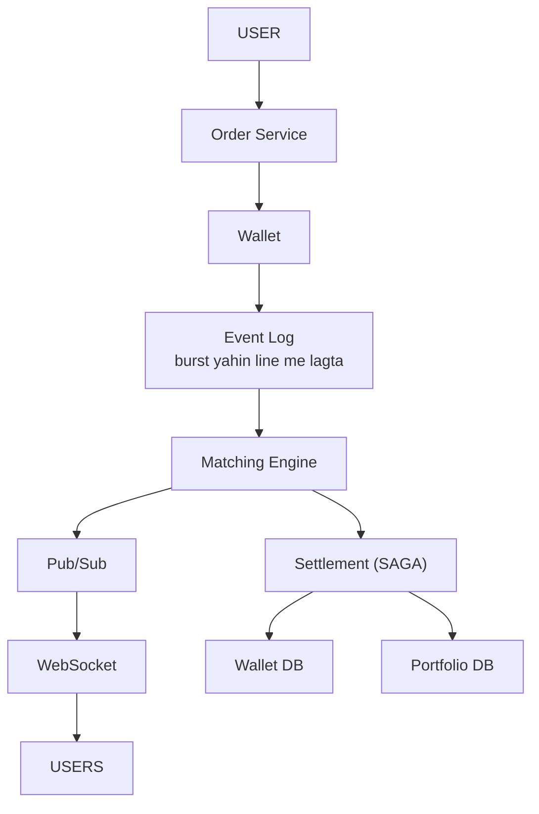

# Stock Broker / Trading Platform

> User BUY / SELL order de -> system MATCH kare -> paisa + share sahi move ho -> live price dikhe.
> Is design ka dil: **paisa = strong consistency** + **matching = microseconds**.
> Finance interview GOLD (JP / GS): consistency, ACID, idempotency, ledger, audit — FAANG-hyperscale nahi. Konovo fraud-domain se bridge.

---

## TASVEER (ByteByteGo / Alex Xu · CC BY-NC-ND 4.0)


Source: [Design Stock Exchange](https://bytebytego.com/guides/design-stock-exchange/)


Source: [Low Latency Stock Exchange](https://bytebytego.com/guides/low-latency-stock-exchange/)

---

## SHURU — poocho + numbers

```
POOCHO:  "Trading bada hai — matching, price feed, risk, settlement. Kis pe focus karein?"
         -> order MATCHING + paise / share ka SETTLEMENT. Risk / margin / IPO / mutual funds scope me nahi.
         LIMIT + MARKET dono? · PARTIAL fill chalega? · hum EXCHANGE hain ya BROKER (jo exchange ko bhejta)?

FR:      buy / sell · order match · paisa + share move · live price · cancel / status
NFR:     paisa CONSISTENT (strong, kabhi eventual nahi) · FAST · FAIR (pehle aaya pehle) · audit

NUMBERS: ~50 lakh users · ~50 lakh orders / din · normal ~250 / sec, market khulte hi PEAK 10,000+ burst
         price feed = CRORE reads / sec (sab dekh rahe)
         -> matching RAM me · price feed PUSH (poll nahi) · paisa SQL + ACID
         speed wala + temporary (order book) = RAM · paisa wala + permanent (wallet / ledger) = SQL / ACID
```

---

## ════ MOCK SE PEHLE: SIRF YE CARD PADHO ════

## MOCK CUE — har dikkat ek card

> Har dikkat ek card: KAHANI (kya toota) -> ILAAJ -> ANDAR KAISE (dabba andar se kaise chalta) ->
> ISKE BAAD KYA TOOTEGA (interviewer yahin ghusta: dabba lagaya, ab kya). Number = us dikkat ka poora hissa neeche.

#### DABBA 0: SABSE SIMPLE (yahan se shuru, phir "kahan tootega")
```
SOLUTION: order DB me rakho, milta-julta sell dhoondho -> match
```


#### 0 SHURU: ORDER BOOK KAISE MATCH KARTA
```
KAHANI:  TCS ke liye bechne wale aur khareedne wale line me. Kaun kisse milega?
ILAAJ:   PRICE-TIME priority.
ANDAR KAISE:
         SELLERS: sabse sasta upar (3000, 3001, 3005 ...) · BUYERS: sabse mehnga upar (2999, 2998 ...)
         match jab best BUY >= best SELL. Same price pe -> jo PEHLE aaya (seq number) wo pehle.
ISKE BAAD KYA TOOTEGA:
  - book kahan rakhoge, DB me?
      -> nahi, RAM me (microseconds). DB me har order = ms, matching dheema.
  - partial match (BUY 10, SELL sirf 6)?
      -> 6 match, 4 book me pade rahe (aur unka paisa blocked rahe).
```

#### [1](#d1) DO ORDER EK HI STOCK PE EK SAATH
```
KAHANI:  seller ke 10 share. Ramesh BUY 10 + Mohan BUY 10 ek saath. Do thread dono ko match -> 20 bik gaye, the 10.
ILAAJ:   har STOCK ki EK queue + EK thread. Order ek ke baad ek. Lock nahi chahiye.
ANDAR KAISE:
         TCS -> thread T1 · INFY -> T2. Ek symbol hamesha ek hi thread pe -> race ho hi nahi sakti.
ISKE BAAD KYA TOOTEGA:
  - hazaar symbol = hazaar thread?
      -> nahi. Thode thread, har ek kai symbol (hash(symbol) % threads).
  - "DB ka ACID rok dega"?
      -> nahi. Matching DB me hai hi nahi, aur ACID akela check-phir-likho race nahi rokta.
  - wo thread atak gaya (GC pause)?
      -> us symbol ke order line me rukenge. Low-GC Java + standby jo log se uth sake.
```

#### [2](#d2) WALLET 50K, 30K-30K KE DO ORDER (DOUBLE SPEND)
```
KAHANI:  wallet me 50k. Ek saath 30k ke DO order. Dono match -> 60k kharch, the 50k.
ILAAJ:   order lagte hi paisa BLOCK (hotel deposit). Available = total - blocked.
ANDAR KAISE:
         EK atomic update:
         UPDATE wallet SET blocked = blocked + x WHERE total - blocked >= x    -> 0 row = REJECT
         match hua -> sach me kato · cancel -> unblock.
ISKE BAAD KYA TOOTEGA:
  - partial match (10 me se 6)?
      -> 6 ka paisa kato, baaki 4 ka blocked rahe.
  - block kiya, order 3 din pada raha?
      -> order ki expiry (day order shaam ko khatam) -> unblock.
  - pehle SELECT balance, phir UPDATE?
      -> do request dono ne 50k padha -> dono pass. Isliye check + update EK hi query me.
```

#### [3](#d3) SETTLEMENT KE BEECH CRASH
```
KAHANI:  match hua. Buyer ka 30k kata, seller ko milne se pehle crash -> 30k hawa me.
ILAAJ:   saare step EK DB transaction me (@Transactional): sab ya kuch nahi. + double-entry LEDGER.
ANDAR KAISE:
         BEGIN  buyer -30k, +10 share · seller +30k, -10 share  COMMIT. Crash beech me -> rollback.
         ledger: har settlement ki do row, buyer DEBIT 30k, seller CREDIT 30k -> sabka jod hamesha 0.
ISKE BAAD KYA TOOTEGA:
  - balance har baar ledger jod ke nikaloge?
      -> nahi. Balance alag column, usi transaction me badalta. Ledger = sach ka record / audit.
  - paisa me eventual chalega (like count jaisa)?
      -> nahi. Paisa = hamesha strong consistency.
```

#### [4](#d4) PAISA WALLET DB ME, SHARE PORTFOLIO DB ME
```
KAHANI:  ab do alag DB. Ek transaction dono pe nahi chalta. Paisa kata, share daalne se pehle crash.
ILAAJ:   SAGA: har step apne DB me commit. Koi step fail -> pichhle ka ULTA step (paisa wapas).
         (flight book, hotel nahi mila -> flight cancel + refund.)
ANDAR KAISE:
         Settlement (orchestrator) har step ka haal DB me: STARTED -> WALLET_DONE -> PORTFOLIO_DONE.
         gira -> uthte hi DB dekh ke wahin se aage, ya ulta.
         wallet -30k OK -> portfolio +10 FAIL -> wallet +30k wapas.
ISKE BAAD KYA TOOTEGA:
  - 2PC kyun nahi?
      -> dono DB lock pakad ke "commit?" ka intezaar. Coordinator gira = dono atke + har step dheema.
         SAGA me lamba lock nahi. Keemat: thodi der galat haalat dikh sakti (paisa kata, share abhi nahi).
  - ulta step (paisa wapas) bhi fail?
      -> retry karte raho (step idempotent) + alert. Paise ka ulta step kabhi chhodna nahi.
  - orchestration ya choreography?
      -> orchestration: ek Settlement sab chalaye -> paise me saaf dikhta kaun step kahan atka.
```

#### [5](#d5) BUY DO BAAR DABA / NETWORK RETRY
```
KAHANI:  user ne BUY do baar daba, ya network ne retry maara -> ek order do baar, paisa do baar.
ILAAJ:   IDEMPOTENCY KEY. Key pehle aa chuki -> wahi purana result, naya order nahi.
ANDAR KAISE:
         client har order pe ek UUID, retry pe WAHI. Server: INSERT idempotency(key, response), key UNIQUE.
         naya -> insert hua, order lagao, response save · pehle se -> UNIQUE fail -> saved response wapas.
         do ek saath -> DB unique ek ko hi jeetne deta.
ISKE BAAD KYA TOOTEGA:
  - pehli request abhi chal rahi, retry aa gaya?
      -> key IN_PROGRESS -> retry ko 409 / "thoda ruko". DONE pe saved result.
  - key kitne din?
      -> ~24 ghante (retry window), phir saaf.
```

#### [6](#d6) ORDER BOOK RAM ME, CRASH = SAB GAYAB
```
KAHANI:  10:15 pe matching server gira. TCS book me 4,000 pending order the, RAM me -> gayab.
ILAAJ:   har order PEHLE append-only LOG me (seq number ke saath), PHIR book me. Crash -> log REPLAY.
         (cricket: scoreboard gaya, scorer ke register se sab wapas.)
ANDAR KAISE:
         naya server log #1 se aakhri tak chalata -> ek thread hai, to book bilkul waisi.
         SEQUENCER har order pe badhta number: Ramesh #501, Mohan #502 -> #501 pehle.
         key = symbol -> ek stock ek partition, kram me. Yahi log = AUDIT (regulator, saalon tak, badal nahi sakte).
ISKE BAAD KYA TOOTEGA:
  - timestamp se kram kyun nahi?
      -> do server ki ghadi alag, do order same millisecond. Seq number pakka.
  - 1 crore event replay, kitna time?
      -> har kuch minute book ka SNAPSHOT + uske baad ka log -> replay chhota.
  - seconds me wapas chahiye?
      -> HOT STANDBY: doosra server log padhta rehta, book RAM me taiyaar, primary gira to le leta.
  - crash pe kya-kya bachana? (do jagah bolna)
      -> matching (RAM) = log replay · settlement (DB) = rollback / SAGA. Sirf ek bola = aadha.
```

#### [7](#d7) LAKHON LOG LIVE PRICE DEKH RAHE
```
KAHANI:  har client har second "price kya hai?" poochh raha (polling) -> server dead.
ILAAJ:   WEBSOCKET + PUB/SUB (Redis). Connection ek baar khula, price badle tab server khud bheje.
ANDAR KAISE:
         har symbol = channel (price:TCS). Jis WebSocket server pe TCS dekhne wala user, wo SUBSCRIBE karta.
         price feed PUBLISH -> Redis sab subscribed servers ko -> wo apne users ko push.
         Redis kuch store nahi karta -> reconnect pe current price alag se.
ISKE BAAD KYA TOOTEGA:
  - price second me 1000 baar badla, sab bhejoge?
      -> nahi, CONFLATE: har ~100 ms sirf latest.
  - Kafka kyun nahi?
      -> Kafka store + replay karta. Yahan purana price bekaar, sirf latest chahiye.
  - SSE kyun nahi?
      -> SSE bhi chalta (sirf server -> client). WebSocket isliye ki order bhi isi connection pe.
  - ek WebSocket server pe kitne user?
      -> lakh ke aas-paas (event loop). Zyada -> aur server, LB se baanto.
```

#### [8](#d8) MARKET KHULTE HI AKELE TCS PE LAKHON ORDER
```
KAHANI:  9:15 baje akele TCS pe lakhon order. Ek stock = ek thread, baant nahi sakte.
ILAAJ:   book mat todo (do thread = double match + kram toota). Aage ka LOG bheed ko line me rakhe (BACKPRESSURE).
         Drop nahi, bas thodi latency.
ANDAR KAISE:
         ek thread RAM me, bina lock -> lakhon order / sec (LMAX ka design yahi).
         scale stocks ke BEECH (alag thread), ek stock ke andar kabhi nahi.
ISKE BAAD KYA TOOTEGA:
  - line me order, user ko kya dikhe?
      -> "ACCEPTED" turant, "FILLED" jab match. Dono status.
```

```
AAKHRI DABBE (sab dikkat ke baad):
  User -> Order Svc (validate + idempotency key) -> Wallet (paisa BLOCK)
  -> Event Log / Kafka (seq no., key = symbol) -> Matching engine (1 thread / symbol, order book RAM)
  -> Settlement (ek txn, ya kai DB me SAGA) -> Wallet DB + Portfolio DB
  prices: Matching -> Pub/Sub -> WebSocket -> users

DB:  paisa / orders = SQL + ACID · order book = RAM · ledger = append-only
     portfolio / history = read replica

END ME POOCHEGA:
  "10x?"            -> Order Svc stateless (box + LB) · read replica · Matching ko copy NAHI, SHARD BY SYMBOL
                       · Kafka partition (key = symbol) · WebSocket box badhao
  "Matching engine kyun ek thread?" -> do copy = do book = double match; ek symbol ek engine pe
  "Engine crash?"   -> event log me seq no. se replay, book wapas ban jaati (audit bhi wahi)
  "Limit ya market?" -> LIMIT = price pakka · MARKET = time pakka
```

AAKHRI DABBE ki tasveer:



---

## ════ DETAIL: HAR DIKKAT KA POORA EXPLANATION ════

> Card me koi baat samajh na aaye, to uska poora "kaise / kyun" aur diagram yahan hai.

---

## DABBA 0 — sabse simple

```
SOLUTION: order DB me rakho, milta-julta sell dhoondho -> match
```


---

<a id="d1"></a>

## DIKKAT 1 — do order ek hi stock pe ek saath (RACE)

```
DIKKAT:   do log ek hi stock pe ek saath order -> do thread dono ko match kar dein to jitne share the usse
          zyada bik jaate = DOUBLE MATCH.

SOLUTION: (1) Har stock (symbol) ki EK queue + EK thread -> order ek ke baad ek match, race ho hi nahi sakti.
          (2) Order book RAM me, microseconds me kaam. Lock nahi chahiye (lock = slow + deadlock ka darr).

NAYA:     Queue per symbol · Matching Engine (buy aur sell order milaane wala, order book RAM me)
```
```
BOARD PE: seller ke 10 share · Ramesh BUY 10 + Mohan BUY 10 ek saath -> 20 bik gaye, the 10
          TCS -> T1 · INFY -> T2

POOCHEGA: "Two users order the same stock at the same time — what happens?"
DHYAAN:   "DB ACID rok dega" NAHI — matching DB me hai hi nahi, aur ACID akela check-phir-write race nahi rokta
BOL:      "Orders for one symbol go into one queue handled by one thread, so they're matched one after
           the other, never in parallel — no lock needed."

AGLA SAWAAL (tere jawab se):
  "Hazaar symbol = hazaar thread?"
   -> nahi, thode thread, har thread kai symbol (hash(symbol) % threads). Ek symbol hamesha ek hi thread pe
  "Woh thread hi atak gaya (GC pause)?"
   -> us symbol ke order line me rukenge; isliye Java me chhoti memory / low-GC, aur ek standby jo log se uth sake
```


---

<a id="d2"></a>

## DIKKAT 2 — wallet me 50k, banda 30k-30k ke DO order daal de (DOUBLE SPEND)

```
DIKKAT:   wallet me jitna paisa usse zyada ke do order ek saath, dono match ho gaye = DOUBLE SPEND.

SOLUTION: (1) Order lagte hi paisa BLOCK karo, kaato nahi (hotel deposit jaisa). Available = total - blocked.
          (2) DB me EK atomic update: block tabhi badhe jab available bacha ho (0 row = reject).
          (3) Match hua -> sach me kato · cancel -> unblock.

NAYA:     Wallet (user ka paisa: total / blocked / available)
```
```
BOARD PE: total 50k · blocked 30k · available 20k -> 30k ka doosra order REJECT
          UPDATE wallet SET blocked = blocked + x WHERE total - blocked >= x   (0 row = reject)

AGLA SAWAAL (tere jawab se):
  "Block kiya, order 3 din pending pada raha?"
   -> order ki expiry (day order shaam ko khatam) -> unblock
  "Partial match (10 me se 6 bike)?"
   -> 6 ka paisa kato, baaki 4 ka blocked wahi rahe
```


---

<a id="d3"></a>

## DIKKAT 3 — settlement ke beech crash

```
DIKKAT:   settlement ke beech crash: buyer ka paisa kata, seller ko milne se pehle crash -> paisa gayab.

SOLUTION: (1) Saare step EK transaction me (ACID, @Transactional) -> sab ya kuch nahi.
          (2) LEDGER double-entry: jitna ek se gaya utna doosre ko mila (audit).
          Paisa = hamesha strong consistency (like-count jaisa eventual nahi).

NAYA:     Settlement (match ke BAAD paisa + share sach me badalne wala dabba — kaam ka naam; yahan wo kaam
          EK TRANSACTION se hota. dikkat 4 me do DB ho jaate, tab wahi kaam SAGA se. Settlement = KYA, transaction / SAGA = KAISE)
```
```
BOARD PE: BEGIN  buyer -30k +10 share · seller +30k -10 share  COMMIT

AGLA SAWAAL (tere jawab se):
  "Double-entry ledger kaise dikhta?"
   -> har settlement ki do row: buyer DEBIT 30k, seller CREDIT 30k. Sab rows ka jod hamesha 0 -> galti turant dikhe
  "Balance ledger se har baar jodoge?"
   -> nahi, balance alag column jo ussi transaction me badalta; ledger = sach ka record / audit
```


---

<a id="d4"></a>

## DIKKAT 4 — paisa Wallet DB me, share Portfolio DB me (alag DB)

```
DIKKAT:   paisa Wallet DB me, share Portfolio DB me -> do alag DB pe ek transaction chal hi nahi sakti.
          Paisa kata, share dalne se pehle crash = paisa gaya, share nahi.

SOLUTION: SAGA: (1) Kaam chhote local steps me, har step apne DB me commit.
                (2) Koi step fail -> pichhle steps ka ULTA step (compensate): paisa wapas.
              (Flight ho gayi, hotel nahi mila -> flight cancel + refund.)
          ACID = ek DB, turant · SAGA = kai DB / service, code se undo.

BADLA:    ek [ DB ] -> do me bata: Wallet DB + Portfolio DB · Settlement ab SAGA chalata

KYUN SAGA (2PC nahi):
          2PC: coordinator dono DB se "ready?" poochta, dono lock pakad ke rukte, phir "commit"
          -> coordinator beech me gira to dono DB lock pakde atke · har step pe network intezaar = dheema
          SAGA: har step apna local commit turant, fail pe ulta step -> koi lamba lock nahi
          keemat: beech me thodi der galat haalat dikh sakti (paisa kata, share abhi nahi)
KAISE (state kahan):
          orchestrator (Settlement) har step ka haal apne DB me likhta: STARTED -> WALLET_DONE -> PORTFOLIO_DONE
          orchestrator gira -> uthte hi DB dekh ke wahin se aage / ulta
```
```
BOARD PE: wallet -30k ✓ -> portfolio +10 ✗ -> COMPENSATE: wallet +30k wapas

AGLA SAWAAL (tere jawab se):
  "Compensation (wallet +30k wapas) bhi fail ho gaya?"
   -> retry karte raho (idempotent step) + alert; paisa ka ulta step chhodna nahi
  "Orchestration ya choreography?"
   -> orchestration (ek Settlement sab chalaye) -> paisa me saaf dikhta kaun-sa step kahan atka
      choreography = har service event sun ke apna kare, simple flow me theek
```


---

<a id="d5"></a>

## DIKKAT 5 — user ne BUY do baar daba diya / network ne retry maara

```
DIKKAT:   user ne BUY do baar daba diya / network ne retry maara -> ek order do baar, do baar paisa.

SOLUTION: IDEMPOTENCY KEY har request ke saath. Key ho chuki -> wahi purana result, naya order nahi.

NAYA:     koi dabba nahi — Order Service me key check juda

KAISE:    client har order pe ek key banata (UUID), retry pe WAHI key
          server: INSERT idempotency(key, response) -> key UNIQUE constraint
          naya = insert ho gaya, order lagao, response save · pehle se = UNIQUE fail -> saved response wapas
          do request ek saath aayi -> DB unique ek ko hi jeetne deta (atomic check-and-set)
```
```
AGLA SAWAAL (tere jawab se):
  "Pehli request abhi chal hi rahi thi aur retry aa gaya?"
   -> key ka status IN_PROGRESS -> retry ko '409 / thoda ruko' -> DONE hone pe saved result
  "Key kitne din rakhoge?"
   -> 24 ghante jaisa (retry window), phir saaf
```


---

<a id="d6"></a>

## DIKKAT 6 — order book RAM me hai, server crash = sab gayab

```
DIKKAT:   order book RAM me -> matching server gira to book aur saare pending order gayab.

SOLUTION: (1) EVENT LOG / SEQUENCER: har order PEHLE append-only log me (disk / Kafka, seq number ke saath),
              PHIR book me.
          (2) Crash -> naya server log REPLAY karta -> ek thread hai, to book bilkul waisi ban jaati.
              (Cricket: scoreboard gaya, scorer ke register se sab wapas.)
          (3) Key = symbol -> alag stocks parallel.
          Bonus: yahi log AUDIT trail bhi. Logging = engineer ke debug ke liye, kuch din, badal sakte.
          Audit = regulator ke liye, kaun-kya-kab, saalon tak, badla nahi ja sakta. Ek log, do kaam.

BADLA:    Queue per symbol -> Event Log (wahi queue, ab disk pe likhi jaati + seq no. + key = symbol)
```
```
BOARD PE: Ramesh 10:00:01, Mohan 10:00:02, dono BUY TCS @3000 -> Ramesh = #501, Mohan = #502
          key = TCS -> ek partition, isi kram me -> #501 pehle = Ramesh ko share

POOCHEGA: "How do you keep orders in the right sequence?"
DHYAAN:   TIMESTAMP nahi — do server ki ghadi alag, do order same millisecond
BOL:      "A sequencer stamps every order with an increasing sequence number and writes it to the log,
           keyed by symbol so one stock's orders stay in one partition, in order."

POOCHEGA: "What if the server crashes in the middle?"
DHYAAN:   DO jagah: (1) matching (RAM) -> log replay   (2) settlement (DB) -> rollback / SAGA
          sirf ek bola to AADHA · pehle matching (design ka dil)
MISAAL:   10:15 pe matching server gira, TCS book me 4,000 pending order
          naya server -> log #1 se #9,87,654 tak replay -> book bilkul waisi (single thread = same result)
          usi waqt ek settlement aadha (buyer -30k, seller +30k nahi) -> DB rollback -> dono wapas
BOL:      "If the matching engine dies, I rebuild the book by replaying the event log. If settlement
           dies midway, a single-DB transaction rolls back; across services a saga compensates."

AGLA SAWAAL (tere jawab se):
  "Replay me 1 crore event, kitna time?"
   -> roz/har kuch minute book ka SNAPSHOT + uske baad ka log -> replay chhota
  "Hot standby rakhoge?"
   -> haan, doosra server log padhta rehta (book RAM me taiyaar), primary gira to seconds me le leta
```


---

<a id="d7"></a>

## DIKKAT 7 — lakhon log live price dekh rahe

```
DIKKAT:   lakhon log live price dekh rahe, har client baar-baar poochh raha (polling) -> server dead.

SOLUTION: WEBSOCKET + PUB/SUB: connection ek baar khulta, price badle tab server khud bhejta.
          Sirf LATEST price chahiye, purana store nahi; reconnect pe current price le lo.

NAYA:     Pub/Sub (ek price update, sab subscriber tak) · WebSocket (khula connection, server khud price bheje)

KAISE:    har symbol = ek channel (price:TCS)
          WebSocket server pe jis user ne TCS dekha, wo server price:TCS SUBSCRIBE karta
          price feed -> price:TCS pe PUBLISH -> Redis sab subscribed servers ko deta -> wo apne users ko push
          Redis kuch store nahi karta -> reconnect pe user current price alag se le leta
KYUN YE:  Kafka -> store + replay karta, yahan purana price bekaar, sirf latest chahiye
          SSE bhi chal jaata (sirf server -> client); WebSocket isliye ki order bhi isi connection pe
```
```
AGLA SAWAAL (tere jawab se):
  "Price second me 1000 baar badla, sab bhejoge?"
   -> nahi, conflate: har ~100ms sirf latest bhejo, beech ke chhodo
  "Ek WebSocket server pe kitne user?"
   -> lakh ke aas paas (event loop); zyada user = zyada servers, LB se baant
```


---

<a id="d8"></a>

## DIKKAT 8 — market khulte hi AKELE TCS pe lakhon order

```
DIKKAT:   market khulte hi akele ek stock pe lakhon order. Ek stock = ek thread, to baant nahi sakte.

SOLUTION: (1) Book mat todo: do thread = double match wapas + kram toot-ta. Ek thread RAM me, bina lock,
              bahut tez (LMAX ka design yahi).
          (2) Aage ka event log burst sambhaalta (BACKPRESSURE): order line me, thread apni speed se.
              Spike me drop nahi, bas thodi latency.
          Scale stocks ke BEECH (alag thread), ek stock ke andar kabhi nahi.

NAYA:     koi dabba nahi — Event Log hi kaam aaya
```
```
AGLA SAWAAL (tere jawab se):
  "Ek thread kitna jhel leta?"
   -> RAM me, lock ke bina -> lakhon order / sec (LMAX ka design yahi)
  "Event log me order kitni der line me rahe to user ko kya?"
   -> order 'ACCEPTED' turant, 'FILLED' jab match hua -> user ko dono status dikhte
```


---

## 10x SCALE — har dabba alag

```
Order Service (stateless)   -> zyada server + LOAD BALANCER
Portfolio / history         -> READ REPLICA (AWS RDS)
Matching (stateful)         -> LB + copy NAHI (do copy = do book = double match)
                               -> SHARD BY SYMBOL: TCS ek engine pe, INFY doosre pe
Kafka                       -> khud scale nahi hota -> PARTITION badhao (key = symbol)
Price feed                  -> WebSocket server badhao

POOCHEGA: "How would you scale this to 10x users?"
BOL:      "Stateless services scale horizontally behind a load balancer, read-heavy data gets replicas.
           The matching engine is stateful, so I shard it by symbol — each symbol lives on one engine."
```

---

## POOCHE TO (deep-dive)

```
ORDER BOOK:  SELLERS: sasta upar (3001, 3003...)   BUYERS: mehnga upar (2998, 2995...)
             match jab  best-bid >= best-ask
             PRICE-TIME priority: behtar price pehle, same price -> jo pehle aaya

LIMIT  = "3000 ya behtar, warna rukunga"   -> price pakka
MARKET = "jo bhav hai, abhi do"             -> time pakka
kab kya: sahi daam chahiye, jaldi nahi -> LIMIT · turant ghusna / nikalna -> MARKET

PARTIAL FILL: BUY 10, mile 6 -> 6 match, 4 pending -> naya seller @3000 aaya -> 4 bhi bhare
              FILLED / PARTIALLY FILLED / OPEN (Zerodha / Groww / NSE / BSE me yahi)

DB: money / orders = SQL + ACID · order book = RAM · ledger = append-only

API: POST /order {stock, side, qty, price, type, idempotencyKey} · DELETE /order/{id} · GET /order/{id}
     WS /prices?symbol=
```

---

## AAKHRI DABBA + WRAP

```
Order Service = validate + idempotency · Wallet = paisa BLOCK · Event Log = seq no. + replay + audit
Matching = 1 thread / symbol, book RAM, shard by symbol · Settlement = ek txn / kai DB = SAGA
```
```
BOL: "Order Service validates and checks the idempotency key, Wallet blocks the money, every order
      goes into an append-only log with a sequence number, and a single-threaded matching engine per
      symbol keeps the book in memory. Settlement is one transaction, or a saga across services.
      Prices go out over WebSocket via pub/sub. The log gives crash recovery and an audit trail.
      Next: stop-loss, circuit breakers, real-time risk checks, regulatory reporting."
```


ARCHETYPE C (transactional) · CONCEPTS: [db-what-when](../../FOUNDATIONS/09_databases_what_when.md) · [CAP](../../FOUNDATIONS/08_cap_theorem.md) · saath: [payment](../06_payment_system/06_payment_system.md) · [← MASTER SHEET](../../00_MASTER_SHEET.md)
