# Stock Broker / Trading Platform

> User BUY / SELL order deta hai -> system order MATCH karta hai -> paisa aur share sahi jagah pahunchte hain -> sabko live price dikhta hai.
> Is design ka dil: **paisa kabhi galat nahi (strong consistency)** + **matching bahut tez (RAM me, microseconds)**.
> Finance interview me (JP / GS) yahi poochte hain: consistency, ACID, idempotency, ledger, audit.

---

## KAHANI (ek din, mera ek TCS order; har dikkat se design me ek dabba judta)

```
   KYA HUA                                     ILAAJ                                DABBA JUDA
1  ek tap, network gaya, do order lag gaye  -> IDEMPOTENCY KEY (wahi id dobara)     Order Service
2  wallet 50k, 30k-30k dono order pass      -> check + block EK atomic query        Wallet
3  Suresh ke 10, mujhe aur Mohan dono ko    -> ek symbol ek thread, book RAM me     Matching Engine
4  9:15 sab TCS pe toot pade                -> baanto mat, ek thread kaafi, line    Queue
5  10:15 server gira, book gayab            -> pehle log, phir book; gira = replay  Event Log (= wahi line)
6  mera 30k kata, Suresh ko mila nahi       -> ek transaction: chaaron ya koi nahi  Settlement
7  dopahar INFY 20k kata, share nahi aaye   -> har step ka haal, aage badho         Wallet DB + Portfolio DB
8  10 lakh log price poochh rahe            -> push (TV jaisa), WebSocket           Pub/Sub + WebSocket

POORA DESIGN (upar ke dabbe kram se):
   User -> Order Service (id) -> Wallet (block) -> Event Log -> Matching (ek stock ek thread)
        -> Settlement -> Wallet DB + Portfolio DB
   price: Matching -> Pub/Sub -> WebSocket -> users
```

---

## TASVEER (ByteByteGo / Alex Xu · CC BY-NC-ND 4.0)


Source: [Design Stock Exchange](https://bytebytego.com/guides/design-stock-exchange/)


Source: [Low Latency Stock Exchange](https://bytebytego.com/guides/low-latency-stock-exchange/)

---

## SHURU: pehle poocho, phir numbers

```
POOCHO:  "Trading bada hai: matching, price feed, risk, settlement. Kis pe focus karein?"
         -> order MATCHING + paise / share ka SETTLEMENT (len-den poora karna).
            Risk / margin / IPO / mutual fund scope me nahi.
         LIMIT aur MARKET dono order? · aadha bhara (partial fill) chalega?
         hum EXCHANGE hain (khud match karte) ya BROKER (exchange ko order bhejte)?
         Is design me: hum broker + apna matching (exchange jaisa). Asli India me Groww / Zerodha order
         NSE ko bhejte, matching NSE karta; wallet block broker ka kaam.

KYA KARE (FR):    buy / sell · order match · paisa + share move · live price · cancel / status
KAISA CHALE (NFR): paisa hamesha sahi (strong, kabhi "thodi der baad sahi" nahi) · tez
                   · imaandar (jo pehle aaya wo pehle) · har cheez ka record (audit)

NUMBERS (andaaza):
   ~50 lakh user · ~50 lakh order / din, market ~6 ghante (~20,000 second) khulta -> ~250 order / second
   9:15 baje market khulte hi jhatka: 10,000+ order / second
   price dekhne wale bahut zyada: ~10 lakh log app khula rakhte, har second naya price -> ~10 lakh / second
   -> matching RAM me · price PUSH karo (har user ka baar-baar poochhna nahi)
   -> jo tez chahiye aur thodi der ka hai (order book) = RAM
   -> jo paisa hai aur hamesha ka hai (wallet / ledger) = SQL DB + ACID
```

---

## ════ MOCK SE PEHLE: SIRF YE CARD PADHO ════

> Har card: pehle PEELA DABBA dekho (scene + ilaaj). Yaad aa gaya -> aage. Nahi aaya -> neeche
> Heading = dikkat, KIYA = jawab, tasveer dekho. AAGE POOCHEGA sirf jab interviewer aage poochhe.

#### DABBA 0: SABSE SIMPLE (yahan se shuru, phir "kahan tootega")
```
Order service har order DB me likhe, aur DB me milta-julta SELL dhoondh ke match kare.
```


#### SHURU: ORDER BOOK KAISE MATCH KARTA
```
DIKKAT     TCS ka share: kuch bechna chahte (SELL), kuch khareedna (BUY).
           Kiska sauda kisse hoga, aur kis daam pe?
HAL        ORDER BOOK, do taraf: bechne wale sasta upar, khareedne wale mehnga upar. Sauda jab top
           khareedar >= top bechne wala; daam pehle se book wale ka; same daam pe jo pehle aaya.
```
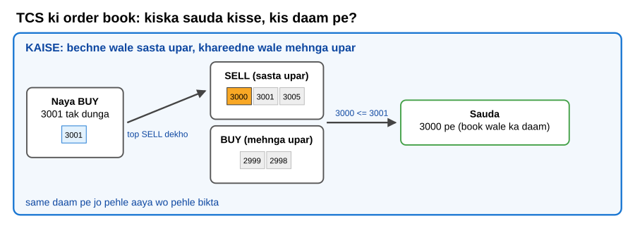

```
AAGE POOCHEGA:
  NIYAM: sauda tabhi jab top khareedar >= top bechne wala; daam book wale ka, barabar pe pehle wala.
         Bacha hissa book me khada rehta, uska paisa ruka rehta.
  SAFAR (ek BUY order, har mod pe kya):
  sab theek              -> BUY 3001, top SELL 3000 -> sauda 3000 pe (book wale ka daam)
  BUY 2998 aaya          -> top SELL 3000 se kam -> sauda nahi, book me khada (mehnga upar)
  same daam, do log      -> jo pehle aaya (chhota number) pehle
  mujhe 10, uske 6       -> 6 ka sauda; baaki 4 book me khade, un 4 ka paisa ruka
```

#### 1 Maine ek baar dabaya, order do lag gaye
KIYA: screen khulte ek id, dobara bhejne pe wahi id (idempotency key)


```
AAGE POOCHEGA:
  NIYAM: ek id = ek kaam: id app banata, server UNIQUE se pakadta; wahi id dobara = purana jawab,
         kaam dobara nahi. User ko ek hi order dikhe, app chahe kitni baar bheje.
  SAFAR (ek tap ka order):
  sab theek                -> id screen khulte bani, server UNIQUE pe likhe, order ek
  wahi id dobara aayi      -> purana jawab: order ek hi
  wahi id, pehli chal rahi -> "thoda ruko" (IN_PROGRESS, 409); ho gaya to saved jawab
  id kab tak yaad          -> ~24 ghante, phir saaf: retry minute me hi aata
```

#### 2 Wallet me 50k the, phir bhi 30k-30k ke dono order lag gaye
KIYA: check aur block ek hi query me (atomic UPDATE)


```
AAGE POOCHEGA:
  NIYAM: 'hai?' aur 'block' ek hi UPDATE (DB ke andar), kitni bhi machine ho; 0 row = reject turant dikhao.
         'blocked' badhe naye order se, ghate sauda / cancel / umar khatam se.
  SAFAR (ek order ka paisa):
  sab theek                           -> ek UPDATE: check + block ek saath (total - blocked >= 30k)
  dono ek saath aaye                  -> ek jeete, doosre ko 0 row -> turant reject
  block kiya, order cancel            -> block hatao
  block kiya, sauda aadha             -> jitna bika utna kata, baaki blocked: order abhi khula
  block kiya, bhav pata nahi (MARKET) -> aakhri bhav + thoda upar block, sauda ke baad bacha wapas
```

#### 3 Suresh ke paas 10 the, mujhe aur Mohan dono ko 10 mil gaye
KIYA: ek share ke saare order ek line, ek hi thread (ek symbol ek thread)


```
AAGE POOCHEGA:
  NIYAM: ek stock ki book ko ek waqt ek hi haath (ek thread): doosra line me ruke, race hi nahi; thread
         atka to sirf us stock ki line rukti, baaki stock chalte, standby taiyaar.
  SAFAR (Suresh ke 10 share):
  sab theek                 -> TCS ka har order ek line, ek thread (T3), ek-ek match
  main + Mohan ek saath     -> pehla le gaya 10, doosre ko 0
  ek thread atka (GC pause) -> sirf TCS ki line rukti, INFY apne thread pe chalta
```

#### 4 9:15 baje sab TCS pe toot pade
KIYA: TCS ki ek line, ek thread RAM me tez nipta


```
AAGE POOCHEGA:
  NIYAM: ek stock = ek line; badhao stocks ke BEECH, ek stock ke andar kabhi nahi. User ko ACCEPTED
         turant, FILLED sauda hone pe; line lambi = der, order khota nahi (line me hai).
  SAFAR (9:15 ki bheed):
  sab theek                    -> TCS order line me, ek thread RAM me lakhon / sec nipta
  line me lag gaya             -> app me ACCEPTED turant; FILLED sauda hone pe
  line lambi                   -> der, par line me hai (khota nahi)
  baanto mat, to badhaye kaise -> stocks ke BEECH (TCS ek thread, INFY doosra), TCS ke andar nahi
```

#### 5 Server gira, poori order book gayab
KIYA: har order pehle log me, phir book; gira to log dobara chalao (replay)


```
AAGE POOCHEGA:
  NIYAM: log hi sach, book uski photo: pehle log, phir book; gira = log se replay, standby
         chalu. Do board ek saath kabhi nahi (do sach = galat). Dobara = no-op (trade_id).
  SAFAR (ek order, crash tak):
  sab theek               -> pehle log me #501, phir book
  10:15 server gira       -> log #1 se replay (aakhri photo + baad ke panne): wahi book
  replay me der           -> standby pehle se log padhta, book taiyaar; pehla gire tab chalu
```

#### 6 Mera paisa kat gaya, Suresh ko mila hi nahi
KIYA: chaaron badlaav ek transaction, ya sab ya koi nahi


```
AAGE POOCHEGA:
  NIYAM: paisa ek DB me: chaaron likhai ek transaction, ya sab ya kuch nahi; ledger jod hamesha 0.
         Beech ka haal user ko PENDING dikhe, galat number kabhi nahi. Dobara = no-op (trade_id).
  SAFAR (mera 30k ka sauda):
  sab theek              -> chaaron ek transaction: Arpan -30k +10 · Suresh +30k -10, COMMIT
  COMMIT se pehle crash  -> rollback, kuch nahi likha: user ko PENDING, galat number nahi
  rollback ke baad retry -> trade_id UNIQUE: Suresh ko do baar nahi
```

#### 7 Dopahar: paisa Wallet DB me, share Portfolio DB me — INFY ka 20k kata, share nahi aaye
KIYA: har kadam ka haal likho, fail pe wahin se retry (status log)


```
AAGE POOCHEGA:
  NIYAM: match ke baad sauda PAKKA: system hi aage badhaata (retry), user ko kuch dobara nahi karna;
         beech ka haal user ko PENDING dikhe. Retry dobara chale = no-op (trade_id).
  SAFAR (INFY 20k, do DB):
  sab theek              -> wallet done -> portfolio done, har kadam likha
  20k kata, phir crash   -> likhe haal se retry, aage hi: portfolio done tak
  retry dobara chala     -> har kadam trade_id se: ho chuka = no-op, share do baar nahi
  match se pehle atka    -> sirf tab ulta (SAGA): block hatao
  ghanton fail           -> PENDING + alert, ops share daalta
```

#### 8 10 lakh log ek saath price poochh rahe, server baith gaya
KIYA: connection khula, price badla tabhi server bheje (WebSocket + pub/sub)


```
AAGE POOCHEGA:
  NIYAM: price = sirf abhi ka: badla tab server khud bheje (push), purana store nahi; wapas juda
         user = abhi ka price alag se do. Poochhne ki line (polling) hi nahi.
  SAFAR (TCS ka price):
  sab theek                 -> price badla, server khud bheje (WebSocket push)
  second me 1000 baar badla -> har ~100 ms aakhri price: purana bekaar
  connection toota, juda     -> abhi ka price alag se do: pub/sub kuch rakhta nahi
  10 lakh connection        -> ek server ~lakh connection: aur server + LB
  price sab server tak      -> pub/sub se har server ko
```

---

## AAKHRI DABBA + WRAP (ek hi baar)

```
User -> Order Svc (check + idempotency key) -> Wallet (paisa BLOCK)
-> Event Log / Kafka (number lagta, key = stock) -> Matching engine (ek stock ek thread, book RAM me)
-> Settlement (ek transaction, ya alag DB ho to step-step, aage hi) -> Wallet DB + Portfolio DB
price: Matching -> Pub/Sub -> WebSocket -> users

DB:  paisa / order = SQL + ACID · order book = RAM · ledger = append-only (sirf jodo)
     portfolio / history = read replica
```
```
JAWAB:    Order service check karti aur dobara order rokti (id se). Wallet paisa block karta. Order
          number ke saath log me, phir har stock ka ek-thread matching engine RAM wali book me match karta.
          Sauda = ek transaction, alag DB ho to step-step, match ke baad sirf aage. Price WebSocket se.
          Log se crash ke baad book wapas, aur hisaab ka record bhi.
          Aage: stop-loss, risk check, regulator ki report.
```


---

## 10 GUNA TRAFFIC — har dabba alag se

```
Order Service (stateless, kuch yaad nahi rakhta) -> machine badhao + LOAD BALANCER
Portfolio / history  -> READ REPLICA (padhne ke liye DB ki copy)
Matching (book RAM me, yaad rakhta) -> do CHALTI copy nahi (do book = ek share do baar bike);
                     standby log padhta khada rehta, sirf pehla gire tab chalta
                     -> stock ke hisaab se baanto: TCS ek engine pe, INFY doosre pe
Kafka                -> partition pehle se zyada rakho (jaise 64); beech me badhaya to key ki jagah
                        badalti, ek stock ke order do partition me, kram tootta
Price                -> WebSocket server badhao

POOCHEGA: "How would you scale this to 10x users?"
          (10 guna users ho gaye to kaise badhaoge?)

JAWAB:    Jo service kuch yaad nahi rakhti (order service), uski machine badhao + load balancer. Padhne
          wale data (portfolio, history) ki copy.
          Matching engine book yaad rakhta, do chalti copy nahi bana sakte (do book = gadbad). Standby
          bas khada rehta. Engine ko stock ke hisaab se baanto: TCS ek machine, INFY doosri.
```

---

## POOCHE TO (gehra sawaal aaye tab)

```
ORDER BOOK:  bechne wale: sasta upar (3001, 3003 ...) · khareedne wale: mehnga upar (2998, 2995 ...)
             sauda jab sabse mehnga khareedar >= sabse sasta bechne wala
             pehle behtar daam, same daam pe jo pehle aaya

LIMIT  = "3000 ya isse behtar, warna rukunga"  -> daam pakka
MARKET = "jo bhav hai, abhi do"                -> waqt pakka
kab kya: sahi daam chahiye, jaldi nahi -> LIMIT · turant ghusna / nikalna -> MARKET

AADHA BHARA: Maine BUY 10, mile 6 -> 6 ka sauda, 4 pade -> naya seller @3000 aaya -> 4 bhi bhar gaye
             status: FILLED / PARTIALLY FILLED / OPEN (Zerodha / Groww / NSE me yahi)

API: POST /order {stock, side, qty, price, type, idempotencyKey} · DELETE /order/{id} · GET /order/{id}
     WS /prices?symbol=

CARD SE AAYE SAWAAL (safar ke bahar):
"Button pehli tap pe band kar do?"   -> kaafi nahi: retry app khud karta, button nahi dabta (card 1)
"Java synchronized laga do?"         -> nahi: taala ek machine ka, phone doosre server pe (card 2)
"Har order pe lock laga do?"         -> nahi: race share pe hai, dono apna lock, dono ko 10 dikhe (card 3)
"5000 stock = 5000 thread?"          -> nahi, 8 core = 8 thread: stock % 8, ek stock ek thread (card 3)
"Matching DB ke ACID se kyun nahi?"  -> DB har order pe dheema; matching RAM me (card 3)
"Time se kram kyun nahi?"            -> do machine ka time (clock) alag, ek second me do order (card 5)
"Sirf book ki photo kaafi?"          -> nahi: photo ke BAAD wale order kahin likhe nahi (card 5)
"Dono board saath chala do?"         -> nahi: do board = do sach = galat (card 5)
"Aakhir me done flag laga do?"       -> flag se pehle gira to pata hi nahi kitna likha (card 6)
"Balance ledger jod ke nikaalo?"     -> dheema (lakhon line): alag column, usi transaction me (card 6)
"Asli paisa usi pal Suresh ko?"      -> nahi, T+1 NSE Clearing; ye broker ka apna khaata (card 6)
"Step-step ki keemat?"               -> beech me PENDING dikhta, par 2PC jaisa lamba lock nahi (card 7)
"Orchestration ya choreography?"     -> orchestration: paise me saaf dikhe kaunsa step atka (card 7)
"SELL pe bhi aisa?"                  -> wahi line portfolio pe (qty - blocked_qty >= 10) (card 2)
"Order ki umar khatam (day order)?"  -> shaam ko block hatao: blocked sirf sauda / cancel / umar se (card 2)
"Cancel aur match usi pal?"          -> book ek haath: jo nahi bika sirf uska block hatao (card 2)
"Crash me paisa ka kya?"             -> paisa DB me, wahan rollback; book log se (card 5)
"Galti pakdoge kaise?"               -> raat ledger jod hamesha 0: galti turant dikhe (card 6)
"Paisa ulta kyun nahi?"             -> match ke baad sauda pakka: bechne wale ko 20k mil chuke (card 7)
"Book DB me rakhi to?"            -> RAM me rakho: DB = milliseconds har order, RAM = microseconds (SHURU)
"RAM me hai, crash -> book gayi?" -> match se PEHLE log me; crash pe log shuru se chalao = wahi book (SHURU)
```

---

ARCHETYPE C (transactional) · CONCEPTS: [db-what-when](../../FOUNDATIONS/09_databases_what_when.md) · [CAP](../../FOUNDATIONS/08_cap_theorem.md) · saath: [payment](../06_payment_system/06_payment_system.md) · [← MASTER SHEET](../../00_MASTER_SHEET.md)
