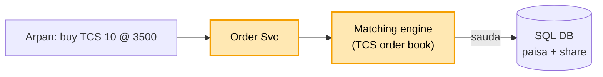
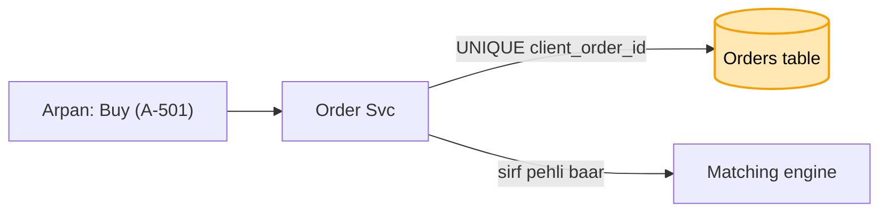

# Stock trading (Groww / Zerodha): shuru se, ek kahani

Kram wahi jo interview me hota hai: **FR, phir NFR, phir numbers, phir design**. Design sabse seedhe dabbe
se shuru hota hai, aur har dikkat aane pe ek naya dabba judta hai. Diagram me peela dabba = abhi juda. Poori
file me ek hi kahani hai: Arpan TCS ke 10 share 3500 pe kharidna chahta hai, Suresh apne 10 TCS 3500 pe
bechna chahta hai.

Ye paise wali tikdi ka chautha design hai: jo [banking](../13_banking_system/13_banking_system.md),
[payment](../06_payment_system/06_payment_system.md) ya [BookMyShow](../09_bookmyshow/09_bookmyshow.md) me pehle
se hai, wahan bas ek line + link. Poora sirf wahi jo stock ka apna hai (order book, matching, 9:15 ki bheed).

---

## 1. FR: kya karna hai

```
1. buy / sell order dalna (LIMIT: "3500 pe hi", MARKET: "jo bhaav abhi hai")
2. order milana (Arpan ka buy + Suresh ka sell = sauda)
3. sauda hua to paisa Arpan se Suresh, share Suresh se Arpan
4. live price dikhana, order ka haal (cancel bhi)
scope ke bahar: margin / risk, IPO, mutual fund
```

## 2. NFR: kaisa chalna chahiye

```
- paisa aur share hamesha sahi ("thodi der baad sahi" nahi)
- imaandar: jo pehle aaya, wo pehle mile
- 9:15 ki bheed jhele, har cheez ka record (audit)
```

## 3. Numbers

```
- 50 lakh order / din, market ~6 ghante (~20,000 sec) -> ~250 order / sec aam
- 9:15 pe jhatka: 10,000+ order / sec
- live price: ~10 lakh logon ka app khula, har second naya bhaav -> poochhne ki jagah PUSH
```

---

## 4. Design

### Kadam 1: sabse seedha (Order Svc + matching engine + DB)

Stock ka dil hai **order book**: har share ki do list.

```
TCS order book
  KHARIDNE WALE (buy)          BECHNE WALE (sell)
  Arpan  10 @ 3500             Suresh 10 @ 3500   <- bhaav mila -> SAUDA
  Mohan   5 @ 3490             Ravi    8 @ 3510
```

Arpan ne order dala. Order Svc use **matching engine** ko deta hai. Engine dekhta hai: koi bechne wala 3500 ya
usse kam pe hai? Suresh hai, sauda ho gaya. Phir DB me likha jaata hai: Arpan ka paisa ghata, share badhe;
Suresh ka ulta. Kram ka niyam: ek hi bhaav pe do bechne wale hon, to jo pehle aaya usse pehle (price-time
priority).



Dikkat: Arpan ne "Buy" dabaya, network atka, app ne dobara bheja (ya do baar tap). Order book me Arpan ke do
order lag gaye, 20 share kharid liye gaye, jabki use 10 chahiye the.

### Kadam 2: ek tap, ek order ([banking kadam 3](../13_banking_system/13_banking_system.md#kadam-3-network-gaya-app-ne-dobara-bheja-idempotency-key) wali key)

App har order ke saath apni ek id bhejta hai: `client_order_id = A-501`. Orders table me
`UNIQUE(client_order_id)`.

```
pehla Buy  : A-501 -> table me nahi -> order likho -> order book me
dobara Buy : A-501 -> pehle se hai  -> "ho chuka", wahi purana order lautao. Book me dusra nahi
```



Ye bilkul [banking kadam 3](../13_banking_system/13_banking_system.md#kadam-3-network-gaya-app-ne-dobara-bheja-idempotency-key) hai, bas paise ki jagah order. Order book me jaane se pehle ye check, to dohra
order kabhi book tak pahunchta hi nahi.

Par Arpan ke wallet me 50,000 hain. Usne ek saath do order daale: TCS 30,000 ka aur INFY 30,000 ka. Dono
Order Svc pe saath pahunche, dono ne dekha "50k hai, chalega", dono lag gaye. 60,000 ke order, paisa 50,000.
