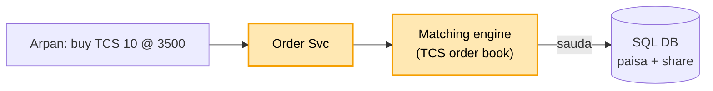
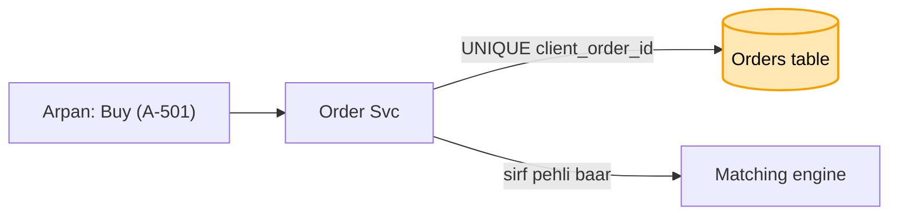
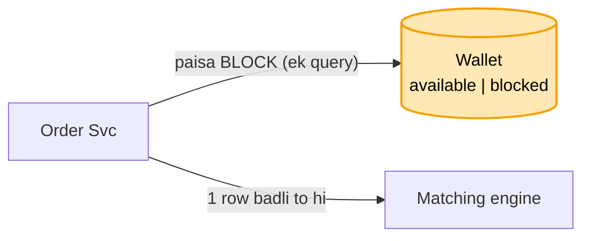
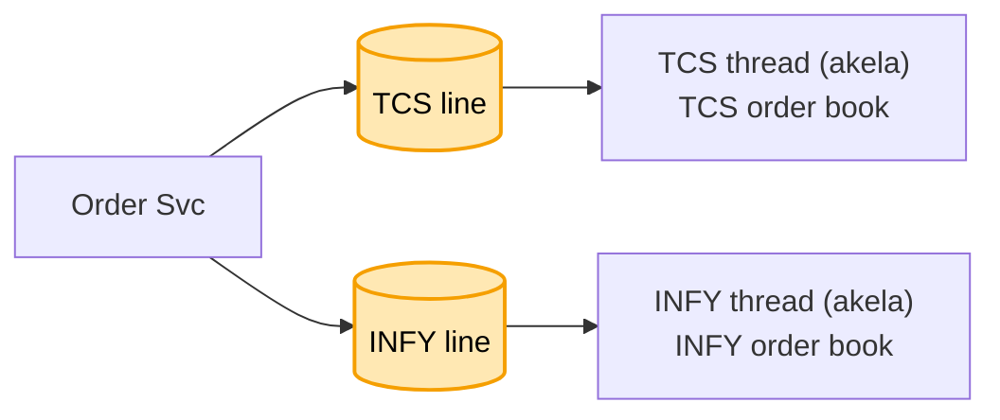
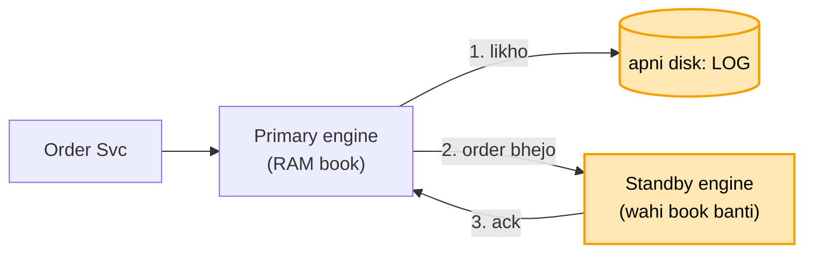

# Stock trading (Groww / Zerodha): shuru se, ek kahani

Kram wahi jo interview me hota hai: **FR, phir NFR, phir numbers, phir design**. Design sabse seedhe dabbe
se shuru hota hai, aur har dikkat aane pe ek naya dabba judta hai. Diagram me peela dabba = abhi juda. Poori
file me ek hi kahani hai: Arpan TCS ke 10 share 3500 pe kharidna chahta hai, Suresh apne 10 TCS 3500 pe
bechna chahta hai.

Ye paise wali tikdi ka chautha design hai: jo [banking](../13_banking_system/13_banking_system.md),
[payment](../06_payment_system/06_payment_system.md) ya [BookMyShow](../09_bookmyshow/09_bookmyshow.md) me pehle
se hai, wahan bas ek line + link. Poora sirf wahi jo stock ka apna hai (order book, matching, 9:15 ki bheed).

---

## 1. FR: kya karna hai

```
1. buy / sell order dalna (LIMIT: "3500 pe hi", MARKET: "jo bhaav abhi hai")
2. order milana (Arpan ka buy + Suresh ka sell = sauda)
3. sauda hua to paisa Arpan se Suresh, share Suresh se Arpan
4. live price dikhana, order ka haal (cancel bhi)
scope ke bahar: margin / risk, IPO, mutual fund
```

## 2. NFR: kaisa chalna chahiye

```
- paisa aur share hamesha sahi ("thodi der baad sahi" nahi)
- imaandar: jo pehle aaya, wo pehle mile
- 9:15 ki bheed jhele, har cheez ka record (audit)
```

## 3. Numbers

```
- 50 lakh order / din, market ~6 ghante (~20,000 sec) -> ~250 order / sec aam
- 9:15 pe jhatka: 10,000+ order / sec
- live price: ~10 lakh logon ka app khula, har second naya bhaav -> poochhne ki jagah PUSH
```

---

## 4. Design

### Kadam 1: sabse seedha (Order Svc + matching engine + DB)

Stock ka dil hai **order book**: har share ki do list.

```
TCS order book
  KHARIDNE WALE (buy)          BECHNE WALE (sell)
  Arpan  10 @ 3500             Suresh 10 @ 3500   <- bhaav mila -> SAUDA
  Mohan   5 @ 3490             Ravi    8 @ 3510
```

Arpan ne order dala. Order Svc use **matching engine** ko deta hai. Engine dekhta hai: koi bechne wala 3500 ya
usse kam pe hai? Suresh hai, sauda ho gaya. Phir DB me likha jaata hai: Arpan ka paisa ghata, share badhe;
Suresh ka ulta. Kram ka niyam: ek hi bhaav pe do bechne wale hon, to jo pehle aaya usse pehle (price-time
priority).



Dikkat: Arpan ne "Buy" dabaya, network atka, app ne dobara bheja (ya do baar tap). Order book me Arpan ke do
order lag gaye, 20 share kharid liye gaye, jabki use 10 chahiye the.

### Kadam 2: ek tap, ek order ([banking kadam 3](../13_banking_system/13_banking_system.md#kadam-3-network-gaya-app-ne-dobara-bheja-idempotency-key) wali key)

App har order ke saath apni ek id bhejta hai: `client_order_id = A-501`. Orders table me
`UNIQUE(client_order_id)`.

```
pehla Buy  : A-501 -> table me nahi -> order likho -> order book me
dobara Buy : A-501 -> pehle se hai  -> "ho chuka", wahi purana order lautao. Book me dusra nahi
```



Ye bilkul [banking kadam 3](../13_banking_system/13_banking_system.md#kadam-3-network-gaya-app-ne-dobara-bheja-idempotency-key) hai, bas paise ki jagah order. Order book me jaane se pehle ye check, to dohra
order kabhi book tak pahunchta hi nahi.

Par Arpan ke wallet me 50,000 hain. Usne ek saath do order daale: TCS 30,000 ka aur INFY 30,000 ka. Dono
Order Svc pe saath pahunche, dono ne dekha "50k hai, chalega", dono lag gaye. 60,000 ke order, paisa 50,000.

### Kadam 3: paisa BLOCK (BMS ka seat HOLD, bas balance pe)

Wallet me do khaane: **available** (khula paisa) aur **blocked** (order ke liye ruka paisa). Engine tak
jaane se pehle us order ka paisa block, ek hi query me:

```sql
UPDATE wallet SET available = available - 30000, blocked = blocked + 30000
WHERE user = 'Arpan' AND available >= 30000;
```

```
shuru:  available 50,000 | blocked 0
TCS  :  50k >= 30k -> 1 row badli -> available 20,000 | blocked 30,000 -> order book me
INFY :  20k >= 30k? nahi -> 0 row -> "paisa kam hai", order lagta hi nahi
```



Ye [BMS kadam 3](../09_bookmyshow/09_bookmyshow.md#kadam-3-seat-hold-5-minute-umar-ke-saath-bms-ka-apna) jaisa: wahan seat HELD, yahan paisa BLOCKED. Query wahi
[banking kadam 4](../13_banking_system/13_banking_system.md#kadam-4-do-kataai-ek-saath-balance--400-check--kaato-ek-query-me) wali: "check + kaato ek query me".

Aage kya:
- sauda hua: blocked se paisa Suresh ko (Kadam 6).
- order cancel / din khatam, bika nahi: blocked wapas available (BMS ka "hold mara to seat FREE").

Bechne wale pe bhi yahi: Suresh ke paas 10 TCS. Usne do jagah "sell 10" daala. Pehle pe 10 share block, doosre
pe "share kam hain". Ek share do baar nahi bik sakta.

Par 9:15 baje market khula, 10,000 order / sec, aadhe sirf TCS pe. Ek hi TCS order book pe kai thread ek saath
haath daal rahe hain. Do thread ne ek hi Suresh ko do kharidne walon se mila diya, book bigad gayi.

### Kadam 4: ek share ki book, ek hi thread (stock ka apna)

Har share ki apni order book, aur har book ko **sirf ek thread** chalata hai. Us share ke saare order ek line
(queue) me lagte hain (abhi engine ki RAM me; Kadam 5 me yahi line log banegi: disk + standby), thread
unhe ek-ek karke uthata hai.

```
TCS ke order  --> [TCS line] --> TCS thread (akela) --> TCS order book
INFY ke order --> [INFY line] --> INFY thread (akela) --> INFY order book
RELIANCE ...  --> [RELIANCE line] --> RELIANCE thread --> ...

line me kram = jo pehle aaya wo pehle milta (imaandari, NFR wala)
```



Ab kya theek hua:
- ek book pe ek hi haath, to Suresh do logon se kabhi nahi milta. Lock bhi nahi chahiye.
- kram line se tay: jo pehle line me laga, wo pehle milega.
- alag share alag thread pe (ya alag machine pe), to TCS aur INFY saath-saath chalte hain.

Lock kyun nahi (asli choice): book pe lock bhi chal jaata, par 9:15 pe saare thread usi ek lock ki line me
khade honge, aur lock pehle kise mile ye tay nahi, to "pehle aaya pehle mila" toot jaata. Akela thread RAM me
bahut tez, aur kram apne aap sahi.

RAM matlab? Matching engine wali machine ki apni memory (Java program ka heap). Order book wahin ek data
structure: buy aur sell ki do sorted list (bhaav + time ke kram se). Redis ya DB nahi, warna har milaan pe
network ka chakkar, aur 9:15 pe wahi dheema. Isi wajah se machine giri to book bhi gayi (agla kadam).

Ek thread TCS ki bheed jhel lega? Haan. Book RAM me, ek order milana microseconds ka kaam. Ek thread ek second
me lakhon order nipta sakta (mera andaza, asli number exchange pe nirbhar). TCS ke 5,000 / sec usse bahut kam.

Par order book RAM me hai. Dopahar 12 baje matching machine gir gayi, poori TCS order book gayab. Kisne kis
bhaav pe kharidne ka order dala tha, kuch nahi bacha.

### Kadam 5: engine giri (log + standby, ack ke baad milaan)

Dikkat: order book engine ki RAM me hai. Machine giri to book gayi, aur restart tak TCS ka trading ruka.

Ilaaj: engine har aane wala **order** (book nahi) pehle pakka karta hai, phir milata hai, isi kram me:

```
order 501 "Arpan buy 10 @ 3500"
  1. apni disk pe LOG me likho
  2. STANDBY machine ko bhejo
  3. standby bole "mil gaya" (ack)  <- iske BAAD hi milao
  4. milao
12:00 primary gira -> standby ke paas 1..501 sab, usi kram me -> book wahi -> standby primary ban gaya
```



Ack ka intezaar kyun: engine ne bheja aur turant gira, standby tak pahuncha hi nahi. Agar engine pehle hi
milaan kar chuka hota, to wo sauda standby ko pata hi nahi. Ack = standby ke paas order pakka.

Standby ko order kyun, book kyun nahi: standby wahi program chala raha, wahi order usi kram me milata hai, to
uski RAM me apne aap wahi book banti hai. Ye [banking kadam 7](../13_banking_system/13_banking_system.md#kadam-7-salary-ki-bheed--ek-hi-db-kai-machine--db-ki-sync-copy) ki sync copy jaisa hi.

Ek waqt me ek hi engine: heartbeat se tay hota hai ki primary mar gaya, tabhi standby kaam shuru karta hai.
Purana primary wapas aaye to wo standby ban ke baithta hai. Do engine ek book pe chal gaye to ek Suresh do
baar bik jaayega (**split brain**, sabse bada khatra).

Snapshot: naya standby subah 9:15 se poora log padhe to minute lagenge. Har minute book ki photo (snapshot);
naya standby aakhri photo + uske baad ka chhota log padhta hai.

Kafka kyun nahi yahan: Kafka me log rakhna bhi chalta, par har order pe uska chakkar milli-second ka hai, apna
log + seedha copy usse kahin tez (andaza: ~100 micro-second vs 2-5 ms). Exchange ke liye ye farak bada hai.
