# Payment System (UPI-style)

> User A se User B / merchant ko paisa, bharose ke saath. Misaal: Arpan ne chai wale (merchant) ko Rs. 500 bheje.
> Is design ka dil: **paisa DO BAAR na kate** + **paisa kabhi GUM na ho**. Finance HLD ka core, JP / GS ka favourite.

```
CHAAR MUSHKIL BAAT (poori file inhi ke ird-gird):
   do baar na kate (IDEMPOTENCY) · dono taraf ek saath (CONSISTENCY)
   kuch gire to bhi paisa na khoye (FAILURE HANDLING) · har paise ka hisaab (LEDGER / AUDIT)
```

---

## TASVEER (ByteByteGo / Alex Xu · CC BY-NC-ND 4.0)


Source: [How to Avoid Double Payment](https://bytebytego.com/guides/how-to-avoid-double-payment/)
(dobara bhejne pe do baar na kate = IDEMPOTENCY KEY)


Source: [Reconciliation in Payment](https://bytebytego.com/guides/reconciliation-in-payment/)
(crash ke baad asli haal PSP se milaana = RECONCILIATION)

---

## SHURU: pehle poocho, phir numbers

```
POOCHO:  "P2P, merchant, refund, settlement, fraud — kis pe? Main ek user se doosre tak paisa bhejne pe."
         ★ dono account EK hi system / bank me ya ALAG?  <- isse poora design badalta:
           ek DB -> ek TRANSACTION (ACID) kaafi · alag bank -> SAGA ka khel
         refund scope me? · bahar ka PSP (Razorpay / Stripe) ya khud? · audit / RBI ka hisaab?

KYA KARE (FR):    A se B ko bhejo · dobara bhejne pe dobara na kate
                  · fail ho to paisa wapas · har paisa traceable
                  scope bahar: fraud engine · kai currency · chargeback
KAISA CHALE (NFR): paisa KHOYE nahi (kata par pahuncha nahi) · ATKE nahi (beech me network gaya)
                   DO BAAR na kate (500 ki jagah 1000) · har paisa TRACE ho (audit)

NUMBERS (andaaza):
   ~10 crore user · aam din kuch sau payment / second · festival / sale pe kuch hazaar / second
   ★ "Payment me bheed badi dikkat nahi, SAHI hona badi dikkat
   hai. Pehle sab-ya-kuch-nahi + do-baar-nahi + ledger."
   -> SQL DB (ACID: kai row ek transaction me) + ledger jisme sirf jodte hain
   DHYAAN: "NoSQL me ACID hota hi nahi" mat bolo -- kai NoSQL ek row / document pe atomic hain.
           sahi farak: debit + credit + ledger = KAI ROW ek saath -> SQL me ye seedha aur pakka.
```
```
POOCHEGA: "Consistency or availability — which do you pick?"
          (Consistency ya availability, kya chunoge?)

JAWAB:    Paise me sahi hona pehle. Network toota aur pakka nahi pata balance kya hai, to payment mana
          kar do. Galat balance pe paisa kaat dena usse kahin bura hai.
          Dashboard / report thode purane bhi chalte hain, wo chalte rahein.
```

---

## ════ MOCK SE PEHLE: SIRF YE CARD PADHO ════

> Har card: DIKKAT 1 (kya toota) -> HAL (kya kiya) -> diagram -> DIKKAT 2, 3 ... (interviewer ke
> agle sawaal) har ek ke neeche uska HAL. Revise: sirf baayein column padho.

#### DABBA 0: SABSE SIMPLE (yahan se shuru, phir "kahan tootega")
```
Payment service DB me do kaam kare: Arpan ke 500 ghatao, merchant ke 500 badhao.

PAISA KAHAN HILTA (pehle ye tay, poori file isi pe):
  Arpan aur merchant dono ka WALLET hamare system me (Paytm / PhonePe wallet jaisa).
  Wallet se wallet = hamare DB ke andar, ek transaction (card 0, 1, 2, 6, 9).
  Bahar ka paisa = PSP (Razorpay / bank) se: bank se wallet me daalna (top-up), wallet se bank me
  nikaalna (payout), ya merchant kisi doosre bank me hai (card 3, 4, 5).
```
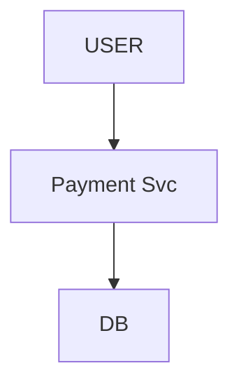

#### 0 DB KAUNSA? SQL
```
DIKKAT 1   Ek payment me chaar likhai: Arpan -500, merchant +500, aur khaate (ledger) me 2 line.
           Ye chaaron ek saath honi chahiye. Teen hui aur chautha reh gaya = hisaab galat.
HAL        SQL (Postgres / MySQL): kai row EK transaction me, sab ya kuch nahi (ACID).
           Teen table: wallet (account_id, balance) · ledger (sirf jodte) · payment (key, haal).
           Ek payment = BEGIN -> 2 balance UPDATE + 2 ledger INSERT + payment ka haal -> COMMIT.
           Beech me kuch bhi fail -> ROLLBACK -> chaaron me se ek bhi nahi hua.
```
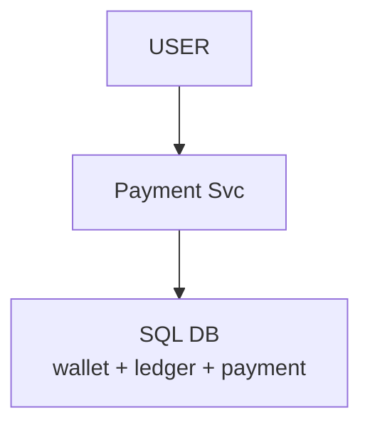
```
DIKKAT 2   NoSQL kyun nahi?
HAL        Yahan kai row / table pe ek saath "sab ya kuch nahi" chahiye, aur paisa turant sahi dikhe.
           Paise me "thodi der baad sahi" (eventual) nahi chalta.
```

#### 1 BEECH ME CRASH: ARPAN -500 HUA, MERCHANT +500 NAHI
```
DIKKAT 1   Arpan ke 500 kat gaye. Merchant ke account me daalne se PEHLE server gir gaya.
           500 na Arpan ke paas, na merchant ke paas. Gayab.
HAL        Kaatna aur daalna EK transaction me:
             BEGIN  Arpan -= 500 · Merchant += 500  COMMIT
           DB har badlaav pehle apni diary (WAL) me likhta. Gira aur utha -> diary dekhta: COMMIT ho chuka
           tha to poora karta, nahi hua tha to ulta. Aadha kabhi nahi bachta.
           Niyam: saare kate == saare jude, hamesha. Na mile -> turant alert.
```
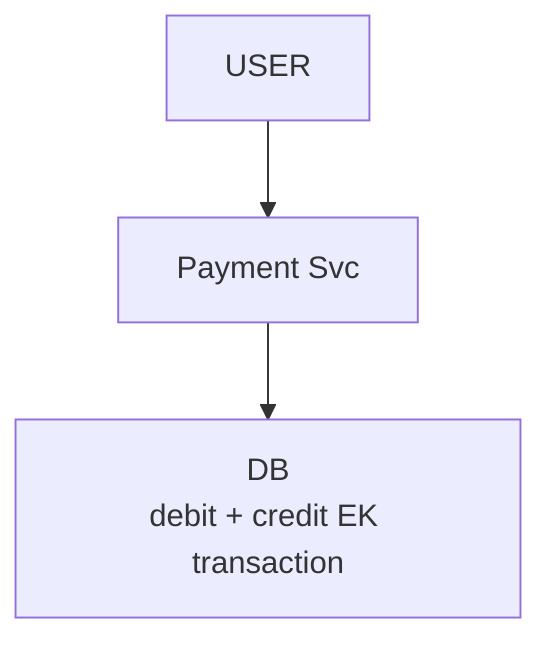
```
DIKKAT 2   Arpan ke account se do payment ek saath, balance sirf 600?
HAL        Check aur kaatna ek hi query me:
             UPDATE account SET balance = balance - 500 WHERE id = ? AND balance >= 500
           Pehla jeeta (bacha 100), doosre ki 0 row badli = reject.
```

#### 2 DO BAAR TAP / APP NE DOBARA BHEJA = 1000 KATE
```
DIKKAT 1   Arpan ne Pay dabaya, app ghoomta raha, usne phir daba diya. Ya network ne khud dobara bheja.
           Server ko do request mili, dono process -> 1000 kate, dene the 500.
HAL        IDEMPOTENCY KEY: "Pay" dabate hi app ek random UUID banata (key-555), dobara bhejne pe WAHI.
           Key ko "dekha?" aur "daal do" EK hi step me: DB me key UNIQUE (pakka) + Redis SETNX (tez).
             pehli request: key-555 daali, haal IN_PROGRESS -> kaato + daalo -> haal DONE + jawab save
             doosri request: key-555 pehle se -> saved jawab wapas. Paisa ek hi baar.
           Arpan ne sach me do alag payment kiye (100 + 100) -> do tap = do alag key -> dono honge.
           Key ~24 ghante rakho.
```
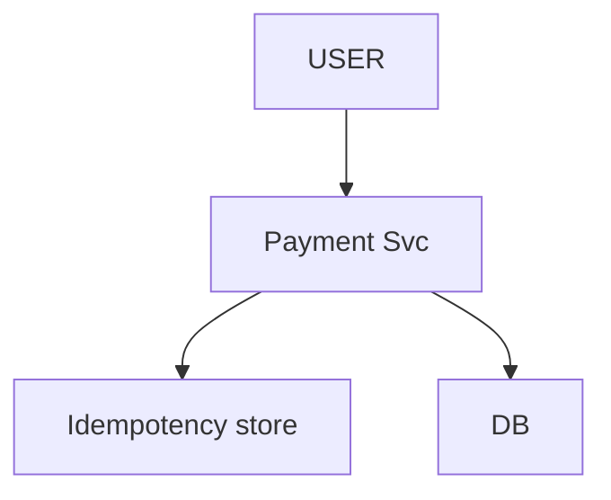
```
DIKKAT 2   Key app kyun banaye, server kyun nahi?
HAL        Dobara bhejta app hai. Server ko pata hi nahi ye wahi request hai. App ki key hi dono ko jodti.

DIKKAT 3   Key lag gayi, phir payment FAIL?
HAL        Sirf PAKKA fail (transaction rollback, paisa hila hi nahi) pe key hatao -> dobara koshish chal
           sake. PENDING (pata nahi kata ya nahi) pe key rahe, andha dobara nahi.

DIKKAT 4   Kaam ke baad key delete kar do?
HAL        Nahi. Der se dobara wali request aayi to dobara kat jaayega.

DIKKAT 5   Redis aur DB dono kyun?
HAL        Redis tez, chal rahi request turant pakadta. DB UNIQUE pakka, Redis gira tab bhi.

DIKKAT 6   Idempotency aur "do log ek balance pe" same cheez?
HAL        Nahi. Idempotency = EK user ki dobara request. Do log ek balance pe = atomic query
           (balance >= 500 ho tabhi kaato).
```

#### 3 ASLI PAISA HAMARA SERVER NAHI HILATA
```
DIKKAT 1   Arpan apne bank se wallet me 2000 daal raha (top-up). Ya merchant din ka paisa bank me nikaal
           raha (payout). Ye paisa hamare DB me nahi hilta: hamara server PSP ko sirf "bhejo" kehta, asli
           paisa bank ke raaste (bank rails) pe hilta. Wo bahar ka raasta kabhi dheema, kabhi band.
HAL        PSP ko TIMEOUT 2-3 sec. Na ho to har thread PSP me atka rehta -> saare phanse -> system band.
           Baar-baar fail -> FUSE: CLOSED --5 baar fail--> OPEN (call hi mat bhejo, payment PENDING)
           --30 sec baad--> HALF-OPEN (ek test call) -> chali to CLOSED, fail to wapas OPEN.
           Paise me andha dobara nahi (shayad pehli baar kat chuka) -> payment PENDING, baad me pakka.
```
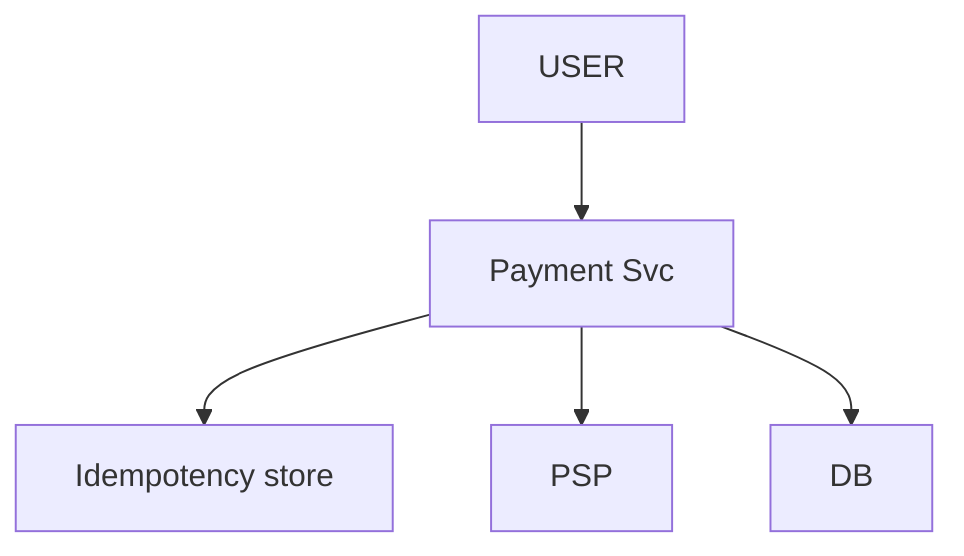
```
DIKKAT 2   Timeout hua, Arpan ko kya dikhao?
HAL        "processing" (PENDING), "fail" NAHI. Paisa shayad kat chuka. Reconciliation job (PSP se baar-baar
           poochh ke) pakka karegi.

DIKKAT 3   Do PSP rakhoge?
HAL        Haan, ek band to doosra. Par EK payment hamesha EK hi PSP pe. Beech me badla = do jagah se kat
           sakta.
```

#### 4 PSP KO CALL KIYA AUR CRASH: PAISA GAYA YA NAHI?
```
DIKKAT 1   Server ne PSP ko "500 bhejo" bola aur jawab aane se pehle khud gir gaya.
           Pata hi nahi: paisa kat gaya aur jawab kho gaya, ya kata hi nahi. "Bas rollback kar do" galat,
           kyunki PSP me shayad paisa sach me kat chuka.
HAL        PSP ko call se PEHLE DB me likho 'PENDING', phir call. Server gira to bhi likha hai ki adhoora hai.
           PSP khud batata (webhook) "ho gaya / fail".
           Ek job har kuch minute: PENDING jo 5 min se purane -> PSP se poochho
             hua -> SUCCESS · nahi hua -> dobara (WAHI key se) · pakka fail -> FAILED + paisa wapas
           Roz raat PSP / bank ki poori file se apna hisaab milao (reconciliation).
           Jaise courier: har parcel ka tracking number. Courier wala gira, parcel gum nahi.
```
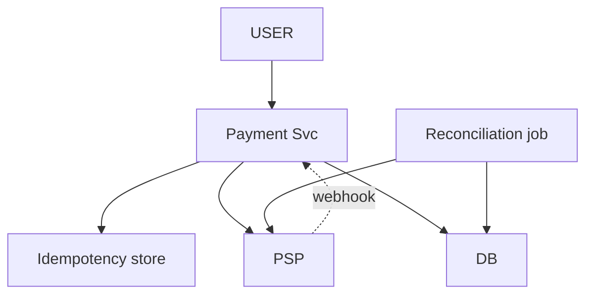
```
DIKKAT 2   Webhook do baar aa gaya?
HAL        PENDING -> SUCCESS sirf ek baar. Pehle se SUCCESS hai aur phir aaya -> ignore.

DIKKAT 3   Sirf webhook kaafi kyun nahi?
HAL        Webhook kho sakta, der se aa sakta, ya us waqt hamara server band tha. Job wo jaal hai jo chhoota
           pakde.

DIKKAT 4   Sirf job (baar-baar poochhna)?
HAL        Der lagti + har PENDING pe baar-baar PSP call (limit / kharcha). Isliye dono.

DIKKAT 5   Kaise pata sab theek chal raha?
HAL        Hisaab ka farak, p99, error rate, line ki lambai pe alert + trace id se ek payment ka poora raasta.
```

#### 5 ALAG BANK / ALAG DB: EK TRANSACTION NAHI CHAL SAKTA
```
DIKKAT 1   Arpan ka account Bank A me, merchant ka Bank B me. Do alag system pe ek DB transaction hota hi
           nahi. Bank A se 500 kata, Bank B me daalna fail -> paisa beech me latka.
HAL        SAGA = step-step, har step ke baad likh lo kahan tak hua (saga table: DEBITED, CREDIT_PENDING..).
           Bank A -500 OK -> Bank B +500 FAIL -> ulta kaam: Bank A +500 wapas.
           Service beech me giri -> uthke saga table dekhti, wahin se aage ya ulta.
```
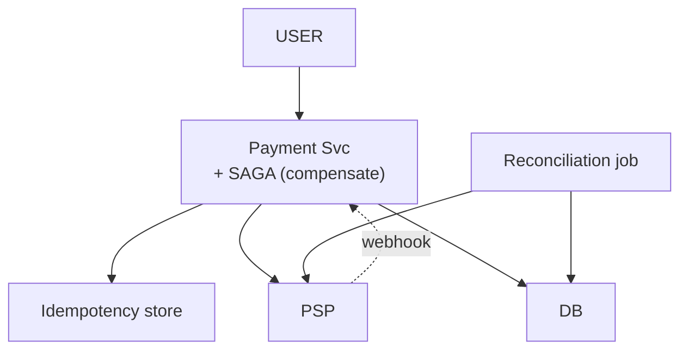
```
DIKKAT 2   2PC (two phase commit) kyun nahi?
HAL        2PC me sab "ready" bol ke lock pakad ke rukte. Coordinator gira = sab atke, aur har payment dheema.

DIKKAT 3   Beech ke waqt Arpan ko kya dikhe?
HAL        "processing", thodi der me SUCCESS ya paisa wapas (eventual).
```

#### 6 RBI POOCHHE: YE PAISA KAHAN SE AAYA, KAHAN GAYA?
```
DIKKAT 1   RBI: "Arpan ke ye 500 kahan se aaye, kahan gaye, kab?"
           Balance column sirf aaj ka number batata (Arpan: 1200). Kaise 1200 bana, uska koi record nahi.
HAL        LEDGER table, USI transaction me jisme paisa hila. Sirf INSERT, kabhi UPDATE / DELETE nahi.
           Double-entry: Arpan -> merchant 500 = "Arpan DEBIT 500" + "merchant CREDIT 500" (jod 0).
           Balance column bhi usi transaction me badalta.
           Galti -> purani line mat mitao, NAYI ulti line likho (pen ki diary, kaat-peet nahi).
           Raat ko jaancho: ledger ka jod == balance? Farak = alert.
```
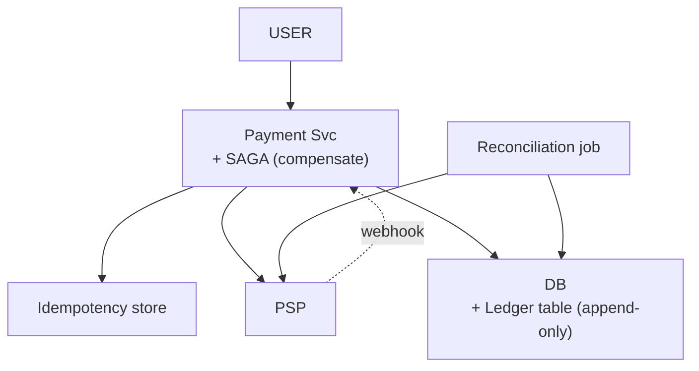
```
DIKKAT 2   Galat entry delete kar do?
HAL        Nahi, ulti entry. Audit me dono dikhni chahiye.

DIKKAT 3   Balance + alag audit_log table kyun nahi?
HAL        audit_log me kuch bhi likh sakte, koi niyam nahi jaanchta. Ledger me har len-den DEBIT + CREDIT,
           jod hamesha 0, aur sirf INSERT -> galti turant pakdi jaati. Ledger hi sach.

DIKKAT 4   3 saal me ledger bahut bada?
HAL        Mahine ke hisaab se tukde (partition), purane tukde sasti jagah (S3 Glacier). Archive, delete
           kabhi nahi.

DIKKAT 5   Ledger crash se bachaata hai?
HAL        Nahi, wo hisaab / audit hai. Crash se bachaate PENDING + webhook + reconciliation.

DIKKAT 6   Refund kaise?
HAL        Purani payment ko chhedo mat. Nayi ulti payment: merchant -500, Arpan +500, apni nayi key,
           purani payment ka number saath me. Ledger me 2 nayi line. Ek payment pe refund ka jod asli
           amount se zyada nahi (check karo).
```

#### 7 FESTIVAL PE 3000 PAYMENT / SECOND
```
DIKKAT 1   Diwali pe 3000 payment / second. Ek hi Payment service machine ka CPU bhar gaya -> timeout ->
           log ghabra ke DOBARA tap kar rahe -> aur bojh. Wo machine giri to sab payment band.
HAL        Payment service STATELESS (saari yaad DB + idempotency store me), kai machine -> koi bhi machine
           koi bhi payment le sakti, ek giri baaki chalti.
           Aage LB / API GATEWAY: login check (JWT), rate limit, WAF, HTTPS.
```
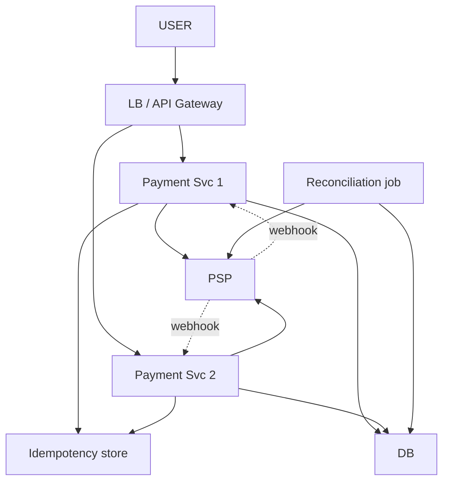
```
DIKKAT 2   Safe kaise rakhoge, galat istemaal kaise rokoge?
HAL        Gateway pe login check. Payment Svc me har payment pe OWNER CHECK: JWT se Arpan ka userId ->
           "from" account ka maalik Arpan hi hai? Nahi -> 403. userId JWT se, request body se kabhi nahi
           (body me koi bhi kisi ka bhi likh de). Har user ki had, aur sabse aage WAF.

DIKKAT 3   JWT hi chori ho gaya?
HAL        JWT ki umar chhoti (~15 min) + refresh token. Bade payment pe PIN / OTP dobara maango.

DIKKAT 4   LB ko kaise pata machine mar gayi?
HAL        LB har kuch second GET /health maarta, jawab nahi = list se bahar.
```

#### 8 MERCHANT KI REPORT NE ASLI PAYMENT ROKE
```
DIKKAT 1   Ek bada merchant dashboard pe "is mahine ki saari payment" report chala raha. Wo bhaari query usi
           DB pe -> DB busy -> Arpan ka 500 ka payment likhne me atak gaya.
HAL        Report READ REPLICA (DB ki padhne wali copy) se. Balance aur payment ka haal hamesha PRIMARY se.
           Primary har badlaav diary (WAL) me likhta -> replica wo diary padh ke wahi lagati, peeche-peeche
           (1-2 sec purani). Report me chalta, balance me nahi.
           Bahut bhaari analytics -> alag warehouse me (CDC se data jaata).
```
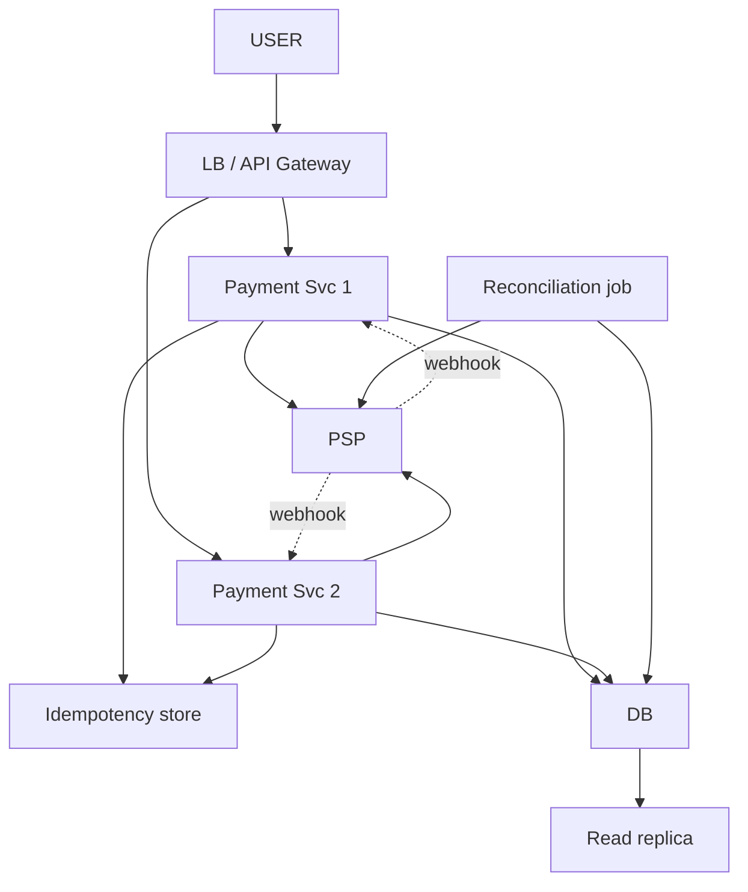
```
DIKKAT 2   Arpan ne pay kiya, use purana balance dikha?
HAL        Wo replica se padha gaya jo peeche thi. Isliye balance / haal PRIMARY se hi.

DIKKAT 3   Primary gira?
HAL        SYNC standby (har likhai uspe bhi pakki) ko primary banao (RDS Multi-AZ) -> kuch nahi khota.
           Async replica ko banaya to aakhri kuch likhai kho sakti.

DIKKAT 4   Replica kitni peeche hai, kaise pata?
HAL        Replication lag metric pe alert.
```

#### 9 50 CRORE ROW, LIKHAI DHEEMI
```
DIKKAT 1   Kuch sau payment / second x saal = ~1000 crore payment row saal me. Saari likhai ek primary pe
           -> likhai dheemi.
HAL        Account id ke hisaab se baanto (shard): Arpan ka balance aur uski saari history ek hi shard pe
           -> Arpan se kaatna ek jagah, ek transaction, atomic.
           Account kis shard pe: consistent hashing, ya lookup table (account -> shard, baad me badal sakte).
```
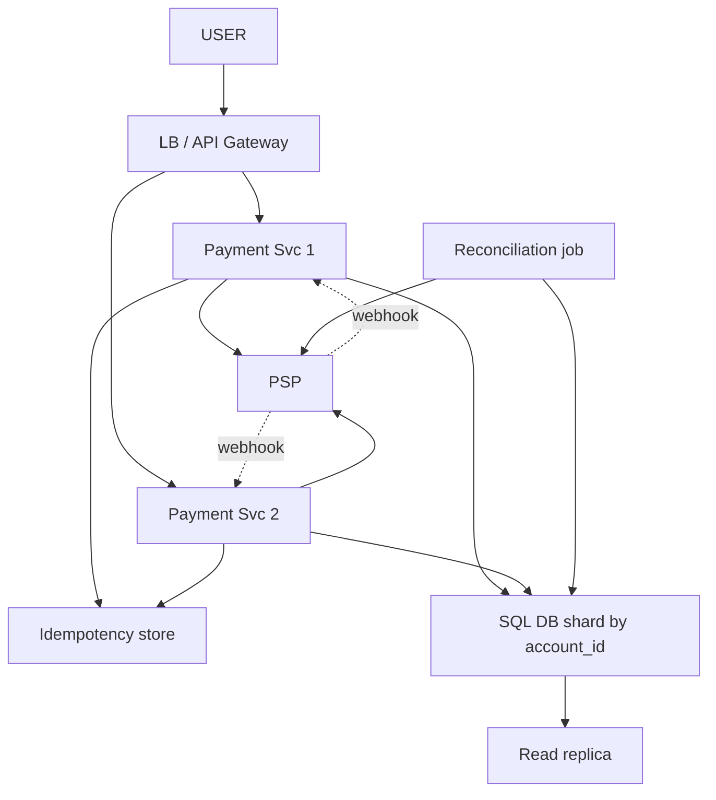
```
DIKKAT 2   txn_id ya time se kyun nahi baanta?
HAL        txn_id: Arpan ki payment alag-alag shard pe bikhri, balance kahan dekhoge? · time: aaj wala shard
           garam.

DIKKAT 3   Amazon jaisa bada merchant -> uska shard garam?
HAL        Merchant ke kai sub-account, alag shard pe; report me jod do.

DIKKAT 4   Do shard ke beech transfer?
HAL        SAGA: shard A se kaato, shard B me daalo, fail pe ulta. Asli mushkil yahi hai, bheed nahi.
```

```
AAKHRI DABBE (sab dikkat ke baad):
  User -> Gateway (login + rate limit) -> Payment Svc (stateless, owner check, saga)
  -> Idempotency (ek key ek baar, unique) -> SQL DB (ACID: kaato + daalo + ledger, shard by account)
  -> PSP (sirf bahar ka paisa: top-up / payout / doosra bank, pehle PENDING)
  -> webhook (PSP batata) · Reconciliation job (hum poochhte, jaal)
  Read replica = sirf dashboard / report

DB:  SQL + ACID -> kaatna aur daalna ek saath · ledger double-entry, kabhi badla nahi jaata
     idempotency key -> { haal, jawab }, ~24 ghante

END ME POOCHEGA:
  "Do baar kata?"   -> Idempotency-Key (Pay TAP pe bani) + unique -> dobara aaya = pehla jawab
  "PSP ne jawab nahi diya?" -> PENDING rakho -> webhook + reconciliation, paisa kabhi gum nahi
  "10x?"            -> Payment Svc machine badhao · read replica · likhai shard by account_id
                       · asli mushkil alag bank / shard ke beech -> SAGA
  "SPOF?"           -> DB primary (sync standby promote) · PSP (doosra PSP)
```

AAKHRI DABBE ki tasveer:


---

## 10 GUNA TRAFFIC — har dabba alag se

```
Gateway           -> bheed / hamla -> rate limit
Payment Svc       -> stateless -> machine badhao
Idempotency       -> do request ek saath -> unique / SETNX
SQL DB            -> kaatna + daalna ek transaction · padhai -> replica · likhai -> shard by account_id
PSP               -> dheema / band -> PENDING + fuse · jawab nahi -> webhook + reconciliation
Ledger            -> sirf jodo, mahine ke tukde, purana sasti jagah
ASLI MUSHKIL      -> alag bank / shard ke beech ka len-den, bheed nahi

POOCHEGA: "How would you scale this to 10x?"      -> paise ka raasta chalo, har dabbe pe "kya toota"
POOCHEGA: "What's the single point of failure?"   -> DB primary (sync standby promote), PSP (doosra PSP)
```

---

## POOCHE TO (gehra sawaal aaye tab)

```
API:      POST /pay { from, to, amount } + header Idempotency-Key: <UUID>  -> { status, txn_id }

KEY KAB BANTI:
          key random hai, "Pay" TAP ke pal banti. Naya tap = nayi key.
          (A) Arpan ne khud do baar tap kiya -> key-555, key-888 -> 100 + 100 = 200 (do payment, sahi)
          (B) ek tap + network ne dobara bheja -> wahi key-555 dobara -> "aa chuki" -> pehla jawab -> 100
          farak = KAUN dobara bhej raha: Arpan (nayi key, naya payment) · system (wahi key, ek hi baar)
          maqsad do payment rokna NAHI, sirf network ke dobara bhejne ko do baar ginne se rokna
          CHEQUE jaisa: key = cheque number · do cheque = dono cash · ek number do baar = nahi
                        bank amount nahi, NUMBER dekhta

DATA:     LEDGER double-entry, kabhi badla nahi · IDEMPOTENCY key -> { haal, jawab } ~24 ghante ·
          KEY ka haal:     IN_PROGRESS -> DONE (dobara aayi request ke liye)
          PAYMENT ka haal: INITIATED -> PENDING -> SUCCESS / FAILED (paisa kahan tak pahuncha)
          NIYAM saare kate == saare jude

SCAM 1992 (ledger kyun itna zaroori):
          1990-91 me kaagaz ka ledger + haath se bani Bank Receipt (BR) -> badli ja sakti, nakli ban sakti,
          turant koi jaanch nahi -> nakli / khaali BR + beech ka paisa market me + der se pakda (~Rs. 4000 cr)
          nakli entry          -> NIYAM (kate == jude) + sirf asli paise ki entry
          paisa gaya, share nahi -> sab-ya-kuch-nahi settlement (ACID / SAGA)
          badli ja sakne wali BR -> kabhi na badalne wala double-entry + audit
          beech ka paisa       -> turant RECONCILIATION
          kaagaz se digital: ledger nahi mara, sirf kaagaz gaya
          · blockchain = sabse pakka na-badalne-wala ledger
          baad me: SEBI ko kanooni taakat (1992) · NSE screen trading
          (1994) · NSDL demat (1996) · T+2 (2003) · T+1 (2021-23)
```

---

## AAKHRI DABBA + WRAP

```
Gateway = login + rate limit · Payment Svc = stateless, owner check, saga · Idempotency = ek key ek baar
SQL DB = ACID kaato + daalo + ledger, shard by account ·
PSP = bahar ka paisa (top-up / payout), pehle PENDING · webhook = PSP batata
Reconciliation = hum poochhte, jaal · Read replica = sirf dashboard
```
```
idempotency  -> ek key, paisa EK baar          (map me "pehle dekha?")
consistency  -> kaatna + daalna ek saath       (ACID ya SAGA)
failure      -> PENDING + webhook + RECONCILE  (courier tracking — gum kabhi nahi)
ledger       -> double-entry, kabhi badla nahi (pen ki diary)
```
```
JAWAB:    Har payment pe ek id, dobara bheja to pehla jawab, paisa ek hi baar.
          Kaatna + daalna ek transaction me, aur khaate me dono line. Alag bank / alag jagah ho to
          step-step + fail pe ulta.
          Wallet se wallet hamare DB me. Bank se aana / bank me jaana PSP karta, isliye wahan pehle
          PENDING likho, phir PSP ke webhook aur roz ke milaan se pakka karo.
          Aage: fraud check, kai currency, chargeback.
```


---

## HANDS-ON — Idempotency LIVE (usercrud, 27-Aug)

> Ek line me: "map me key hai? -> kuch mat karo, wahi wapas. Nahi? -> process + map me daal do."

```java
@RestController
public class IdempotencyController {

    // key -> pehle jo result diya (duplicate pe wahi wapas)
    private final ConcurrentHashMap<String, String> processed = new ConcurrentHashMap<>();
    // asli orders ka counter (SAABIT karega double hua ya nahi)
    private final AtomicInteger orderCounter = new AtomicInteger(0);

    @PostMapping("/pay")
    public String pay(@RequestHeader("Idempotency-Key") String key,
                      @RequestParam int amount) {

        // ATOMIC claim: key hai? -> existing wapas | nahi? -> "PROCESSING" daal + null return
        String existing = processed.putIfAbsent(key, "PROCESSING");
        if (existing != null) {
            return "DUPLICATE (key already claimed) -> " + existing
                 + "  | total orders = " + orderCounter.get();
        }

        // yahan sirf EK thread pahunchega (jisne putIfAbsent race JEETI)
        int orderId = orderCounter.incrementAndGet();
        String result = "Order #" + orderId + " created, amount=" + amount;

        processed.put(key, result);   // "PROCESSING" ko asli result se replace

        return "OK -> " + result + "  | total orders = " + orderCounter.get();
    }
}
// SecurityConfig: .requestMatchers("/pay").permitAll()
```
```
SEQUENTIAL:  A key abc-123, 100 -> OK Order #1, total 1
             B wahi dobara      -> DUPLICATE Order #1, total 1   (2 NAHI)
             C key xyz-999, 200 -> OK Order #2, total 2

RACE:        naive containsKey + put = 2 step, GAP -> A "nahi", B "nahi" -> dono order = DOUBLE
             putIfAbsent = 1 ATOMIC step -> sirf ek jeet-ta
             atomicity NAAM se nahi, ConcurrentHashMap se (bucket
             lock / CAS). plain HashMap = thread-safe nahi

20 PARALLEL, same key "race-1":
             1..20 | ForEach-Object { Start-Job { curl.exe -s -X POST ".../pay?amount=100"
             -H "Idempotency-Key: race-1" } } | Wait-Job | Receive-Job
             BROKEN (containsKey + put + sleep 50) -> Order #1 AUR #2 -> total 2 = DOUBLE CHARGE live
             ATOMIC (putIfAbsent) -> 1 OK, 19 DUPLICATE -> total 1
             pehli DUPLICATE "-> PROCESSING" = reserve-then-fill live dikha

PROD:        Redis / DB unique constraint (memory restart pe udti) + key TTL · PROCESSING placeholder
JAWAB:    Pehle 'key hai?' dekhna aur phir 'daalna' do alag kadam the, beech me doosri request ghus
          gayi. ConcurrentHashMap ka putIfAbsent dono ek hi kadam me karta, to ek hi jeetti.
          Asli system me ye kaam Redis ya DB ka unique karta. 20 request ek saath maari: purane code ne
          2 order banaye, naye ne 1.
```

ARCHETYPE C · CONCEPTS: [db-what-when](../../FOUNDATIONS/09_databases_what_when.md) · [CAP](../../FOUNDATIONS/08_cap_theorem.md) · [saga/ms-comm](../../FOUNDATIONS/10_ms_communication.md) · saath: [bookmyshow](../09_bookmyshow/09_bookmyshow_INTERVIEW.md) · [stock-broker](../05_stock_broker_trading/05_stock_broker_trading.md) · [← MASTER SHEET](../../00_MASTER_SHEET.md)
