# Payment System (UPI-style)

> User A se User B / merchant ko paisa, bharose ke saath. Misaal: Arpan ne kirana dukaan (merchant) ko Rs. 500 bheje.
> Dil do cheezein: paisa do baar na kate, aur paisa kabhi gum na ho. Finance HLD ka core, JP / GS ka favourite.
>
> Har card: kya toota -> kya kiya -> yahi kyun -> doosra kyun nahi. Kram me chalo. "Pooche" wali line = interviewer aage poochhe to.

---

## Poori tasveer (aakhir me design aisa banta hai)



---

## Mock cue (mock me sirf ye dekho: kya hua -> ilaaj -> kaunsa dabba juda)

```
    KYA HUA                                    ILAAJ                                DABBA JUDA
1   kirana ko 500, beech me server gira     -> EK TRANSACTION (WAL se poora / ulta)   SQL DB
2   600 me phone se 500, laptop se 500      -> check + kaato EK atomic query         (DB query)
3   metro me network gaya, app ne dobara    -> IDEMPOTENCY KEY (screen khulte)       Idempotency store
4   bank se 2000 top-up, PSP dheema         -> timeout = PENDING, circuit breaker = abhi nahi   PSP
5   PSP ko call kiya, jawab se pehle crash  -> PENDING pehle + WEBHOOK + RECONCILE   Reconciliation job
6   merchant ka account Bank B me           -> SAGA (step-step, fail pe ulta)        Payment Svc + SAGA
7   "kal raat 2200, subah 1100 kaise?"      -> LEDGER double-entry, sirf INSERT      Ledger table
8   shaam Diwali, 3000 payment / sec        -> STATELESS, kai machine + LB           LB / Gateway + Svc x N
9   merchant ki report ne payment roke      -> READ REPLICA (sirf report)            Read replica
10  ~1000 crore row / saal, likhai dheemi   -> SHARD by account_id                   SQL DB shard

POORA DESIGN (upar ke dabbe kram se):
   User -> Gateway / LB -> Payment Svc (stateless, saga) -> Idempotency -> SQL DB (ACID + ledger, shard)
   bahar ka paisa: Payment Svc -> PSP (pehle PENDING) · webhook + Reconciliation job · report -> Read replica
```

---

## Shuru

Sabse simple: Payment service DB me do kaam kare: Arpan ke 500 ghatao, merchant ke 500 badhao.

Paisa kahan hilta, ye pehle tay, poori file isi pe. Arpan aur merchant dono ka wallet hamare system me hai (Paytm /
PhonePe wallet jaisa). Wallet se wallet = hamare DB ke andar, ek transaction. Bahar ka paisa PSP (Razorpay / bank)
se jaata: bank se wallet me daalna (top-up), wallet se bank me nikaalna (payout), ya merchant kisi doosre bank me hai.

Chaar mushkil baat, poori file inhi ke ird-gird: do baar na kate (idempotency), dono taraf ek saath (consistency),
kuch gire to bhi paisa na khoye (failure handling), har paise ka hisaab (ledger / audit).

Scope pehle poochho: P2P, merchant, refund, settlement, fraud, kis pe? Main ek user se doosre tak paisa bhejne pe.
Sabse bada sawaal: dono account ek hi system / bank me ya alag? Isse poora design badalta. Ek DB hai to ek
transaction (ACID) kaafi, alag bank hai to SAGA ka khel. Refund scope me? Bahar ka PSP (Razorpay / Stripe) ya khud?
Audit / RBI ka hisaab?

Kya chahiye: A se B ko bhejo, dobara bhejne pe dobara na kate, fail ho to paisa wapas, har paisa traceable. Scope
bahar: fraud engine, kai currency, chargeback. Kaisa chale: paisa khoye nahi (kata par pahuncha nahi), atke nahi
(beech me network gaya), do baar na kate (500 ki jagah 1000), har paisa trace ho (audit).

Numbers: ~10 crore user. Aam din kuch sau payment har second, festival / sale pe kuch hazaar har second. Payment me
bheed badi dikkat nahi, sahi hona badi dikkat hai. Pehle sab-ya-kuch-nahi + do-baar-nahi + ledger.

DB kaunsa? SQL. Ek payment me paanch likhai: Arpan -500, merchant +500, khaate (ledger) me 2 line, payment ka haal.
Teen table: wallet (account_id, balance), ledger (sirf jodte), payment (key, haal). Ye paanchon ek saath honi
chahiye. Chaar hui aur ek reh gayi = hisaab galat. Isliye BEGIN, paanchon, COMMIT. Beech me kuch fail to ROLLBACK,
paanchon me se ek bhi nahi (SQL transaction, ACID). User ko sirf "hua" ya "nahi hua" dikhe, beech ka kabhi nahi.

**Pooche: ledger INSERT fail ho gaya?** ROLLBACK. Arpan ka -500 bhi ulta, paanchon me se ek bhi nahi.

**Pooche: ROLLBACK hua, user ko kya?** "Nahi hua", paisa jaisa tha. Wo dobara try kar sakta.

**Pooche: NoSQL kyun nahi?** Kai row / table pe ek saath sab ya kuch nahi chahiye, aur paisa turant sahi. "Thodi der
baad sahi" (eventual) paise me nahi chalta. Par "NoSQL me ACID hota hi nahi" mat bolo, kai NoSQL ek row / document pe
atomic hain. Sahi farak: debit + credit + ledger = kai row ek saath, SQL me ye seedha aur pakka.

**Pooche: consistency ya availability, kya chunoge?** Paise me sahi hona pehle. Network toota aur pakka nahi pata
balance kya hai, to payment mana kar do. Galat balance pe paisa kaat dena usse kahin bura hai. Dashboard / report
thode purane bhi chalte hain, wo chalte rahein.

---

*ab tootega kahan? sabse pehle beech me, jab kaatne ke baad server gire*

## 1. Kirana ko 500 bheje, beech me server gira

Mera wallet -500 hua, crash, kirana ko +500 nahi gaya, 500 gayab. Isliye dono badlaav ek transaction me: BEGIN,
Arpan -500, Kirana +500, COMMIT. Ya dono ya koi nahi.

Ye kyun chalta? DB ka apna log (WAL) hai. COMMIT se pehle gira to utha ke log dekhta, COMMIT nahi tha, to ulta, 500
wapas. COMMIT ke baad gira to log me COMMIT hai, poora karo, kuch nahi khota. Saare kate == saare jude, aadha kabhi
nahi.

Do alag badlaav, ek ke baad ek? Beech me crash = ek hua, doosra nahi. Paisa gayab.

**Pooche: hisaab me farak aaya to?** Turant alert. User ko "hua" ya "nahi hua" dikhe, beech ka nahi.

**Pooche: A->B aur B->A ek saath, dono atke (deadlock)?** Taala hamesha chhoti account id pehle. Poora
13_banking card 9 me.

---

*ab ek payment theek, par do payment ek saath ek hi wallet pe?*

## 2. Wallet me 600, phone se 500 aur laptop se 500 ek saath

Phone se dukaan 500, laptop se Swiggy 500. Dono server ne 600 dekha, dono ne kaata, wallet -400. Isliye check aur
kaatna ek hi query me: `SET balance = balance - 500 WHERE id = ? AND balance >= 500`. Phone jeeta, 600 se 100. Laptop
ko 100 < 500, 0 row, "paisa kam" (atomic UPDATE).

Ye kyun chalta? "Hai?" aur "kaato" ek hi kadam, DB ke andar. Kitni bhi machine ho, DB ek-ek karke chalata, jeetta ek.
0 row badli = reject, user ko turant "paisa kam" dikhe.

Idempotency key se nahi bachega? Nahi. Ye do alag payment hain, do log ek balance pe. Ise atomic query bachati. Key
sirf ek user ka dobara bhejna pakadti (card 3).

**Pooche: WHERE check likhna bhool gaye?** DB ka CHECK (balance >= 0) pakad leta. Aakhri deewar.

---

*ab balance theek, par wahi payment network ne do baar bheji to?*

## 3. Metro me network gaya, app ne dobara bheja, 1000 kate

Timeout hua, app ne dobara bheja, server ne do naye payment maane, 1000 kate. Isliye payment screen khulte hi app ek
key banata (key-555). Retry pe wahi key jaati. Store me key-555 pehle se hai, to saved jawab, 500 hi kate. DB me key
pe UNIQUE (idempotency key). Saath me Pay button pehli tap pe band.

Ye kyun chalta? Ek key = ek payment. Key app banata, wahi key dobara = kaam nahi, saved jawab. User ko ek hi payment
dikhe. Nayi payment = nayi screen = nayi key. Key ka haal: IN_PROGRESS, phir kaato + daalo, phir DONE + jawab.

Key server kyun nahi banata? Dobara app bhejta hai. App ki key hi dono request ko jodti hai, server ko pata hi nahi
ki ye wahi wali hai.

Sirf Redis ya sirf DB kyun nahi, dono kyun? Redis (SETNX) tez pakadta, DB ka UNIQUE aakhri deewar.

**Pooche: wahi key, amount alag?** Request ka hash bhi rakho. Farak = 422.

**Pooche: key kab hatao?** Pakka fail pe hi key hatao (paisa hila nahi). DONE wali ~24 ghante.

**Pooche: sach me do payment karne hain, 100 + 100?** Do baar screen khuli = do key (key-555, key-888), dono honge,
200. Maqsad do payment rokna nahi, sirf network ke dobara bhejne ko do baar ginne se rokna.

---

*ab andar sab theek, par bahar ka PSP dheema ho to?*

## 4. Bank se 2000 top-up, PSP dheema

Har thread PSP ke jawab tak ruka, PSP 30 sec le raha, server atka. Isliye thodi der (2-3 sec) me jawab nahi to
chhodo, PENDING likho (pata nahi kata), baad me pata karo (timeout). 5 fail ho gaye to circuit OPEN: call jaati hi
nahi, saaf bolo "abhi nahi", paisa hila hi nahi (circuit breaker).

Ye kyun chalta? Call gayi aur jawab nahi = PENDING, "fail" kabhi nahi. Call gayi hi nahi (circuit OPEN) = saaf
"abhi nahi". PSP dheema to jaldi chhodo, warna saare thread atke.

Timeout lagao hi mat, wait karo? Sab thread PSP me atke, system band.

**Pooche: circuit OPEN, phir kab khulega?** 30 sec baad ek test call. Chali to circuit band, nahi to phir OPEN.

**Pooche: PSP hi poora band?** Doosra PSP. Par ek payment hamesha ek hi PSP pe.

---

*ab call gayi aur jawab se pehle hum hi gir gaye to?*

## 5. PSP ko call kiya aur server gira: paisa gaya ya nahi?

Server ne PSP call ki aur gira. Top-up 2000 kata ya nahi, pata nahi. Isliye call se PEHLE DB me PENDING likho. PSP
baad me khud bataye (webhook). Jo purane PENDING reh gaye, ek job PSP se unka haal poochhe. Dono me se jo bhi bataye,
DB me SUCCESS.

Ye kyun chalta? Call se pehle "pata nahi" likha hai, to server gire tab bhi tracking number bacha. PSP khud bataye
(webhook) ya hum poochhe (job). User ko PROCESSING dikhe, andha dobara kabhi nahi.

Webhook aa hi jaata, job kyun? Webhook kho sakta (der, ya hamara server band). Job chhoota hua pakadti.

To sirf job chala lo? Der lagti + kharcha (PSP ki limit). Isliye dono.

**Pooche: webhook do baar aaya?** SUCCESS sirf ek baar, doosra ignore.

**Pooche: webhook nakli ho to?** Hastakshar jaancho (PSP secret) + apne PENDING se milao.

**Pooche: webhook aaya hi nahi?** Job har kuch minute purane PENDING PSP se poochhti. Raat ko PSP ki file se poora
milaan (reconciliation).

**Pooche: job ko PSP ne kya bataya, phir?** Hua = SUCCESS. Pakka fail = FAILED, kuch wapas nahi karna (paisa hila nahi).

**Pooche: sab theek chal raha, kaise pata?** Alert (hisaab ka farak, p99, error, line) + trace id.

---

*ab merchant doosre bank me hai, ek transaction ban hi nahi sakti*

## 6. Merchant ka account doosre bank me, ek transaction nahi chalta

Mere wallet se 500 kata, Bank B ka payout fail, paisa beech me latka. Do system, ek transaction nahi. Isliye step-step
chalo, har kadam saga table me likho (DEBITED, PAYOUT). Fail hua to pichhle ka ulta kaam: wallet me 500 wapas (saga,
compensate).

Ye kyun chalta? Alag system me har step likha hua hai. Aage nahi badh sake to ulta kaam. Beech me user ko PROCESSING,
phir SUCCESS ya paisa wapas. Hisaab saaf.

Ek transaction me dono? Do alag system hain, ek transaction chalta hi nahi.

**Pooche: service beech me giri?** Uth ke saga table dekhe, wahin se aage ya ulta.

**Pooche: ulta kaam bhi fail?** Retry + alert, manual queue. Paisa beech me na atke.

---

*ab paisa sahi jagah, par hisaab poochha to?*

## 7. Maine poochha: kal raat 2200 tha, subah 1100 kaise?

Sirf balance column tha, 1100. Support ke paas koi record nahi. Isliye har paisa do line: DEBIT + CREDIT, jod 0. Sirf
nayi line jodte hain (ledger, double-entry). Raat ki line padho: Arpan -800 bijli +800, Arpan -300 recharge +300.
2200 - 800 - 300 = 1100, line-line dikhta.

Ye kyun chalta? Ledger hi sach hai. Sirf nayi line, kaat-peet nahi, jod hamesha 0. Har payment ki 2 line usi
transaction me likhi jaati.

Sirf balance column? Number hai, kahani nahi. "Kaise bana" ka jawab nahi.

**Pooche: galat entry ya refund?** Mitao nahi (sirf INSERT). Nayi ulti line, audit me dono dikhti.

**Pooche: balance column aur khaata alag ho gaye?** Raat ko jod == balance. Farak = alert.

**Pooche: ledger crash se bhi bachaata?** Nahi, wo hisaab hai. Crash se PENDING + webhook + job bachate.

**Pooche: 3 saal me ledger bahut bada?** Mahine ke tukde, purane S3 Glacier me. Kanoon jitna kahe utna rakho.

---

*ab hisaab theek, par Diwali ki bheed aayi*

## 8. Shaam Diwali, 3000 payment / second, machine baith gayi

Ek hi Payment Svc, CPU bhara, payment atke. Isliye kai machine, aage LB, LB kisi bhi machine ko de. Machine kuch yaad
nahi rakhti, yaad DB + idempotency store me (stateless + LB).

Ye kyun chalta? Machine kuch yaad nahi rakhti, to koi bhi machine koi bhi request le, koi bhi badlo / badhao. User
kaun hai, ye JWT se, body se kabhi nahi. Har request pe owner check.

Ek hi machine rakhte? CPU bhara, timeout, log dobara tap karte, aur bojh. Machine badhao.

**Pooche: ek machine mari?** LB har kuch sec poochta (GET /health). Jawab nahi = bahar.

**Pooche: galat istemaal kaise roko?** "from" ka maalik JWT wala hai? Nahi to 403. Aage WAF + had.

**Pooche: JWT chori ho gaya?** Chhoti umar (~15 min) + refresh. Bade payment pe PIN / OTP.

---

*ab machine badh gayi, par DB pe report ka bojh*

## 9. Merchant ki report ne mera payment rok diya

Merchant ki mahine bhar ki report aur mera 500 ek hi primary DB pe, DB busy, payment atka. Isliye bhaari report copy
pe (read replica), primary sirf payment. Copy 1-2 sec peeche chalti.

Ye kyun chalta? Paisa / haal PRIMARY se padho, replica peeche ho sakti. Report replica / warehouse se. Payment tez.

Report bhi primary pe? Wahi hua: report ne primary ko busy kiya, payment ruka.

**Pooche: pay kiya, turant balance dekha?** Primary se padho. Copy 1-2 sec peeche hai.

**Pooche: copy aur peeche chali gayi?** Kitni peeche hai naapo (replication lag), had paar = alert.

**Pooche: report itni bhaari ki copy bhi baith jaaye?** Alag warehouse (CDC).

**Pooche: primary gira?** Sync standby bane, kuch nahi khota.

---

*ab padhna alag, par likhna hi itna ho gaya*

## 10. Saal me ~1000 crore row, primary ki likhai dheemi

Sab ek DB me, index RAM me nahi samaata, disk se padhta, har likhai dheemi. Isliye account_id se tukde (shard). Mera
balance + meri history ek hi tukde pe (shard by account_id).

Account_id hi kyun? Jo ek transaction me saath chahiye (account + uski history), wo ek shard pe. To ek transaction ek
shard tak hi rehti.

Ek hi DB rakhte? 1000 crore row, index disk se, dheema.

**Pooche: do account alag shard pe?** Saga: A se kaato, B me daalo, fail pe ulta. Ek transaction nahi.

**Pooche: ek account bahut bada (merchant)?** Wo shard garam. Sub-account alag shard pe, report me jodo.

**Pooche: idempotency key kahan rakhoge?** account_id se usi shard pe. Payment ke saath ek transaction me.

**Pooche: account kis shard pe, kaise tay?** Ring (consistent hashing) ya naksha (lookup table).

**Pooche: Swiggy ke ek account pe 3000 credit/sec, ek row pe lock ki line?** Credit sirf ledger line me likho
(koi lock nahi), balance column peeche batch me jodo; ya merchant ke 10 sub-account, report me jodo.

---

## Poora design ek saans me

```
User -> Gateway (login + rate limit) -> Payment Svc (stateless, owner check, saga)
-> Idempotency (ek key ek baar, unique) -> SQL DB (ACID: kaato + daalo + ledger, shard by account)
-> PSP (sirf bahar ka paisa: top-up / payout / doosra bank, pehle PENDING)
-> webhook (PSP batata) · Reconciliation job (hum poochhte, jaal)
Read replica = sirf dashboard / report
DB: SQL + ACID -> kaatna aur daalna ek saath · ledger double-entry, kabhi badla nahi jaata
    idempotency key -> { haal, jawab }, ~24 ghante
```

Bolne ke liye: har payment pe ek id, dobara bheja to pehla jawab, paisa ek hi baar. Kaatna + daalna ek transaction me,
aur khaate me dono line. Alag bank / alag jagah ho to step-step + fail pe ulta. Wallet se wallet hamare DB me. Bank se
aana / bank me jaana PSP karta, isliye wahan pehle PENDING likho, phir PSP ke webhook aur roz ke milaan se pakka karo.
Aage: fraud check, kai currency, chargeback.

---

## 10 guna traffic

- **Gateway**: bheed / hamla, rate limit.
- **Payment Svc**: stateless, machine badhao.
- **Idempotency**: do request ek saath, unique / SETNX.
- **SQL DB**: kaatna + daalna ek transaction. Padhai replica pe, likhai shard by account_id.
- **PSP**: dheema = PENDING. Band = circuit breaker, "abhi nahi". Jawab nahi = webhook + reconciliation.
- **Ledger**: sirf jodo, mahine ke tukde, purana sasti jagah.
- Asli mushkil alag bank / shard ke beech ka len-den hai, bheed nahi.

**Pooche: 10 guna pe kaise badhaoge?** Paise ka raasta chalo, har dabbe pe "kya toota".

**Pooche: single point of failure kya hai?** DB primary (sync standby promote), PSP (doosra PSP).

---

## Pooche to (kisi card me nahi baitha)

API: POST /pay { from, to, amount } + header Idempotency-Key: <UUID> -> { status, txn_id }.

Key kab banti? Key random hai, payment screen khulte banti. Arpan ne do alag payment kiye: key-555, key-888, 100 + 100
= 200, do payment, sahi. Ek tap + network ne dobara bheja: wahi key-555 dobara, "aa chuki", pehla jawab, 100. Farak =
kaun dobara bhej raha. Arpan nayi screen se (nayi key, naya payment), ya system (wahi key, ek hi baar). Cheque jaisa:
key = cheque number. Do cheque = dono cash, ek number do baar = nahi. Bank amount nahi, number dekhta.

Data: ledger double-entry, kabhi badla nahi. Idempotency key -> { haal, jawab }, ~24 ghante. Key ka haal: IN_PROGRESS
-> DONE (dobara aayi request ke liye). Payment ka haal: INITIATED -> PENDING -> SUCCESS / FAILED (paisa kahan tak
pahuncha). Niyam: saare kate == saare jude.

Scam 1992, ledger kyun itna zaroori: 1990-91 me kaagaz ka ledger + haath se bani Bank Receipt (BR). Badli ja sakti,
nakli ban sakti, turant koi jaanch nahi. Nakli / khaali BR + beech ka paisa market me + der se pakda (~Rs. 4000 cr).
Aaj ka ilaaj: nakli entry ke liye niyam (kate == jude) + sirf asli paise ki entry. Paisa gaya, share nahi, uske liye
sab-ya-kuch-nahi settlement (ACID / SAGA). Badli ja sakne wali BR ke liye kabhi na badalne wala double-entry + audit.
Beech ke paise ke liye turant reconciliation. Kaagaz se digital: ledger nahi mara, sirf kaagaz gaya. Blockchain =
sabse pakka na-badalne-wala ledger. Baad me: SEBI ko kanooni taakat (1992), NSE screen trading (1994), NSDL demat
(1996), T+2 (2003), T+1 (2021-23).

---

## Hands-on: idempotency live (usercrud, 27-Aug)

> Ek line me: "map me key hai? -> kuch mat karo, wahi wapas. Nahi? -> process + map me daal do."

```java
@RestController
public class IdempotencyController {

    // key -> pehle jo result diya (duplicate pe wahi wapas)
    private final ConcurrentHashMap<String, String> processed = new ConcurrentHashMap<>();
    // asli orders ka counter (SAABIT karega double hua ya nahi)
    private final AtomicInteger orderCounter = new AtomicInteger(0);

    @PostMapping("/pay")
    public String pay(@RequestHeader("Idempotency-Key") String key,
                      @RequestParam int amount) {

        // ATOMIC claim: key hai? -> existing wapas | nahi? -> "PROCESSING" daal + null return
        String existing = processed.putIfAbsent(key, "PROCESSING");
        if (existing != null) {
            return "DUPLICATE (key already claimed) -> " + existing
                 + "  | total orders = " + orderCounter.get();
        }

        // yahan sirf EK thread pahunchega (jisne putIfAbsent race JEETI)
        int orderId = orderCounter.incrementAndGet();
        String result = "Order #" + orderId + " created, amount=" + amount;

        processed.put(key, result);   // "PROCESSING" ko asli result se replace

        return "OK -> " + result + "  | total orders = " + orderCounter.get();
    }
}
// SecurityConfig: .requestMatchers("/pay").permitAll()
```
```
SEQUENTIAL:  A key abc-123, 100 -> OK Order #1, total 1
             B wahi dobara      -> DUPLICATE Order #1, total 1   (2 NAHI)
             C key xyz-999, 200 -> OK Order #2, total 2

RACE:        naive containsKey + put = 2 step, GAP -> A "nahi", B "nahi" -> dono order = DOUBLE
             putIfAbsent = 1 ATOMIC step -> sirf ek jeet-ta
             atomicity NAAM se nahi, ConcurrentHashMap se (bucket
             lock / CAS). plain HashMap = thread-safe nahi

20 PARALLEL, same key "race-1":
             1..20 | ForEach-Object { Start-Job { curl.exe -s -X POST ".../pay?amount=100"
             -H "Idempotency-Key: race-1" } } | Wait-Job | Receive-Job
             BROKEN (containsKey + put + sleep 50) -> Order #1 AUR #2 -> total 2 = DOUBLE CHARGE live
             ATOMIC (putIfAbsent) -> 1 OK, 19 DUPLICATE -> total 1
             pehli DUPLICATE "-> PROCESSING" = reserve-then-fill live dikha

PROD:        Redis / DB unique constraint (memory restart pe udti) + key TTL · PROCESSING placeholder
JAWAB:    Pehle 'key hai?' dekhna aur phir 'daalna' do alag kadam the, beech me doosri request ghus
          gayi. ConcurrentHashMap ka putIfAbsent dono ek hi kadam me karta, to ek hi jeetti.
          Asli system me ye kaam Redis ya DB ka unique karta. 20 request ek saath maari: purane code ne
          2 order banaye, naye ne 1.
```

---

ARCHETYPE C · CONCEPTS: [db-what-when](../../FOUNDATIONS/09_databases_what_when.md) · [CAP](../../FOUNDATIONS/08_cap_theorem.md) · [saga/ms-comm](../../FOUNDATIONS/10_ms_communication.md) · saath: [bookmyshow](../09_bookmyshow/09_bookmyshow_INTERVIEW.md) · [stock-broker](../05_stock_broker_trading/05_stock_broker_trading.md) · [← MASTER SHEET](../../00_MASTER_SHEET.md)
