# Payment System (UPI-style)

> User A se User B / merchant ko paisa, bharose ke saath. Misaal: Arpan ne kirana dukaan (merchant) ko Rs. 500 bheje.
> Is design ka dil: **paisa DO BAAR na kate** + **paisa kabhi GUM na ho**. Finance HLD ka core, JP / GS ka favourite.

```
CHAAR MUSHKIL BAAT (poori file inhi ke ird-gird):
   do baar na kate (IDEMPOTENCY) · dono taraf ek saath (CONSISTENCY)
   kuch gire to bhi paisa na khoye (FAILURE HANDLING) · har paise ka hisaab (LEDGER / AUDIT)
```

---

## KAHANI (ek din, Diwali, mera wallet; har dikkat se design me ek dabba judta)

```
    KYA HUA                                    ILAAJ                                DABBA JUDA
1   kirana ko 500, beech me server gira     -> EK TRANSACTION (WAL se poora / ulta)   SQL DB
2   600 me phone se 500, laptop se 500      -> check + kaato EK atomic query         (DB query)
3   metro me network gaya, app ne dobara    -> IDEMPOTENCY KEY (screen khulte)       Idempotency store
4   bank se 2000 top-up, PSP dheema         -> TIMEOUT + FUSE, PENDING dikhao        PSP
5   PSP ko call kiya, jawab se pehle crash  -> PENDING pehle + WEBHOOK + RECONCILE   Reconciliation job
6   merchant ka account Bank B me           -> SAGA (step-step, fail pe ulta)        Payment Svc + SAGA
7   "kal raat 2200, subah 1100 kaise?"      -> LEDGER double-entry, sirf INSERT      Ledger table
8   shaam Diwali, 3000 payment / sec        -> STATELESS, kai machine + LB           LB / Gateway + Svc x N
9   merchant ki report ne payment roke      -> READ REPLICA (sirf report)            Read replica
10  ~1000 crore row / saal, likhai dheemi   -> SHARD by account_id                   SQL DB shard

POORA DESIGN (upar ke dabbe kram se):
   User -> Gateway / LB -> Payment Svc (stateless, saga) -> Idempotency -> SQL DB (ACID + ledger, shard)
   bahar ka paisa: Payment Svc -> PSP (pehle PENDING) · webhook + Reconciliation job · report -> Read replica
```

---

## TASVEER (ByteByteGo / Alex Xu · CC BY-NC-ND 4.0)


Source: [How to Avoid Double Payment](https://bytebytego.com/guides/how-to-avoid-double-payment/)
(dobara bhejne pe do baar na kate = IDEMPOTENCY KEY)


Source: [Reconciliation in Payment](https://bytebytego.com/guides/reconciliation-in-payment/)
(crash ke baad asli haal PSP se milaana = RECONCILIATION)

---

## SHURU: pehle poocho, phir numbers

```
POOCHO:  "P2P, merchant, refund, settlement, fraud — kis pe? Main ek user se doosre tak paisa bhejne pe."
         ★ dono account EK hi system / bank me ya ALAG?  <- isse poora design badalta:
           ek DB -> ek TRANSACTION (ACID) kaafi · alag bank -> SAGA ka khel
         refund scope me? · bahar ka PSP (Razorpay / Stripe) ya khud? · audit / RBI ka hisaab?

KYA KARE (FR):    A se B ko bhejo · dobara bhejne pe dobara na kate
                  · fail ho to paisa wapas · har paisa traceable
                  scope bahar: fraud engine · kai currency · chargeback
KAISA CHALE (NFR): paisa KHOYE nahi (kata par pahuncha nahi) · ATKE nahi (beech me network gaya)
                   DO BAAR na kate (500 ki jagah 1000) · har paisa TRACE ho (audit)

NUMBERS (andaaza):
   ~10 crore user · aam din kuch sau payment / second · festival / sale pe kuch hazaar / second
   ★ "Payment me bheed badi dikkat nahi, SAHI hona badi dikkat hai.
      Pehle sab-ya-kuch-nahi + do-baar-nahi + ledger."
   -> SQL DB (ACID: kai row ek transaction me) + ledger jisme sirf jodte hain
   DHYAAN: "NoSQL me ACID hota hi nahi" mat bolo -- kai NoSQL ek row / document pe atomic hain.
           sahi farak: debit + credit + ledger = KAI ROW ek saath -> SQL me ye seedha aur pakka.
```
```
POOCHEGA: "Consistency or availability — which do you pick?"
          (Consistency ya availability, kya chunoge?)

JAWAB:    Paise me sahi hona pehle. Network toota aur pakka nahi pata balance kya hai, to payment mana
          kar do. Galat balance pe paisa kaat dena usse kahin bura hai.
          Dashboard / report thode purane bhi chalte hain, wo chalte rahein.
```

---

## ════ MOCK SE PEHLE: SIRF YE CARD PADHO ════

> Har card: pehle PEELA DABBA dekho (scene + ilaaj). Yaad aa gaya -> aage. Nahi aaya -> neeche
> DIKKAT / HAL / NAHI padho. AAGE POOCHEGA sirf jab interviewer aage kuch poochhe.

#### DABBA 0: SABSE SIMPLE (yahan se shuru, phir "kahan tootega")
```
Payment service DB me do kaam kare: Arpan ke 500 ghatao, merchant ke 500 badhao.

PAISA KAHAN HILTA (pehle ye tay, poori file isi pe):
  Arpan aur merchant dono ka WALLET hamare system me (Paytm / PhonePe wallet jaisa).
  Wallet se wallet = hamare DB ke andar, ek transaction.
  Bahar ka paisa = PSP (Razorpay / bank) se: bank se wallet me daalna (top-up), wallet se bank me
  nikaalna (payout), ya merchant kisi doosre bank me hai.
```
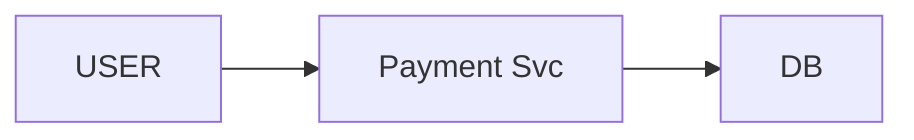

#### 0 SHURU: DB KAUNSA? SQL
```
DIKKAT 1   Ek payment me paanch likhai: Arpan -500, merchant +500, khaate (ledger) me 2 line, payment ka haal.
           Ye paanchon ek saath honi chahiye. Chaar hui aur ek reh gaya = hisaab galat.
HAL        SQL (Postgres / MySQL): kai row EK transaction me, sab ya kuch nahi (ACID).
           Teen table: wallet (account_id, balance) · ledger (sirf jodte) · payment (key, haal).
           Ek payment = BEGIN -> 2 balance UPDATE + 2 ledger INSERT + payment ka haal -> COMMIT.
           Beech me kuch bhi fail -> ROLLBACK -> paanchon me se ek bhi nahi hua.

DIKKAT 2   NoSQL kyun nahi?
HAL        Yahan kai row / table pe ek saath "sab ya kuch nahi" chahiye, aur paisa turant sahi dikhe.
           Paise me "thodi der baad sahi" (eventual) nahi chalta.
```

#### 1 Kirana ko 500 bheje, beech me server gira
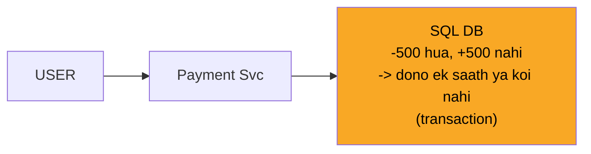
```
DIKKAT     Diwali subah maine kirana ko 500 bheje. Mere 500 kate, merchant me daalne se PEHLE server gira.
           500 na mere paas, na merchant ke paas. Gayab.
HAL        dono ek saath ya koi nahi (TRANSACTION): BEGIN Arpan -= 500 · Merchant += 500 COMMIT. DB pehle
           diary (WAL) me likhta; utha to dekhta: COMMIT ho chuka = poora karo, nahi = ulta. Aadha kabhi nahi.
NAHI       app me 'pehle kaato, fail pe wapas jodo': server beech me gira to wapas jodna chala hi nahi.
```
```
AAGE POOCHEGA:
  NIYAM: saare kate == saare jude, hamesha; na mile -> turant alert.
  "Beech me gira, wapas utha, DB kya karta?" -> DIARY (WAL) DEKHTA: COMMIT tha to poora, nahi tha to ulta;
                                                kyunki paanchon saath ya koi nahi.
```

#### 2 Wallet me 600, phone se 500 aur laptop se 500 ek saath
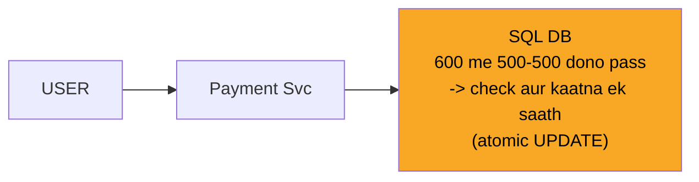
```
DIKKAT     Ab wallet me 600. Phone se dukaan ko 500 scan kiya, usi second laptop pe Swiggy ka 500.
           Do alag server, dono ne 600 dekha -> dono kaatenge?
HAL        check aur kaatna ek saath (ATOMIC UPDATE):
             UPDATE account SET balance = balance - 500 WHERE id = ? AND balance >= 500
NAHI       Java synchronized Payment Svc me: do machine, lock ek ke andar; doosri phir bhi 600 dekhti.
```
```
AAGE POOCHEGA:
  NIYAM: "hai?" aur "kaato" ek hi kadam; jo 0 row badle wo reject.
  "Dono me se kaun jeeta?" -> PEHLA (bacha 100): kyunki "hai?" aur "kaato" ek kadam; doosre ki 0 row badli =
                              reject.
```

#### 3 Metro me network gaya, app ne dobara bheja, 1000 kate
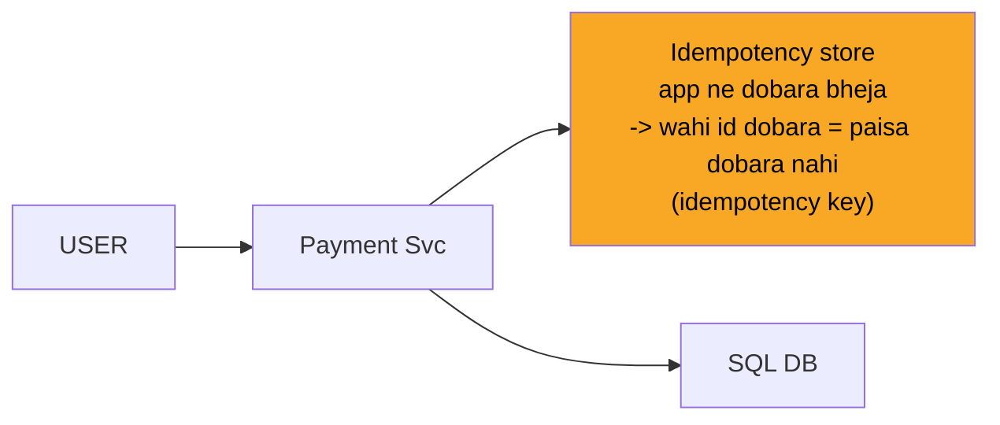
```
DIKKAT     Metro me (Rahul ne 2000 bheje the) maine Pay dabaya. 500 kat gaye, par jawab aate waqt network
           gaya. App ne timeout pe khud DOBARA bheja -> server ko do request, dono process -> 1000 kate.
HAL        wahi id dobara = paisa nahi (IDEMPOTENCY KEY): screen khulte app id banata (key-555), dobara WAHI.
           Pay button pehli tap pe band. DB me key UNIQUE: doosri request = saved jawab, paisa ek baar.
NAHI       server key banaye: server ko pata hi nahi ye wahi request hai.
```
```
AAGE POOCHEGA:
  NIYAM: ek key = ek payment; wahi key dobara aaye to kaam nahi, saved jawab.
  "Dono request ka kya hua?"                -> PEHLI: key-555 daali, IN_PROGRESS -> kaato + daalo -> DONE +
                                               jawab save · DOOSRI: pehle se -> saved jawab.
  "Sach me do payment chahiye (100 + 100)?" -> DO KEY: kyunki do baar payment screen khuli = do key -> dono
                                               honge.
  "Key server kyun nahi banata?"            -> APP BANAYE: kyunki dobara app bhejta; app ki key hi dono
                                               request ko jodti.
  "Key lag gayi, phir payment FAIL?"        -> SIRF PAKKA FAIL pe key hatao (paisa hila nahi); PENDING (pata
                                               nahi kata) pe key rahe, andha dobara nahi.
  "Kaam ho gaya, key delete kar do?"        -> NAHI, ~24 GHANTE: kyunki der se dobara aayi to kat jaata; phir
                                               saaf.
  "Redis aur DB dono kyun?"                 -> REDIS TEZ, DB PAKKA: SETNX chal rahi request turant pakde; DB
                                               UNIQUE aakhri deewar.
  "Do log ek balance pe, ye bhi bachata?"   -> NAHI: idempotency = EK user ki dobara request; do log ek saath
                                               = atomic query (card 2).
```

#### 4 Bank se 2000 top-up, PSP dheema
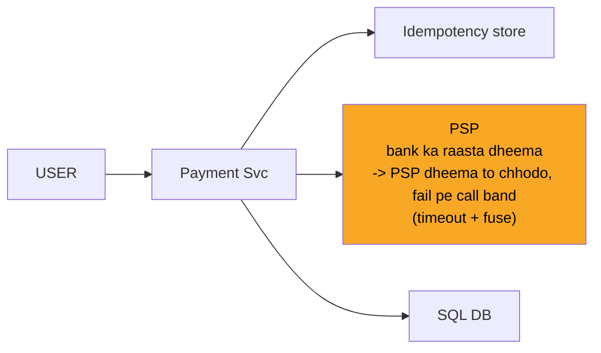
```
DIKKAT     Dopahar maine bank se wallet me 2000 daale (top-up). Ye paisa hamara DB nahi hilata: server PSP
           ko "bhejo" kehta, asli paisa bank rails pe. Wo raasta dheema -> har thread PSP me atka.
HAL        2-3 sec me chhodo, fail pe call band (TIMEOUT + FUSE): 5 baar fail -> OPEN (call mat bhejo, payment
           PENDING) -> 30 sec baad HALF-OPEN (ek test call) -> chali to CLOSED, fail to wapas OPEN.
NAHI       timeout pe "fail" dikha do: paisa shayad kat chuka.
```
```
AAGE POOCHEGA:
  NIYAM: bahar ka paisa = PSP; jawab pakka na ho to PENDING, "fail" nahi.
  "PSP ka timeout aaya, mujhe kya dikhe?" -> PROCESSING (PENDING): kyunki pata nahi kata ya nahi;
                                             reconciliation job PSP se poochh ke pakka kare.
  "Timeout lagao hi mat, wait karo?"      -> SAB PHANSE: kyunki har thread PSP me atka -> saare thread khatam
                                             -> system band.
  "Ek PSP band hua to?"                   -> DO PSP: ek band to doosra; par EK payment hamesha EK PSP pe,
                                             kyunki beech me badla = do jagah se kat sakta.
```

#### 5 PSP ko call kiya aur server gira: paisa gaya ya nahi?
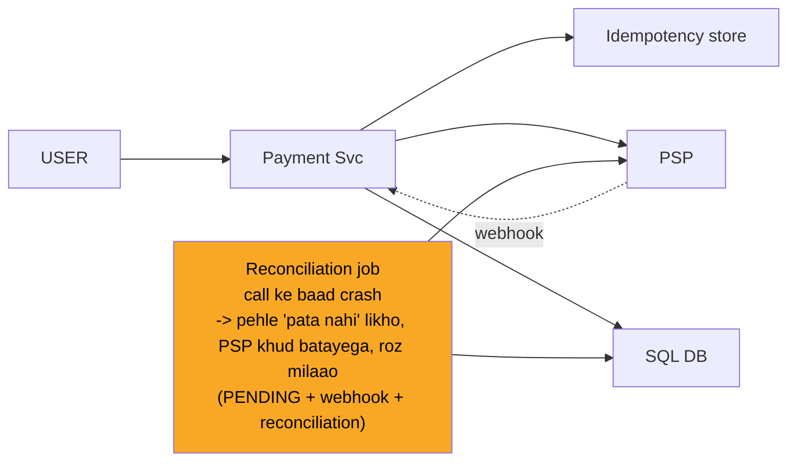
```
DIKKAT     Usi top-up me server ne PSP ko call kiya aur jawab se pehle gira. Paisa kat gaya aur jawab kho
           gaya, ya kata hi nahi? Pata nahi.
HAL        call se pehle 'pata nahi' likho (PENDING). PSP baad me khud batata "ho gaya / fail" (WEBHOOK).
           Milaan (RECONCILIATION): har kuch min purane PENDING PSP se poochho + raat PSP ki file se.
NAHI       "bas rollback kar do": PSP me shayad paisa sach me kat chuka.
```
```
AAGE POOCHEGA:
  NIYAM: courier jaisa: har parcel ka tracking number; courier wala gira, parcel gum nahi.
  "Job ne PSP se poochha, jawab mila to?" -> HUA = SUCCESS · NAHI = dobara (WAHI key) · PAKKA FAIL = FAILED +
                                             refund.
  "Webhook do baar aa gaya?"              -> SIRF EK BAAR PENDING -> SUCCESS: kyunki pehle se SUCCESS ho to
                                             ignore.
  "Webhook aa hi jaata, job kyun?"        -> WEBHOOK KHO SAKTA: der se aaye ya server band tha; job wo jaal jo
                                             chhoota pakde.
  "To sirf job chala lo?"                 -> DER + KHARCHA: har PENDING pe baar-baar PSP call (limit); isliye
                                             DONO.
  "Sab theek chal raha, kaise pata?"      -> ALERT: hisaab ka farak, p99, error rate, line ki lambai; TRACE ID
                                             se ek payment ka poora raasta.
```

#### 6 Merchant ka account doosre bank me, ek transaction nahi chalta
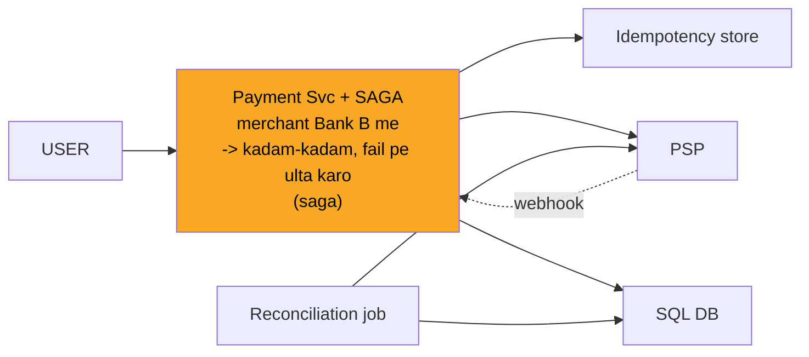
```
DIKKAT     Phir maine ek merchant ko 500 bheje, uska account Bank B me. Do system pe ek DB transaction nahi.
           Wallet se 500 kata, Bank B me daalna (PSP payout) fail -> paisa beech me latka.
HAL        kadam-kadam, fail pe ulta (SAGA): step-step, har step ke baad saga table me likho (DEBITED,
           CREDIT_PENDING..). Wallet -500 OK -> Bank B +500 FAIL -> ulta kaam: wallet me 500 wapas.
NAHI       2PC: sab "ready" bol ke lock pakad ke rukte; coordinator gira = sab atke, har payment dheema.
```
```
AAGE POOCHEGA:
  NIYAM: har step likha hua; aage nahi badh sake to ulta kaam (compensate).
  "Saga chalate service beech me giri?" -> SAGA TABLE: kyunki har step likha hua; uthke dekhti, wahin se aage
                                           ya ulta.
  "Beech me mujhe kya dikhe?"           -> PROCESSING: thodi der me SUCCESS ya paisa wapas (eventual).
```

#### 7 Maine poochha: kal raat 2200 tha, subah 1100 kaise?
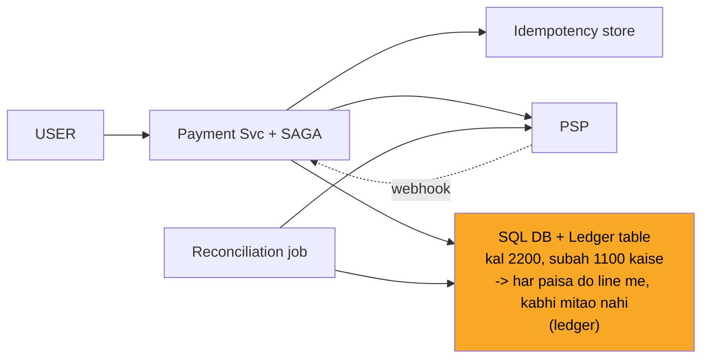
```
DIKKAT     Dopahar maine support se poochha "kal raat 2200, subah 1100 kaise?" (RBI audit bhi yahi poochhe).
           Balance column sirf aaj ka number batata, 1100 kaise bana uska record nahi.
HAL        har paisa khaate me (LEDGER), USI transaction me jisme paisa hila, sirf INSERT. Double-entry:
           "Arpan DEBIT 500" + "merchant CREDIT 500" (jod 0). Balance column bhi usi transaction me badalta.
NAHI       balance + alag audit_log table: usme kuch bhi likh sakte, koi niyam nahi jaanchta.
```
```
AAGE POOCHEGA:
  NIYAM: ledger hi sach; pen ki diary, kaat-peet nahi, sirf nayi line; jod hamesha 0.
  "Raat ko kya jaanchoge?"            -> JOD == BALANCE: kyunki ledger hi sach; farak = alert.
  "Galat entry dikhi, delete kar do?" -> NAYI ULTI LINE: kyunki pen ki diary; audit me dono dikhein.
  "To refund bhi aise hi?"            -> NAYI ULTI PAYMENT: merchant -500, Arpan +500, apni key + purani
                                         payment ka number, ledger me 2 line; jod asli se zyada nahi.
  "3 saal me ledger bahut bada?"      -> MAHINE KE TUKDE (partition): purane sasti jagah (S3 Glacier); kanoon
                                         ki had se pehle delete nahi.
  "Ledger crash se bhi bachaata?"     -> NAHI, wo hisaab / audit: crash se PENDING + webhook + reconciliation
                                         bachate.
```

#### 8 Shaam Diwali, 3000 payment / second, machine baith gayi
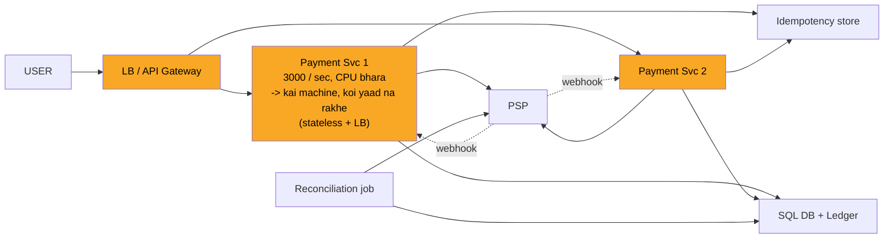
```
AAGE POOCHEGA:
  NIYAM: machine kuch yaad na rakhe, to koi bhi machine badlo / badhao.
  "Machine kaise badhaoge?"                  -> KUCH YAAD NAHI (stateless): saari yaad DB + idempotency store
                                                me, kai machine + LB, koi bhi koi bhi payment le.
  "Pehle baitha kyun?"                       -> BOJH KA CHAKKAR: CPU bhara -> timeout -> log dobara tap -> aur
                                                bojh.
  "Itni machine, galat istemaal kaise roko?" -> OWNER CHECK: userId JWT se (body se kabhi nahi), "from" ka
                                                maalik wahi? nahi -> 403; gateway pe login, aage WAF + had.
  "JWT hi chori ho gaya?"                    -> CHHOTI UMAR (~15 min) + refresh token: bade payment pe PIN /
                                                OTP.
  "LB ko kaise pata machine mari?"           -> GET /HEALTH har kuch second: jawab nahi = list se bahar.
```

#### 9 Merchant ki report ne mera payment rok diya
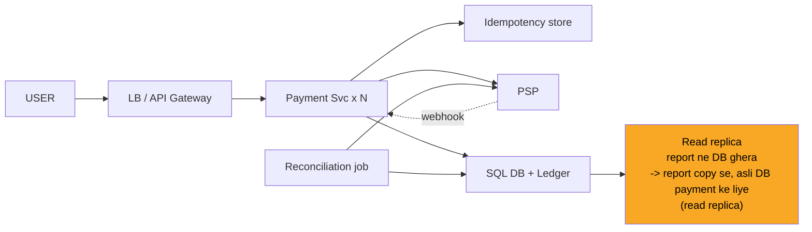
```
DIKKAT     Usi shaam ek bada merchant dashboard pe "is mahine ki saari payment" report chala raha. Bhaari
           query usi DB pe -> DB busy -> mera 500 ka payment likhne me atak gaya.
HAL        report copy se (READ REPLICA): primary sirf payment ke liye. Copy primary ki diary (WAL) padh ke
           peeche chalti (1-2 sec purani): report me chalta, balance me nahi.
NAHI       balance bhi replica se padho: replica peeche, mujhe purana balance dikhta.
```
```
AAGE POOCHEGA:
  NIYAM: paisa / haal = PRIMARY se; report = replica se.
  "Pay kiya, purana balance dikha?"        -> PRIMARY SE: kyunki replica peeche ho sakti; balance / haal
                                              hamesha primary.
  "Replica kitni peeche, kaise pata?"      -> REPLICATION LAG metric pe alert.
  "Bahut bhaari analytics bhi replica pe?" -> ALAG WAREHOUSE: CDC se data jaata, kyunki replica bhi bojh se
                                              peeche hoti.
  "Primary gira to?"                       -> SYNC STANDBY primary bane (RDS Multi-AZ): har likhai uspe bhi
                                              pakki, kuch nahi khota; async pe aakhri likhai kho sakti.
```

#### 10 Saal me ~1000 crore row, primary ki likhai dheemi
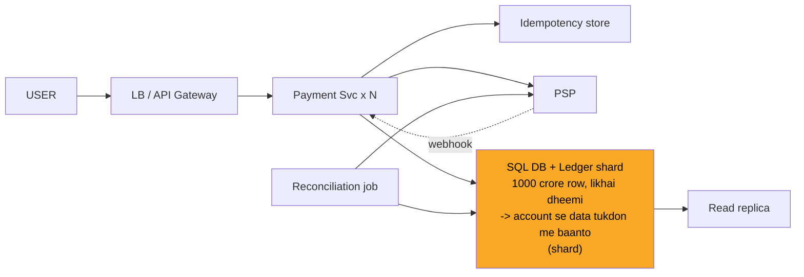
```
DIKKAT     ~1000 crore payment row saal me. Table + index RAM me nahi samaate, har likhai pe index disk se
           -> Diwali ke 3000 / sec pe ek primary ki likhai dheemi.
HAL        account se data baanto (SHARD by account_id): mera balance aur meri saari history ek hi tukde pe ->
           mujhse kaatna ek jagah, ek transaction, atomic.
NAHI       txn_id se baanto: meri payment alag shard pe, balance kahan? · time se: aaj wala shard garam.
```
```
AAGE POOCHEGA:
  NIYAM: jo ek transaction me saath chahiye (account + uski history), wo ek shard pe.
  "Account kis shard pe, kaise tay?"             -> CONSISTENT HASHING ya LOOKUP TABLE (account -> shard, baad
                                                    me badal sako).
  "Amazon jaisa merchant ek shard garam kar de?" -> KAI SUB-ACCOUNT: alag shard pe; report me jod do.
  "Do shard ke beech transfer?"                  -> SAGA: shard A se kaato, B me daalo, fail pe ulta; kyunki
                                                    ek transaction ek shard tak. Asli mushkil yahi.
```

---

## AAKHRI DABBA + WRAP (ek hi baar)

```
User -> Gateway (login + rate limit) -> Payment Svc (stateless, owner check, saga)
-> Idempotency (ek key ek baar, unique) -> SQL DB (ACID: kaato + daalo + ledger, shard by account)
-> PSP (sirf bahar ka paisa: top-up / payout / doosra bank, pehle PENDING)
-> webhook (PSP batata) · Reconciliation job (hum poochhte, jaal)
Read replica = sirf dashboard / report

DB:  SQL + ACID -> kaatna aur daalna ek saath · ledger double-entry, kabhi badla nahi jaata
     idempotency key -> { haal, jawab }, ~24 ghante
```
```
JAWAB:    Har payment pe ek id, dobara bheja to pehla jawab, paisa ek hi baar.
          Kaatna + daalna ek transaction me, aur khaate me dono line. Alag bank / alag jagah ho to
          step-step + fail pe ulta.
          Wallet se wallet hamare DB me. Bank se aana / bank me jaana PSP karta, isliye wahan pehle
          PENDING likho, phir PSP ke webhook aur roz ke milaan se pakka karo.
          Aage: fraud check, kai currency, chargeback.
```
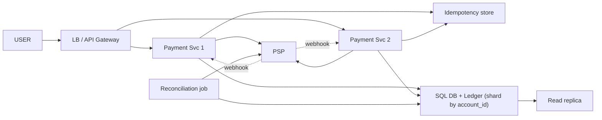

---

## 10 GUNA TRAFFIC — har dabba alag se

```
Gateway           -> bheed / hamla -> rate limit
Payment Svc       -> stateless -> machine badhao
Idempotency       -> do request ek saath -> unique / SETNX
SQL DB            -> kaatna + daalna ek transaction · padhai -> replica · likhai -> shard by account_id
PSP               -> dheema / band -> PENDING + fuse · jawab nahi -> webhook + reconciliation
Ledger            -> sirf jodo, mahine ke tukde, purana sasti jagah
ASLI MUSHKIL      -> alag bank / shard ke beech ka len-den, bheed nahi

POOCHEGA: "How would you scale this to 10x?"      -> paise ka raasta chalo, har dabbe pe "kya toota"
POOCHEGA: "What's the single point of failure?"   -> DB primary (sync standby promote), PSP (doosra PSP)
```

---

## POOCHE TO (gehra sawaal aaye tab)

```
API:      POST /pay { from, to, amount } + header Idempotency-Key: <UUID>  -> { status, txn_id }

KEY KAB BANTI:
          key random hai, payment SCREEN khulte banti. Nayi payment screen = nayi key.
          (A) Arpan ne do alag payment kiye -> key-555, key-888 -> 100 + 100 = 200 (do payment, sahi)
          (B) ek tap + network ne dobara bheja -> wahi key-555 dobara -> "aa chuki" -> pehla jawab -> 100
          farak = KAUN dobara bhej raha: Arpan nayi payment screen se (nayi key, naya payment)
          · system (wahi key, ek hi baar)
          maqsad do payment rokna NAHI, sirf network ke dobara bhejne ko do baar ginne se rokna
          CHEQUE jaisa: key = cheque number · do cheque = dono cash · ek number do baar = nahi
                        bank amount nahi, NUMBER dekhta

DATA:     LEDGER double-entry, kabhi badla nahi · IDEMPOTENCY key -> { haal, jawab } ~24 ghante ·
          KEY ka haal:     IN_PROGRESS -> DONE (dobara aayi request ke liye)
          PAYMENT ka haal: INITIATED -> PENDING -> SUCCESS / FAILED (paisa kahan tak pahuncha)
          NIYAM saare kate == saare jude

SCAM 1992 (ledger kyun itna zaroori):
          1990-91 me kaagaz ka ledger + haath se bani Bank Receipt (BR) -> badli ja sakti, nakli ban sakti,
          turant koi jaanch nahi -> nakli / khaali BR + beech ka paisa market me + der se pakda (~Rs. 4000 cr)
          nakli entry          -> NIYAM (kate == jude) + sirf asli paise ki entry
          paisa gaya, share nahi -> sab-ya-kuch-nahi settlement (ACID / SAGA)
          badli ja sakne wali BR -> kabhi na badalne wala double-entry + audit
          beech ka paisa       -> turant RECONCILIATION
          kaagaz se digital: ledger nahi mara, sirf kaagaz gaya
          · blockchain = sabse pakka na-badalne-wala ledger
          baad me: SEBI ko kanooni taakat (1992) · NSE screen trading
          (1994) · NSDL demat (1996) · T+2 (2003) · T+1 (2021-23)
```

---

## HANDS-ON — Idempotency LIVE (usercrud, 27-Aug)

> Ek line me: "map me key hai? -> kuch mat karo, wahi wapas. Nahi? -> process + map me daal do."

```java
@RestController
public class IdempotencyController {

    // key -> pehle jo result diya (duplicate pe wahi wapas)
    private final ConcurrentHashMap<String, String> processed = new ConcurrentHashMap<>();
    // asli orders ka counter (SAABIT karega double hua ya nahi)
    private final AtomicInteger orderCounter = new AtomicInteger(0);

    @PostMapping("/pay")
    public String pay(@RequestHeader("Idempotency-Key") String key,
                      @RequestParam int amount) {

        // ATOMIC claim: key hai? -> existing wapas | nahi? -> "PROCESSING" daal + null return
        String existing = processed.putIfAbsent(key, "PROCESSING");
        if (existing != null) {
            return "DUPLICATE (key already claimed) -> " + existing
                 + "  | total orders = " + orderCounter.get();
        }

        // yahan sirf EK thread pahunchega (jisne putIfAbsent race JEETI)
        int orderId = orderCounter.incrementAndGet();
        String result = "Order #" + orderId + " created, amount=" + amount;

        processed.put(key, result);   // "PROCESSING" ko asli result se replace

        return "OK -> " + result + "  | total orders = " + orderCounter.get();
    }
}
// SecurityConfig: .requestMatchers("/pay").permitAll()
```
```
SEQUENTIAL:  A key abc-123, 100 -> OK Order #1, total 1
             B wahi dobara      -> DUPLICATE Order #1, total 1   (2 NAHI)
             C key xyz-999, 200 -> OK Order #2, total 2

RACE:        naive containsKey + put = 2 step, GAP -> A "nahi", B "nahi" -> dono order = DOUBLE
             putIfAbsent = 1 ATOMIC step -> sirf ek jeet-ta
             atomicity NAAM se nahi, ConcurrentHashMap se (bucket
             lock / CAS). plain HashMap = thread-safe nahi

20 PARALLEL, same key "race-1":
             1..20 | ForEach-Object { Start-Job { curl.exe -s -X POST ".../pay?amount=100"
             -H "Idempotency-Key: race-1" } } | Wait-Job | Receive-Job
             BROKEN (containsKey + put + sleep 50) -> Order #1 AUR #2 -> total 2 = DOUBLE CHARGE live
             ATOMIC (putIfAbsent) -> 1 OK, 19 DUPLICATE -> total 1
             pehli DUPLICATE "-> PROCESSING" = reserve-then-fill live dikha

PROD:        Redis / DB unique constraint (memory restart pe udti) + key TTL · PROCESSING placeholder
JAWAB:    Pehle 'key hai?' dekhna aur phir 'daalna' do alag kadam the, beech me doosri request ghus
          gayi. ConcurrentHashMap ka putIfAbsent dono ek hi kadam me karta, to ek hi jeetti.
          Asli system me ye kaam Redis ya DB ka unique karta. 20 request ek saath maari: purane code ne
          2 order banaye, naye ne 1.
```

ARCHETYPE C · CONCEPTS: [db-what-when](../../FOUNDATIONS/09_databases_what_when.md) · [CAP](../../FOUNDATIONS/08_cap_theorem.md) · [saga/ms-comm](../../FOUNDATIONS/10_ms_communication.md) · saath: [bookmyshow](../09_bookmyshow/09_bookmyshow_INTERVIEW.md) · [stock-broker](../05_stock_broker_trading/05_stock_broker_trading.md) · [← MASTER SHEET](../../00_MASTER_SHEET.md)
