# Payment System (UPI-style)

> User A se User B / merchant ko paisa, bharose ke saath. Misaal: Arpan ne kirana dukaan (merchant) ko Rs. 500 bheje.
> Is design ka dil: **paisa DO BAAR na kate** + **paisa kabhi GUM na ho**. Finance HLD ka core, JP / GS ka favourite.

```
CHAAR MUSHKIL BAAT (poori file inhi ke ird-gird):
   do baar na kate (IDEMPOTENCY) · dono taraf ek saath (CONSISTENCY)
   kuch gire to bhi paisa na khoye (FAILURE HANDLING) · har paise ka hisaab (LEDGER / AUDIT)
```

---

## KAHANI (ek din, Diwali, mera wallet; har dikkat se design me ek dabba judta)

```
    KYA HUA                                    ILAAJ                                DABBA JUDA
1   kirana ko 500, beech me server gira     -> EK TRANSACTION (WAL se poora / ulta)   SQL DB
2   600 me phone se 500, laptop se 500      -> check + kaato EK atomic query         (DB query)
3   metro me network gaya, app ne dobara    -> IDEMPOTENCY KEY (screen khulte)       Idempotency store
4   bank se 2000 top-up, PSP dheema         -> timeout = PENDING, circuit breaker = abhi nahi   PSP
5   PSP ko call kiya, jawab se pehle crash  -> PENDING pehle + WEBHOOK + RECONCILE   Reconciliation job
6   merchant ka account Bank B me           -> SAGA (step-step, fail pe ulta)        Payment Svc + SAGA
7   "kal raat 2200, subah 1100 kaise?"      -> LEDGER double-entry, sirf INSERT      Ledger table
8   shaam Diwali, 3000 payment / sec        -> STATELESS, kai machine + LB           LB / Gateway + Svc x N
9   merchant ki report ne payment roke      -> READ REPLICA (sirf report)            Read replica
10  ~1000 crore row / saal, likhai dheemi   -> SHARD by account_id                   SQL DB shard

POORA DESIGN (upar ke dabbe kram se):
   User -> Gateway / LB -> Payment Svc (stateless, saga) -> Idempotency -> SQL DB (ACID + ledger, shard)
   bahar ka paisa: Payment Svc -> PSP (pehle PENDING) · webhook + Reconciliation job · report -> Read replica
```

---

## TASVEER (ByteByteGo / Alex Xu · CC BY-NC-ND 4.0)


Source: [How to Avoid Double Payment](https://bytebytego.com/guides/how-to-avoid-double-payment/)
(dobara bhejne pe do baar na kate = IDEMPOTENCY KEY)


Source: [Reconciliation in Payment](https://bytebytego.com/guides/reconciliation-in-payment/)
(crash ke baad asli haal PSP se milaana = RECONCILIATION)

---

## SHURU: pehle poocho, phir numbers

```
POOCHO:  "P2P, merchant, refund, settlement, fraud — kis pe? Main ek user se doosre tak paisa bhejne pe."
         ★ dono account EK hi system / bank me ya ALAG?  <- isse poora design badalta:
           ek DB -> ek TRANSACTION (ACID) kaafi · alag bank -> SAGA ka khel
         refund scope me? · bahar ka PSP (Razorpay / Stripe) ya khud? · audit / RBI ka hisaab?

KYA KARE (FR):    A se B ko bhejo · dobara bhejne pe dobara na kate
                  · fail ho to paisa wapas · har paisa traceable
                  scope bahar: fraud engine · kai currency · chargeback
KAISA CHALE (NFR): paisa KHOYE nahi (kata par pahuncha nahi) · ATKE nahi (beech me network gaya)
                   DO BAAR na kate (500 ki jagah 1000) · har paisa TRACE ho (audit)

NUMBERS (andaaza):
   ~10 crore user · aam din kuch sau payment / second · festival / sale pe kuch hazaar / second
   ★ "Payment me bheed badi dikkat nahi, SAHI hona badi dikkat hai.
      Pehle sab-ya-kuch-nahi + do-baar-nahi + ledger."
   -> SQL DB (ACID: kai row ek transaction me) + ledger jisme sirf jodte hain
   DHYAAN: "NoSQL me ACID hota hi nahi" mat bolo -- kai NoSQL ek row / document pe atomic hain.
           sahi farak: debit + credit + ledger = KAI ROW ek saath -> SQL me ye seedha aur pakka.
```
```
POOCHEGA: "Consistency or availability — which do you pick?"
          (Consistency ya availability, kya chunoge?)

JAWAB:    Paise me sahi hona pehle. Network toota aur pakka nahi pata balance kya hai, to payment mana
          kar do. Galat balance pe paisa kaat dena usse kahin bura hai.
          Dashboard / report thode purane bhi chalte hain, wo chalte rahein.
```

---

## ════ MOCK SE PEHLE: SIRF YE CARD PADHO ════

> Har card: pehle PEELA DABBA dekho (scene + ilaaj). Yaad aa gaya -> aage. Nahi aaya -> neeche
> DIKKAT / NAHI padho. AAGE POOCHEGA sirf jab interviewer aage kuch poochhe.

#### DABBA 0: SABSE SIMPLE (yahan se shuru, phir "kahan tootega")
```
Payment service DB me do kaam kare: Arpan ke 500 ghatao, merchant ke 500 badhao.

PAISA KAHAN HILTA (pehle ye tay, poori file isi pe):
  Arpan aur merchant dono ka WALLET hamare system me (Paytm / PhonePe wallet jaisa).
  Wallet se wallet = hamare DB ke andar, ek transaction.
  Bahar ka paisa = PSP (Razorpay / bank) se: bank se wallet me daalna (top-up), wallet se bank me
  nikaalna (payout), ya merchant kisi doosre bank me hai.
```


#### SHURU: DB KAUNSA? SQL
```
DIKKAT     Ek payment me paanch likhai: Arpan -500, merchant +500, khaate (ledger) me 2 line, payment ka haal.
           Ye paanchon ek saath honi chahiye. Chaar hui aur ek reh gaya = hisaab galat.
HAL        paanchon ek saath ya koi nahi (SQL transaction, ACID): Postgres / MySQL me kai row, kai table,
           BEGIN ... COMMIT; beech me kuch fail -> ROLLBACK.
```
```
TASVEER: ek payment, paanch likhai
teen table:  wallet (account_id, balance) · ledger (sirf jodte) · payment (key, haal)
BEGIN -> Arpan -500 · merchant +500 · ledger 2 line · payment ka haal -> COMMIT
beech me kuch bhi fail -> ROLLBACK -> paanchon me se ek bhi nahi hua
```
```
AAGE POOCHEGA:
  NIYAM: paanchon likhai ek transaction: sab ya kuch nahi (ACID); user ko sirf "hua" ya "nahi hua"
         dikhe, beech ka kabhi nahi.
  SAFAR (ek payment ki paanch likhai):
  sab theek                -> BEGIN -> paanchon -> COMMIT: user ko "hua"
  ledger INSERT fail       -> ROLLBACK: Arpan ka -500 bhi ulta, paanchon me se ek bhi nahi
  ROLLBACK hua             -> user ko "nahi hua", paisa jaisa tha; dobara try kar sakta
```

#### 1 Kirana ko 500 bheje, beech me server gira
```
DIKKAT     Diwali subah maine kirana ko 500 bheje. Mere 500 kate, merchant me daalne se PEHLE server gira.
           500 na mere paas, na merchant ke paas. Gayab.
```

```
NAHI       app me 'pehle kaato, fail pe wapas jodo': server beech me gira to wapas jodna chala hi nahi.
```
```
AAGE POOCHEGA:
  NIYAM: saare kate == saare jude, ek transaction (aadha kabhi nahi); gira to DB log (WAL) se poora ya
         ulta. User ko 'hua' ya 'nahi hua' dikhe, beech ka nahi; hisaab ka farak -> turant alert.
  SAFAR (kirana ke 500):
  sab theek              -> paanchon likhai ek transaction, COMMIT, user ko "hua"
  -500 ke baad gira      -> utha to log (WAL) dekhe: COMMIT nahi tha -> ulta, 500 wapas
  COMMIT ke baad gira    -> log (WAL) me COMMIT -> poora karo, kuch nahi khota
```

#### 2 Wallet me 600, phone se 500 aur laptop se 500 ek saath
```
DIKKAT     Ab wallet me 600. Phone se dukaan ko 500 scan kiya, usi second laptop pe Swiggy ka 500.
           Do alag server, dono ne 600 dekha -> dono kaatenge?
```

```
NAHI       Java synchronized Payment Svc me: do machine, lock ek ke andar; doosri phir bhi 600 dekhti.
```
```
AAGE POOCHEGA:
  NIYAM: 'hai?' aur 'kaato' ek hi kadam, DB ke andar: kitni bhi machine ho, jeetta ek; 0 row badli =
         reject, user ko turant 'paisa kam' dikhe.
  SAFAR (600 me se 500 + 500):
  sab theek               -> ek UPDATE: check + kaato ek kadam (balance >= 500)
  phone + laptop ek saath -> pehla jeeta (bacha 100); doosre ki 0 row -> "paisa kam"
  WHERE check bhool gaye  -> DB CHECK (balance >= 0) pakad leta: aakhri deewar
```

#### 3 Metro me network gaya, app ne dobara bheja, 1000 kate
```
DIKKAT     Metro me (Rahul ne 2000 bheje the) maine Pay dabaya. 500 kat gaye, par jawab aate waqt network
           gaya. App ne timeout pe khud DOBARA bheja -> server ko do request, dono process -> 1000 kate.
```

```
NAHI       server key banaye: server ko pata hi nahi ye wahi request hai.
```
```
AAGE POOCHEGA:
  NIYAM: ek key = ek payment: key app banaye; wahi key dobara = kaam nahi, saved jawab. User ko ek hi
         payment dikhe; nayi payment = nayi screen = nayi key.
  SAFAR (ek payment, metro me):
  sab theek                   -> key-555 screen pe bani: IN_PROGRESS -> kaato + daalo -> DONE + jawab
  network gaya, app ne dobara -> wahi key-555 -> saved jawab, dobara nahi kata
  wahi key, amount alag       -> request ka hash bhi rakho: farak = 422
  key kab hatao               -> pakka fail pe hi key hatao (paisa hila nahi); DONE ~24 ghante
```

#### 4 Bank se 2000 top-up, PSP dheema
```
DIKKAT     Dopahar maine bank se wallet me 2000 daale (top-up). Ye paisa hamara DB nahi hilata: server PSP
           ko "bhejo" kehta, asli paisa bank rails pe. Wo raasta dheema -> har thread PSP me atka.
```

```
NAHI       timeout pe "fail" dikha do: paisa shayad kat chuka.
```
```
AAGE POOCHEGA:
  NIYAM: call GAYI aur jawab nahi = PENDING, 'fail' kabhi nahi; call gayi hi nahi (circuit OPEN) = saaf
         "abhi nahi", paisa hila hi nahi. PSP dheema to jaldi chhodo, warna saare thread atke.
  SAFAR (2000 top-up):
  sab theek              -> PSP ko call, jaldi jawab, SUCCESS
  2-3 sec me jawab nahi  -> chhodo: PENDING (pata nahi kata), baad me pata
  5 fail                 -> circuit OPEN: call jaati hi nahi -> saaf "abhi nahi", paisa hila nahi
  30 sec baad test call  -> chali to circuit band, nahi to phir OPEN
```

#### 5 PSP ko call kiya aur server gira: paisa gaya ya nahi?
```
DIKKAT     Usi top-up me server ne PSP ko call kiya aur jawab se pehle gira. Paisa kat gaya aur jawab kho
           gaya, ya kata hi nahi? Pata nahi.
```

```
NAHI       "bas rollback kar do": PSP me shayad paisa sach me kat chuka.
```
```
AAGE POOCHEGA:
  NIYAM: call se PEHLE 'pata nahi' (PENDING) likho: server gire to bhi tracking number bacha; PSP khud
         bataye (webhook) ya hum poochhe (job). User ko PROCESSING, andha dobara kabhi nahi.
  SAFAR (call ke beech server gira):
  sab theek              -> call se pehle PENDING likho, PSP ka jawab -> SUCCESS
  call ke baad crash     -> PENDING bacha: PSP khud bataye (webhook)
  webhook do baar        -> SUCCESS sirf ek baar, doosra ignore
  webhook nakli          -> hastakshar jaancho (PSP secret) + apne PENDING se milao
  webhook aaya hi nahi   -> job har kuch min purane PENDING PSP se poochhe
  raat ko                -> PSP ki file se poora milaan
  job ka jawab           -> hua = SUCCESS · pakka fail = FAILED, kuch wapas nahi (paisa hila nahi)
```

#### 6 Merchant ka account doosre bank me, ek transaction nahi chalta
```
DIKKAT     Phir maine ek merchant ko 500 bheje, uska account Bank B me. Do system pe ek DB transaction nahi.
           Wallet se 500 kata, Bank B me daalna (PSP payout) fail -> paisa beech me latka.
```

```
NAHI       2PC: sab "ready" bol ke lock pakad ke rukte; coordinator gira = sab atke, har payment dheema.
```
```
AAGE POOCHEGA:
  NIYAM: alag system = har step likha (saga table); aage nahi badh sake to ulta kaam (compensate).
         Beech me user ko PROCESSING, phir SUCCESS ya paisa wapas.
  SAFAR (merchant Bank B me):
  sab theek              -> wallet -500 (DEBITED) -> Bank B +500, har kadam saga table me
  Bank B +500 fail       -> ulta kaam: wallet me 500 wapas (compensate)
  service beech me giri  -> uthke saga table dekhe: wahin se aage ya ulta
  ulta kaam bhi fail     -> retry + alert, manual queue: paisa beech me na atke
```

#### 7 Maine poochha: kal raat 2200 tha, subah 1100 kaise?
```
DIKKAT     Dopahar maine support se poochha "kal raat 2200, subah 1100 kaise?" (RBI audit bhi yahi poochhe).
           Balance column sirf aaj ka number batata, 1100 kaise bana uska record nahi.
```

```
NAHI       balance + alag audit_log table: usme kuch bhi likh sakte, koi niyam nahi jaanchta.
```
```
AAGE POOCHEGA:
  NIYAM: ledger hi sach: sirf nayi line, kaat-peet nahi, jod hamesha 0; galti / refund = nayi ulti line.
         Raat jod == balance, farak = alert.
  SAFAR (2200 -> 1100 ka hisaab):
  sab theek                -> har payment 2 line (Arpan DEBIT · merchant CREDIT), jod 0, usi transaction
  2200 se 1100 kaise       -> raat ki line padho: bijli 800, recharge 300 -> line-line dikhta
  galat entry / refund     -> mitao nahi (sirf INSERT): nayi ulti line, audit me dono
  balance column vs khaata -> raat jod == balance; farak = alert
```

#### 8 Shaam Diwali, 3000 payment / second, machine baith gayi
```
DIKKAT     Shaam Diwali, sab ek saath payment kar rahe: 3000 / sec. Saari request ek hi Payment Svc machine pe
           -> CPU bhara, payment dheeme, phir machine giri -> kisi ka payment nahi ja raha.
```

```
AAGE POOCHEGA:
  NIYAM: machine kuch yaad na rakhe (yaad DB + idempotency store me), to koi bhi machine badlo / badhao;
         kaun hai = JWT se, body se kabhi nahi.
  SAFAR (Diwali 3000 / sec):
  sab theek              -> LB se kisi bhi machine pe, userId JWT se, owner check
  CPU bhara              -> timeout -> log dobara tap -> aur bojh: machine badhao
  machine badhao         -> koi yaad na rakhe: yaad DB + idempotency store, kai machine
  ek machine mari        -> LB har kuch sec poochta (GET /health): jawab nahi = bahar
```

#### 9 Merchant ki report ne mera payment rok diya
```
DIKKAT     Usi shaam ek bada merchant dashboard pe "is mahine ki saari payment" report chala raha. Bhaari
           query usi DB pe -> DB busy -> mera 500 ka payment likhne me atak gaya.
```

```
NAHI       balance bhi replica se padho: replica peeche, mujhe purana balance dikhta.
```
```
AAGE POOCHEGA:
  NIYAM: paisa / haal = PRIMARY se (replica peeche ho sakti); report = replica / warehouse se. Primary
         gira = sync standby bane, kuch nahi khota.
  SAFAR (meri payment + merchant report):
  sab theek                             -> payment primary pe, report copy (replica) se
  pay kiya, balance dekha               -> primary se: copy 1-2 sec peeche
  copy aur peeche gayi                  -> kitni peeche naapo (replication lag) -> alert
  report itni bhaari ki copy bhi baithe -> alag warehouse (CDC)
```

#### 10 Saal me ~1000 crore row, primary ki likhai dheemi
```
DIKKAT     ~1000 crore payment row saal me. Table + index RAM me nahi samaate, har likhai pe index disk se
           -> Diwali ke 3000 / sec pe ek primary ki likhai dheemi.
```

```
NAHI       txn_id se baanto: meri payment alag shard pe, balance kahan? · time se: aaj wala shard garam.
```
```
AAGE POOCHEGA:
  NIYAM: jo ek transaction me saath chahiye (account + uski history), wo ek shard pe; do shard ke beech
         = saga, ek transaction nahi.
  SAFAR (1000 crore row):
  sab theek                        -> account + uski history ek shard: ek transaction ek shard tak
  ek account bahut bada (merchant) -> wo shard garam: sub-account alag shard, report me jodo
  do account alag shard            -> saga: A se kaato, B me daalo, fail pe ulta
  idempotency key kahan            -> account_id se usi shard: payment ke saath ek transaction
```

---

## AAKHRI DABBA + WRAP (ek hi baar)

```
User -> Gateway (login + rate limit) -> Payment Svc (stateless, owner check, saga)
-> Idempotency (ek key ek baar, unique) -> SQL DB (ACID: kaato + daalo + ledger, shard by account)
-> PSP (sirf bahar ka paisa: top-up / payout / doosra bank, pehle PENDING)
-> webhook (PSP batata) · Reconciliation job (hum poochhte, jaal)
Read replica = sirf dashboard / report

DB:  SQL + ACID -> kaatna aur daalna ek saath · ledger double-entry, kabhi badla nahi jaata
     idempotency key -> { haal, jawab }, ~24 ghante
```
```
JAWAB:    Har payment pe ek id, dobara bheja to pehla jawab, paisa ek hi baar.
          Kaatna + daalna ek transaction me, aur khaate me dono line. Alag bank / alag jagah ho to
          step-step + fail pe ulta.
          Wallet se wallet hamare DB me. Bank se aana / bank me jaana PSP karta, isliye wahan pehle
          PENDING likho, phir PSP ke webhook aur roz ke milaan se pakka karo.
          Aage: fraud check, kai currency, chargeback.
```


---

## 10 GUNA TRAFFIC — har dabba alag se

```
Gateway           -> bheed / hamla -> rate limit
Payment Svc       -> stateless -> machine badhao
Idempotency       -> do request ek saath -> unique / SETNX
SQL DB            -> kaatna + daalna ek transaction · padhai -> replica · likhai -> shard by account_id
PSP               -> dheema = PENDING · band = circuit breaker, "abhi nahi"
                     · jawab nahi -> webhook + reconciliation
Ledger            -> sirf jodo, mahine ke tukde, purana sasti jagah
ASLI MUSHKIL      -> alag bank / shard ke beech ka len-den, bheed nahi

POOCHEGA: "How would you scale this to 10x?"      -> paise ka raasta chalo, har dabbe pe "kya toota"
POOCHEGA: "What's the single point of failure?"   -> DB primary (sync standby promote), PSP (doosra PSP)
```

---

## POOCHE TO (gehra sawaal aaye tab)

```
API:      POST /pay { from, to, amount } + header Idempotency-Key: <UUID>  -> { status, txn_id }

KEY KAB BANTI:
          key random hai, payment SCREEN khulte banti. Nayi payment screen = nayi key.
          (A) Arpan ne do alag payment kiye -> key-555, key-888 -> 100 + 100 = 200 (do payment, sahi)
          (B) ek tap + network ne dobara bheja -> wahi key-555 dobara -> "aa chuki" -> pehla jawab -> 100
          farak = KAUN dobara bhej raha: Arpan nayi payment screen se (nayi key, naya payment)
          · system (wahi key, ek hi baar)
          maqsad do payment rokna NAHI, sirf network ke dobara bhejne ko do baar ginne se rokna
          CHEQUE jaisa: key = cheque number · do cheque = dono cash · ek number do baar = nahi
                        bank amount nahi, NUMBER dekhta

DATA:     LEDGER double-entry, kabhi badla nahi · IDEMPOTENCY key -> { haal, jawab } ~24 ghante ·
          KEY ka haal:     IN_PROGRESS -> DONE (dobara aayi request ke liye)
          PAYMENT ka haal: INITIATED -> PENDING -> SUCCESS / FAILED (paisa kahan tak pahuncha)
          NIYAM saare kate == saare jude

SCAM 1992 (ledger kyun itna zaroori):
          1990-91 me kaagaz ka ledger + haath se bani Bank Receipt (BR) -> badli ja sakti, nakli ban sakti,
          turant koi jaanch nahi -> nakli / khaali BR + beech ka paisa market me + der se pakda (~Rs. 4000 cr)
          nakli entry          -> NIYAM (kate == jude) + sirf asli paise ki entry
          paisa gaya, share nahi -> sab-ya-kuch-nahi settlement (ACID / SAGA)
          badli ja sakne wali BR -> kabhi na badalne wala double-entry + audit
          beech ka paisa       -> turant RECONCILIATION
          kaagaz se digital: ledger nahi mara, sirf kaagaz gaya
          · blockchain = sabse pakka na-badalne-wala ledger
          baad me: SEBI ko kanooni taakat (1992) · NSE screen trading
          (1994) · NSDL demat (1996) · T+2 (2003) · T+1 (2021-23)

CARD SE AAYE SAWAAL (safar ke bahar):
"NoSQL kyun nahi?"                  -> kai row / table pe ek saath sab ya kuch nahi, paisa turant sahi;
                                       "thodi der baad sahi" (eventual) paise me nahi (SHURU)
"Sach me do payment (100 + 100)?"    -> do baar screen khuli = do key -> dono honge (card 3)
"Key server kyun nahi banata?"       -> dobara app bhejta; app ki key hi dono request jodti (card 3)
"Redis aur DB dono kyun?"            -> Redis (SETNX) tez pakde, DB UNIQUE aakhri deewar (card 3)
"Do log ek balance pe, key bachati?" -> nahi: wo atomic query (card 2); key = ek user ka dobara (card 3)
"Timeout lagao hi mat, wait karo?"   -> sab thread PSP me atke -> system band (card 4)
"Webhook aa hi jaata, job kyun?"     -> webhook kho sakta (der / server band); job chhoota pakde (card 5)
"To sirf job chala lo?"              -> der + kharcha (PSP ki limit); isliye dono (card 5)
"Sab theek chal raha, kaise pata?"   -> alert (hisaab farak, p99, error, line) + trace id (card 5)
"Ledger crash se bhi bachaata?"      -> nahi, wo hisaab; crash se PENDING + webhook + job (card 7)
"Galat istemaal kaise roko?"         -> 'from' ka maalik JWT wala? nahi -> 403; WAF + had (card 8)
"Account kis shard pe, kaise tay?"   -> ring (consistent hashing) ya naksha (lookup table) (card 10)
"3 saal me ledger bada?"             -> mahine ke tukde, purane S3 Glacier; kanoon tak rakho (card 7)
"JWT chori ho gaya?"                 -> chhoti umar (~15 min) + refresh; bade payment pe PIN / OTP (card 8)
"PSP hi poora band?"                 -> doosra PSP; par ek payment hamesha ek PSP pe (card 4)
```

---

## HANDS-ON — Idempotency LIVE (usercrud, 27-Aug)

> Ek line me: "map me key hai? -> kuch mat karo, wahi wapas. Nahi? -> process + map me daal do."

```java
@RestController
public class IdempotencyController {

    // key -> pehle jo result diya (duplicate pe wahi wapas)
    private final ConcurrentHashMap<String, String> processed = new ConcurrentHashMap<>();
    // asli orders ka counter (SAABIT karega double hua ya nahi)
    private final AtomicInteger orderCounter = new AtomicInteger(0);

    @PostMapping("/pay")
    public String pay(@RequestHeader("Idempotency-Key") String key,
                      @RequestParam int amount) {

        // ATOMIC claim: key hai? -> existing wapas | nahi? -> "PROCESSING" daal + null return
        String existing = processed.putIfAbsent(key, "PROCESSING");
        if (existing != null) {
            return "DUPLICATE (key already claimed) -> " + existing
                 + "  | total orders = " + orderCounter.get();
        }

        // yahan sirf EK thread pahunchega (jisne putIfAbsent race JEETI)
        int orderId = orderCounter.incrementAndGet();
        String result = "Order #" + orderId + " created, amount=" + amount;

        processed.put(key, result);   // "PROCESSING" ko asli result se replace

        return "OK -> " + result + "  | total orders = " + orderCounter.get();
    }
}
// SecurityConfig: .requestMatchers("/pay").permitAll()
```
```
SEQUENTIAL:  A key abc-123, 100 -> OK Order #1, total 1
             B wahi dobara      -> DUPLICATE Order #1, total 1   (2 NAHI)
             C key xyz-999, 200 -> OK Order #2, total 2

RACE:        naive containsKey + put = 2 step, GAP -> A "nahi", B "nahi" -> dono order = DOUBLE
             putIfAbsent = 1 ATOMIC step -> sirf ek jeet-ta
             atomicity NAAM se nahi, ConcurrentHashMap se (bucket
             lock / CAS). plain HashMap = thread-safe nahi

20 PARALLEL, same key "race-1":
             1..20 | ForEach-Object { Start-Job { curl.exe -s -X POST ".../pay?amount=100"
             -H "Idempotency-Key: race-1" } } | Wait-Job | Receive-Job
             BROKEN (containsKey + put + sleep 50) -> Order #1 AUR #2 -> total 2 = DOUBLE CHARGE live
             ATOMIC (putIfAbsent) -> 1 OK, 19 DUPLICATE -> total 1
             pehli DUPLICATE "-> PROCESSING" = reserve-then-fill live dikha

PROD:        Redis / DB unique constraint (memory restart pe udti) + key TTL · PROCESSING placeholder
JAWAB:    Pehle 'key hai?' dekhna aur phir 'daalna' do alag kadam the, beech me doosri request ghus
          gayi. ConcurrentHashMap ka putIfAbsent dono ek hi kadam me karta, to ek hi jeetti.
          Asli system me ye kaam Redis ya DB ka unique karta. 20 request ek saath maari: purane code ne
          2 order banaye, naye ne 1.
```

ARCHETYPE C · CONCEPTS: [db-what-when](../../FOUNDATIONS/09_databases_what_when.md) · [CAP](../../FOUNDATIONS/08_cap_theorem.md) · [saga/ms-comm](../../FOUNDATIONS/10_ms_communication.md) · saath: [bookmyshow](../09_bookmyshow/09_bookmyshow_INTERVIEW.md) · [stock-broker](../05_stock_broker_trading/05_stock_broker_trading.md) · [← MASTER SHEET](../../00_MASTER_SHEET.md)
