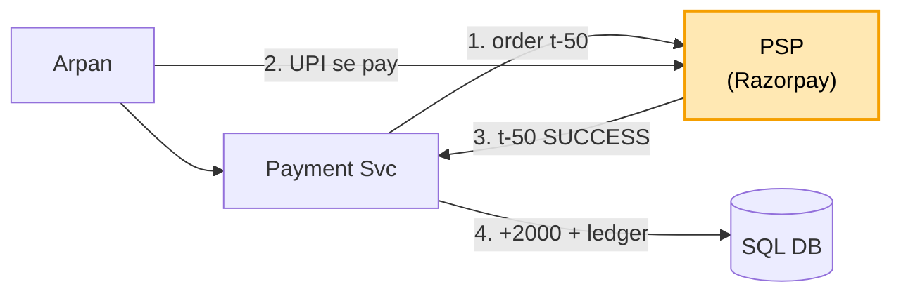
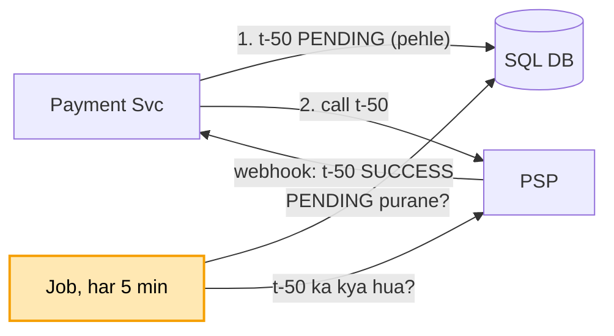
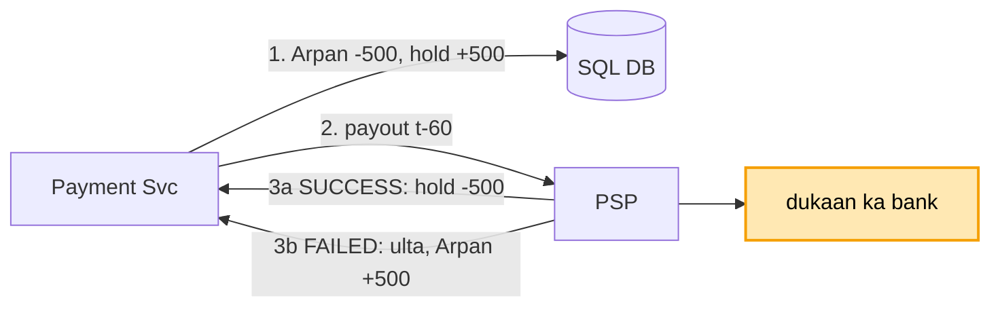
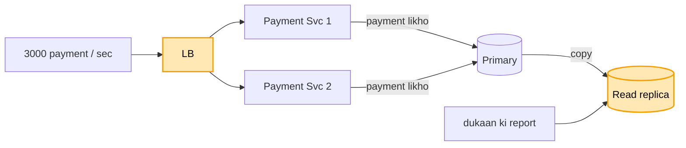
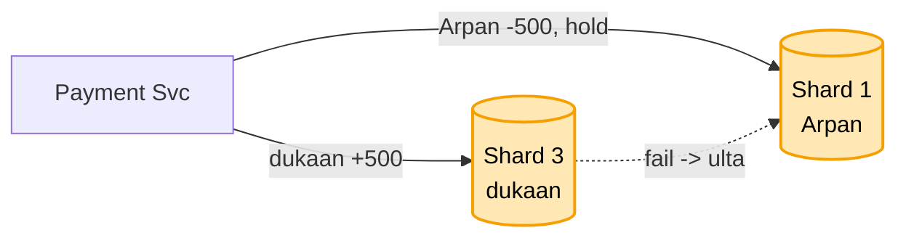

# Payment system (UPI / wallet): shuru se, ek kahani

Kram: **FR -> NFR -> numbers -> design**. Design sabse seedhe dabbe se shuru, har dikkat pe ek dabba judta.
Peela = abhi juda. Kahani ek hi: Arpan ne kirana dukaan (merchant) ko 500 bheje. Dono ka wallet hamare app
me (Paytm / PhonePe wallet jaisa). Andar ka core = [banking](../13_banking_system/13_banking_system.md).

**CUE (yahi kahani, yahi kram):** wallet se wallet = banking core -> PSP (bahar ka paisa) -> PENDING + timeout
-> breaker + doosra PSP -> PENDING pehle + webhook + poochne wala job -> saga (dukaan ka bank)
-> LB + read replica -> shard by account (phir se saga)

---

## 1. FR: kya karna hai

```
1. A se B / merchant ko paisa (wallet se wallet)
2. bank se wallet me daalo (top-up), wallet se bank me nikaalo (payout)
3. fail ho to paisa wapas, har paisa traceable
scope ke bahar (poochh ke hatao): fraud engine, kai currency, chargeback
```

## 2. NFR: kaisa chalna chahiye

```
- do baar na kate
- dono taraf ek saath badle (Arpan -500 + dukaan +500)
- kuch gire to bhi paisa na khoye, aur atke nahi
- har paisa trace ho
```

## 3. Numbers

```
- ~10 crore user, aam din kuch sau payment / sec, Diwali / sale pe kuch hazaar / sec
```

Banking jaisa: bheed badi dikkat nahi, SAHI hona badi dikkat.

---

## 4. Design

### Kadam 1: wallet se wallet = banking ka core

Dono wallet hamare DB me, to banking wala transfer:

```
BEGIN
  idempotency key (UNIQUE) · arpan -500 WHERE balance >= 500 · dukaan +500 · ledger 2 line
COMMIT
```

Bolo: "Wallet se wallet hamare DB ke andar: ek transaction + idempotency key + check-kaato ek query +
ledger, banking jaisa." Naya hissa yahan se: paisa BAHAR se aana / jaana.

### Kadam 2: bank se wallet me 2000 (PSP)

Arpan ka HDFC hamara DB nahi, bahar hai. Ilaaj: beech me **PSP** (Payment Service Provider: Razorpay,
Juspay, Stripe).

```
1. Arpan: "2000 daalo"  -> hum PSP ko: "2000 ka order" (apna txn id t-50)
2. Arpan UPI / bank app me pay karta (paisa PSP ke paas)
3. PSP humein: "t-50 SUCCESS"
4. hum: ek transaction -> wallet +2000 + ledger line ("PSP se aaya")
```



```
KHUD har bank se  -> har bank, UPI (NPCI), card network alag-alag. NPCI manzoori,
                     card data ke kade niyam (PCI-DSS). Saalon ka kaam
PSP               -> ek API, sab bank / UPI / card PSP sambhale. Thoda fees     <- ISLIYE YE
```

Par PSP ko call kiya, PSP dheema, 30 sec jawab nahi. Arpan ka paisa kata ya nahi, pata hi nahi. Fail
dikhayein ya success?

### Kadam 3: PSP dheema / band (PENDING + timeout + breaker + doosra PSP)

FAILED dikhaya to Arpan dobara 2000 daalega. Pehla bhi kata tha to 4000 gaye. Ilaaj: jo pata nahi, wo
**PENDING**.

```
haal:  INITIATED -> PENDING -> SUCCESS / FAILED
PSP chup  -> PENDING. Arpan ko "processing, 2-3 min me pakka"
             (galat FAILED = dohra, galat SUCCESS = nakli paisa)
timeout chhota (5 sec) -> har request ek thread pakde. 30 sec rukte to Diwali pe saare thread PSP me phanse,
                          wallet se wallet bhi ruk jaata
circuit breaker        -> 1 min me 50% fail = KHULA: PSP ko call hi nahi, turant "top-up abhi band".
                          30 sec baad 1-2 try, chala to BAND
PSP poora band         -> doosra PSP (Razorpay + Cashfree). Naye top-up PSP-2 se. Dono band = "abhi band",
                          wallet se wallet chalta
DHYAAN                 -> PSP-1 pe PENDING wala PSP-2 pe DOBARA NAHI (PSP-1 ne shayad kaat liya = dohra)
```


Par PENDING ka pakka kaise pata chale? Aur PSP ko call kiya, jawab se pehle HAMARA server gira. Restart pe
yaad hi nahi call gayi thi ya nahi.

### Kadam 4: pakka kaise pata chale + hamara server gira (PENDING pehle, webhook, poochne wala job)

Ilaaj 1: PSP call se **PEHLE** DB me `t-50 = PENDING` (COMMIT). Server gira to restart pe DB me t-50 dikhta
= pata kis ka pata karna. `t-50` PSP ke liye idempotency key bhi: dobara call pe bhi PSP ek hi baar kaate.

Ilaaj 2: pakka jawab = **dono taraf se baat**:

```
WEBHOOK (PSP -> hum)   PSP khud message bhejta: "t-50 SUCCESS"
                       sign ke saath: koi nakli "2000 daal do" na bheje, PSP ki secret chaabi se jaancho
                       "PENDING hai TABHI SUCCESS karo" -> webhook do baar aaya to doosri baar kuch nahi,
                       +2000 ek hi baar
JOB (hum -> PSP)       har 5 min: jo 5 min se PENDING -> PSP se "t-50 ka kya hua?" (status API)
                       message kho gaya / hamara server us waqt gira tha, tab bhi pakda
RAAT                   PSP ki din bhar ki file se milaan (banking kadam 9 jaisa), farak = ALERT
```

Ek line: PSP khud bataye (tez) + hum khud poochhein (message kho gaya to) + raat ka milaan (pakka).



Par Arpan ne dukaan ko 500 bheje, aur dukaan ko paisa wallet me nahi, seedha apne BANK me chahiye (payout).
Arpan ka wallet hamare DB me, dukaan ka bank bahar. Ek transaction nahi chalega.

### Kadam 5: dukaan ka paisa uske bank me (saga)

Arpan ka wallet hamare DB me hai, aur dukaan ka bank bahar. Ek transaction (BEGIN ... COMMIT) sirf hamare DB
ke andar chalta hai, bank ka DB usme shaamil nahi ho sakta.

Ilaaj: **saga**, yaani kaam kadam-kadam karo, aur koi kadam fail ho to pichhla kaam ulta kar do.

```
Kadam 1 (hamare DB me, ek transaction):
   Arpan ke wallet se 500 nikaalo, ek "beech ke khaate" (hold) me 500 daalo, ledger me dono line likho,
   aur payout t-60 ko PENDING likho.
   Ab paisa Arpan se nikal gaya hai, par dukaan tak abhi nahi pahuncha, beech me ruka hai.

Kadam 2: PSP ko payout call (t-60), taaki dukaan ke bank me 500 jaayein.
   Iska jawab waise hi aata hai jaise kadam 4 me: PSP ka webhook, ya hamara poochne wala job.

Kadam 3a, SUCCESS aaya: beech ke khaate se 500 hata do (ledger line), t-60 = SUCCESS. Kaam poora.
Kadam 3b, FAILED aaya (galat IFSC, ya bank band): ULTA kaam karo.
   Beech ke khaate se 500 hatao, Arpan ke wallet me 500 wapas daalo (nayi ledger lines),
   t-60 = FAILED, aur Arpan ko batao "paisa wapas aa gaya".
```

"Ulta karna" ka matlab mitaana nahi hai. Nayi line daal ke paisa wapas karte hain, kyunki khaate me sirf
INSERT hota hai (banking kadam 5).

Beech ka khaata isliye chahiye kyunki kadam 2 ke dauraan paisa kahin to dikhna chahiye. Wo Arpan ke wallet
se nikal chuka hai par dukaan ke bank nahi pahuncha. Isse har waqt poore hisaab ka jod 0 rehta hai.



Yahan ek asli choice hai: saga ya 2PC (two-phase commit)? 2PC me saare DB pehle "taiyaar hoon" bolte hain,
phir sab ek saath commit karte hain. Par bank ya PSP ka DB isme hissa le hi nahi sakta, aur ek bhi ruk gaya
to sab ruk jaate hain. Bahar wale ke saath saga hi chalta hai.

Par Diwali ki shaam, har second 3000 payment. Ek Payment Svc machine nahi jheli. Aur dukaan wale apni "aaj
ki bikri" report baar-baar khol rahe hain, jo isi DB pe chalti hai. Arpan ka payment dheema ho gaya.

### Kadam 6: Diwali ki bheed + report ne payment dheema kiya (kai machine + read replica)

Ek Payment Svc machine 3000 payment / sec nahi jhel paayi. Ilaaj: kai Payment Svc machine, aage LB. Ye
isliye chalta hai kyunki Payment Svc apne andar kuch yaad nahi rakhta. Saara haal (PENDING, SUCCESS, wallet)
DB me hai, to koi bhi machine koi bhi payment sambhal sakti hai (banking kadam 7 jaisa).

Dukaan wale "aaj ki bikri" report baar-baar khol rahe hain. Ye bhaari query hai, din bhar ke payment jod ke
total nikalti hai, aur usi primary DB pe chal rahi thi jahan payment likhe ja rahe hain. Isliye Arpan ka
payment dheema hua.

Ilaaj: **read replica**. Report sirf padhti hai, to DB ki copy se chalao. Primary sirf payment likhne ke
liye bachta hai. Copy kuch second peeche ho sakti hai, matlab abhi aaya payment report me 2 second baad
dikhega. Report ke liye ye chal jaata hai. Paisa kaatne ka faisla hamesha primary se hota hai.



Par saal bhar me ~1000 crore payment ki lines ho gayi. Ek hi primary pe itni likhai aur itna data, primary
dheema pad gaya. Banking se farak: wahan 120 likhai / sec thi, yahan Diwali pe 3000 / sec.

### Kadam 7: likhai aur data ek primary ke bas ka nahi (shard by account)

Replica sirf padhai ka bojh baantti hai. Likhai (har payment) abhi bhi ek hi primary pe jaa rahi hai, aur
data saal bhar me ~1000 crore line ho gaya.

Ilaaj: wallets ko kai DB machine me baanto (**shard**), account id ke hisaab se. Arpan ka wallet, uski
ledger lines aur uske payment, sab ek hi shard pe rahenge. Har shard ki apni copy (failover ke liye) aur
apni replica (report ke liye).

```
shard = hash(account_id) % 4
Arpan -> shard 1,  dukaan -> shard 3
```

Ab ek pench aata hai: Arpan shard 1 pe hai aur dukaan shard 3 pe. Dono alag DB hain, to ek transaction dono
pe nahi chal sakta. Iska ilaaj hum kadam 5 me padh chuke hain, saga:

```
1. shard 1: Arpan -500, beech ke khaate me +500 (ek transaction)
2. shard 3: dukaan +500
3. shard 3 pe fail hua to ulta: shard 1 pe beech ke khaate se -500, Arpan +500
```

Bas farak itna hai ki kadam 5 me doosri taraf bank tha, yahan doosra shard hai.

Account id se isliye baanta kyunki ek insaan ka saara kaam (balance check, kataai, history) ek hi shard pe
ho jaata hai. Sirf do alag logon ke beech transfer me saga lagta hai. Date ya shehar se baant-te to Diwali
ke din saari likhai ek hi shard pe girti.



---

## 5. Wrap (30 second me poora design, NFR se milao)

Arpan app se payment karta hai. Request LB se kisi bhi Payment Svc machine pe jaati hai. Wallet se wallet ho
to hamare DB me ek transaction: idempotency key, check karke kaatna, dono taraf ka balance aur ledger. Paisa
bahar se aana ya bahar jaana ho (top-up, dukaan ka bank) to PSP: pehle DB me PENDING likho, phir PSP ko
call, aur jawab webhook se ya hamare poochne wale job se aata hai. Dukaan ke bank me bhejna saga se: pehle
Arpan se kaat ke beech ke khaate me, fail hua to wapas. PSP dheema ho to timeout pe PENDING, band ho to
breaker aur doosra PSP. Report replica se, aur bahut bada hua to account id se shard.

```
do baar na kate      -> idempotency key (UNIQUE), PSP ko bhi wahi txn id
dono taraf ek saath  -> hamare DB me ek transaction, bahar / doosre shard ke saath saga
paisa na khoye       -> PENDING pehle likho, webhook + poochne wala job + raat ka milaan
har paisa trace ho   -> ledger (sirf INSERT, double-entry)
```

---

## Pooche to (ek line)

```
API             -> POST /pay { from, to, amount } + header Idempotency-Key -> { status, txn_id }
key kab banti?  -> payment screen khulte hi. Arpan ne do alag payment kiye = do screen = do key = do payment,
                   sahi. Ek tap + network ne dobara bheja = wahi key = ek hi payment. Cheque jaisa: key =
                   cheque number. Do cheque dono cash, ek hi number do baar nahi
haal            -> payment: INITIATED -> PENDING -> SUCCESS / FAILED. Niyam: saare kate == saare jude
owner check     -> userId JWT se, body se nahi. Kisi aur ke wallet se bhejne ki koshish = 403
SPOF?           -> DB primary (sync copy) · PSP (doosra PSP)
pata kaise?     -> hisaab ka farak (milaan), p99, error, kitne PENDING atke, har payment ka trace id
AWS naam        -> RDS (Postgres) Multi-AZ · Razorpay / Cashfree (PSP) ·
                   SQS / Kafka (webhook baad me sambhalna)
```

**Scam 1992: ledger kyun itna zaroori.** 1990-91 me ledger kaagaz pe tha, aur Bank Receipt (BR) haath se
banti thi. Use badla ja sakta tha, nakli banayi ja sakti thi, aur turant koi jaanch nahi hoti thi. Nakli ya
khaali BR se beech ka paisa market me gaya, aur der se pakda gaya (~Rs. 4000 crore). Aaj ka ilaaj wahi hai
jo humne banaya: kabhi na badalne wala double-entry ledger, "saare kate == saare jude" ka niyam,
sab-ya-kuch-nahi transaction, aur turant milaan. Baad me SEBI ko kanooni taakat (1992), NSE ki screen
trading (1994), NSDL demat (1996), aur T+2 / T+1 settlement aaye.

---

## Hands-on: idempotency live (usercrud, 27-Aug)

> Ek line me: "map me key hai? -> kuch mat karo, wahi wapas. Nahi? -> process + map me daal do."

```java
@RestController
public class IdempotencyController {

    // key -> pehle jo result diya (duplicate pe wahi wapas)
    private final ConcurrentHashMap<String, String> processed = new ConcurrentHashMap<>();
    // asli orders ka counter (SAABIT karega double hua ya nahi)
    private final AtomicInteger orderCounter = new AtomicInteger(0);

    @PostMapping("/pay")
    public String pay(@RequestHeader("Idempotency-Key") String key,
                      @RequestParam int amount) {

        // ATOMIC claim: key hai? -> existing wapas | nahi? -> "PROCESSING" daal + null return
        String existing = processed.putIfAbsent(key, "PROCESSING");
        if (existing != null) {
            return "DUPLICATE (key already claimed) -> " + existing
                 + "  | total orders = " + orderCounter.get();
        }

        // yahan sirf EK thread pahunchega (jisne putIfAbsent race JEETI)
        int orderId = orderCounter.incrementAndGet();
        String result = "Order #" + orderId + " created, amount=" + amount;

        processed.put(key, result);   // "PROCESSING" ko asli result se replace

        return "OK -> " + result + "  | total orders = " + orderCounter.get();
    }
}
// SecurityConfig: .requestMatchers("/pay").permitAll()
```
```
SEQUENTIAL:  A key abc-123, 100 -> OK Order #1, total 1
             B wahi dobara      -> DUPLICATE Order #1, total 1   (2 NAHI)
             C key xyz-999, 200 -> OK Order #2, total 2

RACE:        naive containsKey + put = 2 step, GAP -> A "nahi", B "nahi" -> dono order = DOUBLE
             putIfAbsent = 1 ATOMIC step -> sirf ek jeet-ta
             atomicity NAAM se nahi, ConcurrentHashMap se (bucket
             lock / CAS). plain HashMap = thread-safe nahi

20 PARALLEL, same key "race-1":
             1..20 | ForEach-Object { Start-Job { curl.exe -s -X POST ".../pay?amount=100"
             -H "Idempotency-Key: race-1" } } | Wait-Job | Receive-Job
             BROKEN (containsKey + put + sleep 50) -> Order #1 AUR #2 -> total 2 = DOUBLE CHARGE live
             ATOMIC (putIfAbsent) -> 1 OK, 19 DUPLICATE -> total 1
             pehli DUPLICATE "-> PROCESSING" = reserve-then-fill live dikha

PROD:        Redis / DB unique constraint (memory restart pe udti) + key TTL · PROCESSING placeholder
JAWAB:    Pehle 'key hai?' dekhna aur phir 'daalna' do alag kadam the, beech me doosri request ghus
          gayi. ConcurrentHashMap ka putIfAbsent dono ek hi kadam me karta, to ek hi jeetti.
          Asli system me ye kaam Redis ya DB ka unique karta. 20 request ek saath maari: purane code ne
          2 order banaye, naye ne 1.
```

---

