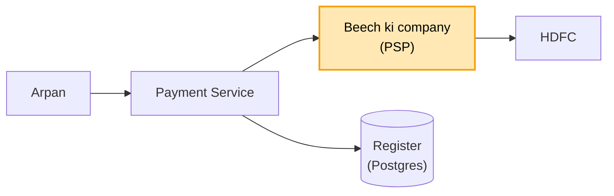
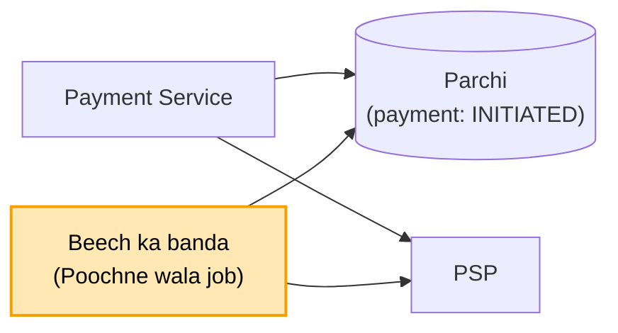
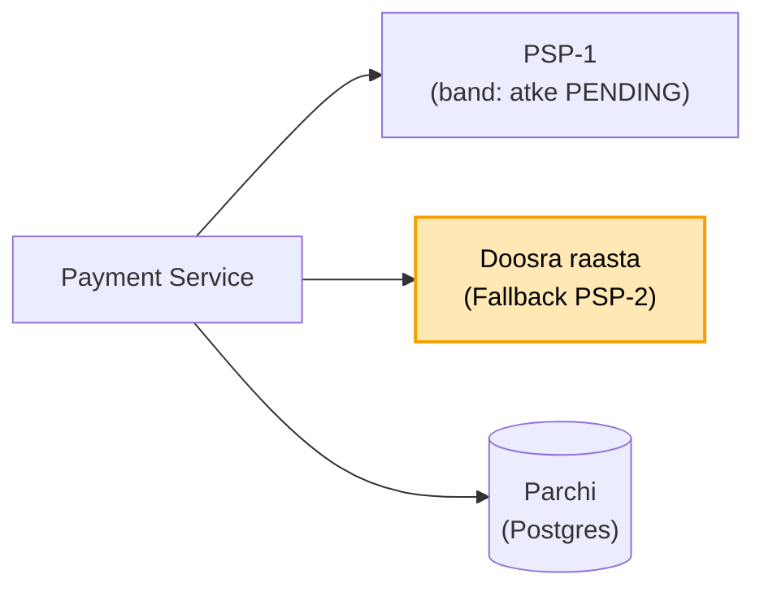
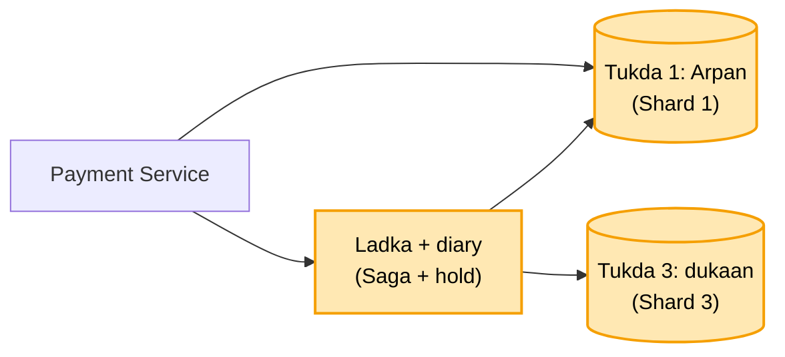

# Payment system: dukaan pe pay ki kahani

Arpan dukaan pe khade ho ke app se 500 pay karta hai. Uska paisa HDFC me, dukaan wale ka ICICI me, aur hamara app na
HDFC ka, na ICICI ka. Kaam: paisa do baar na kate, beech me gayab na dikhe, aur kuch bhi gire to hisaab mile. (Wallet
ke andar ka hisaab, ek transaction aur ledger, banking wali kahani se aaya.)

Har kadam = **kahani** (dikkat aur hal, bolne wali bhasha) -> **Asli naam** (interview me yahi shabd) -> tasveer
(kahani ka shabd, bracket me asli naam).

---

## FR / NFR / Numbers (interview me pehle 2 minute)

```
FR      dukaan ko pay (bank se, PSP ke zariye) · dukaan ka paisa wallet se uske bank me · fail ho to paisa wapas
NFR     do baar na kate · paisa kabhi gayab na dikhe · kuch gire to bhi payment atka na rahe · har paisa trace ho
Numbers ~10 crore user, aam din kuch sau payment / sec, Diwali pe ~3,000 / sec
        -> bheed badi dikkat nahi, sahi hona badi dikkat
```

---

## 1. HDFC hamari sunta hi nahi (beech ki centralized company)

Arpan ne "pay 500" dabaya, app ko HDFC khaate se 500 nikalne hain. Par app HDFC ka hissa nahi, HDFC hamari sunta hi
nahi. Har bank se khud judne jaayein to alag manzoori, saalon lag jaayenge. To ek aisa system ho, aisi API jo ye kaam
khud kare. Har bank ke liye alag-alag nahi, ek centralized authority jo sab bankon se judi ho. Hum bas uski cheez use
karein.

**Asli naam:** centralized authority = PSP (Razorpay, Juspay), uski cheez use karna = PSP ki API (bank, UPI, card PSP
sambhalta, hum thodi fees dete). Hamara paisa ka hisaab = SQL DB (Postgres; dono taraf ek saath badle = ACID).



## 2. PSP 30 second se chup (apni parchi)

App ne PSP ko bola "500 kaato", aur PSP 30 second se chup. FAILED dikhaya to Arpan dobara pay karega aur 1,000 kat
sakte. SUCCESS dikhaya to ho sakta paisa kata hi na ho, aur dukaan wala bina paise saamaan de de. To apne paas ek
parchi rakho, jisse dekh sakein PSP pe kya ho raha. Pay dabaya, parchi pe likha: INITIATED. Phir likhte raho kya-kya
hua: PSP ne ye kara, ab ye kara. Fail hua to FAIL mark, pass hua to PASS mark. Tab tak Arpan ko "processing" dikhao.

**Asli naam:** parchi = payment table me status, INITIATED / PENDING jab tak pata nahi, pakka jawab aane pe hi SUCCESS
/ FAILED.

## 3. PSP ka pakka jawab kaise pata chale? (beech ka banda)

Parchi pe jawab ka intezaar hai. PSP khud batata hai, par batana bhool jaaye ya uska message raste me kho jaaye, to
payment hamesha atka rahega. To beech me ek aisa banda bitha do jo batata rahe: PSP hua ya nahi hua. Wo permanent dono
se baat karta rahe, PSP se bhi aur hamari parchi se bhi: haan bhai hua, nahi hua.

**Asli naam:** PSP khud batata = webhook (sign jaanch ke), beech ka banda = poochne wala job (har minute purane
INITIATED / PENDING uthata, PSP se status poochhta), dono se baat = PSP aur hamare DB ka milaan (raat ko poora
reconciliation).

**Maan lo server parchi pe INITIATED likh chuka tha, aur PSP ko call bhejte waqt hi gir gaya:** restart pe yaad nahi
call pahunchi ya nahi. Isliye register me pehle "initiate hua" likho, phir bhejo. Server aake dekhega: haan yaar, ye
likha hai, chalo PSP se poochte hain "bata, iska kya hua". Dobara bhejna pade to idempotency key laga denge, key process
ho chuki to do baar nahi hoga.
**Asli naam:** PSP call se pehle INITIATED commit, restart pe job INITIATED utha ke status poochhta, payment id hi PSP
ki idempotency key.



## 4. PSP-1 poora band (doosra raasta)

Aaj PSP-1 poora band, uski har call fail. Dukaan pe log pay kar rahe aur sabka payment ruk raha. To PSP-1 band hai to
naye payment PSP-2 pe bhej do, hamare paas fallback tareeka hai, logon ko intezaar kyun karwana. Aur jo log PSP-1 pe
pehle se atke hain aur apna status jaanna chah rahe, unhe thodi der rok do: bhai abhi thoda down hai, aate hi bata
denge. Unhe PSP-2 pe dobara nahi bhejte, ho sakta PSP-1 ne paisa kaat liya ho.

**Asli naam:** PSP-2 = fallback PSP (naye payment), PSP-1 pe atke = wahin PENDING, PSP-1 wapas aaye tab pakka, PSP-2
pe dobara nahi (warna do baar kata).



## 5. Dukaan ka paisa ICICI me, wahan FAILED (sab ulta)

Dukaan ke 500 uske wallet se ICICI me nikalne hain. ICICI hamara DB nahi, to ek transaction me nahi hoga. Wallet se
kaat liye, aur ICICI me jodte waqt PSP bola "FAILED". To ulta kar do, sab wapas. Maan le main HDFC bank hoon, bagal
wale bank ko bhejne gaya, usne mana kar diya: "bhai, bank band hai, kal aana". Fail ho gaya, baatcheet khatam. To main
apne register me likhunga: maine yahan se paise liye the, ise wapas kar raha hoon, aur paise wapas bhej dunga.

**Asli naam:** sab ulta = saga (kadam-kadam kaam, fail pe ulta kadam), register me wapas = ledger me ulti line (mitana
nahi, nayi line), 500 wapas dukaan ke wallet me.

## 6. 2 minute tak 500 kahin nahi (pehle likh lo)

Wallet se 500 kaate, PSP ka jawab aane me 2 minute lage. Us 2 minute me 500 na dukaan ke wallet me, na ICICI me.
Hisaab wala kahega 500 gayab. To sabse pehle likh lo: "wallet se 500 kate". Apne ledger me likh lo, to wo gayab nahi
honge. Koi kuch kahe to bata denge: haan bhai, tere paise abhi yahan hain.

**Asli naam:** ledger entry + hold (beech ka khaata): SUCCESS pe hold se nikle, FAILED pe wapas wallet. Har waqt poore
hisaab ka jod barabar.

**Maan lo koi kahe saga ka jhanjhat kyun, sabse pehle poochh lo "taiyaar ho?", sab haan bolein tab ek saath kaat do aur
jod do:** aisa kar sakte, par maan le ICICI ki service dheemi pad gayi. Mere paas paanch bande hain, main poochh raha
"sab taiyaar ho?". Chaar taiyaar, teesra slow, aur uski wajah se sab khade. Jaise main ek dost ko cheating karwa raha
aur wo likhne me bahut slow, to uski wajah se mera bhi paper chhoot jaayega.
**Asli naam:** "sab taiyaar ho?" = 2PC (prepare round), ek dheema to sab ruke, isliye 2PC nahi, saga + hold.

## 7. Diwali pe 3,000 / sec, ek register nahi jhel raha (tukde + ladka)

Diwali pe har second 3,000 payment, saare wallet ek hi register me, register itni likhai nahi jhel pa raha. To us
register ko kaat do, chhote-chhote tukde kar do: le bhai, tu yahan likh, tu ye likh. Kaam baant diya, ab sab
aaram se apna-apna likh rahe.

Par ab Arpan ka wallet tukda 1 me, dukaan ka tukda 3 me. Ek se kaatna, doosre me jodna, do alag register, ek
transaction me nahi hoga. To apne office se ek ladka pakdunga: ye 500 mera hai, us tukde me jaana hai, de ke aa ja aur
jo hua aake bata. Saath me ek diary rakh, usme likh "ye 500 Arpan ne diye, is tukde me dene hain", aur beech me jo hua
wo bhi. Hisaab poora hua to theek, nahi to wapas aake mere paise de dega.

**Asli naam:** register ke tukde = shard (account id se, ek insaan ka saara kaam ek tukde pe), har tukde ka apna
likhne wala = likhai bant gayi. Ladka = do shard ke beech saga, diary = saga ka har kadam likha (hold), wapas paise =
fail pe ulta kadam. Wahi kadam 5 wala saga, bas doosri taraf bank ki jagah doosra tukda.



---

Notes (Arpan ke shabd) = [PAYMENT_HAND_NOTES.md](PAYMENT_HAND_NOTES.md) · [<- MASTER SHEET](../../00_MASTER_SHEET.md)
