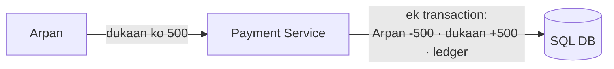
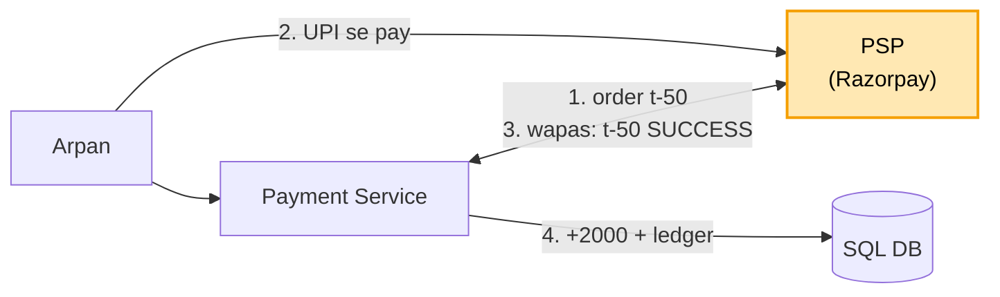
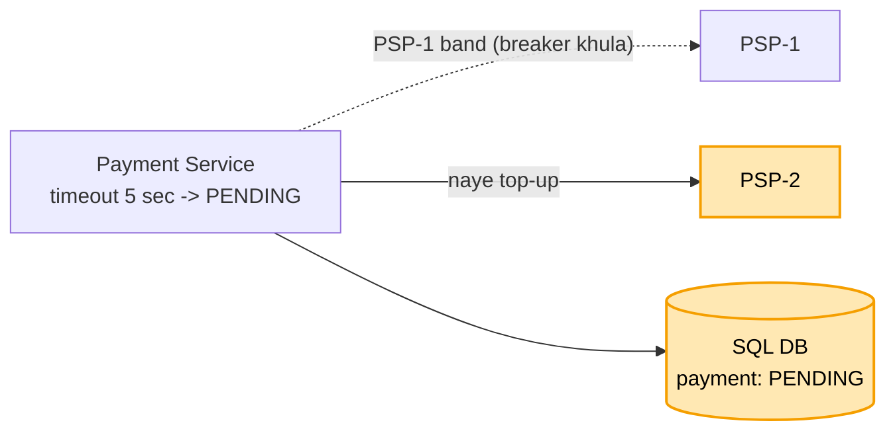
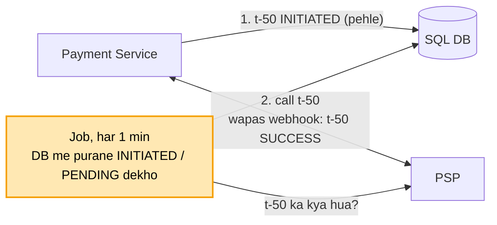
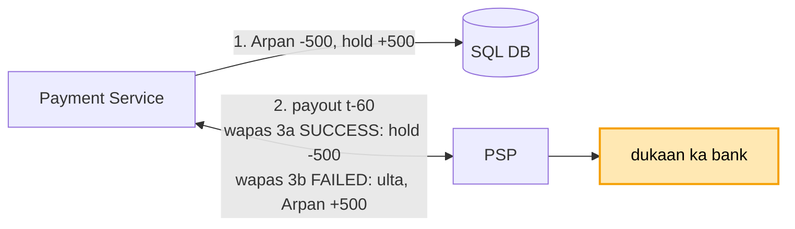
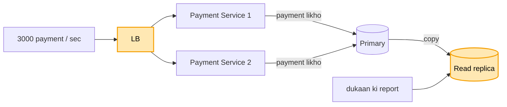
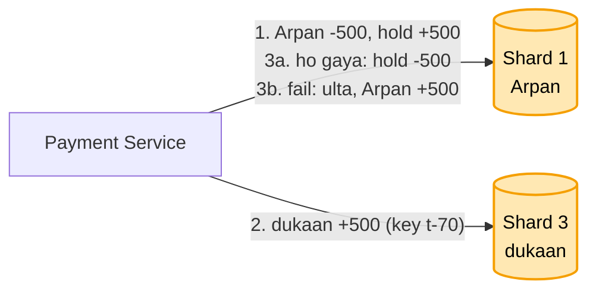

# Payment system (UPI / wallet): shuru se, ek kahani

Kram wahi jo interview me hota hai: **FR, phir NFR, phir numbers, phir design**. Design sabse seedhe dabbe se
shuru hota hai, aur har dikkat aane pe ek naya dabba judta hai. Diagram me peela dabba = abhi juda. Poori file
me ek hi kahani hai: Arpan ne kirana dukaan (merchant) ko 500 bheje. Dono ka wallet hamare app me hai, Paytm /
PhonePe wallet jaisa. Andar ka core [banking](../13_banking_system/13_banking_system.md) jaisa hi hai.
Movie ticket ka paisa bhi isi raaste se jaata hai: [BookMyShow kadam 6](../09_bookmyshow/09_bookmyshow.md#kadam-6-pay-dobara--paisa-banking-kadam-3--payment-file).

**Dukaan pe pay (poori file me yahi):** Arpan dukaan pe app se pay karta hai, uska paisa HDFC me, dukaan ka ICICI me · parchi / register = hamara DB · beech ki company = PSP · ladka = poochne wala job

**CUE (yahi shabd yaad rakhne hain, kram se):**
wallet se wallet = banking ka core -> PSP (bahar ka paisa) -> PENDING + timeout -> breaker + doosra PSP
-> INITIATED pehle + webhook + poochne wala job -> saga + hold (dukaan ka bank) -> LB + read replica
-> shard by account (phir se saga)

---

## 1. FR: kya karna hai

```
1. A se B / dukaan ko paisa bhejo (wallet se wallet)
2. bank se wallet me paisa daalo (top-up), wallet se bank me nikaalo (payout)
3. fail ho to paisa wapas, aur har paisa ka hisaab mile
scope ke bahar (poochh ke hata do): fraud engine, kai currency, chargeback
```

## 2. NFR: kaisa chalna chahiye

```
- do baar na kate
- dono taraf ek saath badle (Arpan -500 aur dukaan +500, dono ya koi nahi)
- kuch gire to bhi paisa na khoye, aur payment atka na rahe
- har paisa trace ho
```

## 3. Numbers

```
- ~10 crore user, aam din kuch sau payment har second, Diwali / sale pe kuch hazaar har second
```

Banking jaisa hi: bheed badi dikkat nahi hai, **sahi hona** badi dikkat hai.

---

## 4. Design

### Kadam 1: wallet se wallet = banking ka core

**Dukaan pe pay:** dono wallet hamare hi register me, to banking jaisa: ek transaction, parchi ka number, ek query, ledger.

Arpan aur dukaan, dono ka wallet hamare hi DB me hai. To ye bilkul banking wala transfer hai:

```
BEGIN
  idempotency key (UNIQUE) · Arpan -500 WHERE balance >= 500 · dukaan +500 · ledger me 2 line
COMMIT
```

Ye pura hum banking me kar chuke hain ([kadam 2 se 5](../13_banking_system/13_banking_system.md#kadam-2-beech-me-server-gira-paisa-gayab-ek-transaction)). Interview me yahan ek line bolo: "Wallet se wallet
hamare DB ke andar hai, to ek transaction, idempotency key, check karke kaatna ek query me, aur ledger,
banking jaisa." Payment ka asli naya hissa yahan se shuru hota hai: paisa bahar se aana aur bahar jaana.



**API:** POST /pay { from, to, amount } + header Idempotency-Key -> { status, txn_id }

**Maan lo pooche key kab banti:** payment screen khulte hi. Arpan ne do alag payment kiye to do screen, do key, do payment, sahi hai. Ek tap aur network ne dobara bheja to wahi key, ek hi payment. Cheque jaisa: key = cheque number. Do cheque dono cash hote hain, ek hi number do baar nahi.

**Maan lo koi kisi aur ke wallet se bheje (owner check):** userId JWT se lo, body se nahi. Kisi aur ke wallet se bhejne ki koshish = 403.

### DB kaunsa: SQL ya NoSQL?

Data dekho: Arpan ka wallet, dukaan ka wallet, aur ledger. Kaam: ek payment me teeno ek saath badalne hain,
ya koi nahi.

Banking wali hi baat (ACID), SQL ka seedha kaam. Bheed badi dikkat nahi hai, sahi hona badi dikkat hai.
Isliye SQL (Postgres).

**AWS pe:** Postgres AWS ka **RDS** lete hain, **Multi-AZ** ke saath: doosri building me sync copy AWS rakhta hai, primary gira to wo khud copy ko primary banata hai. Sync rakhna (paisa hai) hamara faisla tha.

Par Arpan ke wallet me paisa hi nahi hai. Use apne HDFC account se 2000 daalne hain, aur HDFC hamara DB
nahi hai, wo bahar hai.

### Kadam 2: bank se wallet me 2000 (PSP)

**Dukaan pe pay:** app na HDFC ka na ICICI ka -> beech me ek company jo sab bankon se judi hai, uski API use karo (PSP).

Ilaaj: beech me **PSP (Payment Service Provider)**, jaise Razorpay, Juspay ya Stripe.

```
1. Arpan: "2000 daalo"  -> hum PSP ko bolte hain: "2000 ka order banao" (apna transaction id: t-50)
2. Arpan apne UPI / bank app me 2000 pay karta hai (paisa PSP ke paas)
3. PSP humein batata hai: "t-50 SUCCESS"
4. hum ek transaction me: wallet +2000, aur ledger me line ("PSP se aaya")
```



Yahan ek asli choice hai: har bank se khud judein, ya PSP lagayein? Khud judna matlab har bank, UPI (NPCI, jo UPI chalata hai) aur
card network se alag-alag judna, NPCI ki manzoori lena, aur card ke data ke kade niyam (PCI-DSS) maanna. Ye
saalon ka kaam hai. PSP ek hi API deta hai, aur sab bank, UPI aur card khud sambhalta hai, bas thodi fees leta
hai. **Isliye PSP.** Paytm aur PhonePe jaise bade khiladi baad me khud bhi judte hain, par shuru me sab PSP se
hi chalte hain.

Ek baat saaf: PSP se bank / UPI / card ka jhanjhat hatta hai, par wallet me logon ka paisa rakhne ke liye RBI ka
PPI licence (prepaid wallet ki manzoori) phir bhi chahiye. Ye kaanooni kaam hai, design nahi badalta.

**Naam (PSP):** Razorpay / Cashfree.

Par humne PSP ko call kiya, aur PSP dheema tha. 30 second tak jawab hi nahi aaya. Arpan ka paisa kata ya nahi,
humein pata hi nahi. Ab Arpan ko kya dikhayein: fail ya success?

### Kadam 3: PSP dheema ya band (PENDING, timeout, breaker, doosra PSP)

**Dukaan pe pay:** PSP 30 sec chup -> parchi pe haal likho, app pe PENDING. PSP-1 band -> naye PSP-2 pe, PSP-1 pe atke wale ruko.

Agar "FAILED" dikha diya, to Arpan sochega paisa nahi gaya aur dobara 2000 daalega. Agar pehla bhi kat chuka
tha, to 4000 kat gaye. Aur galti se "SUCCESS" dikha diya, to bina paise ke wallet me nakli paisa aa gaya.

Ilaaj: jo pata nahi, use **PENDING** bolo. Payment ka haal aise chalta hai:

```
INITIATED        = humne DB me likh diya, PSP ko call abhi nahi gayi
PENDING          = PSP ko call chali gayi, pakka jawab abhi nahi aaya (timeout / Arpan pay kar raha)
SUCCESS / FAILED = pakka jawab aa gaya
```

PSP ne jawab nahi diya to PENDING, aur Arpan ko dikhao "processing, 2-3 minute me pakka
batayenge".

Timeout chhota rakho (jaise 5 second). Hamari har request ek thread pakad ke baithi hai. Agar PSP dheema hua
aur hum 30 second rukte rahe, to Diwali pe saare thread PSP ke intezaar me phans jaayenge, aur phir wallet se
wallet wale payment bhi ruk jaayenge, jo PSP ko chhute hi nahi. Isliye 5 second ke baad PENDING likho aur
thread chhod do.

PSP poora hi band ho to **circuit breaker**: pichhle 1 minute me 50% call fail hui, to breaker khul jaata hai.
Ab PSP-1 ko call hi mat karo. Badi apps do PSP se judi rehti hain (jaise Razorpay aur Cashfree), to naye top-up
seedha PSP-2 pe bhejo. 30 second baad PSP-1 pe 1-2 call try karo, chal gaya to breaker band, sab wapas PSP-1 pe.
Isse band PSP pe baar-baar call karke thread barbaad nahi hote. Dono PSP band hon tab hi "top-up abhi band,
thodi der baad", par wallet se wallet tab bhi chalta rehta hai.

Ek bada dhyaan: jo payment PSP-1 pe PENDING atka tha, use PSP-2 pe dobara mat bhejo. Ho sakta hai PSP-1 ne
paisa kaat liya ho, bas jawab nahi aaya. PSP-2 pe bheja to paisa do baar katega. Wo PENDING wala PSP-1 ke
wapas aane pe hi pakka hoga.



**Maan lo pooche payment ka haal:** payment: INITIATED -> PENDING -> SUCCESS / FAILED. Niyam: jitna kata, utna hi juda.

Par PENDING ka pakka jawab kaise pata chale? Aur ek aur haalat: humne PSP ko call kiya, aur jawab aane se
pehle hamara hi server gir gaya. Restart pe humein yaad bhi nahi ki call gayi thi ya nahi.

### Kadam 4: pakka kaise pata chale + hamara server gira (INITIATED pehle, webhook, poochne wala job)

**Dukaan pe pay:** beech me ek banda jo PSP se poochhta rahe "hua ya nahi". Server gira -> pehle register me INITIATED likho phir bhejo, dobara bhejna ho to wahi key.

Ilaaj 1: PSP ko call karne se **pehle** DB me likho `t-50 = INITIATED` (COMMIT), phir call karo. Ab server call
ke beech gira, to restart pe DB me t-50 INITIATED dikhta hai. Pata nahi call gayi ya nahi, par ye pata hai ki
kis payment ka pata karna hai. Job PSP se poochta "t-50 ka kya hua?": call gayi hi nahi thi to PSP bolta
"aisa koi order nahi", hum FAILED kar dete; gayi thi to PSP jawab de deta.
Aur `t-50` hi PSP ke liye idempotency key ka kaam karta hai: call dobara gayi to bhi PSP ek hi baar paisa
kaatega.

Ilaaj 2: pakka jawab teen tarah se aata hai.

**Webhook = PSP khud batata hai.** Arpan ne pay kiya, aur 3 second baad PSP hamare server ko khud message
bhejta hai: "t-50 SUCCESS". Hum PENDING ko SUCCESS karte hain, wallet me +2000 aur ledger me line. Koi bhi
hamare server ko nakli message bhej sakta hai ("t-50 SUCCESS, 2000 daal do"), isliye PSP har message pe apni
secret chaabi se sign lagata hai, aur hum sign jaanch ke nakli message phenk dete hain. PSP kabhi-kabhi wahi
message dobara bhej deta hai, isliye hum likhte hain "abhi pakka nahi hua (INITIATED / PENDING) **tabhi**
SUCCESS karo". Pehle message pe PENDING tha, to SUCCESS kiya aur +2000. Doosre message pe wo ab SUCCESS hai,
to kuch nahi kiya. Paisa ek hi baar juda.

**Poochne wala job = hum khud poochte hain.** Agar PSP ka message raaste me kho gaya, ya jab aaya tab hamara
server gira hua tha, to hamara job har 1 minute chalta hai: "kaun se payment 2 minute se INITIATED / PENDING
pade hain?" Use t-50 mila, to wo PSP se poochta hai "t-50 ka kya hua?", PSP bolta hai "SUCCESS", aur hum
t-50 ko SUCCESS kar dete hain. Matlab PSP ne bataya ho ya nahi, 2-3 minute me hum khud pata kar lete hain.

Job ka time Arpan ko diye wade (kadam 3: "2-3 minute me pakka") se bandha hai. Job har 5 minute chale aur 5
minute purane uthaye, to webhook khone pe jawab ~10 minute me aata, wada toot jaata:

```
job har 5 min, 5 min purane:   10:00 PENDING -> 10:05 job: abhi 5 min purana nahi, chhoda -> 10:10 utha liya
job har 1 min, 2 min purane:   10:00 PENDING -> 10:02 / 10:03 ka job utha leta -> PSP se poocha -> pakka
```

Zyaadatar webhook 3 second me aa jaata hai. Job sirf tab kaam aata jab webhook kho gaya, aur tab bhi 2-3 minute
ka wada nibhta.

**Raat ka milaan.** Raat ko PSP ek file deta hai ki aaj kaun-kaun se payment hue aur kitna paisa. Hum use apne
DB se milaate hain, kahin farak mila to ALERT. Ye [banking kadam 9](../13_banking_system/13_banking_system.md#kadam-9-balance-aur-khaata-alag-ho-gaye-raat-ka-milaan--reconciliation) wala milaan hi hai.

Ek line me: PSP khud bataye (webhook, tez), hum khud poochhein (job, agar message kho gaya), aur raat ka
milaan (pakka).



**AWS pe:** webhook aate hi line me daal do, AWS ka **SQS** (ya Kafka), aur baad me sambhalo. Line AWS chalata hai.

Par Arpan ne dukaan ko 500 bheje, aur dukaan ko paisa wallet me nahi, seedha apne bank me chahiye (payout).
Arpan ka wallet hamare DB me hai, dukaan ka bank bahar. Ek transaction se kaam nahi chalega.

### Kadam 5: dukaan ka paisa uske bank me (saga)

**Dukaan pe pay:** ICICI me jodte waqt FAILED -> sab ulta karo, paisa wapas. Beech me paisa gayab na dikhe -> beech ke khaate me likho. Sabse "taiyaar?" poochna (2PC) nahi: ek dheema dost poora paper rok deta.

Arpan ka wallet hamare DB me hai, aur dukaan ka bank bahar. Ek transaction (BEGIN ... COMMIT) sirf hamare DB
ke andar chalta hai, bank ka DB usme shaamil nahi ho sakta.

Ilaaj: **saga**, yaani kaam kadam-kadam karo, aur koi kadam fail ho to pichhla kaam ulta kar do.

```
Step 1 (hamare DB me, ek transaction):
   Arpan ke wallet se 500 nikaalo, ek "beech ke khaate" (hold) me 500 daalo, ledger me dono line likho,
   aur payout t-60 ko INITIATED likho (PSP call se pehle).
   Ab paisa Arpan se nikal gaya hai, par dukaan tak abhi nahi pahuncha, beech me ruka hai.

Step 2: PSP ko payout call (t-60), taaki dukaan ke bank me 500 jaayein.
   Iska jawab waise hi aata hai jaise kadam 4 me: PSP ka webhook, ya hamara poochne wala job.

Step 3a, SUCCESS aaya: beech ke khaate se 500 hata do (ledger line), t-60 = SUCCESS. Kaam poora.
Step 3b, FAILED aaya (galat IFSC bank code, ya bank band): ULTA kaam karo.
   Beech ke khaate se 500 hatao, Arpan ke wallet me 500 wapas daalo (nayi ledger lines),
   t-60 = FAILED, aur Arpan ko batao "paisa wapas aa gaya".
```

Step 1 ke baad, PSP ko call jaane se pehle hi hamara server gir gaya to? t-60 INITIATED COMMIT ho chuka hai, to
kadam 4 wala poochne wala job use uthata hai. Webhook nahi aayega, kyunki call gayi hi nahi thi. Job PSP se poochta
hai, PSP bolta hai "aisa koi order nahi". Ab ya to wahi t-60 key se dobara bhejo (key ki wajah se do baar nahi
jaayega), ya FAILED karke ulta (hold -500, Arpan +500). Arpan ke 500 hold me hamesha ke liye nahi atakte.

"Ulta karna" ka matlab mitaana nahi hai. Nayi line daal ke paisa wapas karte hain, kyunki khaate me sirf
INSERT hota hai ([banking kadam 5](../13_banking_system/13_banking_system.md#kadam-5-500-nahi-mile-pe-saboot-nahi-khaata--ledger)).

Beech ka khaata isliye chahiye kyunki step 2 ke dauraan paisa kahin to dikhna chahiye. Wo Arpan ke wallet se
nikal chuka hai par dukaan ke bank nahi pahuncha. Isse har waqt poore hisaab ka jod 0 rehta hai.



Yahan ek asli choice hai: saga ya 2PC (two-phase commit)? 2PC me saare DB pehle "taiyaar hoon" bolte hain,
phir sab ek saath commit karte hain. Par bank ya PSP ka DB isme hissa le hi nahi sakta, aur ek bhi ruk gaya to
sab ruk jaate hain. Bahar wale ke saath saga hi chalta hai.

Par Diwali ki shaam, har second 3000 payment. Ek Payment Service machine nahi jheli. Aur dukaan wale apni "aaj ki
bikri" report baar-baar khol rahe hain, jo isi DB pe chalti hai. Arpan ka payment dheema ho gaya.

### Kadam 6: Diwali ki bheed + report ne payment dheema kiya (kai machine + read replica)

**Dukaan pe pay:** banking jaisa: cashier badhao, padhne walon ke liye photocopy ka desk.

Ek Payment Service machine 3000 payment / sec nahi jhel paayi. Ilaaj: kai Payment Service machine, aage LB. Ye isliye
chalta hai kyunki Payment Service apne andar kuch yaad nahi rakhta. Saara haal (PENDING, SUCCESS, wallet) DB me
hai, to koi bhi machine koi bhi payment sambhal sakti hai ([banking kadam 7](../13_banking_system/13_banking_system.md#kadam-7-salary-ki-bheed--ek-hi-db-kai-machine--db-ki-sync-copy) jaisa).

Dukaan wale "aaj ki bikri" report baar-baar khol rahe hain. Ye bhaari query hai, din bhar ke payment jod ke
total nikalti hai, aur usi primary DB pe chal rahi thi jahan payment likhe ja rahe hain. Isliye Arpan ka
payment dheema hua.

Ilaaj: **read replica**. Report sirf padhti hai, to DB ki copy se chalao. Primary sirf payment likhne ke liye
bachta hai. Copy kuch second peeche ho sakti hai, matlab abhi aaya payment report me 2 second baad dikhega.
Report ke liye ye chal jaata hai. Paisa kaatne ka faisla hamesha primary se hota hai.



Par saal bhar me ~1000 crore payment ki lines ho gayi. Ek hi primary pe itni likhai aur itna data, primary
dheema pad gaya. Banking se farak: wahan 120 likhai / sec thi, yahan Diwali pe 3000 / sec.

### Kadam 7: likhai aur data ek primary ke bas ka nahi (shard by account)

**Dukaan pe pay:** register Diwali ki likhai nahi jhel raha -> tukde, har tukde ka likhne wala. Arpan tukda 1, dukaan tukda 3 -> ladka 500 aur diary le ke jaata hai (saga).

Replica sirf padhai ka bojh baantti hai. Likhai (har payment) abhi bhi ek hi primary pe jaa rahi hai, aur data
saal bhar me ~1000 crore line ho gaya.

Ilaaj: wallets ko kai DB machine me baanto (**shard**), account id ke hisaab se. Arpan ka wallet, uski ledger
lines aur uske payment, sab ek hi shard pe rahenge. Har shard ki apni copy (failover ke liye) aur apni replica
(report ke liye).

```
shard = hash(account_id) % 4
Arpan -> shard 1,  dukaan -> shard 3
```

Ab ek pench aata hai: Arpan shard 1 pe hai aur dukaan shard 3 pe. Dono alag DB hain, to ek transaction dono pe
nahi chal sakta. Iska ilaaj hum kadam 5 me padh chuke hain, saga:

```
1. shard 1: Arpan -500, beech ke khaate me +500 (ek transaction), transfer t-70 = INITIATED
2. shard 3: dukaan +500, key t-70 ke saath (dobara aaye to shard 3 dekh leta "t-70 ho chuka", dobara nahi jodta)
3a. shard 3 pe ho gaya: shard 1 pe beech ke khaate se -500 (hold khatam), t-70 = SUCCESS
3b. shard 3 pe fail hua to ulta: shard 1 pe beech ke khaate se -500, Arpan +500, t-70 = FAILED
```

Bas farak itna hai ki kadam 5 me doosri taraf bank tha, yahan doosra shard hai.

Account id se isliye baanta kyunki ek insaan ka saara kaam (balance check, kataai, history) ek hi shard pe ho
jaata hai. Sirf do alag logon ke beech transfer me saga lagta hai. Date se baant-te to aaj ki saari likhai ek hi
shard pe girti.



---

## 5. Wrap (30 second me poora design, NFR se milao)

Arpan app se payment karta hai. Request LB se kisi bhi Payment Service machine pe jaati hai. Wallet se wallet ho
to hamare DB me ek transaction: idempotency key, check karke kaatna, dono taraf ka balance aur ledger. Paisa
bahar se aana ya bahar jaana ho (top-up, dukaan ka bank) to PSP: pehle DB me INITIATED likho, phir PSP ko call,
aur jawab webhook se ya hamare poochne wale job se aata hai. Dukaan ke bank me bhejna saga se: pehle Arpan se
kaat ke beech ke khaate me, fail hua to wapas. PSP dheema ho to timeout pe PENDING, band ho to breaker aur
doosra PSP. Report replica se, aur bahut bada hua to account id se shard.

```
do baar na kate      -> idempotency key (UNIQUE), PSP ko bhi wahi transaction id
dono taraf ek saath  -> hamare DB me ek transaction, bahar / doosre shard ke saath saga
paisa na khoye       -> INITIATED pehle likho, webhook + poochne wala job + raat ka milaan
har paisa trace ho   -> ledger (sirf INSERT, double-entry)
```

**Chal raha, kaise pata:** hisaab ka farak (milaan), p99 (100 me se 99 payment isse jaldi), errors, kitne PENDING atke, har payment ka trace id.
