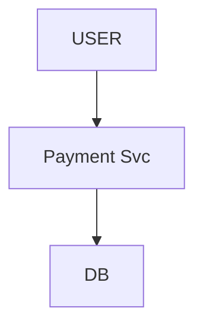
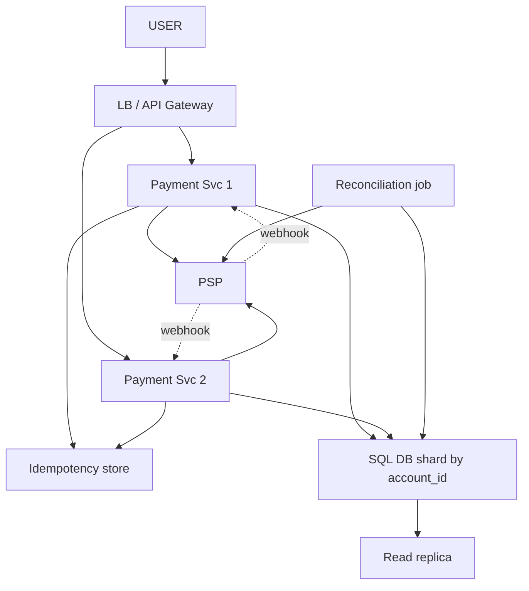
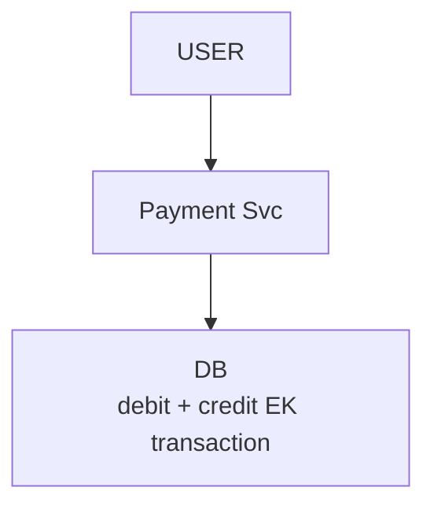
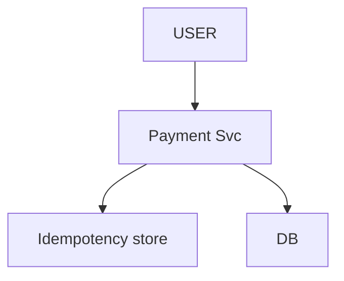
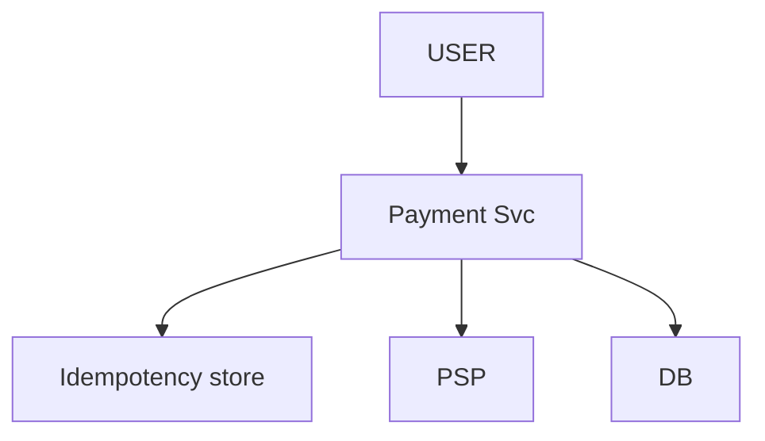
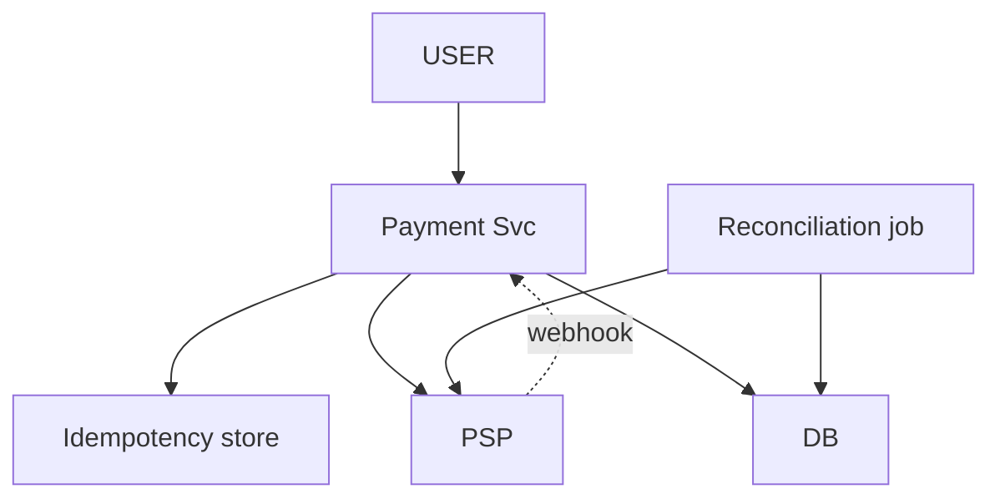
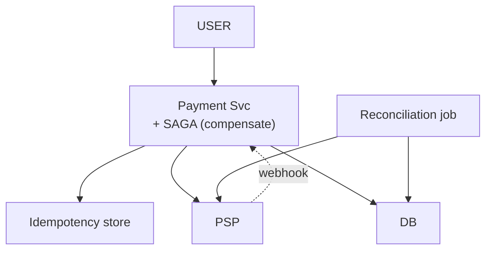
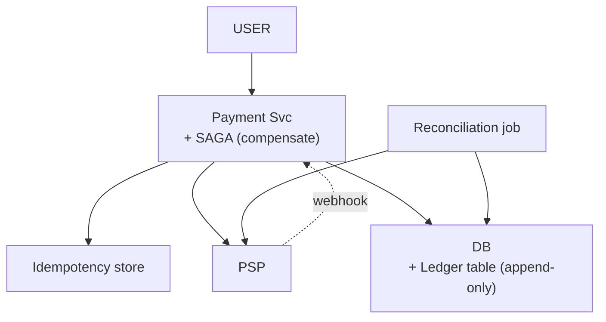
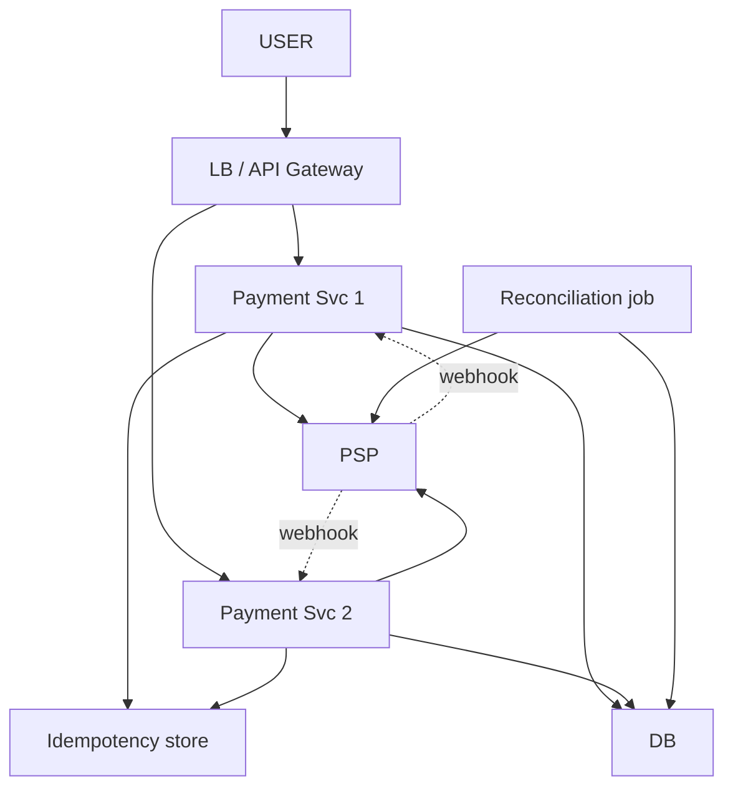
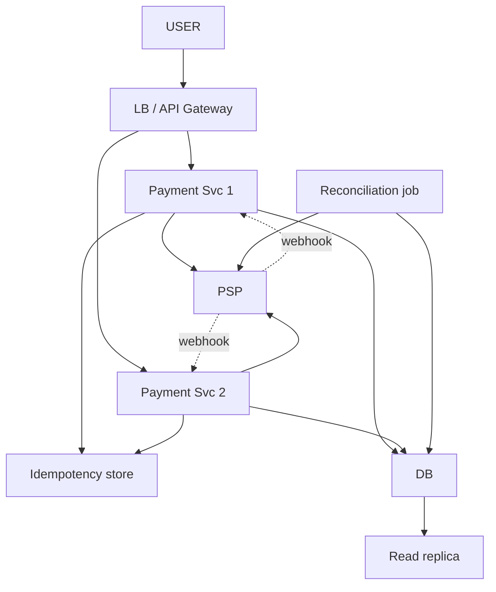

# Payment System (UPI-style)

> User A se User B / merchant ko paisa, bharose ke saath. Misaal: Arpan ne chai wale (merchant) ko Rs. 500 bheje.
> Is design ka dil: **paisa DO BAAR na kate** + **paisa kabhi GUM na ho**. Finance HLD ka core, JP / GS ka favourite.

```
CHAAR MUSHKIL BAAT (poori file inhi ke ird-gird):
   do baar na kate (IDEMPOTENCY) · dono taraf ek saath (CONSISTENCY)
   kuch gire to bhi paisa na khoye (FAILURE HANDLING) · har paise ka hisaab (LEDGER / AUDIT)
```

---

## TASVEER (ByteByteGo / Alex Xu · CC BY-NC-ND 4.0)


Source: [How to Avoid Double Payment](https://bytebytego.com/guides/how-to-avoid-double-payment/)
(dobara bhejne pe do baar na kate = IDEMPOTENCY KEY)


Source: [Reconciliation in Payment](https://bytebytego.com/guides/reconciliation-in-payment/)
(crash ke baad asli haal PSP se milaana = RECONCILIATION)

---

## SHURU: pehle poocho, phir numbers

```
POOCHO:  "P2P, merchant, refund, settlement, fraud — kis pe? Main ek user se doosre tak paisa bhejne pe."
         ★ dono account EK hi system / bank me ya ALAG?  <- isse poora design badalta:
           ek DB -> ek TRANSACTION (ACID) kaafi · alag bank -> SAGA ka khel
         refund scope me? · bahar ka PSP (Razorpay / Stripe) ya khud? · audit / RBI ka hisaab?

KYA KARE (FR):    A se B ko bhejo · dobara bhejne pe dobara na kate · fail ho to paisa wapas · har paisa traceable
                  scope bahar: fraud engine · kai currency · chargeback
KAISA CHALE (NFR): paisa KHOYE nahi (kata par pahuncha nahi) · ATKE nahi (beech me network gaya)
                   DO BAAR na kate (500 ki jagah 1000) · har paisa TRACE ho (audit)

NUMBERS (andaaza):
   ~10 crore user · aam din kuch sau payment / second · festival / sale pe kuch hazaar / second
   ★ "Payment me bheed badi dikkat nahi, SAHI hona badi dikkat hai. Pehle sab-ya-kuch-nahi + do-baar-nahi + ledger."
   -> SQL DB (ACID: kai row ek transaction me) + ledger jisme sirf jodte hain
   DHYAAN: "NoSQL me ACID hota hi nahi" mat bolo -- kai NoSQL ek row / document pe atomic hain.
           sahi farak: debit + credit + ledger = KAI ROW ek saath -> SQL me ye seedha aur pakka.
```
```
POOCHEGA: "Consistency or availability — which do you pick?"
BOL:      "Consistency for money — during a partition I'd rather reject than give a wrong answer. The same
           system can keep dashboards and reports available and eventually consistent."
```

---

## ════ MOCK SE PEHLE: SIRF YE CARD PADHO ════

> Har dikkat ek card: KAHANI (kya hua, kaun, kitna) -> ILAAJ -> ANDAR KAISE (ilaaj kyun kaam karta) ->
> ISKE BAAD KYA TOOTEGA (interviewer yahin ghusta hai: dabba lagaya, ab kya?).

#### DABBA 0: SABSE SIMPLE (yahan se shuru, phir "kahan tootega")
```
Payment service DB me do kaam kare: Arpan ke 500 ghatao, merchant ke 500 badhao.
```


#### 0 DB KAUNSA? SQL
```
KAHANI:  Ek payment me chaar likhai: Arpan -500, merchant +500, aur khaate (ledger) me 2 line.
         Ye chaaron ek saath honi chahiye. Teen hui aur chautha reh gaya = hisaab galat.

ILAAJ:   SQL (Postgres / MySQL): kai row EK transaction me, sab ya kuch nahi (ACID).

ISKE BAAD KYA TOOTEGA:
  - NoSQL kyun nahi?
      -> yahan kai row / table pe ek saath "sab ya kuch nahi" chahiye, aur paisa turant sahi dikhe.
         Paise me "thodi der baad sahi" (eventual) nahi chalta.
```

#### [1](#d1) BEECH ME CRASH: ARPAN -500 HUA, MERCHANT +500 NAHI
```
KAHANI:  Arpan ke 500 kat gaye. Merchant ke account me daalne se PEHLE server gir gaya.
         500 na Arpan ke paas, na merchant ke paas. Gayab.

ILAAJ:   Kaatna aur daalna EK DB TRANSACTION me. Ya dono honge, ya koi nahi. Crash -> sab wapas (rollback).

ANDAR KAISE:
         BEGIN
           Arpan -= 500 · Merchant += 500
         COMMIT
         DB har badlaav pehle apni diary (WAL) me likhta. Gira aur utha -> diary dekhta:
         COMMIT ho chuka tha to poora karta, nahi hua tha to ulta kar deta. Aadha kabhi nahi bachta.
         Niyam: saare kate == saare jude, hamesha. Na mile -> turant alert.

ISKE BAAD KYA TOOTEGA:
  - Arpan ke account se do payment ek saath, balance sirf 600?
      -> UPDATE ... SET balance = balance - 500 WHERE id = ? AND balance >= 500
         check aur kaatna ek hi query me -> pehla jeeta (bacha 100), doosre ki 0 row badli = reject.
```

#### [2](#d2) DO BAAR TAP / APP NE DOBARA BHEJA = 1000 KATE
```
KAHANI:  Arpan ne Pay dabaya, app ghoomta raha, usne phir daba diya. Ya network ne khud dobara bhej diya.
         Server ko do request mili, dono process -> 1000 kate, dene the 500.

ILAAJ:   IDEMPOTENCY KEY: "Pay" dabate hi app ek random UUID banata (key-555). Dobara bhejne pe WAHI key-555.
         Server: ye key pehle aa chuki -> naya payment nahi, pehle wala jawab wapas.

ANDAR KAISE:
         Key ko "dekha?" aur "daal do" EK hi step me: DB me key UNIQUE (pakka) + Redis SETNX (tez).
           pehli request: key-555 daali, haal IN_PROGRESS -> PSP se paisa -> haal DONE + jawab save.
           doosri request: key-555 pehle se hai -> saved jawab wapas. Paisa ek hi baar.
         Arpan ne sach me do alag payment kiye (100 + 100) -> do tap = do alag key -> dono honge.
         Key ~24 ghante rakho.

ISKE BAAD KYA TOOTEGA:
  - Key app kyun banaye, server kyun nahi?
      -> dobara bhejta app hai. Server ko pata hi nahi ye wahi request hai. App ki key hi dono ko jodti.
  - Key lag gayi, PSP call FAIL?
      -> IN_PROGRESS ki chhoti umar ho / fail pe hata do -> dobara koshish chal sake. Sirf DONE pe skip.
  - Kaam ke baad key delete kar do?
      -> nahi. Der se dobara wali request aayi to dobara kat jaayega.
  - Redis aur DB dono kyun?
      -> Redis tez, aur chal rahi request turant pakadta. DB UNIQUE pakka hai, Redis gira tab bhi.
  - Idempotency aur "do log ek balance pe" same cheez?
      -> nahi. Idempotency = EK user ki dobara request. Do log ek balance pe = atomic query (card 1).
```

#### [3](#d3) ASLI PAISA HAMARA SERVER NAHI HILATA
```
KAHANI:  Hamara server sirf "bhejo" kehta hai. Asli paisa bank ke raaste (bank rails) pe hilta.
         Wo bahar ka raasta kabhi dheema, kabhi band.

ILAAJ:   Bahar ka PSP (Razorpay / Stripe / bank). Har payment ka haal: INITIATED -> PENDING -> SUCCESS / FAILED.
         PSP dheema -> chhota TIMEOUT + CIRCUIT BREAKER (fuse).

ANDAR KAISE:
         Fuse teen haal me:
           CLOSED (sab theek, call jao) --5 baar fail--> OPEN (call bhejo hi mat, payment PENDING)
           --30 sec baad--> HALF-OPEN (ek test call) -> chali to CLOSED, fail to wapas OPEN.
         Timeout na ho to har thread PSP ke jawab me atka rehta -> saare thread phans gaye -> poora system band.

ISKE BAAD KYA TOOTEGA:
  - Timeout hua, Arpan ko kya dikhao?
      -> "processing" (PENDING), "fail" NAHI. Paisa shayad kat chuka. Reconciliation (card 4) pakka karegi.
  - Do PSP rakhoge?
      -> haan, ek band to doosra. Par EK payment hamesha EK hi PSP pe. Beech me badla = do jagah se kat sakta.
  - PSP fail, turant dobara bhejo?
      -> paise me andha dobara nahi. PENDING rakho, reconciliation tay kare.
```

#### [4](#d4) PSP KO CALL KIYA AUR CRASH: PAISA GAYA YA NAHI?
```
KAHANI:  Server ne PSP ko "500 bhejo" bola aur jawab aane se pehle khud gir gaya.
         Ab pata hi nahi: paisa kat gaya aur jawab kho gaya, ya kata hi nahi. "Bas rollback kar do" galat,
         kyunki PSP me shayad paisa sach me kat chuka.

ILAAJ:   PSP call se PEHLE DB me "PENDING" likho. Phir do raaste se pata karo:
         (1) WEBHOOK: PSP khud hamein bataata "ho gaya / fail"
         (2) RECONCILIATION job: atke PENDING ke liye hum PSP se poochte.
         Kabhi andaaza nahi: pehle LIKHO, phir PAKKA karo.

ANDAR KAISE:
         Job har kuch minute: PENDING jo 5 min se purane -> PSP se poochho
           hua -> SUCCESS · nahi hua -> dobara (WAHI key se) · pakka fail -> FAILED + paisa wapas.
         Roz raat PSP / bank ki poori file se apna hisaab milao.
         Jaise courier: har parcel ka tracking number. Courier wala gir gaya, parcel gum nahi hota.

ISKE BAAD KYA TOOTEGA:
  - Webhook do baar aa gaya?
      -> PENDING -> SUCCESS sirf ek baar. Pehle se SUCCESS hai aur phir aaya -> ignore.
  - Sirf webhook kaafi kyun nahi?
      -> webhook kho sakta, der se aa sakta, ya us waqt hamara server band tha. Job wo jaal hai jo chhoota pakde.
  - Sirf job (baar-baar poochhna)?
      -> der lagti + har PENDING pe baar-baar PSP call (limit / kharcha). Isliye dono.
  - Kaise pata sab theek chal raha?
      -> hisaab ka farak, p99, error rate, line ki lambai pe alert + trace id se ek payment ka poora raasta.
```

#### [5](#d5) ALAG BANK / ALAG DB: EK TRANSACTION NAHI CHAL SAKTA
```
KAHANI:  Arpan ka account Bank A me, merchant ka Bank B me. Do alag system pe ek DB transaction hota hi nahi.
         Bank A se 500 kata, Bank B me daalna fail -> paisa beech me latka.

ILAAJ:   SAGA: har step apne system me khud commit. Koi step fail -> pichhle step ULTE kram me undo
         (undo ka kaam khud likhna padta).
         Jaise trip: flight book, hotel book, cab nahi mili -> hotel cancel -> flight cancel.

ANDAR KAISE:
         Bank A -500 OK -> Bank B +500 FAIL -> ulta kaam: Bank A +500 wapas.
         Saga table me har step ka haal: DEBITED, CREDIT_PENDING, ...

ISKE BAAD KYA TOOTEGA:
  - 2PC (two phase commit) kyun nahi?
      -> 2PC me sab "ready" bol ke lock pakad ke rukte. Coordinator gira = sab atke, aur har payment dheema.
  - Payment service beech me gir gayi?
      -> uthte hi saga table dekhti, wahin se aage ya ulta.
  - Beech ke waqt Arpan ko kya dikhe?
      -> "processing", thodi der me SUCCESS ya paisa wapas (eventual).
```

#### [6](#d6) RBI POOCHHE: YE PAISA KAHAN SE AAYA, KAHAN GAYA?
```
KAHANI:  RBI: "Arpan ke ye 500 kahan se aaye, kahan gaye, kab?"
         Balance column sirf aaj ka number batata (Arpan: 1200). Kaise 1200 bana, uska koi record nahi.

ILAAJ:   LEDGER table, USI transaction me jisme paisa hila. Isme sirf INSERT, kabhi UPDATE / DELETE nahi.
         Double-entry: har len-den ki do line, ek DEBIT ek CREDIT.

ANDAR KAISE:
         Arpan -> merchant 500: ledger me "Arpan DEBIT 500" + "merchant CREDIT 500". Balance column bhi usi transaction me.
         Galti ho gayi -> purani line mat mitao, NAYI ulti line likho (pen ki diary, kaat-peet nahi).
         Raat ko jaancho: ledger ka jod == balance? Farak = alert.

ISKE BAAD KYA TOOTEGA:
  - Galat entry delete kar do?
      -> nahi, ulti entry. Audit me dono dikhni chahiye.
  - Balance + alag audit_log table kyun nahi?
      -> UPDATE se purana number mit jaata. Aur alag table me ek likha, doosra fail = farak. Ledger hi sach.
  - 3 saal me ledger bahut bada?
      -> mahine ke hisaab se tukde (partition), purane tukde sasti jagah (S3 Glacier). Archive, delete kabhi nahi.
  - Ledger crash se bachaata hai?
      -> nahi, wo hisaab / audit hai. Crash se bachaate PENDING + webhook + reconciliation (card 4).
```

#### [7](#d7) FESTIVAL PE 3000 PAYMENT / SECOND
```
KAHANI:  Diwali pe 3000 payment / second. Ek hi Payment service machine ka CPU bhar gaya -> timeout ->
         log ghabra ke DOBARA tap kar rahe -> aur bojh. Wo machine giri to sab payment band.

ILAAJ:   Payment service STATELESS (kuch yaad nahi rakhti), kai machine, aage LB / API GATEWAY
         (login check JWT, rate limit, WAF, HTTPS).

ANDAR KAISE:
         Saari yaad DB aur idempotency store me -> koi bhi machine koi bhi payment le sakti. Ek giri, baaki chalti.
         Har payment pe OWNER CHECK: JWT se Arpan ka userId -> "from" account ka owner Arpan hi hai? Nahi -> 403.

ISKE BAAD KYA TOOTEGA:
  - userId request body se le lo?
      -> nahi! Body me koi bhi kisi ka bhi userId likh de (spoof). Hamesha JWT se. (PR drill me baar-baar aata.)
  - LB ko kaise pata machine mar gayi?
      -> LB har kuch second GET /health maarta, jawab nahi = list se bahar.
```

#### [8](#d8) MERCHANT KI REPORT NE ASLI PAYMENT ROKE
```
KAHANI:  Ek bada merchant dashboard pe "is mahine ki saari payment" report chala raha. Wo bhaari query
         usi DB pe -> DB busy -> Arpan ka 500 ka payment likhne me atak gaya.

ILAAJ:   Report READ REPLICA (DB ki padhne wali copy) se. Balance aur payment ka haal hamesha PRIMARY se.

ANDAR KAISE:
         Primary har badlaav apni diary (WAL) me likhta -> replica wo diary padh ke wahi badlaav lagati.
         Ye peeche-peeche chalta (async) -> replica 1-2 second purani ho sakti.
         Report me 1-2 second purana chalta, balance me nahi.
         Bahut bhaari analytics -> alag warehouse me (CDC se data jaata).

ISKE BAAD KYA TOOTEGA:
  - Arpan ne pay kiya, use purana balance dikha?
      -> wo replica se padha gaya jo peeche thi. Isliye balance / haal PRIMARY se hi.
  - Primary gira?
      -> SYNC standby (har likhai uspe bhi pakki) ko primary banao (RDS Multi-AZ) -> kuch nahi khota.
         Async replica ko banaya to aakhri kuch likhai kho sakti.
  - Replica kitni peeche hai, kaise pata?
      -> replication lag metric pe alert.
```

#### [9](#d9) 50 CRORE ROW, LIKHAI DHEEMI
```
KAHANI:  Saal bhar me 50 crore payment row. Saari likhai ek hi primary DB pe -> likhai dheemi.

ILAAJ:   SHARD (DB ko tukdon me baanto) account_id se.
         Naya dard: Arpan shard 1 pe, merchant shard 3 pe -> ek transaction nahi -> wapas SAGA (card 5).

ANDAR KAISE:
         Account kis shard pe: consistent hashing, ya lookup table (account -> shard, baad me badal sakte).
         Arpan ka balance aur uski history ek hi shard pe -> Arpan ka kaatna ek jagah, atomic.

ISKE BAAD KYA TOOTEGA:
  - txn_id ya time se kyun nahi baanta?
      -> txn_id: Arpan ki payment alag-alag shard pe bikhri, balance kahan dekhoge? · time: aaj wala shard garam.
  - Amazon jaisa bada merchant -> uska shard garam?
      -> merchant ke kai sub-account, alag shard pe; report me jod do.
  - Do shard ke beech transfer?
      -> SAGA: shard A se kaato, shard B me daalo, fail pe ulta. Asli mushkil yahi hai, bheed nahi.
```

```
AAKHRI DABBE (sab dikkat ke baad):
  User -> Gateway (login + rate limit + owner check) -> Payment Svc (stateless, saga)
  -> Idempotency (ek key ek baar, unique) -> SQL DB (ACID: kaato + daalo + ledger, shard by account)
  -> PSP (asli paisa, pehle PENDING) -> webhook (PSP batata) · Reconciliation job (hum poochhte, jaal)
  Read replica = sirf dashboard / report

DB:  SQL + ACID -> kaatna aur daalna ek saath · ledger double-entry, kabhi badla nahi jaata
     idempotency key -> { haal, jawab }, ~24 ghante

END ME POOCHEGA:
  "Do baar kata?"   -> Idempotency-Key (Pay TAP pe bani) + unique -> dobara aaya = pehla jawab
  "PSP ne jawab nahi diya?" -> PENDING rakho -> webhook + reconciliation, paisa kabhi gum nahi
  "10x?"            -> Payment Svc machine badhao · read replica · likhai shard by account_id
                       · asli mushkil alag bank / shard ke beech -> SAGA
  "SPOF?"           -> DB primary (sync standby promote) · PSP (doosra PSP)
```

AAKHRI DABBE ki tasveer:



---

## ════ DETAIL: HAR DIKKAT KI INTERVIEW LINE + TASVEER ════

> Card me poori kahani hai. Yahan har dikkat ki ek English line (interview me bolne ke liye) aur us waqt tak ka diagram.

---

<a id="d1"></a>

## DIKKAT 1 — beech me crash: Arpan -500 hua, merchant +500 nahi

```
BOL: "Debit and credit happen in one ACID transaction, so a crash rolls both back, and the debit uses a conditional update so two concurrent payments can never overdraw the balance."
```


---

<a id="d2"></a>

## DIKKAT 2 — do baar tap / retry = 1000 kate

```
BOL: "The client generates an idempotency key when the user taps Pay and reuses it on retries; the server stores the key under a unique constraint with its status and result, so a retry returns the first result instead of charging again."
```


---

<a id="d3"></a>

## DIKKAT 3 — asli paisa hamara server nahi hilata

```
BOL: "The real money moves through an external PSP, so every payment has a status from initiated to pending to success or failed, and I call the PSP with a short timeout behind a circuit breaker so a slow PSP cannot exhaust my threads."
```


---

<a id="d4"></a>

## DIKKAT 4 — PSP call ke baad crash: paisa gaya ya nahi

```
BOL: "I write PENDING before calling the PSP, then resolve it through PSP webhooks and a reconciliation job that queries the PSP for stuck payments; I never assume, I record first and then resolve."
```


---

<a id="d5"></a>

## DIKKAT 5 — alag bank / alag DB: ek transaction nahi

```
BOL: "Across banks or databases I use a saga: each step commits locally and a failure runs compensating steps in reverse, with the saga state persisted so a restarted service can continue. I avoid 2PC because it holds locks and blocks if the coordinator dies."
```


---

<a id="d6"></a>

## DIKKAT 6 — RBI: paisa kahan se kahan

```
BOL: "Every movement is written to an append-only double-entry ledger in the same transaction as the balance update; mistakes are fixed with reversal entries, and a nightly job checks the ledger against balances."
```


---

<a id="d7"></a>

## DIKKAT 7 — festival 3000 / sec

```
BOL: "The payment service is stateless behind a load balancer and API gateway that handles auth, rate limiting and TLS, and every request checks that the user from the JWT owns the source account."
```


---

<a id="d8"></a>

## DIKKAT 8 — merchant ki report ne asli payment roke

```
BOL: "Heavy reports run on a read replica while balances and payment status are always read from the primary; a synchronous standby handles failover without losing writes."
```


---

<a id="d9"></a>

## DIKKAT 9 — 50 crore row, likhai dheemi

```
BOL: "I shard by account id so one account's balance and history live on one shard and debits stay atomic; transfers across shards become a saga."
```


---
## 10 GUNA TRAFFIC — har dabba alag se

```
Gateway           -> bheed / hamla -> rate limit
Payment Svc       -> stateless -> machine badhao
Idempotency       -> do request ek saath -> unique / SETNX
SQL DB            -> kaatna + daalna ek transaction · padhai -> replica · likhai -> shard by account_id
PSP               -> dheema / band -> PENDING + fuse · jawab nahi -> webhook + reconciliation
Ledger            -> sirf jodo, mahine ke tukde, purana sasti jagah
ASLI MUSHKIL      -> alag bank / shard ke beech ka len-den, bheed nahi

POOCHEGA: "How would you scale this to 10x?"      -> paise ka raasta chalo, har dabbe pe "kya toota"
POOCHEGA: "What's the single point of failure?"   -> DB primary (sync standby promote), PSP (doosra PSP)
```

---

## POOCHE TO (gehra sawaal aaye tab)

```
API:      POST /pay { from, to, amount } + header Idempotency-Key: <UUID>  -> { status, txn_id }

KEY KAB BANTI:
          key random hai, "Pay" TAP ke pal banti. Naya tap = nayi key.
          (A) Arpan ne khud do baar tap kiya -> key-555, key-888 -> 100 + 100 = 200 (do payment, sahi)
          (B) ek tap + network ne dobara bheja -> wahi key-555 dobara -> "aa chuki" -> pehla jawab -> 100
          farak = KAUN dobara bhej raha: Arpan (nayi key, naya payment) · system (wahi key, ek hi baar)
          maqsad do payment rokna NAHI, sirf network ke dobara bhejne ko do baar ginne se rokna
          CHEQUE jaisa: key = cheque number · do cheque = dono cash · ek number do baar = nahi
                        bank amount nahi, NUMBER dekhta

DATA:     LEDGER double-entry, kabhi badla nahi · IDEMPOTENCY key -> { haal, jawab } ~24 ghante ·
          HAAL INITIATED -> PENDING -> SUCCESS / FAILED · NIYAM saare kate == saare jude

SCAM 1992 (ledger kyun itna zaroori):
          1990-91 me kaagaz ka ledger + haath se bani Bank Receipt (BR) -> badli ja sakti, nakli ban sakti,
          turant koi jaanch nahi -> nakli / khaali BR + beech ka paisa market me + der se pakda (~Rs. 4000 cr)
          nakli entry          -> NIYAM (kate == jude) + sirf asli paise ki entry
          paisa gaya, share nahi -> sab-ya-kuch-nahi settlement (ACID / SAGA)
          badli ja sakne wali BR -> kabhi na badalne wala double-entry + audit
          beech ka paisa       -> turant RECONCILIATION
          kaagaz se digital: ledger nahi mara, sirf kaagaz gaya · blockchain = sabse pakka na-badalne-wala ledger
          baad me: SEBI ko kanooni taakat (1992) · NSE screen trading (1994) · NSDL demat (1996) · T+2 (2003) · T+1 (2021-23)
```

---

## AAKHRI DABBA + WRAP

```
Gateway = login + rate limit + owner check · Payment Svc = stateless, saga · Idempotency = ek key ek baar
SQL DB = ACID kaato + daalo + ledger, shard by account · PSP = asli paisa, pehle PENDING · webhook = PSP batata
Reconciliation = hum poochhte, jaal · Read replica = sirf dashboard
```
```
idempotency  -> ek key, paisa EK baar          (map me "pehle dekha?")
consistency  -> kaatna + daalna ek saath       (ACID ya SAGA)
failure      -> PENDING + webhook + RECONCILE  (courier tracking — gum kabhi nahi)
ledger       -> double-entry, kabhi badla nahi (pen ki diary)
```
```
BOL: "Every payment carries an idempotency key, stored with its result under a unique constraint, so a
      retry never charges twice. Debit and credit happen in one ACID transaction with a double-entry
      ledger; across banks or shards I use a saga with compensation. The PSP moves the real money, so I
      write PENDING first and resolve it through webhooks and a reconciliation job. Next: fraud checks,
      multi-currency and chargebacks."
```


---

## HANDS-ON — Idempotency LIVE (usercrud, 27-Aug)

> Ek line me: "map me key hai? -> kuch mat karo, wahi wapas. Nahi? -> process + map me daal do."

```java
@RestController
public class IdempotencyController {

    // key -> pehle jo result diya (duplicate pe wahi wapas)
    private final ConcurrentHashMap<String, String> processed = new ConcurrentHashMap<>();
    // asli orders ka counter (SAABIT karega double hua ya nahi)
    private final AtomicInteger orderCounter = new AtomicInteger(0);

    @PostMapping("/pay")
    public String pay(@RequestHeader("Idempotency-Key") String key,
                      @RequestParam int amount) {

        // ATOMIC claim: key hai? -> existing wapas | nahi? -> "PROCESSING" daal + null return
        String existing = processed.putIfAbsent(key, "PROCESSING");
        if (existing != null) {
            return "DUPLICATE (key already claimed) -> " + existing
                 + "  | total orders = " + orderCounter.get();
        }

        // yahan sirf EK thread pahunchega (jisne putIfAbsent race JEETI)
        int orderId = orderCounter.incrementAndGet();
        String result = "Order #" + orderId + " created, amount=" + amount;

        processed.put(key, result);   // "PROCESSING" ko asli result se replace

        return "OK -> " + result + "  | total orders = " + orderCounter.get();
    }
}
// SecurityConfig: .requestMatchers("/pay").permitAll()
```
```
SEQUENTIAL:  A key abc-123, 100 -> OK Order #1, total 1
             B wahi dobara      -> DUPLICATE Order #1, total 1   (2 NAHI)
             C key xyz-999, 200 -> OK Order #2, total 2

RACE:        naive containsKey + put = 2 step, GAP -> A "nahi", B "nahi" -> dono order = DOUBLE
             putIfAbsent = 1 ATOMIC step -> sirf ek jeet-ta
             atomicity NAAM se nahi, ConcurrentHashMap se (bucket lock / CAS). plain HashMap = thread-safe nahi

20 PARALLEL, same key "race-1":
             1..20 | ForEach-Object { Start-Job { curl.exe -s -X POST ".../pay?amount=100" -H "Idempotency-Key: race-1" } } | Wait-Job | Receive-Job
             BROKEN (containsKey + put + sleep 50) -> Order #1 AUR #2 -> total 2 = DOUBLE CHARGE live
             ATOMIC (putIfAbsent) -> 1 OK, 19 DUPLICATE -> total 1
             pehli DUPLICATE "-> PROCESSING" = reserve-then-fill live dikha

PROD:        Redis / DB unique constraint (memory restart pe udti) + key TTL · PROCESSING placeholder
BOL:         "Naive check-then-put races; putIfAbsent on a ConcurrentHashMap makes check and insert one
              step, so only one request wins. In production the store is Redis or a DB unique constraint
              with a TTL. I fired 20 parallel requests: broken version made two orders, atomic made one."
```

ARCHETYPE C · CONCEPTS: [db-what-when](../../FOUNDATIONS/09_databases_what_when.md) · [CAP](../../FOUNDATIONS/08_cap_theorem.md) · [saga/ms-comm](../../FOUNDATIONS/10_ms_communication.md) · saath: [bookmyshow](../09_bookmyshow/09_bookmyshow_INTERVIEW.md) · [stock-broker](../05_stock_broker_trading/05_stock_broker_trading.md) · [← MASTER SHEET](../../00_MASTER_SHEET.md)
