# Payment system: dukaan pe pay ki kahani

Arpan dukaan pe khade ho ke app se 500 pay karta hai. Uska paisa HDFC me, dukaan wale ka ICICI me, aur hamara app na
HDFC ka, na ICICI ka. Kaam: paisa do baar na kate, beech me gayab na dikhe, aur kuch bhi gire to hisaab mile. (Wallet
ke andar ka hisaab, ek transaction aur ledger, banking wali kahani se aaya.)

Har kadam = **kahani** (dikkat aur hal, bolne wali bhasha) -> **Asli naam** (interview me yahi shabd) -> tasveer
(kahani ka shabd, bracket me asli naam).

---

## FR / NFR / Numbers (interview me pehle 2 minute)

```
FR      dukaan ko pay (bank se, PSP ke zariye) · dukaan ka paisa wallet se uske bank me · fail ho to paisa wapas
        · wallet top-up · wallet se wallet (Arpan se dukaan)
NFR     do baar na kate · paisa kabhi gayab na dikhe · kuch gire to bhi payment atka na rahe · har paisa trace ho
Numbers ~10 crore user, aam din kuch sau payment / sec, Diwali pe ~3,000 / sec
        -> aam din bheed badi dikkat nahi, sahi hona badi dikkat · Diwali ka 3,000 / sec ek register nahi jhelega (kadam 9)
```

---

## 1. HDFC hamari sunta hi nahi (beech ki centralized authority)

Arpan ne "pay 500" dabaya, app ko HDFC khaate se 500 nikalne hain. Par app HDFC ka hissa nahi, HDFC hamari sunta hi
nahi. Har bank se khud judne jaayein to alag manzoori, saalon lag jaayenge. To ek aisa system ho, aisi API jo ye kaam
khud kare. Har bank ke liye alag-alag nahi, sirf ek centralized tareeka, koi centralized authority jo ye kaam khud
kare. Hum bas uski cheez use karein.

**Asli naam:** centralized authority = PSP (Razorpay, Juspay), uski cheez use karna = PSP ki API (bank, UPI, card PSP
sambhalta, hum thodi fees dete). Hamara paise ka hisaab = SQL DB (Postgres; dono taraf ek saath badle = ACID).

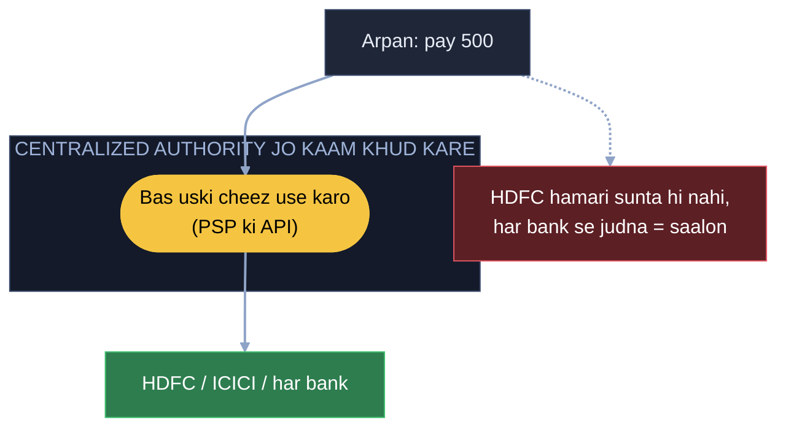

## 2. PSP 30 second se chup (apni parchi)

App ne PSP ko bola "500 kaato", aur PSP 30 second se chup. FAILED dikhaya to Arpan dobara pay karega aur 1,000 kat
sakte. SUCCESS dikhaya to ho sakta paisa kata hi na ho, aur dukaan wala bina paise saamaan de de. To apne paas ek
parchi rakho, jisse dekh sakein PSP pe kya ho raha. Pay dabaya, to parchi pe likh diya: INITIATED ho gaya. Phir
parchi pe likhte raho kya-kya hua: PSP ne ye kara, ab ye kara. Fail hua to FAIL mark, pass hua to PASS mark.

**Asli naam:** parchi = payment table me status, INITIATED / PENDING jab tak pata nahi, pakka jawab aane pe hi SUCCESS
/ FAILED.

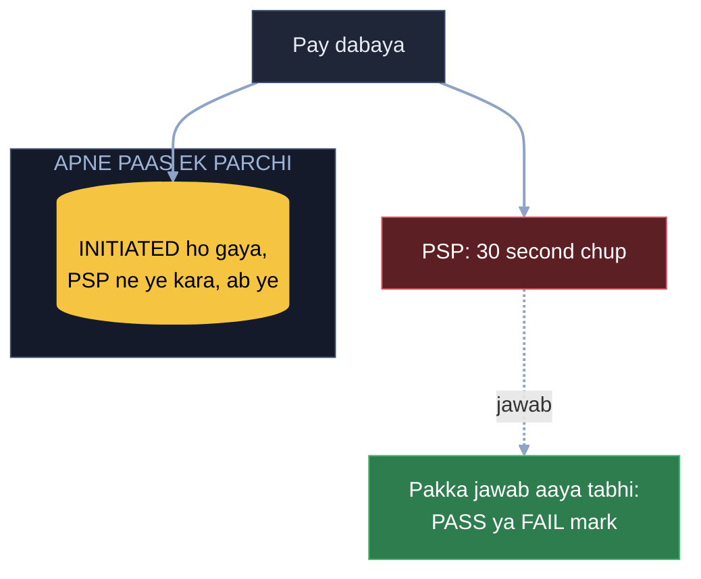

## 3. PSP ka pakka jawab kaise pata chale? (beech ka banda)

Parchi pe jawab ka intezaar hai. PSP batana bhool jaaye ya uska message raste me kho jaaye, to payment hamesha atka
rahega. To beech me ek aisa banda bitha do jo humein batata rahe: PSP pe hua ya nahi hua. Wo permanent dono se baat
karta rahe, PSP se bhi aur hamari parchi se bhi: haan bhai hua, nahi hua.

**Asli naam:** PSP khud batata = webhook (sign jaanch ke), beech ka banda = poochne wala job (har minute purane
INITIATED / PENDING uthata, PSP se status poochhta), dono se baat = PSP aur hamare DB ka milaan (raat ko poora
reconciliation, cron job).

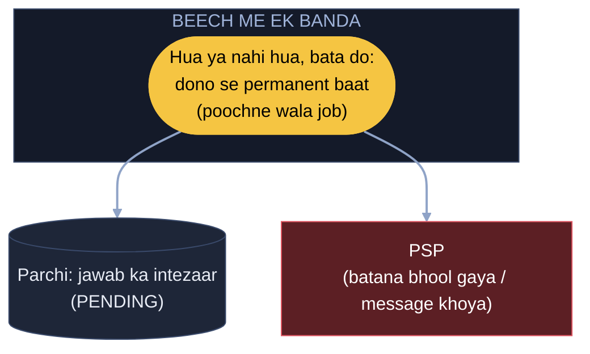

## 4. PSP-1 poora band (fallback tareeka)

Aaj PSP-1 poora band, uski har call fail. Dukaan pe log pay kar rahe aur sabka payment ruk raha. To PSP-1 band hai
to unka payment PSP-2 pe bhej do, hamare paas fallback tareeka hai, logon ko intezaar kyun karwana. Aur maan lo PSP-1
band hai lekin kuch log apna status jaanna chah rahe, to unhe thodi der rok do: bhai abhi thoda down hai, aate-jaate
hum tumhe bata denge.

**Asli naam:** PSP-2 = fallback PSP (naye payment), status wale ko thodi der rokna = PSP-1 pe atke payment wahin
PENDING, PSP-1 wapas aaye tab pakka, PSP-2 pe dobara nahi (warna do baar kata).

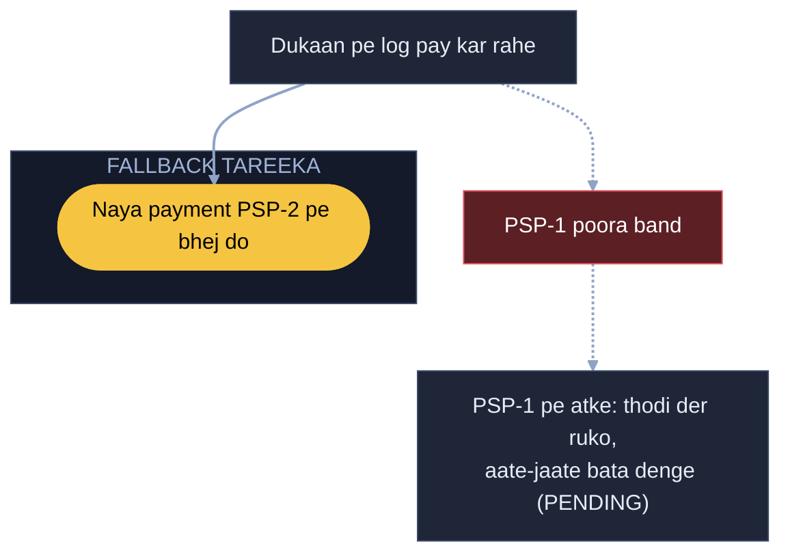

## 5. Server INITIATED likh ke gira (pehle register, phir bhejo)

Server parchi pe INITIATED likh chuka tha, aur PSP ko call bhejte waqt hi gir gaya. Restart pe yaad nahi ki call PSP
tak pahunchi ya nahi. Isliye beech me ek register rakho, usme pehle likh lo "initiate hua", phir bhejo. Server gira to
aake dekhega: haan yaar, ye cheez likhi hui hai, chalo PSP se dobara poochte hain, "bata PSP, iska kya hua". Aur agar
dobara bhejna pade to idempotency key laga denge, us key se pata pad jaayega ki do baar hua. Key process ho chuki to
do baar nahi hoga.

**Asli naam:** pehle register me likho, phir bhejo = PSP call se pehle INITIATED commit, aake dekhega = restart pe job
INITIATED utha ke PSP se status poochhe, idempotency key = payment id hi PSP ki idempotency key.

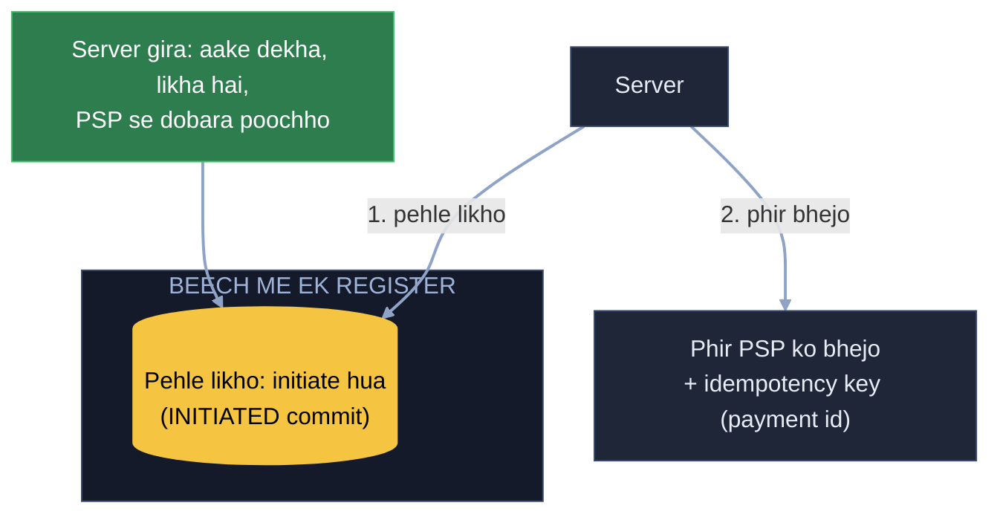

## 6. Dukaan ka paisa ICICI me, wahan FAILED (sab ulta)

Dukaan ke 500 uske wallet se ICICI me nikalne hain. ICICI hamara DB nahi, to ek transaction me nahi hoga. Wallet se
kaat liye, aur ICICI me jodte waqt PSP bola "FAILED". To ulta kar do, sab ulta kar do, sab wapas paise bhej do. Maan
le main HDFC bank hoon, bagal wale bank ko bhejne gaya, usne mana kar diya: "nahi bhai, bank band ho gaya, kal aana,
abhi server bekaar hai". Fail ho gaya, baatcheet khatam. To main apne register me sab kaat dunga: maine yahan se paise
liye the, ise wapas kar raha hoon, aur sab wapas paise bhej dunga.

**Asli naam:** sab ulta = saga (fail pe ulta kadam), register me sab kaat diya = ledger me ulti line (mitana nahi, nayi line), wapas paise =
500 wapas dukaan ke wallet me.

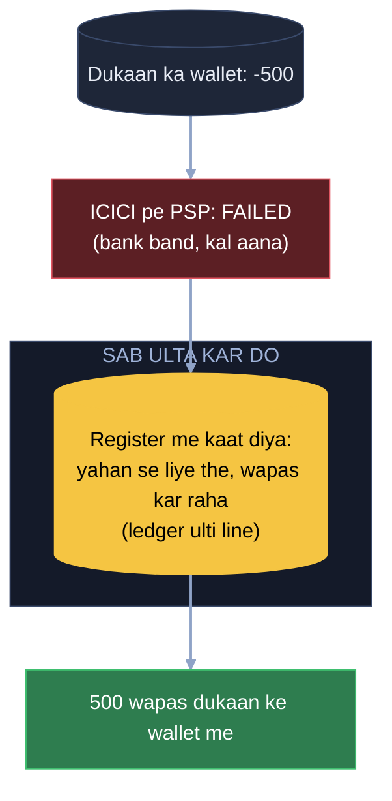

## 7. 2 minute tak 500 kahin nahi (pehle likh lo)

Wallet se 500 kaate, PSP ka jawab aane me 2 minute lage. Us 2 minute me 500 na dukaan ke wallet me, na ICICI me.
Hisaab wala kahega 500 gayab. To sabse pehle kahin likh lo: "wallet se 500 kate". Apne ek log ya ledger me likh lo,
to wo gayab nahi honge. Koi kuch kahe to bata denge: haan bhai, tere paise abhi yahan hain.

**Asli naam:** ledger me likh lo = ledger entry, tere paise abhi yahan = hold (beech ka khaata): SUCCESS pe hold se
nikle, FAILED pe wapas wallet. Har waqt poore hisaab ka jod barabar.

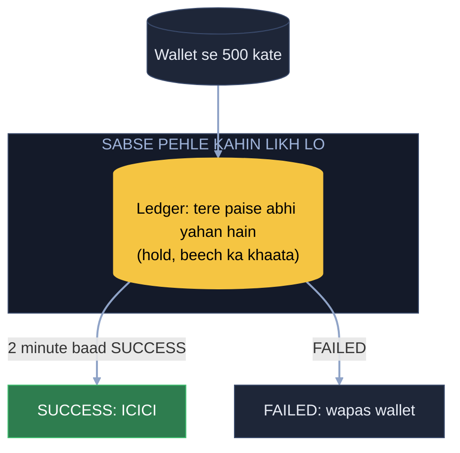

## 8. Saga ka jhanjhat kyun, sabse poochh lo "taiyaar ho?" (dheema dost)

Kisi ne kaha: saga ka jhanjhat kyun? Sabse pehle wallet, PSP, ICICI sabse poochh lo "taiyaar ho?", sab haan bolein tab
ek saath kaat do aur jod do. Aisa kar sakte hain, lekin maan le ICICI ki service dheemi pad gayi. Mere paas paanch
bande hain, main poochh raha "sab taiyaar ho?". Teesra banda thoda slow hai, chaar taiyaar hain, par ek ki wajah se
sab khade. Ye wahi baat hai: main ek dost ko cheating karwa raha, par wo likhne me bahut slow hai, to uski wajah se
mera bhi paper chhoot jaayega.

**Asli naam:** "sab taiyaar ho?" = 2PC (prepare round), ek slow ki wajah se sab khade = 2PC me ek dheema to sab ruke,
isliye 2PC nahi, saga + hold.

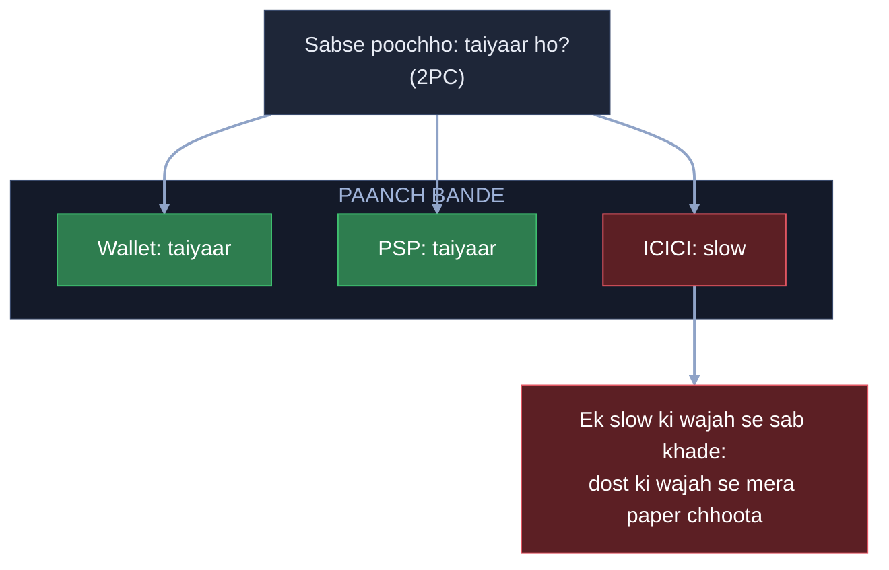

## 9. Diwali pe 3,000 / sec, ek register nahi jhel raha (chhote tukde)

Diwali pe har second 3,000 payment, saare wallet ek hi register (DB) me, register itni likhai nahi jhel pa raha. To
us register ko kaat do, chhote-chhote tukde kar do: le bhai, tu yahan likh, tu ye likh, tu ye likh. Kaam baant diya,
dikkat khatam. Ab aaram se sab apna-apna likh rahe.

**Asli naam:** register ke chhote tukde = shard (account id se, ek insaan ka saara kaam ek tukde pe), tu ye likh = har
shard ka apna likhne wala, likhai bant gayi.

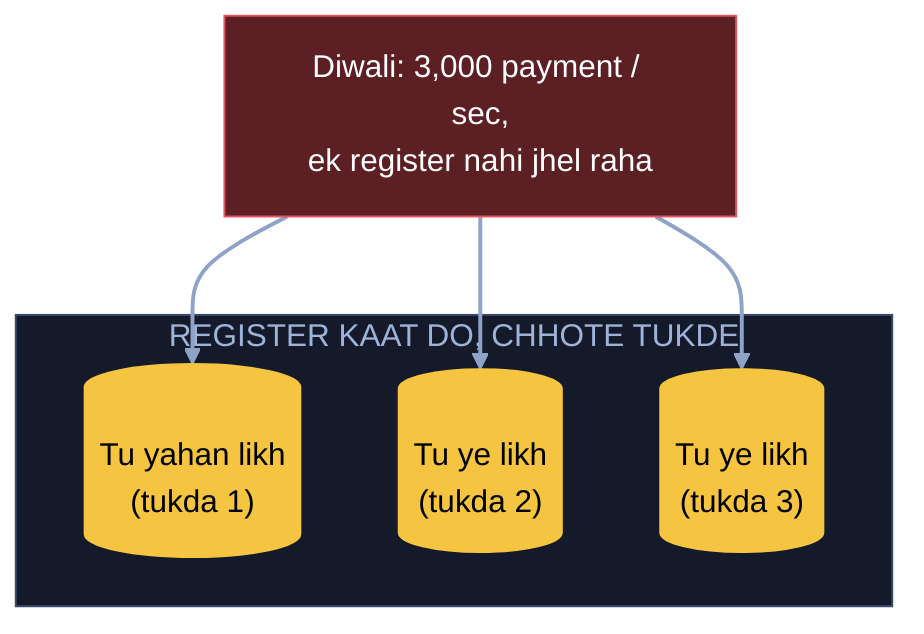

## 10. Arpan tukda 1 me, dukaan tukda 3 me (office ka ladka + diary)

Arpan ka wallet tukda 1 me, dukaan ka tukda 3 me. Ek se kaatna, doosre me jodna, do alag register, ek transaction me
nahi hoga. To apne office se ek ladka pakdunga: ye 500 mera hai, us tukde me jaana hai, use de ke aa ja, aur jo hua
mujhe aake bata. Saath me ek diary rakh, usme likh "ye 500 Arpan ne diye, is tukde me dene hain". Beech me koi dikkat
aaye to diary me likhta jaaye kya-kya hua. Hisaab poora hua to theek, nahi to wapas aake mere paise de dega.

**Asli naam:** ladka 500 le ke us tukde me = saga do shard ke beech, diary = saga ka har kadam likha (beech ka khaata,
hold), wapas aake paise = fail pe ulta kadam.

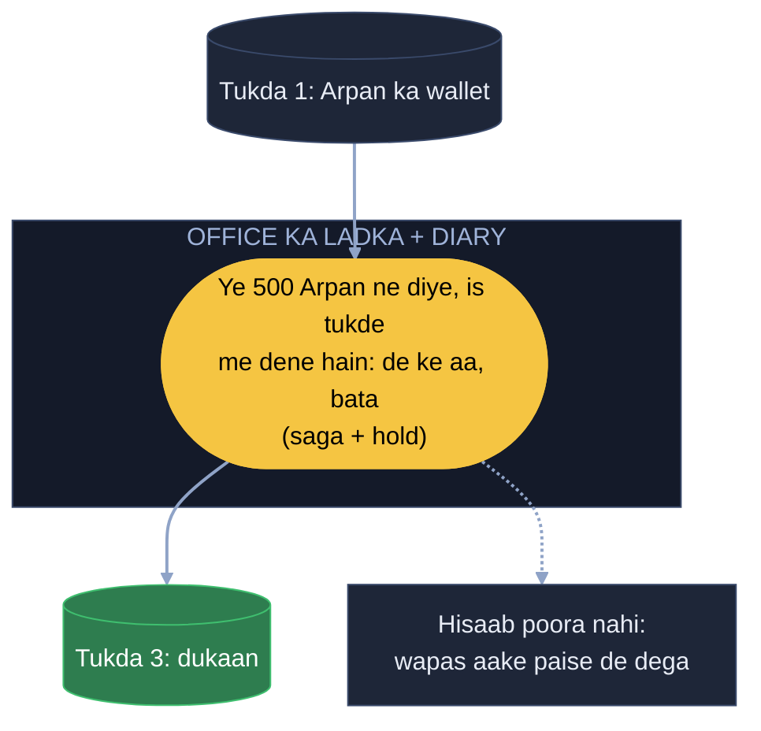

## 11. Ravi ka top-up, PSP-1 chup, mara ya dheema pata nahi (chhotu ko waqt do)

Ravi ne wallet me 500 top-up kiya, aur PSP-1 30 second se chup. Pata nahi PSP-1 mara hai ya bas dheema, aur Ravi ke
bank se paisa kata ya nahi. Doosra PSP khada hai. Ye aisa hai: chhotu ko 500 de ke bheja, wo laut ke nahi aaya. Ho
sakta hai bhaag gaya, ho sakta hai line me khada ho aur dukaan pe paise de bhi diye hon. Agar pehle se pata hai ki
PSP-1 down hai, to payment wahan jaane hi mat do, seedha PSP-2. Par agar pata nahi aur paise shayad kat chuke hain, to
PSP-2 ko bheja to wo bhi kaat lega. Isliye Ravi ko bolo "tumhara payment process ho raha hai", aur PSP-1 ko saaf bol
do: chhotu, tere paas itna waqt hai, ya haan bol ya naa. Haan aaya to kaam ho gaya, naa aaya to Ravi ke paise wapas.
Koi perfect raasta nahi hai, par Ravi ko bekaar me ghanton atka ke nahi rakhna.

**Asli naam:** pehle se pata down hai = circuit breaker OPEN, tab hi fallback PSP-2. Pata nahi kata ya nahi = unknown
state, PENDING (PSP-2 pe nahi, warna do baar katega). Itna waqt, haan ya naa = timeout + status job PSP-1 se poochhe.
Naa to paise wapas = refund.

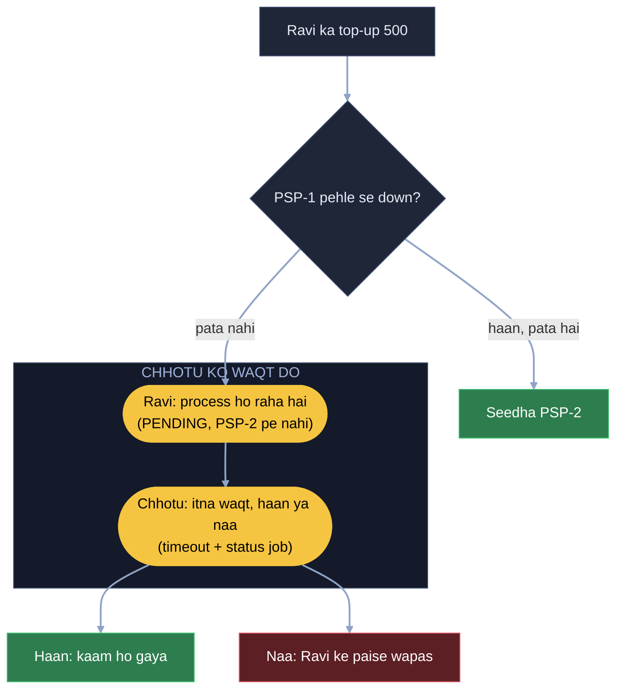

---

Notes (Arpan ke shabd) = [PAYMENT_HAND_NOTES.md](PAYMENT_HAND_NOTES.md)
