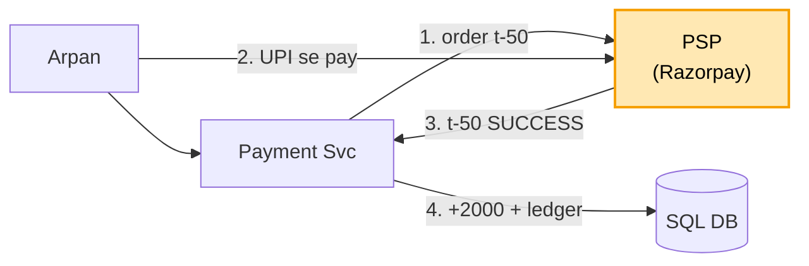

# Payment system (UPI / wallet): shuru se, ek kahani

Kram: **FR -> NFR -> numbers -> design**. Design sabse seedhe dabbe se shuru, har dikkat pe ek dabba judta.
Peela = abhi juda. Kahani ek hi: Arpan ne kirana dukaan (merchant) ko 500 bheje. Dono ka wallet hamare app me
(Paytm / PhonePe wallet jaisa). Andar ka core = [banking](../13_banking_system/13_banking_system.md).

---

## 1. FR: kya karna hai

```
1. A se B / merchant ko paisa (wallet se wallet)
2. bank se wallet me daalo (top-up), wallet se bank me nikaalo (payout)
3. fail ho to paisa wapas, har paisa traceable
scope ke bahar (poochh ke hatao): fraud engine, kai currency, chargeback
```

## 2. NFR: kaisa chalna chahiye

```
- do baar na kate
- dono taraf ek saath badle (Arpan -500 + dukaan +500)
- kuch gire to bhi paisa na khoye, aur atke nahi
- har paisa trace ho
```

## 3. Numbers

```
- ~10 crore user, aam din kuch sau payment / sec, Diwali / sale pe kuch hazaar / sec
```

Banking jaisa: bheed badi dikkat nahi, SAHI hona badi dikkat.

---

## 4. Design

### Kadam 1: wallet se wallet = banking ka core

Dono wallet hamare DB me, to banking wala transfer:

```
BEGIN
  idempotency key (UNIQUE) · arpan -500 WHERE balance >= 500 · dukaan +500 · ledger 2 line
COMMIT
```

Bolo: "Wallet se wallet hamare DB ke andar: ek transaction + idempotency key + check-kaato ek query + ledger,
banking jaisa." Naya hissa yahan se: paisa BAHAR se aana / jaana.

### Kadam 2: bank se wallet me 2000 (PSP)

Arpan ka HDFC hamara DB nahi, bahar hai. Ilaaj: beech me **PSP** (Payment Service Provider: Razorpay, Juspay, Stripe).

```
1. Arpan: "2000 daalo"  -> hum PSP ko: "2000 ka order" (apna txn id t-50)
2. Arpan UPI / bank app me pay karta (paisa PSP ke paas)
3. PSP humein: "t-50 SUCCESS"
4. hum: ek transaction -> wallet +2000 + ledger line ("PSP se aaya")
```



```
KHUD har bank se  -> har bank, UPI (NPCI), card network alag-alag. NPCI manzoori, card data ke kade niyam
                     (PCI-DSS). Saalon ka kaam
PSP               -> ek API, sab bank / UPI / card PSP sambhale. Thoda fees     <- ISLIYE YE
```

Par PSP ko call kiya, PSP dheema, 30 sec jawab nahi. Arpan ka paisa kata ya nahi, pata hi nahi. Fail dikhayein ya
success?
