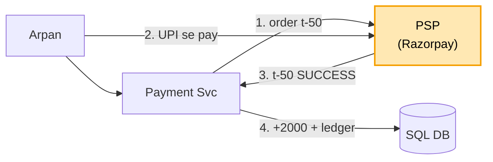
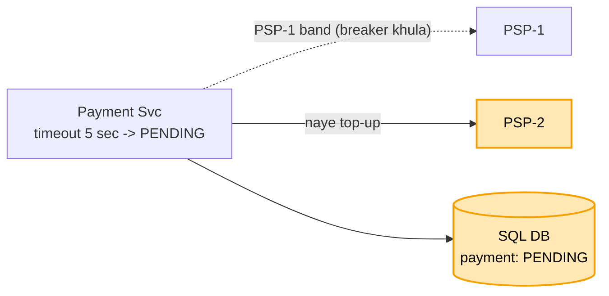
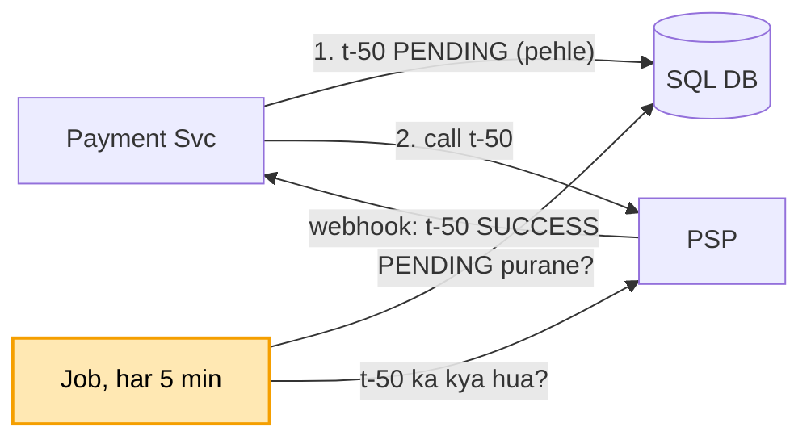

# Payment system (UPI / wallet): shuru se, ek kahani

Kram: **FR -> NFR -> numbers -> design**. Design sabse seedhe dabbe se shuru, har dikkat pe ek dabba judta.
Peela = abhi juda. Kahani ek hi: Arpan ne kirana dukaan (merchant) ko 500 bheje. Dono ka wallet hamare app
me (Paytm / PhonePe wallet jaisa). Andar ka core = [banking](../13_banking_system/13_banking_system.md).

---

## 1. FR: kya karna hai

```
1. A se B / merchant ko paisa (wallet se wallet)
2. bank se wallet me daalo (top-up), wallet se bank me nikaalo (payout)
3. fail ho to paisa wapas, har paisa traceable
scope ke bahar (poochh ke hatao): fraud engine, kai currency, chargeback
```

## 2. NFR: kaisa chalna chahiye

```
- do baar na kate
- dono taraf ek saath badle (Arpan -500 + dukaan +500)
- kuch gire to bhi paisa na khoye, aur atke nahi
- har paisa trace ho
```

## 3. Numbers

```
- ~10 crore user, aam din kuch sau payment / sec, Diwali / sale pe kuch hazaar / sec
```

Banking jaisa: bheed badi dikkat nahi, SAHI hona badi dikkat.

---

## 4. Design

### Kadam 1: wallet se wallet = banking ka core

Dono wallet hamare DB me, to banking wala transfer:

```
BEGIN
  idempotency key (UNIQUE) · arpan -500 WHERE balance >= 500 · dukaan +500 · ledger 2 line
COMMIT
```

Bolo: "Wallet se wallet hamare DB ke andar: ek transaction + idempotency key + check-kaato ek query +
ledger, banking jaisa." Naya hissa yahan se: paisa BAHAR se aana / jaana.

### Kadam 2: bank se wallet me 2000 (PSP)

Arpan ka HDFC hamara DB nahi, bahar hai. Ilaaj: beech me **PSP** (Payment Service Provider: Razorpay,
Juspay, Stripe).

```
1. Arpan: "2000 daalo"  -> hum PSP ko: "2000 ka order" (apna txn id t-50)
2. Arpan UPI / bank app me pay karta (paisa PSP ke paas)
3. PSP humein: "t-50 SUCCESS"
4. hum: ek transaction -> wallet +2000 + ledger line ("PSP se aaya")
```



```
KHUD har bank se  -> har bank, UPI (NPCI), card network alag-alag. NPCI manzoori,
                     card data ke kade niyam (PCI-DSS). Saalon ka kaam
PSP               -> ek API, sab bank / UPI / card PSP sambhale. Thoda fees     <- ISLIYE YE
```

Par PSP ko call kiya, PSP dheema, 30 sec jawab nahi. Arpan ka paisa kata ya nahi, pata hi nahi. Fail
dikhayein ya success?

### Kadam 3: PSP dheema / band (PENDING + timeout + breaker + doosra PSP)

FAILED dikhaya to Arpan dobara 2000 daalega. Pehla bhi kata tha to 4000 gaye. Ilaaj: jo pata nahi, wo
**PENDING**.

```
haal:  INITIATED -> PENDING -> SUCCESS / FAILED
PSP chup  -> PENDING. Arpan ko "processing, 2-3 min me pakka"
             (galat FAILED = dohra, galat SUCCESS = nakli paisa)
timeout chhota (5 sec) -> har request ek thread pakde. 30 sec rukte to Diwali pe saare thread PSP me phanse,
                          wallet se wallet bhi ruk jaata
circuit breaker        -> 1 min me 50% fail = KHULA: PSP ko call hi nahi, turant "top-up abhi band".
                          30 sec baad 1-2 try, chala to BAND
PSP poora band         -> doosra PSP (Razorpay + Cashfree). Naye top-up PSP-2 se. Dono band = "abhi band",
                          wallet se wallet chalta
DHYAAN                 -> PSP-1 pe PENDING wala PSP-2 pe DOBARA NAHI (PSP-1 ne shayad kaat liya = dohra)
```



Par PENDING ka pakka kaise pata chale? Aur PSP ko call kiya, jawab se pehle HAMARA server gira. Restart pe
yaad hi nahi call gayi thi ya nahi.

### Kadam 4: pakka kaise pata chale + hamara server gira (PENDING pehle, webhook, poochne wala job)

Ilaaj 1: PSP call se **PEHLE** DB me `t-50 = PENDING` (COMMIT). Server gira to restart pe DB me t-50 dikhta
= pata kis ka pata karna. `t-50` PSP ke liye idempotency key bhi: dobara call pe bhi PSP ek hi baar kaate.

Ilaaj 2: pakka jawab = **dono taraf se baat**:

```
WEBHOOK (PSP -> hum)   PSP khud message bhejta: "t-50 SUCCESS"
                       sign ke saath: koi nakli "2000 daal do" na bheje, PSP ki secret chaabi se jaancho
                       "PENDING hai TABHI SUCCESS karo" -> webhook do baar aaya to doosri baar kuch nahi,
                       +2000 ek hi baar
JOB (hum -> PSP)       har 5 min: jo 5 min se PENDING -> PSP se "t-50 ka kya hua?" (status API)
                       message kho gaya / hamara server us waqt gira tha, tab bhi pakda
RAAT                   PSP ki din bhar ki file se milaan (banking kadam 9 jaisa), farak = ALERT
```

Ek line: PSP khud bataye (tez) + hum khud poochhein (message kho gaya to) + raat ka milaan (pakka).



Par Arpan ne dukaan ko 500 bheje, aur dukaan ko paisa wallet me nahi, seedha apne BANK me chahiye (payout).
Arpan ka wallet hamare DB me, dukaan ka bank bahar. Ek transaction nahi chalega.

