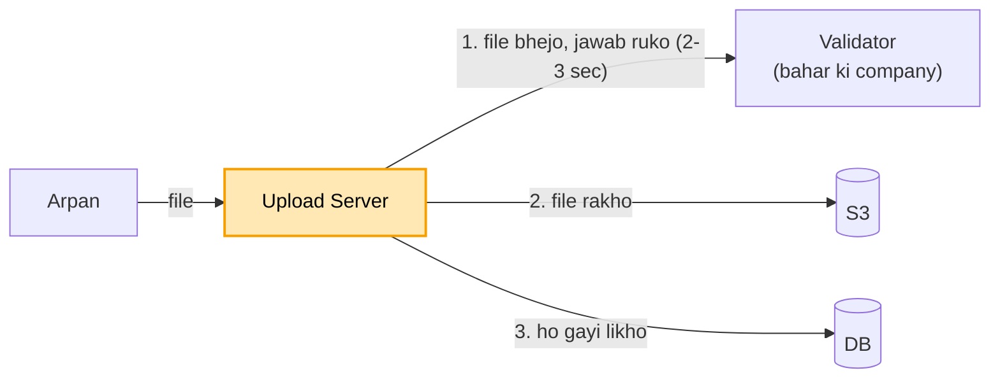
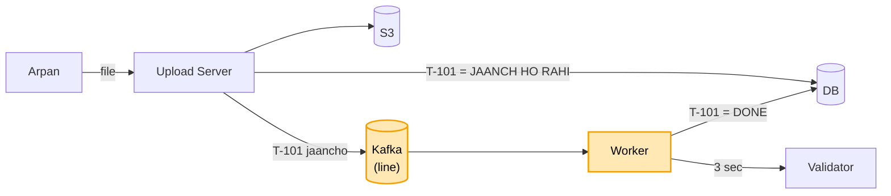

# File upload: shuru se, ek kahani

Kram wahi jo interview me hota hai: **FR, phir NFR, phir numbers, phir design**. Design sabse seedhe dabbe se
shuru hota hai, aur har dikkat aane pe ek naya dabba judta hai. Diagram me peela dabba = abhi juda. Poori file me
ek hi kahani hai: Arpan income tax ki site pe apni `report.pdf` daalta hai.

---

## File upload hai kya, aur kyun chahiye

Arpan income tax ki site pe apni `report.pdf` daalta hai. Site ko us file ke saath teen kaam karne hain: file
lena aur sambhal ke rakhna, file ki jaanch karna, aur Arpan ko batate rehna ki file kahan tak pahunchi.

Jaanch hamari site khud nahi karti. Ye kaam bahar ki ek company karti hai (Validator): file me virus to nahi,
format sahi hai ya nahi. Ek file jaanchne me use lagbhag 2-3 second lagte hain.

Arpan ko haal batane ke liye har file ko ek tracking number milta hai, jaise `T-101`. Is number se wo kabhi bhi
dekh sakta hai ki uski file kahan tak pahunchi.

Ye JP ne sach me poocha tha (SDE-3 writeup). Aam product design hai, finance nahi.

## 1. FR: kya karna hai

```
file upload ho, bahar wali company jaanche, file store ho, user ko tracking number aur haal mile
scope ke bahar: editing, sharing, versions
```

## 2. NFR: kaisa chalna chahiye

```
- user ko rukna na pade (yahi is design ka dil hai)
- file kabhi khoye nahi
- haal hamesha pata ho ki file kahan tak pahunchi
- bheed me bhi chale, aur safe rahe
```

## 3. Numbers

```
- roz 1 lakh file -> ~1-2 upload har second (kam hai)
- deadline wale din (31 March) aakhri ghante me ~100 guna -> ~150-200 upload / sec
- log apna haal baar-baar dekhte hain -> padhna bahut zyada, likhna kam
```

Pehle poochho: jaanch kitna time leti hai (2-3 sec), aur nateeja turant chahiye ya user baad me haal dekh lega.
Turant nahi chahiye, to aage async + tracking aayega.

---

## 4. Design

### Kadam 1: sabse seedha (server khud sab kare)

Ek Upload Server lagao. Arpan app me `report.pdf` chunta hai, aur app poori file is server ko bhej deta hai.
Server ek ke baad ek teen kaam karta hai: file Validator ko bhejta hai aur jawab ka intezaar karta hai, phir file
S3 me rakhta hai, aur DB me likhta hai ki file ho gayi. Uske baad hi Arpan ko "ho gaya" bolta hai.



```
Arpan --file--> Upload Server --1. file bhejo, jawab ruko--> Validator (2-3 sec)
                     |--2. file rakho--> S3
                     |--3. "ho gayi" likho--> DB
Arpan <-- "ho gaya" (3+ sec baad)
```

Jab tak din me thodi file aati hain, ye chalta hai. Seedha hai aur sab ek jagah hai.

Par 31 March aaya. Aakhri ghante me har second 200 log file daal rahe hain, aur har upload server ko 3 second
rokta hai. Matlab kisi bhi pal ~600 upload sirf Validator ke jawab ka intezaar karte khade hain. Server ke dhaage
bhar gaye, nayi file lene ki jagah hi nahi bachi. Arpan ki screen ghoomti reh gayi, aur aakhir me "time out" aa gaya.

### Kadam 2: Arpan 3 sec ghoomti screen dekh raha (jaanch peeche bhejo + tracking number)

Server Arpan ko jaanch khatam hone tak kyun roke? Arpan ko jaanch ka nateeja abhi nahi chahiye, use bas ye pata
hona chahiye ki file pahunch gayi.

To server ab sirf do kaam karta hai. File S3 me rakhta hai, aur DB me likhta hai `T-101 = JAANCH HO RAHI`. Phir ek
line (queue, jaise Kafka) me khabar daalta hai: "T-101 jaancho". Aur Arpan ko turant `T-101` de deta hai, lagbhag
100 ms me. Screen ghoomna band.

Peeche ek **Worker** line se khabar uthata hai, Validator ko bhejta hai, 3 sec rukta hai, aur DB me `T-101 = DONE`
(ya `FAILED`) likh deta hai. Arpan jab chahe `T-101` se haal dekh leta hai.



```
Arpan --file--> Upload Server --> S3 (file) + DB (T-101 = JAANCH HO RAHI)
                     |--"T-101 jaancho"--> Kafka (line)
Arpan <-- "T-101" (turant, ~100 ms)
                     Worker <-- line se uthao --> Validator (3 sec) --> DB: T-101 = DONE
Arpan --"T-101 ka haal?"--> DB --> "DONE"
```

Is tareeke ko **async + tracking ID** kehte hain: kaam peeche hota hai, aur haal dekhne ke liye ek number milta hai.

**Line (queue) kyun, server ke andar hi peeche thread kyun nahi:** thread server ki memory me hota hai. Server
restart hua to jo 500 file jaanch ka intezaar kar rahi thi, wo sab bhool jaata. Kafka me khabar disk pe likhi hoti
hai, server mare tab bhi bachi rehti hai.

Ek fayda aur: Validator 1 ghanta band ho gaya, tab bhi Arpan ki file kahin nahi gayi. File S3 me hai, khabar line
me padi hai. Validator wapas aaya to Worker uthake jaanch kar dega. Arpan ko bas thodi der "jaanch ho rahi" dikhega.

Par Arpan ne `report.pdf` nahi, apni 5 GB ki video daali. Ye poori 5 GB pehle hamare Upload Server pe aati hai, phir
wahan se S3 jaati hai. Server ki memory aur net, dono isi ek file ne gher liye, aur baaki sab ka upload atak gaya.
