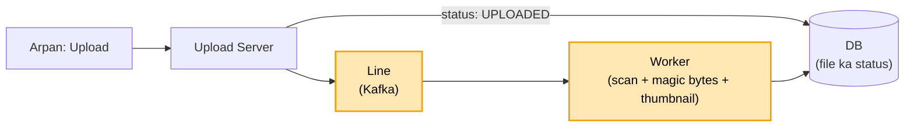
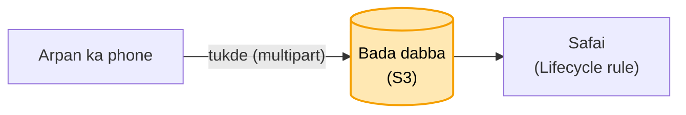
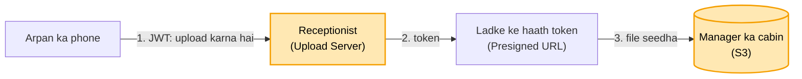
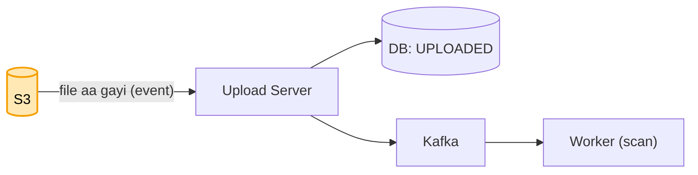
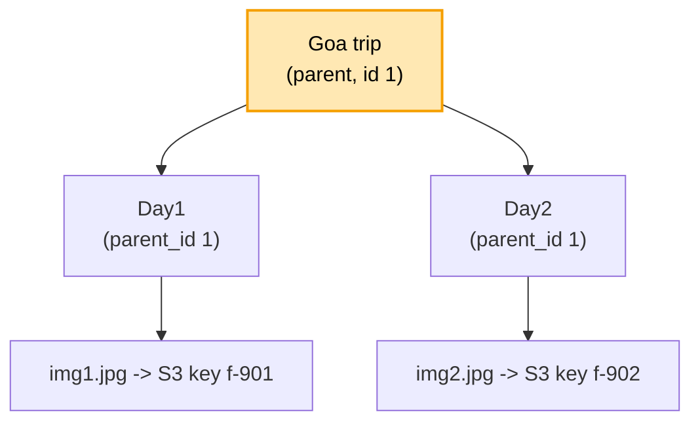
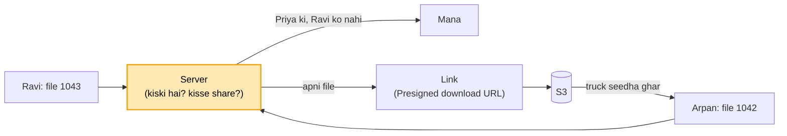
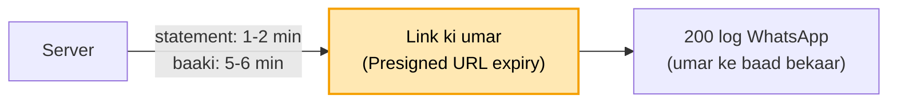
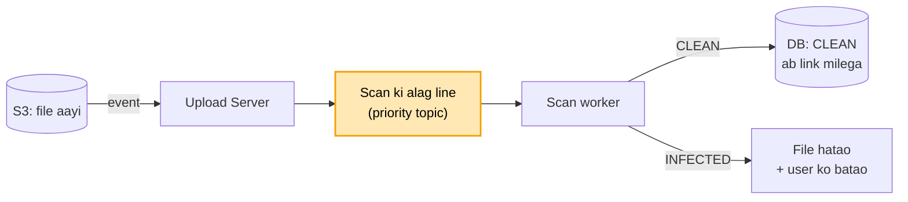

# File upload: YouTube jaisa "peeche chal raha" ki kahani

Ek aam file-sharing app. Arpan 2 GB ki video, 10 GB ki file ya "Goa trip" folder daalta hai, aur Ravi ke saath
share karta hai. Kaam: user ko rukna na pade, badi file bhi bina hamare server ko dabaye pahunche, file kabhi na
khoye, aur ek ki file doosra kabhi na dekh paaye.

Har kadam = **kahani** (dikkat aur hal, bolne wali bhasha) -> **Asli naam** (interview me yahi shabd) -> tasveer
(kahani ka shabd, bracket me asli naam).

---

## Pehle poochho: kaunsa product? (yahi is design ki chaabi)

Har file upload app alag hai: koi scan karta, koi nahi, koi 10 GB ya folder leta hi nahi. Income tax ki site pe
chhoti PDF hai, folder nahi, par scan zaroori. Drive jaisi app me badi file bhi hai aur folder bhi. To design ek
kahani nahi, **tukde** hain: ek core jo har jagah lagta hai, aur "agar" wale tukde, jo product maange tabhi jodo.

```
CORE (har jagah)      1 peeche line + status · 2 seedha S3 · 3 receptionist ka token · 4 S3 khud bataye · 6 maalik check + seedha download · 7 link ki umar
AGAR badi file        2 tukde (multipart) + adhoore ki safai
AGAR folder           5 ped hamare DB me
AGAR bahar ki file    1 me jaanch + 8 scan ki alag line, scan tak link band
```

Seedha S3 bhi core hai, kyunki 3, 4, 6 usi pe tike. Interview me FR pe hi poochh lo: file kitni badi, folder chahiye,
scan chahiye? Jo "haan" aaye wahi tukda bolo.

---

## FR / NFR / Numbers (interview me pehle 2 minute)

```
FR      file upload (badi bhi, folder bhi) · jaanch (virus + sach me wahi type) · status dikhe · share + download
NFR     user ruke nahi · file khoye nahi · ek ki file doosra na dekhe · bheed (shaam ko hazaaron upload) me bhi chale
Numbers 1000 log x 2 GB ek saath = 2 TB -> ye data hamare server se guzarna hi nahi chahiye
        status log baar-baar dekhte -> padhna zyada, likhna kam
```

---

## 1. [core] Server khud sab kar raha, Arpan 10 minute spinner dekh raha (peeche bhejo)

Arpan ne 2 GB ki video daali. Server file leta, virus scan karta, thumbnail banata, save karta, aur ye sab hone ke
baad "done" bolta. Arpan 10 minute spinner dekh raha, aur 1000 log aaye to jo sirf apni list khol rahe wo bhi atke.
YouTube kuch rokta nahi, bol deta "upload chal raha, chai pi aao". Matlab peeche kuch chal raha. Stadium jaisa: line
me lag jao, baaki main peeche karta rahunga. File lo, line me daalo, worker peeche kaam kare. Status apne DB me rakho,
user UI pe dekh le.

Aur jaanch: koi PDF bol ke exe na chadha de. To virus scan (bahar ki company ka) aur file ka chhota tukda dekh lo ki
sach me PDF / CSV hai.

**Asli naam:** line = Kafka + worker (async), status = DB me file ki row ka status, chhota tukda = magic bytes,
scan = third party virus scan.



## 2. [core + agar badi file] 2 TB hamare server se guzar raha (seedha bada dabba + tukde)

Shaam ko 1000 log ek saath 2 GB daalte hain, 2 TB hamare server se guzar raha, network bhar gaya. Badi file apne
server se guzaro hi mat, seedha bade dabbe me daalo.

**Maan lo 10 GB ki file, 8 GB pe net gaya:** file ko tukdon me todo. 8 GB ke tukde pahunch chuke, sirf baaki 2 GB
dobara. Aur client ne dobara upload kiya hi nahi, to adhoore tukde S3 me pade rahenge aur paisa lagega. To thodi der baad S3 ki safai
unhe hata de.

**Asli naam:** bada dabba = S3, tukde = multipart upload (resume, sirf toota tukda dobara), safai = lifecycle rule
(adhoora multipart upload kuch din baad hatao).



## 3. [core] S3 kaise maane ye hamara user hai (receptionist ka token)

Phone seedha S3 me daal raha, par S3 ko kaise pata ki ye hamara user hai? App me AWS ki chaabi rakhi to koi bhi
nikaal le. Bank jaisa: koi seedha manager ke cabin me nahi ghusta (cabin = S3). Pehle receptionist (hamara server)
JWT dekh ke tasalli kare, phir ladke ke haath me token de (token = presigned URL, sirf is file ke liye, thodi der
ka): "ye le, jab teri baari aaye to file de dena". 10 GB ka bora receptionist khud nahi uthata (file hamare server se
nahi guzarti, phone seedha S3 me daalta hai).

**Maan lo koi 10 GB ki faltu file daal raha:** size ki had lagao, ya badi file pe paisa lo, S3 ka kharcha bhi hamara.

**Asli naam:** receptionist ka token = presigned URL (hamara server JWT dekh ke banata, chaabi phone ko kabhi nahi), had = size limit /
quota.



## 4. [core] File S3 me aa gayi, server ko pata hi nahi (S3 khud bataye)

File hamare server ke paas se guzri hi nahi, to server ko pata nahi chala ki upload kab poora hua. DB me "UPLOADING"
pada hai, scan shuru hi nahi hua. S3 ko bol do: "jab file aa jaaye, mujhe bata dena". Hum DB me mark kar denge aur
ladke ko bata denge. Poori nahi hui to wo dobara try karega.

**Asli naam:** S3 event notification (SQS ke raaste) -> hamara server DB me status UPLOADED + Kafka me scan ka kaam.

**Maan lo DB me UPLOADED likha, Kafka me scan daalne se pehle server gira:** file atki, scan kabhi nahi. Wahi vasiyat:
UPLOADED ke saath hi "iska scan karwana hai" likh do, baad me koi utha ke Kafka me daal dega.
**Asli naam:** outbox (status + scan ka kaam ek DB transaction me) + relay.

**Maan lo S3 ne "file aa gayi" do baar bataya, ya ulte kram me:** parchi rakho, is file ka kaam ho gaya to dobara aaya
chhod do; ulta aaya to dekho kaunsa naya, purana chhod do. S3 khud likhta hai: "Amazon S3 event notifications are designed to be delivered at least once."
([AWS](https://docs.aws.amazon.com/AmazonS3/latest/userguide/EventNotifications.html)) aur "Event notifications aren't guaranteed to arrive in the same order that the events occurred." ([AWS](https://docs.aws.amazon.com/AmazonS3/latest/userguide/notification-content-structure.html))
**Asli naam:** idempotency (file id + version pe ek hi baar), S3 event ka `sequencer` (usi file ke liye, bada = baad wala).



## 5. [agar folder] "Goa trip" folder, naam badla to 500 copy (ped hamare DB me)

Arpan ne "Goa trip" folder daala: Day1, Day2, kul 500 photo. S3 me folder hote hi nahi, bas lambe naam wali files.
Naam path me likha to rename = 500 copy + 500 delete. Isliye folder ka hisaab alag, apne server me: ek parent, baaki
uske child, ped jaisa (DSA wala tree: root, phir level 1, level 2). Naam badalna = sirf parent ka naam badlo, saare
bachche usi ke neeche. Parent bulaya to saari files saath; delete kiya to poora. S3 sirf files rakhe.

**Asli naam:** ped = DB me folders table (id, parent_id, name), file ki row me folder_id; S3 key file ki id se, naam se
nahi. Rename = ek row update.



## 6. [core] Ravi ne 1043 likha, Priya ka statement khula (maalik check + truck seedha ghar)

Arpan ne Ravi ko `app.com/files/1042` bheja. Ravi ne 1043 likha aur Priya ka bank statement khul gaya, aur download
bhi hamare server se ja raha. Ravi asli member hai (JWT sahi), par Priya ki statement maange to "Priya ko saath la".
Server DB me dekhe file kiski hai, kisse share hui, tabhi link de, warna mana. Link me chhed-chhaad ki to link bekaar.
Aur download truck seedha ghar (S3 se seedha user ke phone pe), hamare bank me nahi aata (hamare server se data nahi
guzarta).

**Asli naam:** kiski hai = owner / share check (authorization, JWT sirf pehchaan batata, ijaazat DB batata), link bekaar = presigned download
URL (signature, badla to bekaar), truck seedha ghar = S3 se direct download.



## 7. [core] Ravi ne link 200 logon ke WhatsApp group me daala (link ki umar)

Ravi ne apna link 200 logon ke WhatsApp group me daal diya. To link ki umar chhoti rakho, file ke hisaab se: bank
statement jaisi 1-2 minute, baaki 5-6 minute. Umar hamara faisla, S3 ka nahi. User khud baante to wo uski
zimmedari, system pe har cheez nahi thop sakte.

**Asli naam:** umar = presigned URL expiry (file ki sensitivity pe: bank statement jaisi 1-2 minute, baaki 5-6 minute). Umar hamara faisla, S3 ka nahi.



## 8. [agar bahar ki file] Scan baaki, Ravi ko download chahiye; virus nikla to (alag line + lo hi mat)

File S3 me aa gayi, scan me 10 minute baaki, aur Ravi download maang raha. Scan ki alag tez line, jaise SMS me OTP ki
(doctor line me nahi lagta): scan baaki kaam ke peeche nahi rukta. Scan poora hone tak link hi nahi; ho gaya to user
ko bata do.

**Maan lo scan me virus nikla:** file lo hi mat, hata do aur user ko batao. Hum antivirus nahi, file system hain; mall aur airport ki security
jaisa, hum utna jaanchte jitna system ko chahiye (magic bytes + virus scan, poora antivirus nahi). Zaroori ho to
bahar wala (third party) pehle jaanche, phir hamare paas.

**Asli naam:** alag line = priority queue / scan ka alag Kafka topic, link nahi = status CLEAN tak download band,
lo hi mat = INFECTED -> file hatao (quarantine / delete) + user ko batao.



---

## Wrap (30 second me poora design)

User ko server se token milta hai aur file seedha S3 me jaati hai, badi ho to tukdon me; adhoore tukde S3 ki safai
hatati hai. S3 khud batata hai ki file aa gayi, server DB me status likhta hai aur Kafka ki alag tez line pe scan
jaata hai. Scan CLEAN tak link nahi, virus nikla to file hatao. Folder ka ped hamare DB me, rename = ek row. Download
pe maalik / share check, phir chhoti umar ka link aur file S3 se seedha.

```
user ruke nahi       -> Kafka + worker, status DB me
server dabe nahi     -> presigned URL, seedha S3, multipart
file khoye nahi      -> S3 + S3 event (status atke nahi)
kachra na bache      -> lifecycle safai (adhoore tukde)
doosra na dekhe      -> owner / share check, chhota link, scan tak band
```

---

Notes (Arpan ke shabd) = [FILE_UPLOAD_HAND_NOTES.md](FILE_UPLOAD_HAND_NOTES.md)
