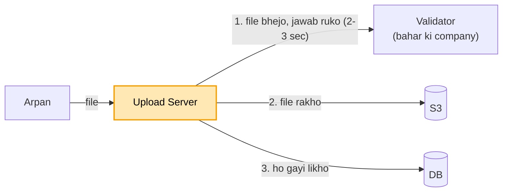
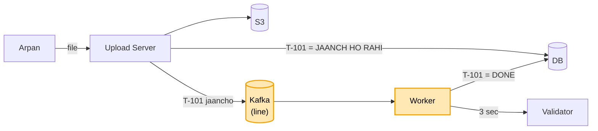
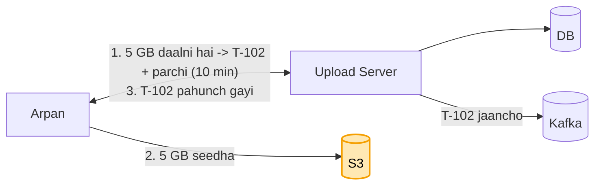
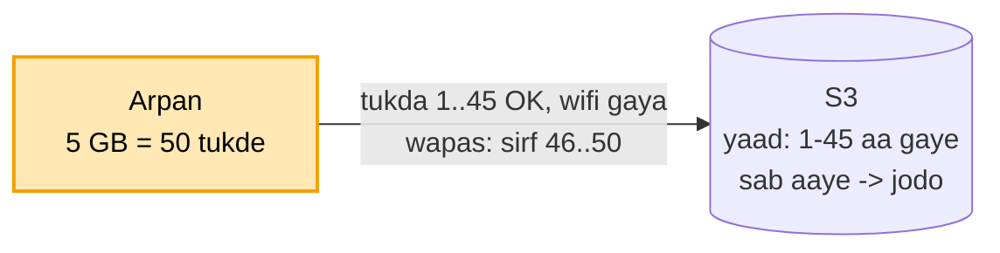
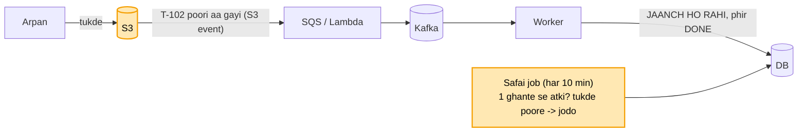
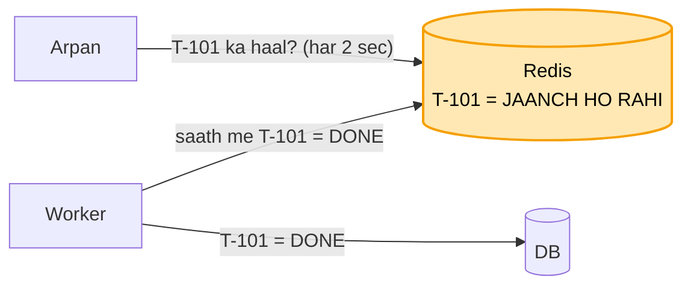
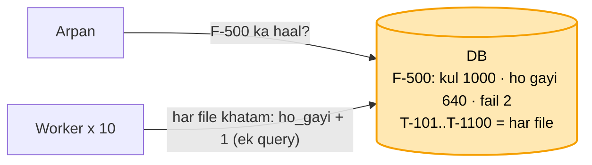
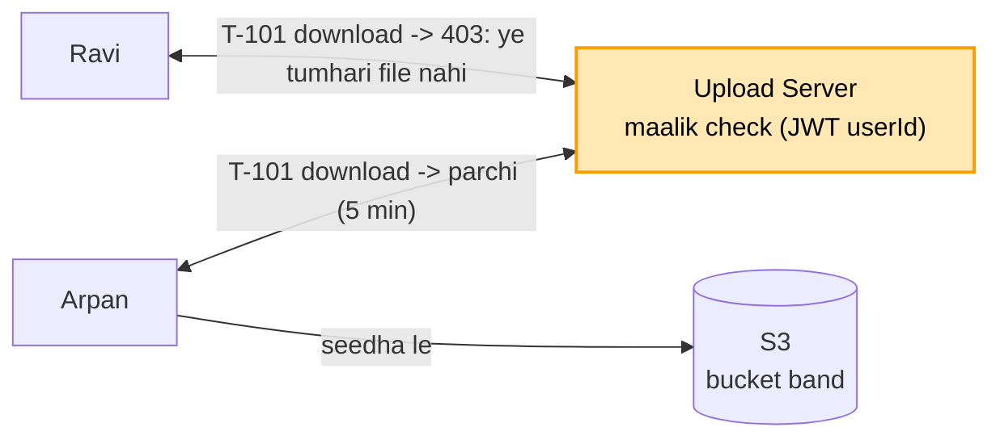

# File upload: shuru se, ek kahani

Kram wahi jo interview me hota hai: **FR, phir NFR, phir numbers, phir design**. Design sabse seedhe dabbe se
shuru hota hai, aur har dikkat aane pe ek naya dabba judta hai. Diagram me peela dabba = abhi juda. Poori file me
ek hi kahani hai: Arpan income tax ki site pe apni `report.pdf` daalta hai.

**CUE (yahi shabd yaad rakhne hain, kram se):**
server sab kare -> peeche bhejo (Kafka + Worker, tracking number) -> parchi se seedha S3 (presigned)
-> tukdon me (multipart) -> S3 khud bataye (event) + safai (lifecycle + job) -> haal Redis me
-> folder ka ek number + atomic ginti -> maalik check + chhota download link

---

## File upload hai kya, aur kyun chahiye

Arpan income tax ki site pe apni `report.pdf` daalta hai. Site ko us file ke saath teen kaam karne hain: file
lena aur sambhal ke rakhna, file ki jaanch karna, aur Arpan ko batate rehna ki file kahan tak pahunchi.

Jaanch hamari site khud nahi karti. Ye kaam bahar ki ek company karti hai (Validator): file me virus to nahi,
format sahi hai ya nahi. Ek file jaanchne me use lagbhag 2-3 second lagte hain.

Arpan ko haal batane ke liye har file ko ek tracking number milta hai, jaise `T-101`. Is number se wo kabhi bhi
dekh sakta hai ki uski file kahan tak pahunchi.

Ye JP ne sach me poocha tha (SDE-3 writeup). Aam product design hai, finance nahi.

## 1. FR: kya karna hai

```
file upload ho, bahar wali company jaanche, file store ho, user ko tracking number aur haal mile
scope ke bahar: editing, sharing, versions
```

## 2. NFR: kaisa chalna chahiye

```
- user ko rukna na pade (yahi is design ka dil hai)
- file kabhi khoye nahi
- haal hamesha pata ho ki file kahan tak pahunchi
- bheed me bhi chale, aur safe rahe
```

## 3. Numbers

```
- roz 1 lakh file -> ~1-2 upload har second (kam hai)
- deadline wale din (31 March) aakhri ghante me ~100 guna -> ~150-200 upload / sec
- log apna haal baar-baar dekhte hain -> padhna bahut zyada, likhna kam
```

Pehle poochho: jaanch kitna time leti hai (2-3 sec), aur nateeja turant chahiye ya user baad me haal dekh lega.
Turant nahi chahiye, to aage async + tracking aayega.

---

## 4. Design

### Kadam 1: sabse seedha (server khud sab kare)

Ek Upload Server lagao. Arpan app me `report.pdf` chunta hai, aur app poori file is server ko bhej deta hai.
Server ek ke baad ek teen kaam karta hai: file Validator ko bhejta hai aur jawab ka intezaar karta hai, phir file
S3 me rakhta hai, aur DB me likhta hai ki file ho gayi. Uske baad hi Arpan ko "ho gaya" bolta hai.



```
Arpan --file--> Upload Server --1. file bhejo, jawab ruko--> Validator (2-3 sec)
                     |--2. file rakho--> S3
                     |--3. "ho gayi" likho--> DB
Arpan <-- "ho gaya" (3+ sec baad)
```

Jab tak din me thodi file aati hain, ye chalta hai. Seedha hai aur sab ek jagah hai.

### DB kaunsa: SQL ya NoSQL?

Data dekho: har file ki ek line (tracking number, maalik, haal). Roz 1 lakh line, data chhota hai. Kaam:
file ka haal badalna (UPLOAD HO RAHI, phir JAANCH HO RAHI, phir DONE), aur aage folder ki ginti ek query me
badhana.

Ye SQL ka seedha kaam hai. NoSQL ki "bahut bada data" wali taakat yahan chahiye hi nahi. Isliye SQL (Postgres).

Par 31 March aaya. Aakhri ghante me har second 200 log file daal rahe hain, aur har upload server ko 3 second
rokta hai. Matlab kisi bhi pal ~600 upload sirf Validator ke jawab ka intezaar karte khade hain. Server ke dhaage
bhar gaye, nayi file lene ki jagah hi nahi bachi. Arpan ki screen ghoomti reh gayi, aur aakhir me "time out" aa gaya.

### Kadam 2: Arpan 3 sec ghoomti screen dekh raha (jaanch peeche bhejo + tracking number)

Server Arpan ko jaanch khatam hone tak kyun roke? Arpan ko jaanch ka nateeja abhi nahi chahiye, use bas ye pata
hona chahiye ki file pahunch gayi.

To server ab sirf do kaam karta hai. File S3 me rakhta hai, aur DB me likhta hai `T-101 = JAANCH HO RAHI`. Phir ek
line (queue, jaise Kafka) me khabar daalta hai: "T-101 jaancho". Aur Arpan ko turant `T-101` de deta hai, lagbhag
100 ms me. Screen ghoomna band.

Peeche ek **Worker** line se khabar uthata hai, Validator ko bhejta hai, 3 sec rukta hai, aur DB me `T-101 = DONE`
(ya `FAILED`) likh deta hai. Arpan jab chahe `T-101` se haal dekh leta hai.



```
Arpan --file--> Upload Server --> S3 (file) + DB (T-101 = JAANCH HO RAHI)
                     |--"T-101 jaancho"--> Kafka (line)
Arpan <-- "T-101" (turant, ~100 ms)
                     Worker <-- line se uthao --> Validator (3 sec) --> DB: T-101 = DONE
Arpan --"T-101 ka haal?"--> DB --> "DONE"
```

Is tareeke ko **async + tracking ID** kehte hain: kaam peeche hota hai, aur haal dekhne ke liye ek number milta hai.

**Kafka aur Worker do alag cheezein hain.** Kafka ek line (register) hai: isme khabar likhi padi rehti hai ("T-101
jaancho"), disk pe, taaki koi mare to bhi bachi rahe. Kafka khud koi kaam nahi karta. Worker humara apna program
hai (jaise ek Spring Boot service): ye Kafka se khabar uthata hai aur asli kaam karta hai, Validator ko bhejna aur
DB me DONE likhna. Bank jaisa: Kafka = token wali line, Worker = counter pe baitha clerk. Clerk chhutti pe gaya to
token line me pade rehte hain. Bheed badhi to 10 clerk (10 Worker) bitha do, line wahi ek.

**Line (queue) kyun, server ke andar hi peeche thread kyun nahi:** thread server ki memory me hota hai. Server
restart hua to jo 500 file jaanch ka intezaar kar rahi thi, wo sab bhool jaata. Kafka me khabar disk pe likhi hoti
hai, server mare tab bhi bachi rehti hai.

Ek fayda aur: Validator 1 ghanta band ho gaya, tab bhi Arpan ki file kahin nahi gayi. File S3 me hai, khabar line
me padi hai. Validator wapas aaya to Worker uthake jaanch kar dega. Arpan ko bas thodi der "jaanch ho rahi" dikhega.

Par Arpan ne `report.pdf` nahi, apni 5 GB ki video daali. Ye poori 5 GB pehle hamare Upload Server pe aati hai, phir
wahan se S3 jaati hai. Server ki memory aur net, dono isi ek file ne gher liye, aur baaki sab ka upload atak gaya.

### Kadam 3: 5 GB video hamare server ke raaste ja rahi (file seedha S3 pe)

Hamara server file ko sirf aage S3 tak pahuncha raha tha, beech ka daakiya ban gaya tha. Jab file ko S3 hi jaana
hai, to seedha S3 kyun nahi?

Par S3 kisi ko bhi file daalne nahi deta, warna koi bhi kachra bhar dega. Isliye server ek **parchi** deta hai,
ek khaas link, jo sirf 10 minute chalta hai, sirf is ek file ke liye, aur sirf 5 GB tak ka. Isko **presigned URL**
kehte hain.



```
1. Arpan --"5 GB video daalni hai"--> Upload Server
   Upload Server --> DB: T-102 = UPLOAD HO RAHI
   Upload Server --> Arpan: "T-102 + parchi (S3 ka link, 10 min)"
2. Arpan --5 GB seedha--> S3        (hamare server ke beech se nahi)
3. Arpan --"T-102 pahunch gayi"--> Upload Server --> DB: JAANCH HO RAHI + Kafka: "T-102 jaancho"
```

Ab hamara server sirf chhoti-chhoti baatein karta hai: parchi dena, aur "pahunch gayi" sunna. 5 GB ka ek byte bhi
uske paas se nahi guzarta. Server halka rehta hai aur baaki sabke upload chalte rehte hain. S3 badi file ke liye
hi bana hai.

Par Arpan ghar ke wifi pe tha. 5 GB me se 4.5 GB chadh chuki thi, aur wifi chala gaya. Wifi wapas aaya to upload
phir 0 se shuru.

### Kadam 4: 4.5 GB chadh chuki thi, wifi gaya (tukdon me upload)

5 GB ek hi baar me bhejna yaani ek lamba dhaaga. Beech me kahin bhi toota to sab gaya. To file ko **chhote
tukdon** me kaat do, jaise 100 MB ke 50 tukde. Har tukda alag se S3 pe jaata hai, aur S3 yaad rakhta hai ki
kaunsa tukda aa gaya.



```
5 GB -> 50 tukde (har ek 100 MB)
tukda 1 OK, tukda 2 OK ... tukda 45 OK  -> wifi gaya
wifi wapas -> S3 se poochho "kaunse aa gaye?" -> 1-45 -> sirf 46-50 bhejo
sab aa gaye -> S3 ko "jodo" bolo -> S3 50 tukde jod ke ek file bana deta hai
```

Isko **multipart upload** kehte hain, S3 me ye pehle se bana hai. Do fayde hain. Wifi gaya to bas aakhri adhoora
tukda dobara jaata hai, 4.5 GB nahi. Aur tukde ek saath bhi bhej sakte hain (jaise 4-5 ek saath), to upload tez
hota hai. Har tukde ki apni chhoti parchi (presigned URL) hoti hai, wahi kadam 3 wala tareeka.

Par Arpan ka phone beech me band ho gaya. Saare 50 tukde S3 pe pahunch gaye the, par app "T-102 pahunch gayi"
bolne se pehle hi mar gaya. Hamare DB me T-102 hamesha ke liye "UPLOAD HO RAHI" pe atka hai, aur jaanch kabhi
shuru hi nahi hui.

### Kadam 5: app "pahunch gayi" bolne se pehle mar gaya (S3 khud bataye + safai)

Dikkat ye thi ki hum app ki ek khabar pe tike the. App mara, khabar nahi aayi, aur file atak gayi. Ilaaj: app pe
bharosa mat karo. **S3 khud batata hai.** Jaise hi file ban jaati hai (tukde jod diye gaye), S3 ek khabar
bhejta hai: "T-102 aa gayi". Ise **S3 event** kehte hain. S3 ye khabar seedha Kafka me nahi daal sakta, wo SQS /
Lambda ko deta hai, aur ek chhota Lambda use Kafka me daal deta hai. Worker DB me "JAANCH HO RAHI" likhta hai
aur jaanch shuru kar deta hai.

Par multipart me tukde aa jaane se file nahi banti. File tab banti hai jab koi S3 ko **"jodo"** bole, aur kadam
4 me ye app bolta hai. To do haalat:

```
A: app ne "jodo" bola, phir "pahunch gayi" bolne se pehle mara
   -> S3 ne file bana li -> S3 event aaya -> jaanch shuru            THEEK
B: saare 50 tukde S3 pe, par app "jodo" bolne se PEHLE mara
   -> file bani hi nahi -> S3 event aata hi nahi -> atka              ise safai job sambhalti (neeche)
```



```
pehle:  Arpan ka app --"pahunch gayi"--> Server      (app mara = khabar gayi)
ab:     S3 --"T-102 poori aa gayi" (S3 event)--> SQS / Lambda --> Kafka --> Worker --> DB + jaanch
```

**Adhoori file ka kachra.** Kisi ne 50 me se 20 tukde bheje aur chhod diya. Wo tukde S3 me pade jagah kha rahe
hain. Iske liye do safai hain. Pehli, **S3 ka niyam (lifecycle)**: jo adhoora upload 1 din se pada hai, S3 use apne
aap mita deta hai, hamein kuch nahi karna padta. Doosri, **safai wali job (sweeper)**: har 10 minute chalti hai.
DB me jo file 1 ghante se "UPLOAD HO RAHI" pe atki hai, uske liye S3 se poochhti hai "kaunse tukde aaye?":

```
saare 50 hain   -> sweeper khud S3 ko "jodo" bole -> file bani -> S3 event aaya -> jaanch     (haalat B ka hal)
saare nahi hain -> FAILED (adhoore tukde S3 ka 1 din wala niyam mita dega)
```

Ye aakhri jaal hai, agar S3 ki khabar bhi kabhi chhoot jaaye. Sweeper beech me mara to agli baar wahi file phir
uthata hai, kyunki haal DB me hai, sweeper ke dimaag me nahi. "Jodo" se pehle dekhta hai ki file ban to nahi
gayi, ban chuki ho to dobara nahi jodta.

Par 31 March aaya. 2 lakh log file daal ke har 2 second app refresh kar rahe hain: "T-101 ka haal?". Har baar DB
se poochha ja raha hai. Likhna kam hai, par padhna itna zyada ki DB ghutno pe aa gaya.

### Kadam 6: 31 March, sab har 2 sec haal poochh rahe (Redis me haal)

2 lakh log har 2 second "T-101 ka haal?" poochh rahe hain. Ye har second 1 lakh sawaal hain, sab DB pe. Par haal
badalta kitni baar hai? Ek file ka poore safar me sirf 3-4 baar: UPLOAD HO RAHI, JAANCH HO RAHI, DONE. Baaki sab
sawaal wahi purana jawab dobara maang rahe hain.

Ilaaj: haal **Redis** me rakho (RAM, ~1 ms). "T-101 ka haal?" ab Redis se jawab paata hai, DB tak jaata hi nahi.



```
Arpan --"T-101 ka haal?"--> Redis: T-101 = JAANCH HO RAHI    (~1 ms, DB ko chhua bhi nahi)
Worker: jaanch khatam --> DB: T-101 = DONE  +  Redis: T-101 = DONE   (dono saath badlo)
```

Ek dhyaan rakhna hai: haal jab badle, Worker **DB ke saath Redis bhi** badle. Warna Arpan ko DB me DONE ke baad
bhi Redis se purana "JAANCH HO RAHI" dikhta rahega. Ye cache wala hi sabak hai.

**Redis kyun, DB ki copy (read replica) kyun nahi:** copy bhi madad karti hai, aur saath me rakh sakte hain. Par
1 lakh / sec ke liye RAM wala Redis sasta aur tez hai. Copy thodi der peeche bhi chal sakti hai, to Arpan ko DONE
ke baad bhi purana haal dikh sakta hai.

Par Arpan ne ek file nahi, poora folder daala, 1,000 file ka. Ab use 1,000 tracking number to nahi chahiye. Use ek
hi baat jaanni hai: "mera folder kahan tak pahuncha?"

### Kadam 7: poora folder, 1,000 file (folder ka ek number + ginti)

Arpan ko 1,000 alag tracking number nahi chahiye. Isliye folder ko apna ek number milta hai, `F-500`. Har file ka
apna `T-` number bhi hota hai, par wo folder ke andar hota hai. DB me folder ki ek line banti hai:

```
F-500:  kul = 1000 · ho gayi = 0 · fail = 0
```

Har file ki jaanch khatam hone pe Worker folder ki ginti ek badha deta hai. Arpan "F-500 ka haal?" poochhta hai to
jawab aata hai: "1000 me se 640 ho gayi, 2 fail". Jab `ho gayi + fail = 1000`, folder DONE.



**Do Worker ek saath:** 10 Worker alag-alag file jaanch rahe hain, aur do ek hi pal me khatam karte hain. Agar dono
pehle padhein "640" aur phir likhein "641", to ek ginti kho jaati hai, aur folder kabhi 1000 tak pahunchta hi
nahi. Isliye padhna aur badhana ek hi query me, DB khud karta hai:

```
UPDATE folders SET ho_gayi = ho_gayi + 1 WHERE id = 'F-500'
```

DB is ek line ko ek jhatke me karta hai, to dono +1 bachte hain. Ye banking wala atomic query ka hi tareeka hai.

Par Ravi ne Arpan ka tracking number `T-101` kahin dekh liya. Usne apne app me "T-101 download karo" daala, aur
Arpan ki income tax ki file Ravi ke phone pe aa gayi.

### Kadam 8: Ravi ne Arpan ka T-101 daala aur file le li (maalik check + chhota download link)

Galti ye thi ki server ne bas number dekha, ye nahi dekha ki maang kaun raha hai. Ilaaj do kadam ka hai.

**1. Maalik check.** DB me har file ke saath likha hai ki uska maalik kaun hai (`T-101 -> maalik = arpan`). Ravi ne
maanga to server login se uska userId dekhta hai (JWT se), aur userId `ravi` hai, `arpan` nahi. Jawab milta hai
**403, ye tumhari file nahi**. Ye wahi "owner check" hai jo PR drill me aata hai.

**2. Download bhi parchi se.** S3 ka bucket band rehta hai, koi seedha link kaam nahi karta. Maalik check pass
hua, tab server ek chhoti parchi deta hai: S3 ka link jo sirf 5 minute chalta hai. Arpan ne wo link WhatsApp pe
bhej bhi diya, to bhi 5 minute baad wo bekaar ho jaata hai.



```
Ravi  --"T-101 download"--> Server: maalik = arpan, tu ravi -> 403
Arpan --"T-101 download"--> Server: maalik check OK -> parchi (S3 link, 5 min) -> Arpan seedha S3 se le
```

Upload me parchi (kadam 3) aur download me parchi, dono me file hamare server se nahi guzarti, aur dono ki umar
chhoti hai.

---

## 5. Wrap (30 second me poora design, NFR se milao)

Arpan ko server se parchi milti hai, aur file seedha S3 pe jaati hai, badi ho to tukdon me. S3 khud batata hai ki
file aa gayi, khabar Kafka me jaati hai, Worker Validator se jaanch karata hai aur DB me haal likhta hai. Arpan ko
turant tracking number mil jaata hai, aur haal Redis se dekhta hai. Folder ki ginti ek query me badhti hai.
Download pe maalik check hota hai aur 5 minute ki parchi milti hai. Adhoori file S3 ke niyam aur safai job se saaf
hoti hai.

```
user ruke nahi      -> Kafka + Worker, turant tracking number
file khoye nahi     -> S3 + S3 event + safai job
haal hamesha pata   -> DB me haal, Redis me copy
safe                -> parchi (upload / download), maalik check
```

---

## Pooche to (design nahi badalta, bas jawab pata ho)

- **Naam `report.pdf`, andar EXE:** Worker file ke pehle kuch byte padh ke asli type dekhta hai (magic bytes). Naam
  pe bharosa nahi.
- **Validator baar-baar fail / dheema:** Worker dobara koshish karta hai, ruk-ruk ke. Bahut fail ho to us pe call
  band (circuit breaker), aur doosri company ya baad me. Khabar Kafka me padi rehti hai, khoti nahi.
- **Ek hi file do baar daali:** file ka hash (SHA-256). Pehle se hai to dobara store nahi. Ye sirf usi user ke
  andar, warna doosre ki file ka pata chal jaata.
- **Chal raha hai, kaise pata:** teen number dekho: Kafka ki line kitni lambi hai, Validator kitni der me jawab de
  raha hai aur kitni baar fail, aur kitni file 10 minute se "jaanch ho rahi" pe atki hain. Had paar ho to alert.
- **10 guna traffic:** Upload Server badhao (stateless). S3 khud badhta hai. Worker badhao (line ki lambai dekh ke).
  Haal ke liye Redis. Bahut file hon to DB ko tracking number se shard karo.
- **API:** `POST /upload/init` (parchi + T-101) · `GET /status/T-101` · `GET /download/T-101` (maalik check + parchi).
