# File Upload + Validate + Track

> User file / folder deta hai -> bahar ki company (third-party) use JAANCHTI hai (2-3 sec) -> file store -> user ko TRACKING link.
> JP ne ye sach me poocha tha (asli SDE-3 writeup). Aam product design, finance nahi.
> Is design ka dil: **user ruke nahi** (async + trackingId) + **file ke bytes hamare server se na guzrein** (presigned URL) + **haal hamesha pata**.

---

## KAHANI (ek din, 31 March deadline, meri files; har dikkat se design me ek dabba judta)

```
   KYA HUA                                     ILAAJ                                DABBA JUDA
1  report.pdf daali, 3 sec ruka, thread atke -> ASYNC + TRACKING ID (queue, worker)  Kafka + Worker + DB
2  5 GB video hamare server se guzri         -> PRESIGNED URL, bytes seedha S3       S3 (client seedha)
3  4.5 GB chadhi, wifi gaya                  -> MULTIPART, sirf bache tukde          (S3 multipart)
4  app crash, "complete" aaya hi nahi        -> SWEEPER job (atki file)              Sweeper job
5  10,000 log har 2 sec haal poochh rahe     -> CACHE Redis + READ REPLICA           Redis + Read replica
6  poora folder, 1000 file                   -> PARENT id + CHILD id                 (DB me parent)
7  Ravi ne mera T-101 daal ke file maangi    -> OWNER CHECK (AUTHZ), 403             Gateway + Upload Svc
8  maine S3 ka link WhatsApp pe bheja        -> SIGNED GET, 5 min ka naya paas       S3 signed GET (s3_key)
9  naam report.pdf, andar EXE                -> MAGIC BYTES (pehle kuch byte)        Worker + magic bytes

POORA DESIGN (upar ke dabbe kram se):
   Client -> Gateway / LB -> Upload Svc (signed URL + T-101) · Client -> S3 seedha (multipart)
   -> Kafka -> Worker (Validator + magic bytes) -> DB (haal) · Redis + replica = haal · Sweeper = atki file
```

---

## TASVEER (ByteByteGo / Alex Xu · CC BY-NC-ND 4.0)


Source: [How to Upload a Large File to S3](https://bytebytego.com/guides/how-to-upload-a-large-file-to-s3/)
(badi file -> presigned URL + MULTIPART: tukdon me, tukda fail to sirf wahi dobara)

---

## SHURU: pehle poocho, phir numbers

```
POOCHO:  file kitni badi? (10 MB ya 5 GB — design badal jaata)  <- badi = presigned + multipart
         kaunse type allowed? · jaanch kitna time leti? (2-3 sec) · sirf FILE ya FOLDER bhi?
         nateeja turant chahiye ya baad me haal dekhega?  <- turant nahi = async + tracking

KYA KARE (FR):    upload · bahar wale se JAANCH · store · tracking link / haal
                  scope bahar: editing · sharing · versions
KAISA CHALE (NFR): user ruke nahi (dil) · file khoye nahi · haal
                   HAMESHA pata (kahan tak pahunchi) · bheed + safe

NUMBERS (andaaza):
   1 lakh file / din, din me ~1 lakh second -> ~1-2 upload / second (kam)
   par deadline wale din (31 March) aakhri ghante me ~100 guna -> ~150-200 upload / second
   par log haal BAAR-BAAR dekhte -> padhna bahut zyada, likhna kam
   -> haal ke liye CACHE + read replica
   -> badi file ke bytes DB me nahi, S3 me (blob storage)
   -> jaanch dheemi -> beech me QUEUE + worker
```

---

## ════ MOCK SE PEHLE: SIRF YE CARD PADHO ════

> Har card: pehle PEELA DABBA dekho (scene + ilaaj). Yaad aa gaya -> aage. Nahi aaya -> neeche
> DIKKAT / HAL / NAHI padho. AAGE POOCHEGA sirf jab interviewer aage kuch poochhe.

#### DABBA 0: SABSE SIMPLE (yahan se shuru, phir "kahan tootega")
```
Client file Upload service ko de. Service file S3 me rakhe,
jaanch wale (Validator) ko call kare (2-3 sec), jawab wapas.
```
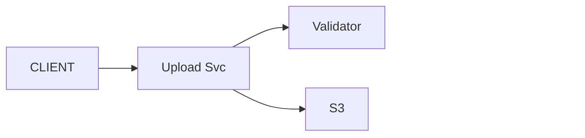

#### 1 Maine report.pdf daali, 3 second ghoomta screen dekhta raha
```
DIKKAT     31 March, maine report.pdf daali. Server Validator ke 3 sec jawab tak atka, main bhi screen pe.
           Aakhri ghante ~200 upload / sec x 3 sec = ~600 thread atke, Tomcat ke 200 khatam.
```
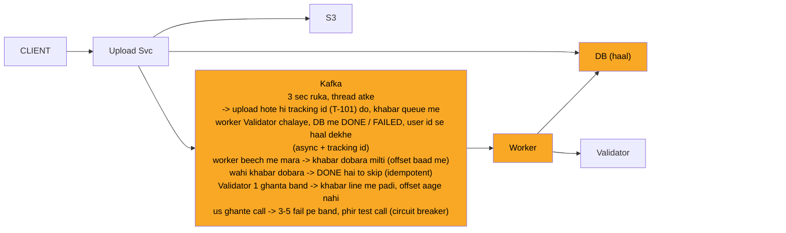
```
NAHI       thread pool 200 se 2000: jaanch tab bhi 3 sec, bas memory khatam hone tak der.
```
```
AAGE POOCHEGA:
  NIYAM: dheema kaam line me peeche; user ko turant T-101 + haal (VALIDATING), wo kuch dobara nahi bhejta;
         khabar tabhi "padh li" jab DB me haal likha -> worker / Validator gire to khabar line me bachi.
  SAFAR (meri ek file, upload se DONE tak, har mod pe kya):
  sab theek chala         -> T-101 turant -> worker -> Validator -> DB DONE -> "padh li"
  worker beech me mara    -> khabar dobara milti: offset commit DB likhne ke baad tha
  wahi khabar dobara      -> pehle haal dekho: T-101 DONE hai to skip (idempotent)
  Validator do baar chala -> jaanch T-101 pe idempotent: dobara chalna theek, DONE ek hi baar
  Validator 1 ghanta band -> 4,000 khabar line me padi: DONE bina offset aage nahi
  us ghante call karte?   -> nahi, circuit breaker: 3-5 fail pe band, thodi der baad ek test call
                             + doosri company (unki copy hum nahi chala sakte)
```

#### 2 Meri 5 GB video hamare server ke raaste S3 jaa rahi
```
DIKKAT     Report ke baad maine 5 GB video daali: client -> hamara server -> S3. 5 GB do baar network pe,
           thread minuton atka, sirf bytes aage badhane ko server badhane pade.
```
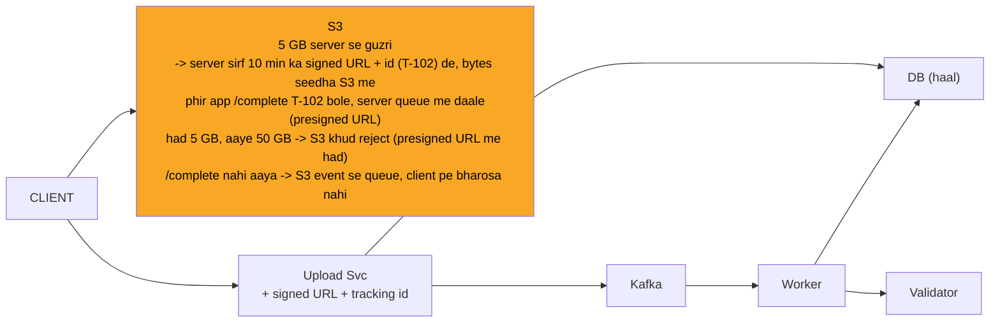
```
NAHI       S3 ki access key app me daal do: app se key nikli = poora bucket khula.
```
```
TASVEER: paas lo, seedha S3
  1  app -> Upload Svc: "5 GB video daalni"   -> T-102 + 10 min ka paas (signed URL)
  2  app -> S3 seedha, paas dikha ke          -> 5 GB S3 me; hamare server pe ek byte bhi nahi
  3  app -> Upload Svc: "/complete T-102"     -> queue -> worker -> jaanch
  paas = sirf is ek file ka, 10 min; leak ho bhi to bas itna
```
```
AAGE POOCHEGA:
  NIYAM: server sirf paas deta (EK file, 10 min), bytes seedha app -> S3; server pe bojh nahi, aur paas
         leak ho bhi to sirf us ek file pe, 10 min tak. Paas khatam -> naya maango.
  SAFAR (5 GB video ka raasta, har mod pe kya):
  sab theek chala      -> paas (EK file, 10 min) -> bytes seedha S3 -> "/complete T-102"
  had 5 GB, aaye 50 GB -> had paas me: POST content-length-range · PUT me size sign
                          (ek PUT max 5 GB) -> S3 khud reject; S3 event pe size phir
  /complete nahi aaya  -> S3 event ("file aa gayi") se queue: client pe bharosa nahi
```

#### 3 4.5 GB chadh chuki thi, wifi chala gaya
```
DIKKAT     Usi video ki 4.5 GB chadh chuki thi, wifi chala gaya. Ab poori 5 GB shuru se?
```
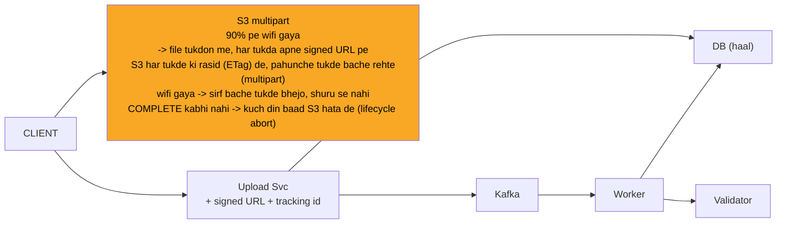
```
NAHI       server ka timeout badha do: wifi gaya to connection hi toota, timeout kuch nahi bachata.
```
```
TASVEER: 100 tukde, sirf bache 10
  5 GB = 100 tukde, uploadId U-9
  [1] [2] [3] ... [90]  -> har ek ki rasid (ETag) S3 pe      [91] ... [100] nahi pahunche
  wifi gaya -> wapas aaya -> ListParts U-9 -> sirf 91..100 bhejo
  COMPLETE(U-9, tukde + rasid) -> S3 kram se jod ke ek file
```
```
AAGE POOCHEGA:
  NIYAM: jis tukde ki rasid S3 pe, wo pakka (rasid S3 pe hai, app pe nahi); net gaya / app band -> S3 se
         poochho, sirf bache tukde dobara. User ko shuru se kuch nahi.
  SAFAR (ek badi file, tukdon me, har mod pe kya):
  sab theek chala     -> U-9 -> tukde kai saath, har ek ki rasid (ETag) -> COMPLETE
  wifi gaya           -> 90 ki rasid S3 pe: sirf bache 10 bhejo, shuru se nahi
  app band, kal wapas -> S3 se poocho (ListParts U-9): rasid wahan, app pe nahi
  COMPLETE kabhi nahi -> adhoore tukde S3 lifecycle kuch din (jaise 7) baad hata deta (abort)
```

#### 4 App crash, "complete" kabhi aaya hi nahi
```
DIKKAT     Ek aur file chadhte waqt meri app crash. "complete" nahi aaya, S3 ka event bhi chhoota: bytes S3 me
           pade (paisa lag raha), DB me T-103 "UPLOADING" pe atka, koi dhoondhta hi nahi.
```
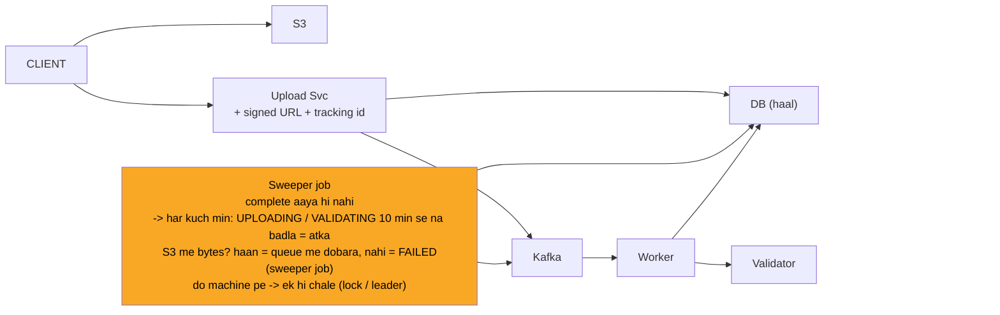
```
NAHI       sirf S3 lifecycle niyam: din me ek baar chalta aur DB nahi dekhta.
```
```
AAGE POOCHEGA:
  NIYAM: har file ka haal DB me (UPLOADING -> VALIDATING -> DONE / FAILED); der se nahi badla = atka ->
         sweeper uthata: bytes hain -> khud dobara line me (safe) · nahi -> FAILED, user dobara daale.
  SAFAR (atki file T-103, har mod pe kya):
  sab theek chala       -> "/complete" ya S3 event -> line me -> worker -> DONE
  crash + event chhoota -> DB me UPLOADING atka, bytes S3 me pade (paisa lag raha)
  sweeper har kuch min  -> 10 min se haal nahi badla (jaanch 3 sec ki) = atka
  bytes S3 me hain      -> khud dobara line me: safe, haal dekh ke skip hota
  bytes nahi            -> FAILED: user dobara daale
  sweeper do machine pe -> ek chale (lock / leader), ya chalne do: dobara daalna safe
```

#### 5 Deadline ke din sab har 2 sec haal poochh rahe
```
DIKKAT     Shaam tak 10,000 log ka "Meri files" page khula, har 2 sec saari files ka haal
           -> 5,000 sawaal / sec DB pe. Likhai 1-2 / sec thi, padhai ne DB ghera.
```
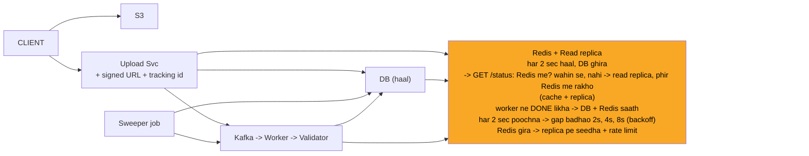
```
NAHI       DB me index daalo: sawaal tez, par 5,000 / sec phir bhi primary pe.
```
```
AAGE POOCHEGA:
  NIYAM: sach DB me, Redis sirf tez copy: padhna Redis se, likhna dono me; purana dikhe to chhoti umar se
         khud theek; Redis gire to DB copy (replica) se, dheema par band nahi.
  SAFAR (ek "haal kya hai?" sawaal, har mod pe kya):
  sab theek chala      -> GET /status/T-101 -> Redis se, 1 ms
  Redis me nahi        -> read replica se laao, Redis me rakho
  replica peeche thi   -> purana haal DONE ke baad Redis me baith sakta: miss pe sirf SET NX
                          + chhoti umar, ya primary se padho
  worker ne DONE likha -> DB + Redis usi waqt; Redis chhoota to umar (TTL) baad naya
  har 2 sec poochna    -> gap badhao (2s, 4s, 8s): haal itni jaldi nahi badalta
  Redis gira           -> replica pe seedha: dheema par chalta; poochne pe rate limit
```

#### 6 Maine file nahi, poora folder daala (1000 file)
```
DIKKAT     Deadline wale din maine ek file nahi, poora folder daala: 1000 file. Har file ka alag trackingId
           -> 1000 id sambhaalna mere bas ka nahi, aur "poora folder ho gaya?" ka koi jawab nahi.
```
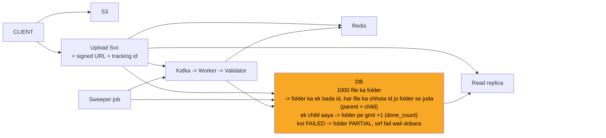
```
TASVEER: folder = bachchon ka jod
  P-1 (folder, 1000 file)
    |- C-1 DONE   |- C-2 DONE   ...   |- C-999 DONE   |- C-1000 FAILED
  har child ka nateeja -> done_count +1 -> 1000/1000 aa gaye -> koi FAILED? haan -> P-1 = PARTIAL
  dobara sirf C-1000; baaki 999 nahi
```
```
AAGE POOCHEGA:
  NIYAM: folder = bada id, har file ka chhota id; folder ka haal = bachchon ka jod (sab DONE = DONE, koi
         FAILED = PARTIAL); ek file fail -> sirf wahi dobara, poora folder nahi.
  SAFAR (folder P-1, 1000 file, har mod pe kya):
  sab theek chala -> batch init (1000 URL) -> har file child id -> sab DONE = P-1 DONE
  ek child aaya   -> DONE / FAILED -> P-1 pe ginti +1 (done_count); sab aa gaye = final
  koi FAILED      -> P-1 PARTIAL: sirf fail wali dobara, poora folder nahi
```

#### 7 Ravi ne mera trackingId daal ke meri file le li
```
DIKKAT     Maine support chat me screenshot bheja, usme T-101 dikh raha tha. Ravi ne GET /download/T-101
           maara -> meri file Ravi ko mil gayi.
```
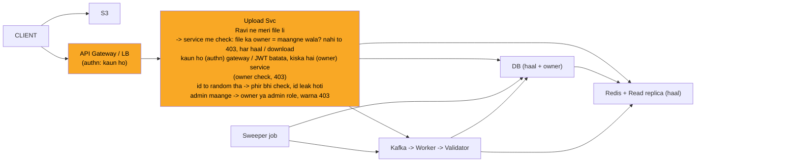
```
NAHI       gateway pe hi check: use pata hi nahi T-101 kiski hai.
```
```
AAGE POOCHEGA:
  NIYAM: kaun ho = gateway (JWT); is file pe haq = service, har request pe (owner_id == jwt.user_id);
         id leak ho jaaye tab bhi file nahi milti (403).
  SAFAR (GET /download/T-101 aaya, har mod pe kya):
  sab theek chala  -> gateway JWT: "ye main hoon" -> service: owner main -> file mili
  Ravi ne maanga   -> JWT bole Ravi, owner main -> 403 (service me, har request pe)
  id to random tha -> phir bhi check: id leak hoti (log, screenshot, link)
  admin maange     -> owner ya admin role, warna 403
```

#### 8 Maine S3 ka seedha link WhatsApp pe bhej diya
```
DIKKAT     Mujhe S3 ka pakka link mila tha. Maine dost ko WhatsApp pe bheja, dost ne group me.
           Link hamesha chalta -> file kisi ke bhi haath.
```
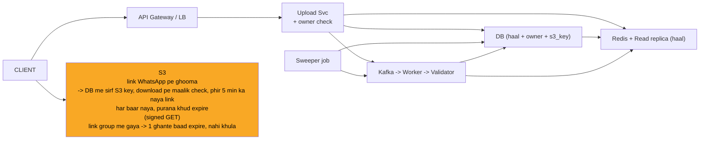
```
NAHI       link me lamba random naam (koi andaza na lagaye): ek baar bahar gaya to hamesha chalta.
```
```
AAGE POOCHEGA:
  NIYAM: DB me sirf pata (S3 key), pakka link kabhi bahar nahi; har download pe maalik check -> naya 5 min
         link. Link aage gaya to bas 5 min tak chalta.
  SAFAR (dost ko file bhejni, har mod pe kya):
  sab theek chala     -> download maanga -> maalik check -> naya 5 min link -> file aayi
  link group me gaya  -> 1 ghante baad khola: expire, nahi khula
  5 min me adhoora    -> umar sirf shuru ki: chalu download beech me nahi katta
  5 min ke andar aage -> risk maana; zyada sensitive -> CloudFront signed URL + IP had
```

#### 9 Naam report.pdf, andar EXE nikla
```
DIKKAT     Raat ko kisi ne virus.exe ka naam report.pdf kiya, type "application/pdf" bheja -> S3 me pahunchi.
           Naam aur type dono client ne bheje, jo jhooth bol sakta.
```
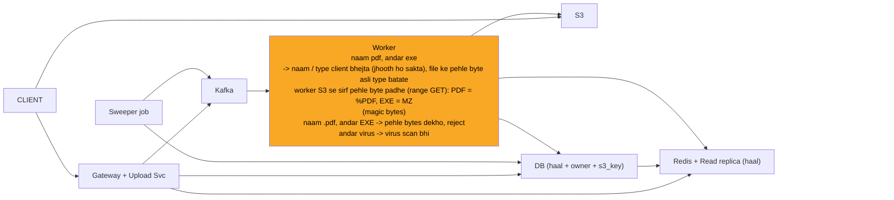
```
NAHI       type ke liye poori file padho: 5 GB S3 se laana; pehle kuch byte kaafi.
```
```
AAGE POOCHEGA:
  NIYAM: client ka bheja (naam, type, size) kuch sach nahi; sach file ke bytes me (pehle kuch byte = type,
         scan = virus); jaanch pass nahi to file DONE nahi, reject.
  SAFAR (report.pdf ki jaanch, har mod pe kya):
  sab theek chala        -> pehle kuch byte "%PDF-" + scan saaf -> DONE
  naam .pdf, shuru "MZ"  -> EXE -> reject, DONE nahi: naam / type client ka, sach nahi
  shuru PDF, andar virus -> magic bytes sirf type: scan bhi (ClamAV / S3 malware)
```

---

## AAKHRI DABBA + WRAP (ek hi baar)

```
User -> Gateway / LB (login) -> Upload Svc (file ki jaankari + signed URL, bytes ko haath nahi)
-> client SEEDHA S3 pe (tmp/, badi file multipart) -> complete -> Kafka -> Worker (jaanch, magic bytes)
-> DB me haal -> Redis + read replica (haal poochhna) · download = owner check + chhota signed GET
Sweeper + S3 lifecycle = atki / adhoori file

DB:  PostgreSQL -> trackingId se seedha dhoondhna simple, par haal
     (UPLOADING -> VALIDATING -> DONE / FAILED) ko ACID chahiye
     files: trackingId (KEY) | ownerId | status | s3_key
```
```
JAWAB:    Server sirf paas deta, file seedha S3 me (badi ho to tukdon me).
          Jaanch 3 second ki, to Arpan ko turant T-101, worker line se jaanchta, file ke pehle byte
          dekhta, haal likhta.
          Haal baar-baar poochha jaata, to Redis + copy, haal badle to Redis bhi. Maalik check aur
          chhote paas se safe, S3 niyam + atki file wali job se safai.
          Aage: fail pe dobara koshish, download ke liye CDN.
```
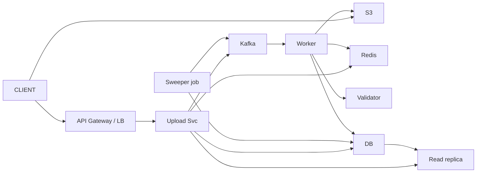

---

## 10 GUNA TRAFFIC — har dabba alag se

```
Upload Svc   -> stateless, kai machine + LB
S3           -> AWS khud scale karta · zyada download wali file -> CDN (CloudFront)
DB           -> haal poochhna -> CACHE + READ REPLICA · bahut files -> SHARD (trackingId)
Redis        -> purana haal na dikhe -> worker saath me update kare
Kafka        -> jaanch ki line lambi -> WORKER badhao (line ki lambai dekh ke)
adhoori file -> S3 lifecycle + sweeper

POOCHEGA: "How would you scale this to 10x?"      -> file ka raasta chalo, pehle jo toote
POOCHEGA: "What's the single point of failure?"   -> Validator (bahar wala): circuit breaker + doosri company
POOCHEGA: "How do you know it's working?"
          (Chal raha hai, kaise pata?)
          MISAAL: raat ko Validator DHEEMA, line me ~5,000 file atki -> alert CloudWatch / PagerDuty se.
JAWAB:    Health check sirf batata 'zinda hai', 'dheema hai' nahi batata. Isliye apne teen number dekho:
          line kitni lambi, jaanch wali company kitni der me jawab de rahi aur kitni baar fail, aur
          kitni files 10 minute se 'jaanch ho rahi' pe atki.
          Had paar = alert, user ke shikayat karne se pehle. Company baar-baar fail ho to us pe call
          band (circuit breaker) aur doosri company.
```

---

## POOCHE TO (gehra sawaal aaye tab)

```
API:      POST /upload/init { fileName, size }  -> signed S3 URL + trackingId (server sirf URL deta)
          -> client SEEDHA S3 pe (presigned POST, size ki had ke saath; ya PUT)
          POST /upload/complete { trackingId }   -> "ho gaya, jaancho" (queue)
          GET  /status/{trackingId}              -> VALIDATING / DONE / FAILED
          GET  /download/{trackingId}            -> signed GET URL -> seedha S3

DB:       files: trackingId (KEY) | fileName | ownerId | status | s3_key | createdAt | updatedAt
          haal: UPLOADING -> VALIDATING -> DONE / FAILED ("kahan tak pahunchi" = gadbad sambhalne ki buniyaad)
          PostgreSQL: dhoondhna simple par haal ko ACID chahiye
          (bahut bada + sirf key-value -> NoSQL bhi chalta · paisa hota -> hamesha SQL)

DEDUP:    file ka hash (MD5 / SHA) -> pehle se hai to dobara store nahi -> jagah bachi

AUR SAWAAL:
  "/complete aur S3 event dono chhoote?" -> SWEEPER (card 4): har kuch min atki file dhoondhe.
  "Do worker saath done_count +1?"  -> EK UPDATE done_count = done_count + 1: DB ke andar, ginti nahi khoti.
  "S3 paas kaise maanta?"          -> WAHI HASH KHUD BANAYE: server ne AWS secret se sign kiya tha.
  "Is line ke liye Kafka hi kyun?"  -> ZAROORI NAHI: ~200 / sec pe SQS / RabbitMQ kaafi; Kafka jab bahut bheed
                                       ya dobara padhna.
  "Ye sab pata kaise chalega?"      -> APNE NUMBER: queue lambai · Validator time + error · 10 min VALIDATING
                                       -> alert (health check sirf "zinda" bolta).
  "AWS chaabi hi app ko de do?"     -> KABHI NAHI: chaabi = poora bucket; paas = sirf ek file, 10 min.
  "Tukda kitna bada rakhoge?"       -> S3 KI HAD: min 5 MB (aakhri chhod), max 10,000 tukde -> badi file =
                                       bada tukda.
  "To S3 lifecycle kis kaam ka?"    -> BYTES KI SAFAI: adhoore uploads ke bytes khud hataata; DB ka haal
                                       sweeper badle.
  "Poochhna hi band karwa do?"      -> SERVER KHUD BHEJE (SSE / WebSocket): haal badla tab hi.
  "Lakh chhoti files ho to?"        -> ZIP: client ek file bana ke bheje, server khol le.
  "Jaanch me fail hui file ka kya?" -> QUARANTINE bucket (download band); baad me delete ya security dekhe.
  "PR me owner check kahan?"        -> HAR HANDLER KI PEHLI LINE: file.owner_id == jwt.user_id ya admin, warna
                                       403; userId JWT se, body se kabhi nahi.
  "Koi bheed / hamla kare?"         -> RATE LIMIT har user pe, sabse aage WAF, HTTPS, secrets vault me.
```

---

ARCHETYPE B+F · CONCEPTS: [message-queues](../../FOUNDATIONS/07_message_queues.md) · [reliability/SPOF](../../FOUNDATIONS/11_reliability_spof_cloud.md) · [← MASTER SHEET](../../00_MASTER_SHEET.md)
