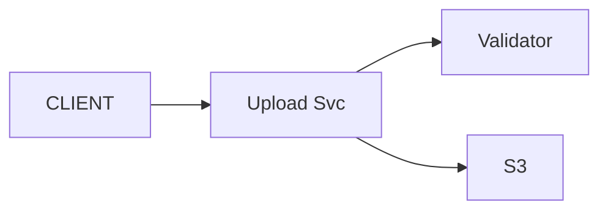
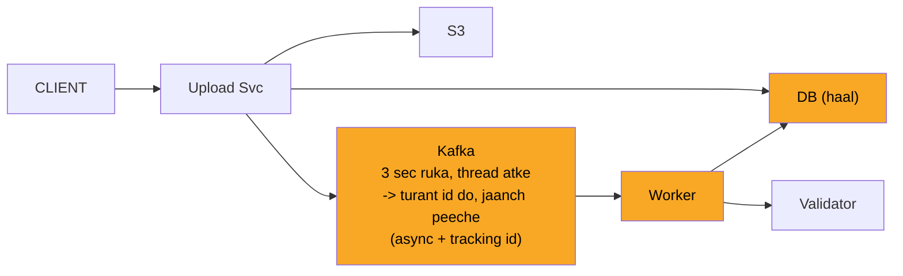
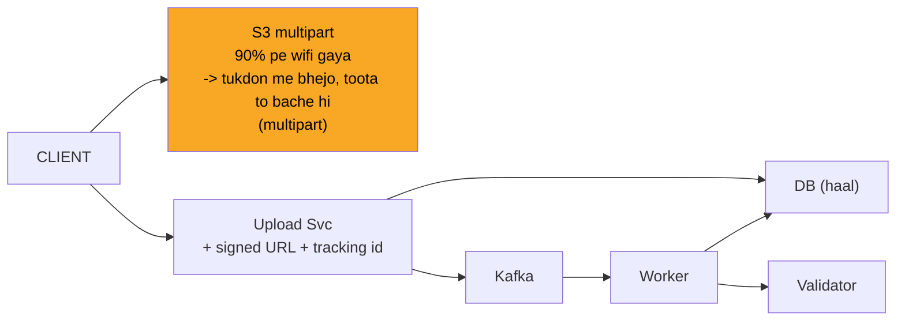
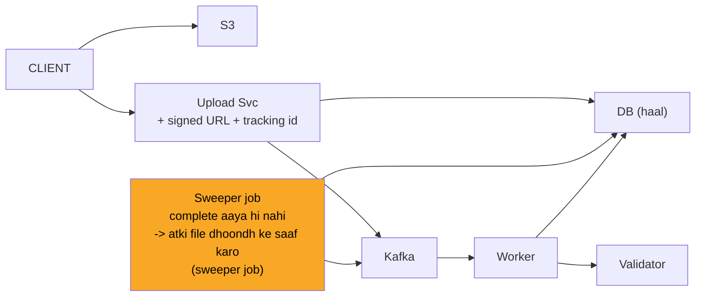
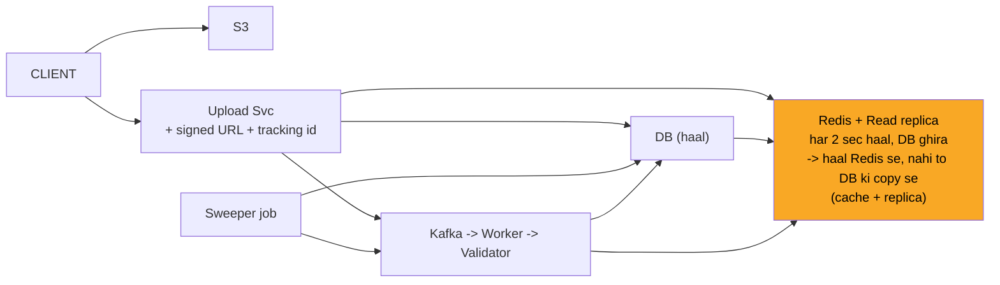
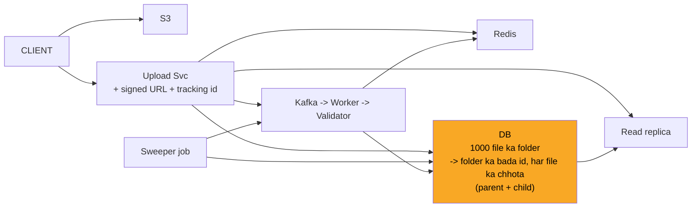
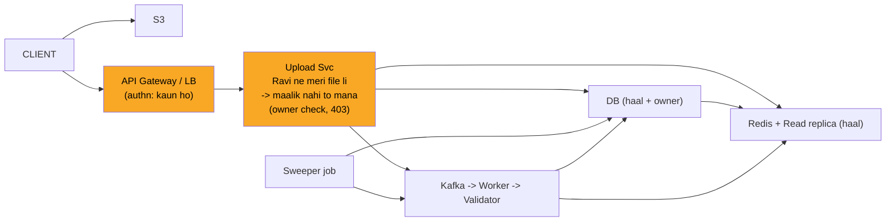
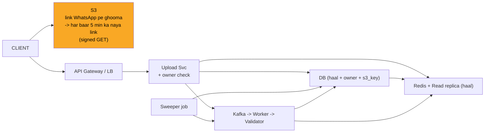
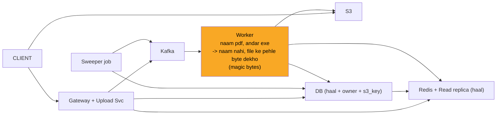
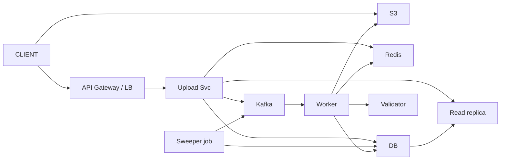

# File Upload + Validate + Track

> User file / folder deta hai -> bahar ki company (third-party) use JAANCHTI hai (2-3 sec) -> file store -> user ko TRACKING link.
> JP ne ye sach me poocha tha (asli SDE-3 writeup). Aam product design, finance nahi.
> Is design ka dil: **user ruke nahi** (async + trackingId) + **file ke bytes hamare server se na guzrein** (presigned URL) + **haal hamesha pata**.

---

## KAHANI (ek din, 31 March deadline, meri files; har dikkat se design me ek dabba judta)

```
   KYA HUA                                     ILAAJ                                DABBA JUDA
1  report.pdf daali, 3 sec ruka, thread atke -> ASYNC + TRACKING ID (queue, worker)  Kafka + Worker + DB
2  5 GB video hamare server se guzri         -> PRESIGNED URL, bytes seedha S3       S3 (client seedha)
3  4.5 GB chadhi, wifi gaya                  -> MULTIPART, sirf bache tukde          (S3 multipart)
4  app crash, "complete" aaya hi nahi        -> SWEEPER job (atki file)              Sweeper job
5  10,000 log har 2 sec haal poochh rahe     -> CACHE Redis + READ REPLICA           Redis + Read replica
6  poora folder, 1000 file                   -> PARENT id + CHILD id                 (DB me parent)
7  Ravi ne mera T-101 daal ke file maangi    -> OWNER CHECK (AUTHZ), 403             Gateway + Upload Svc
8  maine S3 ka link WhatsApp pe bheja        -> SIGNED GET, 5 min ka naya paas       S3 signed GET (s3_key)
9  naam report.pdf, andar EXE                -> MAGIC BYTES (pehle kuch byte)        Worker + magic bytes

POORA DESIGN (upar ke dabbe kram se):
   Client -> Gateway / LB -> Upload Svc (signed URL + T-101) · Client -> S3 seedha (multipart)
   -> Kafka -> Worker (Validator + magic bytes) -> DB (haal) · Redis + replica = haal · Sweeper = atki file
```

---

## TASVEER (ByteByteGo / Alex Xu · CC BY-NC-ND 4.0)


Source: [How to Upload a Large File to S3](https://bytebytego.com/guides/how-to-upload-a-large-file-to-s3/)
(badi file -> presigned URL + MULTIPART: tukdon me, tukda fail to sirf wahi dobara)

---

## SHURU: pehle poocho, phir numbers

```
POOCHO:  file kitni badi? (10 MB ya 5 GB — design badal jaata)  <- badi = presigned + multipart
         kaunse type allowed? · jaanch kitna time leti? (2-3 sec) · sirf FILE ya FOLDER bhi?
         nateeja turant chahiye ya baad me haal dekhega?  <- turant nahi = async + tracking

KYA KARE (FR):    upload · bahar wale se JAANCH · store · tracking link / haal
                  scope bahar: editing · sharing · versions
KAISA CHALE (NFR): user ruke nahi (dil) · file khoye nahi · haal
                   HAMESHA pata (kahan tak pahunchi) · bheed + safe

NUMBERS (andaaza):
   1 lakh file / din, din me ~1 lakh second -> ~1-2 upload / second (kam)
   par deadline wale din (31 March) aakhri ghante me ~100 guna -> ~300 upload / second
   par log haal BAAR-BAAR dekhte -> padhna bahut zyada, likhna kam
   -> haal ke liye CACHE + read replica
   -> badi file ke bytes DB me nahi, S3 me (blob storage)
   -> jaanch dheemi -> beech me QUEUE + worker
```

---

## ════ MOCK SE PEHLE: SIRF YE CARD PADHO ════

> Har card: pehle PEELA DABBA dekho (scene + ilaaj). Yaad aa gaya -> aage. Nahi aaya -> neeche
> DIKKAT / HAL / NAHI padho. AAGE POOCHEGA sirf jab interviewer aage kuch poochhe.

#### DABBA 0: SABSE SIMPLE (yahan se shuru, phir "kahan tootega")
```
Client file Upload service ko de. Service file S3 me rakhe,
jaanch wale (Validator) ko call kare (2-3 sec), jawab wapas.
```


#### 1 Maine report.pdf daali, 3 second ghoomta screen dekhta raha

```
DIKKAT     31 March, maine report.pdf daali. Server Validator ke 3 sec jawab tak atka, main bhi screen pe.
           Aakhri ghante ~300 upload / sec x 3 sec = ~900 thread atke, Tomcat ke 200 khatam.
HAL        turant id, jaanch peeche (ASYNC + TRACKING ID): upload hote hi T-101, khabar queue me.
           Worker uthaye -> Validator -> DB me T-101 = DONE / FAILED. Main T-101 se haal dekhun.
NAHI       thread pool 200 se 2000: jaanch tab bhi 3 sec, bas memory khatam hone tak der.
```
```
AAGE POOCHEGA:
  NIYAM: dheema kaam line me peeche; user ko turant T-101 + haal (VALIDATING), wo kuch dobara nahi bhejta;
         khabar tabhi "padh li" jab DB me haal likha -> worker / Validator gire to khabar line me bachi.
  "Worker DB likhne se pehle mara?"           -> NAHI KHOTI: offset DB me DONE likhne ke BAAD commit, to
                                                 khabar dobara milti.
  "Dobara mili to file do baar jaanchoge?"    -> PEHLE HAAL DEKHO: T-101 pehle se DONE -> skip (idempotent).
  "Is line ke liye Kafka hi kyun?"            -> ZAROORI NAHI: ~300 / sec pe SQS / RabbitMQ kaafi; Kafka jab
                                                 bahut bheed ya dobara padhna.
  "Validator 1 ghanta band, 4,000 file atki?" -> KUCH NAHI KHOTA: khabar line me padi; DB me DONE likhe bina
                                                 offset aage nahi badhta.
  "Us ghante Validator ko call karte rahoge?" -> FUSE: 3-5 fail pe call band, thodi der baad ek test call +
                                                 DOOSRI COMPANY (unki copy hum nahi chala sakte).
  "Ye sab tumhe pata kaise chalega?"          -> APNE NUMBER (health check sirf 'zinda' bolta): queue lambai ·
                                                 Validator time + error · 10 min VALIDATING -> alert.
```

#### 2 Meri 5 GB video hamare server ke raaste S3 jaa rahi

```
DIKKAT     Report ke baad maine 5 GB video daali: client -> hamara server -> S3. 5 GB do baar network pe,
           thread minuton atka, sirf bytes aage badhane ko server badhane pade.
HAL        server sirf paas de (PRESIGNED URL): server sirf 10 min ka paas (signed URL) + naya id T-102 de;
           bytes seedha S3 me. Phir main "/complete T-102" bolun -> server queue me daale.
NAHI       S3 ki access key app me daal do: app se key nikli = poora bucket khula.
```
```
TASVEER: paas lo, seedha S3
  1  app -> Upload Svc: "5 GB video daalni"   -> T-102 + 10 min ka paas (signed URL)
  2  app -> S3 seedha, paas dikha ke          -> 5 GB S3 me; hamare server pe ek byte bhi nahi
  3  app -> Upload Svc: "/complete T-102"     -> queue -> worker -> jaanch
  paas = sirf is ek file ka, 10 min; leak ho bhi to bas itna
```
```
AAGE POOCHEGA:
  NIYAM: server sirf paas deta (EK file, 10 min), bytes seedha app -> S3; server pe bojh nahi, aur paas
         leak ho bhi to sirf us ek file pe, 10 min tak. Paas khatam -> naya maango.
  "S3 us paas ko maanta kaise hai?"      -> SAME SECRET SE HASH: server (bucket + file naam + 10 min) ko AWS
                                            secret se sign kare; S3 wahi hash bana ke milaye.
  "To AWS chaabi hi user ko de do?"      -> KABHI NAHI: chaabi = poora bucket; paas = sirf ek file, 10 min.
  "Had 5 GB thi, kisi ne 50 GB daal di?" -> PRESIGNED POST me had (content-length-range), S3 khud reject. PUT
                                            me had nahi -> S3 event pe size dekho, badi = delete.
  "/complete bola hi nahi?"              -> S3 EVENT ('file aa gayi') se queue me, kyunki client pe bharosa
                                            nahi; wo bhi chhoota to sweeper pakde.
```

#### 3 4.5 GB chadh chuki thi, wifi chala gaya

```
DIKKAT     Usi video ki 4.5 GB chadh chuki thi, wifi chala gaya. Ab poori 5 GB shuru se?
HAL        tukdon me bhejo (MULTIPART): file tukdon me, har tukda apne signed URL pe, S3 har tukde ki rasid
           (ETag) deta. Wifi gaya -> 90 tukde pahunch chuke, sirf bache 10 bhejo.
NAHI       server ka timeout badha do: wifi gaya to connection hi toota, timeout kuch nahi bachata.
```
```
TASVEER: 100 tukde, sirf bache 10
  5 GB = 100 tukde, uploadId U-9
  [1] [2] [3] ... [90]  -> har ek ki rasid (ETag) S3 pe      [91] ... [100] nahi pahunche
  wifi gaya -> wapas aaya -> ListParts U-9 -> sirf 91..100 bhejo
  COMPLETE(U-9, tukde + rasid) -> S3 kram se jod ke ek file
```
```
AAGE POOCHEGA:
  NIYAM: jis tukde ki rasid S3 pe, wo pakka (rasid S3 pe hai, app pe nahi); net gaya / app band -> S3 se
         poochho, sirf bache tukde dobara. User ko shuru se kuch nahi.
  "Kadam kya hain?"                         -> 1 SHURU -> uploadId (U-9) · 2 HAR TUKDA (kai saath) -> rasid
                                               (ETag) · 3 COMPLETE(U-9, tukde + rasid) -> S3 kram se jod ke ek
                                               file.
  "App band, kal wapas aaya, bache kaunse?" -> S3 SE POOCHO (ListParts U-9), kyunki rasid wahan padi; sirf
                                               bache tukde bhejo.
  "Tukda kitna bada rakhoge?"               -> S3 KI HAD: tukda min 5 MB (aakhri chhod), max 10,000 tukde ->
                                               badi file pe tukda bada karo.
```

#### 4 App crash, "complete" kabhi aaya hi nahi

```
DIKKAT     Ek aur file chadhte waqt meri app crash. "complete" kabhi nahi aaya: bytes S3 me pade (paisa lag
           raha), DB me T-103 "UPLOADING" pe atka, koi dhoondhta hi nahi.
HAL        atki file dhoondho (SWEEPER job), har kuch minute: haal UPLOADING / VALIDATING aur 10 min se nahi
           badla (jaanch 3 sec ki) -> S3 me bytes hain? haan = queue me dobara · nahi = FAILED.
NAHI       sirf S3 lifecycle niyam: din me ek baar chalta aur DB nahi dekhta.
```
```
AAGE POOCHEGA:
  NIYAM: har file ka haal DB me (UPLOADING -> VALIDATING -> DONE / FAILED); der se nahi badla = atka ->
         sweeper uthata: bytes hain -> khud dobara line me (safe) · nahi -> FAILED, user dobara daale.
  "To S3 lifecycle kis kaam ka?"     -> BYTES KI SAFAI: purane adhoore uploads ke bytes khud hataata; DB ka
                                        haal badalna sweeper ka kaam.
  "Sweeper do machine pe chal gaya?" -> EK HI CHALE (lock / leader), ya chalne do kyunki dobara daalna safe:
                                        haal dekh ke skip.
  "Jaanch me fail hui file ka kya?"  -> QUARANTINE bucket (download band); baad me delete ya security dekhe.
```

#### 5 Deadline ke din sab har 2 sec haal poochh rahe

```
DIKKAT     Shaam tak 10,000 log ka "Meri files" page khula, har 2 sec saari files ka haal
           -> 5,000 sawaal / sec DB pe. Likhai 1-2 / sec thi, padhai ne DB ghera.
HAL        haal Redis se (CACHE): GET /status/T-101 -> Redis me? wahin se · nahi -> read replica -> Redis me.
           Worker haal badle (DONE) to DB ke saath Redis me bhi usi waqt naya haal.
NAHI       DB me index daalo: sawaal tez, par 5,000 / sec phir bhi primary pe.
```
```
AAGE POOCHEGA:
  NIYAM: sach DB me, Redis sirf tez copy: padhna Redis se, likhna dono me; purana dikhe to chhoti umar se
         khud theek; Redis gire to DB copy (replica) se, dheema par band nahi.
  "DB me DONE, Redis me VALIDATING dikha?"   -> WORKER DONO LIKHTA: DB ke saath Redis bhi; chhoot gaya to
                                                chhoti umar (TTL) ke baad naya.
  "Miss pe replica se laaye, wo peeche tha?" -> PURANA REDIS ME baith sakta; worker ka naya haal upar likh
                                                deta. Pakka chahiye to miss pe primary.
  "Main har 2 sec poochun, theek?"           -> GAP BADHAO (2s, 4s, 8s), kyunki haal itni jaldi nahi badalta.
  "Poochhna hi band karwa do?"               -> SERVER KHUD BHEJE (SSE / WebSocket): haal badla tab hi.
  "Aur Redis hi gir gaya?"                   -> REPLICA PE SEEDHA: dheema par chalta; poochhne pe rate limit.
```

#### 6 Maine file nahi, poora folder daala (1000 file)

```
TASVEER: folder = bachchon ka jod
  P-1 (folder, 1000 file)
    |- C-1 DONE   |- C-2 DONE   ...   |- C-999 DONE   |- C-1000 FAILED
  har child ka nateeja -> done_count +1 -> 1000/1000 aa gaye -> koi FAILED? haan -> P-1 = PARTIAL
  dobara sirf C-1000; baaki 999 nahi
```
```
AAGE POOCHEGA:
  NIYAM: folder = bada id, har file ka chhota id; folder ka haal = bachchon ka jod (sab DONE = DONE, koi
         FAILED = PARTIAL); ek file fail -> sirf wahi dobara, poora folder nahi.
  "Kaise kaam karta?"            -> FOLDER KA BADA ID (P-1), har file ka apna chhota id (child). Saare child
                                    DONE = P-1 DONE · koi FAILED = P-1 PARTIAL / FAILED.
  "P-1 ka haal kab badlega?"     -> HAR CHILD PE GINTI: DONE / FAILED aaya -> done_count +1; sab aa gaye =
                                    final.
  "1000 file = 1000 baar /init?" -> EK CALL (batch init): 1000 signed URL saath.
  "Lakh chhoti files ho to?"     -> ZIP: client ek file bana ke bheje, server khol le.
```

#### 7 Ravi ne mera trackingId daal ke meri file le li

```
DIKKAT     Maine support chat me screenshot bheja, usme T-101 dikh raha tha. Ravi ne GET /download/T-101
           maara -> meri file Ravi ko mil gayi.
HAL        maalik nahi to mana (OWNER CHECK) service me: T-101 ka owner main, maangne wala Ravi -> 403. Har
           haal / download. "Tum kaun ho?" (AUTHN) = gateway / JWT batata: ye Ravi hai.
NAHI       gateway pe hi check: use pata hi nahi T-101 kiski hai.
```
```
AAGE POOCHEGA:
  NIYAM: kaun ho = gateway (JWT); is file pe haq = service, har request pe (owner_id == jwt.user_id);
         id leak ho jaaye tab bhi file nahi milti (403).
  "Id random hai, phir bhi check?"             -> HAAN, kyunki id LEAK hoti (log, screenshot, link); asli rok
                                                  sirf owner check.
  "Admin ko sab dekhna hai?"                   -> OWNER YA ADMIN ROLE, warna 403.
  "PR review me owner check kahan dhoondhoge?" -> HAR HANDLER KI PEHLI LINE: file.owner_id == jwt.user_id ya
                                                  admin, warna 403. userId JWT se, body se kabhi nahi.
```

#### 8 Maine S3 ka seedha link WhatsApp pe bhej diya

```
DIKKAT     Mujhe S3 ka pakka link mila tha. Maine dost ko WhatsApp pe bheja, dost ne group me.
           Link hamesha chalta -> file kisi ke bhi haath.
HAL        har baar naya 5 min link (SIGNED GET): DB me sirf S3 key. Download maanga -> maalik check -> 5 min
           ka naya paas, har baar. Group me 1 ghante baad kisi ne khola -> paas expire -> nahi khula.
NAHI       link me lamba random naam (koi andaza na lagaye): ek baar bahar gaya to hamesha chalta.
```
```
AAGE POOCHEGA:
  NIYAM: DB me sirf pata (S3 key), pakka link kabhi bahar nahi; har download pe maalik check -> naya 5 min
         link. Link aage gaya to bas 5 min tak chalta.
  "5 min me download poora nahi hua?" -> UMAR SIRF SHURU KI: chalu download beech me nahi katta.
  "5 min ke andar hi aage bhej diya?" -> 5 MIN KA RISK MAANA; zyada sensitive -> CloudFront signed URL + IP
                                         had.
```

#### 9 Naam report.pdf, andar EXE nikla

```
DIKKAT     Raat ko kisi ne virus.exe ka naam report.pdf kiya, type "application/pdf" bheja -> S3 me pahunchi.
           Naam aur type dono client ne bheje, jo jhooth bol sakta.
HAL        pehle byte batate asli type (MAGIC BYTES): PDF = "%PDF-" · PNG = "\x89PNG" · EXE = "MZ".
           Worker S3 se sirf pehle kuch byte (range GET). Naam .pdf, shuru "MZ" -> EXE -> reject.
NAHI       type ke liye poori file padho: 5 GB S3 se laana; pehle kuch byte kaafi.
```
```
AAGE POOCHEGA:
  NIYAM: client ka bheja (naam, type, size) kuch sach nahi; sach file ke bytes me (pehle kuch byte = type,
         scan = virus); jaanch pass nahi to file DONE nahi, reject.
  "Type dekhne ko poori 5 GB padhoge?" -> NAHI, PEHLE KUCH BYTE (range GET), kyunki type ka nishaan shuru me
                                          hota.
  "Shuru PDF jaisa, andar virus?"      -> ANTIVIRUS SCAN (ClamAV) worker me, ya S3 malware scanning; magic
                                          bytes sirf type batate.
  "Koi bheed / hamla kare?"            -> RATE LIMIT har user pe, sabse aage WAF, HTTPS, secrets vault me.
```

---

## AAKHRI DABBA + WRAP (ek hi baar)

```
User -> Gateway / LB (login) -> Upload Svc (file ki jaankari + signed URL, bytes ko haath nahi)
-> client SEEDHA S3 pe (tmp/, badi file multipart) -> complete -> Kafka -> Worker (jaanch, magic bytes)
-> DB me haal -> Redis + read replica (haal poochhna) · download = owner check + chhota signed GET
Sweeper + S3 lifecycle = atki / adhoori file

DB:  PostgreSQL -> trackingId se seedha dhoondhna simple, par haal
     (UPLOADING -> VALIDATING -> DONE / FAILED) ko ACID chahiye
     files: trackingId (KEY) | ownerId | status | s3_key
```
```
JAWAB:    Server sirf paas deta, file seedha S3 me (badi ho to tukdon me).
          Jaanch 3 second ki, to Arpan ko turant T-101, worker line se jaanchta, file ke pehle byte
          dekhta, haal likhta.
          Haal baar-baar poochha jaata, to Redis + copy, haal badle to Redis bhi. Maalik check aur
          chhote paas se safe, S3 niyam + atki file wali job se safai.
          Aage: fail pe dobara koshish, download ke liye CDN.
```


---

## 10 GUNA TRAFFIC — har dabba alag se

```
Upload Svc   -> stateless, kai machine + LB
S3           -> AWS khud scale karta · zyada download wali file -> CDN (CloudFront)
DB           -> haal poochhna -> CACHE + READ REPLICA · bahut files -> SHARD (trackingId)
Redis        -> purana haal na dikhe -> worker saath me update kare
Kafka        -> jaanch ki line lambi -> WORKER badhao (line ki lambai dekh ke)
adhoori file -> S3 lifecycle + sweeper

POOCHEGA: "How would you scale this to 10x?"      -> file ka raasta chalo, pehle jo toote
POOCHEGA: "What's the single point of failure?"   -> Validator (bahar wala): fuse + doosri company
POOCHEGA: "How do you know it's working?"
          (Chal raha hai, kaise pata?)
          MISAAL: raat ko Validator DHEEMA, line me ~5,000 file atki -> alert CloudWatch / PagerDuty se.
JAWAB:    Health check sirf batata 'zinda hai', 'dheema hai' nahi batata. Isliye apne teen number dekho:
          line kitni lambi, jaanch wali company kitni der me jawab de rahi aur kitni baar fail, aur
          kitni files 10 minute se 'jaanch ho rahi' pe atki.
          Had paar = alert, user ke shikayat karne se pehle. Company baar-baar fail ho to us pe call
          band (fuse) aur doosri company.
```

---

## POOCHE TO (gehra sawaal aaye tab)

```
API:      POST /upload/init { fileName, size }  -> signed S3 URL + trackingId (server sirf URL deta)
          -> client SEEDHA S3 pe (presigned POST, size ki had ke saath; ya PUT)
          POST /upload/complete { trackingId }   -> "ho gaya, jaancho" (queue)
          GET  /status/{trackingId}              -> VALIDATING / DONE / FAILED
          GET  /download/{trackingId}            -> signed GET URL -> seedha S3

DB:       files: trackingId (KEY) | fileName | ownerId | status | s3_key | createdAt | updatedAt
          haal: UPLOADING -> VALIDATING -> DONE / FAILED ("kahan tak pahunchi" = gadbad sambhalne ki buniyaad)
          PostgreSQL: dhoondhna simple par haal ko ACID chahiye
          (bahut bada + sirf key-value -> NoSQL bhi chalta · paisa hota -> hamesha SQL)

DEDUP:    file ka hash (MD5 / SHA) -> pehle se hai to dobara store nahi -> jagah bachi
```

---

ARCHETYPE B+F · CONCEPTS: [message-queues](../../FOUNDATIONS/07_message_queues.md) · [reliability/SPOF](../../FOUNDATIONS/11_reliability_spof_cloud.md) · [← MASTER SHEET](../../00_MASTER_SHEET.md)
