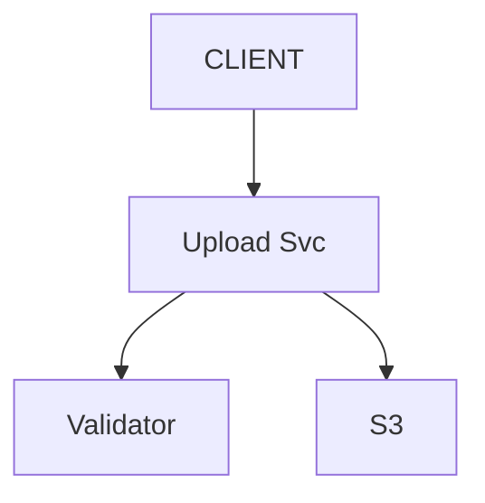
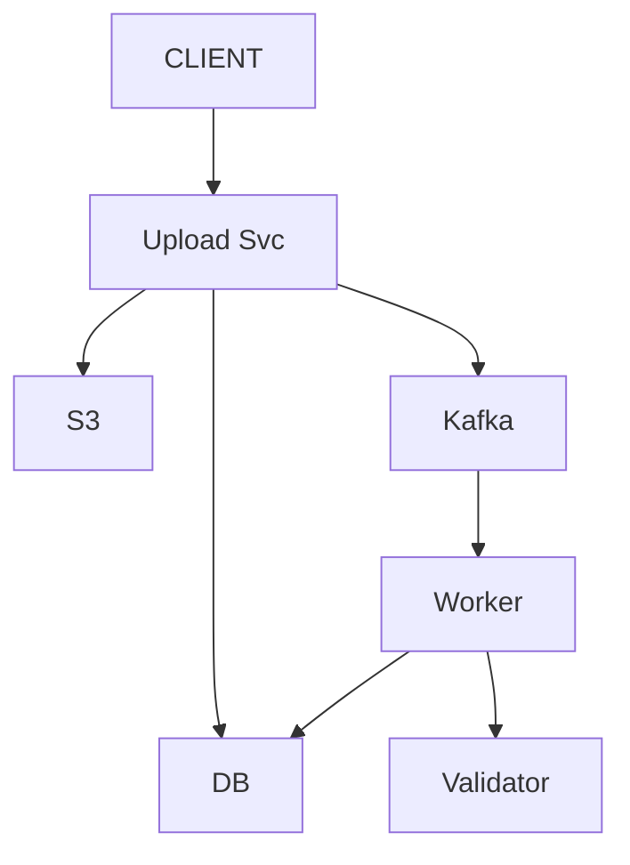
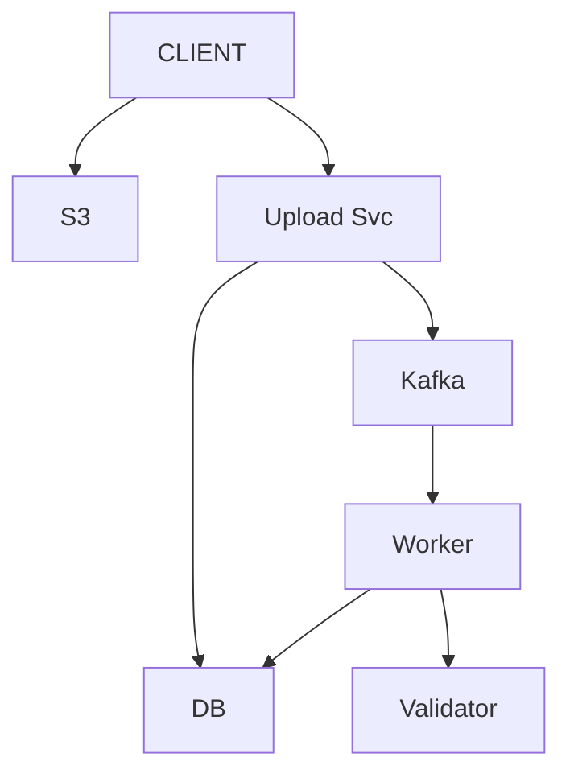
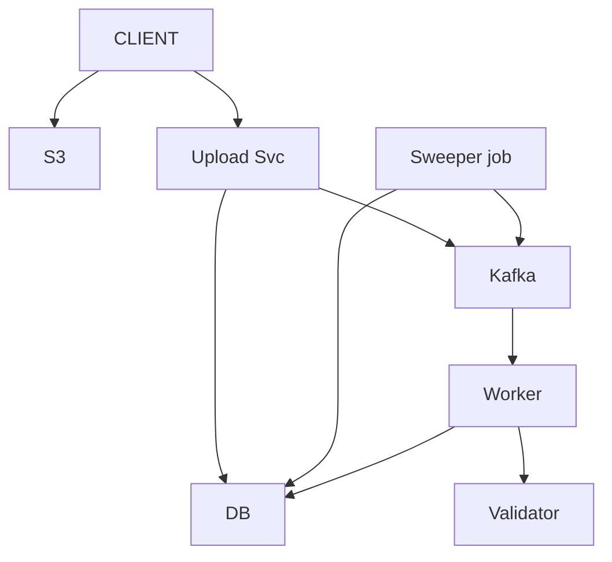
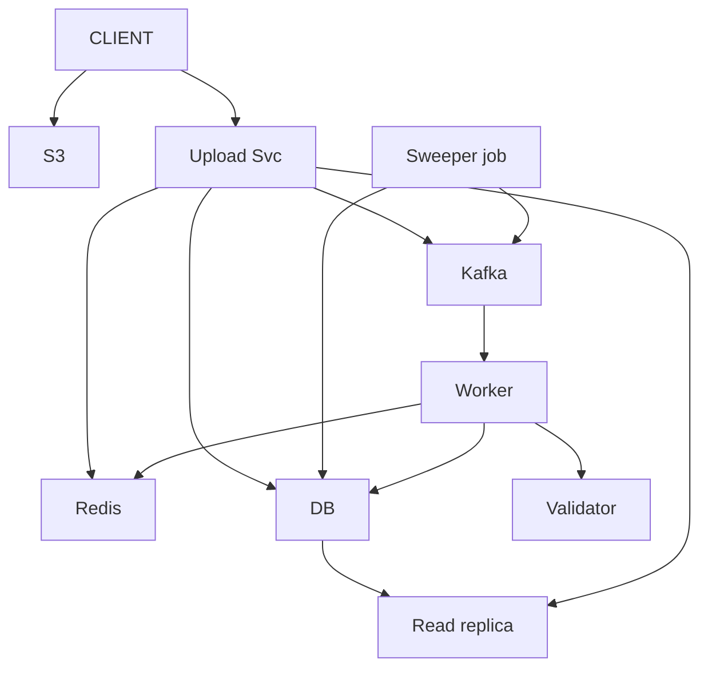
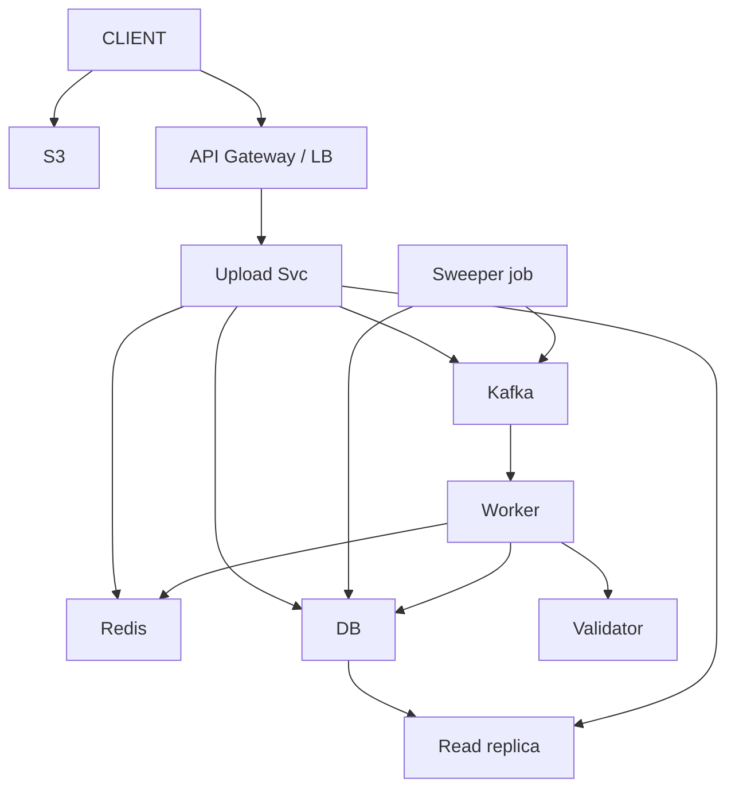
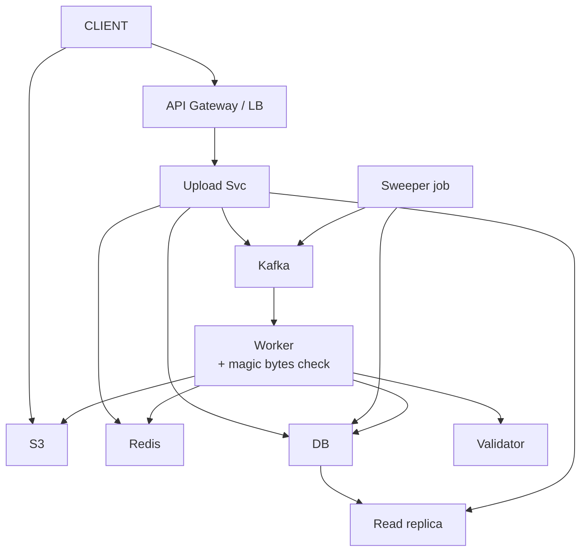
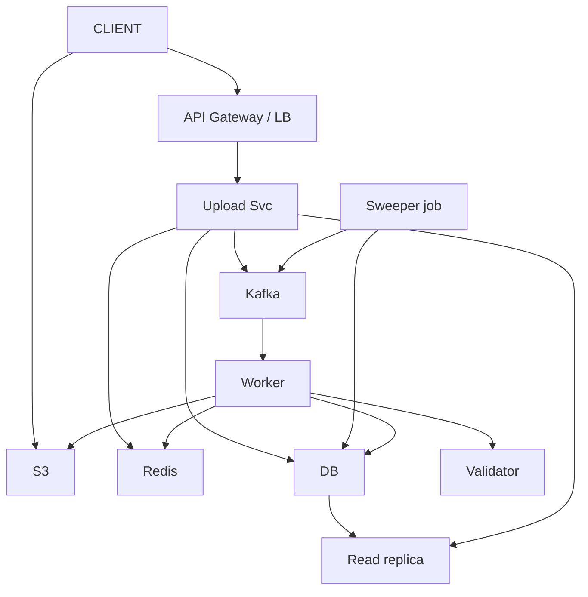

# File Upload + Validate + Track

> User file / folder deta hai -> bahar ki company (third-party) use JAANCHTI hai (2-3 sec) -> file store -> user ko TRACKING link.
> JP ne ye sach me poocha tha (asli SDE-3 writeup). Aam product design, finance nahi.
> Is design ka dil: **user ruke nahi** (async + trackingId) + **file ke bytes hamare server se na guzrein** (presigned URL) + **haal hamesha pata**.

---

## TASVEER (ByteByteGo / Alex Xu · CC BY-NC-ND 4.0)


Source: [How to Upload a Large File to S3](https://bytebytego.com/guides/how-to-upload-a-large-file-to-s3/)
(badi file -> presigned URL + MULTIPART: tukdon me, tukda fail to sirf wahi dobara)

---

## SHURU: pehle poocho, phir numbers

```
POOCHO:  file kitni badi? (10 MB ya 5 GB — design badal jaata)  <- badi = presigned + multipart
         kaunse type allowed? · jaanch kitna time leti? (2-3 sec) · sirf FILE ya FOLDER bhi?
         nateeja turant chahiye ya baad me haal dekhega?  <- turant nahi = async + tracking

KYA KARE (FR):    upload · bahar wale se JAANCH · store · tracking link / haal
                  scope bahar: editing · sharing · versions
KAISA CHALE (NFR): user ruke nahi (dil) · file khoye nahi · haal
                   HAMESHA pata (kahan tak pahunchi) · bheed + safe

NUMBERS (andaaza):
   1 lakh file / din, din me ~1 lakh second -> ~1-2 upload / second (kam)
   par log haal BAAR-BAAR dekhte -> padhna bahut zyada, likhna kam
   -> haal ke liye CACHE + read replica
   -> badi file ke bytes DB me nahi, S3 me (blob storage)
   -> jaanch dheemi -> beech me QUEUE + worker
```

---

## ════ MOCK SE PEHLE: SIRF YE CARD PADHO ════

> Har dikkat ek card: KAHANI (kya hua, kaun, kitna) -> ILAAJ -> ANDAR KAISE (ilaaj kyun kaam karta) ->
> ISKE BAAD KYA TOOTEGA (interviewer yahin ghusta hai: dabba lagaya, ab kya?).

#### DABBA 0: SABSE SIMPLE (yahan se shuru, phir "kahan tootega")
```
Client file Upload service ko de. Service file S3 me rakhe,
jaanch wale (Validator) ko call kare (2-3 sec), jawab wapas.
```


#### 1 USER 2-3 SEC RUKA, SERVER KA THREAD BHI ATKA
```
KAHANI:  Arpan ne report.pdf daali. Server ne Validator ko call kiya, 3 second jawab ka intezaar.
         Arpan 3 second ghoomta screen dekhta raha, aur server ka ek thread bhi 3 second bekaar atka.
         Hazaar log ek saath -> saare thread atke -> naye upload ke liye thread hi nahi.

ILAAJ:   Jaanch 3 second leti hai, to Arpan ko rukwate nahi. Upload hote hi use tracking id (T-101) aur
         'jaanch ho rahi hai' de do, wo chala jaaye.
         Kaam line (queue) me jaata, worker uthata, jaanchta, DB me 'DONE' ya 'FAILED' likhta. Arpan jab
         chahe T-101 se haal dekh le.
         Worker 'kaam le liya' tabhi bolta jab DB me likh diya, to beech me mara to kaam dobara milega,
         khoyega nahi.
```

```
ANDAR KAISE:
         Upload service queue me khabar daale {T-101, file kahan hai} aur turant laut aaye.
         Worker queue se uthaye -> Validator ko call -> DB me T-101 = DONE / FAILED.
         Worker "maine padh liya" (offset commit) DB likhne ke BAAD bole
         -> beech me worker mara to khabar dobara milegi, khoyegi nahi.

ISKE BAAD KYA TOOTEGA:
  - Khabar dobara mili, file do baar jaanchi gayi?
      -> pehle dekho: T-101 pehle se DONE hai? -> skip (idempotent).
  - Kafka hi kyun?
      -> 1-2 upload / second ke liye SQS / RabbitMQ bhi kaafi (simple,
         AWS chalaye). Kafka tab jab bahut khabar ho ya dobara padhni ho.
  - Arpan har 2 sec haal poochhe, bahut nahi?
      -> dheere-dheere gap badhao (2s, 4s, 8s), ya server khud bataye (card 5).
  - Raat 2 baje Validator 1 ghanta band, 4,000 file VALIDATING pe atki. Kya hoga, pata kaise chalega?
      -> khoyega kuch nahi: khabar Kafka me padi, worker DB me DONE
         ke baad hi "padh liya" bolta. Wapas aaya to line nikalti.
         ilaaj: FUSE (3-5 fail pe call band, thodi der baad ek test call)
         + DOOSRI COMPANY (bahar wale ki copy hum nahi chala sakte).
         pata: health check nahi pakadta (wo "zinda" bolta). Apne
         number: queue ki lambai · Validator ka time + error rate
         · 10 min se VALIDATING me atki files -> had paar = alert, user ki shikayat se pehle.
```

#### 2 5 GB FILE KE BYTES HAMARE SERVER SE GUZAR RAHE
```
KAHANI:  Arpan ki 5 GB video: client -> hamara server -> S3. 5 GB do baar network pe chala,
         server ka thread minuton tak atka, aur sirf bytes aage badhane ke liye server badhane pade.

ILAAJ:   5 GB file hamare server se hoke jaaye to server ghanto atka rahe. Isliye server sirf ek 10 minute
         ka 'paas' (signed URL) deta hai, saath me T-101.
         Arpan ka app us paas se file seedha S3 me daal deta, hamare server ke beech se nahi.
         Arpan ke paas AWS ki chaabi kabhi nahi aati, sirf us ek file ka 10 minute ka paas.
```

```
ANDAR KAISE:
         1  Arpan -> server: "5 GB upload karni hai"
         2  server -> Arpan: signed URL (10 min ka) + T-101
         3  Arpan -> S3: bytes seedhe (server beech me nahi)
         4  Arpan -> server: "/complete T-101" -> server queue me daale
         Sign kaise: server apni AWS secret se (PUT + bucket/file ka naam + 10 min) ka hash banata.
         S3 ke paas bhi wahi secret, wo khud hash bana ke milata. Mila -> andar aane do.
         Arpan ke haath AWS ki chaabi kabhi nahi aati, sirf EK file ka 10 min ka paas.

ISKE BAAD KYA TOOTEGA:
  - Limit 5 GB thi, Arpan ne 50 GB daal di?
      -> signed URL me hi size likho (presigned POST me content-length-range max). S3 badi file khud reject.
  - Arpan ne "/complete" bola hi nahi (app band)?
      -> S3 khud batata "file aa gayi" (S3 event notification), ya sweeper pakde (card 4).
```

#### 3 5 GB FILE 90% PE TOOT GAYI
```
KAHANI:  Arpan ki 4.5 GB chadh chuki thi, wifi chala gaya. Ab poori 5 GB shuru se? Arpan pagal ho jaayega.

ILAAJ:   File ko 100 tukdon me bhejo. 90 tukde chale gaye aur wifi gaya, to sirf bache 10 dobara bhejo,
         poori 5 GB nahi.
         Sab tukde pahunche to S3 khud jod ke ek file bana deta. Upload ki id hamare paas hai, to app band
         karke kal aaye to bhi wahin se aage.
```

```
ANDAR KAISE:
         1  "shuru" -> S3 ek uploadId deta (U-9)
         2  har tukda (1..N) apne signed URL pe, ek saath kai bhi -> S3 har tukde ki rasid (ETag) deta
         3  "complete(U-9, [tukda + rasid])" -> S3 kram se jod ke ek file bana deta
         4.5 GB pe wifi gaya -> 90 tukde pahunch chuke, sirf bache 10 bhejo.

ISKE BAAD KYA TOOTEGA:
  - Arpan ne app band kar di, kal wapas aaya?
      -> server ke paas U-9 hai. S3 se poochho kaunse tukde aa chuke (ListParts) -> sirf bache bhejo.
  - Tukda kitna bada?
      -> S3 me kam se kam 5 MB (aakhri chhod ke), zyada se zyada 10,000 tukde -> badi file = bada tukda.
```

#### 4 UPLOAD SHURU HUA, "COMPLETE" KABHI NAHI AAYA (ADHOORI FILE)
```
KAHANI:  Arpan ne upload shuru kiya, phir app crash. "complete" kabhi nahi aaya.
         Bytes S3 me pade (paisa lag raha), DB me T-101 "VALIDATING" pe atka, aur koi use dhoondhta hi nahi.

ILAAJ:   Har file ka haal likha hai: UPLOAD HO RAHI -> JAANCH HO RAHI -> DONE / FAILED.
         Ek job har kuch minute dekhti: koi file 10 minute se 'jaanch ho rahi' pe atki hai (jabki jaanch 3
         second ki hai)? To use dobara line me daalo, ya FAILED kar do.
         Aur S3 ka niyam purani adhoori uploads apne aap hata deta.
```

```
ANDAR KAISE:
         Sweeper har kuch minute: haal VALIDATING / UPLOADING aur 10 min
                                  se nahi badla (jaanch to 3 sec ki hai)
           -> S3 me bytes hain? haan = queue me dobara daalo · nahi = FAILED.
         Lifecycle din me ek baar chalta aur DB nahi dekhta -> isliye sweeper bhi chahiye.

ISKE BAAD KYA TOOTEGA:
  - Sweeper do machine pe chala, file do baar queue me?
      -> ek hi sweeper chale (lock / leader), ya dobara daalna safe ho (worker haal dekh ke skip).
  - Jaanch me fail file ka kya?
      -> quarantine bucket (koi download nahi kar sakta), kuch din baad delete / security team dekhe.
  - Bas haal likh diya, kaafi?
      -> nahi. Koi us atke haal ko DHOONDHE bhi (sweeper), tabhi kaam ka.
```

#### 5 SAB HAR 2 SEC HAAL POOCHH RAHE
```
KAHANI:  10,000 log upload karke baithe, har ek har 2 sec "T-101 ka haal?" -> 5,000 sawaal / second DB pe.
         Likhai to 1-2 / second thi, padhai ne DB ko ghera.

ILAAJ:   Log baar-baar 'T-101 ka haal?' poochhte, to haal Redis se do, DB tak mat jaao. Redis me na ho to
         DB ki copy se.
         Worker jab haal badle (DONE), Redis me bhi usi waqt badal de, warna Arpan ko purana 'jaanch ho
         rahi' dikhta rahega.
         Poochhna hi band karna ho to server khud Arpan ko bata de jab haal badle (SSE / WebSocket).
```

```
ANDAR KAISE:
         GET /status/T-101 -> Redis me hai? -> wahin se · nahi
         -> replica se padho -> Redis me rakh do (chhoti umar).
         JAAL 1: worker ne DB me DONE kiya, Redis me abhi bhi VALIDATING -> Arpan ko purana haal.
                 Ilaaj: worker DB ke saath Redis bhi update kare.
         JAAL 2: replica thodi peeche -> replica se purana VALIDATING padha aur Redis me baith gaya.
                 Ilaaj: haal primary se padho, ya worker khud Redis me likhe.

ISKE BAAD KYA TOOTEGA:
  - Poochhna hi band karwa do?
      -> SSE / WebSocket: haal badla to server khud Arpan ko bheje. Baar-baar poochhna khatam.
  - Redis gira?
      -> sawaal seedha replica pe, dheema par chalta. Poochhne pe rate limit.
```

#### 6 FILE NAHI, POORA FOLDER
```
KAHANI:  Arpan ne 1000 file ka folder daala. Ek trackingId se 1000 file ka haal kaise?

ILAAJ:   Folder ka ek bada id (P-1), andar har file ka apna chhota id. Sab chhote DONE to P-1 DONE, koi
         FAILED to P-1 'kuch fail'.
         1000 file ke liye 1000 baar paas nahi maangte, ek hi baar me saare paas mil jaate.
```

```
ANDAR KAISE:
         saare child DONE = P-1 DONE · koi FAILED = P-1 PARTIAL / FAILED.
         bahut saari chhoti files -> client zip bana ke bheje, server khol le.

ISKE BAAD KYA TOOTEGA:
  - Parent ka haal kab badle?
      -> har child DONE / FAILED pe P-1 ka done_count badhao. Sab ho gaye -> P-1 final.
  - 1000 file = 1000 baar "/init"?
      -> ek hi call me 1000 signed URL (batch init).
```

#### 7 RAVI NE ARPAN KA trackingId DAAL KE FILE MAANG LI
```
KAHANI:  Ravi ne kahin se Arpan ka T-101 dekh liya, GET
         /download/T-101 maara -> Arpan ki file Ravi ko mil gayi.

ILAAJ:   Login darwaze pe hota hai: wo batata ye Ravi hai. Par 'T-101 Ravi ki file hai?' ye darwaza nahi
         jaanta.
         Isliye service me check: T-101 ka maalik Arpan, maangne wala Ravi -> 403. Har haal / download pe
         ye check.
```

```
ANDAR KAISE:
         "Tum kaun ho?" (AUTHN) = gateway / JWT batata: ye Ravi hai.
         "Is file pe haq hai?" (AUTHZ) = SERVICE me check: T-101 ka owner Arpan, maangne wala Ravi -> 403.
         Gateway ye nahi kar sakta, use pata hi nahi T-101 kiski hai.

ISKE BAAD KYA TOOTEGA:
  - Id random hai, phir bhi owner check kyun?
      -> id leak ho sakti (log me, link share). Asli rok owner check hai, randomness nahi.
  - Admin ko sab dekhna?
      -> owner YA admin role, warna 403.
  - (PR review me sabse pehle yahi): request me kisi ki id aayi -> owner check kahan hai?
```

#### 8 ARPAN NE S3 KA SEEDHA LINK WHATSAPP PE BHEJ DIYA
```
KAHANI:  Arpan ko S3 ka pakka link diya. Usne dost ko WhatsApp pe bheja, dost ne group me.
         Link hamesha chalta -> file kisi ke bhi haath.

ILAAJ:   Download ke liye bhi 5 minute ka paas, aur wo bhi maalik check ke baad hi banta.
         DB me file ka naam (key) rakhte, pakka link nahi. Arpan ne link WhatsApp pe bheja to 5 minute
         baad wo band.
```

```
ANDAR KAISE:
         URL "ghar ki chaabi" nahi, "5 minute ka paas". Har baar maangne pe naya.
         Group me 1 ghante baad kisi ne khola -> expire -> nahi khula.

ISKE BAAD KYA TOOTEGA:
  - 5 min me download poora nahi hua (badi file)?
      -> umar sirf SHURU karne ki. Chalu download beech me nahi katta.
  - 5 min ke andar aage bhej diya?
      -> 5 min ka risk maana. Zyada sensitive -> CloudFront signed URL + IP restriction.
```

#### 9 NAAM REPORT.PDF, ANDAR EXE
```
KAHANI:  Kisi ne virus.exe ka naam badal ke report.pdf kiya aur
         type bhi "application/pdf" bheja. S3 me pahunch bhi gayi.
         Naam aur type dono client ne bheje the, jo jhooth bol sakta hai.

ILAAJ:   Login darwaze pe, maalik check har maang pe. Chhote time ke paas.
         File ka naam ya type (jo app bhejta) pe bharosa nahi: worker file ke pehle kuch byte padh ke
         dekhta asal me kya hai (PDF '%PDF' se shuru, EXE 'MZ' se).
         Ek user kitni file daal sakta uski had, sabse aage WAF, HTTPS, aur passwords vault me.
```

```
ANDAR KAISE:
         Har type ki file shuru me apni pehchaan likhti: PDF = "%PDF-" · PNG = "\x89PNG" · EXE = "MZ".
         Worker S3 se sirf pehle kuch byte mangata (range GET, poori 5 GB nahi).
         Naam .pdf, pehle byte "MZ" -> ye EXE hai -> reject.
         Client ka bheja kabhi sach mat maano (na naam, na type).

ISKE BAAD KYA TOOTEGA:
  - Shuru ke byte PDF jaise, par andar virus / JS?
      -> antivirus scan (ClamAV) worker me, ya S3 malware scanning.
  - Koi bheed / hamla?
      -> har user pe rate limit, WAF, HTTPS, secrets vault me.
```

```
AAKHRI DABBE (sab dikkat ke baad):
  User -> Gateway / LB (login) -> Upload Svc (file ki jaankari + signed URL, bytes ko haath nahi)
  -> client SEEDHA S3 pe (tmp/, badi file multipart) -> complete -> Kafka -> Worker (jaanch, magic bytes)
  -> DB me haal -> Redis + read replica (haal poochhna) · download = owner check + chhota signed GET
  Sweeper + S3 lifecycle = atki / adhoori file

DB:  PostgreSQL -> trackingId se seedha dhoondhna simple, par haal
     (UPLOADING -> VALIDATING -> DONE / FAILED) ko ACID chahiye
     files: trackingId (KEY) | ownerId | status | s3_key

END ME POOCHEGA:
  "Bytes server se kyun nahi?" -> signed URL: server pe bojh nahi, seedha S3
  "10x?"            -> Upload Svc machine + LB · S3 khud scale · download CDN · haal cache + replica
                       · DB shard (trackingId) · worker queue ki lambai dekh ke badhao
  "SPOF?"           -> Validator (bahar wala): fuse (circuit breaker) + doosri company
  "Chal raha, kaise pata?" -> apne metric: queue ki lambai
  · Validator p99 + error rate · VALIDATING me atki files
                       (health check sirf "zinda hai" batata, "dheema hai" nahi)
```

AAKHRI DABBE ki tasveer:



---

## 10 GUNA TRAFFIC — har dabba alag se

```
Upload Svc   -> stateless, kai machine + LB
S3           -> AWS khud scale karta · zyada download wali file -> CDN (CloudFront)
DB           -> haal poochhna -> CACHE + READ REPLICA · bahut files -> SHARD (trackingId)
Redis        -> purana haal na dikhe -> worker saath me update kare
Kafka        -> jaanch ki line lambi -> WORKER badhao (line ki lambai dekh ke)
adhoori file -> S3 lifecycle + sweeper

POOCHEGA: "How would you scale this to 10x?"      -> file ka raasta chalo, pehle jo toote
POOCHEGA: "What's the single point of failure?"   -> Validator (bahar wala): fuse + doosri company
POOCHEGA: "How do you know it's working?"
          (Chal raha hai, kaise pata?)
          MISAAL: raat ko Validator DHEEMA, line me 50,000 file atki
          health check "dheema" nahi pakadta (ping ka jawab aa jaata) -> APNA METRIC pakadta:
             line ki lambai · Validator p99 + error rate · VALIDATING me purani files ki ginti
             -> had paar = alert (CloudWatch alarm / PagerDuty), user ke shikayat karne se pehle
          peeche: 3 fail -> fuse (CIRCUIT BREAKER) -> doosri company (bahar wale ki copy hum nahi chala sakte)
JAWAB:    Health check sirf batata 'zinda hai', 'dheema hai' nahi batata. Isliye apne teen number dekho:
          line kitni lambi, jaanch wali company kitni der me jawab de rahi aur kitni baar fail, aur
          kitni files 10 minute se 'jaanch ho rahi' pe atki.
          Had paar = alert, user ke shikayat karne se pehle. Company baar-baar fail ho to us pe call
          band (fuse) aur doosri company.
```

---

## POOCHE TO (gehra sawaal aaye tab)

```
API:      POST /upload/init { fileName, size }  -> signed S3 URL + trackingId (server sirf URL deta)
          -> client SEEDHA S3 pe PUT
          POST /upload/complete { trackingId }   -> "ho gaya, jaancho" (queue)
          GET  /status/{trackingId}              -> VALIDATING / DONE / FAILED
          GET  /download/{trackingId}            -> signed GET URL -> seedha S3

DB:       files: trackingId (KEY) | fileName | ownerId | status | s3_key | createdAt | updatedAt
          haal: UPLOADING -> VALIDATING -> DONE / FAILED ("kahan tak pahunchi" = gadbad sambhalne ki buniyaad)
          PostgreSQL: dhoondhna simple par haal ko ACID chahiye
          (bahut bada + sirf key-value -> NoSQL bhi chalta · paisa hota -> hamesha SQL)

DEDUP:    file ka hash (MD5 / SHA) -> pehle se hai to dobara store nahi -> jagah bachi
```

---

## AAKHRI DABBA + WRAP

```
Gateway / LB = login · Upload Svc = jaankari + signed URL, bytes ko haath nahi · S3 = bytes, tmp/ + lifecycle
DB = trackingId + haal + owner · Kafka + Worker = dheemi
jaanch alag, magic bytes · Redis + replica = haal poochhna
Sweeper = atki file
```
```
JAWAB:    Server sirf paas deta, file seedha S3 me (badi ho to tukdon me).
          Jaanch 3 second ki, to Arpan ko turant T-101, worker line se jaanchta, file ke pehle byte
          dekhta, haal likhta.
          Haal baar-baar poochha jaata, to Redis + copy, haal badle to Redis bhi. Maalik check aur
          chhote paas se safe, S3 niyam + atki file wali job se safai.
          Aage: fail pe dobara koshish, download ke liye CDN.
```


ARCHETYPE B+F · CONCEPTS: [message-queues](../../FOUNDATIONS/07_message_queues.md) · [reliability/SPOF](../../FOUNDATIONS/11_reliability_spof_cloud.md) · [← MASTER SHEET](../../00_MASTER_SHEET.md)
