# File Upload + Validate + Track

> User file / folder deta hai, bahar ki company (third-party) use jaanchti hai (2-3 sec), file store hoti, user ko tracking link milta. JP ne ye sach me poocha tha (asli SDE-3 writeup). Aam product design, finance nahi.
> Dil teen cheezein: user ruke nahi (async + trackingId), file ke bytes hamare server se na guzrein (presigned URL), aur haal hamesha pata.
>
> Mock me sirf heading + Cue + GIF. Neeche har card: **hal** · **kyun** · **nahi** (doosra kyun nahi) · **Pooche**.

---

## Poori tasveer (aakhir me design aisa banta hai)



---


## Shuru

- **FR:** upload, bahar wale se jaanch, store, tracking link / haal · scope bahar: editing, sharing, versions
- **NFR:** user ruke nahi (dil) · file khoye nahi · haal hamesha pata (kahan tak pahunchi) · bheed + safe
- **numbers:** 1 lakh file roz, din ~1 lakh second -> ~1-2 upload / sec (kam). Deadline wale din (31 March) aakhri ghante ~100 guna, ~150-200 upload / sec. Haal baar-baar dekhte: padhna bahut zyada, likhna kam.

---

*ab tootega kahan? sabse pehle jaanch pe, kyunki wo 3 sec leti*

## 1. Maine report.pdf daali, 3 second ghoomta screen dekhta raha

**Cue:** ASYNC + TRACKING ID (queue, worker) · dabba: Kafka + Worker + DB

- **hal:** user ko turant tracking id (T-101) + haal VALIDATING. Khabar Kafka me, worker baad me Validator chalata, DB me DONE likhta (async). User T-101 se haal dekhta.
- **kyun:** jaanch dheemi, isliye beech me queue + worker, dheema kaam line me peeche. User ko turant T-101, wo kuch dobara nahi bhejta.
- **kyun:** khabar tabhi "padh li" (offset commit) jab DB me haal likh diya. Worker ya Validator gire to khabar line me bachi rehti.
- **pehle poochho:** jaanch kitna time leti (2-3 sec)? Nateeja turant chahiye ya baad me haal dekhega? Turant nahi = async + tracking.
- **nahi:** sabse simple: Upload service file S3 me rakhe, Validator call kare (2-3 sec), jawab wapas -> server Validator ka intezaar karta, 31 March 200 upload / sec pe har thread 3 sec atka, threads khatam
- **Pooche:** worker beech me mar gaya? -> khabar dobara milti, kyunki offset commit DB likhne ke baad tha
- **Pooche:** wahi khabar dobara aayi? -> pehle haal dekho. T-101 DONE hai to skip (idempotent).
- **Pooche:** Validator do baar chal gaya? -> jaanch T-101 pe idempotent. Dobara chalna theek, DONE ek hi baar.
- **Pooche:** Validator 1 ghanta band? -> 4,000 khabar line me padi rehti. DONE bina offset aage nahi.
- **Pooche:** us ghante bhi call karte rahoge? -> nahi, circuit breaker: 3-5 fail pe band, thodi der baad ek test call. Aur doosri company (unki copy hum nahi chala sakte).
- **Pooche:** Validator band hai, upload bhi rok dein? -> nahi, error diya to 31 March ki deadline gayi, file gayi hi nahi. Upload le lo, khabar Kafka me padi, Validator aate hi jaanche.
- **Pooche:** is line ke liye Kafka hi kyun? -> zaroori nahi. ~200 / sec pe SQS / RabbitMQ kaafi. Kafka tab jab bahut bheed ho ya dobara padhna ho.
- **Pooche:** Validator ko 5 GB file kaise doge? -> file nahi bhejte, 10 min ka signed GET link. Validator seedha S3 se padhta, bytes hamare server se tab bhi nahi.

---

*ab jaanch peeche gayi, par 5 GB ki file hamare server se hi guzar rahi*

## 2. Meri 5 GB video hamare server ke raaste S3 jaa rahi

**Cue:** PRESIGNED URL, bytes seedha S3 · dabba: S3 (client seedha)

- **hal:** server sirf ek signed URL deta (10 min ka) + T-102. Phone 5 GB seedha S3 pe, phir "/complete T-102" (presigned URL)
- **kyun:** server sirf paas deta: ek file, 10 min. Bytes seedha app se S3, server pe bojh nahi.
- **kyun:** paas leak ho bhi jaaye to sirf us ek file pe, 10 min tak. Paas khatam to naya maango.
- **S3:** badi file ke bytes DB me nahi, S3 me (blob storage)
- **pehle poochho:** file kitni badi? 10 MB ya 5 GB, design badal jaata. Badi hai to presigned + multipart.
- **nahi:** bytes server ke raaste -> phone se 5 GB server pe, phir wahi S3 pe. Bytes do baar, thread minuton atka, mehnga + dheema.
- **nahi:** AWS chaabi hi app ko -> kabhi nahi. Chaabi = poora bucket. Paas = sirf ek file, 10 min.
- **Pooche:** had 5 GB, koi 50 GB bheje? -> had paas me hi: POST me content-length-range, PUT me size sign (ek PUT max 5 GB). S3 khud reject. S3 event pe size phir se dekho.
- **Pooche:** "/complete" aaya hi nahi? -> S3 event ("file aa gayi") se queue me daalo. Client pe bharosa nahi.
- **Pooche:** S3 paas kaise maanta? -> wahi hash khud banata. Server ne AWS secret se sign kiya tha.

---

*ab bytes seedha S3 jaate, par beech me net gaya to?*

## 3. 4.5 GB chadh chuki thi, wifi chala gaya

**Cue:** MULTIPART, sirf bache tukde · dabba: (S3 multipart)

- **hal:** file tukdon me: 100 tukde, kai saath jaate, har tukde ki rasid (ETag), aakhir me COMPLETE. Wifi gaya to 90 ki rasid S3 pe, sirf bache 91 - 100 bhejo (multipart).
- **kyun:** jis tukde ki rasid S3 pe hai, wo pakka. Rasid S3 pe, app pe nahi. Net gaya ya app band, S3 se poochho, sirf bache tukde dobara. User ko shuru se kuch nahi.
- **nahi:** ek hi lamba upload -> 90% pe wifi gaya, toota to sab bekaar, phir 0 se 5 GB
- **Pooche:** app band, kal wapas aaya? -> S3 se poochho (ListParts U-9). Rasid wahan hai, app pe nahi.
- **Pooche:** COMPLETE kabhi aaya hi nahi? -> adhoore tukde S3 lifecycle kuch din (jaise 7) baad hata deta (abort)
- **Pooche:** tukda kitna bada rakhoge? -> S3 ki had: min 5 MB (aakhri chhod ke), max 10,000 tukde. Badi file = bada tukda.

---

*ab upload hua, par app hi crash ho gaya aur kisi ne bataya nahi*

## 4. App crash, "complete" kabhi aaya hi nahi

**Cue:** SWEEPER job (atki file) · dabba: Sweeper job

- **hal:** har kuch min (jaise 5) ek job atki file dhoondhe (sweeper). 10 min se haal nahi badla, jabki jaanch 3 sec ki = atka. S3 me bytes hain = khud dobara queue me. Nahi hain = FAILED, user dobara daale.
- **kyun:** har file ka haal DB me: UPLOADING -> VALIDATING -> DONE / FAILED. Der se nahi badla = atka.
- **kyun:** dobara line me daalna safe, worker haal dekh ke skip kar deta
- **nahi:** sweeper na ho -> T-103 DB me UPLOADING pe hamesha atka, bytes S3 me pade (paisa lag raha), koi nahi dekhta
- **Pooche:** /complete aur S3 event dono chhoot gaye? -> isi liye sweeper, har kuch min atki file dhoondhe
- **Pooche:** sweeper do machine pe chal gaya? -> ek hi chale (lock / leader). Ya chalne do, dobara daalna safe hai.
- **Pooche:** to S3 lifecycle kis kaam ka? -> bytes ki safai: adhoore uploads ke bytes khud hataata. DB ka haal sweeper badle.

---

*ab file chal padi, par deadline ke din sab haal poochh rahe*

## 5. Deadline ke din sab har 2 sec haal poochh rahe

**Cue:** CACHE Redis + READ REPLICA · dabba: Redis + Read replica

- **hal:** GET /status/T-101 pehle Redis se (1 ms). Redis me nahi mila = read replica se laao, Redis me rakho (cache + replica)
- **kyun:** padhna bahut zyada, likhna kam, isliye haal ke liye cache + read replica
- **kyun:** sach DB me, Redis sirf tez copy. Padhna Redis se, likhna dono me. Purana dikhe to chhoti umar (TTL) se khud theek.
- **kyun:** Redis gire to replica se, dheema par band nahi
- **nahi:** har poochh seedha DB pe -> 10,000 log har 2 sec, primary DB ghira, sab dheema
- **Pooche:** worker ne DB me DONE likha, app abhi bhi VALIDATING kyun? -> sirf DB badla, Redis me purana pada tha. Worker DONE likhe to usi waqt: DB likho, Redis key hatao, agla poochh DB se naya DONE laaye. Redis chhoota bhi to umar (TTL) baad naya.
- **Pooche:** replica peeche thi, purana haal Redis me baith gaya? -> DONE ke baad purana haal Redis me baith sakta. Miss pe sirf SET NX + chhoti umar, ya primary se padho.
- **Pooche:** har 2 sec poochna zaroori? -> gap badhao (2s, 4s, 8s). Haal itni jaldi nahi badalta.
- **Pooche:** poochhna hi band karwa do? -> server khud bheje (SSE / WebSocket), haal badla tab hi
- **Pooche:** Redis gira? -> replica pe seedha. Dheema par chalta. Poochne pe rate limit.

---

*ab ek file theek, par poora folder aaya to?*

## 6. Maine file nahi, poora folder daala (1000 file)

**Cue:** PARENT id + CHILD id · dabba: (DB me parent)

- **hal:** folder ka ek id (P-1), har file uska child. Batch init me 1000 URL, har file ka child id. Har child DONE pe folder pe ginti +1 (done_count). Sab DONE = P-1 DONE (parent + child).
- **kyun:** folder = bada id, har file ka chhota id. Folder ka haal = bachchon ka jod. Sab DONE = DONE, koi FAILED = PARTIAL. Ek file fail to sirf wahi dobara.
- **pehle poochho:** sirf file ya folder bhi?
- **nahi:** har file ka alag id hi -> folder ka koi haal nahi, "folder ho gaya?" ke liye 1000 id khud dekho
- **Pooche:** koi file FAILED? -> P-1 PARTIAL. Sirf fail wali dobara, poora folder nahi.
- **Pooche:** do worker saath done_count +1 karein? -> ek UPDATE: done_count = done_count + 1, DB ke andar. Ginti nahi khoti.
- **Pooche:** lakh chhoti files ho to? -> ZIP. Client ek file bana ke bheje, server khol le.

---

*ab sab chal raha, par koi doosre ki file maange to?*

## 7. Ravi ne mera trackingId daal ke meri file le li

**Cue:** OWNER CHECK (AUTHZ), 403 · dabba: Gateway + Upload Svc

- **hal:** har request pe check: file ka maalik = maangne wala? JWT bole ravi, T-101 ka maalik arpan -> 403 (owner check)
- **kyun:** kaun ho = gateway batata (JWT). Is file pe haq hai = service khud dekhti, har request pe (owner_id == jwt.user_id). Id leak ho tab bhi file nahi milti.
- **nahi:** id hai to file de do -> wahi chori: Ravi ne GET /download/T-101 kiya, service ne id dekhi aur de di
- **Pooche:** id to random tha, phir check kyun? -> id leak hoti hai: log, screenshot, link
- **Pooche:** admin maange? -> owner ya admin role, warna 403
- **Pooche:** PR me owner check kahan dhoondhoge? -> har handler ki pehli line: file.owner_id == jwt.user_id ya admin, warna 403. userId JWT se, body se kabhi nahi.

---

*ab andar se safe, par link hi bahar chala gaya to?*

## 8. Maine S3 ka seedha link WhatsApp pe bhej diya

**Cue:** SIGNED GET, 5 min ka naya paas · dabba: S3 signed GET (s3_key)

- **hal:** DB me sirf S3 key (pata). Download maanga = maalik check, phir naya 5 min ka link (signed GET).
- **kyun:** pakka link kabhi bahar nahi. Link aage gaya to bas 5 min tak. Group me 1 ghante baad khola = expire, nahi khula.
- **nahi:** pakka link DB me rakh ke de do -> hamesha chalta, WhatsApp group me koi bhi kabhi bhi khole. File sabke haath, hamesha ke liye.
- **Pooche:** 5 min me download adhoora reh gaya? -> umar sirf shuru ki hai. Chalu download beech me nahi katta.
- **Pooche:** 5 min ke andar hi aage bhej diya? -> risk maana. Zyada sensitive ho to CloudFront signed URL + IP had.

---

*ab file ka raasta safe, par file khud hi jhooth bol rahi ho to?*

## 9. Naam report.pdf, andar EXE nikla

**Cue:** MAGIC BYTES (pehle kuch byte) · dabba: Worker + magic bytes

- **hal:** worker file ke pehle 4 byte padhta. Shuru "MZ" = EXE, "%PDF" nahi -> reject (magic bytes)
- **kyun:** client ka bheja (naam, type, size) kuch sach nahi. Sach file ke bytes me: pehle kuch byte = type, scan = virus. Jaanch pass nahi = DONE nahi, reject.
- **pehle poochho:** kaunse type allowed?
- **nahi:** naam / type pe bharosa (report.pdf, application/pdf) -> wo client ka bola, andar virus.exe aa gaya
- **Pooche:** shuru PDF hai, par andar virus? -> magic bytes sirf type batate. Scan bhi chahiye (ClamAV / S3 malware).
- **Pooche:** jaanch me fail hui file ka kya? -> quarantine bucket (download band). Baad me delete, ya security dekhe.

---

## Poora design ek saans me

```
User -> Gateway / LB (login) -> Upload Svc (file ki jaankari + signed URL, bytes ko haath nahi)
-> client SEEDHA S3 pe (tmp/, badi file multipart) -> complete -> Kafka -> Worker (jaanch, magic bytes)
-> DB me haal -> Redis + read replica (haal poochhna) · download = owner check + chhota signed GET
Sweeper + S3 lifecycle = atki / adhoori file
DB: PostgreSQL -> trackingId se seedha dhoondhna simple, par haal
    (UPLOADING -> VALIDATING -> DONE / FAILED) ko ACID chahiye
    files: trackingId (KEY) | ownerId | status | s3_key
```

Bolne ke liye: server sirf paas deta, file seedha S3 me (badi ho to tukdon me). Jaanch 3 second ki, to Arpan ko turant
T-101, worker line se jaanchta, file ke pehle byte dekhta, haal likhta. Haal baar-baar poochha jaata, to Redis + copy,
haal badle to Redis bhi. Maalik check aur chhote paas se safe, S3 niyam + atki file wali job se safai. Aage: fail pe
dobara koshish, download ke liye CDN.

---

## 10 guna traffic

- **Upload Svc**: stateless, kai machine + LB.
- **S3**: AWS khud scale karta. Zyada download wali file CDN (CloudFront) pe.
- **DB**: haal poochhna = cache + read replica. Bahut files = shard (trackingId).
- **Redis**: purana haal na dikhe, worker saath me update kare.
- **Kafka**: jaanch ki line lambi, worker badhao (line ki lambai dekh ke).
- **Adhoori file**: S3 lifecycle + sweeper.

**Pooche: 10 guna pe kaise badhaoge?** File ka raasta chalo, pehle jo toote.

**Pooche: single point of failure kya hai?** Validator (bahar wala). Circuit breaker + doosri company.

**Pooche: chal raha hai, kaise pata?** Misaal: raat ko Validator dheema, line me ~5,000 file atki, alert CloudWatch /
PagerDuty se. Health check sirf batata "zinda hai", "dheema hai" nahi batata. Isliye apne teen number dekho: line kitni
lambi, jaanch wali company kitni der me jawab de rahi aur kitni baar fail, aur kitni files 10 minute se "jaanch ho
rahi" pe atki. Had paar = alert, user ke shikayat karne se pehle. Company baar-baar fail ho to us pe call band (circuit
breaker) aur doosri company.

---

## Pooche to (kisi card me nahi baitha)

API: POST /upload/init { fileName, size } -> signed S3 URL + trackingId (server sirf URL deta). Phir client seedha S3
pe (presigned POST, size ki had ke saath; ya PUT). POST /upload/complete { trackingId } -> "ho gaya, jaancho" (queue).
GET /status/{trackingId} -> VALIDATING / DONE / FAILED. GET /download/{trackingId} -> signed GET URL -> seedha S3.

DB: files table: trackingId (KEY) | fileName | ownerId | status | s3_key | createdAt | updatedAt. Haal: UPLOADING ->
VALIDATING -> DONE / FAILED. "Kahan tak pahunchi" hi gadbad sambhalne ki buniyaad hai. PostgreSQL kyunki dhoondhna
simple par haal ko ACID chahiye. Bahut bada + sirf key-value ho to NoSQL bhi chalta. Paisa hota to hamesha SQL.

Dedup: file ka hash (MD5 / SHA). Pehle se hai to dobara store nahi, jagah bachi.

Koi bheed / hamla kare? Rate limit har user pe, sabse aage WAF, HTTPS, secrets vault me.

---

ARCHETYPE B+F · CONCEPTS: [message-queues](../../FOUNDATIONS/07_message_queues.md) · [reliability/SPOF](../../FOUNDATIONS/11_reliability_spof_cloud.md) · [← MASTER SHEET](../../00_MASTER_SHEET.md)
