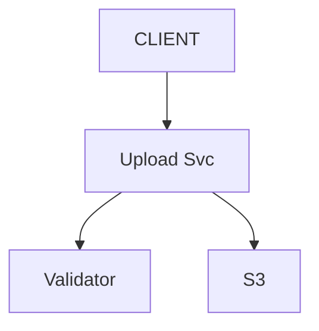
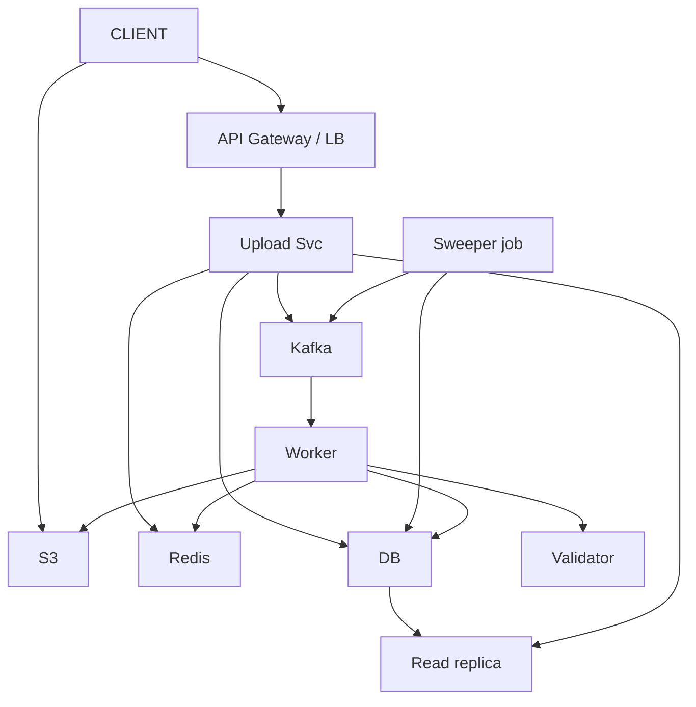
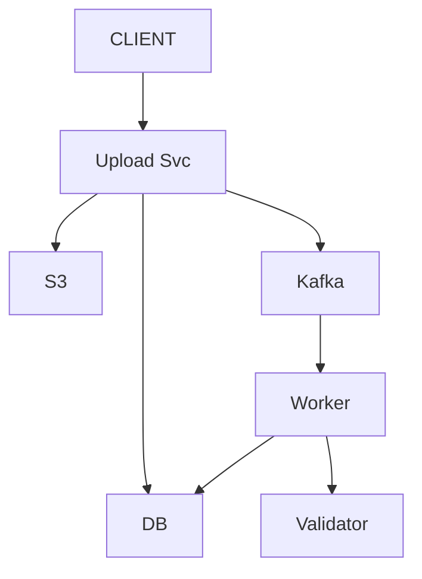
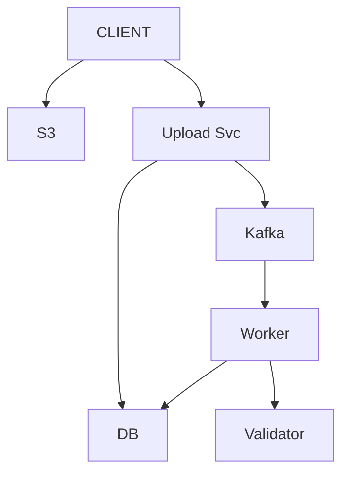
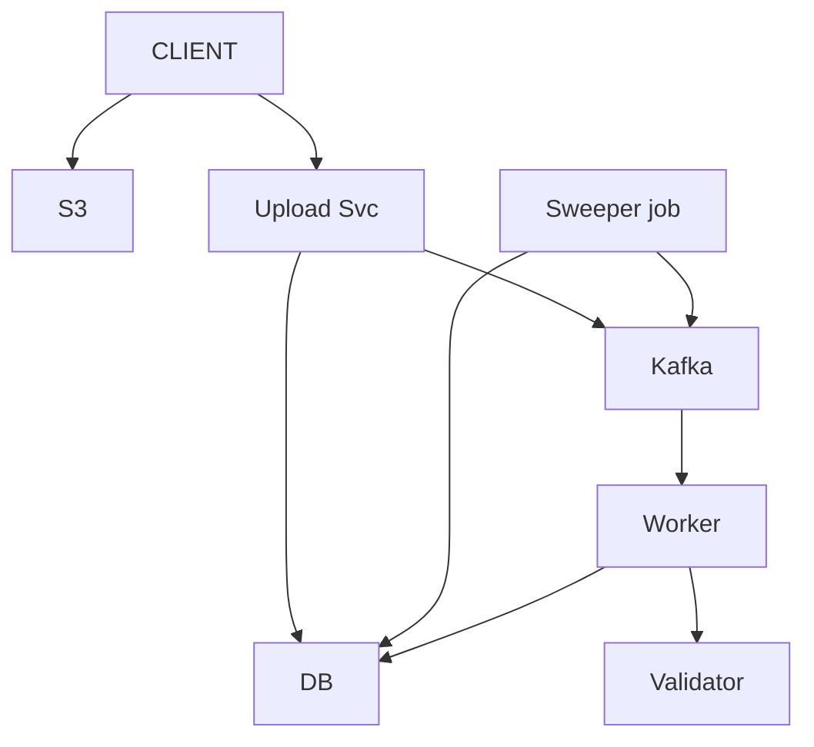
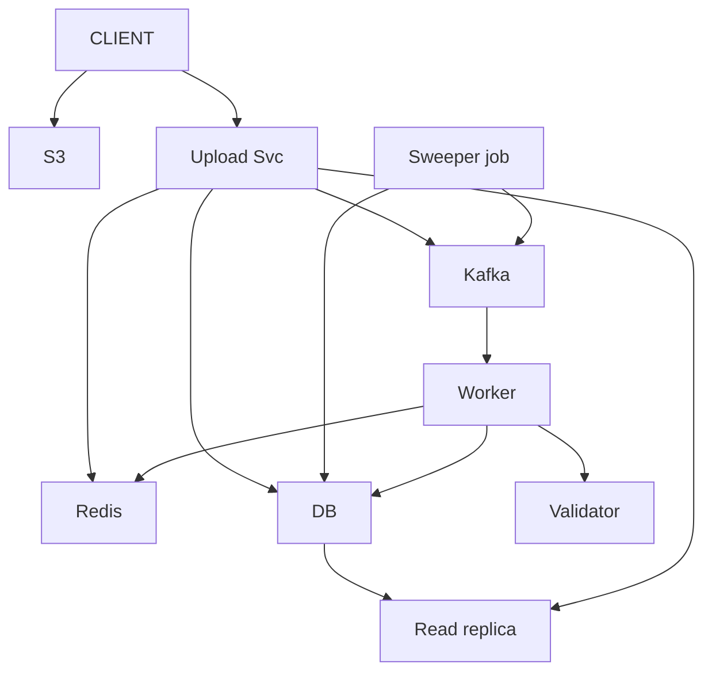
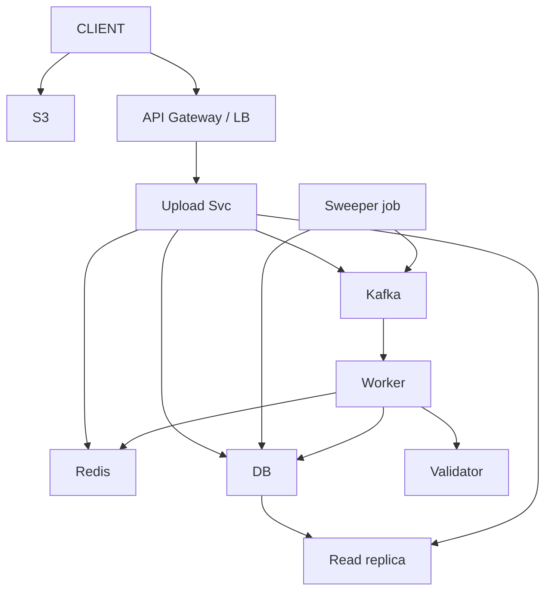
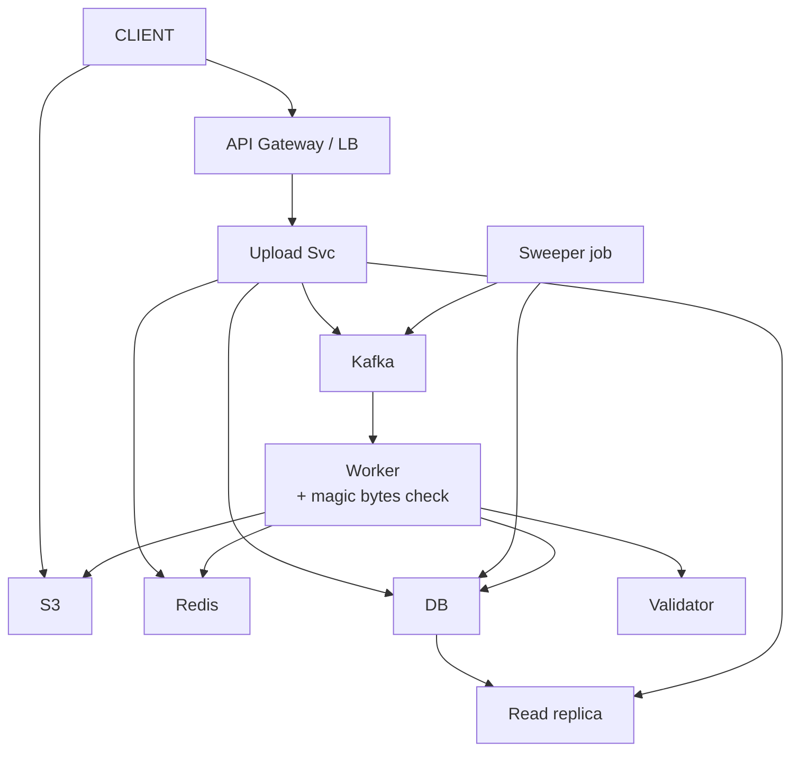

# File Upload + Validate + Track

> User file / folder deta hai -> bahar ki company (third-party) use JAANCHTI hai (2-3 sec) -> file store -> user ko TRACKING link.
> JP ne ye sach me poocha tha (asli SDE-3 writeup). Aam product design, finance nahi.
> Is design ka dil: **user ruke nahi** (async + trackingId) + **file ke bytes hamare server se na guzrein** (presigned URL) + **haal hamesha pata**.

---

## TASVEER (ByteByteGo / Alex Xu · CC BY-NC-ND 4.0)


Source: [How to Upload a Large File to S3](https://bytebytego.com/guides/how-to-upload-a-large-file-to-s3/)
(badi file -> presigned URL + MULTIPART: tukdon me, tukda fail to sirf wahi dobara)

---

## SHURU: pehle poocho, phir numbers

```
POOCHO:  file kitni badi? (10 MB ya 5 GB — design badal jaata)  <- badi = presigned + multipart
         kaunse type allowed? · jaanch kitna time leti? (2-3 sec) · sirf FILE ya FOLDER bhi?
         nateeja turant chahiye ya baad me haal dekhega?  <- turant nahi = async + tracking

KYA KARE (FR):    upload · bahar wale se JAANCH · store · tracking link / haal
                  scope bahar: editing · sharing · versions
KAISA CHALE (NFR): user ruke nahi (dil) · file khoye nahi · haal HAMESHA pata (kahan tak pahunchi) · bheed + safe

NUMBERS (andaaza):
   1 lakh file / din, din me ~1 lakh second -> ~1-2 upload / second (kam)
   par log haal BAAR-BAAR dekhte -> padhna bahut zyada, likhna kam
   -> haal ke liye CACHE + read replica
   -> badi file ke bytes DB me nahi, S3 me (blob storage)
   -> jaanch dheemi -> beech me QUEUE + worker
```

---

## ════ MOCK SE PEHLE: SIRF YE CARD PADHO ════

> Har dikkat ek card: KAHANI (kya hua, kaun, kitna) -> ILAAJ -> ANDAR KAISE (ilaaj kyun kaam karta) ->
> ISKE BAAD KYA TOOTEGA (interviewer yahin ghusta hai: dabba lagaya, ab kya?).

#### DABBA 0: SABSE SIMPLE (yahan se shuru, phir "kahan tootega")
```
Client file Upload service ko de. Service file S3 me rakhe, jaanch wale (Validator) ko call kare (2-3 sec), jawab wapas.
```


#### [1](#d1) USER 2-3 SEC RUKA, SERVER KA THREAD BHI ATKA
```
KAHANI:  Arpan ne report.pdf daali. Server ne Validator ko call kiya, 3 second jawab ka intezaar.
         Arpan 3 second ghoomta screen dekhta raha, aur server ka ek thread bhi 3 second bekaar atka.
         Hazaar log ek saath -> saare thread atke -> naye upload ke liye thread hi nahi.

ILAAJ:   ASYNC: Arpan ko turant trackingId (T-101) + haal "VALIDATING" de do.
         Jaanch peeche QUEUE + WORKER kare. Arpan jab chahe T-101 ka haal dekhe.

ANDAR KAISE:
         Upload service queue me khabar daale {T-101, file kahan hai} aur turant laut aaye.
         Worker queue se uthaye -> Validator ko call -> DB me T-101 = DONE / FAILED.
         Worker "maine padh liya" (offset commit) DB likhne ke BAAD bole
         -> beech me worker mara to khabar dobara milegi, khoyegi nahi.

ISKE BAAD KYA TOOTEGA:
  - Khabar dobara mili, file do baar jaanchi gayi?
      -> pehle dekho: T-101 pehle se DONE hai? -> skip (idempotent).
  - Kafka hi kyun?
      -> 1-2 upload / second ke liye SQS / RabbitMQ bhi kaafi (simple, AWS chalaye). Kafka tab jab bahut khabar ho ya dobara padhni ho.
  - Arpan har 2 sec haal poochhe, bahut nahi?
      -> dheere-dheere gap badhao (2s, 4s, 8s), ya server khud bataye (card 5).
  - Raat 2 baje Validator 1 ghanta band, 4,000 file VALIDATING pe atki. Kya hoga, pata kaise chalega?
      -> khoyega kuch nahi: khabar Kafka me padi, worker DB me DONE ke baad hi "padh liya" bolta. Wapas aaya to line nikalti.
         ilaaj: FUSE (3-5 fail pe call band, thodi der baad ek test call) + DOOSRI COMPANY (bahar wale ki copy hum nahi chala sakte).
         pata: health check nahi pakadta (wo "zinda" bolta). Apne number: queue ki lambai · Validator ka time + error rate
         · 10 min se VALIDATING me atki files -> had paar = alert, user ki shikayat se pehle.
```

#### [2](#d2) 5 GB FILE KE BYTES HAMARE SERVER SE GUZAR RAHE
```
KAHANI:  Arpan ki 5 GB video: client -> hamara server -> S3. 5 GB do baar network pe chala,
         server ka thread minuton tak atka, aur sirf bytes aage badhane ke liye server badhane pade.

ILAAJ:   PRESIGNED URL: server sirf ek chhoti umar ka signed URL + trackingId de. Client bytes SEEDHE S3 pe bheje.

ANDAR KAISE:
         1  Arpan -> server: "5 GB upload karni hai"
         2  server -> Arpan: signed URL (10 min ka) + T-101
         3  Arpan -> S3: bytes seedhe (server beech me nahi)
         4  Arpan -> server: "/complete T-101" -> server queue me daale
         Sign kaise: server apni AWS secret se (PUT + bucket/file ka naam + 10 min) ka hash banata.
         S3 ke paas bhi wahi secret, wo khud hash bana ke milata. Mila -> andar aane do.
         Arpan ke haath AWS ki chaabi kabhi nahi aati, sirf EK file ka 10 min ka paas.

ISKE BAAD KYA TOOTEGA:
  - Limit 5 GB thi, Arpan ne 50 GB daal di?
      -> signed URL me hi size likho (presigned POST me content-length-range max). S3 badi file khud reject.
  - Arpan ne "/complete" bola hi nahi (app band)?
      -> S3 khud batata "file aa gayi" (S3 event notification), ya sweeper pakde (card 4).
```

#### [3](#d3) 5 GB FILE 90% PE TOOT GAYI
```
KAHANI:  Arpan ki 4.5 GB chadh chuki thi, wifi chala gaya. Ab poori 5 GB shuru se? Arpan pagal ho jaayega.

ILAAJ:   MULTIPART: file chhote tukdon me bhejo. Jo tukda fail, sirf wahi dobara. Saare pahunche -> S3 khud jodta.

ANDAR KAISE:
         1  "shuru" -> S3 ek uploadId deta (U-9)
         2  har tukda (1..N) apne signed URL pe, ek saath kai bhi -> S3 har tukde ki rasid (ETag) deta
         3  "complete(U-9, [tukda + rasid])" -> S3 kram se jod ke ek file bana deta
         4.5 GB pe wifi gaya -> 90 tukde pahunch chuke, sirf bache 10 bhejo.

ISKE BAAD KYA TOOTEGA:
  - Arpan ne app band kar di, kal wapas aaya?
      -> server ke paas U-9 hai. S3 se poochho kaunse tukde aa chuke (ListParts) -> sirf bache bhejo.
  - Tukda kitna bada?
      -> S3 me kam se kam 5 MB (aakhri chhod ke), zyada se zyada 10,000 tukde -> badi file = bada tukda.
```

#### [4](#d4) UPLOAD SHURU HUA, "COMPLETE" KABHI NAHI AAYA (ADHOORI FILE)
```
KAHANI:  Arpan ne upload shuru kiya, phir app crash. "complete" kabhi nahi aaya.
         Bytes S3 me pade (paisa lag raha), DB me T-101 "VALIDATING" pe atka, aur koi use dhoondhta hi nahi.

ILAAJ:   File pehle TMP jagah, jaanch pass hone pe asli jagah.
         S3 LIFECYCLE rule purani tmp files + adhoore multipart khud hataye.
         + SWEEPER job: der se atki file dhoondhe.

ANDAR KAISE:
         Sweeper har kuch minute: haal VALIDATING / UPLOADING aur 10 min se nahi badla (jaanch to 3 sec ki hai)
           -> S3 me bytes hain? haan = queue me dobara daalo · nahi = FAILED.
         Lifecycle din me ek baar chalta aur DB nahi dekhta -> isliye sweeper bhi chahiye.

ISKE BAAD KYA TOOTEGA:
  - Sweeper do machine pe chala, file do baar queue me?
      -> ek hi sweeper chale (lock / leader), ya dobara daalna safe ho (worker haal dekh ke skip).
  - Jaanch me fail file ka kya?
      -> quarantine bucket (koi download nahi kar sakta), kuch din baad delete / security team dekhe.
  - Bas haal likh diya, kaafi?
      -> nahi. Koi us atke haal ko DHOONDHE bhi (sweeper), tabhi kaam ka.
```

#### [5](#d5) SAB HAR 2 SEC HAAL POOCHH RAHE
```
KAHANI:  10,000 log upload karke baithe, har ek har 2 sec "T-101 ka haal?" -> 5,000 sawaal / second DB pe.
         Likhai to 1-2 / second thi, padhai ne DB ko ghera.

ILAAJ:   REDIS cache + baaki padhai READ REPLICA se. Worker DONE kare to Redis bhi usi waqt update.

ANDAR KAISE:
         GET /status/T-101 -> Redis me hai? -> wahin se · nahi -> replica se padho -> Redis me rakh do (chhoti umar).
         JAAL 1: worker ne DB me DONE kiya, Redis me abhi bhi VALIDATING -> Arpan ko purana haal.
                 Ilaaj: worker DB ke saath Redis bhi update kare.
         JAAL 2: replica thodi peeche -> replica se purana VALIDATING padha aur Redis me baith gaya.
                 Ilaaj: haal primary se padho, ya worker khud Redis me likhe.

ISKE BAAD KYA TOOTEGA:
  - Poochhna hi band karwa do?
      -> SSE / WebSocket: haal badla to server khud Arpan ko bheje. Baar-baar poochhna khatam.
  - Redis gira?
      -> sawaal seedha replica pe, dheema par chalta. Poochhne pe rate limit.
```

#### [6](#d6) FILE NAHI, POORA FOLDER
```
KAHANI:  Arpan ne 1000 file ka folder daala. Ek trackingId se 1000 file ka haal kaise?

ILAAJ:   Ek PARENT trackingId (P-1) + har file ka apna CHILD id. Parent ka haal bachchon se banta.

ANDAR KAISE:
         saare child DONE = P-1 DONE · koi FAILED = P-1 PARTIAL / FAILED.
         bahut saari chhoti files -> client zip bana ke bheje, server khol le.

ISKE BAAD KYA TOOTEGA:
  - Parent ka haal kab badle?
      -> har child DONE / FAILED pe P-1 ka done_count badhao. Sab ho gaye -> P-1 final.
  - 1000 file = 1000 baar "/init"?
      -> ek hi call me 1000 signed URL (batch init).
```

#### [7](#d7) RAVI NE ARPAN KA trackingId DAAL KE FILE MAANG LI
```
KAHANI:  Ravi ne kahin se Arpan ka T-101 dekh liya, GET /download/T-101 maara -> Arpan ki file Ravi ko mil gayi.

ILAAJ:   Upload pe record me ownerId (JWT se) likho. Haal / download pe: maangne wala hi owner hai? Nahi -> 403.

ANDAR KAISE:
         "Tum kaun ho?" (AUTHN) = gateway / JWT batata: ye Ravi hai.
         "Is file pe haq hai?" (AUTHZ) = SERVICE me check: T-101 ka owner Arpan, maangne wala Ravi -> 403.
         Gateway ye nahi kar sakta, use pata hi nahi T-101 kiski hai.

ISKE BAAD KYA TOOTEGA:
  - Id random hai, phir bhi owner check kyun?
      -> id leak ho sakti (log me, link share). Asli rok owner check hai, randomness nahi.
  - Admin ko sab dekhna?
      -> owner YA admin role, warna 403.
  - (PR review me sabse pehle yahi): request me kisi ki id aayi -> owner check kahan hai?
```

#### [8](#d8) ARPAN NE S3 KA SEEDHA LINK WHATSAPP PE BHEJ DIYA
```
KAHANI:  Arpan ko S3 ka pakka link diya. Usne dost ko WhatsApp pe bheja, dost ne group me.
         Link hamesha chalta -> file kisi ke bhi haath.

ILAAJ:   Download pe presigned GET URL, umar 5-15 MINUTE, aur owner check ke BAAD hi bane.
         DB me S3 ki file ka naam (key) rakho, URL nahi.

ANDAR KAISE:
         URL "ghar ki chaabi" nahi, "5 minute ka paas". Har baar maangne pe naya.
         Group me 1 ghante baad kisi ne khola -> expire -> nahi khula.

ISKE BAAD KYA TOOTEGA:
  - 5 min me download poora nahi hua (badi file)?
      -> umar sirf SHURU karne ki. Chalu download beech me nahi katta.
  - 5 min ke andar aage bhej diya?
      -> 5 min ka risk maana. Zyada sensitive -> CloudFront signed URL + IP restriction.
```

#### [9](#d9) NAAM REPORT.PDF, ANDAR EXE
```
KAHANI:  Kisi ne virus.exe ka naam badal ke report.pdf kiya aur type bhi "application/pdf" bheja. S3 me pahunch bhi gayi.
         Naam aur type dono client ne bheje the, jo jhooth bol sakta hai.

ILAAJ:   Worker file ke PEHLE kuch byte padhe (magic number), type khud tay kare. Mel nahi -> REJECT + quarantine.

ANDAR KAISE:
         Har type ki file shuru me apni pehchaan likhti: PDF = "%PDF-" · PNG = "\x89PNG" · EXE = "MZ".
         Worker S3 se sirf pehle kuch byte mangata (range GET, poori 5 GB nahi).
         Naam .pdf, pehle byte "MZ" -> ye EXE hai -> reject.
         Client ka bheja kabhi sach mat maano (na naam, na type).

ISKE BAAD KYA TOOTEGA:
  - Shuru ke byte PDF jaise, par andar virus / JS?
      -> antivirus scan (ClamAV) worker me, ya S3 malware scanning.
  - Koi bheed / hamla?
      -> har user pe rate limit, WAF, HTTPS, secrets vault me.
```

```
AAKHRI DABBE (sab dikkat ke baad):
  User -> Gateway / LB (login) -> Upload Svc (file ki jaankari + signed URL, bytes ko haath nahi)
  -> client SEEDHA S3 pe (tmp/, badi file multipart) -> complete -> Kafka -> Worker (jaanch, magic bytes)
  -> DB me haal -> Redis + read replica (haal poochhna) · download = owner check + chhota signed GET
  Sweeper + S3 lifecycle = atki / adhoori file

DB:  PostgreSQL -> trackingId se seedha dhoondhna simple, par haal (UPLOADING -> VALIDATING -> DONE / FAILED) ko ACID chahiye
     files: trackingId (KEY) | ownerId | status | s3_key

END ME POOCHEGA:
  "Bytes server se kyun nahi?" -> signed URL: server pe bojh nahi, seedha S3
  "10x?"            -> Upload Svc machine + LB · S3 khud scale · download CDN · haal cache + replica
                       · DB shard (trackingId) · worker queue ki lambai dekh ke badhao
  "SPOF?"           -> Validator (bahar wala): fuse (circuit breaker) + doosri company
  "Chal raha, kaise pata?" -> apne metric: queue ki lambai · Validator p99 + error rate · VALIDATING me atki files
                       (health check sirf "zinda hai" batata, "dheema hai" nahi)
```

AAKHRI DABBE ki tasveer:



---

## ════ DETAIL: HAR DIKKAT KI INTERVIEW LINE + TASVEER ════

> Card me poori kahani hai. Yahan har dikkat ki ek English line (interview me bolne ke liye) aur us waqt tak ka diagram.

---

<a id="d1"></a>

## DIKKAT 1 — user 2-3 sec ruka, thread bhi atka

```
BOL: "Validation is slow, so I make it async: the user gets a tracking id immediately, a worker picks the job from a queue, validates and updates the status, and commits the offset only after the DB update so a crash never loses the job."
```


---

<a id="d2"></a>

## DIKKAT 2 — 5 GB ke bytes hamare server se guzar rahe

```
BOL: "The upload service only returns a short-lived presigned URL and a tracking id; the client uploads the bytes straight to S3, so my servers never carry the file and the client never gets AWS credentials."
```


---

<a id="d3"></a>

## DIKKAT 3 — 5 GB file 90% pe tooti

```
BOL: "Large files use S3 multipart upload: the file goes in parts, failed parts are retried alone, and S3 stitches them together on complete; I keep the upload id so the client can resume."
```


---

<a id="d4"></a>

## DIKKAT 4 — upload shuru, complete kabhi nahi

```
BOL: "Files land in a temp prefix, S3 lifecycle rules clean old temp objects and incomplete multipart uploads, and a sweeper job finds records stuck in VALIDATING and requeues or fails them."
```


---

<a id="d5"></a>

## DIKKAT 5 — sab har 2 sec haal poochh rahe

```
BOL: "Status reads are heavy, so they go through Redis and a read replica, and the worker updates Redis when it changes the status; to remove polling entirely I can push updates with SSE or WebSocket."
```


---

<a id="d6"></a>

## DIKKAT 6 — file nahi, poora folder

```
BOL: "A folder gets a parent tracking id with one child per file; the parent status is derived from the children, and init is batched so one call returns all presigned URLs."
```


---

<a id="d7"></a>

## DIKKAT 7 — Ravi ne Arpan ka trackingId daala

```
BOL: "Authentication happens at the gateway, but authorization happens in the service: every status or download request checks that the user from the JWT owns the file, otherwise 403."
```


---

<a id="d8"></a>

## DIKKAT 8 — S3 ka seedha link aage bhej diya

```
BOL: "Downloads use a presigned GET URL valid for a few minutes, generated only after the owner check; I store the S3 key, never a permanent URL."
```


---

<a id="d9"></a>

## DIKKAT 9 — naam .pdf, andar EXE

```
BOL: "I never trust the client's file name or content type; the worker reads the first bytes with a range GET, checks the magic number, and rejects and quarantines mismatches, with an antivirus scan on top."
```


---
## 10 GUNA TRAFFIC — har dabba alag se

```
Upload Svc   -> stateless, kai machine + LB
S3           -> AWS khud scale karta · zyada download wali file -> CDN (CloudFront)
DB           -> haal poochhna -> CACHE + READ REPLICA · bahut files -> SHARD (trackingId)
Redis        -> purana haal na dikhe -> worker saath me update kare
Kafka        -> jaanch ki line lambi -> WORKER badhao (line ki lambai dekh ke)
adhoori file -> S3 lifecycle + sweeper

POOCHEGA: "How would you scale this to 10x?"      -> file ka raasta chalo, pehle jo toote
POOCHEGA: "What's the single point of failure?"   -> Validator (bahar wala): fuse + doosri company
POOCHEGA: "How do you know it's working?"
          MISAAL: raat ko Validator DHEEMA, line me 50,000 file atki
          health check "dheema" nahi pakadta (ping ka jawab aa jaata) -> APNA METRIC pakadta:
             line ki lambai · Validator p99 + error rate · VALIDATING me purani files ki ginti
             -> had paar = alert (CloudWatch alarm / PagerDuty), user ke shikayat karne se pehle
          peeche: 3 fail -> fuse (CIRCUIT BREAKER) -> doosri company (bahar wale ki copy hum nahi chala sakte)
BOL:      "I'd alert on our own metrics — queue depth, p99 and error rate of validator calls, and files stuck
           in VALIDATING. A health check only tells me it's up, not that it's slow. Behind that, a circuit
           breaker and a fallback provider."
```

---

## POOCHE TO (gehra sawaal aaye tab)

```
API:      POST /upload/init { fileName, size }  -> signed S3 URL + trackingId (server sirf URL deta)
          -> client SEEDHA S3 pe PUT
          POST /upload/complete { trackingId }   -> "ho gaya, jaancho" (queue)
          GET  /status/{trackingId}              -> VALIDATING / DONE / FAILED
          GET  /download/{trackingId}            -> signed GET URL -> seedha S3

DB:       files: trackingId (KEY) | fileName | ownerId | status | s3_key | createdAt | updatedAt
          haal: UPLOADING -> VALIDATING -> DONE / FAILED  ("kahan tak pahunchi" = gadbad sambhalne ki buniyaad)
          PostgreSQL: dhoondhna simple par haal ko ACID chahiye
          (bahut bada + sirf key-value -> NoSQL bhi chalta · paisa hota -> hamesha SQL)

DEDUP:    file ka hash (MD5 / SHA) -> pehle se hai to dobara store nahi -> jagah bachi
```

---

## AAKHRI DABBA + WRAP

```
Gateway / LB = login · Upload Svc = jaankari + signed URL, bytes ko haath nahi · S3 = bytes, tmp/ + lifecycle
DB = trackingId + haal + owner · Kafka + Worker = dheemi jaanch alag, magic bytes · Redis + replica = haal poochhna
Sweeper = atki file
```
```
BOL: "The client asks the upload service for a presigned URL and sends the bytes straight to S3 — multipart
      for big files. Validation takes two to three seconds, so it's async: the user gets a tracking id
      immediately, a worker validates from a queue, checks magic bytes and updates the status. Status is
      read-heavy, so Redis and a read replica, invalidated on every update. Owner checks and short-lived
      URLs secure it, lifecycle rules and a sweeper clean up. Next: retries on failure and a CDN for downloads."
```


ARCHETYPE B+F · CONCEPTS: [message-queues](../../FOUNDATIONS/07_message_queues.md) · [reliability/SPOF](../../FOUNDATIONS/11_reliability_spof_cloud.md) · [← MASTER SHEET](../../00_MASTER_SHEET.md)
