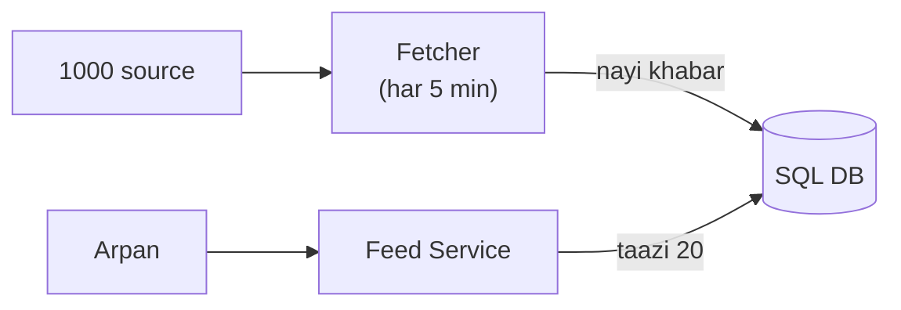
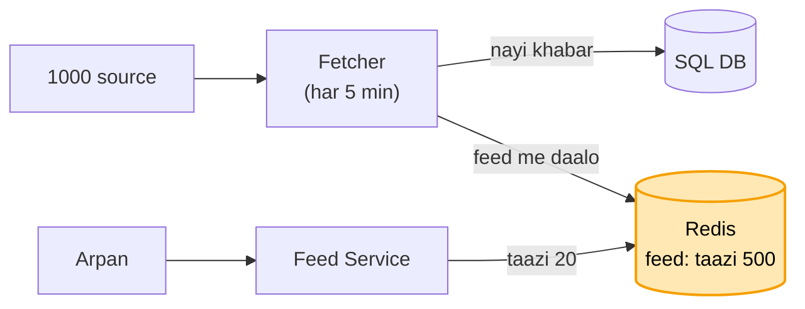
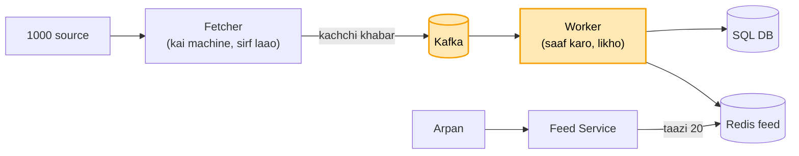
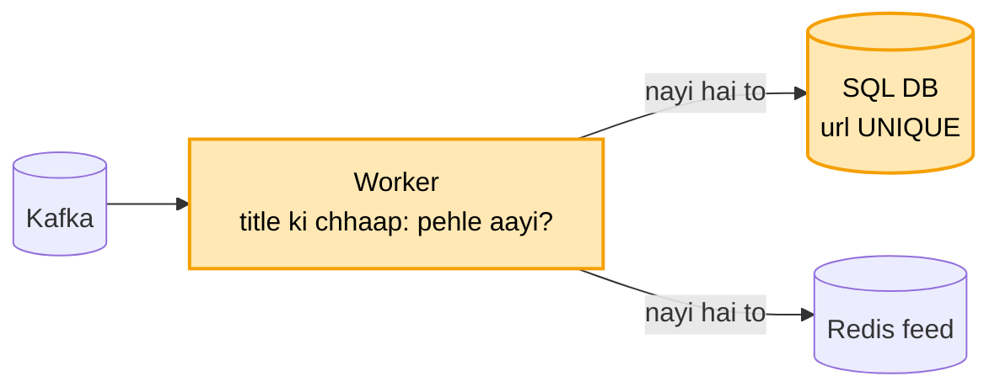
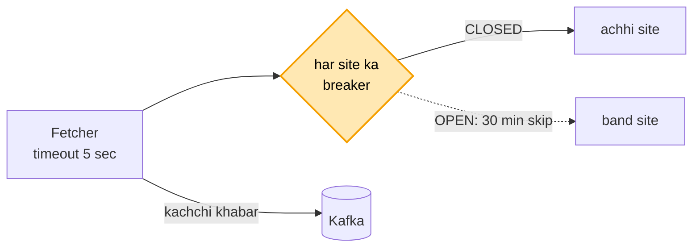
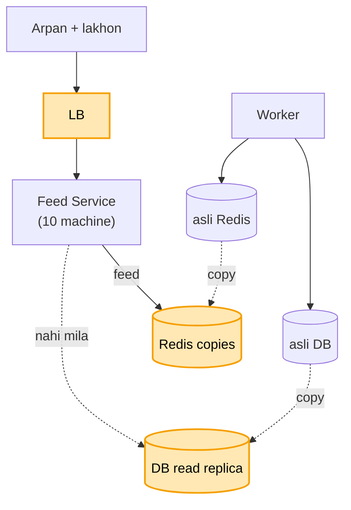
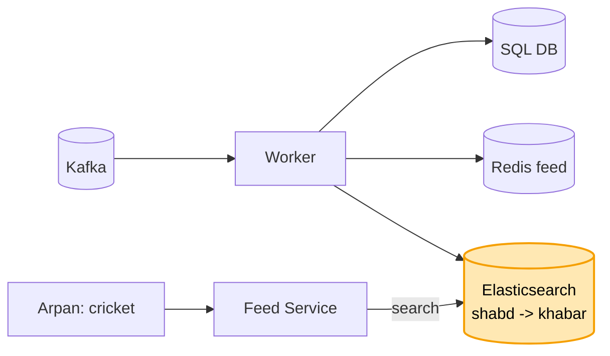
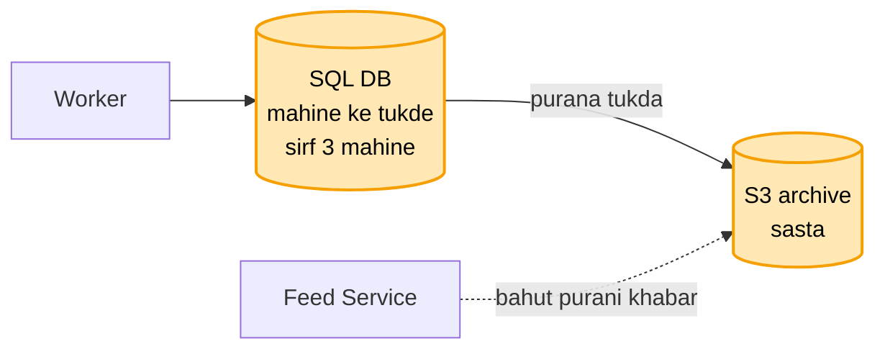

# News aggregator: shuru se, ek kahani

Kram wahi jo interview me hota hai: **FR, phir NFR, phir numbers, phir design**. Design sabse seedhe dabbe se
shuru hota hai, aur har dikkat aane pe ek naya dabba judta hai. Diagram me peela dabba = abhi juda. Poori file me
ek hi kahani hai: Arpan subah news app kholta hai aur taazi khabar dekhta hai.

**CUE (yahi shabd yaad rakhne hain, kram se):**
Fetcher DB me bhare, Feed Service DB se padhe -> feed Redis me pehle se (sorted set)
-> laana aur likhna alag (Kafka + Worker) -> ek khabar ek baar (url UNIQUE + title ki chhaap)
-> band site (timeout + breaker) -> bheed (LB + kai machine + copies)
-> search (Elasticsearch) -> data bada (mahine ke tukde + S3 archive)

---

## News aggregator hai kya, aur kyun mushkil

Subah Arpan Google News ya Inshorts kholta hai. Usme NDTV, TOI, BBC jaise hazaar jagah ki khabar ek hi feed me
dikhti hai. Arpan ko har site alag-alag nahi kholni padti. Peeche ek system in sab site se khabar laata hai,
saaf karta hai, aur ek taazi list bana ke deta hai.

Mushkil kyun: do kaam hain, aur dono bilkul alag hain. Ek, 1000 site se khabar laana, jo dheere-dheere aati hai.
Do, lakhon logon ko feed dikhana, jo subah ek saath khulti hai. Padhne wale bahut zyada hain, likhne wala kam.
Isliye in dono raaston ko alag rakhna hi is design ka dil hai.

## 1. FR: kya karna hai

```
1. 1000 source se khabar laao, store karo
2. user ko taazi khabar ki feed do (neeche scroll pe aur)
3. category (tech, sports) aur search ("cricket")
bahar: comments, ML se har user ki alag ranking
```

## 2. NFR: kaisa chalna chahiye

```
1. feed tez khule (~200 ms), yahi dil hai
2. khabar taazi ho (5-10 min se purani nahi)
3. ek source band ho to baaki system na ruke
4. lakhon user jhele
```

## 3. Numbers

```
padhai : 10 lakh user x 5 baar = 50 lakh roz -> ~50 / sec, subah 10 guna ~500 / sec
likhai : 1000 source har 5 min; nayi khabar ~1 lakh roz -> ~1 / sec
matlab : padhna likhne se ~500 guna zyada -> padhne ka raasta tez banana hai, likhna peeche chal sakta hai
```

---

## 4. Design

### Kadam 1: sabse seedha (Fetcher DB me bhare, Feed Service DB se padhe)

```
Fetcher (har 5 min) --> 1000 source se nayi khabar laao --> DB me likho
Arpan --feed kholi--> Feed Service --> DB: "taazi 20 do" (ORDER BY published_at DESC LIMIT 20) --> Arpan
```

Do hi dabbe hain. Fetcher peeche chalta rehta hai aur DB me khabar bharta hai. Feed Service har baar DB se taazi
20 khabar padh ke deta hai.



**API:** GET /feed?category=tech&cursor=..  · GET /search?q=cricket · GET /article/{id}

### DB kaunsa: SQL ya NoSQL?

Data dekho: har khabar ek row: title, url, source, category, published_at. Data chhota hai (~1 lakh roz). Kaam:
"taazi 20" time ke kram me, category se chhaanna, aur ek url ek hi baar (UNIQUE).

Ye sab SQL me index aur UNIQUE se seedha ho jaata hai. Likhai bas ~1 / sec hai, to SQL aaram se jhel leta hai.
Isliye SQL (Postgres).

**AWS pe:** Postgres AWS ka **RDS** lete hain: machine, backup, copy AWS sambhalta hai, hum bas table aur query.

Par subah 8 baje lakhon log ek saath app kholte hain, ~500 feed / sec. Har feed pe DB wahi "taazi 20" sort karke
de raha hai, aur sabko lagbhag ek hi jawab chahiye. DB ghutne laga.

### Kadam 2: subah sab ek saath, sabko wahi 20 khabar (Redis me feed pehle se bani)

Dikkat ye hai ki sabko lagbhag ek hi feed chahiye, phir bhi har baar DB sort kar raha hai. Ilaaj: feed pehle se
bana ke **Redis** me rakho. Redis RAM me hai, ~1 ms me jawab deta hai.

Feed ko **sorted set** me rakhte hain. Ye aisi list hai jisme har khabar ke saath uska time likha hota hai, aur
list hamesha time ke kram me rehti hai.

```
nayi khabar aayi (Fetcher)  --> DB me likho + Redis ki feed me bhi daal do (time ke saath)
                                feed me sirf aakhri 500 rakho, purani kaat do
Arpan ne feed kholi         --> Redis se taazi 20, ~1 ms. DB tak gaye hi nahi
```



Sorted set kyun, simple list kyun nahi? Khabar hamesha time ke kram me nahi aati. Kisi source ki 10 minute purani
khabar ab aa sakti hai. Sorted set use apne aap sahi jagah rakh deta hai. Simple list me har baar khud sort karna
padta.

Redis restart hua aur feed khaali ho gayi? Feed Service ko Redis me kuch nahi milta, to wo DB se taazi 500 padh ke
Redis phir bhar deta hai. Tab tak kuch request DB pe jaati hain, uske baad phir sab Redis se.

**Maan lo pooche category (tech, sports) kaise:** Worker khabar pe category laga deta, Redis me har category ki alag feed (~20). Arpan ki pasand (tech + sports) -> dono se taazi 20 laao, time ke kram me milao. Har user ki alag feed nahi (twitter jaisi), kyunki sirf ~20 category hain, 10 lakh alag feed faltu.

**AWS pe:** Redis hum khud nahi chalate, AWS ka **ElastiCache** lete hain (Redis jise AWS chalata hai). Machine, copy, gira to copy aage karna, ye AWS ka kaam. Hum bas use karte hain.

Par ek source ki site dheemi hai. Fetcher usi pe 30 second atka rehta hai, aur saari khabar ek-ek karke DB me
likhta hai. Arpan ki feed me khabar 20 minute purani dikh rahi hai.

### Kadam 3: khabar 20 minute purani (laana aur likhna alag: Kafka + Worker)

Dikkat ye hai ki ek hi Fetcher saara kaam ek ke baad ek kar raha hai: site se laana, khabar saaf karna, DB me
likhna, Redis me daalna. Ek site atki, to uske peeche ki 999 bhi ruki.

Ilaaj: kaam do hisson me baant do.

```
Fetcher (kai machine)  --> sirf site se laao, kachchi khabar Kafka me daal do. Bas itna.
Kafka                  --> khabar ki line (bheed aaye to line me khadi rahe, khoye nahi)
Worker (kai machine)   --> line se uthao, saaf karo, DB me likho + Redis feed me daalo
```



Ab kya theek hua:
- Ek site atki to bas ek Fetcher ruka. Baaki apni site se laate rahe.
- 8 baje sab site ek saath nayi khabar dein, to wo Kafka ki line me khadi rehti hain. Worker apni raftaar se
  uthate hain, DB pe ek saath dhakka nahi lagta.
- Worker beech me gira to khabar Kafka me padi hai. Naya worker wahin se utha leta hai.
- Likhna dheema lage to bas worker badha do.

Kafka kyun, Fetcher seedha DB me kyun nahi likhe? Seedha likhe to 1000 fetcher ka dhakka seedha DB pe padta. Aur
DB dheema ho to fetcher bhi ruk jaate. Kafka beech me ek line hai, jo dono ko ek doosre se alag kar deti hai.

**AWS pe:** Kafka ki machines hum khud nahi chalate, AWS ka **MSK** (Managed Kafka) lete hain. Broker, copy, gira to naya leader, ye AWS sambhalta hai. Topic aur partition hum tay karte hain.

Par dopahar me "India ne match jeeta" ki khabar 5 alag site se aayi. Arpan ki feed me wahi khabar 5 baar dikh rahi
hai.

### Kadam 4: wahi khabar 5 baar (ek khabar ek baar: url UNIQUE + title ki chhaap)

Ek hi khabar do tarah se dobara aati hai, aur dono ka ilaaj alag hai.

**1. Wahi site, wahi khabar, dobara aayi.** Fetcher har 5 minute wahi site padhta hai, to purani khabar phir aa
jaati hai. Ya Worker ne DB me likh diya, aur Kafka ko "ho gaya" bolne se pehle gir gaya, to naya Worker wahi
khabar phir uthata hai.

```
ilaaj: DB me url UNIQUE
  Worker likhta: "ye khabar daalo, url pehle se hai to kuch mat karo"
  pehli baar  -> row bani
  dobara aayi -> DB khud mana kar deta, dohra nahi bana
```

**2. Alag site, alag url, par khabar wahi.** "India ne match jeeta" NDTV pe bhi hai, TOI pe bhi. Dono ka url alag
hai, to UNIQUE ise nahi rokta.

```
ilaaj: title ki chhaap (hash)
  title saaf karo: chhote akshar, chinh hatao -> "india ne match jeeta"
  uski chhaap banao -> pehle se hai? -> wahi khabar, feed me dobara mat daalo
  (title thoda alag ho to "milta-julta" pakadne wala hash: SimHash)
```



Ye perfect nahi hai. Title ki chhaap sirf tab pakadti hai jab title same ho ya thoda sa badla ho. Agar doosri site
ne poora vakya apne shabdon me likh diya ("Bharat ne match apne naam kiya"), to chhaap alag banegi aur wo khabar
phir feed me aa jaayegi. Asli apps me bhi aisa dikhta hai.

```
url UNIQUE        -> wahi khabar dobara: 100% rokta
title ki chhaap   -> same / milta-julta title: zyadatar rokta
poora alag vakya  -> nahi rukta. thoda dohraav chalta hai, feed tootti nahi.
                     (pakadna ho to khabar ke matlab se milaana padta hai, ML ka kaam, scope se bahar)
```

Worker ke andar "pehle aayi?" ki yaad kyun nahi rakhte? Worker kai machine pe chalte hain, aur gir bhi sakte hain.
Yaad DB me rakho (UNIQUE), taaki koi bhi Worker ho, faisla ek hi jagah ho.

Par ek chhoti site band pad gayi hai. Har 5 minute uska Fetcher 30 second tak jawab ka intezaar karta hai, aur aise
50 band site hain. Fetcher ke thread inhi me phanse rehte hain, aur achhi site ki baari der se aati hai.

### Kadam 5: band site pe Fetcher phansa (timeout + circuit breaker)

Dikkat ye hai ki band site jawab hi nahi deti, aur Fetcher 30 second tak uska intezaar karta rehta hai. 50 band
site = Fetcher ka bahut sa time barbaad.

**Timeout:** kisi site ko sirf 5 second do. Jawab nahi aaya to chhodo aur agli site pe jao.

**Circuit breaker:** jo site baar-baar fail ho rahi hai, use har 5 minute try karna hi bekaar hai.

```
site lagaataar 5 baar fail  -> breaker OPEN: is site ko 30 minute tak try hi mat karo
30 minute baad              -> ek baar try (HALF-OPEN)
  chal gayi                 -> CLOSED, wapas har 5 minute
  phir fail                 -> 30 minute aur ruko
```



Ab kya theek hua: band site pe ab 5 second se zyada nahi lagte, aur baar-baar fail hone wali ko 30 minute tak
chhua bhi nahi jaata. Achhi site ki baari time pe aati hai. NFR ka "ek source band ho to baaki na ruke" yahi hai.

Par raat 8 baje election ka result aaya. Log 40 guna zyada app khol rahe hain, aur ek Feed Service ki machine itni
request nahi jhel paa rahi.

### Kadam 6: 8 baje result, 40 guna bheed (LB + Feed Service kai machine + copies)

Dikkat ye hai ki ek Feed Service ki machine itni request nahi jhel paa rahi. Ilaaj: Feed Service ko kai machine
pe chalao, aur aage ek **LB** (load balancer) lagao jo request baant de.

Ye aasaan isliye hai kyunki Feed Service apne paas kuch yaad nahi rakhta. Feed Redis me hai. To koi bhi machine
kisi ka bhi request utha sakti hai, aur bheed badhe to bas machine jod do.

Ab bheed Redis pe pahunchti hai, isliye Redis ki **copies** rakhte hain. Likhna sirf asli Redis pe hota hai
(Worker), aur padhna copies se. Aur jo request Redis me nahi milti (restart ke baad, ya 30 page neeche ki purani
khabar), wo DB ki **read replica** (padhne wali copy) pe jaati hai, asli DB pe nahi.

```
Arpan --> LB --> Feed Service (10 machine, kisi pe bhi)
                    |--> Redis copy se feed           (99%)
                    |--> nahi mila -> DB read replica  (1%)
Worker --> asli Redis + asli DB (likhna sirf yahan)
```



Copy thodi peeche ho to? Copy asli se ek-do second peeche chal sakti hai. Matlab nayi khabar Arpan ko ek-do second
der se dikhegi. NFR me "5-10 minute purani nahi" tha, to ek-do second ka farak chalta hai.

Par raat ko Arpan ne "cricket" dhoondha. DB ko poori table ki har khabar ka title padhna pada, aur jawab aane me 5
second lag gaye.

### Kadam 7: "cricket" dhoondhne me 5 second (Elasticsearch)

Dikkat ye hai ki DB me "title me kahin bhi cricket" dhoondhne ke liye har row ka title padhna padta hai. Normal
index yahan kaam nahi aata, kyunki shabd title ke beech me kahin bhi ho sakta hai. Lakhon khabar = 5 second.

Ilaaj: **Elasticsearch**. Ye kitaab ke peeche wale index jaisa hai: har shabd ke saamne likha hota hai ki wo kin
khabron me aata hai. Ise **inverted index** kehte hain.

```
"cricket" -> khabar 12, 45, 980 ...
"match"   -> khabar 12, 77 ...
"cricket" dhoondha -> seedha list mil gayi, saari khabar padhni nahi padi -> ~50 ms
```

Worker jab khabar DB me likhta hai, saath me Elasticsearch me bhi daal deta hai. Feed Redis se aati hai, aur search
Elasticsearch se.



Elasticsearch ki copy DB se thodi peeche ho to? Nayi khabar search me ek-do second baad dikhegi. News ke liye ye
chalta hai. Asli sach DB hi rehta hai, aur Elasticsearch bigde to DB se dobara bhar sakte hain.

**AWS pe:** Elasticsearch AWS ka **OpenSearch** naam se milta hai: machine aur copy AWS sambhalta hai.

Par 6 mahine ho gaye. Roz 1 lakh khabar, to DB me ~2 crore row ho gayi. DB bhaari ho raha hai aur kharcha badh
raha hai, jabki 1 hafte se purani khabar koi padhta hi nahi.

### Kadam 8: 6 mahine me 2 crore row (mahine ke tukde + purana archive)

Dikkat ye hai ki DB me saari khabar ek hi badi table me hai, jabki padhi sirf taazi jaati hai. Purani khabar jagah
aur paisa kha rahi hai, aur index bhi bhaari ho raha hai.

**Ilaaj 1: table ko mahine ke tukdon me baanto (partition).** Bahar se table ek hi dikhti hai, par andar har mahine
ka alag tukda hota hai.

```
khabar table:  [Oct ka tukda] [Sep ka tukda] [Aug ka tukda] ...
"taazi 20"   -> sirf Oct ke tukde me dhoondhta, baaki chhoota hi nahi -> tez
```

**Ilaaj 2: purana tukda sasti jagah bhejo (archive).** 3 mahine se purana tukda poora utha ke S3 me daal do, jo
sasta storage hai. DB se wo tukda hata do. Ye ek jhatke me hota hai, ek-ek row mitaani nahi padti.

```
Jan ka tukda (3 mahine purana) --> S3 (sasta) --> DB se tukda hataya
koi purani khabar maange (bahut kam) --> S3 se laao, thoda dheema chalta hai
```



Ab kya theek hua: DB me hamesha sirf 3 mahine ki khabar rehti hai. DB chhota aur tez rehta hai, aur purani khabar
sasti jagah padi hai.

**Maan lo source 100 guna ho gaye, likhai ek DB pe nahi samaati:** DB ko article_id se baanto (shard). Abhi ~1 likhai / sec hai, to aaj iski zaroorat nahi.

**AWS pe:** purana maal **S3** me: sasta, aur copy AWS khud rakhta hai.

---

## Wrap: 30 sec me poora design

```
Khabar laana aur dikhana do alag raaste hain. Peeche Fetcher 1000 site se khabar laata hai (har site pe 5 sec
timeout, baar-baar fail ho to breaker), aur kachchi khabar Kafka me daal deta hai. Worker use saaf karta hai,
dohra hatata hai (url UNIQUE + title ki chhaap), category lagata hai, aur DB (Postgres), Redis feed aur
Elasticsearch me likhta hai. Sabko lagbhag ek hi feed chahiye, isliye wo Redis me pehle se bani rehti hai
(sorted set), aur 99% feed wahin se jaati hai. Feed Service LB ke peeche kai machine pe chalta hai, Redis aur DB
ki copies se padhta hai. Search Elasticsearch se, aur 3 mahine se purani khabar S3 me.
```

**Chal raha hai, kaise pata:** feed ka time (p99), Redis me kitni baar mila (hit rate), Kafka me kitni khabar line me (lag), kis site ka breaker khula.

CONCEPTS: [caching](../../FOUNDATIONS/04_caching.md) · [message-queues](../../FOUNDATIONS/07_message_queues.md) ·
[elasticsearch](../../FOUNDATIONS/12_elasticsearch_search.md) · saath: [twitter-feed](../03_twitter_feed/03_twitter_feed.md) ·
[<- MASTER SHEET](../../00_MASTER_SHEET.md)
