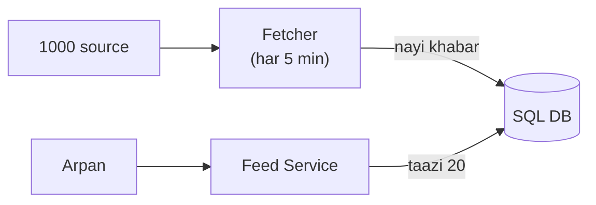

# News aggregator: shuru se, ek kahani

Kram wahi jo interview me hota hai: **FR, phir NFR, phir numbers, phir design**. Design sabse seedhe dabbe se
shuru hota hai, aur har dikkat aane pe ek naya dabba judta hai. Diagram me peela dabba = abhi juda. Poori file me
ek hi kahani hai: Arpan subah news app kholta hai aur taazi khabar dekhta hai.

---

## News aggregator hai kya, aur kyun mushkil

Subah Arpan Google News ya Inshorts kholta hai. Usme NDTV, TOI, BBC jaise hazaar jagah ki khabar ek hi feed me
dikhti hai. Arpan ko har site alag-alag nahi kholni padti. Peeche ek system in sab site se khabar laata hai,
saaf karta hai, aur ek taazi list bana ke deta hai.

Mushkil kyun: do kaam hain, aur dono bilkul alag hain. Ek, 1000 site se khabar laana, jo dheere-dheere aati hai.
Do, lakhon logon ko feed dikhana, jo subah ek saath khulti hai. Padhne wale bahut zyada hain, likhne wala kam.
Isliye in dono raaston ko alag rakhna hi is design ka dil hai.

## 1. FR: kya karna hai

```
1. 1000 source se khabar laao, store karo
2. user ko taazi khabar ki feed do (neeche scroll pe aur)
3. category (tech, sports) aur search ("cricket")
bahar: comments, ML se har user ki alag ranking
```

## 2. NFR: kaisa chalna chahiye

```
1. feed tez khule (~200 ms), yahi dil hai
2. khabar taazi ho (5-10 min se purani nahi)
3. ek source band ho to baaki system na ruke
4. lakhon user jhele
```

## 3. Numbers

```
padhai : 10 lakh user x 5 baar = 50 lakh roz -> ~50 / sec, subah 10 guna ~500 / sec
likhai : 1000 source har 5 min; nayi khabar ~1 lakh roz -> ~1 / sec
matlab : padhna likhne se ~500 guna zyada -> padhne ka raasta tez banana hai, likhna peeche chal sakta hai
```

---

## 4. Design

### Kadam 1: sabse seedha (Fetcher DB me bhare, Feed Service DB se padhe)

```
Fetcher (har 5 min) --> 1000 source se nayi khabar laao --> DB me likho
Arpan --feed kholi--> Feed Service --> DB: "taazi 20 do" (ORDER BY published_at DESC LIMIT 20) --> Arpan
```

Do hi dabbe hain. Fetcher peeche chalta rehta hai aur DB me khabar bharta hai. Feed Service har baar DB se taazi
20 khabar padh ke deta hai.



Par subah 8 baje lakhon log ek saath app kholte hain, ~500 feed / sec. Har feed pe DB wahi "taazi 20" sort karke
de raha hai, aur sabko lagbhag ek hi jawab chahiye. DB ghutne laga.

### DB kaunsa: SQL ya NoSQL?

Data dekho: har khabar ek row: title, url, source, category, published_at. Data chhota hai (~1 lakh roz). Kaam:
"taazi 20" time ke kram me, category se chhaanna, aur ek url ek hi baar (UNIQUE).

Ye sab SQL me index aur UNIQUE se seedha ho jaata hai. Likhai bas ~1 / sec hai, to SQL aaram se jhel leta hai.
Isliye SQL (Postgres).
