# News aggregator: Arpan News ki kahani

Arpan ne apni news app kholi, "Arpan News", Inshorts jaisi. Apna koi reporter nahi. Khabar bahar ki 5000 site
(NDTV, Times, Cricbuzz) se aati hai. Kaam: subah app khule to taazi khabar, apni pasand ki, ek baar, turant.

Har kadam = **kahani** (dikkat aur hal, bolne wali bhasha) -> **Asli naam** (interview me yahi shabd) -> tasveer
(kahani ka shabd, bracket me asli naam).

---

## FR / NFR / Numbers (interview me pehle 2 minute)

```
FR      5000 site se khabar laao · user ko taazi feed (uski category) · ek khabar ek hi baar (best effort, kabhi dohra chalega)
NFR     feed turant (~200 ms) · khabar 5-10 min se purani nahi · ek site band ho to baaki na ruke
Numbers 1 crore user x 5 baar = 5 crore roz, subah ~6000 / sec, badi khabar (iPhone launch) pe 10 lakh / sec · nayi khabar ~1 / sec
        -> padhna bahut zyada, likhna kam: padhne ka raasta tez, likhna peeche chal sakta
```

---

## 1. Khabar aayegi kaise? (chhotu + dabba)

NDTV, Times, Cricbuzz jaisi 5000 site kabhi bhi khabar daalti hain. Ravi 9 baje khole to 8:55 wali "India ne match
jeeta" dikhe. Apna reporter nahi hai, to ek dabba rakh lete hain jo har jagah se khinchega. Maine apne ladke se bola:
chhotu, main in jagahon se news padhta hoon, saari khabar utha ke ek dabbe me daal de, main wahan se padh lunga.

**Asli naam:** chhotu = fetcher (har site se khabar khinchne wala), dabba = DB (Postgres; khabar ek row: title, url,
category, time. Data chhota, url UNIQUE chahiye, isliye SQL).

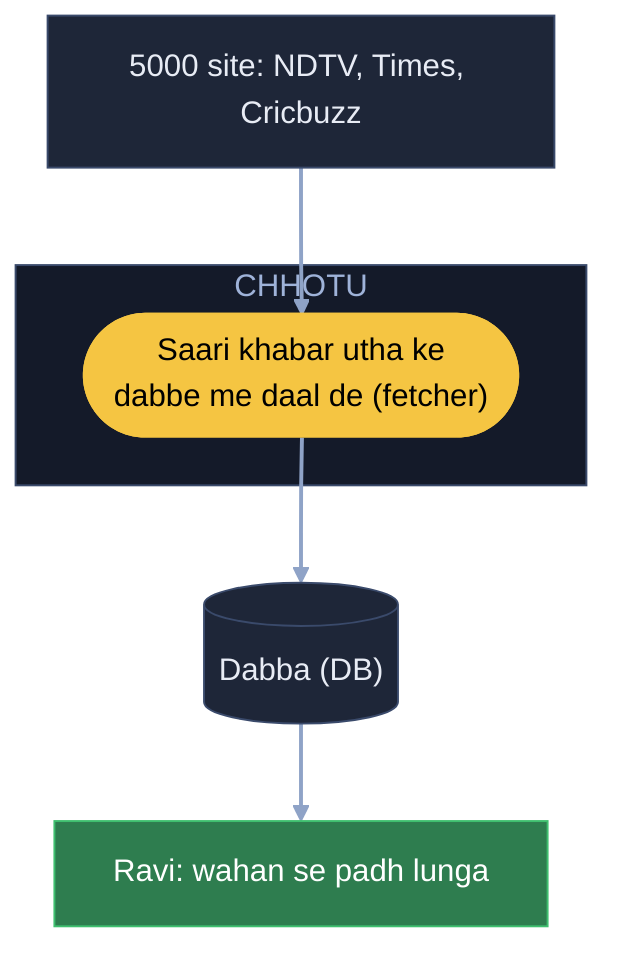

## 2. Chhotu akela, chakkar 3 ghante (bahut chhotu + taiyaar parchi)

Chhotu akela, 5000 site, ek site pe 2 second, to ek chakkar 3 ghante. 8:55 wali khabar 11 baje pahunchi. To bahut
saare chhotu rakh lo. Aur khabar pehle se taiyaar rakho, ek chhoti parchi me, sab wahin se padh lein. Jaise akhbaar me
saari khabar ek saath aati hai, jo achha lage padh lo.

**Asli naam:** bahut chhotu = kai fetcher ek saath (parallel), chhoti parchi = Redis me taiyaar feed (sorted set, time
ke kram me, aakhri 500).

**Maan lo chhotu 7 ke paas 100 site thi, aur wo beech me mar gaya:** Ye Twitter ke worker 7 jaisa hai. Har chhotu thodi-thodi der me bolta rahe "main zinda hoon". Kuch der tak awaaz nahi aayi to main samajh jaata hoon chhotu 7 gaya, aur uski 100 site baaki chhotuon me baant deta hoon. Is tarah koi site bina dekhe nahi chhoot-ti.
**Asli naam:** "main zinda hoon" = heartbeat, "main site baant deta" = coordinator (chhotuon ko kaam baantne wala, load balancer nahi), kaam ka reassignment (lease khatam to doosra le).

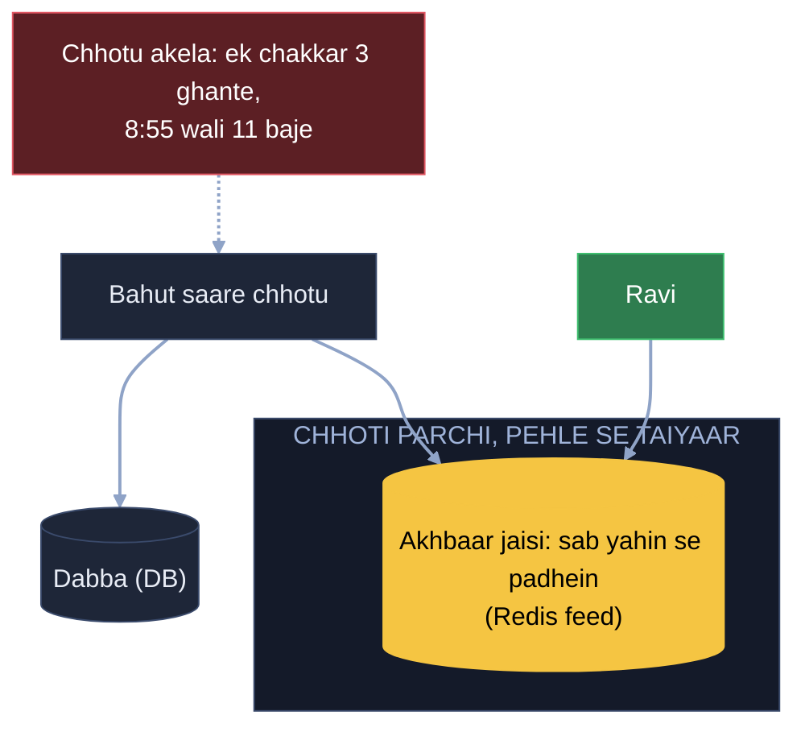

## 3. Ek khabar 40 baar (bada aadmi)

50 chhotu ho gaye. Ravi ki feed me ek khabar 40 baar: 2 chhotu ek hi Cricbuzz se laaye, 38 alag site se alag shabdon
me. To chhotu ke paas ek bada aadmi rakho: "ye dobara hai, hatao, pehle aa chuki". Par "India jeeta, Kohli ki century"
aur "Kohli ki shaandaar century, India jeeta" me shabd alag hain, hubahu wala check nahi pakdega. To wordings dekh lo:
dono me Kohli, century, India, jeeta hai, to same khabar, hata do; nahi to rakh lo.

**Asli naam:** bada aadmi = dedup, hubahu same = url UNIQUE + title ka hash, wordings dekh lo = near-duplicate check
(SimHash). Perfect nahi, trade-off maana (matlab se milana = ML, scope se bahar).

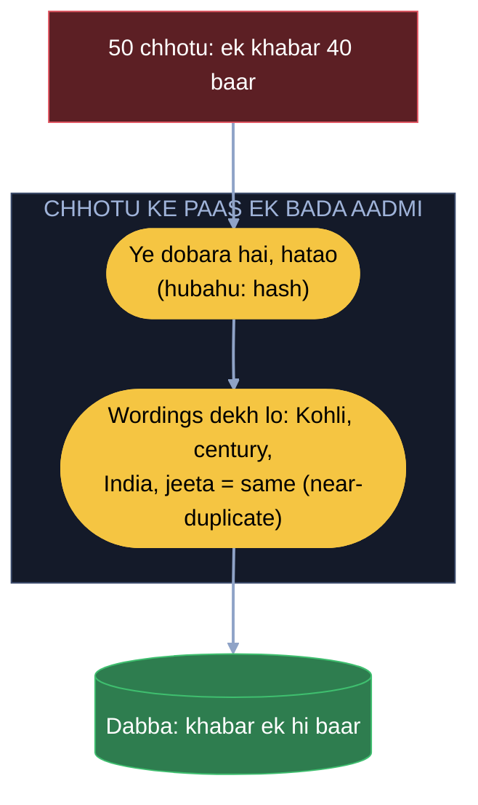

## 4. Bada aadmi akela, chhotu line me khade (Kafka + workers)

Bada aadmi akela, har khabar ko hafte ki 5 lakh khabron se milata, 1 minute ek khabar. Line lambi, 8:55 wali 10:30
pe. Chhotu ko faltu khada mat karo. Khabar Kafka me daalo (stadium wali kahani) aur chhotu apna kaam karta rahe.
Peeche workers dupe hata ke feed / DB / Redis me rakhte rahenge. Aur har dupe nahi hatega, kabhi aa jaayega, jaise
Instagram feed me bhi aata.

**Asli naam:** isme daal, chalta rahe = Kafka (chhotu = producer), peeche workers = consumer group, har dupe nahi
hatega = dedup best effort, trade-off maana. Laana aur likhna alag: ek site atki to baaki nahi rukti, dabba dheema to
chhotu nahi rukte, bheed line me khadi rehti, khoti nahi.

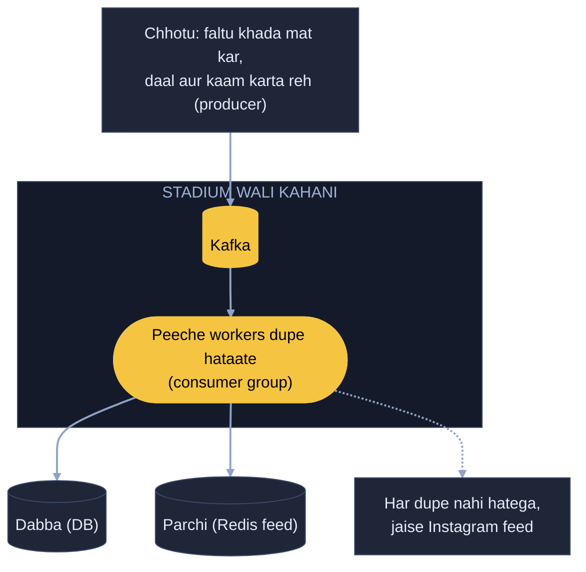

## 5. Ravi ko cricket, Priya ko tech, aur 9 baje 1 crore (category + manage karne wala banda)

Ravi ko cricket chahiye, Priya ko tech, par sabki ek parchi. Aur 9 baje 1 crore log ek saath. To khabar category ke
hisaab se baant do, jise jo pasand wahi do. 1 crore ke liye bahut saare server, aur ek banda jo sabko manage kare: tere
pe 10 load, tere pe 5, agli request tere paas.

**Asli naam:** category me baant = har khabar pe category, user ki pasand DB me, manage karne wala banda = load
balancer, server = stateless Feed Service (server kuch yaad nahi rakhta, parchi Redis me hai, to koi bhi server kisi ka
bhi kaam kar de).

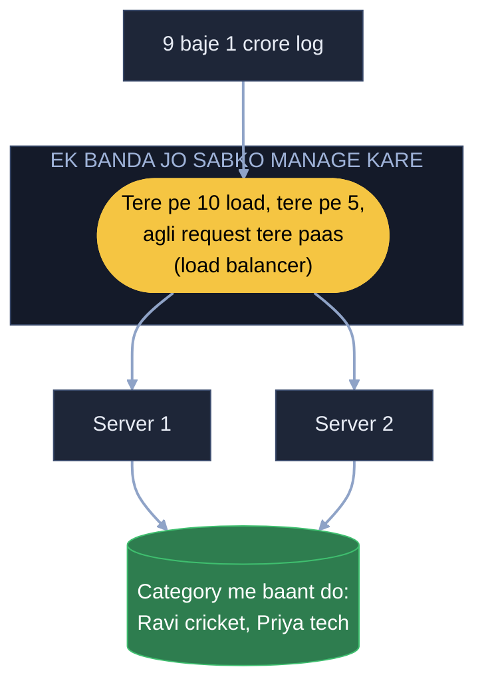

## 6. Priya app kholti hai: site pe jaaye ya parchi se de? (pehli baar DB, phir parchi)

Priya app kholti hai. Chhotu site pe jaata hai ya parchi se deta hai? Parchi bhi chhotu hi banata. Naya banda aaya,
pehle din pasand poochi: tech. To pehli baar DB se laao (thoda time chalega) aur parchi me rakh do. Roz tech hi dekh
raha to wahi pehle se saamne rakho, pasand badle to DB se.

Aur jis site se khabar la rahe wo band ho to 5 sec, 10 sec baad dobara try; na khule to chhodo, baaki site chalti
rahengi.

**Asli naam:** pehli baar DB, phir parchi = cache-aside, 5 sec, 10 sec baad dobara = retry + backoff, ek site band =
baaki pe asar nahi.

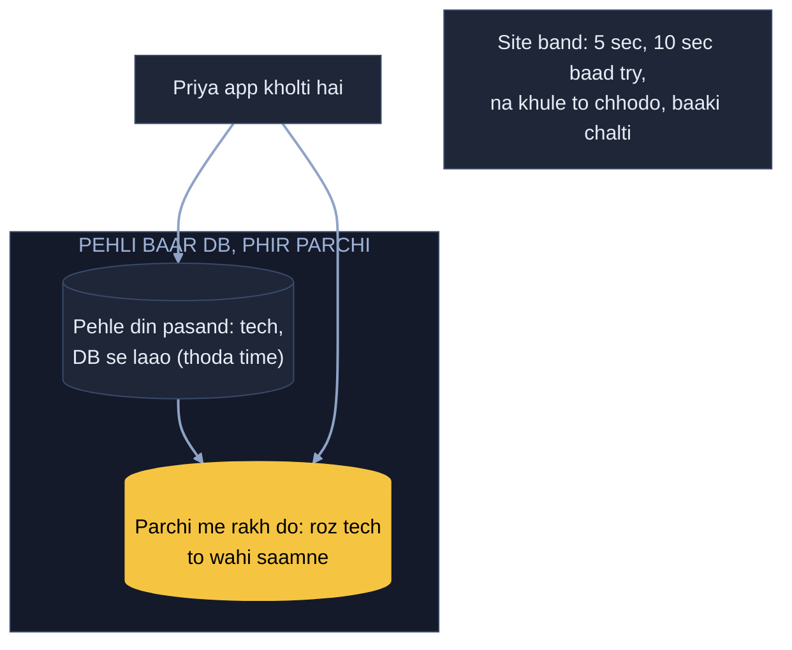

## 7. Parchi 8 baje bani, 9:05 iPhone ki khabar (aate hi feed me + milaan)

Priya ki parchi 8 baje bani. 9:05 iPhone ki khabar DB me gayi. 9:10 Priya ko parchi se purani feed mili, iPhone nahi.
To nayi khabar aate hi tech walon ki feed me daal do. Aur milaan: har tech wale ki parchi me aaj ki badi khabar hai na?
Chhoot gayi to DB se le ke seedha feed me.

**Asli naam:** aate hi feed me = likhte waqt push, milaan = check job.

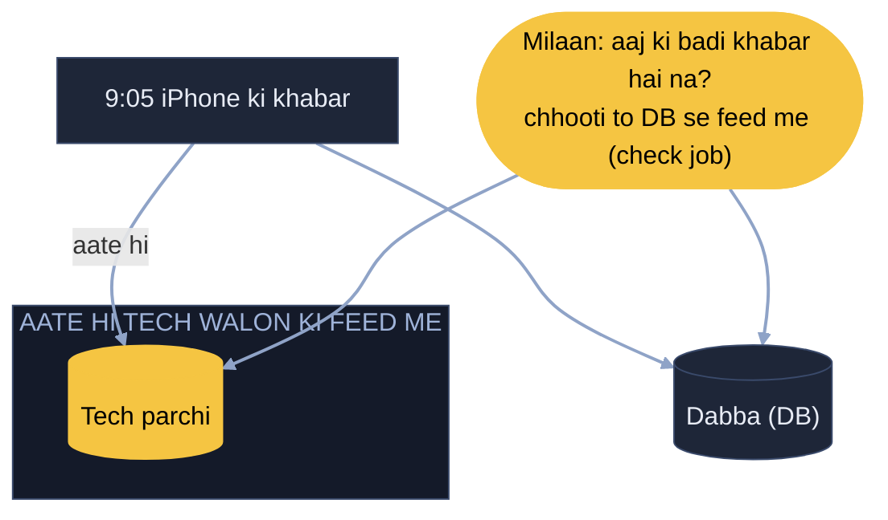

## 8. 50 lakh tech wale, sabki alag parchi (ek tech parchi)

50 lakh tech wale, har ek ki apni parchi, har minute 20 khabar = 10 crore likhna, workers peeche. Worker pe faltu load
kyun? Sab tech wale hain, sabko same khabar; Tesla launch hua to sabke liye hai, aisa nahi Arpan ke liye hai Ravi ke
liye nahi. 50 lakh alag parchi bekaar. Saari tech khabar ek parchi me, app khule to wahin se.

**Asli naam:** ek tech parchi = category ka ek feed (har category ki ek key, ~20 key), likhna ek baar, padhte waqt user
ki pasand se. Har user ki alag feed (twitter jaisi fan-out) yahan faltu.

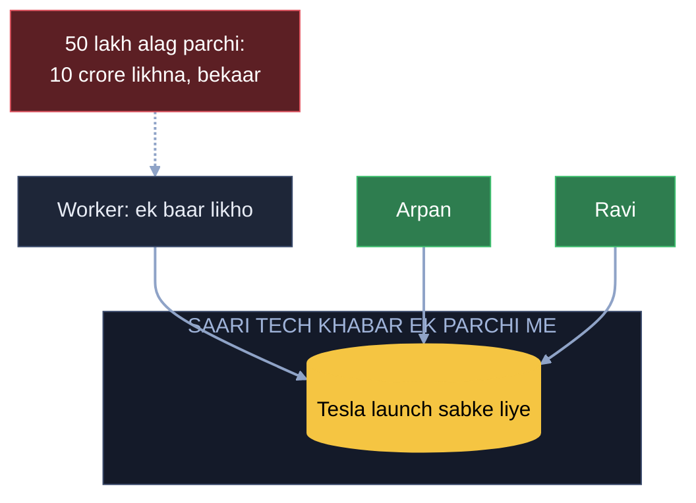

## 9. iPhone launch, tech dabba 10 lakh / sec (dabbe badhao ya cricket dabbe me copy)

Tech parchi ek dabbe me. 9 baje iPhone launch, 10 lakh request / sec, dabba (maan lo) 1 lakh sambhalta. Cricket wale dabbe
khaali. Do tareeke: tech ke dabbe badha do, ya kal match nahi to cricket wale dabbon me bhi tech parchi daal do, aadhi
request wahan se. World Cup hota to cricket dabba chahiye tha. Teeno aapas me baant lo.

**Asli naam:** dabbe badha do = aur Redis node, par us pe bhi tech ki copy (ek key ek hi node pe rehti, akela node
load nahi baant-ta), cricket dabbe me tech ki copy = garam key (hot key) ki copies alag Redis node pe, load baant (app khud har copy me
likhta, isliye agla kadam quorum).

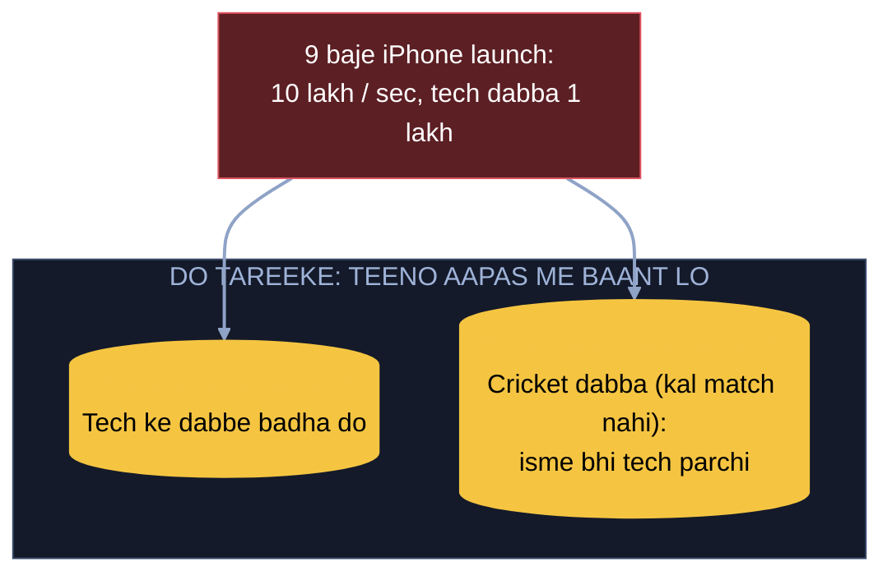

## 10. iPhone khabar sirf A me, refresh pe gayab (do me likho, do se padho)

Tech parchi 3 dabbon me. iPhone khabar sirf A me pahunchi. Priya ko A se dikhi, refresh pe B se gayi to gayab. To
garam khabar do-teen dabbon me daalo. A ke paas hai, B ke paas nahi, to B bhi rakhe. Do me likho, do se padho: A-B,
A-C, B-C, koi bhi do.

**Asli naam:** do me likho, do se padho = quorum, N=3, W=2, R=2 (W + R > N, isliye jo bhi do padho, kam se kam ek me
taaza). Redis copies khud ye nahi karti; app do me likhe aur do se padhe (Cassandra jaisa DB ye khud karta).

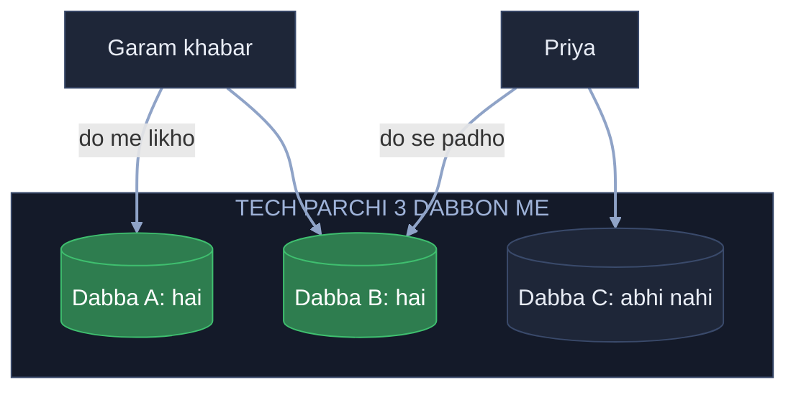

## 11. Worker DB me likh ke mara, khabar kisi ko nahi dikhi (status)

Worker ne khabar DB me likhi, parchi me daalne se pehle mar gaya. Doosra worker DB me dekh ke dupe samjha, hata di.
Khabar kisi ko nahi dikhi. Gadbad parchi se pehle hui. DB se pehle mara to dikkat nahi, doosra daal dega, dupe check +
unique constraint hai. To ek status rakho: "DB me daali", "parchi me daali". Beech me gira to agla status dekh ke kaam
aage badha dega. Ek tarah ki logging.

**Asli naam:** status = khabar ka state (SAVED -> IN_FEED), agla worker adhoora kaam poora karta; DB se pehle gira to
url UNIQUE bacha leta; logging = outbox / WAL wali soch.

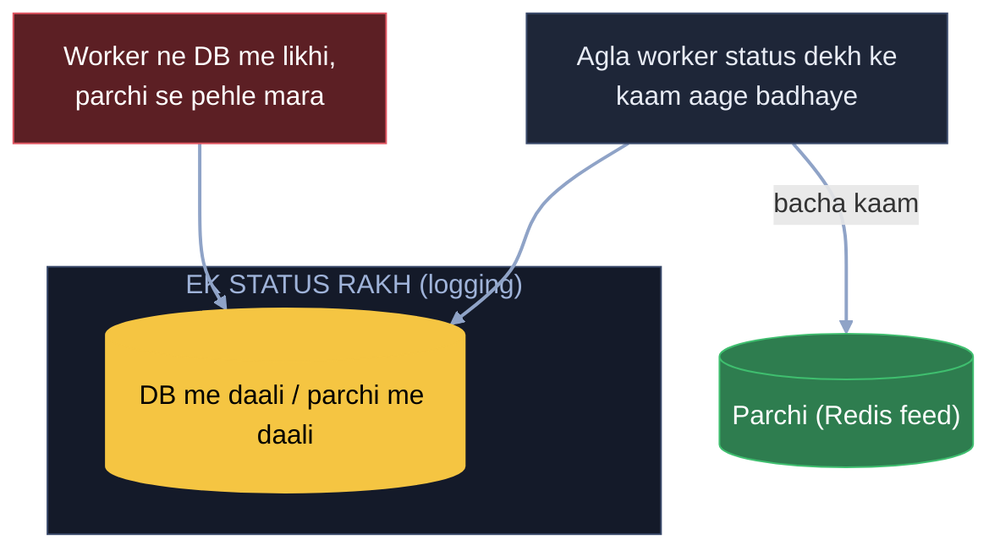

---

Notes (Arpan ke shabd) = [NEWS_HAND_NOTES.md](NEWS_HAND_NOTES.md)
