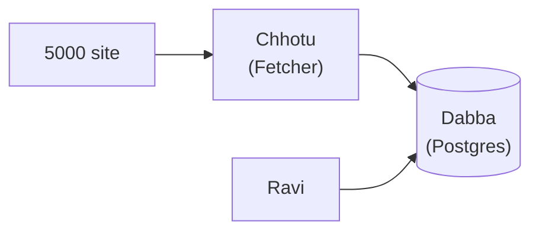
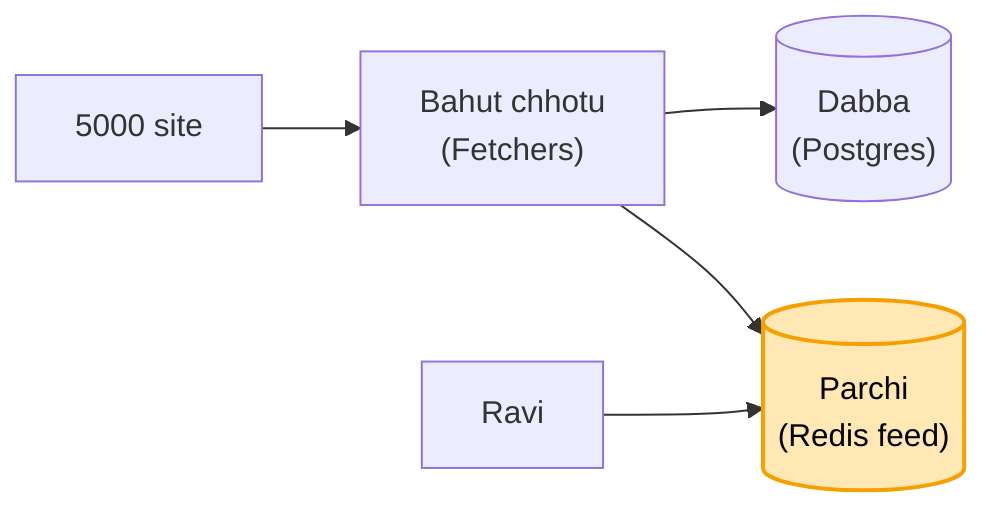
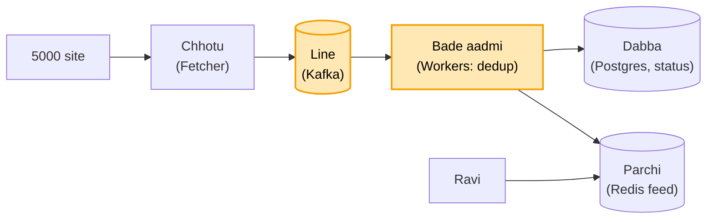
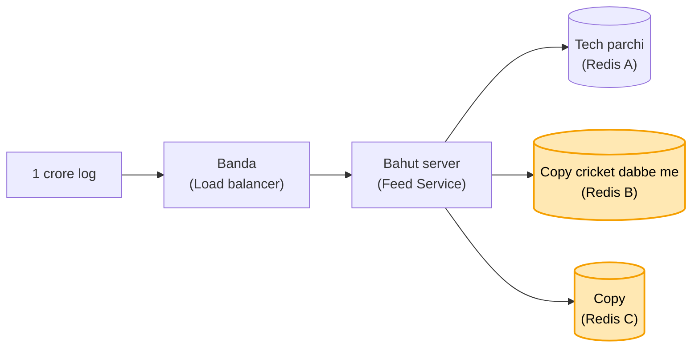

# News aggregator: Arpan News ki kahani

Arpan ne apni news app kholi, "Arpan News", Inshorts jaisi. Apna koi reporter nahi. Khabar bahar ki 5000 site
(NDTV, Times, Cricbuzz) se aati hai. Kaam: subah app khule to taazi khabar, apni pasand ki, ek baar, turant.

Har kadam = **kahani** (dikkat aur hal, bolne wali bhasha) -> **Asli naam** (interview me yahi shabd) -> tasveer
(kahani ka shabd, bracket me asli naam).

---

## FR / NFR / Numbers (interview me pehle 2 minute)

```
FR      5000 site se khabar laao · user ko taazi feed (uski category) · ek khabar ek hi baar
NFR     feed turant (~200 ms) · khabar 5-10 min se purani nahi · ek site band ho to baaki na ruke
Numbers 1 crore user x 5 baar = 5 crore roz, subah ~6000 / sec, badi khabar (iPhone launch) pe 10 lakh / sec · nayi khabar ~1 / sec
        -> padhna bahut zyada, likhna kam: padhne ka raasta tez, likhna peeche chal sakta
```

---

## 1. Khabar aayegi kaise? (chhotu + dabba)

Apna reporter nahi hai, to maine ek ladke se bola: chhotu, main in jagahon se news padhta hoon, saari khabar utha
ke ek dabbe me daal de. App wahan se padh legi.

**Asli naam:** chhotu = Fetcher (har site se khabar khinchta), dabba = DB (Postgres; khabar ek row: title, url,
category, time. Data chhota, url UNIQUE chahiye, isliye SQL).



## 2. Chhotu akela, chakkar 3 ghante (bahut chhotu + taiyaar parchi)

Ek site pe 2 second, 5000 site, to ek chakkar 3 ghante. 8:55 wali "India jeeta" 11 baje pahunchi. To bahut saare
chhotu rakh lo, sab alag site pe ek saath. Aur subah 1 crore log har baar dabba khangaalein, ye kyun? Akhbaar jaisa
karo: khabar pehle se ek chhoti parchi me taiyaar, app khulte hi wahin se.

**Asli naam:** bahut chhotu = kai Fetcher parallel, chhoti parchi = Redis me taiyaar feed (sorted set, time ke kram
me, aakhri 500).

**Maan lo parchi khaali ho gayi (Redis restart):** dabbe se taazi 500 padh ke parchi phir bhar do, tab tak thodi
request dabbe pe.



## 3. Ek khabar 40 baar (bada aadmi)

Ravi ki feed me "India jeeta" 40 baar. Do chhotu ek hi Cricbuzz se laaye, baaki alag site se alag shabdon me. To
chhotu ke paas ek bada aadmi rakho: "ye pehle aa chuki, hatao". Hubahu same ho to seedha pakad lega. Shabd alag hon
("India jeeta, Kohli ki century" vs "Kohli ki shaandaar century, India jeeta") to wordings milao: dono me Kohli,
century, India, jeeta, to wahi khabar. Har dupe nahi hatega, kabhi aa jaayega, Instagram feed me bhi aata.

**Asli naam:** bada aadmi = dedup. Hubahu = url UNIQUE + title ka hash. Wordings milao = near-duplicate (SimHash).
Perfect nahi, trade-off maana (matlab se milana = ML, scope se bahar).

## 4. Chhotu line me khade (Kafka + workers)

Bada aadmi akela, har khabar ko hafte ki 5 lakh khabron se milata, 1 minute ek khabar. 50 chhotu line me, 8:55
wali 10:30 pe. Chhotu ko faltu khada mat karo: khabar ek line me daal ke agli site pe jao (stadium wali kahani).
Peeche kai bade aadmi line se uthate, dupe hatate, dabbe aur parchi me rakhte.

**Asli naam:** line = Kafka, chhotu = producer, bade aadmi = Workers (consumer group). Laana aur likhna alag: ek site
atki to baaki nahi rukti, dabba dheema to chhotu nahi rukte, bheed line me khadi rehti, khoti nahi.

**Maan lo worker ne khabar dabbe me likh di, parchi me daalne se pehle gir gaya:** line wahi khabar agle worker ko
deti. Agla dabbe me dekhta "pehle aa chuki", dupe samajh ke hata deta, aur khabar parchi me kabhi nahi pahunchti. Ilaaj:
har khabar pe status rakho: "dabbe me likhi" -> "parchi me daali". Agla worker dekhta: dabbe wala tick hai, parchi
wala nahi, to bas bacha kaam poora karta. Dabbe se pehle gira to dikkat nahi, url UNIQUE bacha leta.
**Asli naam:** status = state (SAVED -> IN_FEED), outbox / WAL wali soch.



## 5. Site band (dobara try, phir chhodo)

Jis site se khabar la rahe wo band. Chhotu 30 second khada intezaar kare to baaki site ki baari der se. To 5 second
do, na mile to 5 sec, phir 10 sec baad dobara. Phir bhi na khule to chhodo, baaki site chalti rahein. Jo site baar-baar
band, use thodi der chhuo hi mat.

**Asli naam:** 5 second = timeout, 5 phir 10 sec = retry + backoff, thodi der chhuo mat = circuit breaker (OPEN 30 min,
phir ek try HALF-OPEN).

## 6. Ravi ko cricket, Priya ko tech (category ki parchi)

Sabki ek parchi, Priya ko 20 cricket khabar ke neeche tech dhoondhni padti. To khabar category me baanto, jise jo
pasand wahi do. Naya banda aaya, pehle din pasand poochi; pehli baar dabbe se, phir yaad rakho, badle to dabbe se.
Par 50 lakh tech walon ki alag-alag parchi? Har nayi khabar pe 50 lakh jagah likhna, aur sabko same khabar hi
chahiye (Tesla launch sabke liye hai). To tech ki ek hi parchi, likhna ek baar.

**Asli naam:** category feed (har category ki ek key, ~20 key), user ki pasand = DB + cache-aside. Har user ki alag
feed (twitter jaisi fan-out) yahan faltu.

**Maan lo 8 baje parchi bani, 9:05 iPhone ki khabar aayi:** worker khabar aate hi tech parchi me daal deta hai (likhte
waqt push), aur ek milaan chalta: aaj ki badi khabar parchi me hai na? Chhooti to dabbe se le ke daal do.

## 7. 9 baje 1 crore log (bahut server + parchi ki copy)

Ek server nahi jhelega: bahut saare server, aur aage ek banda jo dekhe kis pe kitna load, agli request khaali wale
ko. Server kuch yaad nahi rakhta, parchi Redis me hai, to koi bhi server kisi ka bhi kaam kar de.

iPhone launch: saari bheed tech parchi pe, 10 lakh / sec, ek dabba 1 lakh sambhalta. Cricket wale dabbe khaali (aaj
match nahi). To unme bhi tech parchi ki copy rakho, teeno baant lo. World Cup ho to dabbe badhao.

**Asli naam:** banda = load balancer, server = stateless Feed Service, tech parchi = garam key (hot key), copy khaali
machine pe = key ki copies alag Redis node pe (app khud har copy me likhta, isliye neeche quorum).

**Maan lo copy peeche, Priya ko khabar dikhi aur refresh pe gayab:** 3 copy me se 2 me likho, 2 se padho. Jo bhi do
padho, ek me taaza zaroor.
**Asli naam:** quorum, W=2, R=2, N=3 (W + R > N).



---

Notes (Arpan ke shabd) = [NEWS_HAND_NOTES.md](NEWS_HAND_NOTES.md) · [<- MASTER SHEET](../../00_MASTER_SHEET.md)
