# News Aggregator

> Alag-alag source (NDTV, TOI, BBC ...) se khabar kheencho -> store karo -> user ko EK feed (Google News / Inshorts jaisa). JP ka aam product design.
> Is design ka dil: **padhne wale bahut zyada, likhne wale kam** + **likhne ka raasta aur padhne ka raasta ALAG** + **feed pehle se bana ke cache me**.

---

## KAHANI (ek din, election result wala; har dikkat se design me ek dabba judta)

```
   KYA HUA                                       ILAAJ                                 DABBA JUDA
1  subah 7, sabko wahi 20, har baar DB pe     -> FEED CACHE (Redis SORTED SET)         Redis
2  meri feed me khabar 20 min purani          -> KAFKA: laana aur likhna alag          Kafka + Worker
3  8 baje election result, 40 guna bheed      -> LB + READ REPLICA                     LB + Read replica
4  dopahar "India ne match jeeta" 5 baar      -> DEDUPE (title hash + SimHash)         (Worker me dedupe)
5  dopahar baad ek source 30 sec atka         -> TIMEOUT + CIRCUIT BREAKER            (Fetcher me breaker)
6  shaam ko mujhe sirf tech + sports          -> CATEGORY FEED, padhte waqt milao      (Redis me feed:tech)
7  raat ko maine "cricket" dhoondha           -> INVERTED INDEX                        Elasticsearch
8  raat DBA mail: 2 crore row, kharcha        -> mahine ka PARTITION, purana ARCHIVE   Archive (S3)
9  mail aage: 100 guna, ek DB nahi jhelegi    -> SHARD hash(article_id)                (DB ke tukde)

POORA DESIGN (upar ke dabbe kram se):
   LIKHNA: Sources -> Fetcher (timeout + circuit breaker) -> Kafka -> Worker (saaf + dedupe + category)
           -> DB + Redis + ES
   PADHNA: User -> LB -> Feed Svc x N -> Redis (99%) -> nahi mila to Read replica
           search = ES · purana = Archive
```

---

## TASVEER (ByteByteGo / Alex Xu · CC BY-NC-ND 4.0)


Source: [How to Avoid Crawling Duplicate URLs at Google Scale?](https://bytebytego.com/guides/how-to-avoid-crawling-duplicate-urls-at-google-scale/)
(crawler + DEDUPE — BLOOM FILTER: "ye URL pehle dekha?" kam memory me; kabhi-kabhi galat "haan", galat "na" kabhi nahi)

---

## SHURU: pehle poocho, phir numbers

```
POOCHO:  "Do hisse: khabar andar laana (ingestion) aur feed dikhana — kis pe focus?"
         kitne SOURCE? 10 ya 10,000? · kitni TAAZI? turant chahiye ya
         5 min purani chalegi?  <- chalegi = pehle se bana lo + cache
         feed sabki SAME ya har user ki ALAG? · kitne user, kitni khabar / din?

KYA KARE (FR):    sources se kheencho · store · FEED (taazi list) · (optional) category / search
                  scope bahar: comments · ML ranking
KAISA CHALE (NFR): feed TEZ (dil) · khabar TAAZI · lakhon user · ek source band ho to system na gire
                   SOCH: "har user feed kholta, khabar gine-chune source se aati -> padhna >> likhna"

NUMBERS (andaaza):
   10 lakh user x 5 baar / din = 50 lakh padhai / din
      din me ~1 lakh second -> ~50 / second (subah 10 guna ~500 / second)
   1000 source, har 5 min -> ~3 lakh fetch / din, nayi khabar ~1 lakh / din -> ~1 likhai / second
   -> padhna >> likhna -> CACHE + READ REPLICA (dil)
   -> likhna peeche chale -> QUEUE
   -> data badhta jaata -> purana ARCHIVE (bahut bade scale pe SHARD)
```

---

## ════ MOCK SE PEHLE: SIRF YE CARD PADHO ════

> Har card: pehle PEELA DABBA dekho (scene + ilaaj). Yaad aa gaya -> aage. Nahi aaya -> neeche
> DIKKAT / NAHI padho. AAGE POOCHEGA sirf jab interviewer aage kuch poochhe.

#### DABBA 0: SABSE SIMPLE (yahan se shuru, phir "kahan tootega")
```
Fetcher sources se khabar laaye, DB me daale. Feed service DB se "taazi 20" nikaal ke de.
```

<details><summary>diagram source (mermaid)</summary>

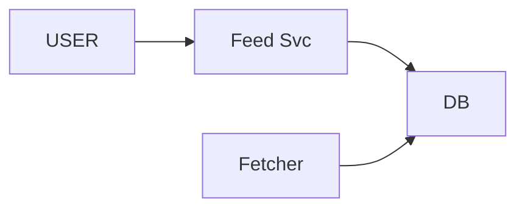

</details>


#### 1 Subah maine app khola, sabko wahi 20 khabar, har baar DB se
```
DIKKAT     Subah 7 baje laakhon log app khol rahe, sabko wahi top 20 khabar. Har khulne pe DB se sort karke
           nikaalte -> DB pe bheed, feed dheemi, kabhi khulti hi nahi.
```

<details><summary>diagram source (mermaid)</summary>

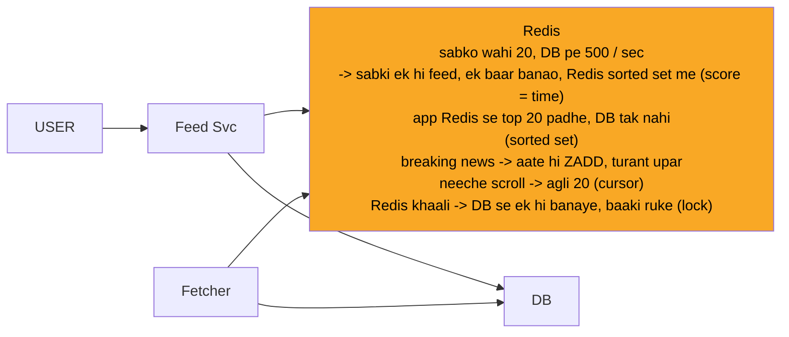

</details>

```
TASVEER: ek list, sab padhein
  feed:latest (sorted set, score = kab chhapi):  9:05 a90 | 9:03 a77 | 9:01 a45 | 8:58 a12 | ... (top 500)
  nayi khabar 9:06 a91 -> ZADD -> apne time pe, sabse upar
  10 lakh user app kholein -> sab ZREVRANGE 0 19 -> wahi 20 id -> DB tak koi nahi
```
```
AAGE POOCHEGA:
  NIYAM: sabko ek jaisi feed = ek baar bana ke Redis me (sorted set, time se); har user DB nahi jaata;
         nayi khabar aate hi list me apni jagah, user ko turant dikhti.
  SAFAR (ek "feed kholo", har mod pe kya):
  sab theek chala       -> ZADD feed:latest; khola -> ZREVRANGE 0 19 -> 20 id
  breaking news         -> aate hi ZADD = turant; "5 min" sirf sabse bura haal
  neeche scroll (21-40) -> ZREVRANGE 20 39, ya cursor (aakhri dekhi ke time se pehle ki 20)
  Redis restart, khaali -> DB se ek baar bana lo (lock se: ek hi banaye, baaki ruke)
```

#### 2 Meri feed me khabar 20 minute purani
```
DIKKAT     Badi khabar aayi, par meri feed me 20 minute baad dikhi. Ek hi kaam me source se laana aur DB me
           likhna dono, ek dheema source poori line rok deta -> khabar purani.
```

<details><summary>diagram source (mermaid)</summary>

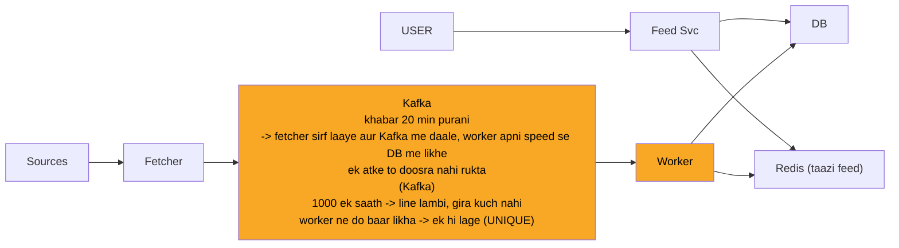

</details>

```
AAGE POOCHEGA:
  NIYAM: laana aur padhna alag: laana peeche apni speed se (Kafka, key = source_id); user sirf Redis ki list
         padhta -> laane me der / bheed ho tab bhi feed khulti, bas thodi purani.
  SAFAR (ek khabar, source se feed tak, har mod pe kya):
  sab theek chala         -> kai fetcher -> Kafka (10 partition) -> worker -> DB + Redis
  kuch naya nahi          -> ETag / Last-Modified: "naya nahi" to download hi nahi
  1000 ek saath aaye      -> line lambi, gira kuch nahi: Kafka disk pe, worker apni speed
  worker ne do baar likha -> ek baar hi lage: ON CONFLICT DO NOTHING -> skip
```

#### 3 8 baje election result, 40 guna bheed
```
DIKKAT     8 baje election result: aam 500 / sec ki jagah 20,000 / sec. Ek Feed Svc machine ka CPU bhara,
           cache miss seedha primary DB pe, jahan fetcher bhi likh raha -> dono dheeme.
```

<details><summary>diagram source (mermaid)</summary>

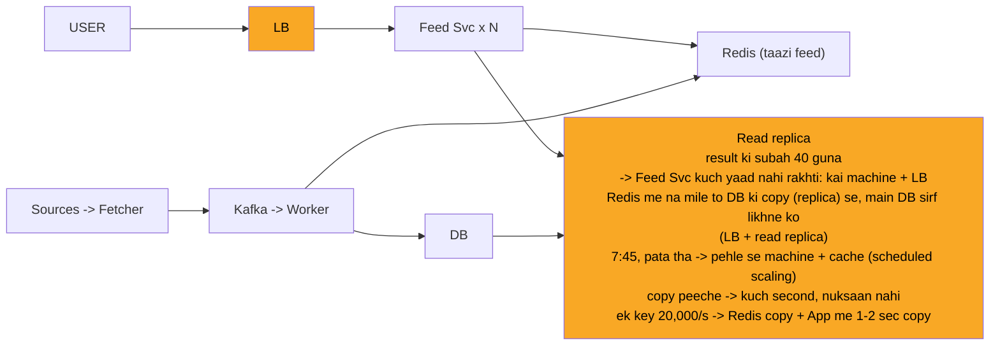

</details>

```
NAHI       Kafka se bheed sambhalo: Kafka likhne ke raaste ke liye hai, padhai ki bheed nahi jhelta.
```
```
AAGE POOCHEGA:
  NIYAM: padhai copy pe, likhai main pe; jo kuch yaad nahi rakhta (Feed Svc) uski machine badhao; copy
         thodi peeche ho to user ko kuch sec purani khabar, nuksaan nahi.
  SAFAR (8 baje ki bheed, har mod pe kya):
  sab theek chala -> Feed Svc kai machine + LB; Redis miss -> replica; main DB sirf likhai
  7:45, pata tha  -> pehle se machine badhao (scheduled scaling) + cache pehle bharo
  20,000 / sec    -> aur machine: Feed Svc kuch yaad nahi rakhti, koi bhi le
  copy peeche     -> kuch second: 5 sec purani khabar se nuksaan nahi
  ek key 20,000/s -> Redis replica + App me 1-2 sec ki copy: ek machine pe sab nahi
```

#### 4 Dopahar "India ne match jeeta", meri feed me 5 baar
```
DIKKAT     Dopahar "India ne match jeeta" 5 source ne chhaapa, thode alag title, alag URL. Sab naya maana
           -> meri feed me wahi khabar 5 baar, baaki khabar neeche dab gayi.
```

<details><summary>diagram source (mermaid)</summary>

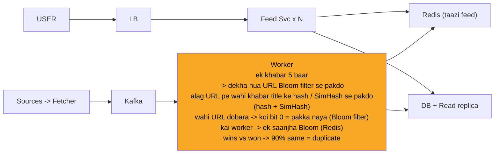

</details>

```
TASVEER: Bloom filter (bit-line)
  bits:   [0] [0] [1] [0] [1] [0] [0] [1] [0] [0]      (jagah 0..9)
  URL-A -> hash = 2, 4, 7 -> teeno 1      -> SHAYAD dekha -> skip
  URL-B -> hash = 1, 4, 8 -> jagah 1 pe 0 -> PAKKA naya -> laao, jagah 1, 4, 8 = 1
  galat "naya" kabhi nahi · galat "dekha" kabhi-kabhi (ek nayi khabar chhoot sakti, news me chalta)
```
```
AAGE POOCHEGA:
  NIYAM: ek khabar ek baar: pehchaan (hash) same = khabar same, URL chahe alag; kabhi ek nayi chhoot jaaye
         to chalta (news), par user ko ek khabar 5 baar nahi.
  SAFAR (ek khabar, 5 source se, har mod pe kya):
  sab theek chala       -> naya URL + naya title-hash -> nayi khabar, feed me ek baar
  wahi URL dobara aaya  -> Bloom filter: koi bit 0 = pakka naya · sab 1 = shayad dekha
  kai worker            -> ek saanjha Bloom (Redis): apna-apna ho to ek ne dekha, doosre ko pata nahi
  naya URL, wahi khabar -> title chhote akshar, chinh hatao -> hash; same hash = same khabar
  wins vs won           -> hash alag pad jaata: SimHash, 90% same = duplicate
  5 me se kaunsa        -> jo pehle aaya / bada source; baaki "aur sources" me link
```

#### 5 Dopahar baad nayi khabar aani ruki: ek chhota source 30 sec atka, baaki 999 bhi ruke
```
DIKKAT     Dopahar baad ek chhota source 30 sec tak jawab nahi de raha. Sab usi ke intezaar me atke, baaki
           999 source ki khabar bhi nahi aayi -> poori feed ruk gayi.
```

<details><summary>diagram source (mermaid)</summary>

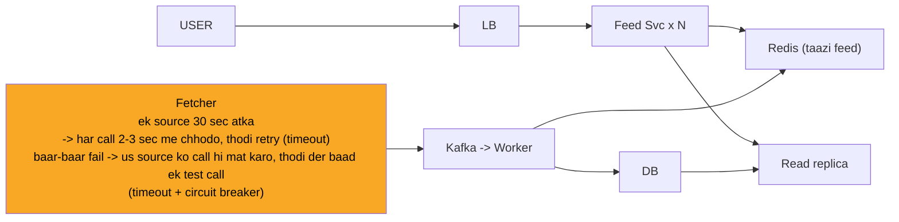

</details>

```
AAGE POOCHEGA:
  NIYAM: ek beemar source baaki ko na roke: had tak intezaar, phir circuit breaker; us source ki
         khabar kuch der nahi aati, baaki feed chalti rehti.
  SAFAR (ek source ki call, har mod pe kya):
  sab theek chala    -> 2-3 sec me jawab -> khabar line me
  site atki          -> 2-3 sec timeout, thodi retry: atka source baaki ko nahi rokta
  baar-baar fail     -> breaker OPEN: us source ko call hi nahi, baaki apne raaste
  thodi der baad     -> HALF-OPEN: ek test call, theek to CLOSED
  source ne 429 diya -> dheere: uska samay badhao + Retry-After maano
  kuch din OPEN      -> alert + list se bahar
```

#### 6 Shaam ko mujhe sirf tech aur sports chahiye
```
DIKKAT     Shaam ko mujhe sirf tech aur sports pasand. Har user ki alag feed (10 lakh feed) bahut mehngi.
```

<details><summary>diagram source (mermaid)</summary>

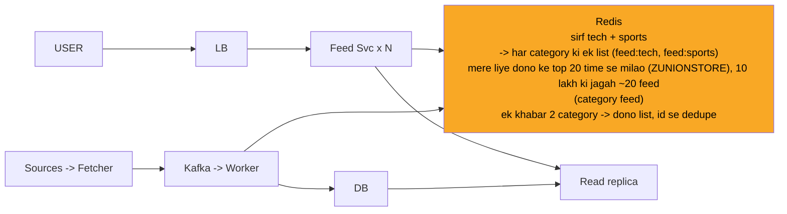

</details>

```
NAHI       har baar DB se WHERE category IN (tech, sports): har khulne pe DB, cache ka fayda gaya.
```
```
AAGE POOCHEGA:
  NIYAM: list category ki pehle se (feed:tech), milana padhte waqt; user ki pasand = kaunsi list milaani,
         har user ki alag feed nahi.
  SAFAR (meri tech + sports feed, har mod pe kya):
  sab theek chala      -> khabar category list me; khola -> tech + sports top 20 time se milao
  ek khabar 2 category -> dono list me ZADD; milate waqt id se dedupe (do baar na dikhe)
  tech zyada pasand    -> asli personalization: har user ki ranking (scope se bahar)
```

#### 7 Raat ko maine "cricket" dhoondha, poori table padhi gayi
```
DIKKAT     Raat ko maine "cricket" dhoondha. DB ne har khabar ki poori line padh ke match kiya, 2 crore row
           -> search bahut dheema, aur DB baaki sab ke liye dheemi.
```

<details><summary>diagram source (mermaid)</summary>

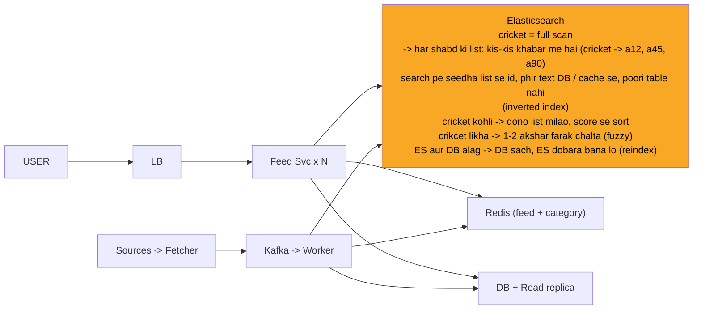

</details>

```
AAGE POOCHEGA:
  NIYAM: ES sirf dhoondhta (id deta), sach DB me; ES gira / galat -> DB se dobara bana lo: khabar kabhi
         nahi khoti, bas us beech search dheemi / band.
  SAFAR (ek "cricket" search, har mod pe kya):
  sab theek chala -> ES (inverted index) se id -> text DB / cache se
  cricket kohli   -> dono list milao: [a12, a45, a90] · [a45, a77]; AND = a45, OR = sab;
                     score se sort
  crikcet likha   -> fuzzy (ES): 1-2 akshar ka farak chalta
  ES aur DB alag  -> DB sach: ES dobara bana lo (reindex); likhna fail -> retry ki line
```

#### 8 Raat ko DBA ka mail: 6 mahine me ~2 crore row, kharcha badhta ja raha
```
DIKKAT     Usi raat DBA ka mail: 6 mahine me ~2 crore khabar ki row, disk / backup ka kharcha badh raha.
           Taazi 20 ke alawa purana koi padhta hi nahi. (Query dheemi NAHI hui: published_at pe index hai.)
```

<details><summary>diagram source (mermaid)</summary>

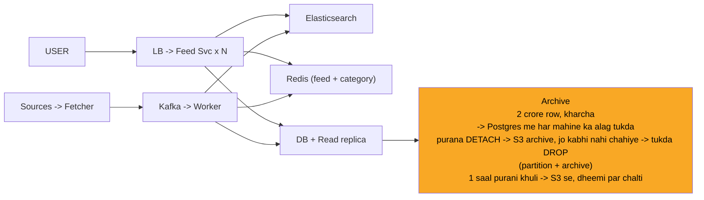

</details>

```
NAHI       "sharding karo": ye purana hatana (retention) hai, data baantna (sharding) nahi.
```
```
AAGE POOCHEGA:
  NIYAM: naya mahina garam (Postgres), purane thande (S3); purani khabar khulti, bas dheemi; purana hatana =
         retention, sharding nahi.
  SAFAR (ek khabar ki umar, har mod pe kya):
  sab theek chala     -> is mahine ke tukde me (partition), index se tez
  mahina beeta        -> DETACH -> S3; bilkul nahi chahiye -> DROP (pal ka kaam)
  DETACH pe lock?     -> normal = poore table pe pal bhar (padhai bhi rukti);
                         PG 14+ DETACH ... CONCURRENTLY -> kuch nahi rukta
  1 saal purani khuli -> S3 archive se: dheemi, par koi kabhi-kabhi hi kholta
```

#### 9 Mail ka doosra hissa: source 100 guna hue to ek DB machine nahi jhelegi
```
DIKKAT     Mail aage: "source 100 guna ya log khud content daalne lage to ek DB likhai aur data nahi jhelegi."
           (Hamare number pe ek DB kaafi hai, ye sirf bahut bade scale pe.)
```

<details><summary>diagram source (mermaid)</summary>

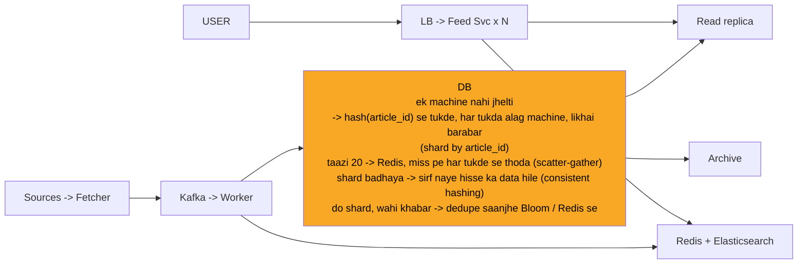

</details>

```
NAHI       date se baanto: aaj ki saari likhai aaj wale shard pe -> wo akela garam.
```
```
AAGE POOCHEGA:
  NIYAM: baantne ki key wo jo bojh barabar baante (article_id ka hash); ek shard garam / mara to sirf
         uska hissa dheema, baaki chalta.
  SAFAR (ek nayi khabar, 100 guna scale, har mod pe kya):
  sab theek chala       -> hash(article_id) se shard: likhai sab tukdon pe barabar
  taazi 20 chahiye      -> Redis se; miss pe har tukde se thoda (scatter-gather)
  shard badhaya         -> thoda hilta (consistent hashing): sirf naye shard ke hisse ka
  do shard, wahi khabar -> dedupe pehle saanjhe Bloom / Redis se; DB UNIQUE sirf shard ke andar
```

---

## AAKHRI DABBA + WRAP (ek hi baar)

```
LIKHNA: Sources -> Fetcher (timeout / dobara / skip + breaker) -> Kafka (bheed sambhaale)
        -> Worker (saaf + dedupe + category) -> DB + Redis + Elasticsearch
PADHNA: LB -> Feed Svc (kai machine) -> Redis (99%, taazi feed pehle se bani) -> nahi mila to read replica
        search = Elasticsearch · purani khabar = Archive

DB:  Postgres (primary + read replica + mahine ke tukde) -> likhai sirf ~1 / second, ek machine kaafi;
     "taazi 20" index se seedha; padhai Redis aage se sambhaalta
     (likhai 100 guna ho jaaye tab hi Cassandra jaisa / shard socho)
```
```
JAWAB:    Khabar laana aur khabar dikhana alag raaste. Peeche fetcher sites se laata, Kafka se worker
          tak, worker saaf karke, ek khabar ek baar, category laga ke DB me rakhta.
          Sabko lagbhag wahi feed, to Redis me pehle se bani, 99% wahin se. Feed service kai machine pe,
          purani khabar sasti jagah, search Elasticsearch pe.
```

<details><summary>diagram source (mermaid)</summary>

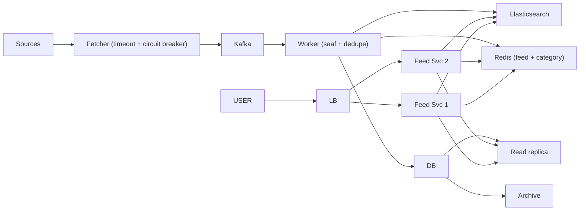

</details>


---

## 10 GUNA TRAFFIC — har dabba alag se

```
PADHNA: Feed Svc  -> kai machine + LB
        Redis     -> gira? cluster + replica, nahi mila to read replica
        DB        -> READ REPLICA · jagah -> ARCHIVE (+ bahut bade scale pe shard)
LIKHNA: Fetcher   -> source band / dheema -> timeout + dobara + skip + circuit breaker
        Kafka     -> 1000 ek saath -> line sambhaale, partition badhao
        Worker    -> kai worker ek saath
AAGE:   pasand wali feed (category cache) · photo CDN · ML ranking · badi khabar turant push

POOCHEGA: "How would you scale this to 10x?"      -> dono raaste alag chalao, pehle jo toote
POOCHEGA: "What's the single point of failure?"   -> "ek machine giri to sab?" -> uski copy
                                                     · source band -> circuit breaker + skip
POOCHEGA: "How do you know it's working?"         -> feed p99 ·
          cache hit rate · Kafka lag · source error rate · alert
```

---

## POOCHE TO (gehra sawaal aaye tab)

```
API:      GET /feed?page=1&category=tech -> taazi list (page me, neeche scroll; 10,000 ek saath nahi)
          GET /article/{id} · GET /search?q=cricket · POST /ingest { source data } (andar, peeche)
          GET = padhna · POST = kuch badalna (ulta mat karna)

DB:       ARTICLE: id | title | content | sourceId | category | publishedAt | url
          SOURCE:  id | name | rssUrl | lastFetchedAt
          USER_PREFS (optional): userId | categories[] | savedArticles[]
          Postgres: likhai ~1 / second (chhoti), "ORDER BY published_at DESC LIMIT 20" index se,
                    primary + read replica, mahine ke tukde (partition) -> purana archive
          Mongo bhi chal jaata (replica set + TTL). Cassandra tab jab likhai bahut badi ho jaaye;
          par Cassandra me primary-replica nahi (sab node barabar, leaderless)
          aur poori table pe "taazi 20" nahi chalta -> isliye yahan nahi.

AUR SAWAAL:
  "Redis me list kitni lambi?"       -> TOP 500: RAM chhoti; usse purani chahiye to DB.
  "Pehle feed kaise khulti thi?"    -> HAR USER PE DB: ORDER BY ... LIMIT 20; ab ~99% DB tak nahi.
  "Pehle khabar 20 min purani kyun?" -> 1 FETCHER, 1000 source ek-ek; ab kai fetcher + Kafka.
  "Pehle 999 kyun ruke?"            -> 30 SEC INTEZAAR: fetcher ek source pe atka, baaki peeche.
  "LIKE '%cricket%' slow kyun?"     -> % AAGE = INDEX KAAM NAHI: poori table padhi jaati.
  "10 lakh user = 10 lakh feed?"    -> NAHI: ~20 category list, pasand = kaunsi milaani.
  "3 saal baad DB?"                 -> UTNA HI: naya mahina garam, purana thanda (S3).
  "Kafka kyun, SQS kyun nahi?"       -> SQS BHI CHALTA; Kafka me search / analytics apne group se padhte,
                                        dobara bhi.
  "Har source kitni baar dekhoge?"   -> APNA-APNA SAMAY: NDTV har 1 min, chhota blog har 15 min.
  "Bloom kyun, Redis SET kyun nahi?" -> RAM BACHAO: crore URL = bahut RAM; galat "haan" se kabhi ek nayi
                                        khabar chhoot sakti, news me chalta.
  "Bloom se URL hatana ho?"          -> NORMAL BLOOM ME NAHI: roz naya filter, purana phenko (ya counting
                                        Bloom).
  "Postgres se search nahi chalega?" -> CHHOTE SCALE PE HAAN (full-text, GIN); ES = ranking, galat spelling,
                                        bahut data, DB pe bojh nahi.
  "Category se shard karo?"          -> BOJH TIRCHHA (skew): sports / politics bade, baaki chhote.
```

---

ARCHETYPE A+E · CONCEPTS: [elasticsearch](../../FOUNDATIONS/12_elasticsearch_search.md) · [caching](../../FOUNDATIONS/04_caching.md) · saath: [twitter-feed](../03_twitter_feed/03_twitter_feed.md) · [← MASTER SHEET](../../00_MASTER_SHEET.md)
