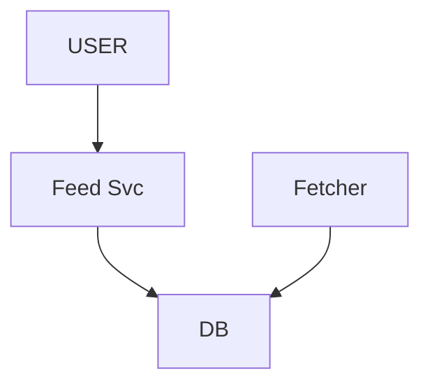
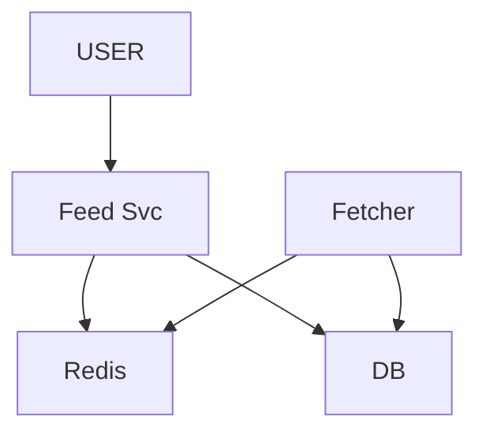
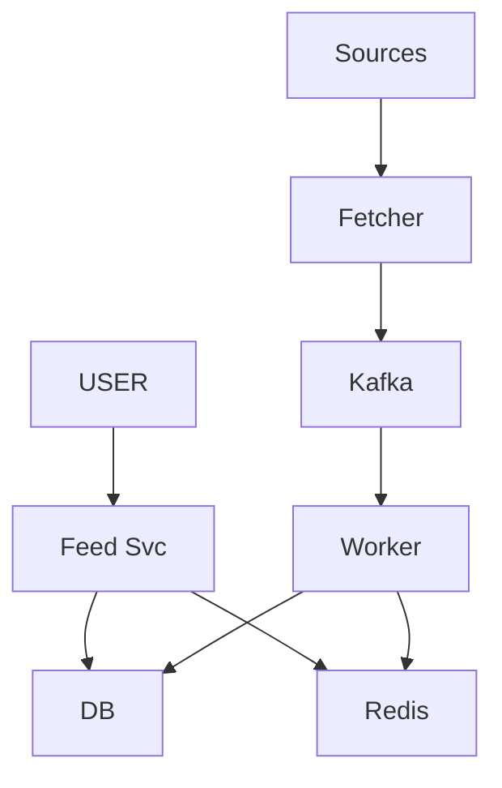
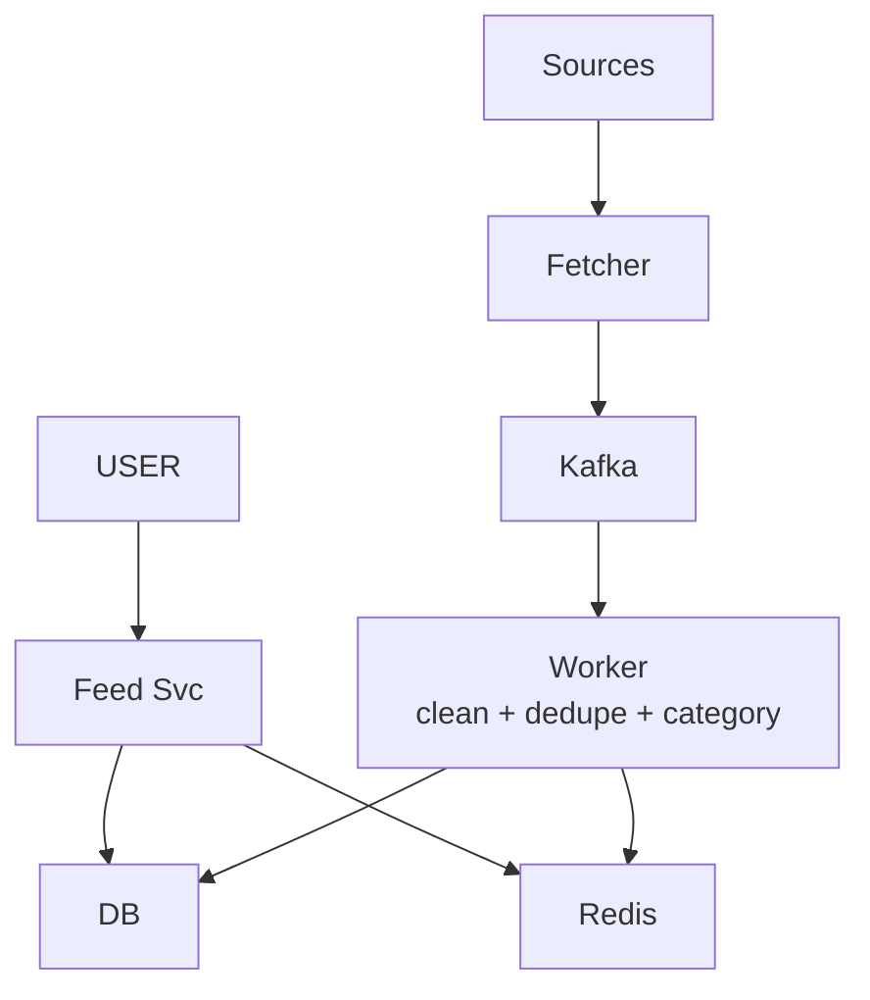
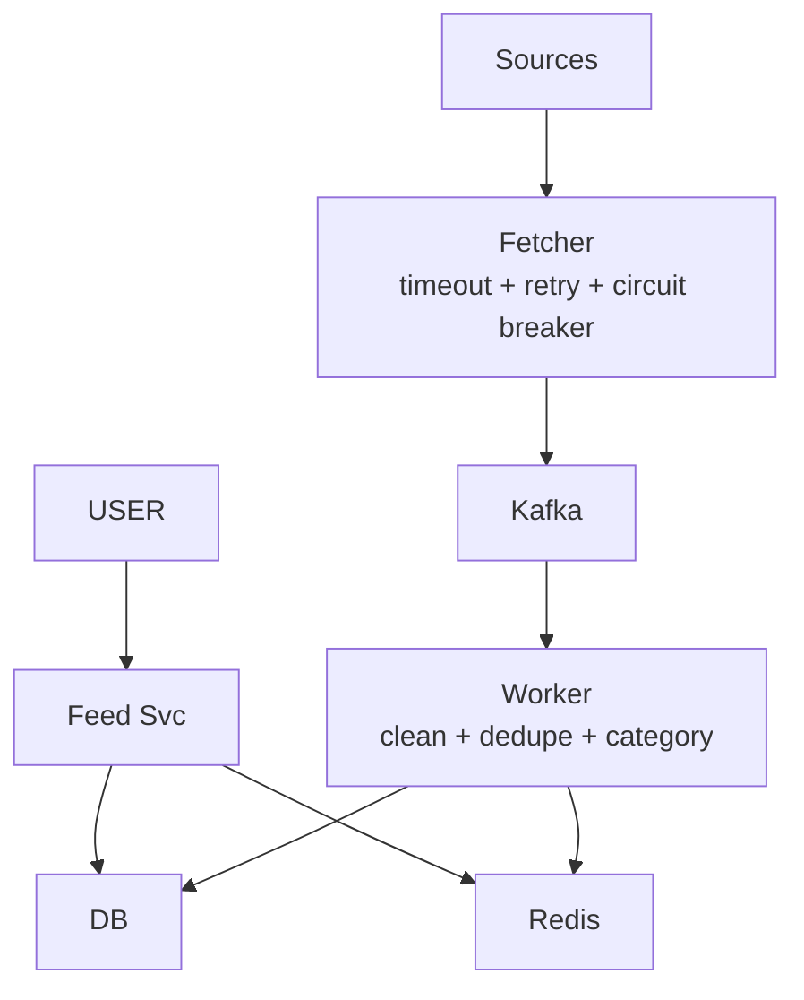
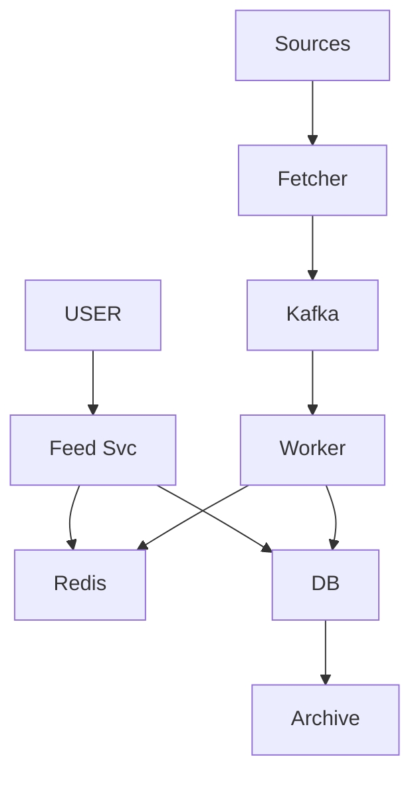
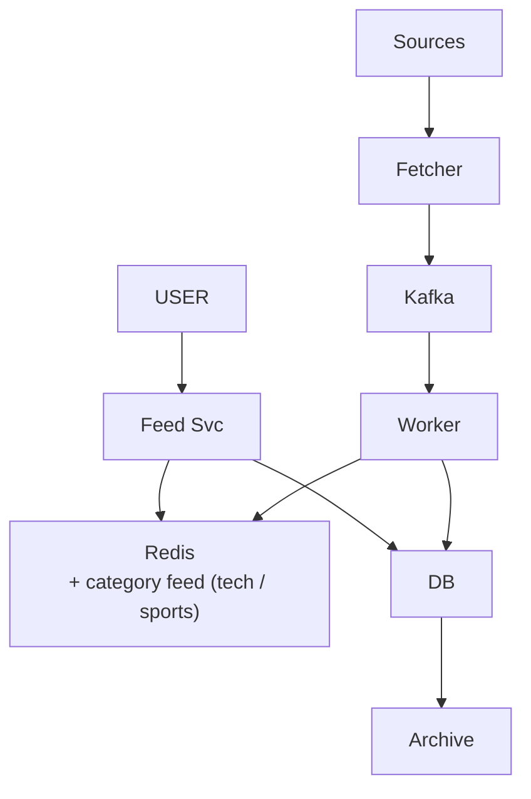
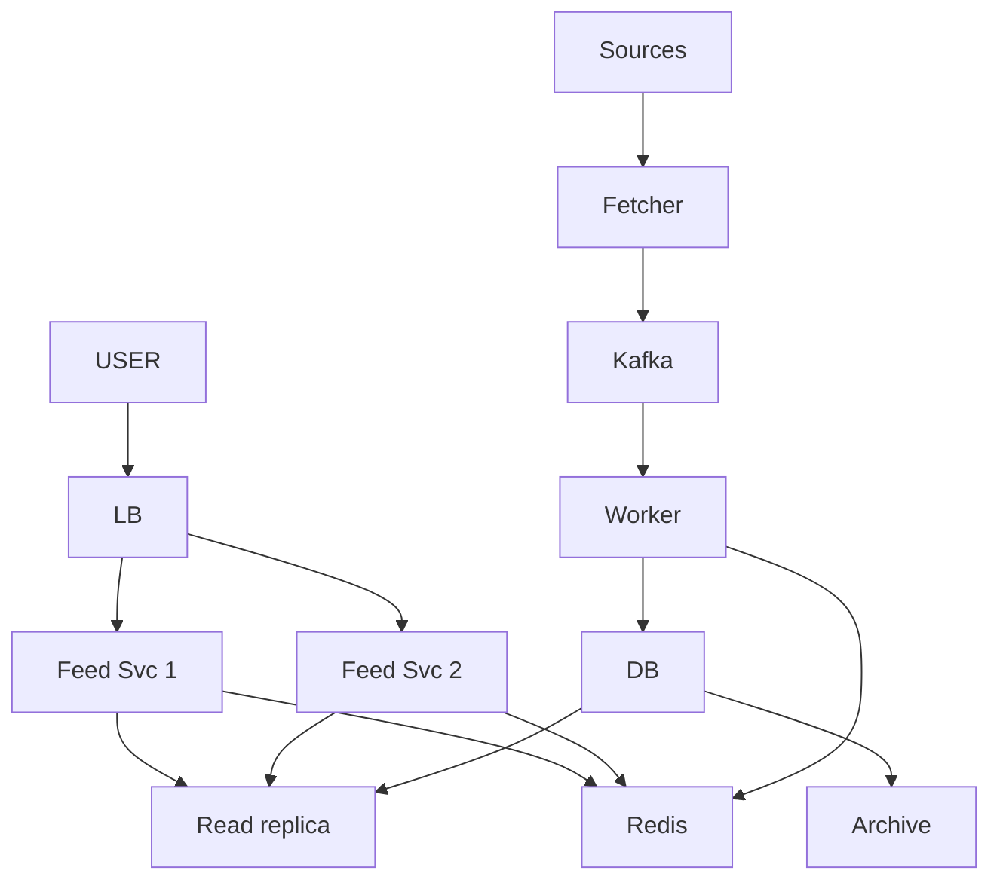
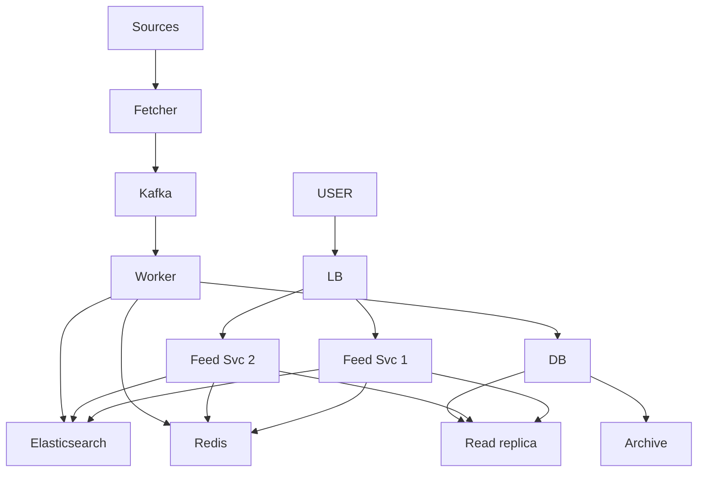

# News Aggregator

> Alag-alag source (NDTV, TOI, BBC ...) se khabar kheencho -> store karo -> user ko EK feed (Google News / Inshorts jaisa). JP ka aam product design.
> Is design ka dil: **padhne wale bahut zyada, likhne wale kam** + **likhne ka raasta aur padhne ka raasta ALAG** + **feed pehle se bana ke cache me**.

---

## TASVEER (ByteByteGo / Alex Xu · CC BY-NC-ND 4.0)


Source: [How to Avoid Crawling Duplicate URLs at Google Scale?](https://bytebytego.com/guides/how-to-avoid-crawling-duplicate-urls-at-google-scale/)
(crawler + DEDUPE — BLOOM FILTER: "ye URL pehle dekha?" kam memory me; kabhi-kabhi galat "haan", galat "na" kabhi nahi)

---

## SHURU: pehle poocho, phir numbers

```
POOCHO:  "Do hisse: khabar andar laana (ingestion) aur feed dikhana — kis pe focus?"
         kitne SOURCE? 10 ya 10,000? · kitni TAAZI? turant chahiye ya
         5 min purani chalegi?  <- chalegi = pehle se bana lo + cache
         feed sabki SAME ya har user ki ALAG? · kitne user, kitni khabar / din?

KYA KARE (FR):    sources se kheencho · store · FEED (taazi list) · (optional) category / search
                  scope bahar: comments · ML ranking
KAISA CHALE (NFR): feed TEZ (dil) · khabar TAAZI · lakhon user · ek source band ho to system na gire
                   SOCH: "har user feed kholta, khabar gine-chune source se aati -> padhna >> likhna"

NUMBERS (andaaza):
   10 lakh user x 5 baar / din = 50 lakh padhai / din
      din me ~1 lakh second -> ~50 / second (subah 10 guna ~500 / second)
   1000 source, har 5 min -> ~3 lakh likhai / din -> ~3 / second
   -> padhna >> likhna -> CACHE + READ REPLICA (dil)
   -> likhna peeche chale -> QUEUE
   -> data badhta jaata -> purana ARCHIVE (bahut bade scale pe SHARD)
```

---

## ════ MOCK SE PEHLE: SIRF YE CARD PADHO ════

> Har card: DIKKAT 1 (kya toota) -> HAL (kya kiya) -> diagram -> DIKKAT 2, 3 ... (interviewer ke
> agle sawaal) har ek ke neeche uska HAL. Revise: sirf baayein column padho.

#### DABBA 0: SABSE SIMPLE (yahan se shuru, phir "kahan tootega")
```
Fetcher sources se khabar laaye, DB me daale. Feed service DB se "taazi 20" nikaal ke de.
```


#### 1 HAR REQUEST PE DB SE "TAAZI 20"
```
DIKKAT 1   Subah 8 baje 500 log / second app khol rahe. Har ek ke liye DB se
           "ORDER BY published_at DESC LIMIT 20" chal raha, aur sabko lagbhag WAHI 20 khabar dikh rahi.
           Ek hi kaam 500 baar / second.
HAL        Ek baar list bana ke Redis me rakh do: SORTED SET "feed:latest", id + score = kab chhapi.
           Nayi khabar aayi -> ZADD (apni jagah baith jaati). Purani kaato -> top 500 hi rakho.
           Arpan ne app khola -> ZREVRANGE feed:latest 0 19 -> 20 id -> khabar ka text alag cache se.
           ~99% log Redis se hi laut jaate, DB tak koi nahi jaata.
```

```
DIKKAT 2   "5 min purani chalegi" bola, par badi khabar (breaking) turant chahiye?
HAL        Khabar aate hi ZADD hota -> asal me turant dikhti. 5 min sirf sabse bura haal.

DIKKAT 3   Arpan neeche scroll kare (page 2, 21-40)?
HAL        ZREVRANGE 20 39, ya cursor (jo aakhri dekhi uske time se pehle ki 20).

DIKKAT 4   Har user ki alag feed kyun nahi banate?
HAL        Mehngi. Sabki lagbhag same, ek cache kaafi. Pasand wali feed = har category ki alag list,
           padhte waqt mila do.
```

#### 2 1000 SOURCE SE KHABAR LAANA DHEEMA
```
DIKKAT 1   Ek fetcher 1000 source ek-ek karke laata (har ek ~1 sec) -> ek chakkar ~20 minute.
           Khabar 20 minute purani, aur fetcher hi DB me likh raha to wo bhi atka.
HAL        Laana aur likhna alag karo. Kai fetcher ek saath sources se laate aur Kafka me daal ke bhool
           jaate. Workers apni speed se padhte (apna offset yaad), saaf karke DB + Redis me rakhte.
           1000 source ki khabar ek saath aayi -> Kafka ki line lambi hui, kuch gira nahi.
           10 partition = 10 worker ek saath. Arpan sirf Redis ki taiyaar list padhta.
```

```
DIKKAT 2   Fetcher ek source kitni baar dekhe?
HAL        Har source ka apna samay (NDTV har 1 min, chhota blog har 15 min).
           Saath me ETag / Last-Modified -> source bole "kuch naya nahi" to download hi nahi.

DIKKAT 3   Worker ne ek khabar do baar likhi?
HAL        URL / text ke hash pe UNIQUE -> doosri baar INSERT ... ON CONFLICT DO NOTHING -> skip.

DIKKAT 4   Kafka kyun, SQS kyun nahi?
HAL        SQS bhi chalta. Kafka isliye ki search index / analytics bhi wahi khabar apne alag group se
           padh sakein, aur dobara bhi.
```

#### 3 EK HI KHABAR PAANCH SOURCE SE
```
DIKKAT 1   "India ne match jeeta" -> NDTV, TOI, HT, BBC, ESPN sabne likha. Arpan ki feed me wahi khabar
           5 baar (5 alag URL).
HAL        Same title, alag URL: title chhote akshar + chinh hatao -> hash -> same hash = same khabar.
           Thoda alag likha ("India wins" vs "India won"): SimHash / MinHash -> milte-julte text ke hash
           paas-paas aate -> "90% same" = duplicate. Ek hi rakho.
```

```
DIKKAT 2   Fetcher wahi URL dobara le aaya (pehle bhi dekha tha)?
HAL        BLOOM FILTER: ek lambi bit-line + kuch hash. URL ke saare hash wali jagah dekho:
           koi ek bhi 0 = pakka naya · saare 1 = SHAYAD dekha (galat "haan" ho sakta, galat "na" kabhi nahi).

DIKKAT 3   Bloom filter kyun, Redis SET kyun nahi?
HAL        Crore URL SET me = bahut RAM. Bloom thodi si memory me. Galat "haan" se kabhi ek nayi
           khabar chhoot sakti, news me chalta.

DIKKAT 4   Bloom me se URL hatana?
HAL        Normal Bloom me nahi hota. Roz naya filter, purana phenko (ya counting Bloom).

DIKKAT 5   5 me se kaunsa source dikhao?
HAL        Jo pehle aaya / bada source. Baaki "aur sources" me link.
```

#### 4 EK SOURCE BAND / BAHUT DHEEMA
```
DIKKAT 1   Ek chhota source 30 second me jawab de raha. Fetcher us pe atka -> baaki 999 source ki
           khabar bhi ruki.
HAL        Har site alag se lao. 2-3 sec me jawab nahi to chhod do, thodi baar dobara koshish.
           Baar-baar fail -> FUSE: CLOSED (sab theek) --kai fail--> OPEN (us source ko call hi mat karo)
           --thodi der--> HALF-OPEN (ek test call) --chali--> CLOSED.
           Ek source ka fuse uda, baaki 999 apne raaste chalte rahe.
```

```
DIKKAT 2   Source ne 429 (bahut maang rahe ho) diya?
HAL        Us source ka samay badhao + uska Retry-After maano.

DIKKAT 3   Source hamesha ke liye band ho gaya?
HAL        Kuch din OPEN raha -> alert, list se hatao.
```

#### 5 6 MAHINE ME 5 CRORE ROW, KHARCHA BADHTA
```
DIKKAT 1   6 mahine me 5 crore khabar ki row. Disk, backup, kharcha badhta ja raha. Par taazi 20 ke
           alawa purana koi padhta hi nahi. (Query dheemi NAHI hui: published_at pe index hai.)
HAL        Postgres me har mahine ka alag tukda (partition). Mahina purana hua -> tukda table se alag
           karo (DETACH) -> S3 archive. Jo kabhi nahi chahiye -> tukda DROP (ek pal ka kaam).
           Ye purana hatana (retention) hai, data baantna (sharding) nahi.
```

```
DIKKAT 2   Kisi ne 1 saal purani khabar ka link khola?
HAL        Archive / S3 se aayegi (dheemi chalegi).

DIKKAT 3   DETACH pe table lock hoga?
HAL        Normal DETACH chhota lock leta. PG 14+ me DETACH PARTITION ... CONCURRENTLY -> bina roke.

DIKKAT 4   3 saal baad?
HAL        Wahi: hafta garam, baaki thanda. "Ye retention hai, sharding nahi."
```

#### 6 (SIRF BAHUT BADE SCALE PE) EK DB MACHINE NAHI JHEL RAHI
```
DIKKAT 1   Source 100 guna ho gaye ya log khud content daalne lage -> ek DB machine likhai aur data
           nahi jhel pa rahi. (Hamare number pe ek DB kaafi hai, ye sirf bahut bade scale pe.)
HAL        Khabar ki id ke hash se baanto (hash(article_id)) -> likhai sab shard pe barabar.
           Date se nahi: aaj ki saari likhai aaj wale shard pe -> wo akela garam.
           Keemat: "taazi 20" ke liye har shard se thoda laana padta (scatter-gather), par wo to Redis
           se aata hi hai.
```

```
DIKKAT 2   Category se baanto?
HAL        Sports / politics bade, baaki chhote -> bojh barabar nahi (skew).

DIKKAT 3   Shard badhaye to data kitna khiske?
HAL        Consistent hashing -> thoda sa data hilta.
```

#### 7 ARPAN KO SIRF TECH + SPORTS CHAHIYE
```
DIKKAT 1   Arpan ko sirf tech aur sports pasand. Har user ki alag feed (10 lakh feed) bahut mehngi.
HAL        Har category ki ek list (feed:tech, feed:sports).
           Arpan: feed:tech se top 20 + feed:sports se top 20 -> time se mila ke (ya Redis ZUNIONSTORE)
           -> top 20 dikhao. 10 lakh feed ki jagah sirf ~20 category feed.
```

```
DIKKAT 2   Har user ki pasand ka alag wazan (Arpan ko tech zyada)?
HAL        Tab asli personalization -> har user ki ranking service (abhi scope se bahar).
```

#### 8 SUBAH 8 BAJE SAB EK SAATH
```
DIKKAT 1   8 baje sabne app khola. Ek hi Feed service machine ka CPU bhar gaya.
           Jo cache me nahi mila wo seedha primary DB pe gaya, jahan fetcher bhi likh raha -> dono dheeme.
HAL        Feed service kuch yaad nahi rakhti -> kai machine + load balancer.
           Redis me na mile to DB ki copy (replica) se padho, main DB se nahi -> main sirf likhne ke liye.
           (Kafka padhai ki bheed nahi jhelta, wo likhne ke raaste ke liye hai.)
```

```
DIKKAT 2   Pata hai 8 baje bheed aati hai?
HAL        7:45 pe pehle se machine badhao (scheduled scaling) + cache pehle se bhar do.

DIKKAT 3   Replica kitni peeche?
HAL        Kuch second, news me chalta.
```

#### 9 ARPAN NE "CRICKET" DHOONDHA
```
DIKKAT 1   Arpan ne search me "cricket" likha -> DB me LIKE '%cricket%' -> poori table ek-ek row padhi
           (full scan).
HAL        INVERTED INDEX = kitaab ke peeche ki index jaisi (ek HashMap): shabd -> kis-kis khabar me hai.
             "cricket" -> [a12, a45, a90] · "kohli" -> [a45, a77]
           "cricket kohli" -> dono list (OR = dono jodo, AND = jo dono me = a45) -> score se sort.
           Ye kaam Elasticsearch karta. ES se sirf id, khabar ka text DB / cache se.
```

```
DIKKAT 2   ES aur DB me alag-alag data ho gaya?
HAL        DB = sach. ES dobara bana sakte (reindex). ES me likhna fail -> dobara koshish ki line.

DIKKAT 3   Arpan ne galat likha (crikcet)?
HAL        ES fuzzy search (1-2 akshar ka farak chalta).

DIKKAT 4   Postgres se kaam nahi chalega?
HAL        Chhote scale pe Postgres full-text (GIN) chalta. ES = ranking, galat spelling, bahut data,
           DB pe bojh nahi.
```

```
AAKHRI DABBE (sab dikkat ke baad):
  LIKHNA: Sources -> Fetcher (timeout / dobara / skip) -> Kafka
          (bheed sambhaale) -> Worker (saaf + dedupe + category)
          -> DB + cache
  PADHNA: LB -> Feed Svc (kai machine) -> Redis (99%, taazi feed pehle se bani) -> nahi mila to read replica
          search = Elasticsearch · purani khabar = Archive

DB:  Postgres (primary + read replica + mahine ke tukde) -> likhai sirf ~3 / second, ek machine kaafi;
     "taazi 20" index se seedha; padhai Redis aage se sambhaalta
     (likhai 100 guna ho jaaye tab hi Cassandra jaisa socho, card 6)

END ME POOCHEGA:
  "Likhna aur padhna alag kyun?" -> khabar laana peeche, user ko hamesha cache se taiyaar feed
  "10x?"            -> Feed Svc machine + LB · Redis cluster + replica · DB read replica + archive
                       · Kafka partition · worker zyada
  "SPOF?"           -> "ek machine giri to sab?" -> uski copy · source band -> fuse + skip
  "Chal raha, kaise pata?" -> feed p99 · cache hit rate · Kafka lag · source error rate · alert
```

AAKHRI DABBE ki tasveer:


---

## 10 GUNA TRAFFIC — har dabba alag se

```
PADHNA: Feed Svc  -> kai machine + LB
        Redis     -> gira? cluster + replica, nahi mila to read replica
        DB        -> READ REPLICA · jagah -> ARCHIVE (+ bahut bade scale pe shard)
LIKHNA: Fetcher   -> source band / dheema -> timeout + dobara + skip + fuse
        Kafka     -> 1000 ek saath -> line sambhaale, partition badhao
        Worker    -> kai worker ek saath
AAGE:   pasand wali feed (category cache) · photo CDN · ML ranking · badi khabar turant push

POOCHEGA: "How would you scale this to 10x?"      -> dono raaste alag chalao, pehle jo toote
POOCHEGA: "What's the single point of failure?"   -> "ek machine giri to sab?" -> uski copy
POOCHEGA: "How do you know it's working?"         -> feed p99 ·
          cache hit rate · Kafka lag · source error rate · alert
```

---

## POOCHE TO (gehra sawaal aaye tab)

```
API:      GET /feed?page=1&category=tech -> taazi list (page me, neeche scroll; 10,000 ek saath nahi)
          GET /article/{id} · GET /search?q=cricket · POST /ingest { source data } (andar, peeche)
          GET = padhna · POST = kuch badalna (ulta mat karna)

DB:       ARTICLE: id | title | content | sourceId | category | publishedAt | url
          SOURCE:  id | name | rssUrl | lastFetchedAt
          USER_PREFS (optional): userId | categories[] | savedArticles[]
          Postgres: likhai ~3 / second (chhoti), "ORDER BY published_at DESC LIMIT 20" index se,
                    primary + read replica, mahine ke tukde (partition) -> purana archive
          Mongo bhi chal jaata (replica set + TTL). Cassandra tab jab likhai bahut badi ho jaaye;
          par Cassandra me primary-replica nahi (sab node barabar, leaderless)
          aur poori table pe "taazi 20" nahi chalta -> isliye yahan nahi.
```

---

## AAKHRI DABBA + WRAP

```
LIKHNA: Sources -> Fetcher (timeout / dobara / skip) -> Kafka
        (bheed) -> Worker (saaf + dedupe + category) -> DB + cache
PADHNA: LB -> Feed Svc (kai machine) -> Redis (99%) -> nahi mila to
        Read replica · Elasticsearch = search · Archive = purana
```
```
JAWAB:    Khabar laana aur khabar dikhana alag raaste. Peeche fetcher sites se laata, Kafka se worker
          tak, worker saaf karke, ek khabar ek baar, category laga ke DB me rakhta.
          Sabko lagbhag wahi feed, to Redis me pehle se bani, 99% wahin se. Feed service kai machine pe,
          purani khabar sasti jagah, search Elasticsearch pe.
```


ARCHETYPE A+E · CONCEPTS: [elasticsearch](../../FOUNDATIONS/12_elasticsearch_search.md) · [caching](../../FOUNDATIONS/04_caching.md) · saath: [twitter-feed](../03_twitter_feed/03_twitter_feed.md) · [← MASTER SHEET](../../00_MASTER_SHEET.md)
