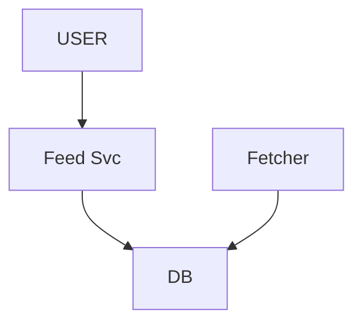
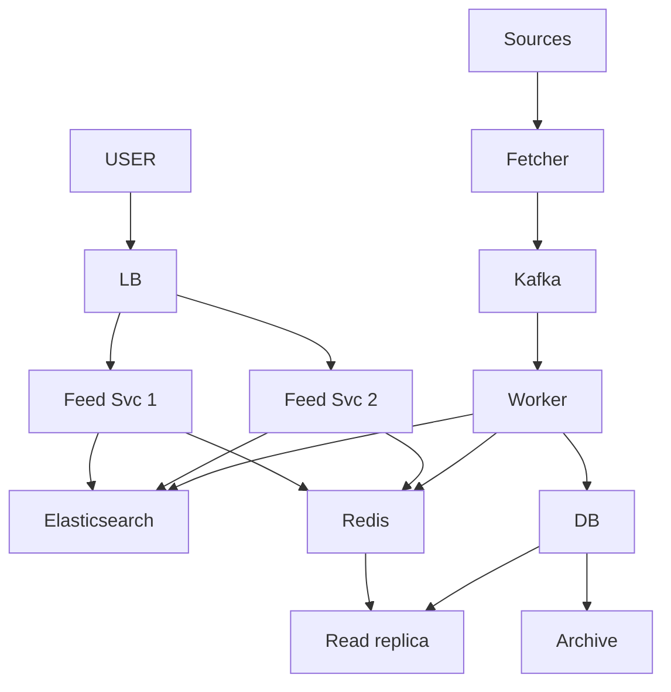
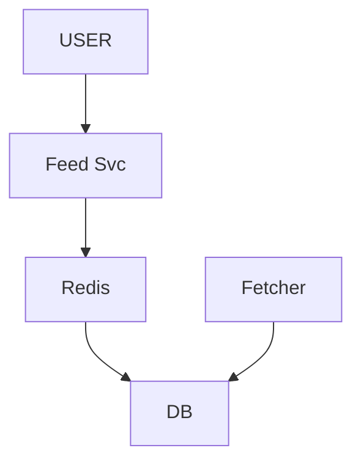
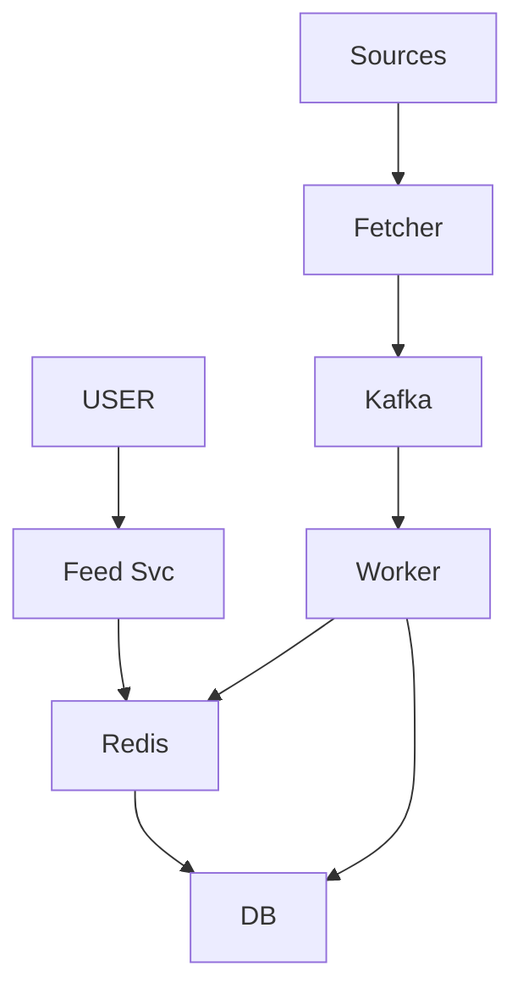
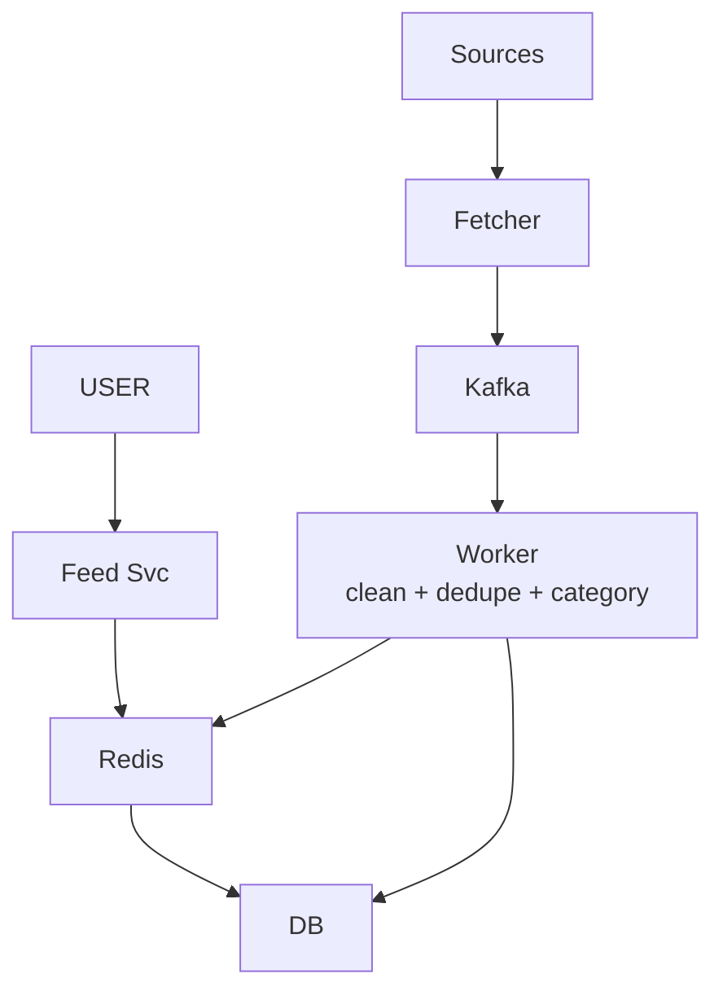
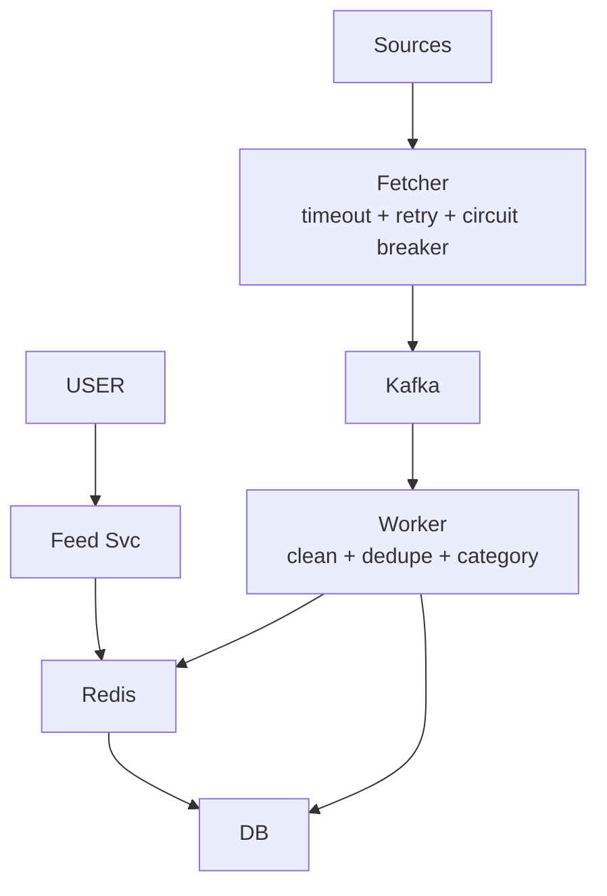
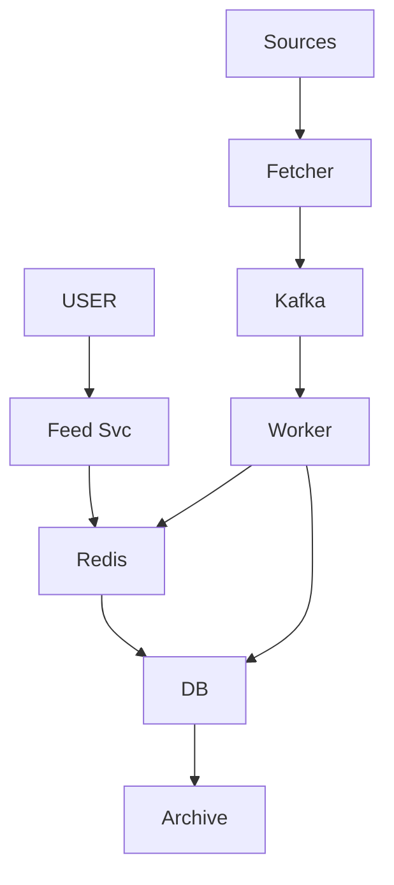
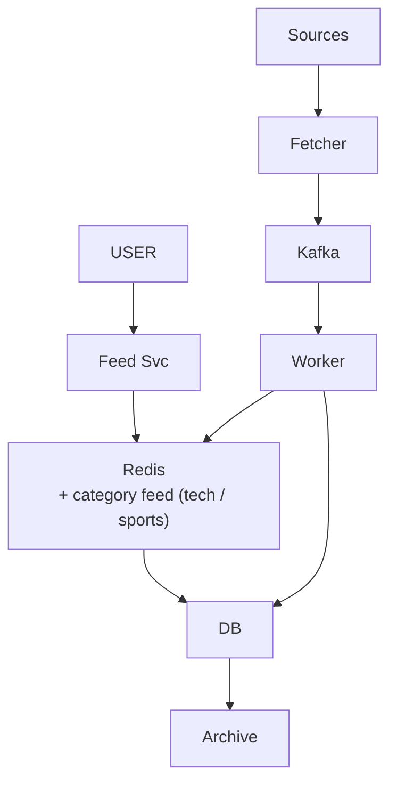
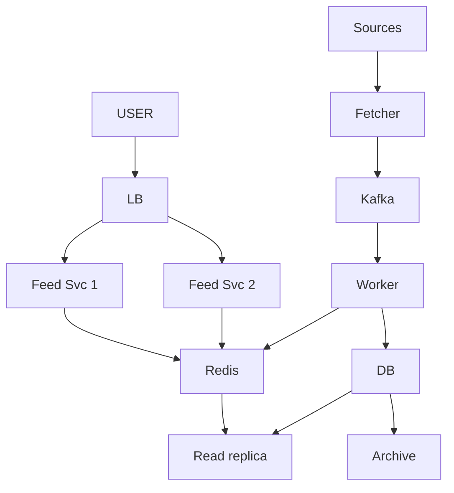

# News Aggregator

> Alag-alag source (NDTV, TOI, BBC ...) se khabar kheencho -> store karo -> user ko EK feed (Google News / Inshorts jaisa). JP ka aam product design.
> Is design ka dil: **padhne wale bahut zyada, likhne wale kam** + **likhne ka raasta aur padhne ka raasta ALAG** + **feed pehle se bana ke cache me**.

---

## TASVEER (ByteByteGo / Alex Xu · CC BY-NC-ND 4.0)


Source: [How to Avoid Crawling Duplicate URLs at Google Scale?](https://bytebytego.com/guides/how-to-avoid-crawling-duplicate-urls-at-google-scale/)
(crawler + DEDUPE — BLOOM FILTER: "ye URL pehle dekha?" kam memory me; kabhi-kabhi galat "haan", galat "na" kabhi nahi)

---

## SHURU: pehle poocho, phir numbers

```
POOCHO:  "Do hisse: khabar andar laana (ingestion) aur feed dikhana — kis pe focus?"
         kitne SOURCE? 10 ya 10,000? · kitni TAAZI? turant chahiye ya
         5 min purani chalegi?  <- chalegi = pehle se bana lo + cache
         feed sabki SAME ya har user ki ALAG? · kitne user, kitni khabar / din?

KYA KARE (FR):    sources se kheencho · store · FEED (taazi list) · (optional) category / search
                  scope bahar: comments · ML ranking
KAISA CHALE (NFR): feed TEZ (dil) · khabar TAAZI · lakhon user · ek source band ho to system na gire
                   SOCH: "har user feed kholta, khabar gine-chune source se aati -> padhna >> likhna"

NUMBERS (andaaza):
   10 lakh user x 5 baar / din = 50 lakh padhai / din, din me ~1
      lakh second -> ~50 / second (subah 10 guna ~500 / second)
   1000 source, har 5 min -> ~3 lakh likhai / din -> ~3 / second
   -> padhna >> likhna -> CACHE + READ REPLICA (dil)
   -> likhna peeche chale -> QUEUE
   -> data badhta jaata -> purana ARCHIVE (bahut bade scale pe SHARD)
```

---

## ════ MOCK SE PEHLE: SIRF YE CARD PADHO ════

> Har dikkat ek card: KAHANI (kya hua, kaun, kitna) -> ILAAJ -> ANDAR KAISE (ilaaj kyun kaam karta) ->
> ISKE BAAD KYA TOOTEGA (interviewer yahin ghusta hai: dabba lagaya, ab kya?).

#### DABBA 0: SABSE SIMPLE (yahan se shuru, phir "kahan tootega")
```
Fetcher sources se khabar laaye, DB me daale. Feed service DB se "taazi 20" nikaal ke de.
```


#### [1](#d1) HAR REQUEST PE DB SE "TAAZI 20"
```
KAHANI:  Subah 8 baje 500 log / second app khol rahe. Har ek ke liye DB se
         "ORDER BY published_at DESC LIMIT 20" chal raha. Aur sabko lagbhag WAHI 20 khabar dikh rahi.
         Ek hi kaam 500 baar / second.

ILAAJ:   Feed PEHLE SE BANA ke Redis me rakho, nayi khabar aate hi update. Sab log wahi ek cache padhein.

ANDAR KAISE:
         Redis SORTED SET "feed:latest": har khabar ki id, score = kab chhapi (time).
         Nayi khabar aayi -> ZADD (apni jagah pe baith jaati). Purani kaato -> top 500 hi rakho.
         Arpan ne app khola -> ZREVRANGE feed:latest 0 19 -> 20 id -> khabar ka text alag cache se.
         ~99% log Redis se hi laut jaate, DB tak koi nahi jaata.

ISKE BAAD KYA TOOTEGA:
  - "5 min purani chalegi" bola, par badi khabar (breaking) turant chahiye?
      -> worker khabar aate hi ZADD karta -> asal me turant dikhti. 5 min sirf sabse bura haal.
  - Arpan neeche scroll kare (page 2, 21-40)?
      -> ZREVRANGE 20 39, ya cursor (jo aakhri dekhi uske time se pehle ki 20).
  - Har user ki alag feed kyun nahi banate?
      -> mehngi. Sabki lagbhag same, ek cache kaafi. Pasand wali feed = card 7.
```

#### [2](#d2) 1000 SOURCE SE KHABAR LAANA DHEEMA
```
KAHANI:  Arpan ne app khola aur server us waqt 1000 source se khabar laane gaya. Arpan 20 second ruka.

ILAAJ:   LIKHNE aur PADHNE ka raasta ALAG (is design ka dil):
         likhna: sources -> FETCHER -> KAFKA -> WORKER -> DB + cache update   (peeche, apne aap)
         padhna: Arpan -> Feed svc -> cache -> nahi mila to DB                (turant)

ANDAR KAISE:
         Fetcher khabar Kafka me daal ke bhool jaata. Workers apni speed se padhte (apna offset yaad rakhte).
         1000 source ki khabar ek saath aayi -> Kafka ki line lambi hui, kuch gira nahi.
         10 partition = 10 worker ek saath kaam.
         Arpan ko is sab ka pata hi nahi, wo sirf cache padhta.

ISKE BAAD KYA TOOTEGA:
  - Fetcher ek source kitni baar dekhe?
      -> har source ka apna samay (NDTV har 1 min, chhota blog har 15 min).
         Saath me ETag / Last-Modified -> source bole "kuch naya nahi" to download hi nahi.
  - Worker ne ek khabar do baar likhi?
      -> URL / text ke hash pe unique -> dobara likhna skip (Cassandra
         me hash hi key -> wahi row dobara, koi farak nahi).
  - Kafka kyun, SQS kyun nahi?
      -> SQS bhi chalta. Kafka isliye ki search index / analytics bhi
         wahi khabar apne alag group se padh sakein, aur dobara bhi.
```

#### [3](#d3) EK HI KHABAR PAANCH SOURCE SE
```
KAHANI:  "India ne match jeeta" -> NDTV, TOI, HT, BBC, ESPN sabne likha. Arpan ki feed me wahi khabar 5 baar.

ILAAJ:   Worker me teen kaam: SAAF karo (ads / HTML hatao) -> DEDUPE (ek hi khabar ek baar) -> CATEGORY lagao.

ANDAR KAISE:
         Same title, alag URL: title chhote akshar + chinh hatao -> hash -> same hash = same khabar.
         Thoda alag likha ("India wins" vs "India won"): SimHash / MinHash -> milte-julte text ke hash
         paas-paas aate -> "90% same" = duplicate.
         Ye URL pehle aaya? BLOOM FILTER: ek lambi bit-line + kuch hash.
           URL ke saare hash wali jagah dekho: koi ek bhi 0 = pakka naya.
           saare 1 = SHAYAD dekha (kabhi galat "haan" bol sakta, galat "na" kabhi nahi).

ISKE BAAD KYA TOOTEGA:
  - Bloom filter kyun, Redis SET kyun nahi?
      -> crore URL SET me = bahut RAM. Bloom thodi si memory me. Galat
         "haan" se kabhi ek nayi khabar chhoot sakti, news me chalta.
  - Bloom me se URL hatana?
      -> normal Bloom me nahi hota. Roz naya filter, purana phenko (ya counting Bloom).
  - 5 me se kaunsa source dikhao?
      -> jo pehle aaya / bada source. Baaki "aur sources" me link.
```

#### [4](#d4) EK SOURCE BAND / BAHUT DHEEMA
```
KAHANI:  Ek chhota source 30 second me jawab de raha. Fetcher
         us pe atka -> baaki 999 source ki khabar bhi ruki.

ILAAJ:   Har source alag aur ek saath (parallel). TIMEOUT, dobara koshish, phir chhod do.
         Har source pe CIRCUIT BREAKER (fuse).

ANDAR KAISE:
         Fuse: CLOSED (sab theek) --kai baar fail--> OPEN (us source ko call hi mat karo, turant skip)
         --thodi der--> HALF-OPEN (ek test call) --chali--> CLOSED.
         Ek source ka fuse uda, baaki 999 apne raaste chalte rahe.

ISKE BAAD KYA TOOTEGA:
  - Source ne 429 (bahut maang rahe ho) diya?
      -> us source ka samay badhao + uska Retry-After maano.
  - Source hamesha ke liye band ho gaya?
      -> kuch din OPEN raha -> alert, list se hatao.
```

#### [5](#d5) 6 MAHINE ME 5 CRORE ROW, KHARCHA BADHTA
```
KAHANI:  6 mahine me 5 crore khabar ki row. Disk, backup, kharcha badhta
         ja raha. Par taazi 20 ke alawa purana koi padhta hi nahi.
         (Query dheemi NAHI hui: published_at pe index hai.)

ILAAJ:   RETENTION (purana hatao), sharding nahi: haal ka (7 din) garam rakho.
         Table mahine ke hisaab se tukdon me (PARTITION), purane tukde S3 / Glacier me, ya row pe TTL.

ANDAR KAISE:
         Har mahine ka alag tukda. Mahina purana hua -> tukda table se alag karo (DETACH) -> archive.
         Mongo / Cassandra me row pe TTL -> umar poori, row khud gayab.

ISKE BAAD KYA TOOTEGA:
  - Kisi ne 1 saal purani khabar ka link khola?
      -> archive / S3 se aayegi (dheemi chalegi).
  - DETACH pe table lock hoga?
      -> normal DETACH chhota lock leta. PG 14+ me DETACH PARTITION ... CONCURRENTLY -> bina roke.
  - 3 saal baad?
      -> wahi: hafta garam, baaki thanda (cold). "Ye retention hai, sharding nahi."
```

#### [6](#d6) (SIRF BAHUT BADE SCALE PE) EK DB MACHINE NAHI JHEL RAHI
```
KAHANI:  Source 100 guna ho gaye ya log khud content daalne lage
         -> ek DB machine likhai aur data nahi jhel pa rahi.

ILAAJ:   Pehle IMAANDARI: hamare number (~3 likhai / second, 7
         din garam) pe ek machine kaafi, shard ki zaroorat nahi.
         Zaroorat pade to hash(article_id) se shard.

ANDAR KAISE:
         Date se baanta -> aaj ki saari likhai aaj wale shard pe -> wo akela garam.
         hash(article_id) se baanta -> likhai sab shard pe barabar.
         Keemat: "taazi 20" ke liye har shard se thoda laana padta
                 (scatter-gather), par wo to Redis se aata hi hai.

ISKE BAAD KYA TOOTEGA:
  - Category se baanto?
      -> sports / politics bade, baaki chhote -> bojh barabar nahi (skew).
  - Shard badhaye to data kitna khiske?
      -> consistent hashing -> thoda sa data hilta.
```

#### [7](#d7) ARPAN KO SIRF TECH + SPORTS CHAHIYE
```
KAHANI:  Arpan ko sirf tech aur sports pasand. Har user ki alag feed banana (10 lakh feed) bahut mehnga.

ILAAJ:   Har CATEGORY ki ek feed cache me (feed:tech, feed:sports ...). Arpan ki 2-3 category mila do.

ANDAR KAISE:
         feed:tech se top 20 + feed:sports se top 20 -> time
         se mila ke (ya Redis ZUNIONSTORE) -> top 20 dikhao.
         10 lakh feed ki jagah sirf ~20 category feed.

ISKE BAAD KYA TOOTEGA:
  - Har user ki pasand ka alag wazan (Arpan ko tech zyada)?
      -> tab asli personalization -> har user ki ranking service (abhi scope se bahar).
```

#### [8](#d8) SUBAH 8 BAJE SAB EK SAATH
```
KAHANI:  8 baje sabne app khola. Ek hi Feed service machine ka CPU bhar gaya.
         Jo cache me nahi mila wo seedha primary DB pe gaya, jahan fetcher bhi likh raha -> dono dheeme.

ILAAJ:   Kai Feed service machine (stateless) + LB. Cache miss READ REPLICA se padho, primary se nahi.

ANDAR KAISE:
         Cache zyadatar padhai rok leta. Jo bachi wo replica pe -> primary sirf likhne ke liye free.
         (Kafka padhai ki bheed nahi jhelta, wo likhne ke raaste ke liye hai.)

ISKE BAAD KYA TOOTEGA:
  - Pata hai 8 baje bheed aati hai?
      -> 7:45 pe pehle se machine badhao (scheduled scaling) + cache pehle se bhar do.
  - Replica kitni peeche?
      -> kuch second, news me chalta.
```

#### [9](#d9) ARPAN NE "CRICKET" DHOONDHA
```
KAHANI:  Arpan ne search me "cricket" likha -> DB me LIKE
         '%cricket%' -> 5 crore row ek-ek karke padhi (full scan).

ILAAJ:   Alag SEARCH INDEX (Elasticsearch). Worker khabar save karte waqt index me bhi daale (peeche se).

ANDAR KAISE:
         INVERTED INDEX = kitaab ke peeche ki index jaisi: shabd -> kis-kis khabar me hai.
           "cricket" -> [a12, a45, a90] · "kohli" -> [a45, a77]
         "cricket kohli" -> dono list (OR = dono jodo, AND = jo dono me hai = a45) -> score se sort.
         ES se sirf id, khabar ka text DB / cache se.

ISKE BAAD KYA TOOTEGA:
  - ES aur DB me alag-alag data ho gaya?
      -> DB = sach. ES dobara bana sakte (reindex). ES me likhna fail -> dobara koshish ki line.
  - Arpan ne galat likha (crikcet)?
      -> ES fuzzy search (1-2 akshar ka farak chalta).
  - Postgres se kaam nahi chalega?
      -> chhote scale pe Postgres full-text (GIN) chalta. ES =
         ranking, galat spelling, bahut data, DB pe bojh nahi.
```

```
AAKHRI DABBE (sab dikkat ke baad):
  LIKHNA: Sources -> Fetcher (timeout / dobara / skip) -> Kafka
          (bheed sambhaale) -> Worker (saaf + dedupe + category)
          -> DB + cache
  PADHNA: LB -> Feed Svc (kai machine) -> Redis (99%, taazi feed pehle se bani) -> nahi mila to read replica
          search = Elasticsearch · purani khabar = Archive

DB:  NoSQL (Mongo / Cassandra) -> bahut data, seedha, ACID nahi chahiye, "thodi der baad sahi" chalega
     (paisa hota to hamesha SQL; "data ka swabhav dekho, phir DB") · padhai Redis aage se sambhaalta

END ME POOCHEGA:
  "Likhna aur padhna alag kyun?" -> khabar laana peeche, user ko hamesha cache se taiyaar feed
  "10x?"            -> Feed Svc machine + LB · Redis cluster + replica · DB read replica + archive
                       · Kafka partition · worker zyada
  "SPOF?"           -> "ek machine giri to sab?" -> uski copy · source band -> fuse + skip
  "Chal raha, kaise pata?" -> feed p99 · cache hit rate · Kafka lag · source error rate · alert
```

AAKHRI DABBE ki tasveer:



---

## ════ DETAIL: HAR DIKKAT KI INTERVIEW LINE + TASVEER ════

> Card me poori kahani hai. Yahan har dikkat ki ek English line (interview me bolne ke liye) aur us waqt tak ka diagram.

---

<a id="d1"></a>

## DIKKAT 1 — har request pe DB se taazi 20

```
JAWAB:    Sabko lagbhag wahi taazi 20 khabar dikhti hain. To har baar DB se mat nikaalo: ek baar list
          bana ke Redis me rakh do, time ke kram se.
          Nayi khabar aayi -> list me apni jagah daal do. Koi bhi app khole -> list se upar ki 20 de do.
          100 me se 99 log Redis se hi laut jaate.
```


---

<a id="d2"></a>

## DIKKAT 2 — 1000 source se khabar laana dheema

```
JAWAB:    1000 sites se khabar laana dheema hai, to user ke aane pe nahi laate.
          Peeche ek fetcher apne aap har kuch minute sites se khabar laake Kafka me daalta, worker saaf
          karke DB aur Redis me rakhte.
          User hamesha Redis me taiyaar list padhta, use is sab ka intezaar nahi karna padta.
```


---

<a id="d3"></a>

## DIKKAT 3 — ek khabar paanch source se

```
JAWAB:    Ek hi khabar 5 site pe: title chhote akshar me karke uska hash nikalo, same hash = same
          khabar, ek hi rakho.
          Thoda alag likha ho ('India wins' / 'India won') to milte-julte text wala hash (SimHash)
          paas-paas aata, use bhi same maano.
          Ye URL pehle aaya? Ek chhota dabba (Bloom filter) jo kam jagah me 'shayad dekha' / 'pakka
          naya' batata.
```


---

<a id="d4"></a>

## DIKKAT 4 — ek source band / dheema

```
POOCHEGA: "What if a source is slow or down?"
          (Koi source dheema / band ho to?)

JAWAB:    Har site alag se lao. 2-3 second me jawab nahi to chhod do, thodi baar dobara koshish.
          Koi site baar-baar fail ho to kuch der usko bulao hi mat (fuse). Ek kharab site baaki 999 ko
          nahi rokti.
```


---

<a id="d5"></a>

## DIKKAT 5 — 6 mahine me 5 crore row

```
POOCHEGA: "Data keeps growing — what happens in 3 years?"
          (Data badhta ja raha, 3 saal baad?)

JAWAB:    Log sirf aakhri hafte ki khabar padhte. Table ko mahine ke tukdon me rakho, purane tukde sasti
          jagah bhej do, jo kabhi nahi chahiye uski umar khatam.
          Ye purana hatana hai, data baantna (sharding) nahi.
```


---

<a id="d6"></a>

## DIKKAT 6 — bahut bade scale pe ek DB machine nahi jhelti

```
JAWAB:    Hamare number pe ek DB kaafi hai.
          Zaroorat pade to khabar ki id ke hash se baanto, taaki likhai sab jagah barabar bate. Date se
          nahi baant-te, warna aaj ki saari likhai ek hi jagah aur wahi garam.
```


---

<a id="d7"></a>

## DIKKAT 7 — Arpan ko sirf tech + sports

```
JAWAB:    Har user ki alag list banana mehnga. Har category (tech, sports) ki ek list rakho.
          Arpan ko tech + sports pasand -> dono list se upar ki khabar lo, time se mila do, top 20 dikha
          do.
```


---

<a id="d8"></a>

## DIKKAT 8 — subah 8 baje sab ek saath

```
JAWAB:    Feed service kuch yaad nahi rakhti, kai machine + load balancer.
          Redis me na mile to DB ki copy se padho, main DB se nahi (wahan khabar likhi ja rahi).
          Subah 8 baje ki bheed pata hai, to 7:45 tak machine badha do aur Redis bhar do.
```


---

<a id="d9"></a>

## DIKKAT 9 — Arpan ne cricket dhoondha

```
JAWAB:    Har shabd ke saath likh lo wo kin khabron me aaya, jaise kitaab ke peeche ki index: 'cricket'
          -> [khabar 12, 45, 90].
          Ye ek HashMap hi hai: shabd -> list. 'cricket kohli' dhoondha to dono list nikaalo, jo dono me
          hain wo upar.
          Ye kaam Elasticsearch karta. Asli data DB me, index kabhi bhi dobara bana sakte.
```


---
## 10 GUNA TRAFFIC — har dabba alag se

```
PADHNA: Feed Svc  -> kai machine + LB
        Redis     -> gira? cluster + replica, nahi mila to read replica
        DB        -> READ REPLICA · jagah -> ARCHIVE (+ bahut bade scale pe shard)
LIKHNA: Fetcher   -> source band / dheema -> timeout + dobara + skip + fuse
        Kafka     -> 1000 ek saath -> line sambhaale, partition badhao
        Worker    -> kai worker ek saath
AAGE:   pasand wali feed (category cache) · photo CDN · ML ranking · badi khabar turant push

POOCHEGA: "How would you scale this to 10x?"      -> dono raaste alag chalao, pehle jo toote
POOCHEGA: "What's the single point of failure?"   -> "ek machine giri to sab?" -> uski copy
POOCHEGA: "How do you know it's working?"         -> feed p99 ·
          cache hit rate · Kafka lag · source error rate · alert
```

---

## POOCHE TO (gehra sawaal aaye tab)

```
API:      GET /feed?page=1&category=tech -> taazi list (page me, neeche scroll; 10,000 ek saath nahi)
          GET /article/{id} · GET /search?q=cricket · POST /ingest { source data } (andar, peeche)
          GET = padhna · POST = kuch badalna (ulta mat karna)

DB:       ARTICLE: id | title | content | sourceId | category | publishedAt | url
          SOURCE:  id | name | rssUrl | lastFetchedAt
          USER_PREFS (optional): userId | categories[] | savedArticles[]
          NoSQL (Mongo / Cassandra): bahut + seedha + padhai zyada + ACID nahi chahiye
                                     -> machine jodte jao + schema badal sakte
          FARAK: khabar -> NoSQL · PAISA / ledger -> HAMESHA SQL + ACID ("data ka swabhav dekho, phir DB")
          Cassandra ki asli taakat = LIKHNA; padhai Redis aage se sambhaalta
          "primary + read replica" wala dhaancha = Mongo (replica set);
          Cassandra me primary hota hi nahi, har node padh-likh leta
```

---

## AAKHRI DABBA + WRAP

```
LIKHNA: Sources -> Fetcher (timeout / dobara / skip) -> Kafka
        (bheed) -> Worker (saaf + dedupe + category) -> DB + cache
PADHNA: LB -> Feed Svc (kai machine) -> Redis (99%) -> nahi mila to
        Read replica · Elasticsearch = search · Archive = purana
```
```
JAWAB:    Khabar laana aur khabar dikhana alag raaste. Peeche fetcher sites se laata, Kafka se worker
          tak, worker saaf karke, ek khabar ek baar, category laga ke DB me rakhta.
          Sabko lagbhag wahi feed, to Redis me pehle se bani, 99% wahin se. Feed service kai machine pe,
          purani khabar sasti jagah, search Elasticsearch pe.
```


ARCHETYPE A+E · CONCEPTS: [elasticsearch](../../FOUNDATIONS/12_elasticsearch_search.md) · [caching](../../FOUNDATIONS/04_caching.md) · saath: [twitter-feed](../03_twitter_feed/03_twitter_feed.md) · [← MASTER SHEET](../../00_MASTER_SHEET.md)
