# News Aggregator

> Alag-alag source (NDTV, TOI, BBC ...) se khabar kheencho -> store karo -> user ko EK feed (Google News / Inshorts jaisa). JP ka aam product design.
> Is design ka dil: **padhne wale bahut zyada, likhne wale kam** + **likhne ka raasta aur padhne ka raasta ALAG** + **feed pehle se bana ke cache me**.

---

## KAHANI (ek din, election result wala; har dikkat se design me ek dabba judta)

```
   KYA HUA                                       ILAAJ                                 DABBA JUDA
1  subah 7, sabko wahi 20, har baar DB pe     -> FEED CACHE (Redis SORTED SET)         Redis
2  meri feed me khabar 20 min purani          -> KAFKA: laana aur likhna alag          Kafka + Worker
3  8 baje election result, 40 guna bheed      -> LB + READ REPLICA                     LB + Read replica
4  dopahar "India ne match jeeta" 5 baar      -> DEDUPE (title hash + SimHash)         (Worker me dedupe)
5  dopahar baad ek source 30 sec atka         -> TIMEOUT + CIRCUIT BREAKER (fuse)      (Fetcher me fuse)
6  shaam ko mujhe sirf tech + sports          -> CATEGORY FEED, padhte waqt milao      (Redis me feed:tech)
7  raat ko maine "cricket" dhoondha           -> INVERTED INDEX                        Elasticsearch
8  raat DBA mail: 2 crore row, kharcha        -> mahine ka PARTITION, purana ARCHIVE   Archive (S3)
9  mail aage: 100 guna, ek DB nahi jhelegi    -> SHARD hash(article_id)                (DB ke tukde)

POORA DESIGN (upar ke dabbe kram se):
   LIKHNA: Sources -> Fetcher (timeout + fuse) -> Kafka -> Worker (saaf + dedupe + category)
           -> DB + Redis + ES
   PADHNA: User -> LB -> Feed Svc x N -> Redis (99%) -> nahi mila to Read replica
           search = ES · purana = Archive
```

---

## TASVEER (ByteByteGo / Alex Xu · CC BY-NC-ND 4.0)


Source: [How to Avoid Crawling Duplicate URLs at Google Scale?](https://bytebytego.com/guides/how-to-avoid-crawling-duplicate-urls-at-google-scale/)
(crawler + DEDUPE — BLOOM FILTER: "ye URL pehle dekha?" kam memory me; kabhi-kabhi galat "haan", galat "na" kabhi nahi)

---

## SHURU: pehle poocho, phir numbers

```
POOCHO:  "Do hisse: khabar andar laana (ingestion) aur feed dikhana — kis pe focus?"
         kitne SOURCE? 10 ya 10,000? · kitni TAAZI? turant chahiye ya
         5 min purani chalegi?  <- chalegi = pehle se bana lo + cache
         feed sabki SAME ya har user ki ALAG? · kitne user, kitni khabar / din?

KYA KARE (FR):    sources se kheencho · store · FEED (taazi list) · (optional) category / search
                  scope bahar: comments · ML ranking
KAISA CHALE (NFR): feed TEZ (dil) · khabar TAAZI · lakhon user · ek source band ho to system na gire
                   SOCH: "har user feed kholta, khabar gine-chune source se aati -> padhna >> likhna"

NUMBERS (andaaza):
   10 lakh user x 5 baar / din = 50 lakh padhai / din
      din me ~1 lakh second -> ~50 / second (subah 10 guna ~500 / second)
   1000 source, har 5 min -> ~3 lakh fetch / din, nayi khabar ~1 lakh / din -> ~1 likhai / second
   -> padhna >> likhna -> CACHE + READ REPLICA (dil)
   -> likhna peeche chale -> QUEUE
   -> data badhta jaata -> purana ARCHIVE (bahut bade scale pe SHARD)
```

---

## ════ MOCK SE PEHLE: SIRF YE CARD PADHO ════

> Har card: pehle PEELA DABBA dekho (scene + ilaaj). Yaad aa gaya -> aage. Nahi aaya -> neeche
> DIKKAT / HAL / NAHI padho. AAGE POOCHEGA sirf jab interviewer aage kuch poochhe.

#### DABBA 0: SABSE SIMPLE (yahan se shuru, phir "kahan tootega")
```
Fetcher sources se khabar laaye, DB me daale. Feed service DB se "taazi 20" nikaal ke de.
```
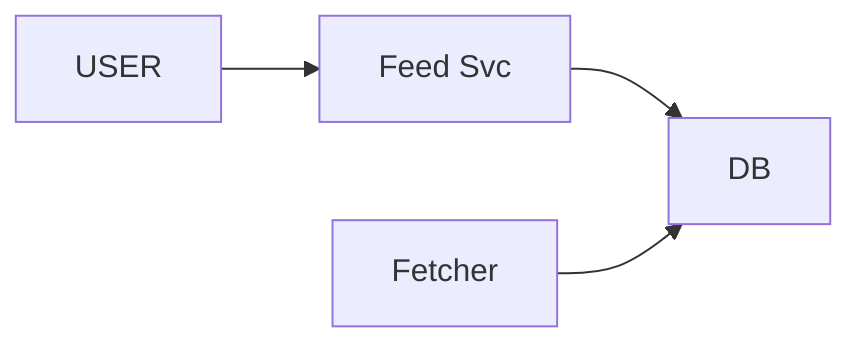

#### 1 Subah maine app khola, sabko wahi 20 khabar, har baar DB se
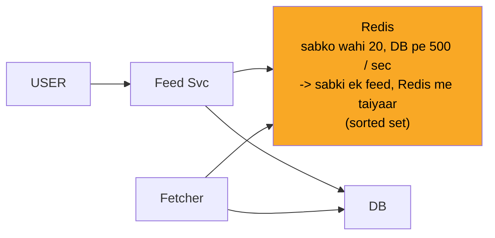
```
TASVEER: ek list, sab padhein
  feed:latest (sorted set, score = kab chhapi):  9:05 a90 | 9:03 a77 | 9:01 a45 | 8:58 a12 | ... (top 500)
  nayi khabar 9:06 a91 -> ZADD -> apne time pe, sabse upar
  10 lakh user app kholein -> sab ZREVRANGE 0 19 -> wahi 20 id -> DB tak koi nahi
```
```
AAGE POOCHEGA:
  NIYAM: sabko ek jaisi feed = ek baar bana ke Redis me (sorted set, time se); har user DB nahi jaata;
         nayi khabar aate hi list me apni jagah, user ko turant dikhti.
  "Kaise kaam karta?"             -> pehle har user pe DB "ORDER BY published_at DESC LIMIT 20". Ab Redis
                                     SORTED SET feed:latest (score = kab chhapi): nayi khabar ZADD, top 500
                                     rakho; khola -> ZREVRANGE feed:latest 0 19 -> 20 id. ~99% DB tak nahi.
  "Breaking news turant chahiye?" -> AATE HI ZADD: asal me turant dikhti; "5 min" sirf sabse bura haal.
  "Neeche scroll kiya (21-40)?"   -> AGLA TUKDA: ZREVRANGE 20 39, ya cursor (aakhri dekhi ke time se pehle ki
                                     20).
```

#### 2 Meri feed me khabar 20 minute purani
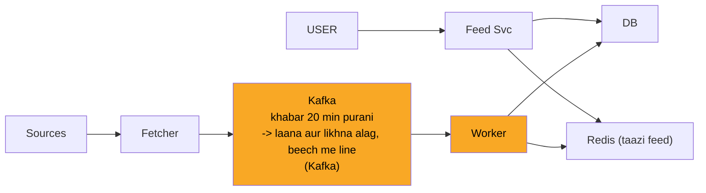
```
AAGE POOCHEGA:
  NIYAM: laana aur padhna alag: laana peeche apni speed se (Kafka line); user sirf Redis ki taiyaar list
         padhta -> laane me der / bheed ho tab bhi feed khulti, bas thodi purani.
  "Kaise kaam karta?"                    -> pehle 1 fetcher 1000 source ek-ek = ~20 min. Ab kai fetcher ->
                                            KAFKA (10 partition); worker apni speed se, OFFSET yaad.
  "Likhna, padhna alag kyun rakha?"      -> USER KABHI NA RUKE: laana peeche apni speed se, user hamesha cache
                                            ki taiyaar feed padhe.
  "1000 source ek saath aaye?"           -> LINE LAMBI HUI, kuch gira nahi: Kafka disk pe rakhta, worker apni
                                            speed se.
  "Har source kitni baar dekhoge?"       -> APNA-APNA SAMAY: NDTV har 1 min, chhota blog har 15 min.
  "Kuch naya nahi, phir bhi download?"   -> NAHI, ETag / Last-Modified: source bole "kuch naya nahi" to
                                            download hi nahi.
  "Worker ne ek khabar do baar likh di?" -> UNIQUE PE RUKTI: URL / text hash UNIQUE -> INSERT ... ON CONFLICT
                                            DO NOTHING -> skip.
  "Kafka kyun, SQS kyun nahi?"           -> SQS BHI CHALTA; Kafka me search / analytics apne group se padhte,
                                            dobara bhi.
```

#### 3 8 baje election result, 40 guna bheed
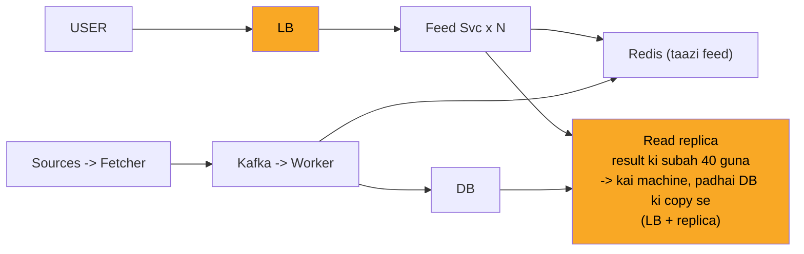
```
DIKKAT     8 baje election result: aam 500 / sec ki jagah 20,000 / sec. Ek Feed Svc machine ka CPU bhara,
           cache miss seedha primary DB pe, jahan fetcher bhi likh raha -> dono dheeme.
HAL        kai machine + DB ki copy (LB + READ REPLICA): Feed Svc kuch yaad nahi rakhti -> kai machine + LB.
           Redis me na mile to DB ki copy (replica) se padho; main DB sirf likhne ke liye.
NAHI       Kafka se bheed sambhalo: Kafka likhne ke raaste ke liye hai, padhai ki bheed nahi jhelta.
```
```
AAGE POOCHEGA:
  NIYAM: padhai copy pe, likhai main pe; jo kuch yaad nahi rakhta (Feed Svc) uski machine badhao; copy
         thodi peeche ho to user ko kuch sec purani khabar, nuksaan nahi.
  "Pata hai 8 baje bheed aati?" -> PEHLE SE BADHAO: 7:45 pe machine (scheduled scaling) + cache pehle bharo.
  "Replica kitni peeche rehti?" -> KUCH SECOND: news me chalta, kyunki 5 sec purani khabar se nuksaan nahi.
```

#### 4 Dopahar "India ne match jeeta", meri feed me 5 baar
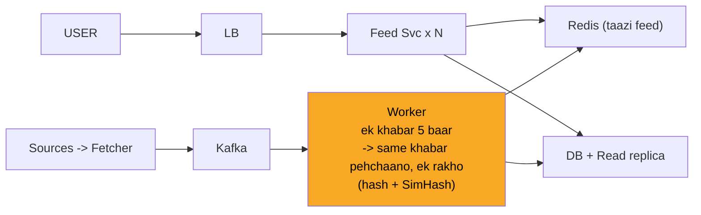
```
TASVEER: Bloom filter (bit-line)
  bits:   [0] [0] [1] [0] [1] [0] [0] [1] [0] [0]      (jagah 0..9)
  URL-A -> hash = 2, 4, 7 -> teeno 1      -> SHAYAD dekha -> skip
  URL-B -> hash = 1, 4, 8 -> jagah 1 pe 0 -> PAKKA naya -> laao, jagah 1, 4, 8 = 1
  galat "naya" kabhi nahi · galat "dekha" kabhi-kabhi (ek nayi khabar chhoot sakti, news me chalta)
```
```
AAGE POOCHEGA:
  NIYAM: ek khabar ek baar: pehchaan (hash) same = khabar same, URL chahe alag; kabhi ek nayi chhoot jaaye
         to chalta (news), par user ko ek khabar 5 baar nahi.
  "Kaise kaam karta?"                -> title chhote akshar, chinh hatao -> hash; same hash = same khabar.
                                        Thoda alag ("India wins" / "won") -> SimHash, "90% same" = duplicate.
  "Wahi URL fetcher dobara le aaya?" -> BLOOM FILTER: bit-line + kuch hash; URL ki jagahon pe koi 0 = pakka
                                        naya · saare 1 = SHAYAD dekha (galat "na" kabhi nahi).
  "Bloom kyun, Redis SET kyun nahi?" -> RAM BACHAO: crore URL = bahut RAM, Bloom thodi memory; galat "haan" se
                                        kabhi ek nayi khabar chhoot sakti, news me chalta.
  "Bloom se URL hatana ho?"          -> NORMAL BLOOM ME NAHI: roz naya filter, purana phenko (ya counting
                                        Bloom).
  "5 me se kaunsa source dikhao?"    -> JO PEHLE AAYA / BADA source; baaki "aur sources" me link.
```

#### 5 Dopahar baad meri feed ruki: ek chhota source 30 sec atka, baaki 999 bhi ruke
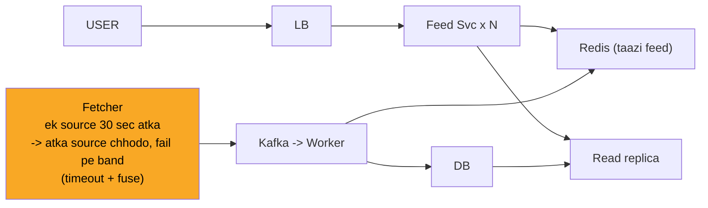
```
AAGE POOCHEGA:
  NIYAM: ek beemar source baaki ko na roke: had tak intezaar, phir fuse; us source ki khabar kuch der
         nahi aati, baaki feed chalti rehti.
  "Kaise kaam karta?"            -> har site 2-3 sec timeout, thodi retry; baar-baar fail -> fuse OPEN, us
                                    source ko call hi nahi. Baaki 999 apne raaste.
  "Fuse wapas kab judta?"        -> HALF-OPEN TEST: CLOSED -> (kai fail) OPEN -> (thodi der) ek test call ->
                                    theek to CLOSED.
  "Source ne 429 diya?"          -> DHEERE CHALO: us source ka samay badhao + uska Retry-After maano.
  "Source hamesha ke liye band?" -> ALERT + HATAO: kuch din OPEN raha -> list se bahar.
```

#### 6 Shaam ko mujhe sirf tech aur sports chahiye
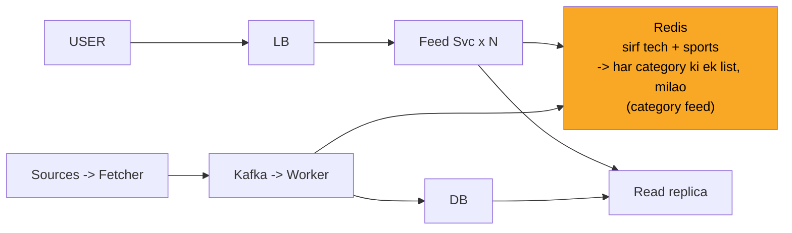
```
DIKKAT     Shaam ko mujhe sirf tech aur sports pasand. Har user ki alag feed (10 lakh feed) bahut mehngi.
HAL        har category ki ek list (CATEGORY FEED): feed:tech, feed:sports. Mere liye dono ke top 20, time se
           milao (ya ZUNIONSTORE). 10 lakh feed ki jagah sirf ~20 category feed.
NAHI       har baar DB se WHERE category IN (tech, sports): har khulne pe DB, cache ka fayda gaya.
```
```
AAGE POOCHEGA:
  NIYAM: list category ki pehle se (feed:tech), milana padhte waqt; user ki pasand = kaunsi list milaani,
         har user ki alag feed nahi.
  "Mujhe tech zyada pasand, alag wazan?" -> TAB ASLI PERSONALIZATION: har user ki ranking service, kyunki
                                            category list sabki same (scope se bahar).
```

#### 7 Raat ko maine "cricket" dhoondha, poori table padhi gayi
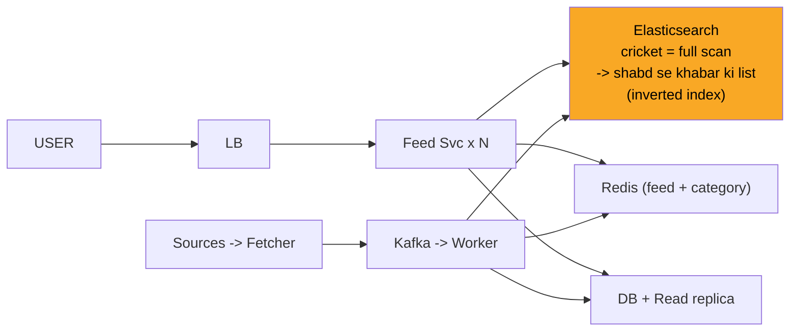
```
AAGE POOCHEGA:
  NIYAM: ES sirf dhoondhta (id deta), sach DB me; ES gira / galat -> DB se dobara bana lo: khabar kabhi
         nahi khoti, bas us beech search dheemi / band.
  "Kaise kaam karta?"               -> pehle LIKE '%cricket%' = full scan. INVERTED INDEX = kitaab ke peeche
                                       ki index: shabd -> kin khabaron me. ES se id, text DB / cache se.
  "'cricket kohli' kaise?"          -> DONO LIST MILAO: "cricket" -> [a12, a45, a90] · "kohli" -> [a45, a77];
                                       OR = dono jodo, AND = jo dono me (a45) -> score se sort.
  "ES aur DB me data alag ho gaya?" -> DB = SACH: ES dobara bana lo (reindex); likhna fail -> retry ki line.
  "Galat likha (crikcet)?"          -> FUZZY SEARCH (ES): 1-2 akshar ka farak chalta.
  "Postgres se nahi chalega?"       -> CHHOTE SCALE PE HAAN (full-text, GIN); ES = ranking, galat spelling,
                                       bahut data, DB pe bojh nahi.
```

#### 8 Raat ko DBA ka mail: 6 mahine me ~2 crore row, kharcha badhta ja raha
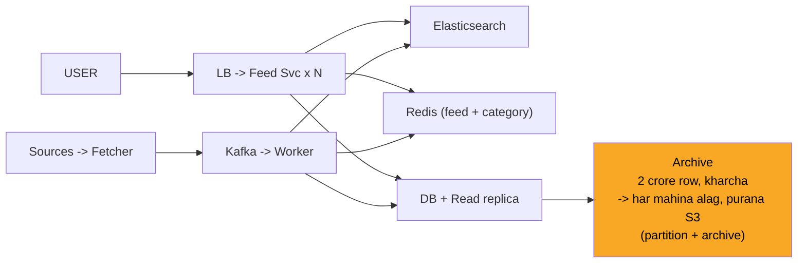
```
DIKKAT     Usi raat DBA ka mail: 6 mahine me ~2 crore khabar ki row, disk / backup ka kharcha badh raha.
           Taazi 20 ke alawa purana koi padhta hi nahi. (Query dheemi NAHI hui: published_at pe index hai.)
HAL        mahine alag, purana S3 (PARTITION + ARCHIVE): Postgres me har mahine ka alag tukda. Purana ->
           DETACH -> S3 archive. Jo kabhi nahi chahiye -> tukda DROP (ek pal ka kaam).
NAHI       "sharding karo": ye purana hatana (retention) hai, data baantna (sharding) nahi.
```
```
AAGE POOCHEGA:
  NIYAM: hafta garam (Postgres), baaki thanda (S3); purani khabar khulti, bas dheemi; purana hatana =
         retention, sharding nahi.
  "1 saal purani khabar khuli?" -> ARCHIVE (S3) SE aayegi: dheemi, par use koi kabhi-kabhi hi kholta.
  "DETACH pe table lock hoga?"  -> NORMAL DETACH = ACCESS EXCLUSIVE poore table pe (pal bhar, feed padhai bhi
                                   rukti); PG 14+ DETACH PARTITION ... CONCURRENTLY -> kuch nahi rukta.
  "3 saal baad kya?"            -> WAHI NIYAM: hafta garam, baaki thanda; DB utna hi rehta.
```

#### 9 Mail ka doosra hissa: source 100 guna hue to ek DB machine nahi jhelegi
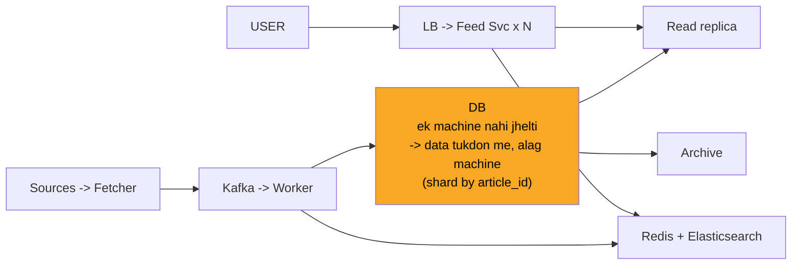
```
DIKKAT     Mail aage: "source 100 guna ya log khud content daalne lage to ek DB likhai aur data nahi jhelegi."
           (Hamare number pe ek DB kaafi hai, ye sirf bahut bade scale pe.)
HAL        data tukdon me, alag machine pe (SHARD): hash(article_id) se -> likhai sab tukdon pe barabar.
           Keemat: "taazi 20" ke liye har tukde se thoda (scatter-gather), par wo to Redis se aata hi hai.
NAHI       date se baanto: aaj ki saari likhai aaj wale shard pe -> wo akela garam.
```
```
AAGE POOCHEGA:
  NIYAM: baantne ki key wo jo bojh barabar baante (article_id ka hash); ek shard garam / mara to sirf
         uska hissa dheema, baaki chalta.
  "Category se baanto?"               -> SKEW: sports / politics bade, baaki chhote -> bojh barabar nahi.
  "Shard badhaye, data kitna hilega?" -> THODA SA (consistent hashing): sirf naye shard ke hisse ka.
```

---

## AAKHRI DABBA + WRAP (ek hi baar)

```
LIKHNA: Sources -> Fetcher (timeout / dobara / skip + fuse) -> Kafka (bheed sambhaale)
        -> Worker (saaf + dedupe + category) -> DB + Redis + Elasticsearch
PADHNA: LB -> Feed Svc (kai machine) -> Redis (99%, taazi feed pehle se bani) -> nahi mila to read replica
        search = Elasticsearch · purani khabar = Archive

DB:  Postgres (primary + read replica + mahine ke tukde) -> likhai sirf ~1 / second, ek machine kaafi;
     "taazi 20" index se seedha; padhai Redis aage se sambhaalta
     (likhai 100 guna ho jaaye tab hi Cassandra jaisa / shard socho)
```
```
JAWAB:    Khabar laana aur khabar dikhana alag raaste. Peeche fetcher sites se laata, Kafka se worker
          tak, worker saaf karke, ek khabar ek baar, category laga ke DB me rakhta.
          Sabko lagbhag wahi feed, to Redis me pehle se bani, 99% wahin se. Feed service kai machine pe,
          purani khabar sasti jagah, search Elasticsearch pe.
```
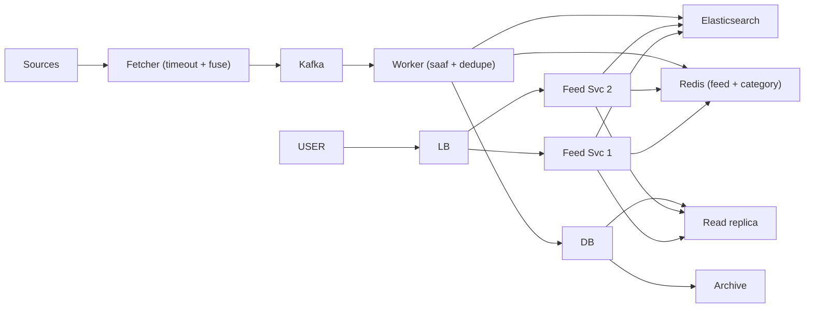

---

## 10 GUNA TRAFFIC — har dabba alag se

```
PADHNA: Feed Svc  -> kai machine + LB
        Redis     -> gira? cluster + replica, nahi mila to read replica
        DB        -> READ REPLICA · jagah -> ARCHIVE (+ bahut bade scale pe shard)
LIKHNA: Fetcher   -> source band / dheema -> timeout + dobara + skip + fuse
        Kafka     -> 1000 ek saath -> line sambhaale, partition badhao
        Worker    -> kai worker ek saath
AAGE:   pasand wali feed (category cache) · photo CDN · ML ranking · badi khabar turant push

POOCHEGA: "How would you scale this to 10x?"      -> dono raaste alag chalao, pehle jo toote
POOCHEGA: "What's the single point of failure?"   -> "ek machine giri to sab?" -> uski copy
                                                     · source band -> fuse + skip
POOCHEGA: "How do you know it's working?"         -> feed p99 ·
          cache hit rate · Kafka lag · source error rate · alert
```

---

## POOCHE TO (gehra sawaal aaye tab)

```
API:      GET /feed?page=1&category=tech -> taazi list (page me, neeche scroll; 10,000 ek saath nahi)
          GET /article/{id} · GET /search?q=cricket · POST /ingest { source data } (andar, peeche)
          GET = padhna · POST = kuch badalna (ulta mat karna)

DB:       ARTICLE: id | title | content | sourceId | category | publishedAt | url
          SOURCE:  id | name | rssUrl | lastFetchedAt
          USER_PREFS (optional): userId | categories[] | savedArticles[]
          Postgres: likhai ~1 / second (chhoti), "ORDER BY published_at DESC LIMIT 20" index se,
                    primary + read replica, mahine ke tukde (partition) -> purana archive
          Mongo bhi chal jaata (replica set + TTL). Cassandra tab jab likhai bahut badi ho jaaye;
          par Cassandra me primary-replica nahi (sab node barabar, leaderless)
          aur poori table pe "taazi 20" nahi chalta -> isliye yahan nahi.
```

---

ARCHETYPE A+E · CONCEPTS: [elasticsearch](../../FOUNDATIONS/12_elasticsearch_search.md) · [caching](../../FOUNDATIONS/04_caching.md) · saath: [twitter-feed](../03_twitter_feed/03_twitter_feed.md) · [← MASTER SHEET](../../00_MASTER_SHEET.md)
