# News Aggregator

> Alag-alag source (NDTV, TOI, BBC ...) se khabar kheencho, store karo, user ko ek feed do (Google News / Inshorts jaisa).
> Dil teen cheezein: padhne wale bahut zyada, likhne wale kam. Likhne ka raasta aur padhne ka raasta alag. Feed pehle se bana ke cache me.
>
> Mock me sirf heading + Cue + GIF. Neeche har card: **hal** · **kyun** · **nahi** (doosra kyun nahi) · **Pooche**.

---

## Poori tasveer (aakhir me design aisa banta hai)



---


## Shuru

- **FR:** sources se kheencho, store karo, feed do (taazi list), chaho to category / search · comments + ML ranking scope se bahar
- **NFR:** feed tez (yahi dil) · khabar taazi · lakhon user · ek source band ho to system na gire · har user feed kholta, khabar gine-chune source se, to padhna likhne se bahut zyada
- **numbers:** 10 lakh user x 5 baar = 50 lakh padhai roz, din ~1 lakh sec -> ~50 / sec (subah 10 guna, ~500 / sec) · 1000 source har 5 min = ~3 lakh fetch roz · nayi khabar ~1 lakh roz = ~1 likhai / sec. Padhna >> likhna -> cache + read replica · likhna peeche -> queue · data badhta -> purana archive (bahut bade scale pe shard)

---

*ab tootega kahan? sabse pehle padhne pe, kyunki sab subah ek saath kholte hain*

## 1. Subah maine app khola, sabko wahi 20 khabar, har baar DB se

**Cue:** FEED CACHE (Redis SORTED SET) · dabba: Redis

- **pehle (sabse simple):** Fetcher sources se laata, DB me daalta. Feed Svc har baar DB se "taazi 20" sort karke deta.
- **hal:** sabki ek feed ek baar, Redis me time se (sorted set). Nayi khabar `ZADD feed:latest`, kholne pe `ZREVRANGE 0 19` = 20 id. DB tak koi nahi.
- **kyun:** sabko ek jaisi feed, to ek baar bana ke Redis me. Nayi khabar aate hi apni jagah, turant dikhti.
- **nahi:** har user pe DB se `ORDER BY ... LIMIT 20` -> yahi pehle tha, DB 500 / sec sort, feed dheemi. Ab ~99% DB tak nahi.
- **Pooche:** khabar kitni taazi chahiye, 5 min purani chalegi? -> chalegi, to feed pehle se bana ke cache me
- **Pooche:** breaking news kitni der me? -> aate hi ZADD, turant. "5 min" sirf sabse bura haal.
- **Pooche:** neeche scroll (21-40)? -> `ZREVRANGE 20 39`, ya cursor: aakhri dekhi khabar ke time se pehle ki 20
- **Pooche:** Redis restart, list khaali? -> DB se ek baar bana lo, lock ke saath: ek banaye, baaki ruk ke Redis se
- **Pooche:** Redis me list kitni lambi? -> top 500, RAM chhoti. Usse purani chahiye to DB.

---

*ab padhna tez ho gaya, par khabar hi der se aa rahi*

## 2. Meri feed me khabar 20 minute purani

**Cue:** KAFKA: laana aur likhna alag · dabba: Kafka + Worker

- **hal:** fetcher sirf laata, Kafka me daalta (key = source_id). Worker apni speed se Kafka se padh ke DB + Redis me. Kai fetcher, Kafka 10 partition, phir worker.
- **kyun:** laana aur padhna alag. User sirf Redis list padhta; laane me der / bheed ho tab bhi feed khulti, bas thodi purani.
- **kyun:** ek source atke, baaki chalte rehte
- **nahi:** fetcher hi DB me likhe -> pehle yahi tha: 1000 source ek-ek karke, A atka to B se Z line me khade
- **nahi:** SQS -> chal jaata, par Kafka me search / analytics apne group se wahi khabar padh lete, dobara bhi
- **Pooche:** source pe kuch naya nahi? -> ETag / Last-Modified dekho. "Naya nahi" to download hi nahi.
- **Pooche:** 1000 khabar ek saath? -> line lambi, gira kuch nahi. Kafka disk pe rakhta, worker apni speed se.
- **Pooche:** worker ne likha, Kafka commit se pehle crash, naya worker dobara likhe? -> DB khud roke: url pe UNIQUE, `ON CONFLICT DO NOTHING`
- **nahi:** wahan Bloom se rokna -> Bloom DB se alag, Bloom update se pehle crash ho sakta, khabar feed me do baar
- **Pooche:** har source kitni baar dekhoge? -> apna-apna samay: NDTV har 1 min, chhota blog har 15 min

---

*ab khabar taazi, par 8 baje sab ek saath aa gaye*

## 3. 8 baje election result, 40 guna bheed

**Cue:** LB + READ REPLICA · dabba: LB + Read replica

- **hal:** Feed Service kai machine pe, aage LB. Redis miss to DB ki copy (read replica) se. Main DB sirf likhai.
- **kyun:** padhai copy pe, likhai main pe. Feed Svc kuch yaad nahi rakhti, machine badhao, koi bhi request le.
- **kyun:** copy thodi peeche = kuch second purani khabar, nuksaan nahi
- **nahi:** ek Feed machine -> 500 se seedha 20,000 / sec, CPU bhar gaya
- **nahi:** miss main DB pe -> wahan fetcher bhi likh raha, bheed ki padhai likhai ko bhi dheema karti
- **Pooche:** 8 baje ka pata tha? -> 7:45 pe machine badhao (scheduled scaling) + cache pehle bharo
- **Pooche:** 20,000 / sec aur badhe? -> aur machine. Feed Svc kuch yaad nahi rakhti, koi bhi le.
- **Pooche:** copy peeche reh gayi? -> kuch second. 5 sec purani khabar se nuksaan nahi.
- **Pooche:** ek hi key pe 20,000 / sec? -> Redis ki replica + App me 1-2 sec ki copy. Ek machine pe sab nahi.

---

*ab bheed sambhal li, par feed me wahi khabar baar-baar*

## 4. Dopahar "India ne match jeeta", meri feed me 5 baar

**Cue:** DEDUPE (title hash + SimHash) · dabba: (Worker me dedupe)

- **hal:** dekha hua URL Bloom filter se, wahi khabar title ke hash se (Bloom + SimHash). Title chhote akshar, chinh hatao, phir hash.
- **kyun:** same hash = same khabar, URL chahe alag ho (5 source, alag URL, thoda alag title). Ek khabar ek baar.
- **Bloom:** URL ki jagah koi bit 0 = pakka naya, sab 1 = shayad dekha. Kabhi nayi chhoot jaaye to news me chalta.
- **nahi:** har naya URL = nayi khabar -> pehle yahi tha, 5 source = feed me 5 baar
- **nahi:** Redis SET -> crore URL = bahut RAM. Bloom ka galat "haan" kabhi ek nayi chhudaye, news me chalta.
- **nahi:** har worker apna Bloom -> ek ne dekha, doosre ko pata nahi. Isliye ek saanjha Bloom (Redis me).
- **Pooche:** "wins" vs "won", hash alag? -> SimHash: 90% same = duplicate
- **Pooche:** 5 me se kaunsa dikhaoge? -> jo pehle aaya ya bada source. Baaki "aur sources" me link.
- **Pooche:** Bloom se URL hatana? -> normal Bloom me nahi hota. Roz naya filter, purana phenko (ya counting Bloom).

---

*ab khabar saaf, par ek source hi atak gaya*

## 5. Dopahar baad nayi khabar aani ruki: ek chhota source 30 sec atka, baaki 999 bhi ruke

**Cue:** TIMEOUT + CIRCUIT BREAKER · dabba: (Fetcher me breaker)

- **hal:** thodi der me chhodo (timeout, 2-3 sec, thodi retry). Baar-baar fail to call hi mat karo (circuit breaker). OPEN = us source ko call nahi.
- **kyun:** ek beemar source baaki ko nahi rokta. Had tak intezaar, phir breaker. Us source ki khabar kuch der nahi, baaki feed chalti.
- **nahi:** poora jawab aane tak ruko -> wahi 30 sec, ek atka, 999 peeche
- **Pooche:** breaker kab wapas chalu? -> thodi der baad HALF-OPEN: ek test call. Theek to CLOSED.
- **Pooche:** source ne 429 diya? -> dheere chalo. Uska samay badhao, Retry-After maano.
- **Pooche:** kuch din se OPEN hi? -> alert, aur list se bahar

---

*ab sab khabar aa rahi, par mujhe sab nahi chahiye*

## 6. Shaam ko mujhe sirf tech aur sports chahiye

**Cue:** CATEGORY FEED, padhte waqt milao · dabba: (Redis me feed:tech)

- **hal:** har category ki list pehle se (`feed:tech`, `feed:sports`). Khabar aayi to apni list me. Khola to tech + sports ke top 20 time se milao (category feed).
- **kyun:** list pehle se bani, milana padhte waqt. User ki pasand = kaunsi list milaani. Sirf ~20 list, 10 lakh nahi.
- **nahi:** har user ki alag feed -> 10 lakh feed, har nayi khabar sab me daalni, bahut mehnga
- **Pooche:** ek khabar 2 category me? -> dono list me ZADD. Milate waqt id se dedupe, do baar na dikhe.
- **Pooche:** mujhe tech zyada pasand? -> wo asli personalization, har user ki ranking. Scope se bahar.

---

*ab feed ban gayi, par dhoondhna dheema*

## 7. Raat ko maine "cricket" dhoondha, poori table padhi gayi

**Cue:** INVERTED INDEX · dabba: Elasticsearch

- **hal:** har shabd ki list, wo kis-kis khabar me (inverted index, Elasticsearch). "cricket" -> [a12, a45, a90]. ES sirf id deta, text DB / cache se.
- **kyun:** ES sirf dhoondhta, sach DB me. ES gira / galat to DB se dobara bana lo. Khabar nahi khoti, bas search dheemi / band.
- **nahi:** `LIKE '%cricket%'` -> % aage to index nahi, poori table (2 crore row ek-ek) padhi jaati
- **nahi:** Postgres search -> chhote scale pe haan (full-text, GIN). ES chahiye ranking, galat spelling, bahut data, DB pe bojh nahi.
- **Pooche:** "cricket kohli"? -> dono list milao: [a12, a45, a90] aur [a45, a77]. AND = a45, OR = sab. Phir score se sort.
- **Pooche:** "crikcet" likh diya? -> fuzzy (ES): 1-2 akshar ka farak chal jaata
- **Pooche:** ES aur DB alag ho gaye? -> DB sach, ES dobara bana lo (reindex). Likhna fail to retry ki line.

---

*ab sab chal raha, par data bhar raha*

## 8. Raat ko DBA ka mail: 6 mahine me ~2 crore row, kharcha badhta ja raha

**Cue:** mahine ka PARTITION, purana ARCHIVE · dabba: Archive (S3)

- **hal:** har mahine ka alag tukda (partition), purana S3 pe (archive). Postgres me sirf haal ke mahine.
- **kyun:** naya mahina garam (Postgres, index se tez), purane thande (S3, sasta). Purani khabar khulti, bas dheemi.
- **kyun:** purana hatana = retention, sharding nahi
- **nahi:** sab ek table me (May se Oct) -> purana koi padhta nahi, par uski disk + backup ka faltu kharcha
- **Pooche:** mahina beet gaya? -> DETACH karke S3. Bilkul nahi chahiye to DROP. Pal ka kaam.
- **Pooche:** DETACH pe lock? -> normal DETACH = poore table pe pal bhar ka lock, padhai bhi rukti. PG 14+ `DETACH ... CONCURRENTLY`, kuch nahi rukta.
- **Pooche:** 1 saal purani khabar khuli? -> S3 archive se. Dheemi, par kabhi-kabhi hi khulti.
- **Pooche:** 3 saal baad DB kitna? -> utna hi. Naya mahina garam, purana thanda (S3).

---

*ab jagah theek, par source hi 100 guna ho gaye*

## 9. Mail ka doosra hissa: source 100 guna hue to ek DB machine nahi jhelegi

**Cue:** SHARD hash(article_id) · dabba: (DB ke tukde)

- **hal:** article_id se tukde, har tukda alag machine (shard). `hash(a91)` -> shard 2. Likhai sab tukdon pe barabar.
- **kyun:** baantne ki key wo jo bojh barabar baante = article_id ka hash. Ek shard garam / mara to sirf uska hissa dheema.
- **nahi:** ek machine -> saari likhai wahin, disk + likhai full
- **nahi:** category se shard -> bojh tirchha (skew): sports / politics bade, baaki chhote
- **Pooche:** taazi 20 kahan se? -> Redis se. Miss to har tukde se thoda (scatter-gather).
- **Pooche:** shard badhaya? -> thoda hilta (consistent hashing). Sirf naye shard ke hisse ka data.
- **Pooche:** do shard pe wahi khabar? -> dedupe pehle saanjhe Bloom / Redis se. DB ka UNIQUE sirf shard ke andar.

---

## Poora design ek saans me

```
LIKHNA: Sources -> Fetcher (timeout / dobara / skip + breaker) -> Kafka (bheed sambhaale)
        -> Worker (saaf + dedupe + category) -> DB + Redis + Elasticsearch
PADHNA: LB -> Feed Svc (kai machine) -> Redis (99%, taazi feed pehle se bani) -> nahi mila to read replica
        search = Elasticsearch · purani khabar = Archive
DB:     Postgres (primary + read replica + mahine ke tukde), likhai sirf ~1 / second
```

Bolne ke liye: khabar laana aur khabar dikhana alag raaste. Peeche fetcher sites se laata, Kafka se worker tak, worker
saaf karke, ek khabar ek baar, category laga ke DB me rakhta. Sabko lagbhag wahi feed, to Redis me pehle se bani, 99%
wahin se. Feed service kai machine pe, purani khabar sasti jagah, search Elasticsearch pe.

---

## 10 guna traffic

- **Feed Svc**: kai machine + LB.
- **Redis**: gira to cluster + replica. Nahi mila to read replica.
- **DB**: read replica. Jagah ke liye archive (bahut bade scale pe shard).
- **Fetcher**: source band ya dheema to timeout + dobara + skip + circuit breaker.
- **Kafka**: 1000 ek saath aaye to line sambhaale, partition badhao.
- **Worker**: kai worker ek saath.
- **Aage**: pasand wali feed (category cache), photo CDN, ML ranking, badi khabar turant push.

**Pooche: 10 guna kaise?** Dono raaste alag chalao, pehle jo toote use badhao.

**Pooche: kahan se sab gir sakta?** Ek machine giri to sab? Uski copy. Source band to circuit breaker + skip.

**Pooche: chal raha hai, kaise pata?** Feed ka p99, cache hit rate, Kafka lag, source error rate, alert.

---

## Pooche to (kisi card me nahi baitha)

API: `GET /feed?page=1&category=tech` -> taazi list, page me (neeche scroll, 10,000 ek saath nahi).
`GET /article/{id}`, `GET /search?q=cricket`, aur andar peeche `POST /ingest { source data }`. GET = padhna, POST =
kuch badalna, ulta mat karna.

Row: ARTICLE = id, title, content, sourceId, category, publishedAt, url. SOURCE = id, name, rssUrl, lastFetchedAt.
USER_PREFS (optional) = userId, categories[], savedArticles[].

DB kyun Postgres: likhai ~1 har second (chhoti), `ORDER BY published_at DESC LIMIT 20` index se seedha, primary +
read replica, mahine ke tukde, purana archive. Padhai Redis aage se sambhaal leta.

Mongo bhi chal jaata (replica set + TTL). Cassandra tab jab likhai bahut badi ho jaaye (100 guna). Par Cassandra me
primary-replica nahi (sab node barabar, leaderless), aur poori table pe "taazi 20" nahi chalta, isliye yahan nahi.

- **Pehle poochho:** do hisse, khabar andar laana (ingestion) aur feed dikhana, kis pe focus?
- **Pehle poochho:** kitne source, 10 ya 10,000?
- **Pehle poochho:** feed sabki same hai ya har user ki alag?
- **Pehle poochho:** kitne user, kitni khabar roz?

---

ARCHETYPE A+E · CONCEPTS: [elasticsearch](../../FOUNDATIONS/12_elasticsearch_search.md) · [caching](../../FOUNDATIONS/04_caching.md) · saath: [twitter-feed](../03_twitter_feed/03_twitter_feed.md) · [← MASTER SHEET](../../00_MASTER_SHEET.md)
