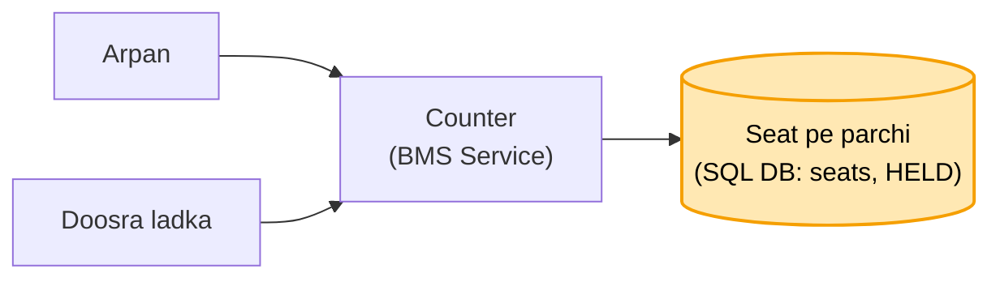
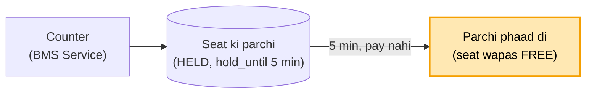
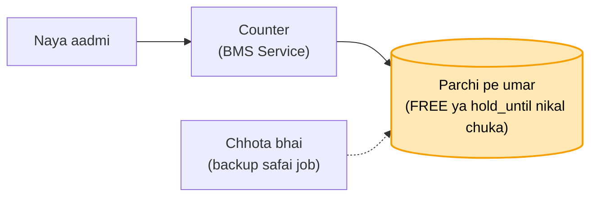
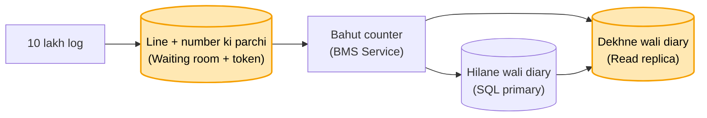
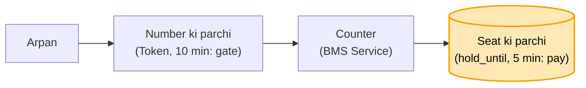
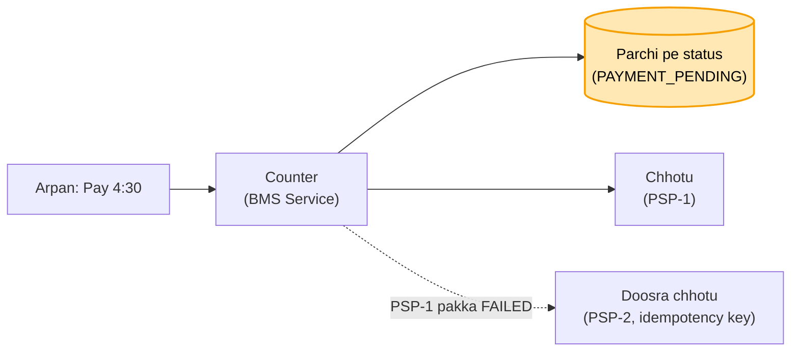

# BookMyShow: do counter, ek seat ki kahani

Arpan BookMyShow pe Avengers ke pehle show ki seat D5 book kar raha hai. Socho cinema ke do counter hain, dono ek hi
seat bech rahe, aur ek ko doosre ka pata nahi. Kaam: ek seat kabhi do logon ko na bike, aur advance booking wale din
10 lakh ki bheed me bhi jo pay kar raha uska kaam na atke.

Har kadam = **kahani** (dikkat aur hal, bolne wali bhasha) -> **Asli naam** (interview me yahi shabd) -> tasveer
(kahani ka shabd, bracket me asli naam).

---

## FR / NFR / Numbers (interview me pehle 2 minute)

```
FR      show aur seat map dekho · seat chuno -> pay karo -> ticket pakka
NFR     ek seat kabhi do logon ko na bike (yahi dil hai) · seat map dekhna tez · badi movie ke din ki bheed jhele
Numbers advance booking 10 baje: 10 lakh log ek saath, seat sirf 50 hazaar · 100 log map dekhte to ~1-2 book karte
        -> dekhna bahut, likhna kam · data chhota (aaj + agle hafte ke show), purana archive
```

---

## 1. Do counter, ek seat (dekhna aur parchi lagana ek saath)

Maine D5 chuni aur "book" dabaya, usi second ek aur ladke ne bhi D5 pe book dabaya. Dono ke app ne seat khaali dekhi,
aur dono ko "seat mil gayi" aa gaya. Ye isliye hua kyunki seat dekhna aur seat book karna alag-alag rakha tha, beech
me doosra ghus gaya. To dono ko ek saath rakho. Maan lo do counter hain, main is counter pe, doosra us counter pe, aur
andar ek hi seat bachi. Dono counter ko nahi pata ki doosra bhi wahi seat bech raha. Maine kaha "ek seat chahiye, lo
mere paise". Mere counter wale ne jaake seat pe ek parchi rakh di: "ye Arpan ki seat hai, Arpan iska payment karega,
ye Arpan ko milegi, kisi aur ko nahi." Doosra counter wala dekhta hai "achha, yahan Arpan ki parchi lagi hai, ise main
bech nahi sakta", aur ladke ko bol deta hai "tu ja bhai, seat book ho gayi".

**Asli naam:** dekhna aur parchi ek saath = ek hi query `UPDATE seats SET status = HELD ... WHERE seat = D5 AND
status = FREE`, parchi = hold, doosre counter ko mana = uski query me 0 row badli, "seat chali gayi". Ye banking wali
kahani se aaya (wahan `WHERE balance >= 500`, yahan `WHERE status = FREE`). Register = SQL DB (Postgres): data chhota,
aur pay hua to seat + booking + payment teeno ek saath badlein ya koi nahi, ye transaction SQL ka seedha kaam hai.



## 2. Parchi laga ke chai peene chala gaya (5 minute ki parchi)

Maine D5 pe parchi laga di, phir pay kiye bina phone rakh ke chai peene chala gaya, aur kabhi wapas nahi aaya. Ab D5 pe
hamesha ke liye meri parchi, koi aur le hi nahi sakta. To parchi ko bas thodi der ke liye wahin rehne do. Counter wala
dekh raha: "ye payment kar raha, chal main 5 minute tak dekhta hoon. Aa gaya to theek, nahi to hata dunga yahan se."
Usne 5 minute intezaar kiya, main nahi aaya, to parchi phaad ke phenk di. Seat agle ke liye.

**Asli naam:** 5 minute tak dekhta hoon = hold expiry (`hold_until = now + 5 min`), parchi phaad ke phenk di = hold
hata ke seat wapas FREE, pay aa gaya to HELD -> BOOKED.



## 3. Parchi phaadne wala chhutti pe (chhota bhai, ya parchi pe hi umar)

Parchi phaadne wala counter wala har minute ghoom ke purani parchiyan dekhta hai. Aaj wo chhutti pe hai. Meri parchi
ko 20 minute ho gaye, abhi bhi D5 pe lagi, aur naya aadmi D5 lena chahta hai. Sabse pehli baat, parchi uthane wala
chhutti pe hai to uska ek chhota bhai rakh lo, wo kaam kar lega, ya us din ke liye uska replacement lao. Ya phir hum
us parchi pe hi umar laga dein ki wo apne aap wahan se gayab ho jaaye: parchi 5 minute tak yahan padi hai, 5 minute ke
baad tu hat ja, parchi khatam. Tab naya aadmi aaye to counter khud dekh leta hai ki parchi ki umar nikal chuki,
phaadne wale ka intezaar hi nahi.

**Asli naam:** chhota bhai / replacement = backup safai job (purane HELD ko FREE karta, taaki map pe seat jaldi khaali dikhe), parchi pe hi umar = shart
query me hi: `WHERE status = FREE OR (status = HELD AND hold_until < now)`, phaadne wale ka intezaar nahi.



## 4. 10 baje 10 lakh log (counter badhao, alag diary, hall jitne andar)

Avengers ki advance booking subah 10 baje khuli. 10 lakh log ek saath app pe toot pade, seat sirf 50 hazaar. Servers
doob gaye, aur jo asli me pay kar rahe the unke page bhi atke. To pehle counter badhao, server badhao. Phir jo sirf
dekhne aa raha uske liye ek alag diary, aur jo kuch hilane aa raha (parchi lagana, pay) uske liye alag diary, primary
aur replica wali cheez. Aur thode-thode log andar jaao, zyada nahi. Sabse pehli baat, cinema ki capacity kitni hai,
utne log andar. Maan lo mere hall me 1000 ki jagah aur saamne 5000 khade, to 1000 andar jaao, baaki 4000 ghar jaao. Aur
wo line me lago: "le bhai, ye teri parchi, tu jaayega, phir agla number tera."

**Asli naam:** counter / server badhao = kai BMS Service machine (load balancer ke peeche), kuch hilane wali diary =
SQL primary (saari HOLD / BOOKED query yahin), dekhne wale ki alag diary = read replica (seat map yahan se), capacity
jitne andar baaki line me = virtual queue (waiting room), ye teri parchi agla number tera = token (andar aane ka pass, umar 10 minute). Replica thoda peeche ho to chalega: map
sirf dikhata hai, faisla primary ki query karti hai. Server badhane se line wala kaam nahi hota, kyunki jhagda seat ki
chand rows pe hai, ek row ek hi jagah lock hoti hai; bheed ko register tak pahunchne se pehle hi rokna padta hai.



## 5. Token khatam, parchi baaki (do alag ghadi)

Line me mera number aaya, andar jaane ka token mila jo 10 minute chalega. Maine 8ve minute pe D5 chuni, to D5 pe 5
minute ki parchi lagi. 10ve minute pe token khatam, par parchi ke 3 minute baaki. Pay kar paunga? Haan. Humne token
diya, wo andar aa gaya, iska matlab wo authenticate ho chuka, ab koi dikkat nahi. Andar aa gaya, to haan bhai, seat
ruk gayi iske liye. Use utne time me payment karna hai jo uske liye allot hua. Kar diya to theek, nahi to parchi hata
do, seat agle ki.

**Asli naam:** token = sirf gate ka pass, hold = seat ki ghadi (`hold_until`). Do alag ghadiyan: token gate ki, hold
seat ki; pay ka faisla sirf hold ki ghadi karti. Token khatam = bas nayi seat HOLD nahi
kar sakta, dobara line. Pay ka raasta banking / payment wali kahani se aaya: dobara bheja to idempotency key (booking
id), paisa PSP se, webhook aaya tab D5 HELD -> BOOKED.



## 6. Pay dabaya, PSP dheema, parchi ki umar nikal gayi (status likh lo)

Maine 4:30 pe Pay dabaya, PSP dheema. 5:00 pe parchi ki umar khatam, 5:10 pe Priya D5 maang rahi, aur PSP ka jawab
6:00 pe aata hai "paisa kat gaya". Time ke andar Pay dabaya to seat meri, Priya ko nahi; humne vaada kar diya, warna
consumer court ka case. PSP dheema hai to galti meri nahi, hamari taraf ki hai. To parchi pe status likh lo: pay chal
raha hai, PSP ka jawab baaki. Jab tak ye likha hai, umar badha do, seat kisi aur ko dikhe hi nahi. Ya query me hi daal
do.

**Asli naam:** status likh lo = HELD -> PAYMENT_PENDING (Pay dabate hi), umar badha do = is status pe hold expire nahi
hota (na query na safai job isko chhoote). PSP ka SUCCESS -> BOOKED.

**Maan lo chhotu (PSP) jawab hi nahi de raha, 3-4 baar jagaya phir bhi chup:** user ne to pay kar diya, chhotu hamara
hai, uski bimaari ki saza user ko nahi. Kab tak rokun, peeche aur log hain, to uski seat book dikha do. Baad me chhotu
khud aake bole "main fail ho gaya", to user ko kuch nahi kehna: chhotu ko bolo dobara koshish kar, phir bhi nahi to
doosra chhotu. Ye hamare aur chhotu ke beech ka kaam hai, zimmedari hamari.
**Asli naam:** 3-4 baar jagaya = status job retry, book dikha do = PAYMENT_PENDING -> BOOKED, chhotu dobara / doosra
chhotu = server khud retry, phir PSP-2 (idempotency key ke saath, sirf jab PSP-1 pakka FAILED bole, warna do baar
katega). User tak FAILED nahi jaata.



---

Notes (Arpan ke shabd) = [BMS_HAND_NOTES.md](BMS_HAND_NOTES.md)
