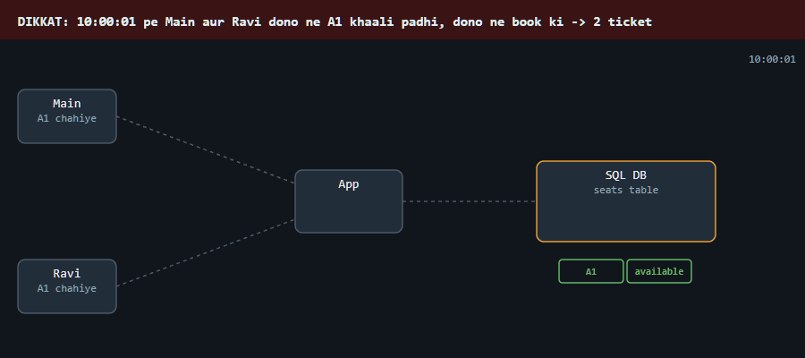
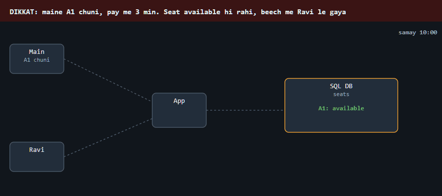
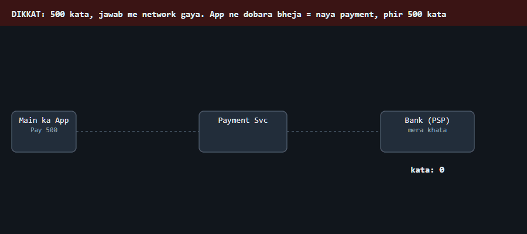
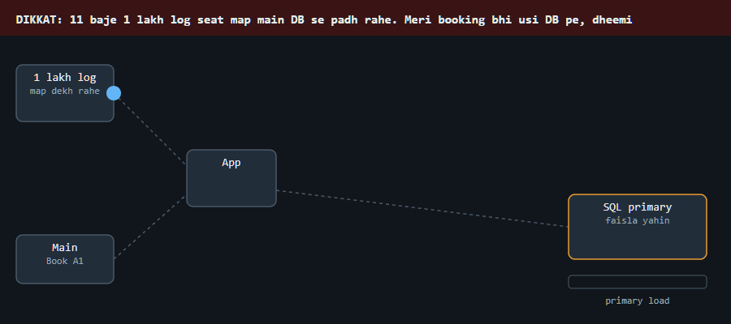
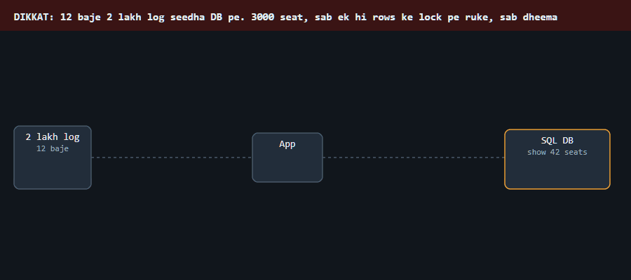
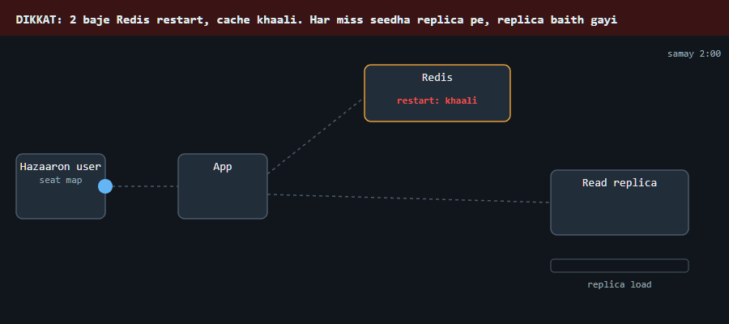
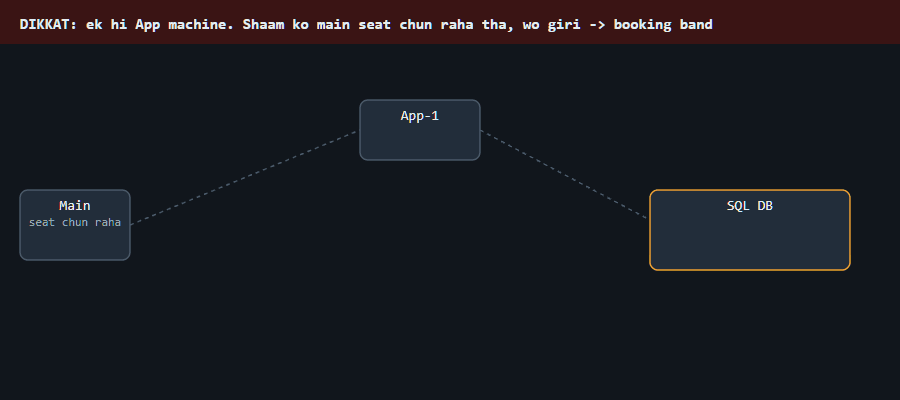

# BookMyShow (Ticket Booking)

> Movie / show dekho, seat chuno, pay karo, ticket. JP ke liye kaam ka: paisa aur seat ek saath sahi ("paisa do baar kharch na ho" jaisa).
> Dil do cheezein: ek seat do logon ko na bike (ek saath booking), aur badi movie ke din ki bheed.
>
> Mock me sirf heading + Cue + GIF. Neeche har card ek block: HAL (GIF ka ILAAJ) · KYUN · NAHI (doosra kyun nahi) · AGAR (cross-Q).
> Cross-Q: hal ke har bade shabd pe socho -> gira? · dheema / bheed? · do ek saath? · galat hua? · kaise / kitna?

---

## Poori tasveer (aakhir me design aisa banta hai)


---


## Shuru

```
FR      movies aur shows dekhna, seat map dekhna, seat book karna (payment ke saath) aur ticket pakka hona.
        Refund, recommendation aur review scope se bahar hain
NFR     ek seat kabhi do logon ko na bike (yahi dil hai), dekhna tez ho, badi movie ki bheed jhel le,
        aur system bharosemand ho
NUMBERS 1 crore user hain, par bojh do alag hain, isliye ek number mat bolo.
        Dekhna (shows, seat map) sab karte hain, lakhon padhai hoti hai, isliye cache aur read replica.
        Booking kam log karte hain, par ek hi seat pe ek saath aur jhatke me, isliye queue.
        Active data chhota hai (aaj aur agle hafte ke show), purana archive me jaata hai, isliye sharding nahi
PEHLE   seats table me seat_id, show_id, status. "Book" dabaya to status = 'booked'. Pehle padha (khaali),
        phir likha, to 10:00:01 pe dono ne A1 khaali dekhi aur dono ne book kar di
```

---

*ab tootega kahan? sabse pehle wahin jahan dil hai, ek seat pe do log*

## 1. Maine aur Ravi ne ek hi second me A1 book ki, dono ko mil gayi

Cue: ATOMIC UPDATE ... WHERE available



```
HAL     dekhna aur book karna ek hi atomic query me (UPDATE ... WHERE available). Row lock se Main ko 1 row
        milti hai, Ravi ko 0
        UPDATE seats SET status = 'booked' WHERE show_id = 42 AND seat_id = 'A1' AND status = 'available'
KYUN    faisla DB ki ek query karti hai, WHERE me khaali check hai. DB ka row lock ek-ek ko chalata hai: main
        pehle gaya, Ravi ruka, phir uske WHERE ko 0 row mili. Lock App me nahi, DB me hai
        jo jeeta use 1 row milti hai, A1 uski. Jo haara use 0 row, usko bolo "seat ja chuki, doosri chuno"
NAHI    SELECT ... FOR UPDATE -> LAMBA: chalta bhi hai, par DB pe do baar jaana padta hai aur lock lamba
           rehta hai. Ek statement me lock sabse chhota rehta hai
        version column (optimistic) -> RETRY: haarne wala dobara try karta hai. Conditional UPDATE me haarne
           wala seedha sunta hai "seat gayi"
AGAR    network toot gaya aur aakhri seat pe do log hain, consistency chunoge ya availability?
        -> ek hi system me dono chalte hain: booking me ek, search me doosra
        booking ke waqt network toota to?
        -> CP: sahi hona pehle. Seat khaali hai ya nahi, pakka nahi pata, to mana kar do. Ek seat do logon
           ko bechna usse bura hai
        search ke waqt network toota to?
        -> AP: movie list ya seat ginti 2 sec purani bhi chalegi, bas search chalta rahe
        Ravi ne Book phir se dabaya to?
        -> WHERE ko phir 0 row milegi. Dobara dabane se kuch nahi milta
        UPDATE ke liye seat ki rows pehle se bani hoti hain?
        -> haan. Show banate hi saari seat rows ban jaati hain, booking sirf UPDATE hai
        UPDATE me 4 seat li aur A4 pehle hi ja chuki thi to?
        -> sab ek transaction me. Badli rows 4 nahi hain to ROLLBACK, kyunki aadhi booking bekaar hai
        row lock ke saath 4 seat, aur do log ulte kram me le rahe hain to?
        -> DB deadlock pakad ke ek ko abort karta hai, wo retry kare. Alag-alag UPDATE ho to seat_id ke kram
           me bhejo
```

---

*ab seat ek ko mili, par payment me waqt lagta*

## 2. Maine A1 chuni, payment me 3 minute lag rahe

Cue: HOLD + held_until (umar)



```
HAL     A1 HELD ho jaati hai, held_until = ab + 5 min. Ravi ko A1 held dikhti hai. Umar khatam ho gayi to
        Sweeper seat chhod deta hai
HOLD    usi row me held_until = ab + 5 min likhte hain. Pay ho gaya to BOOKED. Umar khatam ho gayi to seat
        khaali maano
KYUN    hold DB ki usi row ka haal hai (held + umar). Mujhe 5 min ke liye seat pakki, baaki sabko 'held'
        dikhti hai. Umar khatam ho gayi ya app gir gaya to sweeper khud chhod deta hai. Sweeper sirf safai
        karta hai, asli faisla UPDATE ke WHERE me hota hai
NAHI    seat available hi rakho -> CHHINI: pay karte-karte Ravi seat le jaata hai
        seedha booked kar do    -> BAND: payment fail hua to seat hamesha ke liye band
AGAR    umar khatam ho gayi, phir pay aaya to?
        -> confirm pe bhi WHERE lagta hai (held + main + umar). 0 row aayi to seat gayi, paisa refund
        koi 10 seat HOLD karke baith gaya to?
        -> had lagao (hold ki ginti + rate limit), kyunki hold matlab sabke liye band
```

---

*ab seat pakad li, par pay ka network gaya*

## 3. Pay dabaya, network gaya, app ne dobara bheja

Cue: IDEMPOTENCY KEY (bookingId)



```
HAL     har pay usi bookingId (B-42) se jaata hai. Wahi dobara aaya to jawab "ho chuka", purana jawab milta
        hai, paisa ek hi baar katta hai
KYUN    bookingId hi idempotency key hai. Ek booking = ek payment. User ko kuch dobara nahi karna, beech ka
        haal PENDING dikhta hai. Paisa kata par seat nahi mili to refund
NAHI    har request pe naya payment -> DOGUNA: paisa kata, network gaya, app ne dobara bheja, 500 do baar kata
AGAR    user ne Pay double tap kar diya to?
        -> wahi bookingId jaata hai, paisa ek hi baar katta hai
        paisa kat gaya par seat fail ho gayi to?
        -> refund karo aur user ko batao. Payment aur seat saga jaisa: ek fail hua to doosra ulta karo
        PSP ka webhook der se aaya to?
        -> PAYMENT_PENDING rakho, hold thoda badhao, aur roz hisaab milao (reconciliation)
```

---

*ab booking sahi, par dekhne wale bahut*

## 4. 11 baje main seat map dekh raha tha, saath me 1 lakh log, book koi-koi

Cue: CACHE + READ REPLICA



```
HAL     seat map Redis se aata hai (seatmap:show42, ~5 sec umar), DB tak nahi jaata. Faisla sirf main DB ka
        UPDATE karta hai
KYUN    dekhna copy se hota hai (Redis / replica), faisla sirf main DB ka UPDATE. Map thoda purana bhi
        chalta hai, galat dikhi seat ko DB pakad leta hai (0 row)
NAHI    map bhi main DB se -> DHEEMA: 1 lakh dekhne wale booking ko bhi dheema kar dete hain
AGAR    Redis me map nahi mila to?
        -> replica se banao aur Redis me rakh do
        kisi ne book kiya to map ka kya?
        -> booking main DB pe hoti hai, phir map ki key DEL kar do
        A1 bik chuki hai par map me khaali dikh rahi hai to?
        -> chalta hai. Faisla UPDATE ka hai, wo 0 row bolega. Turant chahiye to WebSocket / SSE
        lakh log ek hi Redis key pe aa gaye to?
        -> kai copy rakho + App me 1-2 sec ki copy. Ek key = ek machine (hot key)
```

---

*ab dekhna sambhal liya, par badi release pe likhne wale bhi lakhon*

## 5. 12 baje Arijit ka concert khula, 2 lakh log ek show pe

Cue: WAITING ROOM + Kafka (sirf badi sale)



```
HAL     darwaze pe ginti: ~3000 andar, baaki line me (waiting room). Andar walon ki booking Kafka me, ek show
        ek line (key = show_id). Booking worker ek-ek UPDATE karta hai
KAB     sirf badi sale pe. Aam din App seedha SQL primary pe UPDATE karta hai, turant jawab. Badi sale pe
        user ko "booking ho rahi hai" dikhta hai
KYUN    likhne ki bheed ko line me khada karo. User ko apni jagah dikhti hai. Ek show = ek line, aur sach
        hamesha DB ki seats hi hain
NAHI    sab seedha DB pe -> DHEEMA: 3000 seat, 2 lakh log ek hi rows ke lock pe ruke, sab dheema
AGAR    UPDATE jeet gaya, user ko kaise pata chalega?
        -> bookingId se poll ya WebSocket push. Line me tha, to jawab baad me aata hai
        UPDATE me seat haar gaya to?
        -> "seat gayi, doosri lo". Faisla DB ka hai
        andar wala bina liye chala gaya to?
        -> line se agla andar aa jaata hai. Line sirf darwaza hai
        ek hi Booking worker, dheema nahi hoga?
        -> UPDATE ~ms ka hai, hazaar / sec. Aur chahiye to show ke hisse karo (balcony / stall)
        line ki ginti Redis me thi, Redis restart ho gaya to?
        -> ginti sirf darwaza hai. Sach DB ki seats hain, DB se dobara gin lo
        release ka time to pata hai?
        -> haan, to pehle se machine badhao + har user ki had (rate limit). Waqt pata hai to tayyari pehle
```

---

*ab line bani, par cache hi khaali ho gaya*

## 6. 2 baje Redis restart, saara seat map ek saath replica pe

Cue: SET NX lock, pehla hi banaye



```
HAL     sirf pehli request SET NX EX 5 se lock leti hai, replica se ek query karti hai, map Redis me rakhti
        hai. Baaki 50-100 ms ruk ke Redis se padhti hain
KYUN    khaali cache pe sirf ek hi DB jaata hai, baaki rukte hain. Jo gir sakta hai uski copy pehle se
        taiyaar. User ko bas thoda dheema lagta hai, galat seat kabhi nahi, kyunki faisla DB me hai
NAHI    sabko DB jaane do -> GIRA: hazaaron miss ek saath replica pe, replica baith gayi, map nahi khulta
AGAR    lock lene wala hi mar gaya to?
        -> EX 5 ki wajah se lock khud hat jaata hai. NX matlab koi aur pehle se na laga ho
        ruke, aur 100 ms baad bhi Redis khaali hai to?
        -> 2-3 retry, phir khud replica se. User ko bas dheema lagega
        SQL primary hi gir gaya to?
        -> ~30-120 sec me failover (Multi-AZ / Aurora). App wahi id se dobara bheje (idempotent)
        aakhri booking copy tak pahunchi thi?
        -> sync copy: likhai dono jagah pakki hoti hai (Multi-AZ). Booking matlab paisa
```

---

*ab data surakshit, par App machine hi giri*

## 7. Shaam ko main seat chun raha tha, App machine gir gayi

Cue: STATELESS App + LB health check



```
HAL     App stateless hai, hold DB me hai. LB GET /health se poochta hai, 2-3 fail hue to machine bahar.
        App-2 wahi hold dekhti hai
KYUN    App kuch yaad nahi rakhta, LB kisi bhi zinda machine pe bhej deta hai. Machine giri to agli machine
        wahi hold dekhti hai, kyunki hold DB me tha, memory me nahi. Seat wahin rehti hai
NAHI    ek hi App machine -> BAND: wo giri to booking band
AGAR    giri machine LB se bahar kaise hoti hai?
        -> LB har kuch sec poochta hai (GET /health). 2-3 baar fail = bahar. Ek fail sirf jhatka hai
        payment beech me tha aur machine giri to?
        -> same bookingId se dobara, doosri machine pe. Idempotent hai, do baar nahi katega
```

---

## Poora design ek saans me

```
DEKHNA:  LB -> App (stateless) -> Redis Cluster (99%) -> read replica
BOOKING: aam din: App -> SQL primary seedha: atomic conditional UPDATE (HOLD + umar), turant jawab
         badi sale: App -> Kafka (har show ek line) -> Booking worker -> wahi UPDATE ("booking ho rahi hai")
         -> Payment Svc (idempotency key) -> booked
Sweeper = purane hold saaf (sirf safai; asli faisla UPDATE ke WHERE me)
DB:      SQL (ACID + row lock), active data chhota, shard nahi
```

Bolne ke liye: seat map Redis aur copy se, booking main DB pe ek query se ("khaali ho tabhi book"), to ek seat kabhi
do ko nahi. Seat chuni = 5 minute hold, query purana hold khaali maanti, job safai karti. Release ke din ki bheed:
darwaze pe ginti + har show ki ek line. Payment pe id, do baar nahi katega. SQL kyunki sahi hona sabse zaroori, data
chhota to baantna nahi.

---

## 10 guna traffic

- **App**: stateless, machine badhao.
- **Dekhna**: Redis cluster (99%) + read replica.
- **Booking**: atomic conditional UPDATE / row lock, HOLD + umar.
- **Bada show**: Kafka + har show ek line + darwaze pe ginti + waiting room. Garam row pe ek hi jeete.
- **Payment**: idempotency key.
- **SQL**: replica + apne aap failover. Data chhota, shard nahi.
- **Aage**: virtual waiting room. Kai DB / shard ho to seat ka faisla usi shard ke atomic UPDATE se (Redlock = Redis
  ka lock, DB ka nahi). Hold ka time theek karna. Bade show ka analytics.

**Pooche: 10 guna kaise?** User ka raasta chalo, pehle jo toote use badhao.

**Pooche: kahan se sab gir sakta?** SQL primary (failover) aur Redis (cluster). Redis gira to har master ki copy
(Cluster). Master gira to copy master ban jaati, khud (Sentinel nahi).

**Pooche: chal raha hai, kaise pata?** Booking p99, 0-row ("ja chuki") rate, Kafka lag, kitne hold khatam, alert.

---

## Pooche to (kisi card me nahi baitha)

API: `GET /movies?city=BLR`, `GET /shows?movieId=X`, `GET /shows/{id}/seats` (available / held / booked).
`POST /bookings { showId, seats }` -> seat HOLD (atomic) -> bookingId + umar. User JWT se lo, body se nahi, warna koi
bhi kisi aur ke naam se book kare. `POST /bookings/{id}/pay` -> success = 'booked', fail = seat chhodo.

Row: seats = seat_id, show_id, status ('available' / 'held' / 'booked'), user_id, held_until.
bookings = booking_id, user_id, show_id, seat_ids, status, created_at.

SQL kyun: sahi hona hi dil hai. ACID + row lock se ek seat do ko bikna namumkin. Seat + booking + payment ka haal kai
row ek saath badalta, to ek transaction. NoSQL ka "thodi der baad sahi" matlab do machine alag-alag "khaali" bol
sakti, khatra. Data chhota, isliye sharding nahi (bina zaroorat shard = faltu bhaari design).

"BookMyShow sach me aise karta hai?" Mat bolo "BMS aise karta". Bolo "a common pattern in flash sales", unka andar ka
pata nahi.

- **Pehle poochho:** browse, booking, payment, refund, recommendation, kis pe focus? -> main seat booking, asli dikkat wahin
- **Pehle poochho:** badi movie ke din ek saath kitne log ek hi show pe? -> bheed doosra bada dushman, pehla ek seat do ko
- **Pehle poochho:** payment khud ya bahar ka gateway?
- **Pehle poochho:** seat chunne ke baad kitni der rokni hai (hold)?
- **Pehle poochho:** refund scope me?

---

ARCHETYPE C · CONCEPTS: [db-what-when](../../FOUNDATIONS/09_databases_what_when.md) · [CAP](../../FOUNDATIONS/08_cap_theorem.md) · saath: [payment](../06_payment_system/06_payment_system.md) · [← MASTER SHEET](../../00_MASTER_SHEET.md)
