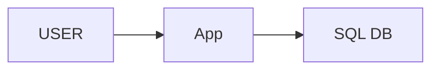
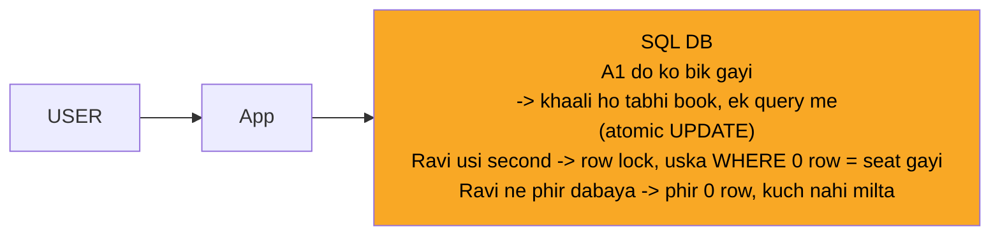
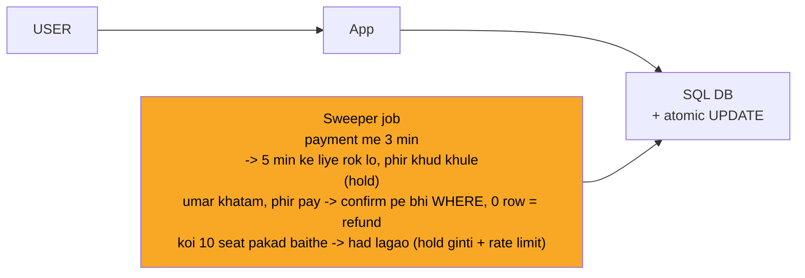
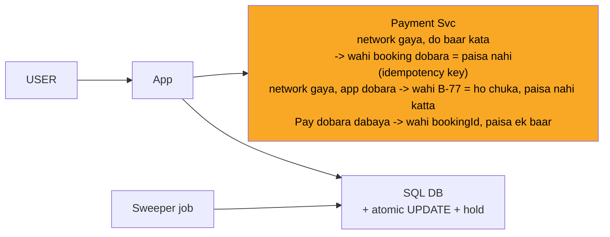
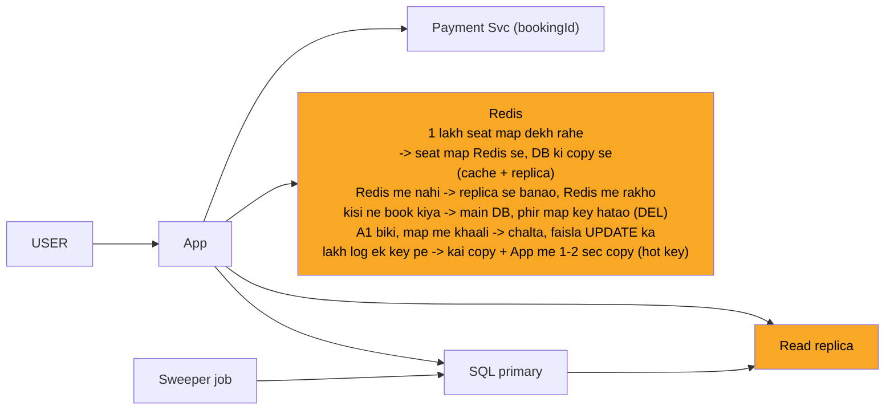
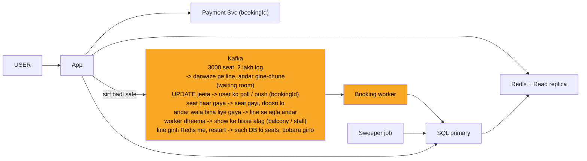
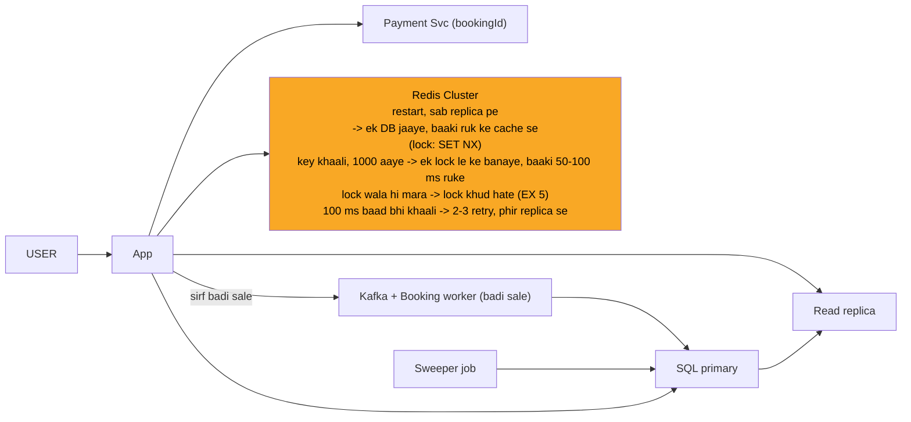
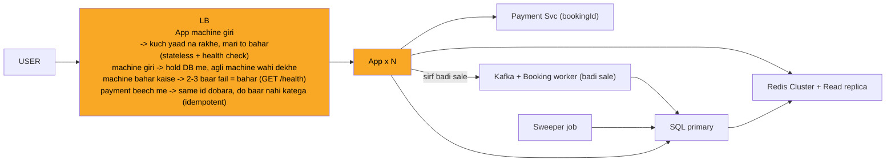
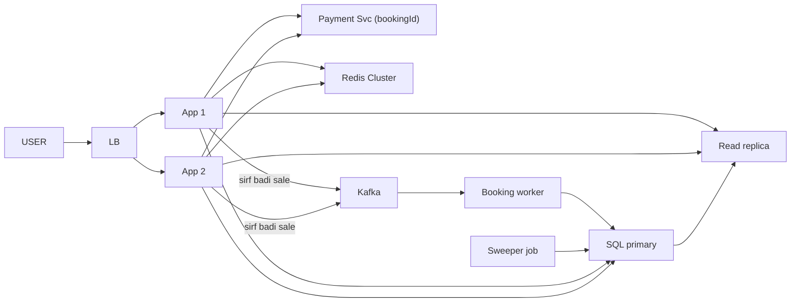

# BookMyShow (Ticket Booking)

> Movie / show dekho -> seat chuno -> pay karo -> ticket. JP ke liye kaam ka: paisa aur seat ek saath sahi (trading ke "paisa do baar kharch na ho" jaisa).
> Is design ka dil: **ek seat DO logon ko na bike** (ek saath booking) + **badi movie ke din ki bheed**.

---

## KAHANI (ek din, main aur Ravi, badi movie ki release; har dikkat se design me ek dabba judta)

```
   KYA HUA                                       ILAAJ                                 DABBA JUDA
1  10 baje maine aur Ravi ne ek saath A1 li   -> ATOMIC UPDATE ... WHERE available     SQL DB
2  A1 chuni, payment me 3 min                 -> HOLD + held_until (umar)              Sweeper job
3  Pay ke baad network gaya, app ne dobara    -> IDEMPOTENCY KEY (bookingId)           Payment Svc
4  11 baje 1 lakh log seat map dekh rahe      -> CACHE + READ REPLICA                  Redis + Read replica
5  12 baje concert: 3000 seat, 2 lakh log     -> WAITING ROOM + Kafka (sirf badi sale) Kafka + Booking worker
6  2 baje Redis restart, sab replica pe       -> SET NX lock, pehla hi banaye          Redis (SET NX + copy)
7  shaam ko meri App machine giri             -> STATELESS App + LB health check       LB + App x N

POORA DESIGN (upar ke dabbe kram se):
   User -> LB -> App x N -> SQL primary (atomic UPDATE, hold + umar) -> Payment Svc (bookingId)
   dekhna: Redis Cluster -> Read replica · badi sale: Kafka (key = show_id) -> Booking worker
   Sweeper = purane hold ki safai
```

---

## TASVEER (ByteByteGo / Alex Xu · CC BY-NC-ND 4.0)


Source: [CAP Theorem: One of the Most Misunderstood Terms](https://bytebytego.com/guides/cap-theorem-one-of-the-most-misunderstood-terms/)
(booking CP, search AP)


Source: [Pessimistic vs Optimistic Locking](https://bytebytego.com/guides/pessimistic-vs-optimistic-locking/)
(image ke do tareeke: FOR UPDATE (pessimistic) / version (optimistic); humne atomic UPDATE chuna)

---

## SHURU: pehle poocho, phir numbers

```
POOCHO:  "Browse, booking, payment, refund, recommendation — main seat BOOKING pe, asli dikkat wahin."
         badi movie ke din ek saath kitne log ek hi show pe?
         <- bheed = doosra bada dushman (pehla: ek seat do ko)
         payment khud ya bahar ka gateway? · seat chunne ke baad kitni der rokni (HOLD)? · refund scope me?

KYA KARE (FR):    movies / shows dekho · seat map · seat BOOK (payment) · ticket pakka
                  scope bahar: refund · recommendation · review
KAISA CHALE (NFR): EK seat DO ko na bike (dil) · dekhna tez · badi movie ki bheed jhele · bharosemand

NUMBERS (andaaza): 1 crore user · DO ALAG bojh (ek number mat bolo):
   DEKHNA (shows / seat map) = sab karte -> lakhon padhai -> CACHE + READ REPLICA
   BOOKING = kam log, par ek hi seat pe ek saath + jhatke me aati -> QUEUE
   active data chhota (aaj + agle hafte ke show), purane show archive -> SHARDING KI ZAROORAT NAHI
```
```
POOCHEGA: "Consistency or availability — which do you pick?"
          (chhota: "network toota, aakhri seat pe do log — C ya A?")
          (Consistency ya availability, kya chunoge?)

DHYAAN:   ek hi system me dono: BOOKING = CP (network toota to ek taraf
          REJECT) · SEARCH = AP (seat ginti 2 sec purani chalegi)
JAWAB:    Booking me sahi hona pehle: network toota aur pakka nahi pata seat khaali hai, to booking mana
          kar do. Ek seat do logon ko bechna usse bura hai.
          Movie list / search thodi purani bhi dikhe to chalega, wo chalta rahe.
```

---

## ════ MOCK SE PEHLE: SIRF YE CARD PADHO ════

> Har card: pehle PEELA DABBA dekho (scene + ilaaj). Yaad aa gaya -> aage. Nahi aaya -> neeche
> DIKKAT / HAL / NAHI padho. AAGE POOCHEGA sirf jab interviewer aage kuch poochhe.

#### DABBA 0: SABSE SIMPLE (yahan se shuru, phir "kahan tootega")
```
seats table (seat_id, show_id, status). "Book" dabao -> status = 'booked'.
```


#### 1 Maine aur Ravi ne ek hi second me A1 book ki, dono ko mil gayi

```
DIKKAT     10 baje badi movie ki booking khuli. Maine aur Ravi ne 10:00:01 pe "A1 khaali" dekha, Book dabaya.
           App ne dono baar pehle padha (khaali), phir likha (booked) -> A1 dono ko bik gayi.
HAL        khaali ho tabhi book (ATOMIC UPDATE), check + likhna EK query me: UPDATE seats SET status =
           'booked' WHERE show_id = 42 AND seat_id = 'A1' AND status = 'available'
NAHI       Java synchronized / lock App me: App ki kai machine, lock sirf ek ke andar.
```
```
TASVEER: ek row, do haath
  10:00:01  main:  UPDATE ... 'booked' WHERE A1 AND 'available' -> row lock mujhe -> 1 row badli
  10:00:01  Ravi:  wahi UPDATE -> lock pe ruka -> mera commit -> WHERE dobara: ab 'booked' -> 0 row
  mujhe: "booked"                 Ravi ko: "seat ja chuki, doosri chuno"
```
```
AAGE POOCHEGA:
  NIYAM: seat ka faisla DB ki EK query (WHERE khaali): jeeta = 1 row; haara = 0 row -> use turant "seat ja
         chuki, doosri chuno", dobara dabane se kuch nahi milta. Lock App me nahi, DB me.
  SAFAR (ek seat A1, har mod pe kya):
  A1 dabaya, sab theek -> UPDATE ... WHERE A1 khaali -> 1 row = meri, pakki
  Ravi usi second      -> DB row lock: main pehle, Ravi ruka -> uska WHERE 0 row, "seat gayi"
  Ravi ne phir dabaya  -> WHERE phir 0 row: dobara dabane se kuch nahi milta
```

#### 2 Maine A1 chuni, payment me 3 minute lag rahe

```
DIKKAT     Maine A1 chuni, payment me 3 min. 'available' rehne di -> beech me Ravi le gaya. Seedha 'booked'
           kar di -> mera payment fail hua to A1 hamesha ke liye band.
HAL        5 min rok lo (HOLD + UMAR): row me 'held', held_until = now + 5 min; SWEEPER job har minute purane
           hold saaf (sirf safai). Booking ka UPDATE purana hold khaali maane: WHERE status = 'available' OR
           (status = 'held' AND held_until < now())
NAHI       hold Redis me (SET NX EX 300): hold Redis me + booking DB me = do jagah sach, farak aa sakta.
```
```
TASVEER: seat ka safar
  available --(maine A1 chuni)--> held (Arpan, held_until = abhi + 5 min)
  held --(5 min ke andar pay)--> booked
  held --(5 min nikle, pay nahi)--> booking UPDATE use khaali maane · sweeper -> available
  beech me Ravi ko 'held' dikhe, le nahi sakta
```
```
AAGE POOCHEGA:
  NIYAM: hold = DB ki usi row ka haal (held + umar): mujhe 5 min seat pakki, baaki ko 'held' dikhe; umar
         khatam ya app gira to sweeper khud chhodta, koi haath se nahi.
  SAFAR (meri A1 ka hold, har mod pe kya):
  A1 chuni, sab theek      -> usi row me held + umar (5 min) -> pay -> booked
  umar khatam, phir pay    -> confirm pe bhi WHERE (held + main + umar) -> 0 row = seat gayi -> refund
  koi 10 seat pakad baithe -> had lagao (hold ginti + rate limit): hold = sabke liye band
```

#### 3 Pay dabaya, network gaya, app ne dobara bheja

```
AAGE POOCHEGA:
  NIYAM: ek booking = ek payment: wahi id dobara = purana jawab; user ko kuch dobara nahi karna, beech ka
         haal PENDING dikhe; paisa kata par seat nahi mili = refund.
  SAFAR (ek pay tap, har mod pe kya):
  pay dabaya, sab theek    -> paisa kata -> seat booked -> B-77 DONE
  network gaya, app dobara -> wahi B-77 -> "ho chuka", purana jawab, paisa nahi katta (idempotency)
  Pay dobara dabaya        -> double tap: wahi bookingId, paisa ek baar
```

#### 4 11 baje main seat map dekh raha tha, saath me 1 lakh log, book koi-koi

```
AAGE POOCHEGA:
  NIYAM: dekhna copy se (Redis / replica), faisla sirf main DB ka UPDATE: map thoda purana dikhe to chalta,
         kyunki galat dikhi seat bhi book karte waqt DB pakad leta (0 row).
  SAFAR (seat map dekhna, har mod pe kya):
  map kholo, sab theek   -> Redis "seatmap:show42" (~5 sec umar) se; DB tak nahi
  Redis me nahi mila     -> replica se banao, Redis me rakho
  kisi ne book kiya      -> booking main DB pe, phir map key DEL
  A1 biki, map me khaali -> chalta: faisla UPDATE ka; turant chahiye to WebSocket / SSE
  lakh log ek key pe     -> kai copy + App me 1-2 sec copy: ek key = ek machine (hot key)
```

#### 5 12 baje Arijit ka concert khula, 2 lakh log ek show pe

```
DIKKAT     12 baje Arijit ka concert: ek show, 3000 seat, 2 lakh log ek saath. Saari bheed DB ki wahi rows
           pe, har koi lock ke intezaar me -> sab dheema. (Aam din ye nahi hota, hold seedha DB pe.)
HAL        darwaze pe line (WAITING ROOM): darwaze pe ginti (Redis DECR), ek waqt ~3000 andar, baaki line.
           Andar walo ki booking Kafka me, key = show_id -> ek show ek worker, ek-ek UPDATE -> ladaai khatam.
NAHI       read replica badhao: replica PADHNA sambhaalti, likhne ki bheed line (queue) sambhaalti.
```
```
TASVEER: darwaze pe line
  2 lakh log -> [ darwaza: Redis DECR, ek waqt ~3000 andar ] -> baaki line me, apni jagah dekhte
  andar wale -> booking Kafka (key = show_id) -> ek worker -> ek-ek UPDATE -> DB
  koi bina khareede gaya / hold khatam -> line se agla andar
```
```
AAGE POOCHEGA:
  NIYAM: likhne ki bheed ko line me khada karo (waiting room; badi release pe Kafka): user ko apni jagah
         dikhe; ek show = ek line, sach hamesha DB ki seats.
  SAFAR (12 baje ki line, har mod pe kya):
  2 lakh aaye, sab theek       -> waiting room: apni jagah dikhe, ek-ek andar, UPDATE jeeta = pakka
  UPDATE jeeta, user ko pata?  -> bookingId se poll ya WebSocket push: line me tha, jawab baad me
  seat haar gaya               -> "seat gayi, doosri lo": faisla DB ka
  andar wala bina liye gaya    -> line se agla andar: line sirf darwaza
  ek worker dheema?            -> ~ms ka UPDATE, hazaar / sec; aur chahiye to show ke hisse (balcony / stall)
  line ginti Redis me, restart -> ginti sirf darwaza; sach DB ki seats, DB se dobara gino
```

#### 6 2 baje Redis restart, saara seat map ek saath replica pe

```
AAGE POOCHEGA:
  NIYAM: khaali cache pe ek hi DB jaaye, baaki ruke; jo gir sakta uski copy pehle se taiyaar. User ko bas
         thoda dheema, galat seat kabhi nahi (faisla DB me).
  SAFAR (Redis restart ke baad seat map, har mod pe kya):
  Redis zinda, key hai   -> map seedha Redis se, DB tak kuch nahi
  key khaali, 1000 aaye  -> ek lock le ke banaye (SET NX EX 5), baaki 50-100 ms ruk ke Redis se
  lock wala hi mara      -> EX 5 = lock khud hate · NX = koi aur na laga ho
  100 ms baad bhi khaali -> 2-3 retry, phir khud replica se padho: user ko bas dheema
```

#### 7 Shaam ko main seat chun raha tha, App machine gir gayi

```
AAGE POOCHEGA:
  NIYAM: App kuch yaad nahi rakhta, sab DB me: machine giri to agli machine wahi hold dekhti; user same id
         se dobara bheje, paisa do baar nahi katta.
  SAFAR (meri hold, App machine giri, har mod pe kya):
  sab machine zinda    -> LB kisi bhi machine pe bheje; hold DB me
  machine giri         -> hold DB me tha, memory me nahi: agli machine wahi hold dekhti
  machine bahar kaise  -> har kuch sec poochta (GET /health); 2-3 baar fail = bahar, ek = jhatka
  payment beech me tha -> same id dobara, doosri machine pe: idempotent = do baar nahi katega
```

---

## AAKHRI DABBA + WRAP (ek hi baar)

```
DEKHNA:  LB -> App (stateless) -> Redis Cluster (99%) -> read replica
BOOKING: aam din: App -> SQL primary seedha: atomic conditional UPDATE (HOLD + umar), turant jawab
         badi sale: App -> Kafka (har show ek line) -> Booking worker -> wahi UPDATE ("booking ho rahi hai")
         -> Payment Svc (idempotency key) -> booked
Sweeper = purane hold saaf (sirf safai; asli faisla UPDATE ke WHERE me)

DB:  SQL -> sahi hona hi dil: ACID + row lock -> ek seat do ko bikna namumkin
     (seat + booking + payment haal = kai row ek saath badalti -> ek transaction) · active data chhota
     -> shard NAHI
```
```
JAWAB:    Seat map Redis aur copy se, booking main DB pe ek query se ('khaali ho tabhi book') -> ek seat
          kabhi do ko nahi.
          Seat chuni = 5 minute hold, query purana hold khaali maanti, job safai karti.
          Release ke din ki bheed: darwaze pe ginti + har show ki ek line. Payment pe id, do baar nahi katega.
          SQL kyunki sahi hona sabse zaroori, data chhota to baantna nahi.
```


---

## 10 GUNA TRAFFIC — har dabba alag se

```
App          -> stateless, machine badhao
dekhna       -> Redis cluster (99%) + read replica
booking      -> atomic conditional UPDATE / row lock · HOLD + umar
bada show    -> Kafka + har show ek line + darwaze pe ginti + waiting room · garam row pe ek hi jeete
payment      -> idempotency key
SQL          -> replica + apne aap failover · data chhota, shard NAHI
AAGE:        virtual waiting room · kai DB / shard ho to seat ka faisla usi shard ke atomic UPDATE se
             (Redlock = Redis ka lock, DB ka nahi) · hold ka time theek karna · bade show ka analytics

POOCHEGA: "How would you scale this to 10x?"      -> user ka raasta chalo, pehle jo toote
POOCHEGA: "What's the single point of failure?"   -> SQL primary (failover), Redis (cluster)
          Redis gira (c6) -> har master ki copy (Cluster), master gira -> copy master (khud, Sentinel nahi)
POOCHEGA: "How do you know it's working?"
          -> booking p99 · 0-row ("ja chuki") rate · Kafka lag · kitne hold khatam · alert
```

---

## POOCHE TO (gehra sawaal aaye tab)

```
SAFAR KE BAHAR WALE SAWAAL:
"FOR UPDATE / version kyun nahi?" -> ek statement = lock sabse chhota; FOR UPDATE = do baar DB, lock lamba ·
                                     version = haara dobara try
"Release ka time to pata hai na?" -> pehle se machine badhao + har user ki had (rate limit): bheed ka waqt
                                     pata = tayyari pehle
"BookMyShow sach me aise karta hai?" -> mat bolo "BMS aise karta"; bolo "a common pattern in flash sales":
                                        unka andar ka pata nahi
"Seat rows pehle se hoti?" (c1) -> haan: har show banate hi uski saari seat rows bani, booking = UPDATE hi
"SQL primary gira?" (c6) -> ~30-120 sec failover (Multi-AZ / Aurora); app wahi id se dobara (idempotent)
"Aakhri booking copy pe thi?" (c6) -> sync copy: likhai dono jagah pakki (Multi-AZ), booking = paisa
"4 seat, A4 gayi?" (c1) -> ek transaction: badli rows 4 nahi -> ROLLBACK: aadhi booking bekaar
"4 seat, do log ulta kram?" (c1) -> DB deadlock pakad ke ek ko abort, wo retry; alag UPDATE ho to seat_id
                                     ke kram me bhejo
"Paisa kata, seat fail?" (c3) -> refund + batao: payment aur seat saga jaisa, ek fail to doosra ulta
"PSP ka webhook der se?" (c3) -> PAYMENT_PENDING, hold thoda badhao, roz milao (reconciliation)

API:      GET /movies?city=BLR · GET /shows?movieId=X · GET /shows/{id}/seats (available / held / booked)
          POST /bookings { showId, seats } -> seat HOLD (atomic) -> bookingId + umar
                    (user JWT se lo, body se nahi -> warna koi bhi kisi aur ke naam se book kare)
          POST /bookings/{id}/pay -> success 'booked' · fail -> seat chhodo

DB:       seats(seat_id, show_id, status ['available' / 'held' / 'booked'], user_id, held_until)
          bookings(booking_id, user_id, show_id, seat_ids, status, created_at)
          SQL kyun: sahi hona = dil -> ACID + row lock -> ek seat do ko namumkin
                    NoSQL "thodi der baad sahi" = do machine alag-alag "khaali" bol sakti -> khatra
          version column nahi: conditional UPDATE chuna (version = haarne wala dobara try kare)
          data chhota -> SHARDING NAHI (bina zaroorat shard = faltu bhaari design)

EK SEAT DO KO (dil):  UPDATE ... WHERE seat_id = 'A1' AND status = 'available'
                      ek -> 1 row SUCCESS · doosra -> 0 row "ja chuki"
                      (SELECT ... FOR UPDATE bhi chalta, par yahan nahi chuna)
```

---

ARCHETYPE C · CONCEPTS: [db-what-when](../../FOUNDATIONS/09_databases_what_when.md) · [CAP](../../FOUNDATIONS/08_cap_theorem.md) · saath: [payment](../06_payment_system/06_payment_system.md) · [← MASTER SHEET](../../00_MASTER_SHEET.md)
