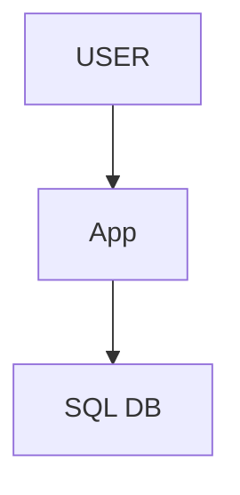
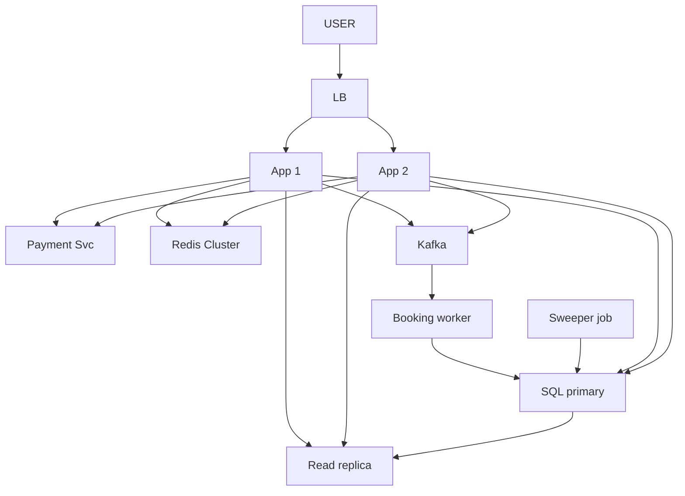
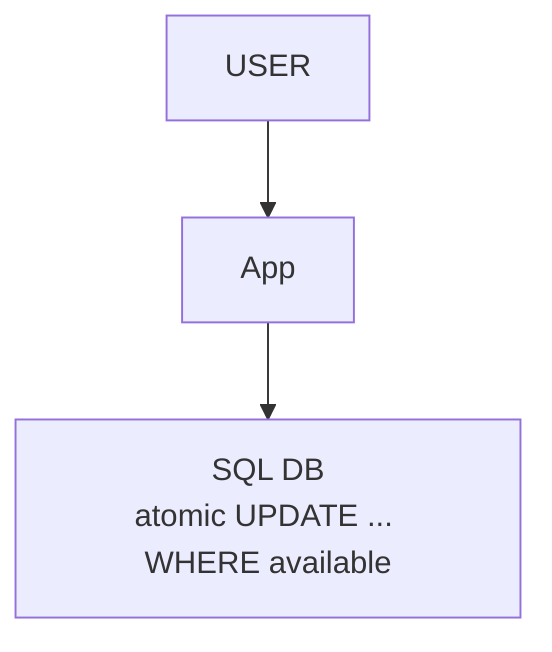
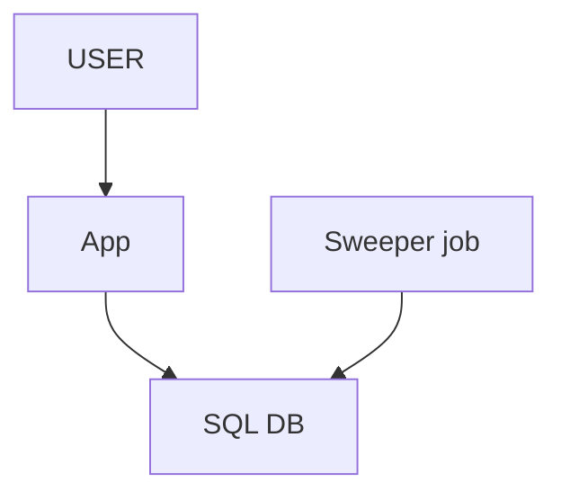
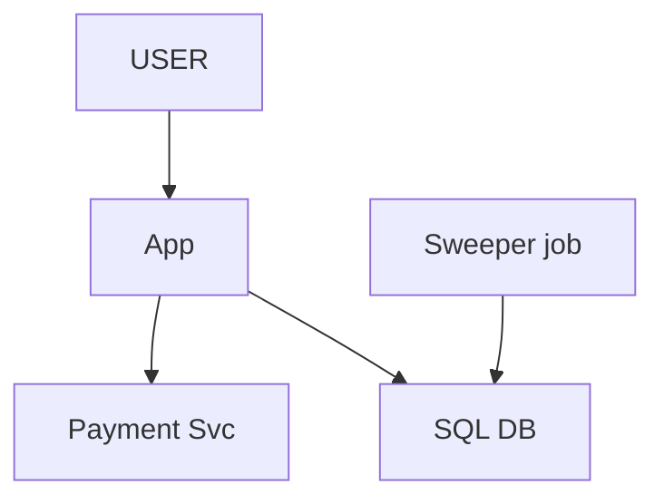
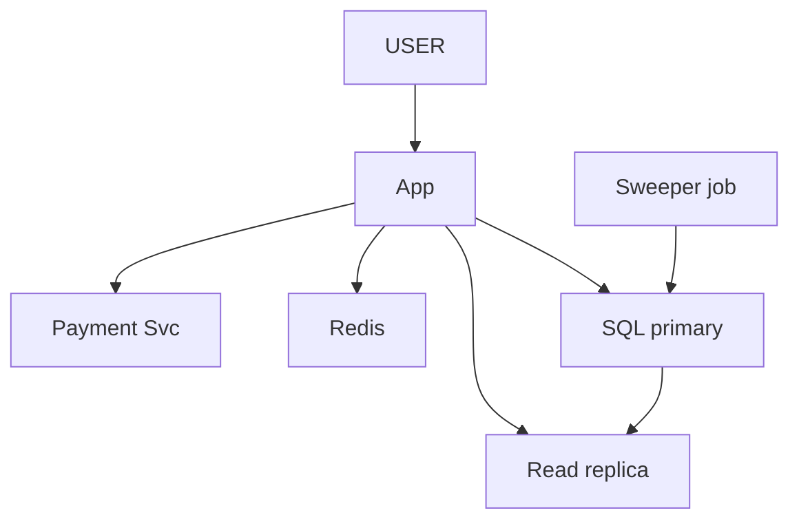
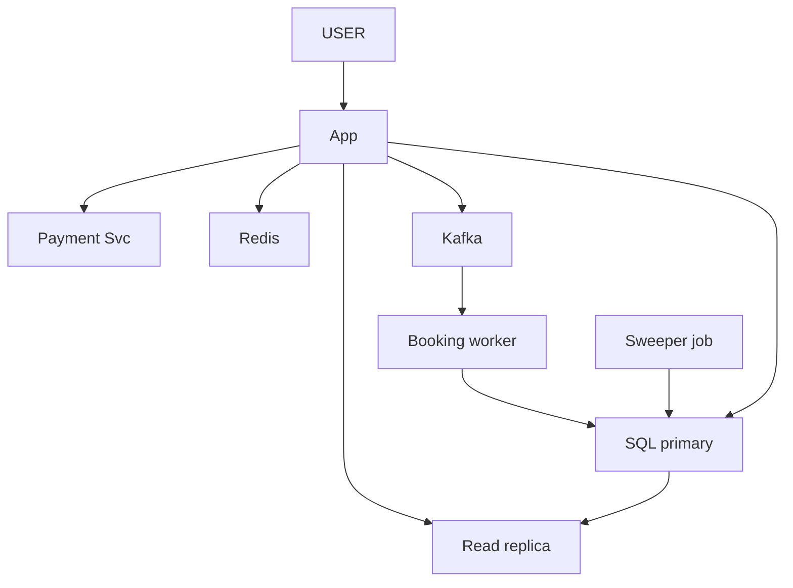

# BookMyShow (Ticket Booking)

> Movie / show dekho -> seat chuno -> pay karo -> ticket. JP ke liye kaam ka: paisa aur seat ek saath sahi (trading ke "paisa do baar kharch na ho" jaisa).
> Is design ka dil: **ek seat DO logon ko na bike** (ek saath booking) + **badi movie ke din ki bheed**.

---

## TASVEER (ByteByteGo / Alex Xu · CC BY-NC-ND 4.0)


Source: [CAP Theorem: One of the Most Misunderstood Terms](https://bytebytego.com/guides/cap-theorem-one-of-the-most-misunderstood-terms/)
(booking CP, search AP)


Source: [Pessimistic vs Optimistic Locking](https://bytebytego.com/guides/pessimistic-vs-optimistic-locking/)
(ek seat do log = SELECT FOR UPDATE (pessimistic) ya version check (optimistic))

---

## SHURU: pehle poocho, phir numbers

```
POOCHO:  "Browse, booking, payment, refund, recommendation — main seat BOOKING pe, asli dikkat wahin."
         badi movie ke din ek saath kitne log ek hi show pe?
         <- bheed = doosra bada dushman (pehla: ek seat do ko)
         payment khud ya bahar ka gateway? · seat chunne ke baad kitni der rokni (HOLD)? · refund scope me?

KYA KARE (FR):    movies / shows dekho · seat map · seat BOOK (payment) · ticket pakka
                  scope bahar: refund · recommendation · review
KAISA CHALE (NFR): EK seat DO ko na bike (dil) · dekhna tez · badi movie ki bheed jhele · bharosemand

NUMBERS (andaaza): 1 crore user · DO ALAG bojh (ek number mat bolo):
   DEKHNA (shows / seat map) = sab karte -> lakhon padhai -> CACHE + READ REPLICA
   BOOKING = kam log, par ek hi seat pe ek saath + jhatke me aati -> QUEUE
   data chhota (movies / shows / seats gine-chune) -> SHARDING KI ZAROORAT NAHI (ye bolna)
```
```
POOCHEGA: "Consistency or availability — which do you pick?"
          (chhota: "network toota, aakhri seat pe do log — C ya A?")
          (Consistency ya availability, kya chunoge?)

DHYAAN:   ek hi system me dono: BOOKING = CP (network toota to ek taraf
          REJECT) · SEARCH = AP (seat ginti 2 sec purani chalegi)
JAWAB:    Booking ke liye consistency: ek seat do ko bechne se behtar likhna mana kar do. Search wala
          hissa chalta rahe, thoda purana bhi chalega.
```

---

## ════ MOCK SE PEHLE: SIRF YE CARD PADHO ════

> Har dikkat ek card: KAHANI (kya hua, kaun, kitna) -> ILAAJ -> ANDAR KAISE (ilaaj kyun kaam karta) ->
> ISKE BAAD KYA TOOTEGA (interviewer yahin ghusta hai: dabba lagaya, ab kya?).

#### DABBA 0: SABSE SIMPLE (yahan se shuru, phir "kahan tootega")
```
seats table (seat_id, show_id, status). "Book" dabao -> status = 'booked'.
```


#### [1](#d1) ARPAN AUR RAVI NE EK SAATH A1 BOOK KI
```
KAHANI:  Arpan ne dekha "A1 khaali", usi pal Ravi ne bhi dekha "A1 khaali". Dono ne Book dabaya.
         App ne dono baar pehle padha (khaali), phir likha (booked) -> A1 dono ko bik gayi.

ILAAJ:   "Khaali hai?" aur "book karo" EK hi UPDATE me:
           UPDATE seats SET status = 'booked', user_id = Arpan
           WHERE seat_id = 'A1' AND status = 'available'
         Jiska pehle laga, use 1 row. Doosre ko 0 row -> "seat ja chuki".

ANDAR KAISE:
         Arpan aur Ravi ek saath -> DB ne A1 ki row pe pehle Arpan ko lock diya, Ravi ruka.
         Arpan ka commit -> Ravi ko lock mila, DB ne WHERE dobara dekha -> A1 ab 'available' nahi -> 0 row.
         Beech me koi ghus hi nahi sakta, kyunki check aur likhna ek hi kadam hai.

ISKE BAAD KYA TOOTEGA:
  - Arpan ne 4 seat chuni (A1-A4), 3 mili, A4 Ravi le gaya?
      -> chaaron EK transaction me: WHERE seat_id IN (A1..A4) AND available -> badli rows 4 nahi -> ROLLBACK.
         Deadlock na ho isliye seat_id ke kram me lock (A1, A2, A3 ...).
  - SELECT FOR UPDATE ya version column kyun nahi?
      -> FOR UPDATE = do baar DB jaana, lock lamba, deadlock ka khatra.
         Version = haarne wala dobara try kare, par seat gayi to gayi.
         Conditional UPDATE = ek hi statement, lock sabse chhota.
  - Do alag log vs ek hi aadmi ka dobara bhejna?
      -> do ALAG log ek seat = atomic UPDATE (ye card). EK aadmi ka dobara bhejna = idempotency (card 3).
```

#### [2](#d2) SEAT CHUNI, AB 3 MIN PAYMENT KAR RAHA
```
KAHANI:  Arpan ne A1 chuni, payment me 3 min lag rahe.
         A1 'available' hi rehne di -> beech me Ravi le gaya.
         A1 seedha 'booked' kar di -> Arpan ka payment fail hua to A1 hamesha ke liye band.

ILAAJ:   HOLD + umar: chunte hi A1 = 'held' + held_until (5 min
         baad). Payment hua -> 'booked'. 5 min nikle -> wapas khaali.

ANDAR KAISE:
         SQL me TTL nahi hota -> 5 min baad bhi row me 'held' hi likha rahega. Isliye do kaam:
         (1) booking ka UPDATE hi purane hold ko khaali maane:     <- sahi hona isi se
             WHERE status = 'available' OR (status = 'held' AND held_until < now())
         (2) SWEEPER har minute purane hold ko 'available' kar de  <- sirf safai, seat map saaf dikhe

ISKE BAAD KYA TOOTEGA:
  - Hold Redis me (SET NX EX 300) kyun nahi?
      -> hold Redis me + booking DB me = do jagah sach -> dono
         me farak aa sakta. DB me = ek row, ek UPDATE, ek sach.
  - Hold khatam hone ke 1 second baad Arpan ka payment aaya?
      -> confirm pe bhi WHERE status = 'held' AND user = Arpan AND held_until > now()
         -> 0 row = seat ja chuki -> paisa wapas (refund).
  - Ek aadmi ne 10 seat hold karke chhod di?
      -> ek user kitni hold kar sake uski limit + rate limit.
```

#### [3](#d3) PAYMENT PAGE PE "PAY" DO BAAR DABA
```
KAHANI:  Arpan ne Pay dabaya, page ghooma, phir daba diya -> ek hi booking ke do baar paise kate.

ILAAJ:   IDEMPOTENCY KEY: app ek key banata, dobara bhejne pe WAHI. Server key ko ek baar hi lene de
         (UNIQUE / SET NX). Dobara aayi -> pehla jawab wapas, naya charge nahi.

ANDAR KAISE:
         Key APP banata. Agar server banata to dobara aayi request = nayi request = nayi key = do baar kata.
         App ki key hi batati "ye wahi purani request hai".

ISKE BAAD KYA TOOTEGA:
  - Paisa kat gaya, par seat ka UPDATE fail (hold khatam ho chuka)?
      -> paisa wapas (refund) + Arpan ko batao. Payment aur
         seat ka faisla saga jaisa (ek fail to doosra ulta).
  - Payment wale ka jawab (webhook) der se aaya?
      -> booking 'PAYMENT_PENDING' rakho, hold thoda badhao, ya reconciliation se pakka karo.
```

#### [4](#d4) BOOK KOI-KOI KARTA, SEAT MAP SAB DEKH RAHE
```
KAHANI:  Ek show ka seat map 1 lakh log dekh rahe, book shayad 500 karenge.
         1 lakh padhai aur nazuk booking dono ek hi DB pe -> booking dheemi.

ILAAJ:   Dekhna -> REDIS (seat map) + READ REPLICA. Booking -> SQL PRIMARY (atomic UPDATE).

ANDAR KAISE:
         Seat map Redis me "seatmap:show42" -> nahi mila to replica se banao -> Redis me rakho (~5 sec umar).
         Koi seat book hui -> "seatmap:show42" DEL -> agli baar taaza banta.
         Map thoda purana dikhe to bhi chalta: asli faisla to booking ke UPDATE me hota hai (card 1).

ISKE BAAD KYA TOOTEGA:
  - A1 book ho gayi, par Arpan ko map me abhi bhi khaali dikh rahi?
      -> WebSocket / SSE se us show ke dekhne walon ko turant
         bhejo. Screen 1-2 sec purani chale, faisla UPDATE ka.
  - Ek bade show ki ek hi Redis key pe lakhon padhai?
      -> us key ki kai copy + App ke andar 1-2 sec ka local cache.
```

#### [5](#d5) BADI MOVIE KA PEHLA DIN, LAKHON LOG EK SHOW PE
```
KAHANI:  Badi movie, pehla show: 5000 log, 3000 seat. Saari bheed seedha DB pe, wahi rows pe ladaai,
         har koi lock ke intezaar me -> sab dheema.

ILAAJ:   (1) darwaze pe GINTI (Redis DECR): 3000 andar, baaki 2000 ko turant "housefull".
         (2) KAFKA + har show ka WORKER: us show ki booking ek-ek karke atomic UPDATE.
         (3) VIRTUAL WAITING ROOM ("aapka number 12,340, ruko").

ANDAR KAISE:
         Kafka me key = show_id -> ek show ki saari booking ek line (partition) me -> ek worker ek-ek karke.
         Ladaai khatam, kyunki ek show pe ek waqt me ek hi UPDATE. Alag show = alag worker, ek saath.
         Arpan KHAAS seat (A1) chunta, ginti sirf "kitni bachi" batati -> isliye turant "booked" mat bolo:
         "booking ho rahi hai" -> worker ka UPDATE jeeta = pakka · haara = "ye seat gayi, doosri chuno".

ISKE BAAD KYA TOOTEGA:
  - Ek show itna bada ki ek worker dheema?
      -> ek UPDATE ~ms -> ek worker hazaar / second. Zyada
         chahiye -> show ko hisson (balcony / stall) me baanto.
  - Darwaze wali ginti Redis restart me gayi?
      -> ginti sirf darwaza hai, sach DB ki seats. Restart pe DB se gin ke dobara set karo.
  - Read replica se kaam nahi chalega?
      -> replica PADHNA sambhaalti. Likhne ki bheed queue sambhaalti.
  - (bolne me) "BookMyShow aise karta hai"?
      -> mat bolo. "A common pattern in flash sales" bolo.
```

#### [6](#d6) REDIS RESTART, SAARA DEKHNA EK SAATH DB PE
```
KAHANI:  Redis restart hua -> cache khaali -> 1 lakh log ka seat map
         dekhna ek saath DB pe -> booking ke UPDATE bhi ruk gaye.

ILAAJ:   REDIS CLUSTER (ek machine mare, baaki chalti rahein).
         Dekhna REPLICA se, booking PRIMARY pe (raaste alag).
         Cache khaali ho to sirf EK request DB se bana ke bhare (lock), baaki ruk ke cache padhein.

ANDAR KAISE:
         Redis Cluster: saari keys 16384 hisson (slot) me, har master
                        ke paas kuch hisse + apni copy (replica).
         Master gira -> baaki vote karke uski copy ko master bana dete.
         Lock: SET lock:seatmap:42 1 NX EX 5 -> jo jeeta wo DB se map bana ke Redis me daale,
         baaki 50-100 ms ruk ke Redis se padhein. 1 lakh ki jagah 1 request DB pe.

ISKE BAAD KYA TOOTEGA:
  - Redis poora gira, dekhna kahan se?
      -> read replica se (zaroorat ho to aur replica), primary pe KABHI nahi.
  - SQL primary gira, booking kitni der band?
      -> 10-30 sec (failover). Us beech dobara koshish (idempotent) / "thodi der me try karein".
  - Copy ko primary banaya, par aakhri booking copy tak pahunchi hi nahi thi?
      -> booking DB ke liye SYNC replica (RDS Multi-AZ, har
         likhai dono jagah pakki) -> pakki booking nahi khoti.
```

#### [7](#d7) EK APP MACHINE GIRI, 500 LOGON KA HOLD
```
KAHANI:  Ek App machine pe 500 log seat chun rahe the, wo machine gir gayi. Unki held seats ka kya?

ILAAJ:   Hold DB me hai, machine me nahi -> seat abhi bhi held, apne time pe chhutegi.
         Kai App machine (stateless) + LB.

ANDAR KAISE:
         LB ka health check fail -> machine list se bahar. Arpan
         ki agli request doosri machine pe -> wahi hold dikhega.
         Ye isliye chala kyunki hold machine ke BAHAR (DB me) rakha tha (card 2 ka faisla).

ISKE BAAD KYA TOOTEGA:
  - Machine giri tab Arpan ka payment chal raha tha?
      -> idempotency key app ke paas -> doosri machine pe dobara bhejo, do baar nahi katega.
  - Health check kya dekhta?
      -> GET /health: machine zinda + DB / Redis tak pahunch rahi. 2-3 baar fail = bahar.
```

```
AAKHRI DABBE (sab dikkat ke baad):
  DEKHNA:  LB -> App (stateless) -> Redis Cluster (99%) -> read replica
  BOOKING: App -> Kafka + Booking worker (har show ek line, bheed sambhaale)
           -> SQL primary: atomic conditional UPDATE (HOLD + umar) -> Payment Svc (idempotency key) -> booked
  Sweeper = purane hold saaf (sirf safai; asli faisla UPDATE ke WHERE me)

DB:  SQL -> sahi hona hi dil: ACID + row lock -> ek seat do ko bikna namumkin
     (NoSQL "thodi der baad sahi" me do machine alag-alag "khaali" bol sakti) · data chhota -> shard NAHI

END ME POOCHEGA:
  "Do log ek seat?"   -> UPDATE ... WHERE status = 'available' -> ek ko 1 row, doosre ko 0 row "ja chuki"
  "4 seat, 1 nahi mili?" -> chaaron EK transaction, rows 4 nahi -> ROLLBACK (A4 koi aur le sakta)
  "Hold khatam hua?"  -> UPDATE ke WHERE me purana hold = khaali; sweeper sirf safai
  "10x?"              -> App machine · Redis + replica ·
  Kafka har show + waiting room · SQL replica + failover
  "SPOF?"             -> SQL primary (failover), Redis (cluster)
  "Chal raha, kaise pata?" -> booking p99 · 0-row ("ja
  chuki") rate · Kafka lag · kitne hold khatam hue · alert
```

AAKHRI DABBE ki tasveer:



---

## ════ DETAIL: HAR DIKKAT KI INTERVIEW LINE + TASVEER ════

> Card me poori kahani hai. Yahan har dikkat ki ek English line (interview me bolne ke liye) aur us waqt tak ka diagram.

---

<a id="d1"></a>

## DIKKAT 1 — Arpan aur Ravi ne ek saath A1 book ki

```
POOCHEGA: "Two users book the same seat at the same time — what happens?"
          (Do log ek hi seat ek saath book karein to?)

JAWAB:    Do kadam me (pehle dekho, phir likho) hamesha beech me jagah rehti. Isliye condition UPDATE ke
          andar: WHERE status = available. DB ek ko hi jeetne deta, doosre ko 0 row aur 'seat ja chuki'.
```


---

<a id="d2"></a>

## DIKKAT 2 — seat chuni, ab 3 min payment

```
POOCHEGA: "Who releases the hold after 5 minutes?"
          (5 minute baad hold kaun chhodega?)

JAWAB:    SQL me TTL nahi. Do raaste: booking ka UPDATE hi purane hold ko khaali maane (status held aur
          held_until abhi se pehle), ya sweeper har minute purane hold wapas khaali kare.
          Sahi hona UPDATE wali condition se, sweeper sirf safai.
```


---

<a id="d3"></a>

## DIKKAT 3 — Pay do baar daba

```
POOCHEGA: "What if the user clicks Pay twice / the client retries?"
          (User ne Pay do baar dabaya / app ne dobara bheja to?)

JAWAB:    App dobara bhejne pe wahi idempotency key bhejta. Server key ko UNIQUE se ek baar hi lene
          deta, doosri baar rakha hua jawab.
```


---

<a id="d4"></a>

## DIKKAT 4 — book koi-koi karta, seat map sab dekh rahe

```
JAWAB:    Seat map Redis aur read replica se, chhoti umar ke saath, booking hote hi hatao. Booking
          hamesha SQL primary pe. Map thoda purana dikhe to chalega, faisla UPDATE karta.
```


---

<a id="d5"></a>

## DIKKAT 5 — badi movie, lakhon log ek show pe

```
POOCHEGA: "What if traffic suddenly spikes 10x?"
          (Traffic achanak 10 guna ho gaya to?)

JAWAB:    Darwaze pe ginti: jitni seat, utne log andar, baaki ko turant 'housefull'.
          Par log KHAAS seat chunte, isliye booking tabhi pakki jab us seat ka atomic UPDATE jeete. Tab
          tak user ko 'ho rahi hai', nateeja poochh ke ya push se.
          Saath me har user ki had, aur pata ho kab release to pehle se machine badhao.
```


---

<a id="d6"></a>

## DIKKAT 6 — Redis restart, saara dekhna DB pe

```
POOCHEGA: "What if the cache goes down?"
          (Cache gir gaya to?)

JAWAB:    Redis cluster me chalta. Seat map dekhna read replica pe chala jaata, primary pe kabhi nahi,
          to booking chalti rehti. Garam key sirf ek request dobara bharti, baaki rukte.
```


---

<a id="d7"></a>

## DIKKAT 7 — App machine giri, 500 logon ka hold

```
POOCHEGA: "What happens if an app server goes down?"
          (Ek app server gir gaya to?)

JAWAB:    Hold DB me hai, machine me nahi, to bacha rehta. Load balancer us machine ko bahar kar deta,
          user ki agli request doosri machine pe, wahi hold dikhta.
```


---
## 10 GUNA TRAFFIC — har dabba alag se

```
App          -> stateless, machine badhao
dekhna       -> Redis cluster (99%) + read replica
booking      -> atomic conditional UPDATE / row lock · HOLD + umar
bada show    -> Kafka + har show ek line + darwaze pe ginti + waiting room · garam row pe ek hi jeete
payment      -> idempotency key
SQL          -> replica + apne aap failover · data chhota, shard NAHI
AAGE:        virtual waiting room · kai DB / shard ho to seat ka faisla usi shard ke atomic UPDATE se
             (Redlock = Redis ka lock, DB ka nahi) · hold ka time theek karna · bade show ka analytics

POOCHEGA: "How would you scale this to 10x?"      -> user ka raasta chalo, pehle jo toote
POOCHEGA: "What's the single point of failure?"   -> SQL primary (failover), Redis (cluster)
POOCHEGA: "How do you know it's working?"         -> booking p99
          · 0-row rate · Kafka lag · kitne hold khatam · alert
```

---

## POOCHE TO (gehra sawaal aaye tab)

```
API:      GET /movies?city=BLR · GET /shows?movieId=X · GET /shows/{id}/seats (available / held / booked)
          POST /bookings { showId, seats, user } -> seat HOLD (atomic) -> bookingId + umar
          POST /bookings/{id}/pay -> success 'booked' · fail -> seat chhodo

DB:       seats(seat_id, show_id, status ['available' / 'held' / 'booked'], user_id, held_until, version)
          bookings(booking_id, user_id, show_id, seat_ids, status, created_at)
          SQL kyun: sahi hona = dil -> ACID + row lock -> ek seat do ko namumkin
                    NoSQL "thodi der baad sahi" = do machine alag-alag "khaali" bol sakti -> khatra
          version = optimistic locking (row lock ki jagah ye chuno to)
          data chhota -> SHARDING NAHI (bina zaroorat shard = faltu bhaari design)

EK SEAT DO KO (dil):  UPDATE ... WHERE seat_id = 'A1' AND status = 'available'
                      ek -> 1 row SUCCESS · doosra -> 0 row "ja chuki" · ya SELECT ... FOR UPDATE
```

---

## AAKHRI DABBA + WRAP

```
LB · App = stateless · Redis Cluster = dekhna 99% · Read replica = baaki dekhna
Kafka + Booking worker = bheed + har show ek line · SQL primary = ACID, atomic UPDATE, failover
Sweeper = purane hold saaf · Payment Svc = bahar wala, idempotency key
```
```
JAWAB:    Dekhna Redis + read replica se. Booking SQL primary pe atomic condition
          wale UPDATE se, to ek seat kabhi do ko nahi.
          Seat chuni = 5 min ka hold. UPDATE purane hold ko khaali maanta, sweeper safai karta.
          Release ke din ki bheed queue + har show ka worker sambhaalta, payment pe idempotency key.
          SQL kyunki sahi hona hi dil hai; data chhota, sharding nahi.
```


ARCHETYPE C · CONCEPTS: [db-what-when](../../FOUNDATIONS/09_databases_what_when.md) · [CAP](../../FOUNDATIONS/08_cap_theorem.md) · saath: [payment](../06_payment_system/06_payment_system.md) · [← MASTER SHEET](../../00_MASTER_SHEET.md)
