# BookMyShow (Ticket Booking)

> Movie / show dekho, seat chuno, pay karo, ticket. JP ke liye kaam ka: paisa aur seat ek saath sahi ("paisa do baar kharch na ho" jaisa).
> Dil do cheezein: ek seat do logon ko na bike (ek saath booking), aur badi movie ke din ki bheed.
>
> Har card: kya toota -> kya kiya -> yahi kyun -> doosra kyun nahi. Kram me chalo. "Pooche" wali line = interviewer aage poochhe to.

---

## Poori tasveer (aakhir me design aisa banta hai)



---

## Mock cue (mock me sirf ye dekho: kya hua -> ilaaj -> kaunsa dabba juda)

```
   KYA HUA                                       ILAAJ                                 DABBA JUDA
1  10 baje maine aur Ravi ne ek saath A1 li   -> ATOMIC UPDATE ... WHERE available     SQL DB
2  A1 chuni, payment me 3 min                 -> HOLD + held_until (umar)              Sweeper job
3  Pay ke baad network gaya, app ne dobara    -> IDEMPOTENCY KEY (bookingId)           Payment Svc
4  11 baje 1 lakh log seat map dekh rahe      -> CACHE + READ REPLICA                  Redis + Read replica
5  12 baje concert: 3000 seat, 2 lakh log     -> WAITING ROOM + Kafka (sirf badi sale) Kafka + Booking worker
6  2 baje Redis restart, sab replica pe       -> SET NX lock, pehla hi banaye          Redis (SET NX + copy)
7  shaam ko meri App machine giri             -> STATELESS App + LB health check       LB + App x N

POORA DESIGN (upar ke dabbe kram se):
   User -> LB -> App x N -> SQL primary (atomic UPDATE, hold + umar) -> Payment Svc (bookingId)
   dekhna: Redis Cluster -> Read replica · badi sale: Kafka (key = show_id) -> Booking worker
   Sweeper = purane hold ki safai
```

---

## Shuru

Sabse simple: ek seats table (seat_id, show_id, status). "Book" dabao, status = 'booked'.

Pehle poochho: browse, booking, payment, refund, recommendation, main seat booking pe focus karunga, asli dikkat
wahin. Badi movie ke din ek saath kitne log ek hi show pe? Bheed doosra bada dushman hai, pehla hai ek seat do ko.
Payment khud ya bahar ka gateway? Seat chunne ke baad kitni der rokni hai (hold)? Refund scope me?

Kaam (FR): movies / shows dekho, seat map, seat book (payment), ticket pakka. Refund, recommendation, review scope se
bahar. Kaisa chale (NFR): ek seat do ko na bike (yahi dil), dekhna tez, badi movie ki bheed jhele, bharosemand.

Numbers: 1 crore user, par do alag bojh hain, ek number mat bolo. Dekhna (shows / seat map) sab karte, lakhon padhai,
isliye cache + read replica. Booking kam log karte, par ek hi seat pe ek saath aur jhatke me aati, isliye queue.
Active data chhota (aaj + agle hafte ke show), purane show archive, isliye sharding ki zaroorat nahi.

**Pooche: consistency ya availability, kya chunoge? (network toota, aakhri seat pe do log)** Ek hi system me dono.
Booking = CP: sahi hona pehle, network toota aur pakka nahi pata seat khaali hai to booking mana kar do. Ek seat do
logon ko bechna usse bura hai. Search = AP: movie list / seat ginti 2 sec purani bhi dikhe to chalega, wo chalta rahe.

---

*ab tootega kahan? sabse pehle wahin jahan dil hai, ek seat pe do log*

## 1. Maine aur Ravi ne ek hi second me A1 book ki, dono ko mil gayi

Pehle padha (khaali), phir likha (booked). Maine aur Ravi ne 10:00:01 pe dono ne A1 khaali dekhi, dono ne book ki.
Do ko biki.

Isliye dekhna aur book karna ek hi query me (atomic UPDATE):
`UPDATE seats SET status = 'booked' WHERE show_id = 42 AND seat_id = 'A1' AND status = 'available'`.
Jeeta = 1 row, A1 meri. Haara = 0 row, "seat ja chuki, doosri chuno".

Ye kyun chalta? Seat ka faisla DB ki ek query karti, WHERE khaali. DB row lock ek-ek ko chalaata: main pehle, Ravi
ruka, phir uska WHERE 0 row. Lock App me nahi, DB me.

`SELECT ... FOR UPDATE` kyun nahi? Chalta bhi hai, par do baar DB jaana padta aur lock lamba rehta. Ek statement =
lock sabse chhota.

Version column (optimistic) kyun nahi? Usme haarne wala dobara try karta. Conditional UPDATE me haara seedha "seat gayi".

**Pooche: Ravi ne phir dabaya?** WHERE phir 0 row. Dobara dabane se kuch nahi milta.

**Pooche: seat rows pehle se hoti hain?** Haan. Show banate hi uski saari seat rows ban jaati, booking = UPDATE hi.

**Pooche: 4 seat li, A4 gayi?** Ek transaction me. Badli rows 4 nahi to ROLLBACK. Aadhi booking bekaar.

**Pooche: 4 seat, do log ulta kram me?** DB deadlock pakad ke ek ko abort karta, wo retry kare. Alag UPDATE ho to
seat_id ke kram me bhejo.

---

*ab seat ek ko mili, par payment me waqt lagta*

## 2. Maine A1 chuni, payment me 3 minute lag rahe

Seat available rakho to Ravi le jaata, chhin gayi. Booked kar do aur payment fail ho to seat hamesha band. Dono galat.

Isliye seat HELD + umar: usi row me `held_until = ab + 5 min`. Pay ho gaya to BOOKED. Umar khatam = khaali maano (hold).

Ye kyun chalta? Hold DB ki usi row ka haal hai (held + umar). Mujhe 5 min seat pakki, baaki ko 'held' dikhti. Umar
khatam ya app gira to sweeper khud chhodta, koi haath se nahi. Sweeper sirf safai hai, asli faisla UPDATE ke WHERE me.

**Pooche: umar khatam, phir pay aaya?** Confirm pe bhi WHERE (held + main + umar). 0 row = seat gayi, refund.

**Pooche: koi 10 seat pakad ke baith gaya?** Had lagao (hold ki ginti + rate limit). Hold = sabke liye band.

---

*ab seat pakad li, par pay ka network gaya*

## 3. Pay dabaya, network gaya, app ne dobara bheja

Pehle har request naya payment tha. Paisa kata, network gaya, app ne dobara bheja, 500 do baar kata.

Isliye har booking ki ek id, pay hamesha usi id se (idempotency key). Wahi B-42 dobara aaya to "ho chuka", purana
jawab, paisa ek baar.

Ye kyun chalta? Ek booking = ek payment. Wahi id dobara = purana jawab. User ko kuch dobara nahi karna, beech ka haal
PENDING dikhta. Paisa kata par seat nahi mili = refund.

Har request ko naya payment maano to? Wahi pehle wala haal, do baar kata.

**Pooche: user ne Pay double tap kiya?** Wahi bookingId, paisa ek baar.

**Pooche: paisa kata, seat fail?** Refund + user ko batao. Payment aur seat saga jaisa: ek fail to doosra ulta.

**Pooche: PSP ka webhook der se aaya?** PAYMENT_PENDING rakho, hold thoda badhao, roz milao (reconciliation).

---

*ab booking sahi, par dekhne wale bahut*

## 4. 11 baje main seat map dekh raha tha, saath me 1 lakh log, book koi-koi

Har map main DB se aa raha tha. Bheed, aur booking bhi dheemi. Sab dheema.

Isliye map Redis se: `seatmap:show42`, ~5 sec umar, DB tak nahi. Book dabaya to faisla sirf main DB ke UPDATE pe.

Ye kyun chalta? Dekhna copy se (Redis / replica), faisla sirf main DB ka UPDATE. Map thoda purana dikhe to chalta,
kyunki galat dikhi seat bhi book karte waqt DB pakad leta (0 row).

Map bhi main DB se hi do to? Wahi pehle wala haal. 1 lakh dekhne wale booking ko bhi dheema kar dete.

**Pooche: Redis me nahi mila?** Replica se banao, Redis me rakho.

**Pooche: kisi ne book kiya to map?** Booking main DB pe, phir map ki key DEL.

**Pooche: A1 bik chuki, map me khaali dikh rahi?** Chalta. Faisla UPDATE ka hai, wo 0 row bolega. Turant chahiye to
WebSocket / SSE.

**Pooche: lakh log ek hi key pe?** Kai copy + App me 1-2 sec ki copy. Ek key = ek machine (hot key).

---

*ab dekhna sambhal liya, par badi release pe likhne wale bhi lakhon*

## 5. 12 baje Arijit ka concert khula, 2 lakh log ek show pe

3000 seat, 2 lakh log. Sab seedha DB ki wahi rows pe, sab lock ke intezaar me. Sab dheema.

Isliye darwaze pe ginti: ~3000 andar, baaki line me (waiting room). Andar walon ki booking Kafka me, ek show ek line
(key = show_id). Booking worker ek-ek UPDATE karta. Ye sirf badi sale pe. Aam din App seedha SQL primary pe UPDATE
karta, turant jawab. Badi sale pe user ko "booking ho rahi hai".

Ye kyun chalta? Likhne ki bheed ko line me khada karo. User ko apni jagah dikhti. Ek show = ek line, sach hamesha DB ki seats.

Sab seedha DB pe hi aane do? 2 lakh ek hi rows ke lock pe ruke, sab dheema.

**Pooche: UPDATE jeeta, user ko kaise pata?** bookingId se poll ya WebSocket push. Line me tha, jawab baad me.

**Pooche: seat haar gaya?** "Seat gayi, doosri lo". Faisla DB ka.

**Pooche: andar wala bina liye chala gaya?** Line se agla andar. Line sirf darwaza hai.

**Pooche: ek worker dheema nahi?** ~ms ka UPDATE, hazaar har second. Aur chahiye to show ke hisse (balcony / stall).

**Pooche: line ki ginti Redis me thi, Redis restart?** Ginti sirf darwaza hai. Sach DB ki seats, DB se dobara gino.

**Pooche: release ka time to pata hai na?** Haan, to pehle se machine badhao + har user ki had (rate limit). Bheed ka
waqt pata = tayyari pehle.

---

*ab line bani, par cache hi khaali ho gaya*

## 6. 2 baje Redis restart, saara seat map ek saath replica pe

Map khaali, hazaaron ek saath miss, sab ek saath replica pe. Replica baith gayi, map nahi khulta.

Isliye sirf ek request DB se banaye, baaki ruk ke Redis se (lock). Pehli request lock leti (`SET NX EX 5`), replica
se ek hi query, map Redis me bharti. Baaki 50-100 ms ruk ke Redis se padhti.

Ye kyun chalta? Khaali cache pe ek hi DB jaata, baaki rukte. Jo gir sakta uski copy pehle se taiyaar. User ko bas
thoda dheema, galat seat kabhi nahi, kyunki faisla DB me.

Sabko DB jaane do? Wahi pehle wala haal, hazaaron ek saath, replica baith gayi.

**Pooche: lock wala hi mar gaya?** EX 5 = lock khud hat jaata. NX = koi aur pehle se na laga ho.

**Pooche: 100 ms baad bhi khaali?** 2-3 retry, phir khud replica se padho. User ko bas dheema.

**Pooche: SQL primary hi gira?** ~30-120 sec failover (Multi-AZ / Aurora). App wahi id se dobara bheje (idempotent).

**Pooche: aakhri booking copy tak pahunchi thi?** Sync copy: likhai dono jagah pakki (Multi-AZ). Booking = paisa.

---

*ab data surakshit, par App machine hi giri*

## 7. Shaam ko main seat chun raha tha, App machine gir gayi

Ek hi App machine thi. Giri to booking band.

Isliye App kuch yaad nahi rakhta, aage LB zinda machine ko deta (stateless). LB kisi bhi machine pe bheje, hold DB me.

Ye kyun chalta? App kuch yaad nahi rakhta, sab DB me. Machine giri to agli machine wahi hold dekhti, kyunki hold DB me
tha, memory me nahi. Seat wahin.

Ek hi App machine rakho? Wo giri to booking band.

**Pooche: giri machine LB se bahar kaise?** LB har kuch sec poochta (GET /health). 2-3 baar fail = bahar. Ek fail = jhatka.

**Pooche: payment beech me tha?** Same bookingId se dobara, doosri machine pe. Idempotent hai, do baar nahi katega.

---

## Poora design ek saans me

```
DEKHNA:  LB -> App (stateless) -> Redis Cluster (99%) -> read replica
BOOKING: aam din: App -> SQL primary seedha: atomic conditional UPDATE (HOLD + umar), turant jawab
         badi sale: App -> Kafka (har show ek line) -> Booking worker -> wahi UPDATE ("booking ho rahi hai")
         -> Payment Svc (idempotency key) -> booked
Sweeper = purane hold saaf (sirf safai; asli faisla UPDATE ke WHERE me)
DB:      SQL (ACID + row lock), active data chhota, shard nahi
```

Bolne ke liye: seat map Redis aur copy se, booking main DB pe ek query se ("khaali ho tabhi book"), to ek seat kabhi
do ko nahi. Seat chuni = 5 minute hold, query purana hold khaali maanti, job safai karti. Release ke din ki bheed:
darwaze pe ginti + har show ki ek line. Payment pe id, do baar nahi katega. SQL kyunki sahi hona sabse zaroori, data
chhota to baantna nahi.

---

## 10 guna traffic

- **App**: stateless, machine badhao.
- **Dekhna**: Redis cluster (99%) + read replica.
- **Booking**: atomic conditional UPDATE / row lock, HOLD + umar.
- **Bada show**: Kafka + har show ek line + darwaze pe ginti + waiting room. Garam row pe ek hi jeete.
- **Payment**: idempotency key.
- **SQL**: replica + apne aap failover. Data chhota, shard nahi.
- **Aage**: virtual waiting room. Kai DB / shard ho to seat ka faisla usi shard ke atomic UPDATE se (Redlock = Redis
  ka lock, DB ka nahi). Hold ka time theek karna. Bade show ka analytics.

**Pooche: 10 guna kaise?** User ka raasta chalo, pehle jo toote use badhao.

**Pooche: kahan se sab gir sakta?** SQL primary (failover) aur Redis (cluster). Redis gira to har master ki copy
(Cluster). Master gira to copy master ban jaati, khud (Sentinel nahi).

**Pooche: chal raha hai, kaise pata?** Booking p99, 0-row ("ja chuki") rate, Kafka lag, kitne hold khatam, alert.

---

## Pooche to (kisi card me nahi baitha)

API: `GET /movies?city=BLR`, `GET /shows?movieId=X`, `GET /shows/{id}/seats` (available / held / booked).
`POST /bookings { showId, seats }` -> seat HOLD (atomic) -> bookingId + umar. User JWT se lo, body se nahi, warna koi
bhi kisi aur ke naam se book kare. `POST /bookings/{id}/pay` -> success = 'booked', fail = seat chhodo.

Row: seats = seat_id, show_id, status ('available' / 'held' / 'booked'), user_id, held_until.
bookings = booking_id, user_id, show_id, seat_ids, status, created_at.

SQL kyun: sahi hona hi dil hai. ACID + row lock se ek seat do ko bikna namumkin. Seat + booking + payment ka haal kai
row ek saath badalta, to ek transaction. NoSQL ka "thodi der baad sahi" matlab do machine alag-alag "khaali" bol
sakti, khatra. Data chhota, isliye sharding nahi (bina zaroorat shard = faltu bhaari design).

"BookMyShow sach me aise karta hai?" Mat bolo "BMS aise karta". Bolo "a common pattern in flash sales", unka andar ka
pata nahi.

---

ARCHETYPE C · CONCEPTS: [db-what-when](../../FOUNDATIONS/09_databases_what_when.md) · [CAP](../../FOUNDATIONS/08_cap_theorem.md) · saath: [payment](../06_payment_system/06_payment_system.md) · [← MASTER SHEET](../../00_MASTER_SHEET.md)
