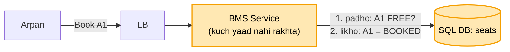
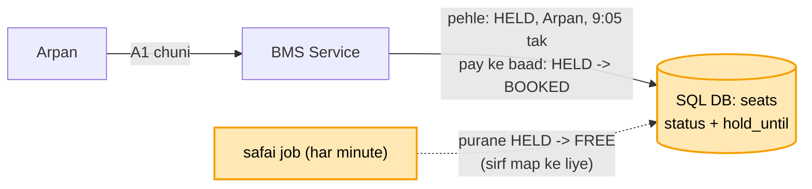
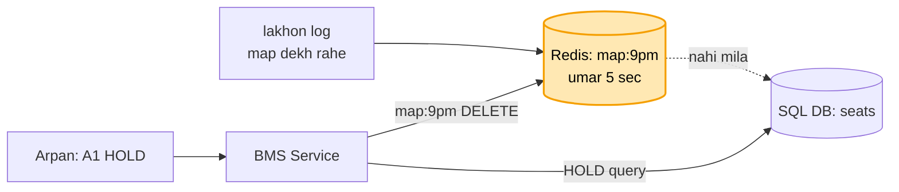
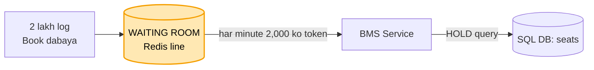
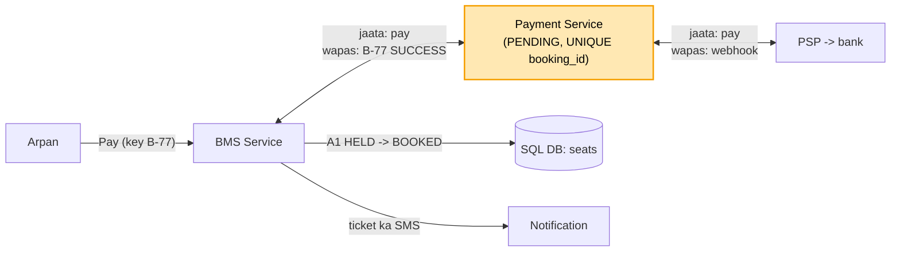

# BookMyShow: hand notes (mock se pehle ye padho)

Har line waise likhi hai jaise interview me bolni hai. Padho, aur waise hi bolo.

### Shuru

**Kaam:** User movie ya show dekhta hai, seat map dekhta hai, seat chunta hai, pay karta hai, aur ticket pakka ho jaata hai. Concert ki booking bhi isi me aati hai.

**Bahar:** User khud cancel karke refund maange, review, recommendation, ye sab main scope se bahar rakhta hoon. Par andar ek cheez zaroor hai: booking fail hui aur paisa kat gaya, to wo apne aap wapas jaata hai.

**Sabse upar:** Ek seat kabhi do logon ko nahi bikni chahiye, yahi is system ka dil hai. Uske baad seat map dekhna tez ho, aur concert ki bheed jhel sake.

**Numbers:** 100 log map dekhte hain to 1-2 hi book karte hain. Isliye dekhne ke liye cache rakhunga, aur likhne ke liye ek pakka SQL. Data chhota hai, bas aaj aur agle hafte ke show, to shard ki zaroorat nahi. Concert khulte hi ek second me ~2 lakh log aate hain, aur seat sirf 5000 hain.

### Banking aur payment se aaya (naya nahi)

Ek query me check aur likhna banking kadam 4 se aaya hai. Idempotency key banking kadam 3 se. PSP aur webhook payment file se.

&nbsp;

**1. SERVICE + SQL**



Pehle ek BMS Service aur ek SQL DB rakhta hoon. Seats table me har seat ki ek row hai, jaise show 9pm, seat A1, status FREE.

SQL isliye, kyunki jab pay hota hai to teen cheezein ek saath badalti hain: seat BOOKED hoti hai, booking ki row banti hai, aur payment ki row banti hai. Ya to teeno hon ya koi nahi, yahi transaction hai. Aur data chhota hai, to NoSQL ki zaroorat hi nahi.

AWS pe main RDS Multi-AZ lunga, aur copy sync rakhunga, kyunki booking matlab paisa. Primary gira to copy ko aage karna AWS ka kaam hai.

**App server kuch yaad nahi rakhta:** sach sirf SQL me hai. Isliye koi server gira to LB request doosre server pe bhej deta hai, wo wahi SQL padh ke wahi jawab deta hai. Isiliye app server ki replica ki baat hi nahi aati.

Par yahan dikkat aati hai. Arpan aur Ravi ne ek hi second me A1 dabaya. Dono ne FREE padha, dono ne BOOKED likha, aur ab ek seat pe do log hain.

&nbsp;

**2. EK QUERY (UPDATE ... WHERE FREE)**

```
Arpan ki query pehle:  A1 FREE hai -> BOOKED       -> "1 row badli" -> seat mili
Ravi ki query baad me: A1 ab FREE nahi, match nahi -> "0 row badli" -> "seat chali gayi"
```

Isliye main padhna aur likhna alag nahi karta, dono ek hi query me karta hoon:

`UPDATE seats SET status = BOOKED WHERE seat = A1 AND status = FREE`

DB us row pe lock lagata hai, to Arpan aur Ravi ki query saath nahi, ek ke baad ek chalti hai. Arpan ki pehle chali, "1 row badli", to seat Arpan ki. Ravi ki baad me chali, "0 row badli", to Ravi ko dikhta hai "seat chali gayi".

**Maan lo user ne 2 seat li, A1 aur A2, aur ek mili ek nahi:** dono UPDATE ek hi transaction me chalaunga. Dono milein ya koi nahi.

Par ab nayi dikkat. Pay karne me 3 minute lagte hain. Agar pehle BOOKED kar diya aur Arpan bina pay kiye chala gaya, to seat hamesha ke liye phasi. Aur agar pehle pay karwaya, to un 3 minute me Ravi seat le gaya aur Arpan ka paisa kat gaya.

&nbsp;

**3. HELD 5 MIN (hold_until)**



Isliye main beech ka ek haal rakhta hoon: HELD, matlab "ye seat 5 minute Arpan ki hai". Arpan ne pay kar diya to seat BOOKED ho jaati hai, par sirf tab jab hold Arpan ka ho aur umar baaki ho. Pay nahi kiya, to 5 minute baad seat apne aap kisi aur ki ho sakti hai.

**Apne aap kaise:** shart query me hi likhi hai. HOLD wali query do haalat me chalti hai: seat FREE ho, ya seat HELD ho par uska hold_until nikal chuka ho. To mara hua hold gina hi nahi jaata, kisi job ka intezaar nahi karna padta.

**Job kis liye:** ek chhota job har minute purane HELD saaf karta hai, bas taaki seat map pe A1 jaldi khaali dikhe.

**Maan lo job band pada hai:** tab bhi seat milti hai, kyunki shart query me hai, job pe nahi.

**Maan lo Arpan ne 5:30 minute pe pay kiya, hold mar chuka tha, aur seat Ravi le gaya:** to Arpan ka paisa wapas jaata hai, payment file wale raaste se.

Par ab 9 baje ke show ka map lakhon log dekh rahe hain. Har "map dekho" pe SQL se 200 seat padhni padti hain, aur isse Arpan ki booking bhi dheemi ho jaati hai.

&nbsp;

**4. SEAT MAP REDIS CACHE**



Isliye "map dekho" pe har baar SQL tak jaana band karta hoon. Redis me har show ka map ek key me rakhta hoon, jaise map:9pm, 5 second ki umar ke saath.

**Map kab badalta hai:** Arpan ne A1 HOLD ki, to pehle SQL me likha, phir Redis ki map:9pm key DELETE kar di. Agla dekhne wala naya map dekhega.

**Purana map chalega:** kyunki map sirf aankh ke liye hai, faisla SQL karta hai. SQL baap hai, Redis bachcha.

**Maan lo Ravi ko purane map me A1 FREE dikhi, jabki Arpan HOLD kar chuka tha:** Ravi ne A1 dabaya, to kadam 3 wali query SQL pe chali, "0 row badli", aur Ravi ko "seat chali gayi" dikha. Kuch galat nahi hua.

**Banking jaisa hi hai:** wahan balance dekhna read replica se tha aur paisa kaatna primary se. Yahan map dekhna Redis se hai aur seat lena SQL se.

AWS pe Redis main khud nahi chalata, AWS ka ElastiCache leta hoon. Machine, copy, aur gira to copy ko aage karna, ye AWS ka kaam hai.

Par ab 12 baje concert ki booking khuli. Ek second me 2 lakh log aaye, aur seat sirf 5000 hain. Saari HOLD query ek hi table ki chand rows pe toot padti hain, aur SQL lock ki line me phas jaata hai.

&nbsp;

**5. WAITING ROOM (line + token)**



Isliye 2 lakh log seedhe booking pe nahi jaate. Pehle Redis me ek line me lagte hain, aur unhe dikhta hai "aap 45,000 number pe ho, ~22 minute".

**Token:** har minute sirf 2,000 logon ko andar aane ki parchi milti hai, yahi token hai, 10 minute ki umar ke saath. Sirf token wale hi seat HOLD kar sakte hain. To SQL pe ek waqt me sirf 2,000 log aate hain, 2 lakh nahi. Aur jo pehle aaya wo pehle andar jaata hai.

**SQL ki aur machine kyun nahi lagata:** kyunki jhagda 5000 seat ki chand rows pe hai, aur ek row ka lock ek hi machine pe hota hai. Machine 10 kar do, A1 ki row phir bhi ek hi hai. Isliye bheed ko DB tak pahunchne se pehle hi rokna padta hai.

**Maan lo ek aadmi 50 tab khol ke baitha:** token login se juda hai, ek user ko ek hi token. Aur bots ki bheed ke liye rate limiter hai.

**Maan lo pay ke beech token ki 10 minute ki umar khatam ho gayi:** seat pe koi asar nahi padta, kyunki yahan do alag ghadiyan hain. Token darwaze ki parchi hai: andar aao aur seat HOLD karo. HOLD seat ki ghadi hai, jo SQL me hai, 5 minute ki. Ek baar HOLD ho gaya, to seat ka faisla sirf hold ki ghadi karti hai. Hold 5 minute ka hai aur token 10 ka, to hold hamesha pehle khatam hota hai. Token khatam hone ka matlab bas itna hai ki ab wo nayi seat HOLD nahi kar sakta, uske liye dobara line me lagna padega.

**Maan lo Redis aur uski copy dono chale gaye, AWS bhi nahi bacha paaya:** system ka dil SQL me hai, to system dheema ho sakta hai, galat nahi.
- **Map:** har BMS Service apni memory me aakhri map 5 second rakhti hai.
- **Jo andar aa chuke:** unka token signed parchi hai, BMS Service signature khud check kar leti hai, Redis ki zaroorat nahi. Unki booking poori hoti hai.
- **Jo line me the:** line ka kram kho gaya. To main darwaza BAND rakhta hoon, yani fail-closed, aur dikhata hoon "booking thodi der me". Agar khula chhoda to 2 lakh log seedhe SQL pe aa jaayenge. Rate limiter me fail-open tha, yahan ulta hai, kyunki yahan SQL bachana zaroori hai.

**Maan lo pooche "BookMyShow sach me aise karta hai?":** main bolunga "this is a common pattern for flash sales", unka andar ka mujhe pata nahi.

Par ab Arpan andar gaya, A1 HOLD ki, aur Pay dabaya. Beech me network gaya, app ne apne aap dobara bheja, aur paisa do baar kat gaya.

&nbsp;

**6. PAY: KEY + PSP + WEBHOOK**



**Key:** isliye app har Pay ke saath ek key bhejta hai, aur yahan key hai booking id, jaise B-77. Payments table me booking_id UNIQUE hai. Dobara request aayi to row pehle se milti hai, "ho chuka", aur wahi purana jawab jaata hai. Paisa dobara nahi katta.

**Paisa:** BMS khud bank se baat nahi karta. PSP (Razorpay jaisa) beech me hai. Payment pehle INITIATED, phir PENDING, aur phir PSP ka webhook aata hai "SUCCESS".

**Webhook aaya, tab seat pakki:** tab HELD se BOOKED wali query chalti hai, sirf agar hold ki umar baaki ho. "1 row badli" to ticket pakka aur SMS jaata hai, notification se. "0 row badli" matlab hold mar chuka tha aur seat gayi, to paisa wapas.

**Maan lo server dheema hai aur Arpan ko pata nahi seat bani ya nahi:** app wahi booking id ke saath dobara poochhti ya bhejti hai, ruk-ruk ke, yani backoff + jitter. LB dheeme server ko hata ke request kisi aur server pe bhejta hai. Wo SQL dekh ke batata hai ki A1 HELD hai ya BOOKED, Arpan ki. Dobara bheja to bhi kuch dohra nahi hota, kyunki key aur WHERE FREE dono hain.

**API:** `GET /shows/{id}/seats` se map. `POST /bookings { showId, seats }` se HOLD, aur wapas bookingId aur umar. `POST /bookings/{id}/pay` se pay. User main JWT se leta hoon, body se nahi.

**Tables:** seats me show_id, seat_id, status, user_id, hold_until. bookings me booking_id, user_id, show_id, seats, status. payments me booking_id (UNIQUE) aur status.

&nbsp;

### Wrap

Seat ka faisla ek query se hota hai, WHERE FREE. Pay ke waqt ke liye HELD 5 minute, aur shart query me hai. Map Redis cache se, par faisla SQL karta hai. Concert ke liye waiting room aur signed token. Token ki ghadi aur hold ki ghadi alag hain. Pay dobara aaye to booking id key bachati hai. Redis gaya to system dheema hota hai, galat nahi. Aur app server kuch yaad nahi rakhta, sach SQL me hai.

**Chal raha hai kaise pata:** booking ka p99, "0 row badli" ki ginti, kitne hold umar se mare, aur line kitni lambi hai.


Poora design (har kadam ka "kyun") = [09_bookmyshow.md](09_bookmyshow.md)
