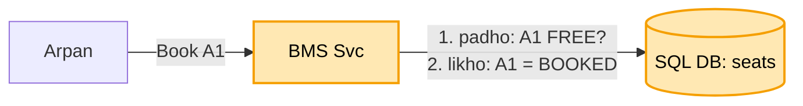
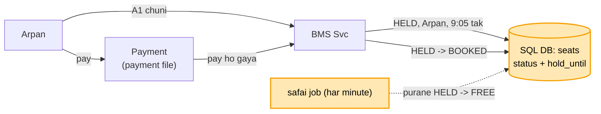
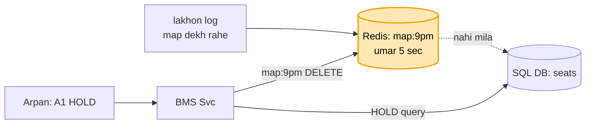

# BookMyShow: shuru se, ek kahani

Kram wahi jo interview me hota hai: **FR, phir NFR, phir numbers, phir design**. Design sabse seedhe dabbe
se shuru hota hai, aur har dikkat aane pe ek naya dabba judta hai. Diagram me peela dabba = abhi juda. Poori
file me ek hi kahani hai: Arpan ko Ravi ke saath PVR ka 9 baje wala show dekhna hai, seat A1.

**Teeno ka jod (banking, payment, BMS):** andar ka dhaancha ek hi hai. Jo kadam banking / payment me pehle
se hai, wahan bas ek line "ye wahi hai"; poora sirf wahi jo BMS ka apna hai.

```
dikkat                         banking            payment             BMS
do log ek saath, ek cheez      kadam 4: balance   (banking wala)      seat A1: UPDATE ... WHERE status = FREE
                               check + kaato
network gaya, dobara bheja     kadam 3: idem key  (banking wala)      pay dobara -> wahi idempotency key
bahar ka paisa (bank / PSP)    -                  kadam 2-4: PSP,     ticket ka paisa = payment file poori
                                                  PENDING, webhook
BMS ka APNA                    -                  -                   seat HOLD 5 min (umar ke saath),
                                                                      seat map ki bheed (cache),
                                                                      concert ki line (waiting room)
```

---

## 1. FR: kya karna hai

```
1. movie / show dekhna, seat map dekhna
2. seat chuno -> pay karo -> ticket pakka
scope ke bahar: refund, review, recommendation
```

## 2. NFR: kaisa chalna chahiye

```
- ek seat kabhi do logon ko na bike (yahi dil hai)
- seat map dekhna tez (bheed yahin hoti)
- badi movie / concert ke din ki bheed jhele
```

## 3. Numbers

```
- dekhne wale bahut, book karne wale kam: 100 log map dekhte to ~1-2 book karte
  -> dekhne ke liye cache, likhne ke liye ek pakka SQL DB
- active data chhota (aaj + agle hafte ke show) -> sharding nahi chahiye, purana archive
```

---

## 4. Design

### Kadam 1: sabse seedha (BMS Svc + SQL DB, pehle padho phir likho)

BMS Svc aur ek SQL DB. `seats` table me har seat ki row: `show 9pm | A1 | FREE`. Arpan "Book A1" dabata hai.
BMS Svc pehle padhta hai "A1 FREE hai?", haan. Phir likhta hai `status = BOOKED`.



Dikkat: Ravi ne bhi usi second me A1 dabaya. Dono ne padha "FREE", dono ne likha "BOOKED". Dono ko ticket,
ek seat pe do log. Ye banking ke "do kataai ek saath, balance -400" jaisi hi dikkat hai: pehle padho, phir
likho, aur beech ke pal me koi aur ghus jaata hai.

### Kadam 2: padhna aur likhna ek hi query me (banking kadam 4 wala hi)

"Pehle padho, phir likho" do alag kaam hain, aur dono ke beech Ravi ghus gaya. Ilaaj: dono ko ek hi query me.

```sql
UPDATE seats SET status = 'BOOKED', user = 'Arpan'
WHERE show = '9pm' AND seat = 'A1' AND status = 'FREE';
```

DB is row pe lock lagata hai, to Arpan aur Ravi ki query ek ke baad ek chalti hai, saath nahi:

```
Arpan ki query pehle: A1 FREE hai -> BOOKED, user = Arpan  -> "1 row badli" -> Arpan ko seat mili
Ravi ki query baad me: A1 ab FREE nahi, WHERE match nahi  -> "0 row badli" -> Ravi: "seat chali gayi"
```

Banking me yahi tha: `UPDATE ... SET balance = balance - 500 WHERE balance >= 500`. Wahan shart "balance
hai?", yahan shart "seat FREE hai?". Baaki sab same.

Par seat book karte hi paisa nahi aata, Arpan ko pay karne me 3 minute lagte hain. Do raaste, dono kharab:
- pehle seat BOOKED, phir pay: Arpan ne pay hi nahi kiya, app band kar di, to A1 hamesha ke liye BOOKED padi
  rahegi, kisi ko nahi milegi.
- pehle pay, phir seat: 3 minute me Ravi le gaya, to Arpan ka paisa kat gaya aur seat nahi mili.

### Kadam 3: seat HOLD 5 minute, umar ke saath (BMS ka apna)

Na pehle BOOKED, na pehle pay. Beech ka ek haal: **HELD** = "Arpan ke liye 5 min ruki hui".
Seat 5 min Arpan ki; pay kiya to pakki, nahi kiya to apne aap wapas FREE.

```sql
-- seat chuni: HOLD (Kadam 2 wali ek query, bas haal HELD + umar)
UPDATE seats SET status = 'HELD', user = 'Arpan', hold_until = now() + 5 min
WHERE show = '9pm' AND seat = 'A1'
  AND (status = 'FREE' OR (status = 'HELD' AND hold_until < now()));   -- purana hold mar chuka to bhi le lo

-- pay ho gaya: pakka (sirf apna, aur umar abhi baaki ho)
UPDATE seats SET status = 'BOOKED'
WHERE seat = 'A1' AND user = 'Arpan' AND status = 'HELD' AND hold_until > now();
```

```
9:00:00  Arpan ne A1 chuni   -> HELD, Arpan, 9:05 tak
9:01:00  Ravi ne A1 chuni    -> HELD hai, umar baaki -> "seat abhi kisi ke paas hai"
9:02:30  Arpan ne pay kiya   -> BOOKED. pakka

dusri kahani: Arpan ne pay kiya hi nahi
9:05:01  Ravi ne A1 chuni    -> hold_until < now -> purana hold mara -> Ravi ka HELD
```



Koi job chahiye jo 5 min baad seat FREE kare? Zaroori nahi. Shart query me hi likhi hai
(`hold_until < now()`), to mara hua hold apne aap gina hi nahi jaata.
Ek chhota job har minute purane HELD saaf kar deta hai, bas taaki seat map pe A1 jaldi khaali dikhe.

Arpan ne 5:30 min pe pay kiya, hold mar chuka tha, aur seat Ravi le gaya? Paisa kat chuka, seat nahi mili ->
paisa wapas (refund). Ye payment file wala hi hissa hai (PSP, PENDING, webhook).

Par 9 baje ke show ka seat map lakhon log dekh rahe hain, book koi-koi kar raha hai. Har "map dekho" pe SQL DB
se 200 seat padhna. DB padhne me hi ghut raha hai, aur Arpan ki booking query bhi dheemi ho gayi.

### Kadam 4: seat map ka cache (Redis)

Har "map dekho" pe SQL tak jaana band. Redis me har show ka seat map ek key me:
`map:9pm = { A1: HELD, A2: FREE, ... 200 seat }`.

```
lakhon log "map dekho" --> [Redis: map:9pm] --mila--> turant (SQL tak gaye hi nahi)
                                 | nahi mila / umar khatam
                                 +--> SQL se 200 seat padho -> Redis me rakho (umar 5 sec)

Arpan ne A1 HOLD ki --> SQL me likha (Kadam 3) --> Redis ki map:9pm DELETE --> agla dekhne wala naya map
```



Map 2-5 sec purana dikhe to chalega? Haan. Map sirf dikhane ke liye hai, faisla nahi karta. Ravi ko cache me
A1 FREE dikha, jabki asal me Arpan le chuka tha. Ravi ne A1 dabaya, Kadam 3 wali query SQL pe chali: "0 row
badli, seat chali gayi". Sach hamesha SQL me, cache sirf aankh ke liye. Yahi banking ke read replica me tha:
balance dekhna copy se, paisa kaatna hamesha primary se. Yahan map dekhna cache se, seat lena hamesha SQL se.

Ab kya theek hua: lakhon "dekho" Redis jhel leta hai, SQL sirf booking ki query dekhta hai, Arpan ki booking
tez.

Par 12 baje Arijit Singh ke concert ki booking khuli. 2 lakh log ek hi second me, ek hi show pe "Book" daba
rahe hain, seat sirf 5000. Saari HOLD query ek hi table ki chand rows pe toot padti hain. SQL lock ki line me
phans jaata hai, sab ka app ghoomta rehta hai.
