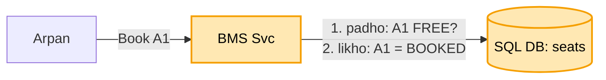

# BookMyShow: shuru se, ek kahani

Kram wahi jo interview me hota hai: **FR, phir NFR, phir numbers, phir design**. Design sabse seedhe dabbe
se shuru hota hai, aur har dikkat aane pe ek naya dabba judta hai. Diagram me peela dabba = abhi juda. Poori
file me ek hi kahani hai: Arpan ko Ravi ke saath PVR ka 9 baje wala show dekhna hai, seat A1.

**Teeno ka jod (banking, payment, BMS):** andar ka dhaancha ek hi hai. Jo kadam banking / payment me pehle
se hai, wahan bas ek line "ye wahi hai"; poora sirf wahi jo BMS ka apna hai.

```
dikkat                         banking            payment             BMS
do log ek saath, ek cheez      kadam 4: balance   (banking wala)      seat A1: UPDATE ... WHERE status = FREE
                               check + kaato
network gaya, dobara bheja     kadam 3: idem key  (banking wala)      pay dobara -> wahi idempotency key
bahar ka paisa (bank / PSP)    -                  kadam 2-4: PSP,     ticket ka paisa = payment file poori
                                                  PENDING, webhook
BMS ka APNA                    -                  -                   seat HOLD 5 min (umar ke saath),
                                                                      seat map ki bheed (cache),
                                                                      concert ki line (waiting room)
```

---

## 1. FR: kya karna hai

```
1. movie / show dekhna, seat map dekhna
2. seat chuno -> pay karo -> ticket pakka
scope ke bahar: refund, review, recommendation
```

## 2. NFR: kaisa chalna chahiye

```
- ek seat kabhi do logon ko na bike (yahi dil hai)
- seat map dekhna tez (bheed yahin hoti)
- badi movie / concert ke din ki bheed jhele
```

## 3. Numbers

```
- dekhne wale bahut, book karne wale kam: 100 log map dekhte to ~1-2 book karte
  -> dekhne ke liye cache, likhne ke liye ek pakka SQL DB
- active data chhota (aaj + agle hafte ke show) -> sharding nahi chahiye, purana archive
```

---

## 4. Design

### Kadam 1: sabse seedha (BMS Svc + SQL DB, pehle padho phir likho)

BMS Svc aur ek SQL DB. `seats` table me har seat ki row: `show 9pm | A1 | FREE`. Arpan "Book A1" dabata hai.
BMS Svc pehle padhta hai "A1 FREE hai?", haan. Phir likhta hai `status = BOOKED`.



Dikkat: Ravi ne bhi usi second me A1 dabaya. Dono ne padha "FREE", dono ne likha "BOOKED". Dono ko ticket,
ek seat pe do log. Ye banking ke "do kataai ek saath, balance -400" jaisi hi dikkat hai: pehle padho, phir
likho, aur beech ke pal me koi aur ghus jaata hai.
