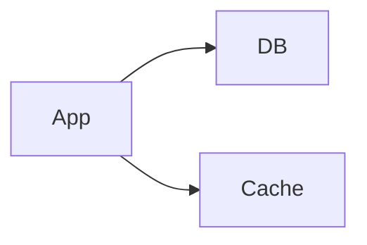
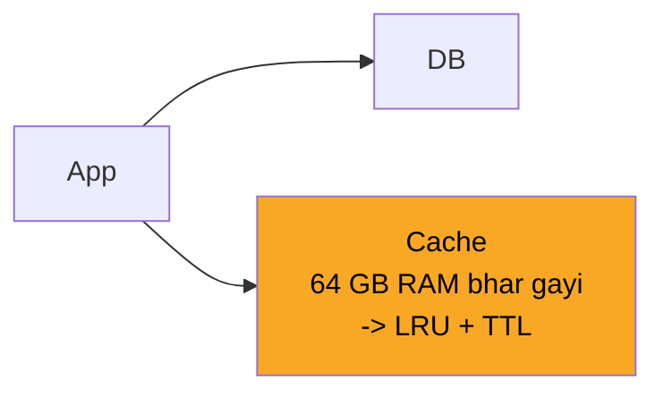
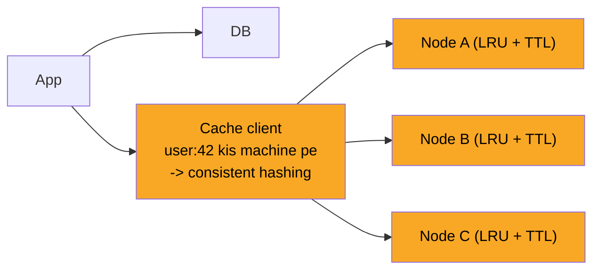
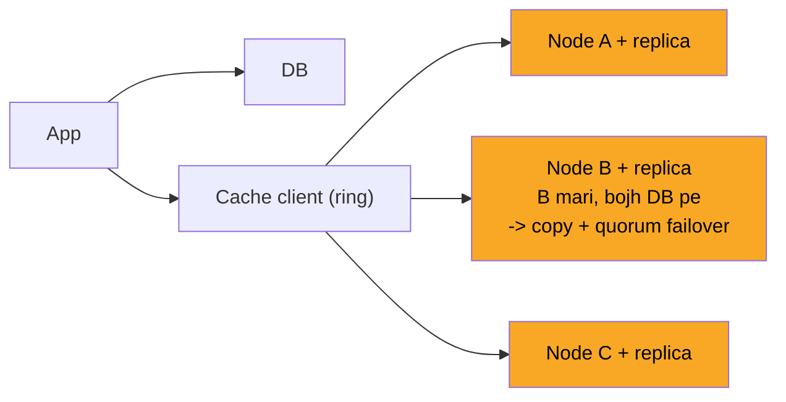
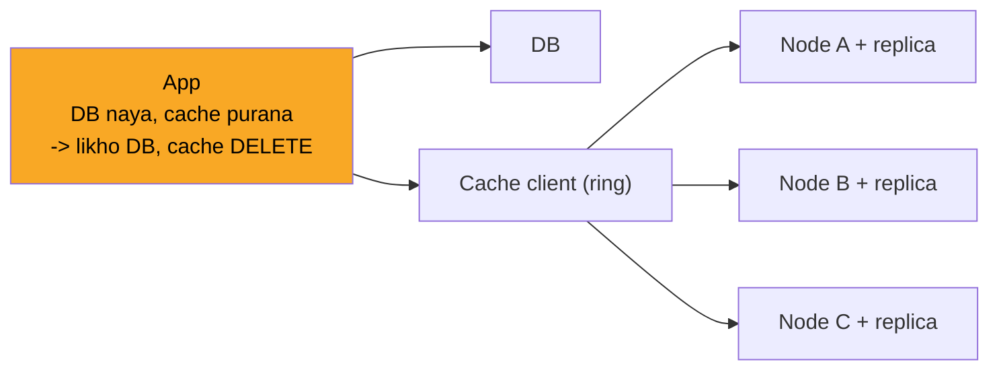
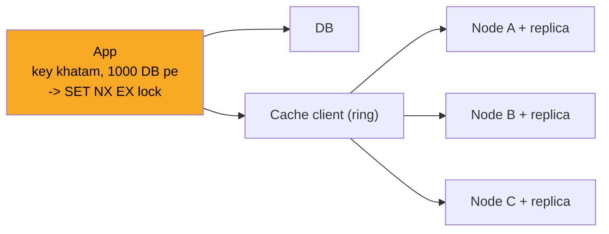
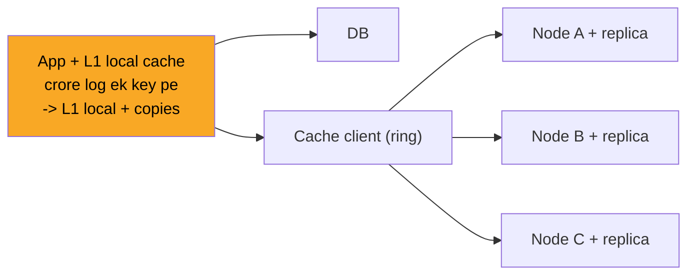
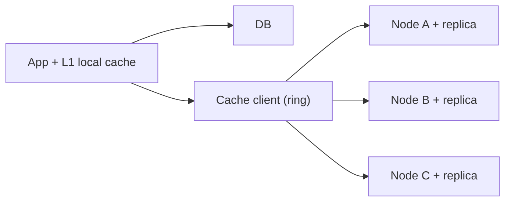

# Distributed Cache (Redis-jaisa)

> Tez RAM wala key-value store, jo ek machine se bada ho aur ek machine mare to bhi chale. Concept detail = FOUNDATIONS/04_caching.md
> Is design ka dil: **TEZ (<1 ms)** + **machine mare to bhi chale**. BookMyShow ka ulta: wahan sahi hona dil tha, yahan tezi.

---

## KAHANI (ek din, mere app ka cache, IPL final wala; har dikkat se design me ek dabba judta)

```
   KYA HUA                                       ILAAJ                                 DABBA JUDA
1  subah 64 GB RAM bhar gayi, kya hatayein    -> LRU + TTL (HashMap + DLL)             Cache (LRU + TTL)
2  data 1 TB, "user:42" kis machine pe        -> CONSISTENT HASHING + virtual nodes    Cache client + Nodes
3  dopahar machine B mari, bojh DB pe         -> REPLICA (async) + quorum failover     Node + replica
4  Ravi ne naam badla, cache me purana        -> DB me likho, cache key DELETE         (App: likhne pe delete)
5  7 baje "home page" key khatam, 1000 DB pe  -> LOCK: SET NX EX, sirf pehla DB jaaye  (App: SET NX lock)
6  raat IPL final, "live:score" pe crore log  -> L1 LOCAL CACHE + key ki copies        App + L1 local cache

POORA DESIGN (upar ke dabbe kram se):
   App + L1 -> Cache client (consistent hashing: key -> machine) -> Node (LRU + TTL) primary + copy
   miss -> DB (asli sach) · padhna = cache-aside · likhna = DB + cache key DELETE
```

---

## TASVEER (ByteByteGo / Alex Xu · CC BY-NC-ND 4.0)


Source: [How Can Cache Systems Go Wrong?](https://bytebytego.com/guides/how-can-cache-systems-go-wrong/)
(thundering herd / penetration / breakdown / crash)


Source: [Consistent Hashing Explained](https://bytebytego.com/guides/consistent-hashing/)
(machine jude ya gire to sirf thodi keys khiskein — ring)

---

## SHURU: pehle poocho, phir numbers

```
POOCHO:  "Ek machine ka cache (kya hatayein, TTL) ya kai machine wala (baantna, copy) — kis pe?"
         kaisa data, padhai zyada? · kitna PURANA chalega? (5
         min purana?)  <- isi se tay hota cache kab saaf karna
         kya hatane ka tareeka (LRU / LFU)? · cache DB ke aage hai ya khud asli store?

KYA KARE (FR):    get(key) · put(key, value, ttl) · delete(key)
                  scope bahar: disk pe bachana · pub/sub · transactions
KAISA CHALE (NFR): <1 ms (dil) · ek machine mare to chale · TB bhar data
                   "thodi der baad sahi" (eventual) chalega — asli sach DB me, cache sirf tez copy

NUMBERS (andaaza):
   ~1 TB data · ~10 lakh read / second · padhai zyada
   1 TB         -> ek machine ki RAM (64 GB) me nahi aata -> BAANTO (sharding)
   10 lakh / sec -> ek machine itna nahi deti -> machines me baanto
   machine mari -> saara bojh DB pe -> har machine ki COPY (replication)
   teeno milke "ek machine kaafi" khaarij -> isliye DISTRIBUTED
```

---

## ════ MOCK SE PEHLE: SIRF YE CARD PADHO ════

> Har card: pehle PEELA DABBA dekho (scene + ilaaj). Yaad aa gaya -> aage. Nahi aaya -> neeche
> DIKKAT / HAL / NAHI padho. AAGE POOCHEGA sirf jab interviewer aage kuch poochhe.

#### DABBA 0: SABSE SIMPLE (yahan se shuru, phir "kahan tootega")
```
Ek machine, uski RAM me ek HashMap. get / put O(1).
App pehle cache se poochhe: mila -> wahi do · nahi mila -> DB se laao -> cache me daalo -> do (CACHE-ASIDE).
```


#### 0 SHURU: CACHE-ASIDE (cache kaam kaise karta)
```
DIKKAT 1   Meri profile DB se padhne me ~10 ms (disk). 10 lakh log / second profile khol rahe
           -> DB ghutno pe.
HAL        DB ke aage RAM wala cache. App pehle cache se poochhe:
             mili (HIT) -> <1 ms me wapas
             nahi mili (MISS) -> DB se laao -> cache me daalo (TTL ke saath) -> wapas. Agli baar HIT.
           App khud cache sambhalta = CACHE-ASIDE (sabse aam tareeka).

DIKKAT 2   Likhna kaise? cache-aside / write-through / write-back?
HAL        Cache-aside: DB me likho, cache ki key DELETE.
           Write-through: DB aur cache dono me saath (hamesha taaza, par likhna dheema).
           Write-back: pehle sirf cache, DB me baad me (tez, par cache mara to data gaya -> paise pe kabhi
           nahi).

DIKKAT 3   Poora cache hi gir gaya?
HAL        Saari padhai DB pe. DB ke aage rate limit / load shedding (faltu request mana), warna DB bhi
           girega.

DIKKAT 4   Chal raha hai, kaise pata?
HAL        HIT RATIO sabse pehle (achanak gira = kuch toota) + p99 + kitni key nikaali ja rahi (evictions).
```

#### 1 Subah cache machine ki RAM bhar gayi, kya hatayein

```
AAGE POOCHEGA:
  NIYAM: sabse purana chhua hua pehle jaaye; umar khatam = key bekaar.
  "Kaise kaam karta?"              -> jise sabse LAMBE samay se kisi ne nahi chhua, wo bahar (wahi LRU jo tune
                                      DSA me banaya, 09_DESIGN, LeetCode 146). Saath me har key ki umar (TTL).
  "LRU andar kaise?"               -> HashMap = key turant · Doubly linked list = kaun kab chhua ki line
                                      get -> node AAGE (head ke paas) · put -> naya AAGE, RAM bhari -> PEECHE
                                      (tail ke paas) wala hatao.
  "TTL wali key kab hatti?"        -> padhne aaye tab check (lazy) + peeche safai (active).
  "LRU kyun, LFU kyun nahi?"       -> LRU = "aakhri baar KAB chhua", LFU = "KITNI baar"; LFU me kal ki
                                      famous key aaj bhi baithi rehti -> ginti waqt ke saath ghatao (decay).
                                      Default LRU.
  "Redis sach me list rakhta?"     -> nahi, memory bachane ko ANDAAZE wala LRU: kuch random key, sabse purani.
  "RAM bhari, hatana band?"        -> noeviction = naya likhna ERROR; cache ke liye allkeys-lru rakho.
```

#### 2 Subah 11 tak data 1 TB: "user:42" kis machine pe?

```
DIKKAT     Subah 11 tak data 1 TB ho gaya, ek machine me 64 GB -> 16+ machine. "user:42" kis machine pe
           jaaye, aur App ko har baar kaise pata chale?
HAL        CONSISTENT HASHING: ring (0 .. 2^32) pe machine bhi, key bhi; key ghadi ki disha me chale,
           PEHLI machine pe rahe. VIRTUAL NODES se bojh barabar; App ki CACHE CLIENT library hisaab karti.
NAHI       hash(key) % N: N badla to lagbhag SAB key ki machine badli -> sab MISS -> DB gira.
```
```
AAGE POOCHEGA:
  NIYAM: machine jude / jaaye to sirf pados ki ~K/N key hilein (K = saari key, N = machine).
  "Ring ka misaal?"                -> ring 0 .. 360: A = 100, B = 200, C = 300 -> key 150 -> B, 250 -> C,
                                      350 -> A (ghoom ke). D = 250 jodi -> sirf 201 .. 250 C se D pe.
  "Ring jaisa kahin dekha?"        -> tera circular array (Next Greater Element II me i % n):
                                      ant pe pahunch ke ghoom ke pehle pe.
  "% N me kitna hilta?"            -> hash 10, 11, 12, 13, 14: N = 4 -> 2, 3, 0, 1, 2 · N = 5 -> 0, 1, 2, 3, 4
                                      = ek machine jodi, PAANCHON hili; asal me 4 -> 5 = ~80% key.
                                      Ring me N kahin nahi. (Interview me dono mila ke mat bolna.)
  "Virtual nodes?"                 -> ek machine ring pe 100 jagah baithti -> bojh barabar.
  "Nayi machine, key khaali?"      -> haan, sirf us hisse ki ~K/N key ek baar miss; poora cache nahi.
  "Kaunsi machine zinda, kaise?"   -> cluster ka naksha (topology / config service);
                                      galat machine pe gaya to Redis bolta "MOVED, wahan jao".
  "Redis Cluster ring use karta?"  -> nahi, 16384 SLOT: CRC16(key) % 16384 -> slot -> machine.
                                      16384 PAKKA (machine ginti nahi): machine badhe to kuch slot khiskao.
                                      Kaam ring jaisa.
  "Range se baanto (A-M, N-Z)?"    -> ek range garam ho jaati (sab "a" wale), ek machine pe bojh; isliye hash.
```

#### 3 Dopahar machine B mar gayi, uski key ka bojh DB pe

```
DIKKAT     Dopahar machine B mar gayi. Uske hisse ki saari key gayab -> un key ki saari padhai seedha DB pe.
HAL        REPLICA: har machine ki COPY doosri building me, likhna B pe, copy tak thodi der baad (ASYNC).
           Baaki B ko ping karti; zyadatar (quorum) bolein "B mari" -> vote se copy naya B, App ko naya pata.
NAHI       sync copy: har likhai pe copy ke "haan" ka intezaar -> <1 ms gaya.
```
```
AAGE POOCHEGA:
  NIYAM: cache me tezi pehle; aakhri kuch likhai kho jaaye to chalta, asli sach DB me.
  "Async ki keemat?"               -> aakhri kuch likhai kho sakti; cache me chalta, asli sach DB me hai.
  "Baaki machines pe asar?"        -> sirf B ki keys pe asar, baaki machines aaram se.
  "Copy ko primary banane me?"     -> ~10-30 sec; us beech us hisse ki key DB se aati (thoda dheema).
  "Network toota, do primary?"     -> SPLIT BRAIN: faisla zyadatar (quorum) se
                                      + jo akeli pad gayi (minority) wo likhna band kare (min-replicas).
  "Copy se padh sakte?"            -> haan, padhai bat jaati; thoda purana mil sakta (lag), cache me chalta.
```

#### 4 Ravi ne naam badla, sabko purana dikh raha

```
DIKKAT     Shaam ko Ravi ne naam "Ravi" se "Ravi K" kiya. DB me naya ho gaya, cache me abhi bhi "Ravi"
           -> sabko purana naam dikh raha.
HAL        DELETE ON WRITE: DB update karo -> phir cache ki key DELETE (update nahi). Agli padhai MISS
           -> DB se "Ravi K" -> cache me.
NAHI       cache UPDATE: "X" phir "Y" likha, cache me pehle Y pahuncha phir X -> galat "X" baith gaya.
```
```
AAGE POOCHEGA:
  NIYAM: likho DB me, cache se hatao; kuch bhi pahunche, key khaali hi hogi. Umar = suraksha jaal.
  "DB hua, cache DELETE fail?"     -> TTL: zyada se zyada utni der purana;
                                      pakka chahiye -> DB ke badlaav (CDC) se delete dobara.
  "Delete ke baad purani wapas?"   -> (race) thodi der baad phir delete (double delete), ya version se likho.
  "Ravi ko khud purana dikha?"     -> copy peeche thi (replica lag);
                                      likhne wale ko thodi der primary se padhao (read-your-own-writes).
  "TTL kitna?"                     -> jitna purana business jhel sake: profile minute, price / stock second ya
                                      turant delete.
```

#### 5 7 baje "home page" key khatam, 1000 log ek saath DB pe

```
AAGE POOCHEGA:
  NIYAM: khaali key pe ek hi DB jaaye; baaki ruke ya purani value le.
  "Kaise kaam karta?"              -> "home page" = 20 table ka join, ~1 sec. Sirf PEHLA DB jaaye: SET
                                      lock:home 1 NX EX 5 (NX = koi aur na laga ho tabhi · EX 5 = pehla beech
                                      me mara to lock khud chhoote). Baaki 999 "thoda ruko", phir cache se.
  "Khatam hi kyun hone do?"        -> umar khatam hone se thoda pehle hi peeche se taaza kar do.
  "Pata tha kab bheed (sale 12 baje, IPL final)?" -> uske pehle hi cache bhar do aur machine badha do.
  "Baaki 999 kitni der rukenge?"   -> 50-100 ms, 2-3 baar; soft-TTL ho (purani value + "taaza karo" nishaan)
                                      to purani value de do, DB pe mat bhejo.
  "Sab ek saath bhari, ek saath khatam?" -> umar me thoda random (60 min +- 5), khatam hona bikhar jaata.
  "Key DB me hai hi nahi?"         -> "nahi hai" ko bhi chhoti umar ke saath cache me, DB tak jaane mat do.
```

#### 6 Raat IPL final, "live:score" key ki machine akeli mar rahi

```
AAGE POOCHEGA:
  NIYAM: garam key ko faila do: App ke paas chhoti copy, ya alag machine pe copies.
  "Kaise kaam karta?"              -> har App server ki RAM me 1-2 sec ka cache: 1000 server, har ek 1 sec me
                                      EK baar Redis se -> Redis pe 1000 / sec, crore nahi. Saath me key ki kai
                                      copy (score#1 .. #10), koi bhi ek.
  "Consistent hashing nahi bachata?" -> nahi; ek key hamesha ek hi machine pe.
  "Kitni parat?"                   -> L1 (App ki RAM, nano-sec) -> L2 Redis (micro / milli) -> DB (milli-sec).
  "Garam key pehchanoge kaise?"    -> App me har key ki ginti (sabse pakka) + machine ka metric
                                      (ops / sec achanak upar); had paar -> copy / L1.
                                      (redis-cli --hotkeys sirf LFU policy pe chalta, hum LRU pe hain.)
  "L1 me purana score kitni der?"  -> L1 ki umar jitna (1-2 sec); score ke liye theek, paisa / stock nahi.
  "Garam key pe LIKHNA (like)?"    -> key ke tukde (like#0..#9), kisi ek me likho, padhte waqt sab jodo.
  "Stampede aur hot key me farak?" -> stampede = key KHAALI, sab DB bhaage (lock)
                                      · hot key = key BHARI, ek machine padhai se mar rahi (L1 / copy).
```

---

## AAKHRI DABBA + WRAP (ek hi baar)

```
App + L1 local cache (nano-sec, hot key ka pehla ilaaj) -> Cache client (consistent hashing: key -> machine)
-> Machine (HashMap + DLL = LRU, + TTL) primary + copy (alag AZ) -> miss pe DB (asli sach)
PADHNA = cache-aside (~90% hit, DB pe bojh 10 guna kam) · PURANA = TTL + likhne pe delete
STAMPEDE = lock / soft-TTL · HOT KEY = copies / L1 local

DB:  cache = RAM wala key-value (<1 ms, join nahi, sirf key se) · DB peeche asli sach
     cache AP ki taraf: tezi > sahi hona, "thodi der baad sahi" chalta
```
```
JAWAB:    Cache = RAM me rakhi key-value, kai machines me baanti (ring se), har machine ki copy.
          App pehle cache se poochhta, na mile to DB se laake cache me rakhta. RAM bhare to purani key
          nikalti, har key ki umar hoti.
          Do dikkat dhyaan rakhni: purana data (badalne pe key hatao + umar) aur key khatam hote hi
          bheed (ek laaye, baaki ruke).
          Bahut garam key: har app server apne paas 1-2 second rakhe.
```


---

## 10 GUNA TRAFFIC — har dabba alag se

```
Cache client  -> machine judi / gayi -> consistent hashing + virtual nodes
Machine       -> RAM bhari -> LRU + TTL · mari -> copy promote · data badha -> machine jodo
hot key       -> copies + L1 local cache
umar khatam   -> lock · soft-TTL · kabhi khatam nahi · pehle se bharo
DB            -> purana data -> likhne pe delete + TTL
AAGE:         write-back (likhna bahut ho to) · kai region me cache

POOCHEGA: "How would you scale this to 10x?"      -> request ka raasta chalo
POOCHEGA: "What's the single point of failure?"   -> machine (copy), cache client config (sab app me copy)
POOCHEGA: "How do you know it's working?"         -> HIT RATIO sabse
          zaroori (gira = kuch toota) · p99 · evictions · alert
```

---

## POOCHE TO (gehra sawaal aaye tab)

```
API:      GET key · PUT key value ttl · DELETE key
          jaan-boojh ke chhoti — query nahi, sirf key se -> index / planner nahi -> isiliye tez

MACHINE KE ANDAR: HashMap key -> value (O(1)) · LRU = HashMap + DLL · TTL lazy + active
                  RAM wala key-value (Redis-jaisa), DB peeche asli sach
                  <1 ms -> RAM (disk nahi) · join nahi -> key-value kaafi

KEY BAANTNA:    hash % N -> sab khiskti -> NAHI · CONSISTENT HASHING
                -> ring + ghadi ki disha + virtual nodes <- YAHI
                range -> ek range garam -> NAHI

TRADE-OFF:      tezi vs sahi hona — cache AP ki taraf, "thodi der baad sahi" chalta (CAP)

LIBRARY DESK: 10,000 kitaab godaam me (DB = dheema, sab kuch) · top-100 front desk pe (cache = RAM, tez)
   ek desk pe saari kitaab nahi aati + desk wala beemar pad sakta (machine band)
   -> kai desk (nodes) + kaunsi kitaab kis desk (sharding) + har
      desk ka backup banda (replication) = DISTRIBUTED CACHE
```

---

ARCHETYPE F · CONCEPTS: [caching](../../FOUNDATIONS/04_caching.md) · [sharding](../../FOUNDATIONS/06_database_sharding.md) · [replication](../../FOUNDATIONS/05_database_replication.md) · [← MASTER SHEET](../../00_MASTER_SHEET.md)
