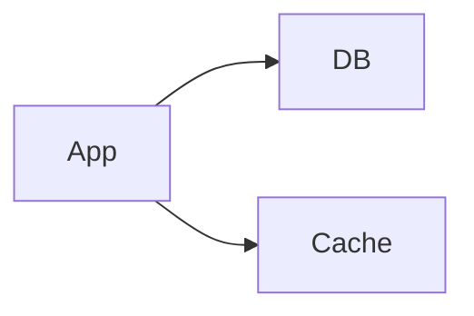
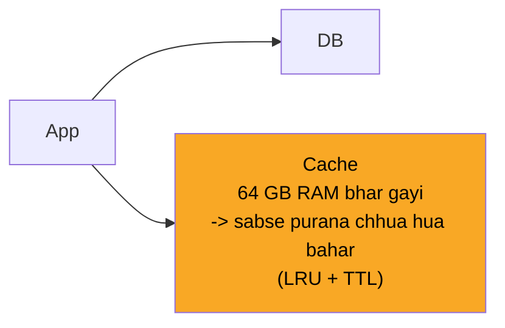
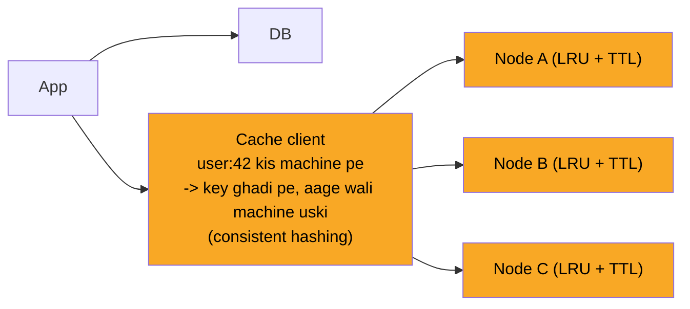
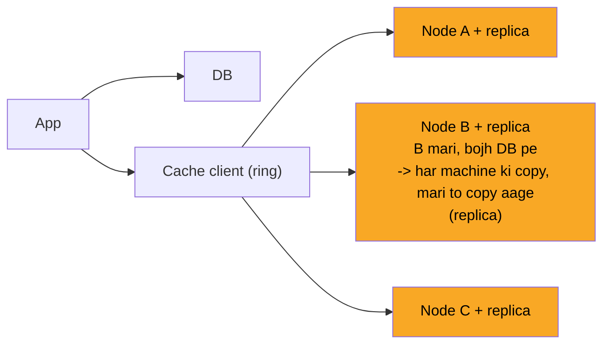
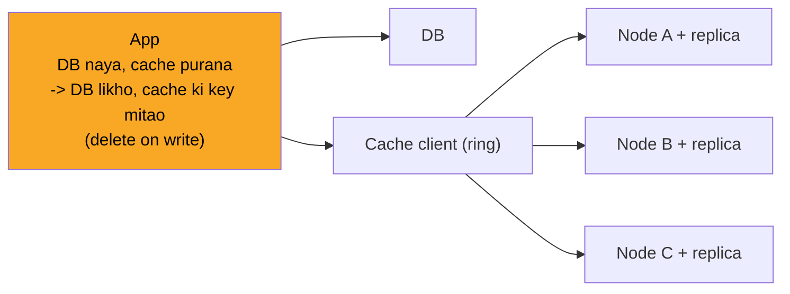
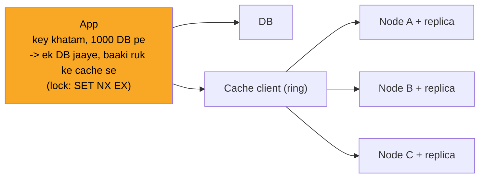
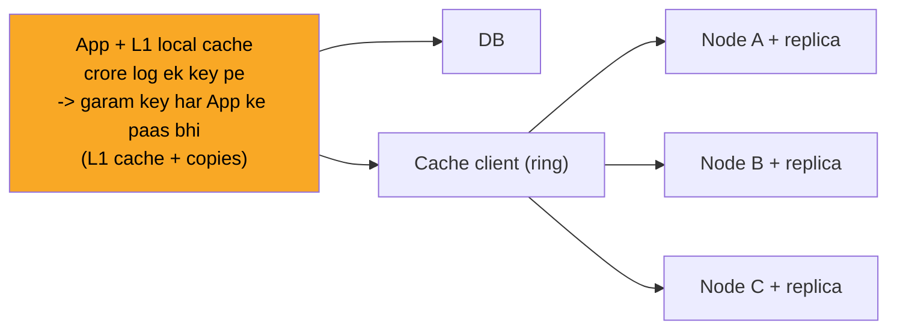
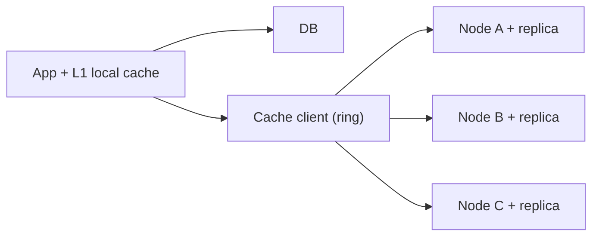

# Distributed Cache (Redis-jaisa)

> Tez RAM wala key-value store, jo ek machine se bada ho aur ek machine mare to bhi chale. Concept detail = FOUNDATIONS/04_caching.md
> Is design ka dil: **TEZ (<1 ms)** + **machine mare to bhi chale**. BookMyShow ka ulta: wahan sahi hona dil tha, yahan tezi.

---

## KAHANI (ek din, mere app ka cache, IPL final wala; har dikkat se design me ek dabba judta)

```
   KYA HUA                                       ILAAJ                                 DABBA JUDA
1  subah 64 GB RAM bhar gayi, kya hatayein    -> LRU + TTL (HashMap + DLL)             Cache (LRU + TTL)
2  data 1 TB, "user:42" kis machine pe        -> CONSISTENT HASHING + virtual nodes    Cache client + Nodes
3  dopahar machine B mari, bojh DB pe         -> REPLICA (async) + quorum failover     Node + replica
4  Ravi ne naam badla, cache me purana        -> DB me likho, cache key DELETE         (App: likhne pe delete)
5  7 baje "home page" key khatam, 1000 DB pe  -> LOCK: SET NX EX, sirf pehla DB jaaye  (App: SET NX lock)
6  raat IPL final, "live:score" pe crore log  -> L1 LOCAL CACHE + key ki copies        App + L1 local cache

POORA DESIGN (upar ke dabbe kram se):
   App + L1 -> Cache client (consistent hashing: key -> machine) -> Node (LRU + TTL) primary + copy
   miss -> DB (asli sach) · padhna = cache-aside · likhna = DB + cache key DELETE
```

---

## TASVEER (ByteByteGo / Alex Xu · CC BY-NC-ND 4.0)


Source: [How Can Cache Systems Go Wrong?](https://bytebytego.com/guides/how-can-cache-systems-go-wrong/)
(thundering herd / penetration / breakdown / crash)


Source: [Consistent Hashing Explained](https://bytebytego.com/guides/consistent-hashing/)
(machine jude ya gire to sirf thodi keys khiskein — ring)

---

## SHURU: pehle poocho, phir numbers

```
POOCHO:  "Ek machine ka cache (kya hatayein, TTL) ya kai machine wala (baantna, copy) — kis pe?"
         kaisa data, padhai zyada? · kitna PURANA chalega? (5
         min purana?)  <- isi se tay hota cache kab saaf karna
         kya hatane ka tareeka (LRU / LFU)? · cache DB ke aage hai ya khud asli store?

KYA KARE (FR):    get(key) · put(key, value, ttl) · delete(key)
                  scope bahar: disk pe bachana · pub/sub · transactions
KAISA CHALE (NFR): <1 ms (dil) · ek machine mare to chale · TB bhar data
                   "thodi der baad sahi" (eventual) chalega — asli sach DB me, cache sirf tez copy

NUMBERS (andaaza):
   ~1 TB data · ~10 lakh read / second · padhai zyada
   1 TB         -> ek machine ki RAM (64 GB) me nahi aata -> BAANTO (sharding)
   10 lakh / sec -> ek machine itna nahi deti -> machines me baanto
   machine mari -> saara bojh DB pe -> har machine ki COPY (replication)
   teeno milke "ek machine kaafi" khaarij -> isliye DISTRIBUTED
```

---

## ════ MOCK SE PEHLE: SIRF YE CARD PADHO ════

> Har card: pehle PEELA DABBA dekho (scene + ilaaj). Yaad aa gaya -> aage. Nahi aaya -> neeche
> DIKKAT / HAL / NAHI padho. AAGE POOCHEGA sirf jab interviewer aage kuch poochhe.

#### DABBA 0: SABSE SIMPLE (yahan se shuru, phir "kahan tootega")
```
Ek machine, uski RAM me ek HashMap. get / put O(1).
App pehle cache se poochhe: mila -> wahi do · nahi mila -> DB se laao -> cache me daalo -> do (CACHE-ASIDE).
```


#### 0 SHURU: CACHE-ASIDE (cache kaam kaise karta)
```
DIKKAT 1   Meri profile DB se padhne me ~10 ms (disk). 10 lakh log / second profile khol rahe
           -> DB ghutno pe.
HAL        DB ke aage RAM wala cache. App pehle cache se poochhe:
             mili (HIT) -> <1 ms me wapas
             nahi mili (MISS) -> DB se laao -> cache me daalo (TTL ke saath) -> wapas. Agli baar HIT.
           App khud cache sambhalta = CACHE-ASIDE (sabse aam tareeka).

DIKKAT 2   Likhna kaise? cache-aside / write-through / write-back?
HAL        Cache-aside: DB me likho, cache ki key DELETE.
           Write-through: DB aur cache dono me saath (hamesha taaza, par likhna dheema).
           Write-back: pehle sirf cache, DB me baad me (tez, par cache mara to data gaya -> paise pe kabhi
           nahi).

DIKKAT 3   Poora cache hi gir gaya?
HAL        Saari padhai DB pe. DB ke aage rate limit / load shedding (faltu request mana), warna DB bhi
           girega.

DIKKAT 4   Chal raha hai, kaise pata?
HAL        HIT RATIO sabse pehle (achanak gira = kuch toota) + p99 + kitni key nikaali ja rahi (evictions).
```

#### 1 Subah cache machine ki RAM bhar gayi, kya hatayein

```
AAGE POOCHEGA:
  NIYAM: RAM bhari to sabse purana chhua pehle jaaye; umar khatam = key bekaar. Hati key = sirf ek miss,
         App DB se laake wapas rakhta; sach DB me, cache sirf tez copy.
  "Ye chalta kaise hai?"                    -> SABSE PURANA CHHUA HUA bahar (LRU), wahi jo tune DSA me banaya
                                               (LC 146); har key ki umar bhi (TTL).
  "Sabse purana kaun, har baar dhoondhoge?" -> NAHI: HASHMAP + DOUBLY LINKED LIST; chhua -> AAGE, RAM bhari ->
                                               PEECHE wala hatao, kyunki dono kaam O(1).
  "Umar wali key hat-ti kab hai?"           -> PADHTE WAQT check (lazy) + peeche thodi-thodi safai (active),
                                               kyunki har key pe ghadi lagana mehnga.
  "Kitni baar chhua, wo kyun nahi ginte?"   -> wo LFU; kal ki famous key aaj bhi baithi rehti, kyunki purani
                                               ginti nahi ghatti. Default LRU.
  "Redis sach me poori list rakhta?"        -> NAHI, ANDAAZE wala LRU: kuch random key utha ke unme sabse
                                               purani, kyunki poori list = har key pe extra memory.
  "Aur hatana hi band kar diya to?"         -> NAYA LIKHNA ERROR (noeviction), kyunki RAM bhari aur kuch
                                               hatana mana; cache me allkeys-lru rakho.
```

#### 2 Subah 11 tak data 1 TB: "user:42" kis machine pe?

```
DIKKAT     Subah 11 tak data 1 TB ho gaya, ek machine me 64 GB -> 16+ machine. "user:42" kis machine pe
           jaaye, aur App ko har baar kaise pata chale?
HAL        gol ghadi pe key aur machine (CONSISTENT HASHING): key ghadi ki disha me chale, PEHLI machine uski.
           VIRTUAL NODES se bojh barabar; App ki CACHE CLIENT library hisaab karti.
NAHI       hash(key) % N: N badla to lagbhag SAB key ki machine badli -> sab MISS -> DB gira.
```
```
AAGE POOCHEGA:
  NIYAM: machine jude / jaaye to sirf pados ki ~K/N key hilein (K = saari key, N = machine); App ko us
         hisse ki ek baar miss, baaki sab hit.
  "Ghadi ka ek misaal do."               -> 0..360: A=100, B=200, C=300; key 150 -> B, 350 -> GHOOM KE A.
                                            D=250 juda -> sirf 201..250 khiske.
  "Ye ghoomna kahin dekha hai?"          -> TERA CIRCULAR ARRAY: Next Greater Element II me i % n, wahi aakhri
                                            ke baad pehla.
  "Seedha hash % N kyun nahi?"           -> N BADLA TO SAB HILTI: 4 se 5 machine = ~80% key, kyunki har key ka
                                            % N badal gaya; ring me N nahi.
  "Ek machine pe zyada key aa gayi?"     -> VIRTUAL NODES: ek machine ring pe 100 jagah, kyunki 3 nishaan =
                                            bade-chhote tukde, 100 nishaan = barabar.
  "Nayi machine aayi, wo to khaali hai?" -> SIRF US HISSE ki ~K/N key ek baar miss, kyunki baaki key ki
                                            machine badli hi nahi.
  "App ko kaise pata kaun zinda?"        -> NAKSHA (config service); galat machine pe gaya to Redis bolta
                                            "MOVED, wahan jao", kyunki naksha thoda purana ho sakta.
  "Redis Cluster bhi ring hai?"          -> NAHI, 16384 SLOT: CRC16(key) % 16384 -> slot -> machine; slot
                                            ki ginti fix rehti, machine badhe to sirf kuch slot khiskao.
  "A-M ek pe, N-Z doosre pe kyun nahi?"  -> EK RANGE GARAM ho jaati (sab "S" naam), ek machine pe bojh; hash
                                            se key bikhar jaati.
```

#### 3 Dopahar machine B mar gayi, uski key ka bojh DB pe

```
DIKKAT     Dopahar machine B mar gayi. Uske hisse ki saari key gayab -> un key ki saari padhai seedha DB pe.
HAL        har machine ki copy (REPLICA): doosri building me, likhna B pe, copy tak thodi der baad (ASYNC).
           Baaki B ko ping karti; zyadatar (quorum) bolein "B mari" -> copy naya B, App ko naya pata.
NAHI       sync copy: har likhai pe copy ke "haan" ka intezaar -> <1 ms gaya.
```
```
AAGE POOCHEGA:
  NIYAM: cache me tezi pehle: copy thodi der baad, aakhri likhai kho jaaye to chalta, kyunki sach DB me.
         Machine giri -> copy main bane, App ko us hisse me thodi der miss.
  "Copy tak thodi der baad, kuch kho sakta?" -> HAAN, AAKHRI KUCH LIKHAI, kyunki main pehle haan bolta, copy
                                                baad me; cache me chalta, sach DB me.
  "B gayi to baaki machines?"                -> SIRF B KI KEY pe asar, kyunki har machine ka apna hissa; baaki
                                                aaram se.
  "Copy ko main banane me kitni der?"        -> ~10-30 SEC, kyunki pehle pakka karna ki B sach me mari; us
                                                beech us hisse ki key DB se (thoda dheema).
  "Network toota, dono khud ko main samjhe?" -> ZYADATAR (quorum) tay kare; akeli padi wo likhna band kare,
                                                kyunki do main = do sach (split brain).
  "Copy baithi hai, usse padh bhi lo?"       -> HAAN, padhai bat-ti; thoda purana mil sakta, kyunki copy
                                                peeche chalti; cache me chalta.
```

#### 4 Ravi ne naam badla, sabko purana dikh raha

```
DIKKAT     Shaam ko Ravi ne naam "Ravi" se "Ravi K" kiya. DB me naya ho gaya, cache me abhi bhi "Ravi"
           -> sabko purana naam dikh raha.
HAL        DB likho, cache mitao (DELETE ON WRITE): DB update karo -> phir cache ki key DELETE (update nahi).
           Agli padhai MISS -> DB se "Ravi K" -> cache me.
NAHI       cache UPDATE: "X" phir "Y" likha, cache me pehle Y pahuncha phir X -> galat "X" baith gaya.
```
```
AAGE POOCHEGA:
  NIYAM: likho DB me, cache se hatao; kuch bhi pahunche, key khaali hi hogi -> agla padhne wala DB se naya
         laata. Umar = suraksha jaal: delete chhoota to bhi utni der hi purana.
  "DB likha, par delete fail ho gaya?"       -> UMAR (TTL) bachati: utni der hi purana, phir key khud hategi.
                                                Pakka chahiye -> DB ke badlaav (CDC) se phir delete.
  "Delete ke baad koi purani wapas daal de?" -> THODI DER BAAD PHIR DELETE (double delete), kyunki purana
                                                padhne wala beech me likh gaya; ya version se likho.
  "Ravi ko apna hi purana naam dikha?"       -> COPY PEECHE thi; likhne wale ko kuch der primary se padhao,
                                                kyunki apna likha turant dikhna chahiye.
  "Umar kitni rakhoge?"                      -> JITNA PURANA JHEL SAKE: profile = minute, price / stock =
                                                second, kyunki galat price = nuksaan.
```

#### 5 7 baje "home page" key khatam, 1000 log ek saath DB pe

```
AAGE POOCHEGA:
  NIYAM: khaali key pe ek hi DB jaaye, baaki ruke ya purani value le; App ko thoda dheema ya thoda purana
         chalta, DB pe 1000 ek saath kabhi nahi.
  "Ek hi DB jaaye, hota kaise hai?"             -> PEHLA LOCK LE, wahi join laaye; baaki ruk ke cache se. (SET
                                                   lock:home 1 NX EX 5: NX = koi aur na laga ho · EX 5 = mara
                                                   to khud chhoote)
  "999 ruke hain, kitni der?"                   -> 50-100 ms. Ya PURANI VALUE de do, DB mat bhejo, kyunki
                                                   thodi purani home page chalti.
  "Purani de sakte, to khatam hone hi kyun di?" -> sahi: PEHLE TAAZA karo, umar khatam se thoda pehle, kyunki
                                                   key khaali hi nahi hogi.
  "Sale 12 baje, tumhe pata tha na?"            -> to PEHLE BHAR do cache, machine badha do, kyunki bheed ka
                                                   waqt pata = tayyari pehle.
  "Saari key ek saath khatam ho gayi to?"       -> RANDOM UMAR (60 min +- 5), kyunki sabki umar same = sab ek
                                                   saath girti.
  "Key DB me thi hi nahi?"                      -> "NAHI HAI" bhi cache karo, chhoti umar, kyunki warna har
                                                   baar DB tak jaata.
```

#### 6 Raat IPL final, "live:score" key ki machine akeli mar rahi

```
AAGE POOCHEGA:
  NIYAM: garam key ko faila do (App ke paas 1-2 sec ki copy, ya key ke tukde): ek key = ek machine, isliye
         bheed baanto; score thoda purana chalta, paisa nahi.
  "Ye chalta kaise hai?"                  -> HAR APP KE PAAS 1-2 SEC ki copy: Redis pe 1000 / sec, crore nahi.
                                             Saath me key ki kai copy (score#1..#10).
  "Consistent hashing se bat nahi jaati?" -> NAHI; EK KEY = EK MACHINE, hamesha, kyunki ring key baant-ta, ek
                                             key ki bheed nahi.
  "To kitni parat hui?"                   -> L1 (App RAM) -> L2 Redis -> DB; har neeche wali dheemi, isliye
                                             upar se pehle.
  "Garam key pata kaise chalegi?"         -> APP ME GINTI + machine ka metric achanak upar; had paar -> copy /
                                             L1.
  "L1 me score kitna purana?"             -> L1 KI UMAR jitna (1-2 sec); score theek, paisa / stock nahi,
                                             kyunki wahan purana = galat.
  "Aur us key pe likhna ho (like)?"       -> KEY KE TUKDE (like#0..#9): kisi ek me likho, padhte waqt jodo,
                                             kyunki likhai bhi 10 jagah bat gayi.
  "Pichhla stampede aur ye, farak?"       -> stampede = key KHAALI (lock) · hot key = key BHARI, ek machine pe
                                             bheed (L1).
```

---

## AAKHRI DABBA + WRAP (ek hi baar)

```
App + L1 local cache (nano-sec, hot key ka pehla ilaaj) -> Cache client (consistent hashing: key -> machine)
-> Machine (HashMap + DLL = LRU, + TTL) primary + copy (alag AZ) -> miss pe DB (asli sach)
PADHNA = cache-aside (~90% hit, DB pe bojh 10 guna kam) · PURANA = TTL + likhne pe delete
STAMPEDE = lock / soft-TTL · HOT KEY = copies / L1 local

DB:  cache = RAM wala key-value (<1 ms, join nahi, sirf key se) · DB peeche asli sach
     cache AP ki taraf: tezi > sahi hona, "thodi der baad sahi" chalta
```
```
JAWAB:    Cache = RAM me rakhi key-value, kai machines me baanti (ring se), har machine ki copy.
          App pehle cache se poochhta, na mile to DB se laake cache me rakhta. RAM bhare to purani key
          nikalti, har key ki umar hoti.
          Do dikkat dhyaan rakhni: purana data (badalne pe key hatao + umar) aur key khatam hote hi
          bheed (ek laaye, baaki ruke).
          Bahut garam key: har app server apne paas 1-2 second rakhe.
```


---

## 10 GUNA TRAFFIC — har dabba alag se

```
Cache client  -> machine judi / gayi -> consistent hashing + virtual nodes
Machine       -> RAM bhari -> LRU + TTL · mari -> copy promote · data badha -> machine jodo
hot key       -> copies + L1 local cache
umar khatam   -> lock · soft-TTL · kabhi khatam nahi · pehle se bharo
DB            -> purana data -> likhne pe delete + TTL
AAGE:         write-back (likhna bahut ho to) · kai region me cache

POOCHEGA: "How would you scale this to 10x?"      -> request ka raasta chalo
POOCHEGA: "What's the single point of failure?"   -> machine (copy), cache client config (sab app me copy)
POOCHEGA: "How do you know it's working?"         -> HIT RATIO sabse
          zaroori (gira = kuch toota) · p99 · evictions · alert
```

---

## POOCHE TO (gehra sawaal aaye tab)

```
API:      GET key · PUT key value ttl · DELETE key
          jaan-boojh ke chhoti — query nahi, sirf key se -> index / planner nahi -> isiliye tez

MACHINE KE ANDAR: HashMap key -> value (O(1)) · LRU = HashMap + DLL · TTL lazy + active
                  RAM wala key-value (Redis-jaisa), DB peeche asli sach
                  <1 ms -> RAM (disk nahi) · join nahi -> key-value kaafi

KEY BAANTNA:    hash % N -> sab khiskti -> NAHI · CONSISTENT HASHING
                -> ring + ghadi ki disha + virtual nodes <- YAHI
                range -> ek range garam -> NAHI

TRADE-OFF:      tezi vs sahi hona — cache AP ki taraf, "thodi der baad sahi" chalta (CAP)

LIBRARY DESK: 10,000 kitaab godaam me (DB = dheema, sab kuch) · top-100 front desk pe (cache = RAM, tez)
   ek desk pe saari kitaab nahi aati + desk wala beemar pad sakta (machine band)
   -> kai desk (nodes) + kaunsi kitaab kis desk (sharding) + har
      desk ka backup banda (replication) = DISTRIBUTED CACHE
```

---

ARCHETYPE F · CONCEPTS: [caching](../../FOUNDATIONS/04_caching.md) · [sharding](../../FOUNDATIONS/06_database_sharding.md) · [replication](../../FOUNDATIONS/05_database_replication.md) · [← MASTER SHEET](../../00_MASTER_SHEET.md)
