# Distributed Cache (Redis-jaisa)

> Tez RAM wala key-value store, jo ek machine se bada ho aur ek machine mare to bhi chale. Concept detail = FOUNDATIONS/04_caching.md
> Dil do cheezein: tez (<1 ms), aur machine mare to bhi chale. BookMyShow ka ulta: wahan sahi hona dil tha, yahan tezi.
>
> Mock me sirf heading + Cue + kahani ki tasveer. Neeche har card: HAL · KYUN · NAHI, phir YAAD RAKH dabba + CROSS-Q dabba (sawaal → cue, poora jawab).
> Cross-Q: hal ke har bade shabd pe socho -> gira? · dheema / bheed? · do ek saath? · galat hua? · kaise / kitna?

---

## Poori tasveer (aakhir me design aisa banta hai)



---


## Shuru

```
FR      get(key), put(key, value, ttl), delete(key). Disk pe bachana, pub/sub aur transactions scope se bahar
NFR     <1 ms (yahi dil hai), ek machine mare to bhi chale, TB bhar data. "Thodi der baad sahi" (eventual)
        chalega, asli sach DB me hai
NUMBERS ~1 TB data, ~10 lakh read / sec, padhai zyada. DB se ~10 ms lagta hai (disk), 10 lakh / sec pe DB
        ghutno pe aa jaata hai, isliye aage RAM cache
        1 TB ek machine ki RAM (64 GB) me nahi aata, to baanto (sharding)
        10 lakh / sec ek machine nahi deti, to machines me baanto
        machine mari to saara bojh DB pe, isliye har machine ki copy (replication)
        teeno ne "ek machine kaafi" khaarij kar diya, isliye distributed
PEHLE   sabse simple: ek machine, uski RAM me ek HashMap, get / put O(1)
```

> [!IMPORTANT]
> **RAIL: har design isi kram me chalta (8 dabbe, sab file me same)**
> kaam chala → bheed aayi → machine giri → do log ek saath → kuch dheema → data bada → door ke log → bahar ka hamla
>
> | rail | is design me | card |
> |---|---|---|
> | 1 kaam chala | get / put, RAM bhar gayi, kya hatayein | 1 |
> | 2 bheed aayi | 7 baje home key khatam, 1000 log DB pe · IPL final, ek key pe crore log | 5, 6 |
> | 3 machine giri | machine B mari, uski key DB pe (**is design ka khaas: machine mare to bhi chale**) | 3 |
> | 4 do log ek saath | Ravi ne naam badla, DB me naya, cache me purana · delete ke beech purana wapas bhara (card 4 ka cross-Q) | 4 |
> | 5 kuch dheema | alag nahi: DB ~10 ms, isliye aage cache (Shuru) | - |
> | 6 data bada | 1 TB, "user:42" kis machine pe | 2 |
> | 7 door ke log | nahi aata | - |
> | 8 bahar ka hamla | jo key DB me hai hi nahi, baar-baar maango (card 5 ka cross-Q) | 5 |


> [!NOTE]
> **AWS pe kaunsa DB (interview me naam bolna ho to)** · SQL wala = RDS, Cassandra RDS pe nahi chalta
>
> - Ye khud cache hai → **ElastiCache (Redis)**: AWS pe Redis jaisa managed cache yahi

---

*ab tootega kahan? sabse pehle RAM pe, kyunki RAM chhoti hai*

## 1. Subah cache machine ki RAM bhar gayi, kya hatayein

**Rail 1 KAAM CHALA** · Cue: LRU + TTL (HashMap + DLL)

<details><summary>kahani dekho (3 scene)</summary>


</details>

```
HAL     jo sabse der se chhua gaya wo bahar (LRU), aur har key ki umar (TTL). RAM bhari to sabse der se
        chhua hatao. Wahi LRU jo LC 146 me hai
        cache-aside: App pehle cache se poochhta hai. GET profile:42 mili (HIT) to <1 ms, DB tak nahi.
        Nahi mili (MISS) to DB se (~10 ms), cache me TTL ke saath rakho, agli baar HIT
KYUN    RAM bhari to sabse purana chhua pehle jaata hai, umar khatam to key bekaar. Hati key sirf ek miss
        hai, App DB se laake wapas rakh deta hai
        sach DB me hai, cache sirf tez copy. Cache khaali ho tab bhi sahi data DB se milta hai,
        App ko farak sirf tezi ka padta hai
NAHI    LFU (kitni baar chhua)
        -> ATKA: kal ki famous key aaj bhi baithi rehti hai, purani ginti nahi ghatti. Default LRU
        hatana hi band (noeviction)
        -> ERROR: naya likhna error deta hai. Cache me allkeys-lru rakho
```

> [!IMPORTANT]
> **Yaad rakh:** RAM bhari to sabse der se chhua bahar (LRU), har key ki umar (TTL). HashMap + list = O(1). Sach DB me.

> [!TIP]
> **Cross-Q: sawaal → cue, phir poora jawab**
> - LRU me sabse purana har baar dhoondhoge? → **HashMap + doubly linked list**: nahi. HashMap + doubly linked list: chhua to aage, peeche wala hatao, O(1)
> - user:9 phir padha → **utha ke aage rakho**: Ab wo sabse baad me nikalega, chhua matlab taaza
> - Redis sach me poori LRU list rakhta hai? → **andaaze wala LRU**: nahi, andaaze wala LRU: kuch random key me sabse purani hatata hai. Poori list = har key pe memory
> - umar (TTL) kitni rakhoge? → **jitna purana jhel sako**: jitna purana data jhel sako (5 min chalega?). Profile = minute, price / stock = second
> - umar (TTL) khatam ho gayi → **agla padhne wala MISS karega**: DB se taaza laayega. Purana zyada der nahi tikta


---

*ab ek machine me jagah ka hisaab ho gaya, par data hi ek machine se bada*

## 2. Subah 11 tak data 1 TB: "user:42" kis machine pe?

**Rail 6 DATA BADA** · Cue: CONSISTENT HASHING + virtual nodes

<details><summary>kahani dekho (3 scene)</summary>


</details>

```
HAL     kai machine hain, App ke paas cache client jo batata hai key kis machine pe hai (consistent hashing).
        Key ring pe aage chalti hai, pehli machine uska ghar. Aakhir ke baad ghoom ke pehli
KYUN    machine jude ya jaaye to sirf pados ki ~K/N key hilti hain (K = saari key, N = machine).
        Sirf us hisse ki ek baar miss, baaki hit
        virtual nodes se pados kai machine ban jaati hain, bojh ek pe nahi padta
NAHI    seedha hash % N
        -> HILTA: N badla to har key ka % N badla. 4 se 5 machine = ~80% key hilti. Ring me N hai hi nahi
        A-M ek pe, N-Z doosre pe
        -> GARAM: ek range garam (sab "S" naam), ek machine pe bojh. Hash se key bikhar jaati hai
```

> [!IMPORTANT]
> **Yaad rakh:** Key ka hash ring pe, aage chalo, pehli machine ghar. Machine jude / jaaye to sirf pados ki key hilti.

> [!TIP]
> **Cross-Q: sawaal → cue, phir poora jawab**
> - ring me machine D judi → **sirf pados ki key khiski**: sirf pados ki key khiski (201..250, C se D pe). Baaki sab hit
> - ring se machine A giri → **aage wali machine**: uski key aage wali machine pe chali jaati hain. Sirf wahi ek baar miss
> - A gira to uska saara bojh B pe double ho jaayega? → **virtual nodes**: nahi, har machine ring pe 100-200 jagah hai (virtual nodes). Bojh kai pados pe bat jaata hai
> - Redis Cluster bhi ring hai? → **nahi, 16384 slot**: nahi. CRC16(key) % 16384 se slot, slot se machine. Machine badhe to sirf kuch slot khiskao


---

*ab data baant diya, par ek machine mari to?*

## 3. Dopahar machine B mar gayi, uski key ka bojh DB pe

**Rail 3 MACHINE GIRI (khaas)** · Cue: REPLICA (async) + quorum failover

<details><summary>kahani dekho (3 scene)</summary>


</details>

```
HAL     har machine ki ek copy hai (replica, async). B mari to B ki copy B ban jaati hai. DB bach gaya
KYUN    cache me tezi pehle hai. Copy thodi der baad likhi jaati hai, aakhri likhai khoye to chalta hai,
        sach DB me hai
        machine giri to copy main ban jaati hai, App ko us hisse me thodi der miss. Asar sirf B ki key pe,
        har machine ka apna hissa hai
NAHI    copy na rakho
        -> BOJH: pehle yahi tha, B mari, B ki saari key (user:42 ...) miss, DB pe achanak bojh, DB dheema
```

> [!IMPORTANT]
> **Yaad rakh:** Har machine ki async copy. B mari to ~10-30 sec me copy main. Network toota to zyadatar (quorum) chunte.

> [!TIP]
> **Cross-Q: sawaal → cue, phir poora jawab**
> - copy ko main banane me kitna time? → **~10-30 sec (pakka B mari?)**: Us beech B ki key DB se aati hai, dheema
> - copy peeche thi → **aakhri kuch likhai kho sakti hai**: Cache me chalta hai, sach DB me
> - network toota, do main ban gaye → **quorum**: zyadatar machines (quorum) tay karti hain kaun main. Akeli wali likhna band (split brain)
> - copy se padh bhi lo to? → **haan, thoda purana**: haan, padhai bat jaati hai. Thoda purana mil sakta hai, copy peeche chalti hai
> - main aur copy sab, poora cache hi gir gaya → **saari padhai DB pe**: DB ke aage rate limit / load shedding, warna DB bhi gira


---

*ab machine marne se nahi girta, par data purana dikh raha*

## 4. Ravi ne naam badla, sabko purana dikh raha

**Rail 4 DO LOG EK SAATH** · Cue: DB me likho, cache key DELETE

<details><summary>kahani dekho (3 scene)</summary>


</details>

```
HAL     pehle DB update, phir cache ki key DELETE (delete on write). Agla padhne wala DB se naya laata hai,
        cache me rakhta hai
KYUN    likho DB me, cache se hatao. Kuch bhi pahunche, key khaali hai, to agla DB se naya laayega.
        Umar suraksha jaal hai: delete chhoot gaya to bhi utni der hi purana dikhega
NAHI    sirf DB update karo
        -> PURANA: DB me "Ravi K", cache me purana "Ravi", sab "Ravi" dekhte hain
        write-through (DB + cache saath likho)
        -> DHEEMA: taaza rehta hai, par likhna dheema
        write-back (pehle sirf cache, DB baad me)
        -> KHOYA: tez hai, par cache mara to data gaya. Paise pe kabhi nahi
```

> [!IMPORTANT]
> **Yaad rakh:** Pehle DB update, phir cache key DELETE. Delete fail ho to umar (TTL) bachati, utni der hi purana.

> [!TIP]
> **Cross-Q: sawaal → cue, phir poora jawab**
> - cache ka delete fail ho gaya → **umar (TTL) bachati hai**: utni der hi purana. Pakka chahiye to DB ke log se delete (CDC)
> - delete ke baad purana data beech me wapas bhar gaya → **thodi der baad phir delete (double delete)**: ya version se likho
> - Ravi ko apna hi purana naam dikha → **copy peeche hai**: Likhne wale ko kuch der primary se padhao


---

*ab data taaza, par key khatam hote hi bheed*

## 5. 7 baje "home page" key khatam, 1000 log ek saath DB pe

**Rail 2 BHEED AAYI (key khaali)** · Cue: LOCK: SET NX EX, sirf pehla DB jaaye

<details><summary>kahani dekho (3 scene)</summary>


</details>

```
HAL     ek jaaye, DB se laaye, cache bhare, baaki ruk ke cache se padhein (lock). Pehla lock leta hai
        (SET lock:home NX EX 5), wahi DB jaata hai. Baaki 999 cache se
KYUN    khaali key pe ek hi DB jaata hai, baaki rukte hain ya purani value lete hain.
        DB pe 1000 ek saath kabhi nahi
        lock ki umar hai, to lene wala mare to lock khud khulta hai. App ko bas thoda dheema ya purana
        milta hai
NAHI    sabko DB jaane do
        -> BHEED: sabko miss, 1000 ek saath (stampede), home page dheema
```

> [!IMPORTANT]
> **Yaad rakh:** Khaali key pe pehla lock leta (SET NX EX 5), wahi DB jaata, baaki ruk ke cache se. Lock khud khulta.

> [!TIP]
> **Cross-Q: sawaal → cue, phir poora jawab**
> - purani value de sakte ho, to key khatam hone hi kyun di? → **soft-TTL**: umar khatam hone se thoda pehle taaza karo (soft-TTL), key khaali hi na ho
> - lock nahi mila, 999 kitna ruke? → **50-100 ms**: ya purani value do. Thodi purani home page chalti hai
> - lock lene wala hi mar gaya → **lock ki umar (EX 5) hai**: Khud khulta hai, agla le leta hai. 999 hamesha nahi rukte
> - saari key ki umar ek saath khatam → **umar me random daalo (60 min +- 5)**: Ek saath nahi girti
> - key DB me thi hi nahi → **"nahi hai" bhi cache karo**: chhoti umar ke saath. Warna har baar DB jaayega (penetration)
> - sale 12 baje hai, pehle se pata tha → **pehle hi cache bhar do + machine badhao**: Waqt pata hai to tayyari pehle


---

*ab key khaali hone ki bheed sambhal li, par ek key pe hi crore log*

## 6. Raat IPL final, "live:score" key ki machine akeli mar rahi

**Rail 2 BHEED AAYI (garam key)** · Cue: L1 LOCAL CACHE + key ki copies

<details><summary>kahani dekho (3 scene)</summary>


</details>

```
HAL     garam key ki thodi der ki copy har App ki memory me (L1 cache). App 1-2 sec me ek baar Machine A
        se leta hai, A aaram se. Ya key ki kai copy (score#1..#10)
KYUN    garam key ko faila do. Ek key = ek machine, crore read / sec pe A ka CPU full, B aur C khaali.
        Isliye bheed baantni padti hai
        score 1-2 sec purana chalta hai, paisa nahi hai
NAHI    consistent hashing se bheed bat jaayegi
        -> GALAT: ring key baant-ta hai, ek key ki bheed nahi. Ek key = ek machine
```

> [!IMPORTANT]
> **Yaad rakh:** Garam key ki 1-2 sec copy har App ki RAM me (L1). Likhna ho to tukde like#0..#9, padhte waqt jodo.

> [!TIP]
> **Cross-Q: sawaal → cue, phir poora jawab**
> - garam key pakdoge kaise? → **App me ginti + metric**: pehle pakdo: App me ginti + machine ka metric achanak upar
> - L1 me score kitna purana hoga? → **1-2 sec**: Score me chalta hai, paisa / stock me nahi
> - us garam key pe likhna bhi ho (like) → **tukde like#0..#9**: key ke tukde like#0..#9. Kisi ek me likho, padhte waqt jodo
> - L1 ke baad kitni parat hui? → **L1 (App RAM) -> L2 Redis -> DB**: Neeche wali dheemi, isliye upar se pehle
> - stampede aur garam key me farak? → **stampede = key khaali (lock)**: Hot key = key bhari, ek machine pe bheed (L1)


---

## Poora design ek saans me

```
App + L1 local cache (nano-sec, hot key ka pehla ilaaj) -> Cache client (consistent hashing: key -> machine)
-> Machine (HashMap + DLL = LRU, + TTL) primary + copy (alag AZ) -> miss pe DB (asli sach)
PADHNA = cache-aside (~90% hit, DB pe bojh 10 guna kam) · PURANA = TTL + likhne pe delete
STAMPEDE = lock / soft-TTL · HOT KEY = copies / L1 local
```

Bolne ke liye: cache = RAM me rakhi key-value, kai machines me baanti (ring se), har machine ki copy. App pehle cache
se poochhta, na mile to DB se laake cache me rakhta. RAM bhare to purani key nikalti, har key ki umar hoti. Do dikkat
dhyaan rakhni: purana data (badalne pe key hatao + umar), aur key khatam hote hi bheed (ek laaye, baaki ruke). Bahut
garam key: har app server apne paas 1-2 second rakhe.

---

## 10 guna traffic

- **Cache client**: machine judi / gayi to consistent hashing + virtual nodes.
- **Machine**: RAM bhari to LRU + TTL. Mari to copy promote. Data badha to machine jodo.
- **Hot key**: copies + L1 local cache.
- **Umar khatam**: lock, soft-TTL, kabhi khatam nahi, ya pehle se bharo.
- **DB**: purana data, to likhne pe delete + TTL.
- **Aage**: write-back (likhna bahut ho to), kai region me cache.

**Pooche: 10 guna kaise?** Request ka raasta chalo.

**Pooche: kahan se sab gir sakta?** Machine (copy hai), cache client ka config (sab App me copy).

**Pooche: chal raha hai, kaise pata?** Hit ratio sabse zaroori (achanak gira = kuch toota), p99, evictions, alert.

---

## Pooche to (kisi card me nahi baitha)

API: GET key, PUT key value ttl, DELETE key. Jaan-boojh ke chhoti: query nahi, sirf key se, to index / planner nahi,
isiliye tez.

Machine ke andar: HashMap key -> value (O(1)). LRU = HashMap + DLL. TTL lazy + active dono.

Kaunsa store: RAM wala key-value (Redis-jaisa), DB peeche asli sach. <1 ms chahiye to RAM (disk nahi). Join nahi
chahiye, to key-value kaafi.

Trade-off: tezi vs sahi hona. Cache AP ki taraf, "thodi der baad sahi" chalta (CAP).

- **Pehle poochho:** ek machine ka cache (kya hatayein, TTL) ya kai machine wala (baantna, copy), kis pe focus?
- **Pehle poochho:** kaisa data, padhai zyada?
- **Pehle poochho:** kitna purana chalega, 5 min? -> isi se tay hota cache kab saaf karna
- **Pehle poochho:** hatane ka tareeka kya (LRU / LFU)?
- **Pehle poochho:** cache DB ke aage hai ya khud asli store?

---

ARCHETYPE F · CONCEPTS: [caching](../../FOUNDATIONS/04_caching.md) · [sharding](../../FOUNDATIONS/06_database_sharding.md) · [replication](../../FOUNDATIONS/05_database_replication.md) · [← MASTER SHEET](../../00_MASTER_SHEET.md)
