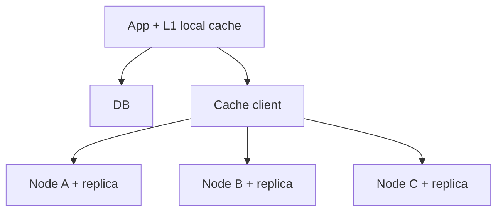
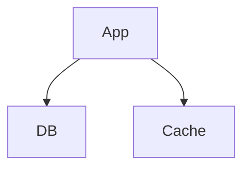
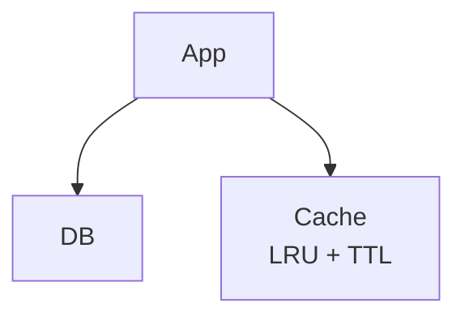
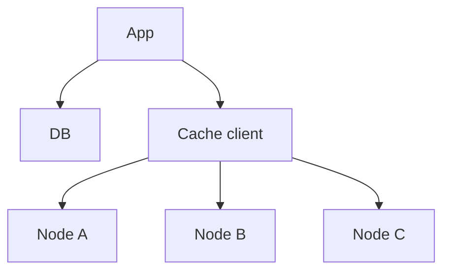
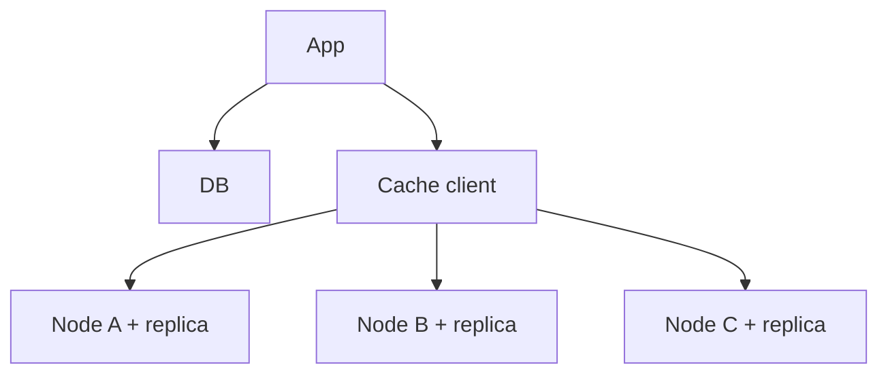

# Distributed Cache (Redis-jaisa)

> Tez in-memory key-value store jo ek machine se bada ho, aur node mare to bhi chale. Concept detail = FOUNDATIONS/04_caching.md
> Is design ka dil: **SPEED (<1ms)** + **node mare to chale**. Booking ka ULTA: wahan consistency dil, yahan speed.

```
LIBRARY DESK: 10,000 kitaab godaam me (DB = slow, poora) · top-100 front desk pe (cache = RAM, tez)
   ek desk me saari nahi aati + banda beemar (node down)
   -> kai desk (nodes) + kaunsi kitaab kis desk (sharding) + backup banda (replication) = DISTRIBUTED CACHE
```

---

## TASVEER (ByteByteGo / Alex Xu · CC BY-NC-ND 4.0)


Source: [How Can Cache Systems Go Wrong?](https://bytebytego.com/guides/how-can-cache-systems-go-wrong/)
(thundering herd / penetration / breakdown / crash)


Source: [Consistent Hashing Explained](https://bytebytego.com/guides/consistent-hashing/)
(node jude ya gire to sirf thodi keys khiskein — ring)

---

## SHURU — poocho + numbers

```
POOCHO:  "Ek node ka cache (eviction, TTL) ya distributed (sharding, replication) — kis pe?"
         kaisa data, read-heavy? · STALENESS kitni chalegi? (5 min purana?)  <- invalidation isi se tay
         eviction pasand (LRU / LFU)? · cache DB ke aage ya khud primary store?

FR:      get(key) · put(key, value, ttl) · delete(key)
         scope bahar: persistence · pub/sub · transactions
NFR:     <1ms (dil) · HA (node mare to chale) · TBs data · consistency EVENTUAL (asli sach DB me, cache tez copy)

NUMBERS: ~1 TB · ~1M QPS · read-heavy
         1 TB     -> ek node ki RAM me nahi -> SHARDING
         1M QPS   -> ek node itna nahi deti -> nodes me baanto
         node mara -> saara load DB pe -> REPLICATION
         teeno milke single node khaarij -> DISTRIBUTED justify
```

---

## MOCK CUE — pehle ye, phir mock

> Har dikkat ek card: KAHANI (kya toota) -> ILAAJ -> ANDAR KAISE (dabba andar se kaise chalta) ->
> ISKE BAAD KYA TOOTEGA (interviewer yahin ghusta: dabba lagaya, ab kya). Number = us dikkat ka poora hissa neeche.

#### 0 SHURU: CACHE-ASIDE (cache kaam kaise karta)
```
KAHANI:  DB har read pe disk pe jaata, ~10 ms. 1M read / sec -> DB ghutno pe.
ILAAJ:   aage RAM wala cache. App pehle cache se poochhe.
ANDAR KAISE:
         HIT  -> cache se value, <1 ms.
         MISS -> DB se laao -> cache me PUT (TTL ke saath) -> return.
         App khud cache sambhalta = CACHE-ASIDE (sabse common).
ISKE BAAD KYA TOOTEGA:
  - write kaise? cache-aside / write-through / write-back?
      -> cache-aside: DB me likho, cache key DELETE. write-through: dono me saath (taaza, par write dheema).
         write-back: pehle cache, DB baad me (tez, par cache mara to data gaya -> paisa pe kabhi nahi).
  - poora cache hi gir gaya?
      -> sab DB pe. DB ke aage rate limit / load shedding, warna chhupa load DB ko gira deta.
  - chal raha hai, kaise pata?
      -> HIT RATIO sabse pehle (gira = kuch toota) + p99 latency + evictions.
```

#### [1](#d1) RAM BHAR GAYI, KYA HATAYEIN
```
KAHANI:  RAM 64 GB bhar gayi. Naya daalna hai, kuch nikaalna padega. Kya?
ILAAJ:   LRU: jo sabse LAMBE samay se nahi chhua, wo bahar. Har entry pe TTL bhi.
ANDAR KAISE:
         HashMap (key -> node) + doubly linked list. Chhua -> list ke aage.
         jagah chahiye -> list ki POONCH wala hatao. Dono O(1). (LeetCode 146, tera LRU REDO.)
         TTL: padhte waqt check (lazy) + background me thodi-thodi safai (active).
ISKE BAAD KYA TOOTEGA:
  - LRU kyun, LFU kyun nahi?
      -> LRU = "kab chhua", LFU = "kitni baar". LFU me kal ka famous key aaj bhi baitha rehta -> isliye
         LFU ginti ko waqt ke saath ghatata (decay). Default LRU.
  - Redis sach me har key ki list rakhta?
      -> nahi, memory bachane ko APPROXIMATE LRU: kuch random key uthata, unme sabse purani hatata.
  - memory bhari aur eviction band (noeviction)?
      -> naye write pe ERROR. Cache ke liye allkeys-lru rakho.
```

#### [2](#d2) 1 TB EK NODE ME NAHI: KEY KIS NODE PE
```
KAHANI:  data 1 TB, ek node me 64 GB. 16+ node chahiye. "user:42" kis node pe jaaye?
ILAAJ:   CONSISTENT HASHING (hash % N nahi).
ANDAR KAISE:
         hash % N: 4 se 5 node kiye -> N badla -> ~80% key ka node badla -> sab MISS -> DB gira.
         RING: 0 se 2^32 ka gola. node bhi ring pe, key bhi. key ghadi ki disha me jo pehla node mile, wahin.
         node juda / gaya -> sirf uske paas ki thodi key hilti (~K/N).
         VIRTUAL NODES: ek machine ring pe 100 jagah -> load barabar baante.
         App ke andar CACHE CLIENT library ye hisaab karke sahi node pe bhejti.
ISKE BAAD KYA TOOTEGA:
  - naya node juda, uski key khaali -> miss?
      -> haan, sirf us hisse ki ~K/N key ek baar miss. Poora nahi.
  - client ko kaise pata kaun node zinda?
      -> cluster topology / config service. Galat node pe gaya to Redis bolta "MOVED, wahan jao".
  - Redis Cluster ring use karta?
      -> nahi, 16384 SLOT: CRC16(key) % 16384 -> slot -> node. Node juda to kuch slot khiskao. Kaam wahi.
  - range se baanto (A-M, N-Z)?
      -> ek range garam ho jaati (sab "a" wale), ek node pe bojh. Isliye hash.
```

#### [3](#d3) EK NODE MARA, LOAD DB PE
```
KAHANI:  Node B mara. Uske hisse ki saari key gayi. Wo saari read seedha DB pe -> DB pe achanak bojh.
ILAAJ:   har node ki 1-2 COPY (replica) alag AZ me. Primary mara -> replica primary bana.
ANDAR KAISE:
         write primary pe, replica ko copy thodi der baad (ASYNC).
         Sentinel / cluster ke baaki node ping karte, zyada (quorum) bolein "mara" -> vote se replica promote,
         client ko naya pata.
ISKE BAAD KYA TOOTEGA:
  - async kyun, sync kyun nahi?
      -> sync = har write pe replica ke "haan" ka intezaar -> <1 ms gaya. Keemat: aakhri kuch write kho sakte.
         Cache me chalta, asli sach DB me hai.
  - failover me kitni der?
      -> ~10-30 sec. Us beech us hisse ki key DB se (thoda dheema).
  - network toota, purana primary bhi khud ko primary samjhe (do primary)?
      -> SPLIT BRAIN. Quorum se faisla + jo akela (minority) me hai wo write lena band kare (min-replicas).
  - replica se padh sakte?
      -> haan, read baant jaate. Par thoda purana mil sakta (lag). Cache me chalta.
```

#### [4](#d4) DB UPDATE, CACHE PURANA (STALE)
```
KAHANI:  user ne naam "Ravi" se "Ravi K" kiya. DB me naya, cache me abhi bhi "Ravi". Profile purani dikh rahi.
ILAAJ:   DB update -> phir cache key DELETE (update nahi) + TTL suraksha jaal.
ANDAR KAISE:
         delete ke baad agli read MISS -> DB se taaza -> cache me.
         UPDATE kyun nahi: do write ulte kram me pahunche (A ne "X" likha, B ne "Y", cache me pehle Y phir X)
         -> cache me galat value baith gayi. DELETE me ye dikkat nahi.
ISKE BAAD KYA TOOTEGA:
  - DB update hua, cache DELETE fail?
      -> TTL bachata (max utni der purana). Pakka chahiye -> DB change event (CDC) se delete ka retry.
  - delete ke baad koi purani value wapas daal de (race)?
      -> thodi der baad dobara delete (double delete), ya version ke saath likho.
  - maine likha, mujhe hi purana dikha?
      -> replica lag. Likhne wale ko thodi der primary se padhao (read-your-own-writes).
  - TTL kitna?
      -> jitna purana business jhel sake. Profile: minutes. Price / stock: seconds ya invalidate.
```

#### [5](#d5) GARAM KEY EXPIRE, 1000 REQUEST EK SAATH DB PE (STAMPEDE)
```
KAHANI:  "home page" key expire hui. Usi second 1000 request -> sab MISS -> sab DB pe -> DB gira.
ILAAJ:   LOCK: sirf EK request DB se laaye, baaki ruk ke cache se padhein.
         + SOFT-TTL: expire se PEHLE background me refresh.
ANDAR KAISE:
         miss -> SET lock:key 1 NX EX 5
            jeeta -> DB se laao, cache bharo, lock hatao
            haara -> 50-100 ms ruko, cache dobara padho (tab tak jeetne wale ne bhar diya)
         EX 5 kyun: jeetne wala beech me mara to lock 5 sec me khud chhoote.
ISKE BAAD KYA TOOTEGA:
  - haarne wale kitni der rukenge?
      -> chhota wait + 2-3 retry. Phir bhi nahi -> purani value do, DB pe mat bhejo.
  - bahut saari key EK SAATH expire (sab ka TTL 1 ghanta, sab ek saath bhari thi)?
      -> AVALANCHE. TTL me random jitter (60 min +- 5) -> expire bikhar jaate.
  - key DB me HAI hi nahi, attacker baar-baar wahi maange?
      -> PENETRATION: har baar miss -> DB. "nahi hai" (null) ko bhi chhote TTL ke saath cache karo,
         ya Bloom filter: "ye key ho hi nahi sakti" -> DB tak jao hi mat.
  - pata ho kab aayega (sale, final)?
      -> pehle se cache bharo (pre-warm) + servers badhao.
```

#### [6](#d6) EK KEY ITNI POPULAR, USKA NODE AKELA MAR RAHA (HOT KEY)
```
KAHANI:  IPL final, "live:score" key. Crore log ek saath. Key ek hi node pe -> wo node akela mar raha.
         Consistent hashing yahan kuch nahi karta: ek key = ek node.
ILAAJ:   (1) L1 LOCAL CACHE: har App server ki apni memory me 1-2 sec ka chhota cache -> Redis tak jaata hi nahi.
         (2) us key ki kai copy (score#1 .. #10), padhte waqt random copy.
ANDAR KAISE:
         L1 (App ki RAM, nano-sec) -> L2 Redis (micro / milli) -> DB (milli-sec).
         1000 App server, har ek 1 sec me EK baar Redis se -> Redis pe 1000 / sec, crore nahi.
ISKE BAAD KYA TOOTEGA:
  - hot key pehchanoge kaise?
      -> node metrics (ek key pe ops / sec), redis-cli --hotkeys, client side ginti. Had paar -> copy / L1.
  - L1 me purana score kitni der?
      -> L1 TTL jitna (1-2 sec). Score ke liye theek, paisa / stock ke liye nahi.
  - hot key LIKHNI bhi ho (like counter)?
      -> key ke tukde (like#0..#9), kisi ek me likho, padhte waqt jodo.
  - stampede aur hot key me farak?
      -> stampede = key KHAALI, sab DB bhage (lock). Hot key = key BHARI, ek node read se mar raha (L1 / copy).
```

```
AAKHRI DABBE (sab dikkat ke baad):
  App + L1 local cache (nano-sec, hot key ka pehla ilaaj) -> Cache client (consistent hashing: key -> node)
  -> Node (HashMap + DLL = LRU, + TTL) primary + replica (alag AZ) -> miss pe DB (source of truth)
  READ = cache-aside

DB:  cache = in-memory KV (RAM, <1ms, join nahi, sirf key se) · DB peeche source of truth
     cache AP ki taraf: speed > consistency, eventual chalta

END ME POOCHEGA:
  "Key kis node pe?"  -> hash % N nahi (node juda to sab shift) -> CONSISTENT HASHING + virtual nodes
  "Stale data?"       -> TTL + explicit invalidation
  "Stampede?"         -> mutex / soft-TTL / pre-warm
  "Hot key?"          -> copies + L1 local cache
  "SPOF?"             -> node (replica promote) · cache client config (har app me copy)
  "Chal raha, kaise pata?" -> HIT RATIO sabse zaroori (gira = kuch toota) · p99 · evictions · alert
```

AAKHRI DABBE ki tasveer:



---

## DABBA 0 — sabse simple

```
SOLUTION: ek machine, ek HashMap (RAM) · O(1) get / put · CACHE-ASIDE: hit -> return · miss -> DB -> cache me PUT -> return
```


---

<a id="d1"></a>

## DIKKAT 1 — RAM bhar gayi, kya hatayein?

```
DIKKAT:   RAM bhar gayi -> naya daalne ke liye kya hatayein?

SOLUTION: (1) EVICTION: LRU = jo sabse lambe samay se nahi chhua ("kab") · LFU = jo sabse kam baar chhua
              ("kitni baar"). Default LRU: wahi bache jo abhi kaam aa raha.
          (2) LRU = HashMap + doubly linked list: chhua -> aage, jagah chahiye -> peeche wala hatao, dono O(1).
              (LeetCode 146.)
          (3) TTL har entry pe: access pe check (lazy) + background safai (active).

NAYA:     koi dabba nahi — node ke andar
```
```
BOARD PE: get(x) -> FRONT laao · jagah nahi -> TAIL hatao
          [FRONT] x <-> b <-> a <-> z <-> ... <-> q [TAIL, ye nikalega]

AGLA SAWAAL (tere jawab se):
  "Redis sach me poora LRU rakhta (har key ki list)?"
   -> nahi, memory bachane ko 'approximate LRU': kuch random keys uthata, unme sabse purani hatata
  "LFU me purana famous key hamesha rahega?"
   -> isliye LFU ginti ko waqt ke saath ghatata (decay) -> kal ka hero aaj nikal sake
```


---

<a id="d2"></a>

## DIKKAT 2 — 1 TB ek node me nahi: key kis node pe?

```
DIKKAT:   1 TB ek node me nahi, kai node chahiye -> har key kis node pe jaaye?

SOLUTION: ★ hash % N nahi: node juda / gaya -> N badla -> lagbhag saari keys ka node badla -> sab miss -> DB crash.
          (1) CONSISTENT HASHING: gol ring, node + key dono ring pe; key ghadi ki disha me pehla node.
              Node juda / gaya -> sirf uske hisse ki thodi keys hilti.
          (2) VIRTUAL NODES: ek machine ring pe kai jagah -> load barabar.
          (3) App ke andar CACHE CLIENT library key dekh ke sahi node chunti.
          (Range A-M / N-Z = ek range garam ho jaati, nahi.)

NAYA:     Cache client (app ke andar library, key dekh ke sahi node chunti)
BADLA:    Cache -> Node A / B / C
```
```
BOARD PE: RING 0 .. 2^32 · node juda / gaya -> sirf us arc ki ~K/N keys hilti

AGLA SAWAAL (tere jawab se):
  "Cache client ko kaise pata kaun-se node zinda hain?"
   -> config service / cluster ka topology (Redis Cluster khud batata: 'ye key us node pe hai, MOVED')
  "Naya node juda, uski key khaali -> miss?"
   -> haan, sirf us arc ki ~K/N key ka ek baar miss -> DB pe thoda bojh, poora nahi
```


---

<a id="d3"></a>

## DIKKAT 3 — ek node mara, uski saari key gayab, load DB pe

```
DIKKAT:   ek node mara, uski saari keys gayab, saara load DB pe (node ek shard ka akela ghar tha).

SOLUTION: (1) REPLICATION: har shard ki 1-2 copy, alag AZ me. Primary mara -> replica promote.
          Keemat: replica thoda peeche (lag) -> thodi der purana data, cache me chal jaata.

BADLA:    Node A / B / C -> Node + replica

KAISE (kaun pakadta, kaun promote):
          Redis Sentinel (alag 3 process) ya Cluster ke baaki masters primary ko ping karte (gossip)
          zyada (quorum) bolein "mara" -> vote se ek replica ko primary banaya, clients ko naya pata
KYUN ASYNC replication (sync nahi):
          sync = har write pe replica ke "haan" ka intezaar -> cache ka <1ms toot jaata
          keemat: primary mara to aakhri kuch write replica tak nahi pahunche -> cache me chalta (DB me sach hai)
```
```
POOCHEGA: "What happens if a cache node goes down?"
BOL:      "Each shard has a replica in another zone that gets promoted, and with consistent hashing only that
           node's keys are affected."

AGLA SAWAAL (tere jawab se):
  "Network toota, purana primary bhi zinda samjha raha (do primary)?"
   -> split brain. Quorum + jo minority me hai wo write lena band kare (min-replicas)
  "Failover me kitni der?"
   -> ~10-30 sec; us beech us shard ki key DB se (thoda dheema)
```


---

<a id="d4"></a>

## DIKKAT 4 — DB me update, cache purana (STALE)

```
DIKKAT:   DB me value update hui, cache me abhi bhi purani (STALE).

SOLUTION: (1) CACHE-ASIDE: DB update, phir cache key DELETE -> agli read DB se taaza. (Sabse common.)
          (2) WRITE-THROUGH: cache + DB dono saath -> hamesha taaza, par har write slow.
          (3) TTL = kitna purana chalega uski had. Production me TTL + khud invalidate dono
              ("cache invalidation is one of the hardest problems").
          ★ Key DELETE karo, UPDATE nahi: do write ulte kram me pahunche to galat value baith jaati.
          Replica lag bhi wajah: jisne abhi likha use thodi der primary se padhao (read-your-own-writes).

NAYA:     koi dabba nahi
```
```
POOCHEGA: "The user updated something but still sees the old value. Why?"
BOL:      "On update I delete the cache key rather than overwrite it, and keep a TTL as a safety net. If it's
           replica lag, the writer reads from the primary for a short while."

AGLA SAWAAL (tere jawab se):
  "DB update hua, cache DELETE fail ho gaya?"
   -> TTL bachata (max utni der purana). Pakka chahiye -> DB change event (CDC) se delete ka retry
  "DELETE ke baad koi purani value phir se cache me daal de (race)?"
   -> chhota delay ke baad dobara delete (double delete) ya version / TTL se
```


---

<a id="d5"></a>

## DIKKAT 5 — super-hot key expire, 1000 request ek saath MISS

```
DIKKAT:   bahut garam key expire, hazaar request ek saath miss -> sab DB pe -> DB crash (STAMPEDE).

SOLUTION: (1) MUTEX: sirf EK request DB se dobara banaye, baaki ruk ke cache se padhein.
          (2) SOFT-TTL: expire hone se PEHLE background me refresh. Bahut garam key ko expire hi mat hone do.
          (3) Pata ho kab aayega (sale, WC final) -> pehle se cache bharo (pre-warm) + servers badhao.

NAYA:     koi dabba nahi

KAISE (mutex):
          miss hua -> SET lock:key 1 NX EX 5
          jeeta (OK) -> DB se laao, cache bharo, lock DEL
          haara (nil) -> 50-100 ms ruko, cache dobara padho (tab tak jeetne wale ne bhar diya)
          lock pe EX kyun: jeetne wala beech me mara to lock 5 sec me khud chhoote, warna sab hamesha atke
```
```
POOCHEGA: "What if the cache goes down / a hot key expires?"
DHYAAN:   poora cache gaya -> DB fallback, par load shedding / rate limit ke saath — warna chhupa load ek saath DB pe
BOL:      "For known events I'd pre-warm the cache and scale up in advance. For unpredictable spikes I still
           need stampede protection: a lock so only one request rebuilds the key, and early background refresh
           before the TTL expires."

AGLA SAWAAL (tere jawab se):
  "Haarne wale kitni der rukenge?"
   -> chhota wait + kuch retry; phir bhi nahi to purani value (stale) do, DB pe mat bhejo
  "Soft-TTL kaise?"
   -> value ke saath 'refresh_after' time; padhne wala dekhe time nikal gaya -> background me ek refresh,
      tab tak purani value hi do
```


---

<a id="d6"></a>

## DIKKAT 6 — ek key itni popular, uska shard akela mar raha

```
DIKKAT:   ek key itni popular ki uska node akela mar raha (HOT KEY).
          ★ Consistent hashing ek hot key ko nahi bachata (wo ek hi node pe jaati).

SOLUTION: (1) Hot key ki kai node pe copy, padhte waqt random copy -> read bat gaye.
          (2) L1 LOCAL CACHE: app ke andar chhota cache (1-2 sec), request Redis tak jaati hi nahi.
          (3) Garam LIKHNA ho -> key tukdon me baanto, kisi ek me likho, padhte waqt jodo.
          Pehchaan: key KHAALI + sab DB bhage = stampede (mutex). Key BHARI + ek node read se mar raha = hot key.
          Misaal: IPL live score, crore log ek key -> L1 sabse bada ilaaj.

NAYA:     L1 local cache (har App server ki apni memory me chhota cache)
BADLA:    App -> App + L1 local cache
```
```
BOARD PE: read copies: score#1..#10 · write buckets: key#0..#9
          L1 app (nano-sec) -> L2 distributed (micro-sec) -> DB (milli-sec)

POOCHEGA: "What about a hot key / celebrity / hot partition?"
BOL:      "The key is there, one node just can't take the reads. I'd put a 1-2 second local cache on each app
           server so most reads never reach Redis, and copy the key across replicas so the rest are spread
           out. A slightly stale score is fine here. If the key were missing instead, that's a stampede — one
           request rebuilds, the rest wait."

AGLA SAWAAL (tere jawab se):
  "Hot key pehchanoge kaise?"
   -> node ke metrics (ek key pe ops/sec), Redis --hotkeys, client side ginti -> had paar = copy / L1 me
  "L1 me purana score kitni der?"
   -> L1 TTL 1-2 sec -> utna purana chalta (score ke liye theek, paisa ke liye nahi)
```


---

## 10x SCALE — har dabba alag

```
Cache client  -> node juda / gaya -> consistent hashing + virtual nodes
Node          -> RAM bhari -> LRU + TTL · mara -> replica promote · data badha -> node jodo
hot key       -> copies + L1 local cache
expiry        -> mutex · soft-TTL · never-expire · pre-warm
DB            -> stale -> invalidate + TTL
AAGE:         write-back (write-heavy ho to) · multi-region cache

POOCHEGA: "How would you scale this to 10x?"      -> request ka raasta chalo
POOCHEGA: "What's the single point of failure?"   -> node (replica), cache client config (sab app me copy)
POOCHEGA: "How do you know it's working?"         -> HIT RATIO sabse zaroori (gira = kuch toota) · p99 · evictions · alert
```

---

## POOCHE TO (deep-dive)

```
API:      GET key · PUT key value ttl · DELETE key
          jaan-boojh ke chhoti — query nahi, sirf key se -> index / planner nahi -> isiliye tez

NODE KE ANDAR:  HashMap key -> value (O(1)) · LRU = HashMap + DLL · TTL lazy + active
                in-memory KV (Redis-jaisa), DB peeche source of truth
                <1ms -> RAM (disk nahi) · join nahi -> KV kaafi

KEY BAANTNA:    hash % N -> sab shift -> NAHI · CONSISTENT HASHING -> ring + clockwise + virtual nodes <- YAHI
                range -> hot range -> NAHI

TRADE-OFF:      speed vs consistency — cache AP ki taraf, eventual chalta (CAP ka spirit)
```

---

## AAKHRI DABBA + WRAP

```
App + L1 = nano-sec, hot key ka pehla ilaaj · Cache client = consistent hashing, key -> node
Node = HashMap + DLL (LRU) + TTL, primary + replica (alag AZ) · DB = source of truth, miss pe
```
```
SINGLE node : HashMap + DLL (LRU) + TTL
DISTRIBUTE  : consistent hashing (shard) + replication (HA)
READ        : cache-aside (~90% hit, DB load 10x kam)
STALE       : TTL + explicit invalidation
STAMPEDE    : mutex / soft-TTL
HOT KEY     : copies / L1 local
```
```
BOL: "A distributed cache is an in-memory key-value store, sharded with consistent hashing and replicated for
      availability. Cache-aside with LRU and TTL is the production combo. The two hard parts are invalidation —
      TTL plus explicit deletes — and stampedes — a lock or early refresh. Hot keys get a local L1 cache and
      copies. It's a speed versus consistency trade-off, decided by the use case."
```


ARCHETYPE F · CONCEPTS: [caching](../../FOUNDATIONS/04_caching.md) · [sharding](../../FOUNDATIONS/06_database_sharding.md) · [replication](../../FOUNDATIONS/05_database_replication.md) · [← MASTER SHEET](../../00_MASTER_SHEET.md)
