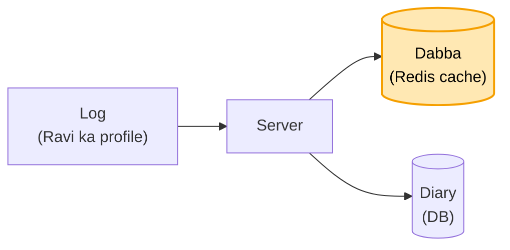
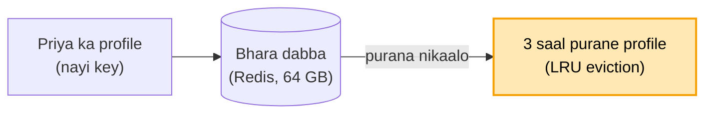
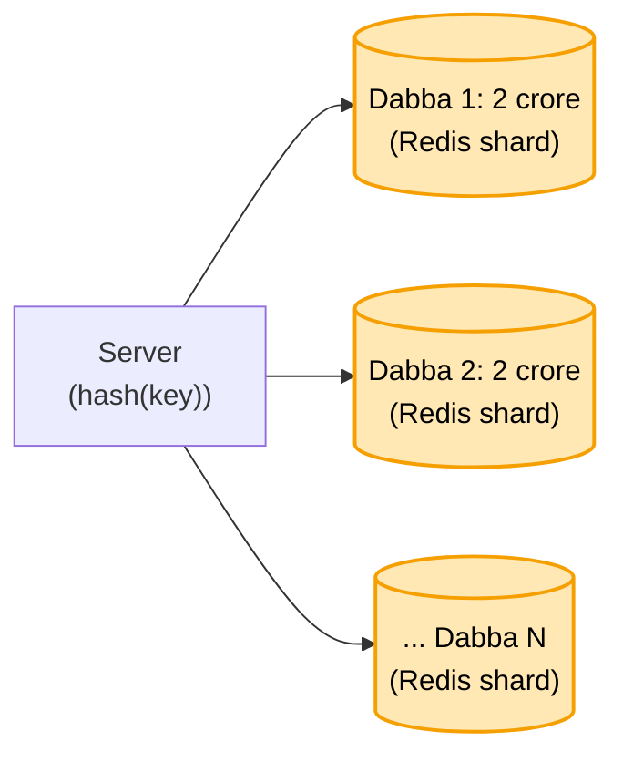
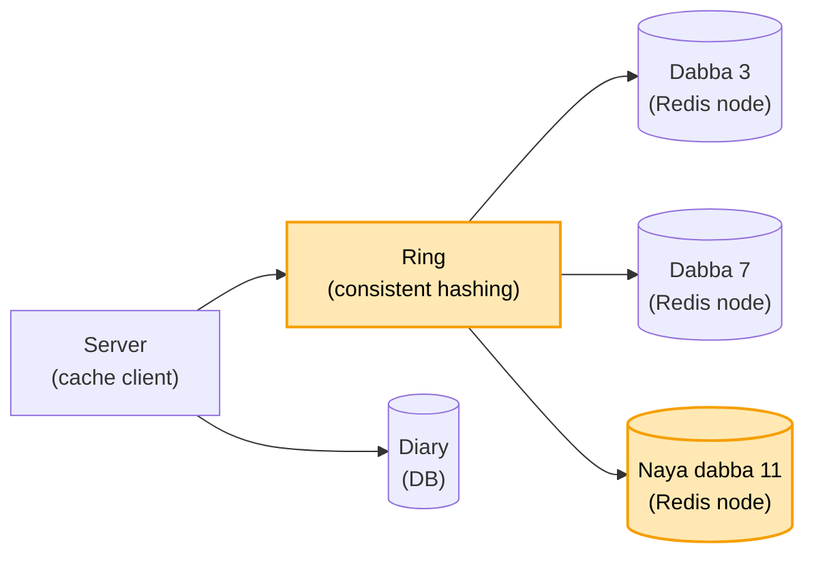
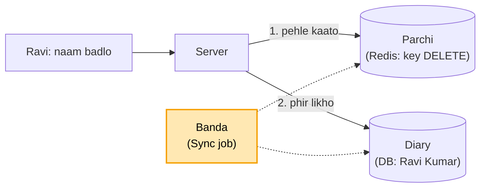
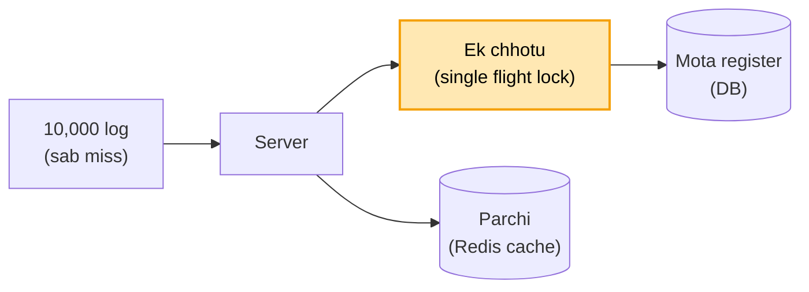
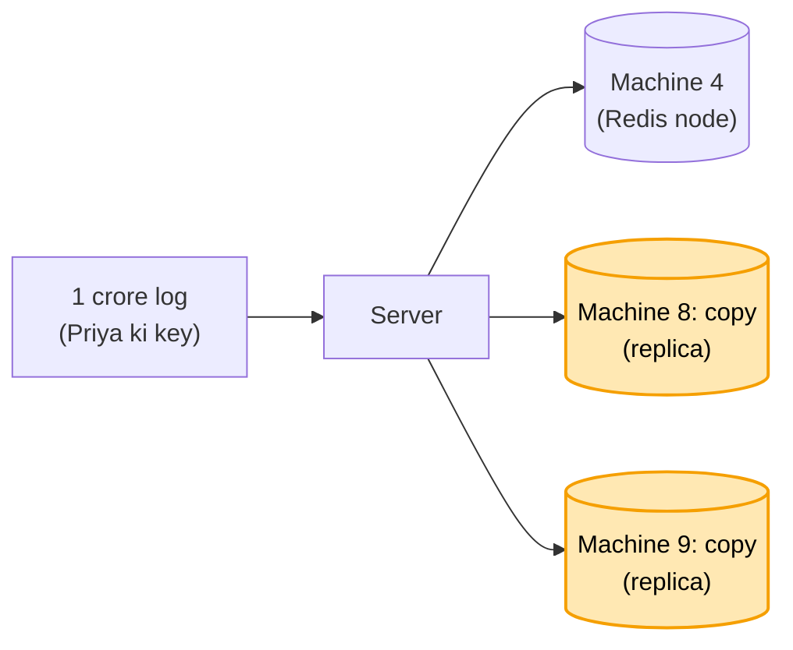

# Distributed cache: Arpan aur Ravi ke profile page ki kahani

Arpan ki app me har bande ka profile page hai (naam, photo, bio). Ravi mashhoor hai, uska profile din me lakhon log
kholte hain. Data DB me hai, aur har baar server DB se padh ke laata hai. Kaam: profile turant khule, DB na baithe,
aur bheed ek jagah toot pade tab bhi chale.

Har kadam = **kahani** (dikkat aur hal, bolne wali bhasha) -> **Asli naam** (interview me yahi shabd) -> tasveer
(kahani ka shabd, bracket me asli naam).

---

## FR / NFR / Numbers (interview me pehle 2 minute)

```
FR      get(key), put(key, value), delete(key) · asli sach DB me, cache sirf tez copy
NFR     tez (~1 ms, DB se 50 ms) · DB pe bojh kam · thodi der purana chalega (profile hai, paisa nahi)
Numbers DB ek padhai ~50 ms, kuch hazaar query / sec jhelta · Ravi ka profile hazaaron / sec, badalta din me ek baar
        10 crore user, roz khulne wale profile ~1 TB · ek machine ki RAM 64 GB -> baantna padega
```

---

## 1. DB ki saans phooli (DB se pehle ek dabba)

Ravi ka profile har second hazaaron log khol rahe, aur har baar server DB tak jaata, ek baar me 50 ms. Jabki uska data
din bhar me shayad ek baar badalta. Page dheema, DB ki saans phooli. To information thodi store kar lete hain. DB se
pehle ek dabba rakh lo, jisme aisi information rakho jo famous ho, ya jo padhi bahut ja rahi ho aur update bahut kam
ho rahi ho. Ab koi bhi maange to pehle dabbe me dekho, wahan mila to wahin se de do; nahi mila to DB se laao aur dabbe
me bhi rakh do. Baar-baar DB jaane ki zaroorat hi nahi, dikkat khatam.

**Asli naam:** dabba = cache (Redis, RAM me, ~1 ms), padhi bahut update kam = cache ke laayak data, dabbe me mila =
cache hit, nahi mila to DB se laake rakho = cache-aside. DB = source of truth.



## 2. Dabba bhar gaya, Priya ki jagah nahi (purana nikaalo)

Dabba RAM ka hai, 64 GB. Log profile kholte gaye, sab jama hote gaye, dabba bhar gaya. Aaj Priya ka video viral,
lakhon log uska profile khol rahe, par uske liye jagah nahi. Aur dabbe me 3 saal purane profile pade hain jinhe mahino
se kisi ne nahi khola. To RAM ko thoda khaali karo: jo purana hai, jo kam use ho raha hai, use nikaal do, use
lena-dena hi nahi. Jo ab use nahi ho raha aur RAM me pada hai, wo befaltu ki jagah ghere hai.

**Asli naam:** RAM khaali karo = eviction, jo purana aur kam use ho raha wo nikaalo = LRU (Least Recently Used; andar
HashMap + doubly linked list, sab O(1), wahi LC 146).



## 3. 1 TB ek dabbe me nahi aata (tod do, hash batata kahan)

Ab 10 crore users, roz khulne wale profile hi 1 TB. Ek machine me 64 GB, LRU kitna bhi chalao, 1 TB ek dabbe me nahi
aata. Upar se ek machine ki request ki had hai, bheed usse kai guna. To tod do. 10 crore ko tod do, 2-2 crore ya 3-3
crore ek dabbe me rakh do. Wo bhi kam pade to un 2 crore ko bhi tod do, todte raho. Kaunsa profile kis dabbe me, ye
key ka hash batata hai, same key hamesha same dabbe pe jaayegi.

**Asli naam:** tod do = sharding, hash se dabba = `hash(key) % N`, same key hamesha same machine. Ye hisaab app ke andar ki
cache client library karti, beech me koi alag dabba nahi.



## 4. 11vi machine judi, saare miss (ring, kho-kho)

10 machine, formula `hash(key) % 10`, Ravi machine 3 pe. 11vi machine judi, formula `% 11`, ab Ravi ke liye machine
7, jahan uska data hi nahi. Lagbhag har key ki jagah badli, saari request miss, sab DB pe, DB baith gaya. To ring
lagao, jo pehle discuss ki thi. Ek gol ring me machines paas-paas baithi hain. Key ka hash do khaanon ke beech gira to
aage ke sabse paas wale khaane pe chala jaata. Kho-kho dekha hai? Bada bhaagta hai to main sabse paas wale bande ko
dhakka deta hoon: chal tu pakad jaake. Ya do padaav hain, ek 50 km pe, agla 100 km pe; gaadi ki headlight kharab hui
to main sabse paas wale padaav pe chupchaap ruk jaunga, 100 km pe nahi jaunga. Nayi machine aayi to sirf uske paas wali
thodi key hilti hain, baaki apni jagah.

**Asli naam:** ring = consistent hashing, beech me gira to sabse paas wala = key ghadi ki disha me agli machine pe,
kho-kho / headlight = sabse paas wala hi sambhale, machine judi to sirf uske paas ki key hilti, ~1/N key (`%` me lagbhag
saari). Har machine ring pe 100-200 jagah = virtual nodes, taaki hissa barabar aaye.



## 5. Ravi ne naam badla, sabko purana dikh raha (parchi kaato, phir DB, peeche ek banda)

Ravi ne apna naam badal diya. DB me naya naam likh gaya, par cache me abhi bhi purana "Ravi", aur sab cache se padh
rahe. Mere paas ek diary (DB) aur ek cache ki parchi. Ravi aaya: mera naam "Ravi Kumar" kar do. Sabse pehle apni parchi
se "Ravi" kaat dunga, phir DB me "Ravi Kumar" likhunga. Ab koi get karne aaya, parchi pe Ravi hai nahi, to DB se
uthaya "Ravi Kumar" aur parchi pe likh diya. Kaam khatam.

**Asli naam:** parchi se kaato = cache key DELETE (update nahi, taaki do likhai ulte kram me pahunchein to bhi galat
naam na baithe), phir DB me likho (DB = source of truth), agla GET miss -> DB se
naya = cache-aside.

**Maan lo parchi kaatne aur DB likhne ke beech koi request aa gayi:** parchi khaali thi, request DB pe gayi, abhi wala
purana "Ravi" laake parchi pe likh diya, phir DB me "Ravi Kumar" aaya. Iske liye ek banda hai jo har baar check kar
raha: yahan Ravi, wahan Ravi Kumar, to parchi pe Ravi Kumar kar do, kyunki DB hamara source of truth hai. Ho sakta hai
kuch second Ravi dikhe, par ye koi paisa thodi hai jo ekdum consistency chahiye. Chahiye hoti to lock laga lete.
**Asli naam:** banda har baar check kare, farak mila to theek = background sync (reconciliation) job, kuch second
Ravi dikhe, paisa nahi = eventual consistency chalegi.

**Maan lo poochhe "pehle DB phir parchi kaato, ulta kyun nahi?":** wo bhi chalta, chhed thoda chhota, par chhed wahan
bhi hai (dheemi read purana laake likh sakti). Isliye peeche wala banda dono kram me chahiye; kaatna fail to dobara kaato.
**Asli naam:** write-then-invalidate, invalidation retry, pakka chahiye to version check / lock.

**Maan lo cache me 1 TB, sync job ko kaise pata kaunsi key dekhni hai:** wahi jo update hui. Job ko time do: pichhle ek
ghante me DB me jo row badli, sirf unki parchi milao. Ek saath 1 TB nahi badalta. Dikkat lage to 2-3 ghante ya ek din ka kar do.
**Asli naam:** DB me `updated_at` pe query (index), sirf badli key ka cache theek, chhoti time window.

**Maan lo TTL laga ke chhod dein:** TTL alag cheez hai. Sync job tab lagaunga jab data baar-baar update hota ho (din me
100-200 baar). TTL tab jab data thodi der ke liye hi rakhna ho, jaise koi form bhar raha: chhota TTL
laga do, form khaali chhod diya to apne aap gaayab. Har baar TTL se kaam nahi chala sakte, TTL kabhi-kabhi dhokha de
deta hai.
**Asli naam:** thodi der wala data, chhota TTL = TTL; baar-baar badalne wale data ke liye sync job.



## 6. Priya viral, 10,000 log ek saath DB pe (ek chhotu bhejo)

Priya aam user thi, uski parchi cache me hai hi nahi. Raat 9 baje video viral, ek second me 10,000 log, sabko miss,
sab ek saath DB pe, Priya ki ek hi query 10,000 baar. 10,000 log ek saath DB jaayenge to DB maar dega, pehle unhe
roko. Main chupchaap ek chhotu bhejunga: chhotu bhai, jaldi se DB me jaa, Priya ki parchi hot hai, le aa. Parchi pe
likh lunga aur sabko yahin se bhaga dunga, mote register ki taraf koi nahi jaayega.

**Asli naam:** 10,000 ek saath DB pe = cache stampede, ek chhotu bhejo baaki yahin ruko = single flight (lock: pehli
request lock leti, DB jaati, cache bharti; baaki thoda ruk ke cache dekhte).

**Maan lo chhotu raaste me gir gaya ya dheema pad gaya:** kuch second dekh lo. Nahi aaya to bheed me se ek aadmi
pakdunga: ae bhai tu idhar aa, mote register pe jaa, jo data tu maang raha wo utha la aur mujhe bhi de dena. Wo laya,
cache me daal diya, sabko bhej diya. Ye mera backup plan.
**Asli naam:** kuch second dekho, phir bheed me se ek = lock ki umar (timeout, jaise 2 sec), agli request lock le leti.

**Maan lo aur raaste pooche:** ek ki jagah do chhotu bhejo, ek gira to doosra le aayega. Hot key ko zyada der tak rakho.
Ya key ki 3 copy rakho aur sabka expire ka time alag, to sab ek saath kabhi expire nahi honge. Ek sahi jawab nahi,
company kya chahti hai us pe.
**Asli naam:** do chhotu = redundant fetch, hot key lambi umar = longer TTL, alag-alag expire = TTL jitter (staggered
expiry).



## 7. 1 crore log, akeli machine 4 pe (ek aur gaadi)

Priya ki parchi cache me aa gayi, par ek second me 1 crore log. Ring pe uski key sirf machine 4 pe. Baaki 9 aaram se,
akeli machine 4 pe poori bheed, dheemi hote-hote girne lagi. To baaki machine pe baant do. Machine 4 ka replica bana
do, teen jagah ho gayi, to bheed bat gayi. Ya ring me aur jagah bitha do: machine 8 tu bhi dekh le, machine 9 tu bhi
dekh le. Jaise bheed zyada ho gayi to ek aur gaadi extra kar lo; ek gaadi me sab nahi aa sakte, to ek-do chhoti gaadi
kar lo.

**Asli naam:** machine 4 pe poori bheed = hot key, machine 4 ka replica / 8 aur 9 tu bhi dekh = hot key ki copies kai
machine pe, ek aur gaadi = padhne ki bheed copies me bat-ti (padhne wale koi bhi copy chunte). Machine badhane se akela kaam
nahi chalta, kyunki ek key ek hi machine pe jaati.



---

Notes (Arpan ke shabd) = [CACHE_HAND_NOTES.md](CACHE_HAND_NOTES.md)
