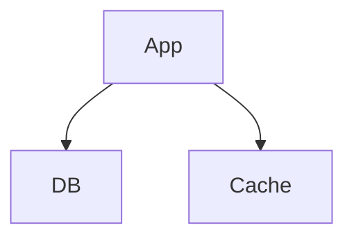
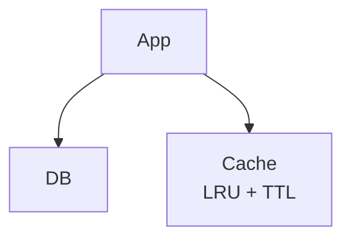
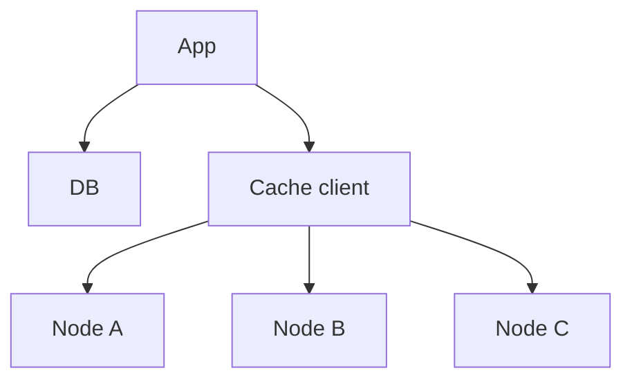
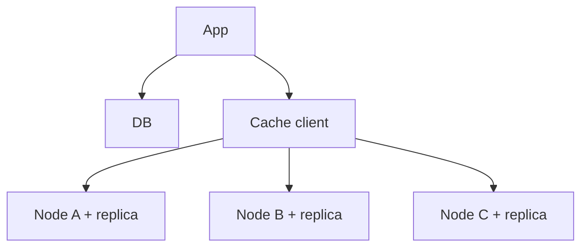
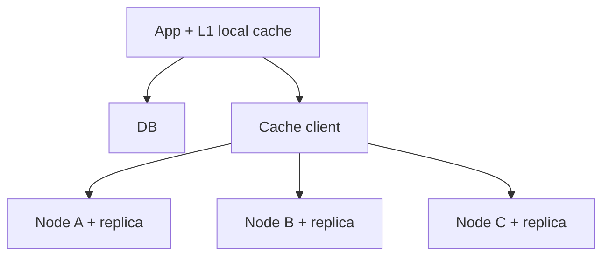

# Distributed Cache (Redis-jaisa)

> Tez RAM wala key-value store, jo ek machine se bada ho aur ek machine mare to bhi chale. Concept detail = FOUNDATIONS/04_caching.md
> Is design ka dil: **TEZ (<1 ms)** + **machine mare to bhi chale**. BookMyShow ka ulta: wahan sahi hona dil tha, yahan tezi.

```
LIBRARY DESK: 10,000 kitaab godaam me (DB = dheema, sab kuch) · top-100 front desk pe (cache = RAM, tez)
   ek desk pe saari kitaab nahi aati + desk wala beemar pad sakta (machine band)
   -> kai desk (nodes) + kaunsi kitaab kis desk (sharding) + har
      desk ka backup banda (replication) = DISTRIBUTED CACHE
```

---

## TASVEER (ByteByteGo / Alex Xu · CC BY-NC-ND 4.0)


Source: [How Can Cache Systems Go Wrong?](https://bytebytego.com/guides/how-can-cache-systems-go-wrong/)
(thundering herd / penetration / breakdown / crash)


Source: [Consistent Hashing Explained](https://bytebytego.com/guides/consistent-hashing/)
(machine jude ya gire to sirf thodi keys khiskein — ring)

---

## SHURU: pehle poocho, phir numbers

```
POOCHO:  "Ek machine ka cache (kya hatayein, TTL) ya kai machine wala (baantna, copy) — kis pe?"
         kaisa data, padhai zyada? · kitna PURANA chalega? (5
         min purana?)  <- isi se tay hota cache kab saaf karna
         kya hatane ka tareeka (LRU / LFU)? · cache DB ke aage hai ya khud asli store?

KYA KARE (FR):    get(key) · put(key, value, ttl) · delete(key)
                  scope bahar: disk pe bachana · pub/sub · transactions
KAISA CHALE (NFR): <1 ms (dil) · ek machine mare to chale · TB bhar data
                   "thodi der baad sahi" (eventual) chalega — asli sach DB me, cache sirf tez copy

NUMBERS (andaaza):
   ~1 TB data · ~10 lakh read / second · padhai zyada
   1 TB         -> ek machine ki RAM (64 GB) me nahi aata -> BAANTO (sharding)
   10 lakh / sec -> ek machine itna nahi deti -> machines me baanto
   machine mari -> saara bojh DB pe -> har machine ki COPY (replication)
   teeno milke "ek machine kaafi" khaarij -> isliye DISTRIBUTED
```

---

## ════ MOCK SE PEHLE: SIRF YE CARD PADHO ════

> Har card: DIKKAT 1 (kya toota) -> HAL (kya kiya) -> diagram -> DIKKAT 2, 3 ... (interviewer ke
> agle sawaal) har ek ke neeche uska HAL. Revise: sirf baayein column padho.

#### DABBA 0: SABSE SIMPLE (yahan se shuru, phir "kahan tootega")
```
Ek machine, uski RAM me ek HashMap. get / put O(1).
App pehle cache se poochhe: mila -> wahi do · nahi mila -> DB se laao -> cache me daalo -> do (CACHE-ASIDE).
```


#### 0 SHURU: CACHE-ASIDE (cache kaam kaise karta)
```
DIKKAT 1   Arpan ki profile DB se padhne me ~10 ms (disk). 10 lakh log / second profile khol rahe
           -> DB ghutno pe.
HAL        DB ke aage RAM wala cache. App pehle cache se poochhe:
             mili (HIT) -> <1 ms me wapas
             nahi mili (MISS) -> DB se laao -> cache me daalo (TTL ke saath) -> wapas. Agli baar HIT.
           App khud cache sambhalta = CACHE-ASIDE (sabse aam tareeka).

DIKKAT 2   Likhna kaise? cache-aside / write-through / write-back?
HAL        Cache-aside: DB me likho, cache ki key DELETE.
           Write-through: DB aur cache dono me saath (hamesha taaza, par likhna dheema).
           Write-back: pehle sirf cache, DB me baad me (tez, par cache mara to data gaya -> paise pe kabhi
           nahi).

DIKKAT 3   Poora cache hi gir gaya?
HAL        Saari padhai DB pe. DB ke aage rate limit / load shedding (faltu request mana), warna DB bhi
           girega.

DIKKAT 4   Chal raha hai, kaise pata?
HAL        HIT RATIO sabse pehle (achanak gira = kuch toota) + p99 + kitni key nikaali ja rahi (evictions).
```

#### 1 RAM BHAR GAYI, KYA HATAYEIN
```
DIKKAT 1   Cache machine ki 64 GB RAM bhar gayi. Nayi key daalni hai, to koi purani nikaalni padegi. Kaunsi?
HAL        LRU: jise sabse LAMBE samay se kisi ne nahi chhua, wo bahar.
           Ye wahi LRU cache hai jo tune DSA me khud banaya (09_DESIGN, LeetCode 146):
             HashMap = key turant dhoondho · Doubly linked list = kaun kab chhua, uski line
             get(key) -> key mili, uska node line ke AAGE (head ke paas) = abhi chhuya
             put(key) -> naya node AAGE · RAM bhari -> line ke PEECHE wala (tail ke paas) hatao
           Saath me har key ki umar (TTL): umar khatam to key bekaar, padhne aaye tab check + peeche safai.
```

```
DIKKAT 2   LRU kyun, LFU kyun nahi?
HAL        LRU = "aakhri baar KAB chhua", LFU = "KITNI baar chhua". LFU me kal ki famous key aaj bhi baithi
           rehti, isliye LFU ginti waqt ke saath ghatata (decay). Default LRU.

DIKKAT 3   Redis sach me har key ki list rakhta?
HAL        Nahi, memory bachane ko ANDAAZE wala LRU: kuch random key uthata, unme sabse purani hata deta.

DIKKAT 4   RAM bhari aur hatana band (noeviction)?
HAL        Naya likhna ERROR dega. Cache ke liye allkeys-lru rakho.
```

#### 2 1 TB EK MACHINE ME NAHI: "user:42" KIS MACHINE PE?
```
DIKKAT 1   Data 1 TB, ek machine me 64 GB. 16+ machine chahiye. "user:42" kis machine pe jaaye, aur App ko
           har baar kaise pata chale?
HAL        RING (consistent hashing): ek gol ring 0 .. 360 (asal me 0 .. 2^32). Machine bhi ring pe, key bhi.
           Key ghadi ki disha me chale, jo PEHLI machine mile wahin rahe.
             A = 100, B = 200, C = 300 -> key 150 -> B, key 250 -> C, key 350 -> A (ghoom ke)
             nayi machine D = 250 jodi -> sirf 201 .. 250 wali key C se D pe gayi. Baaki sab wahin.
           RING = tera circular array (Next Greater Element II me i % n): ant pe pahunch ke ghoom ke pehle pe.
           VIRTUAL NODES: ek machine ring pe 100 jagah baithti -> bojh barabar.
           App ke andar CACHE CLIENT library ye hisaab karke sahi machine pe bhejti.
```

```
DIKKAT 2   Seedha hash(key) % N kyun nahi?
HAL        N badla to lagbhag SAB key ki machine badal jaati:
             key ka hash 10, 11, 12, 13, 14
             N = 4 -> machine 2, 3, 0, 1, 2
             N = 5 -> machine 0, 1, 2, 3, 4      <- ek machine jodi, PAANCHON key hil gayi
           Asal me 4 -> 5 machine = ~80% key hilti -> sab MISS -> saara bojh DB pe -> DB gira.
           Ring me N kahin nahi, sirf pados ki ~K/N key hilti. (Interview me dono mila ke mat bolna.)

DIKKAT 3   Nayi machine judi, uski key khaali -> miss?
HAL        Haan, sirf us hisse ki ~K/N key ek baar miss. Poora cache nahi.

DIKKAT 4   App ko kaise pata kaunsi machine zinda?
HAL        Cluster ka naksha (topology / config service). Galat machine pe gaya to Redis bolta
           "MOVED, wahan jao".

DIKKAT 5   Redis Cluster ring use karta?
HAL        Nahi, 16384 SLOT: CRC16(key) % 16384 -> slot -> machine. Yahan 16384 PAKKA hai (machine ginti
           nahi), isliye machine badhne pe sab nahi hilta: bas kuch slot nayi machine pe khiskao.
           Kaam ring jaisa.

DIKKAT 6   Range se baanto (A-M, N-Z)?
HAL        Ek range garam ho jaati (sab "a" wale), ek machine pe bojh. Isliye hash.
```

#### 3 MACHINE B MARI, USKI KEY KA BOJH DB PE
```
DIKKAT 1   Machine B mar gayi. Uske hisse ki saari key gayab. Un key ki saari padhai ab seedha DB pe
           -> DB pe achanak bojh.
HAL        Har machine (B) ki ek COPY doosri building me. Likhna B pe, copy tak thodi der baad (ASYNC).
           Baaki machine B ko ping karti rehti. Zyadatar (quorum) bolein "B mari" -> vote se copy naya B
           -> App ko naya pata mil jaata. Sirf B ki keys pe asar, baaki machines aaram se.
```

```
DIKKAT 2   Copy async kyun, sync kyun nahi?
HAL        Sync = har likhai pe copy ke "haan" ka intezaar -> <1 ms gaya. Keemat: aakhri kuch likhai kho
           sakti. Cache me chalta, asli sach DB me hai.

DIKKAT 3   Copy ko primary banane me kitni der?
HAL        ~10-30 sec. Us beech us hisse ki key DB se aati (thoda dheema).

DIKKAT 4   Network toota, purani B bhi khud ko primary samjhe (do primary)?
HAL        SPLIT BRAIN. Faisla zyadatar (quorum) se + jo akeli pad gayi (minority) wo likhna band kare
           (min-replicas).

DIKKAT 5   Copy se padh sakte?
HAL        Haan, padhai bat jaati. Par thoda purana mil sakta (lag). Cache me chalta.
```

#### 4 DB ME NAYA NAAM, CACHE ME PURANA (STALE)
```
DIKKAT 1   Ravi ne naam "Ravi" se "Ravi K" kiya. DB me naya ho gaya, cache me abhi bhi "Ravi".
           Sabko purana naam dikh raha.
HAL        DB update karo -> phir cache ki key DELETE (update nahi). Agli padhai MISS -> DB se "Ravi K"
           -> cache me. Upar se TTL suraksha jaal.
           UPDATE kyun nahi: Ravi ne "X" likha, phir "Y". Cache me pehle Y pahuncha, phir X -> galat "X" baith
           gaya. DELETE me ye dikkat nahi: kuch bhi pahunche, key khaali hi hogi.
```

```
DIKKAT 2   DB update hua, par cache DELETE fail?
HAL        TTL bachata (zyada se zyada utni der purana). Pakka chahiye -> DB ke badlaav (CDC) se delete
           dobara.

DIKKAT 3   Delete ke baad kisi ne purani value wapas daal di (race)?
HAL        Thodi der baad dobara delete (double delete), ya version ke saath likho.

DIKKAT 4   Ravi ne khud naam badla, aur use hi purana dikha?
HAL        Copy peeche thi (replica lag). Likhne wale ko thodi der primary se padhao (read-your-own-writes).

DIKKAT 5   TTL kitna?
HAL        Jitna purana business jhel sake. Profile: minute. Price / stock: second, ya turant delete.
```

#### 5 GARAM KEY KHATAM, 1000 LOG EK SAATH DB PE (STAMPEDE)
```
DIKKAT 1   "home page" ki key ki umar khatam hui. Usi second 1000 log aaye -> cache me nahi mili
           -> 1000 ek saath DB pe -> DB gira.
HAL        Sirf PEHLE wale ko DB jaane do, baaki 999 "thoda ruko", phir cache se le lenge.
           Pehla kaun, Redis se:
             SET lock:home 1 NX EX 5   -> jo pehle pahuncha usi ka lock (NX = sirf tab jab koi aur na laga ho)
             EX 5 -> pehla beech me mar gaya to lock 5 sec me khud chhoote, baaki atke na rahein
           DB pe 1000 ki jagah 1 request. Aur umar khatam hone se thoda pehle hi peeche se taaza kar do.
```

```
DIKKAT 2   Pata tha bheed kab aayegi (sale 12 baje, IPL final)?
HAL        Uske pehle hi cache bhar do aur machine badha do.

DIKKAT 3   Baaki 999 kitni der rukenge?
HAL        50-100 ms, 2-3 baar. Soft-TTL rakhi ho (purani value bhi rakho, bas "taaza karo" ka nishaan) to
           purani value de do, DB pe mat bhejo.

DIKKAT 4   Bahut saari key EK SAATH khatam (sab ek saath bhari thi)?
HAL        Umar me thoda random (60 min +- 5), to khatam hona bikhar jaata.

DIKKAT 5   Key DB me HAI hi nahi, koi baar-baar wahi maange?
HAL        "Nahi hai" ko bhi chhoti umar ke saath cache me rakho, DB tak jaane hi mat do.
```

#### 6 EK KEY ITNI POPULAR, USKI MACHINE AKELI MAR RAHI (HOT KEY)
```
DIKKAT 1   IPL final, "live:score" key. Crore log ek saath padh rahe. Key ek hi machine pe -> wo machine
           akeli mar rahi. Consistent hashing yahan kuch nahi karta: ek key = ek machine.
HAL        (1) L1 LOCAL CACHE: har App server ki apni RAM me 1-2 sec ka chhota cache.
               1000 App server, har ek 1 sec me EK baar Redis se -> Redis pe 1000 / sec, crore nahi.
           (2) Us key ki kai copy (score#1 .. #10) alag machine pe, padhte waqt koi bhi ek.
           L1 (App ki RAM, nano-sec) -> L2 Redis (micro / milli) -> DB (milli-sec).
```

```
DIKKAT 2   Garam key pehchanoge kaise?
HAL        App me har key ki ginti (sabse pakka) + machine ka metric (ek machine pe ops / sec achanak upar).
           Had paar -> copy / L1. (redis-cli --hotkeys sirf LFU policy pe chalta, hum LRU pe hain.)

DIKKAT 3   L1 me purana score kitni der?
HAL        L1 ki umar jitna (1-2 sec). Score ke liye theek, paisa / stock ke liye nahi.

DIKKAT 4   Garam key pe LIKHNA bhi ho (like counter)?
HAL        Key ke tukde (like#0..#9), kisi ek me likho, padhte waqt sab jodo.

DIKKAT 5   Stampede aur hot key me farak?
HAL        Stampede = key KHAALI, sab DB bhaage (lock). Hot key = key BHARI, ek machine padhai se mar rahi
           (L1 / copy).
```

```
AAKHRI DABBE (sab dikkat ke baad):
  App + L1 local cache (nano-sec, hot key ka pehla ilaaj) -> Cache client (consistent hashing: key -> machine)
  -> Machine (HashMap + DLL = LRU, + TTL) primary + copy (alag AZ) -> miss pe DB (asli sach)
  PADHNA = cache-aside

DB:  cache = RAM wala key-value (<1 ms, join nahi, sirf key se) · DB peeche asli sach
     cache AP ki taraf: tezi > sahi hona, "thodi der baad sahi" chalta

END ME POOCHEGA:
  "Key kis machine pe?" -> hash % N nahi (machine judi to sab khiski) -> CONSISTENT HASHING + virtual nodes
  "Purana data?"      -> TTL + likhne pe delete
  "Stampede?"         -> lock / soft-TTL / pehle se bharo
  "Hot key?"          -> copies + L1 local cache
  "SPOF?"             -> machine (copy promote) · cache client ka config (har app me copy)
  "Chal raha, kaise pata?" -> HIT RATIO sabse zaroori (gira = kuch toota) · p99 · evictions · alert
```

AAKHRI DABBE ki tasveer:


---

## 10 GUNA TRAFFIC — har dabba alag se

```
Cache client  -> machine judi / gayi -> consistent hashing + virtual nodes
Machine       -> RAM bhari -> LRU + TTL · mari -> copy promote · data badha -> machine jodo
hot key       -> copies + L1 local cache
umar khatam   -> lock · soft-TTL · kabhi khatam nahi · pehle se bharo
DB            -> purana data -> likhne pe delete + TTL
AAGE:         write-back (likhna bahut ho to) · kai region me cache

POOCHEGA: "How would you scale this to 10x?"      -> request ka raasta chalo
POOCHEGA: "What's the single point of failure?"   -> machine (copy), cache client config (sab app me copy)
POOCHEGA: "How do you know it's working?"         -> HIT RATIO sabse
          zaroori (gira = kuch toota) · p99 · evictions · alert
```

---

## POOCHE TO (gehra sawaal aaye tab)

```
API:      GET key · PUT key value ttl · DELETE key
          jaan-boojh ke chhoti — query nahi, sirf key se -> index / planner nahi -> isiliye tez

MACHINE KE ANDAR: HashMap key -> value (O(1)) · LRU = HashMap + DLL · TTL lazy + active
                  RAM wala key-value (Redis-jaisa), DB peeche asli sach
                  <1 ms -> RAM (disk nahi) · join nahi -> key-value kaafi

KEY BAANTNA:    hash % N -> sab khiskti -> NAHI · CONSISTENT HASHING
                -> ring + ghadi ki disha + virtual nodes <- YAHI
                range -> ek range garam -> NAHI

TRADE-OFF:      tezi vs sahi hona — cache AP ki taraf, "thodi der baad sahi" chalta (CAP)
```

---

## AAKHRI DABBA + WRAP

```
App + L1 = nano-sec, hot key ka pehla ilaaj · Cache client = consistent hashing, key -> machine
Machine = HashMap + DLL (LRU) + TTL, primary + copy (alag AZ) · DB = asli sach, miss pe
```
```
EK MACHINE : HashMap + DLL (LRU) + TTL
BAANTNA    : consistent hashing (shard) + copy (replication)
PADHNA     : cache-aside (~90% hit, DB pe bojh 10 guna kam)
PURANA     : TTL + likhne pe delete
STAMPEDE   : lock / soft-TTL
HOT KEY    : copies / L1 local
```
```
JAWAB:    Cache = RAM me rakhi key-value, kai machines me baanti (ring se), har machine ki copy.
          App pehle cache se poochhta, na mile to DB se laake cache me rakhta. RAM bhare to purani key
          nikalti, har key ki umar hoti.
          Do dikkat dhyaan rakhni: purana data (badalne pe key hatao + umar) aur key khatam hote hi
          bheed (ek laaye, baaki ruke).
          Bahut garam key: har app server apne paas 1-2 second rakhe.
```


ARCHETYPE F · CONCEPTS: [caching](../../FOUNDATIONS/04_caching.md) · [sharding](../../FOUNDATIONS/06_database_sharding.md) · [replication](../../FOUNDATIONS/05_database_replication.md) · [← MASTER SHEET](../../00_MASTER_SHEET.md)
