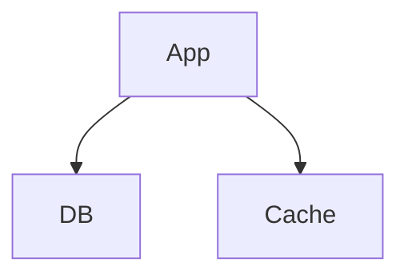
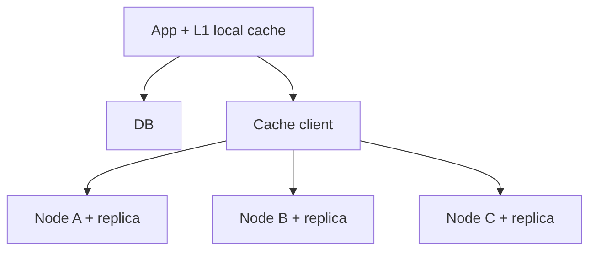
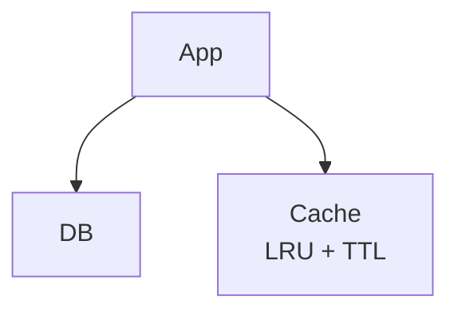
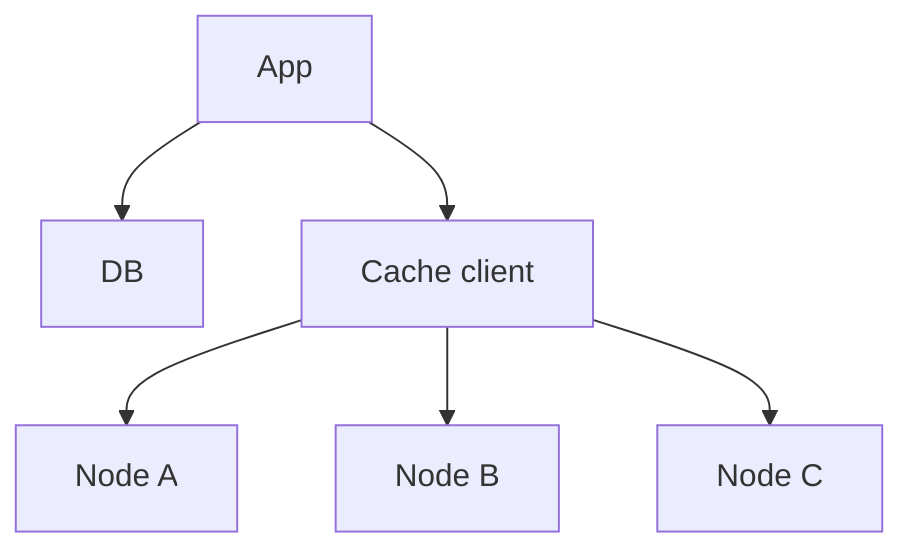
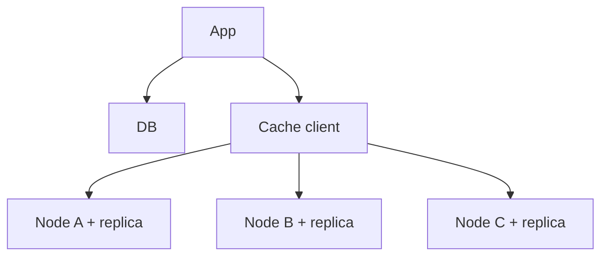

# Distributed Cache (Redis-jaisa)

> Tez RAM wala key-value store, jo ek machine se bada ho aur ek machine mare to bhi chale. Concept detail = FOUNDATIONS/04_caching.md
> Is design ka dil: **TEZ (<1 ms)** + **machine mare to bhi chale**. BookMyShow ka ulta: wahan sahi hona dil tha, yahan tezi.

```
LIBRARY DESK: 10,000 kitaab godaam me (DB = dheema, sab kuch) · top-100 front desk pe (cache = RAM, tez)
   ek desk pe saari kitaab nahi aati + desk wala beemar pad sakta (machine band)
   -> kai desk (nodes) + kaunsi kitaab kis desk (sharding) + har
      desk ka backup banda (replication) = DISTRIBUTED CACHE
```

---

## TASVEER (ByteByteGo / Alex Xu · CC BY-NC-ND 4.0)


Source: [How Can Cache Systems Go Wrong?](https://bytebytego.com/guides/how-can-cache-systems-go-wrong/)
(thundering herd / penetration / breakdown / crash)


Source: [Consistent Hashing Explained](https://bytebytego.com/guides/consistent-hashing/)
(machine jude ya gire to sirf thodi keys khiskein — ring)

---

## SHURU: pehle poocho, phir numbers

```
POOCHO:  "Ek machine ka cache (kya hatayein, TTL) ya kai machine wala (baantna, copy) — kis pe?"
         kaisa data, padhai zyada? · kitna PURANA chalega? (5
         min purana?)  <- isi se tay hota cache kab saaf karna
         kya hatane ka tareeka (LRU / LFU)? · cache DB ke aage hai ya khud asli store?

KYA KARE (FR):    get(key) · put(key, value, ttl) · delete(key)
                  scope bahar: disk pe bachana · pub/sub · transactions
KAISA CHALE (NFR): <1 ms (dil) · ek machine mare to chale · TB bhar data
                   "thodi der baad sahi" (eventual) chalega — asli sach DB me, cache sirf tez copy

NUMBERS (andaaza):
   ~1 TB data · ~10 lakh read / second · padhai zyada
   1 TB         -> ek machine ki RAM (64 GB) me nahi aata -> BAANTO (sharding)
   10 lakh / sec -> ek machine itna nahi deti -> machines me baanto
   machine mari -> saara bojh DB pe -> har machine ki COPY (replication)
   teeno milke "ek machine kaafi" khaarij -> isliye DISTRIBUTED
```

---

## ════ MOCK SE PEHLE: SIRF YE CARD PADHO ════

> Har dikkat ek card: KAHANI (kya hua, kaun, kitna) -> ILAAJ -> ANDAR KAISE (ilaaj kyun kaam karta) ->
> ISKE BAAD KYA TOOTEGA (interviewer yahin ghusta hai: dabba lagaya, ab kya?).

#### DABBA 0: SABSE SIMPLE (yahan se shuru, phir "kahan tootega")
```
Ek machine, uski RAM me ek HashMap. get / put O(1).
App pehle cache se poochhe: mila -> wahi do · nahi mila -> DB se laao -> cache me daalo -> do (CACHE-ASIDE).
```


#### 0 SHURU: CACHE-ASIDE (cache kaam kaise karta)
```
KAHANI:  Arpan ki profile DB se padhne me ~10 ms (disk). 10
         lakh log / second profile khol rahe -> DB ghutno pe.

ILAAJ:   DB ke aage RAM wala cache. App pehle cache se poochhe.

ANDAR KAISE:
         Arpan ki profile cache me mili (HIT) -> <1 ms me wapas.
         Nahi mili (MISS) -> DB se laao -> cache me daalo (TTL ke saath) -> wapas. Agli baar HIT.
         App khud cache sambhalta hai = CACHE-ASIDE (sabse aam tareeka).

ISKE BAAD KYA TOOTEGA:
  - Likhna kaise? cache-aside / write-through / write-back?
      -> cache-aside: DB me likho, cache ki key DELETE.
         write-through: DB aur cache dono me saath (hamesha taaza, par likhna dheema).
         write-back: pehle sirf cache, DB me baad me (tez,
         par cache mara to data gaya -> paise pe kabhi nahi).
  - Poora cache hi gir gaya?
      -> saari padhai DB pe. DB ke aage rate limit / load shedding (faltu request mana), warna DB bhi girega.
  - Chal raha hai, kaise pata?
      -> HIT RATIO sabse pehle (achanak gira = kuch toota) + p99 + kitni key nikaali ja rahi (evictions).
```

#### [1](#d1) RAM BHAR GAYI, KYA HATAYEIN
```
KAHANI:  Cache machine ki 64 GB RAM bhar gayi. Nayi key daalni hai, to koi purani nikaalni padegi. Kaunsi?

ILAAJ:   LRU: jise sabse LAMBE samay se kisi ne nahi chhua, wo bahar. Saath me har key ki umar (TTL).

ANDAR KAISE:
         HashMap (key -> list ka dabba) + doubly linked list.
         Koi key padhi -> uska dabba list ke AAGE. Jagah chahiye
         -> list ki POONCH wala hatao (sabse purana chhua).
         Dono kaam O(1). (LeetCode 146, tera LRU REDO.)
         TTL: padhte waqt dekho umar khatam? (lazy) + peeche thodi-thodi safai (active).

ISKE BAAD KYA TOOTEGA:
  - LRU kyun, LFU kyun nahi?
      -> LRU = "aakhri baar KAB chhua", LFU = "KITNI baar
         chhua". LFU me kal ki famous key aaj bhi baithi rehti
         -> isliye LFU ginti waqt ke saath ghatata (decay). Default LRU.
  - Redis sach me har key ki list rakhta?
      -> nahi, memory bachane ko ANDAAZE wala LRU: kuch random key uthata, unme sabse purani hata deta.
  - RAM bhari aur hatana band (noeviction)?
      -> naya likhna ERROR dega. Cache ke liye allkeys-lru rakho.
```

#### [2](#d2) 1 TB EK MACHINE ME NAHI: "user:42" KIS MACHINE PE?
```
KAHANI:  Data 1 TB, ek machine me 64 GB. 16+ machine chahiye. "user:42" kis machine pe jaaye,
         aur App ko har baar kaise pata chale?

ILAAJ:   CONSISTENT HASHING (ring). hash % N NAHI. Dono ALAG cheez hain, mila ke mat bolna.

GALAT RAASTA = hash % N   (pehle ye bolo, phir kyun toota)
         machine = hash(key) % N
         key ka hash 10, 11, 12, 13, 14
           N = 4 -> machine 2, 3, 0, 1, 2
           N = 5 -> machine 0, 1, 2, 3, 4      <- ek machine jodi, PAANCHON key ki machine badal gayi
         asal me 4 -> 5 machine = ~80% key ki machine badalti -> sab MISS -> saara bojh DB pe -> DB gira

SAHI RAASTA = RING (consistent hashing)   (isme "% N" kahin nahi)
         ek gol ring 0 .. 360 (asal me 0 .. 2^32). MACHINE bhi ring pe, KEY bhi ring pe.
         key ghadi ki disha me chale, jo PEHLI machine mile wahin rahe.
           A = 100, B = 200, C = 300
           key 150 -> B,  key 250 -> C,  key 350 -> A (ghoom ke)
         nayi machine D = 250 jodi:
           sirf 201 .. 250 wali key C se D pe gayi. Baaki sab wahin.
         -> machine judi / gayi = sirf PADOS ki thodi key hilti (~K/N), poori nahi

ANDAR KAISE:
         VIRTUAL NODES: ek machine ring pe 100 jagah baithti -> bojh barabar (warna kisi ka hissa bahut bada).
         App ke andar CACHE CLIENT library ye hisaab karke sahi machine pe bhejti.

ISKE BAAD KYA TOOTEGA:
  - hash % N me kya dikkat, ring me kyun nahi?
      -> % N me N badla = lagbhag SAB key hili. Ring me N kahin nahi, sirf pados wala hissa hila.
  - Nayi machine judi, uski key khaali -> miss?
      -> haan, sirf us hisse ki ~K/N key ek baar miss. Poora cache nahi.
  - App ko kaise pata kaunsi machine zinda?
      -> cluster ka naksha (topology / config service). Galat
         machine pe gaya to Redis bolta "MOVED, wahan jao".
  - Redis Cluster ring use karta?
      -> nahi, 16384 SLOT: CRC16(key) % 16384 -> slot -> machine. Yahan 16384 PAKKA hai (machine ginti nahi),
         isliye machine badhne pe sab nahi hilta: bas kuch slot nayi machine pe khiskao. Kaam ring jaisa.
  - Range se baanto (A-M, N-Z)?
      -> ek range garam ho jaati (sab "a" wale), ek machine pe bojh. Isliye hash.
```

#### [3](#d3) MACHINE B MARI, USKI KEY KA BOJH DB PE
```
KAHANI:  Machine B mar gayi. Uske hisse ki saari key gayab. Un key
         ki saari padhai ab seedha DB pe -> DB pe achanak bojh.

ILAAJ:   Har machine ki 1-2 COPY (replica) alag AZ (alag building) me. Primary mari -> copy primary ban jaati.

ANDAR KAISE:
         Likhna primary pe, copy ko thodi der baad pahunchta (ASYNC).
         Baaki machine B ko ping karti rehti. Zyadatar (quorum) bolein "B mari" -> vote se B ki copy primary,
         App ko naya pata bata diya jaata.

ISKE BAAD KYA TOOTEGA:
  - Copy async kyun, sync kyun nahi?
      -> sync = har likhai pe copy ke "haan" ka intezaar -> <1 ms gaya. Keemat: aakhri kuch likhai kho sakti.
         Cache me chalta, asli sach DB me hai.
  - Copy ko primary banane me kitni der?
      -> ~10-30 sec. Us beech us hisse ki key DB se aati (thoda dheema).
  - Network toota, purani B bhi khud ko primary samjhe (do primary)?
      -> SPLIT BRAIN. Faisla zyadatar (quorum) se + jo akeli pad
         gayi (minority) wo likhna band kare (min-replicas).
  - Copy se padh sakte?
      -> haan, padhai bat jaati. Par thoda purana mil sakta (lag). Cache me chalta.
```

#### [4](#d4) DB ME NAYA NAAM, CACHE ME PURANA (STALE)
```
KAHANI:  Ravi ne naam "Ravi" se "Ravi K" kiya. DB me naya ho gaya,
         cache me abhi bhi "Ravi". Sabko purana naam dikh raha.

ILAAJ:   DB update karo -> phir cache ki key DELETE (update nahi). + TTL suraksha jaal.

ANDAR KAISE:
         Key delete hui -> agli padhai MISS -> DB se "Ravi K" -> cache me. Ab sab taaza.
         UPDATE kyun nahi: do likhai ulte kram me pahunch sakti.
           Ravi ne "X" likha, phir "Y". Cache me pehle Y pahuncha, phir X -> cache me galat "X" baith gaya.
           DELETE me ye dikkat nahi: kuch bhi pahunche, key khaali hi hogi.

ISKE BAAD KYA TOOTEGA:
  - DB update hua, par cache DELETE fail?
      -> TTL bachata (zyada se zyada utni der purana). Pakka chahiye -> DB ke badlaav (CDC) se delete dobara.
  - Delete ke baad kisi ne purani value wapas daal di (race)?
      -> thodi der baad dobara delete (double delete), ya version ke saath likho.
  - Ravi ne khud naam badla, aur use hi purana dikha?
      -> copy peeche thi (replica lag). Likhne wale ko thodi der primary se padhao (read-your-own-writes).
  - TTL kitna?
      -> jitna purana business jhel sake. Profile: minute. Price / stock: second, ya turant delete.
```

#### [5](#d5) GARAM KEY KHATAM, 1000 REQUEST EK SAATH DB PE (STAMPEDE)
```
KAHANI:  "home page" ki key ki umar khatam hui. Usi second 1000
         log aaye -> sabko MISS -> 1000 ek saath DB pe -> DB gira.

ILAAJ:   LOCK: sirf EK request DB se laaye, baaki ruk ke cache se padhein.
         + SOFT-TTL: umar khatam hone se PEHLE peeche se taaza kar do.

ANDAR KAISE:
         miss -> SET lock:home 1 NX EX 5
            jeeta (pehla) -> DB se laao, cache bharo, lock hatao
            haara (baaki 999) -> 50-100 ms ruko, cache dobara padho (tab tak pehle ne bhar diya)
         EX 5 kyun: pehla beech me mar gaya to lock 5 sec me khud chhoot jaaye.
         1000 ki jagah 1 request DB pe.

ISKE BAAD KYA TOOTEGA:
  - Haarne wale kitni der rukenge?
      -> chhota intezaar + 2-3 baar. Phir bhi nahi -> purani value do, DB pe mat bhejo.
  - Bahut saari key EK SAATH khatam (sabki umar 1 ghanta, sab ek saath bhari thi)?
      -> AVALANCHE. Umar me thoda random (60 min +- 5) -> khatam hona bikhar jaata.
  - Key DB me HAI hi nahi, attacker baar-baar wahi maange?
      -> PENETRATION: har baar miss -> DB. "nahi hai" (null) ko bhi chhoti umar ke saath cache karo,
         ya Bloom filter: "ye key ho hi nahi sakti" -> DB tak jao hi mat.
  - Pata hai bheed kab aayegi (sale, final)?
      -> pehle se cache bharo (pre-warm) + machine badhao.
```

#### [6](#d6) EK KEY ITNI POPULAR, USKI MACHINE AKELI MAR RAHI (HOT KEY)
```
KAHANI:  IPL final, "live:score" key. Crore log ek saath padh
         rahe. Key ek hi machine pe -> wo machine akeli mar rahi.
         Consistent hashing yahan kuch nahi karta: ek key = ek machine.

ILAAJ:   (1) L1 LOCAL CACHE: har App server ki apni RAM me 1-2 sec ka chhota cache -> Redis tak jaata hi nahi.
         (2) us key ki kai copy (score#1 .. #10) alag machine pe, padhte waqt koi bhi ek.

ANDAR KAISE:
         L1 (App ki RAM, nano-sec) -> L2 Redis (micro / milli) -> DB (milli-sec).
         1000 App server, har ek 1 sec me sirf EK baar Redis se laata -> Redis pe 1000 / sec, crore nahi.

ISKE BAAD KYA TOOTEGA:
  - Garam key pehchanoge kaise?
      -> machine ke metric (ek key pe kitne ops / sec), redis-cli
         --hotkeys, App me ginti. Had paar -> copy / L1.
  - L1 me purana score kitni der?
      -> L1 ki umar jitna (1-2 sec). Score ke liye theek, paisa / stock ke liye nahi.
  - Garam key pe LIKHNA bhi ho (like counter)?
      -> key ke tukde (like#0..#9), kisi ek me likho, padhte waqt sab jodo.
  - Stampede aur hot key me farak?
      -> stampede = key KHAALI, sab DB bhaage (lock). Hot key =
         key BHARI, ek machine padhai se mar rahi (L1 / copy).
```

```
AAKHRI DABBE (sab dikkat ke baad):
  App + L1 local cache (nano-sec, hot key ka pehla ilaaj) -> Cache client (consistent hashing: key -> machine)
  -> Machine (HashMap + DLL = LRU, + TTL) primary + copy (alag AZ) -> miss pe DB (asli sach)
  PADHNA = cache-aside

DB:  cache = RAM wala key-value (<1 ms, join nahi, sirf key se) · DB peeche asli sach
     cache AP ki taraf: tezi > sahi hona, "thodi der baad sahi" chalta

END ME POOCHEGA:
  "Key kis machine pe?" -> hash % N nahi (machine judi to sab khiski) -> CONSISTENT HASHING + virtual nodes
  "Purana data?"      -> TTL + likhne pe delete
  "Stampede?"         -> lock / soft-TTL / pehle se bharo
  "Hot key?"          -> copies + L1 local cache
  "SPOF?"             -> machine (copy promote) · cache client ka config (har app me copy)
  "Chal raha, kaise pata?" -> HIT RATIO sabse zaroori (gira = kuch toota) · p99 · evictions · alert
```

AAKHRI DABBE ki tasveer:



---

## ════ DETAIL: HAR DIKKAT KI INTERVIEW LINE + TASVEER ════

> Card me poori kahani hai. Yahan har dikkat ki ek English line (interview me bolne ke liye) aur us waqt tak ka diagram.

---

<a id="d1"></a>

## DIKKAT 1 — RAM bhar gayi, kya hatayein

```
BOL:      "Each node evicts with LRU, a hash map plus a doubly linked list so both lookup and eviction
           are O(1), and every key also has a TTL cleaned lazily on read and actively in the background."
```


---

<a id="d2"></a>

## DIKKAT 2 — 1 TB ek machine me nahi: key kis machine pe

```
BOL:      "I place keys with consistent hashing on a ring with virtual nodes, not hash mod N, so
           adding or removing a node moves only about K over N keys instead of almost all of them."
```


---

<a id="d3"></a>

## DIKKAT 3 — machine mari, bojh DB pe

```
POOCHEGA: "What happens if a cache node goes down?"
BOL:      "Each shard has a replica in another zone that gets promoted, and
           with consistent hashing only that node's keys are affected."
```


---

<a id="d4"></a>

## DIKKAT 4 — DB me naya, cache me purana

```
POOCHEGA: "The user updated something but still sees the old value. Why?"
BOL:      "On update I delete the cache key rather than overwrite it, and keep a TTL as a safety
           net. If it's replica lag, the writer reads from the primary for a short while."
```


---

<a id="d5"></a>

## DIKKAT 5 — garam key khatam, 1000 request DB pe

```
POOCHEGA: "What if the cache goes down / a hot key expires?"
BOL:      "For known events I'd pre-warm the cache and scale up in advance. For
           unpredictable spikes I still need stampede protection: a lock so only one
           request rebuilds the key, and early background refresh before the TTL expires."
```


---

<a id="d6"></a>

## DIKKAT 6 — ek key itni popular, machine akeli mar rahi

```
POOCHEGA: "What about a hot key / celebrity / hot partition?"
BOL:      "The key is there, one node just can't take the reads. I'd put a 1-2 second local
           cache on each app server so most reads never reach Redis, and copy the key across
           replicas so the rest are spread out. A slightly stale score is fine here. If the
           key were missing instead, that's a stampede — one request rebuilds, the rest wait."
```


---
## 10 GUNA TRAFFIC — har dabba alag se

```
Cache client  -> machine judi / gayi -> consistent hashing + virtual nodes
Machine       -> RAM bhari -> LRU + TTL · mari -> copy promote · data badha -> machine jodo
hot key       -> copies + L1 local cache
umar khatam   -> lock · soft-TTL · kabhi khatam nahi · pehle se bharo
DB            -> purana data -> likhne pe delete + TTL
AAGE:         write-back (likhna bahut ho to) · kai region me cache

POOCHEGA: "How would you scale this to 10x?"      -> request ka raasta chalo
POOCHEGA: "What's the single point of failure?"   -> machine (copy), cache client config (sab app me copy)
POOCHEGA: "How do you know it's working?"         -> HIT RATIO sabse
          zaroori (gira = kuch toota) · p99 · evictions · alert
```

---

## POOCHE TO (gehra sawaal aaye tab)

```
API:      GET key · PUT key value ttl · DELETE key
          jaan-boojh ke chhoti — query nahi, sirf key se -> index / planner nahi -> isiliye tez

MACHINE KE ANDAR: HashMap key -> value (O(1)) · LRU = HashMap + DLL · TTL lazy + active
                  RAM wala key-value (Redis-jaisa), DB peeche asli sach
                  <1 ms -> RAM (disk nahi) · join nahi -> key-value kaafi

KEY BAANTNA:    hash % N -> sab khiskti -> NAHI · CONSISTENT HASHING
                -> ring + ghadi ki disha + virtual nodes <- YAHI
                range -> ek range garam -> NAHI

TRADE-OFF:      tezi vs sahi hona — cache AP ki taraf, "thodi der baad sahi" chalta (CAP)
```

---

## AAKHRI DABBA + WRAP

```
App + L1 = nano-sec, hot key ka pehla ilaaj · Cache client = consistent hashing, key -> machine
Machine = HashMap + DLL (LRU) + TTL, primary + copy (alag AZ) · DB = asli sach, miss pe
```
```
EK MACHINE : HashMap + DLL (LRU) + TTL
BAANTNA    : consistent hashing (shard) + copy (replication)
PADHNA     : cache-aside (~90% hit, DB pe bojh 10 guna kam)
PURANA     : TTL + likhne pe delete
STAMPEDE   : lock / soft-TTL
HOT KEY    : copies / L1 local
```
```
BOL:      "A distributed cache is an in-memory key-value store, sharded with consistent hashing and replicated
           for availability. Cache-aside with LRU and TTL is the production combo. The two hard parts are
           invalidation — TTL plus explicit deletes — and stampedes — a lock or early refresh. Hot keys get a
           local L1 cache and copies. It's a speed versus consistency trade-off, decided by the use case."
```


ARCHETYPE F · CONCEPTS: [caching](../../FOUNDATIONS/04_caching.md) · [sharding](../../FOUNDATIONS/06_database_sharding.md) · [replication](../../FOUNDATIONS/05_database_replication.md) · [← MASTER SHEET](../../00_MASTER_SHEET.md)
