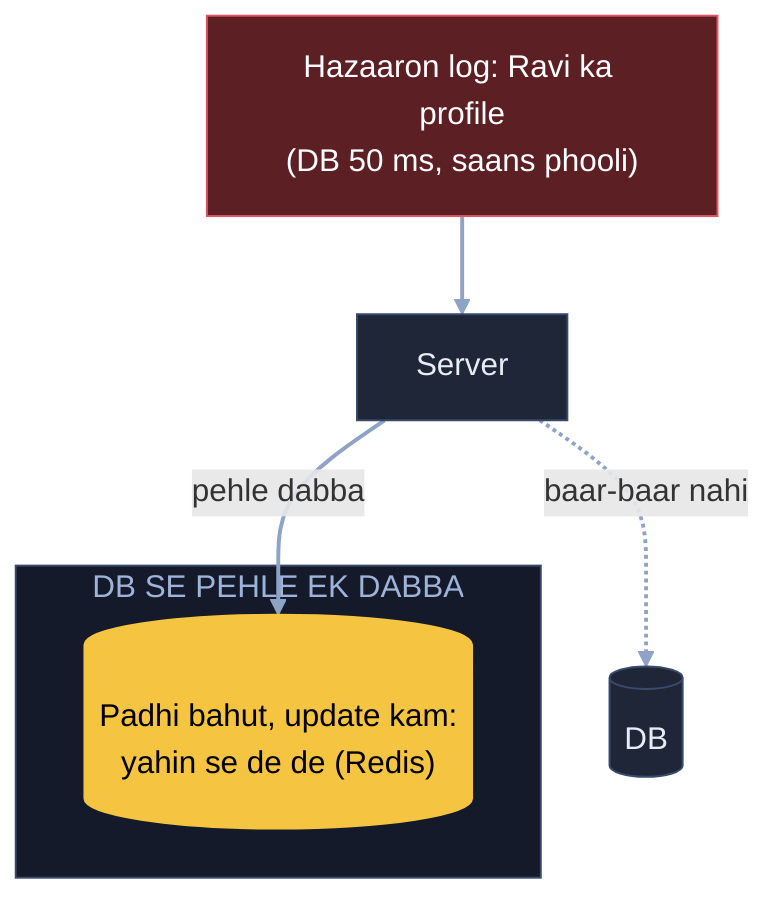
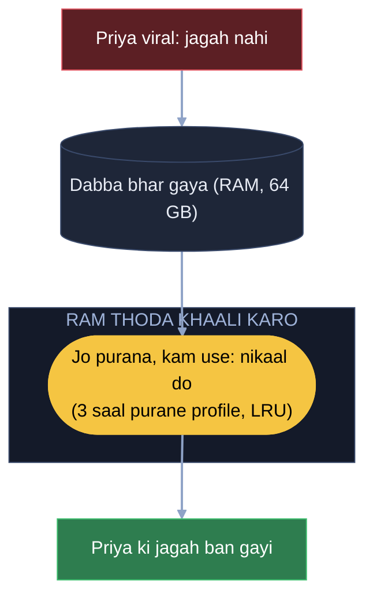
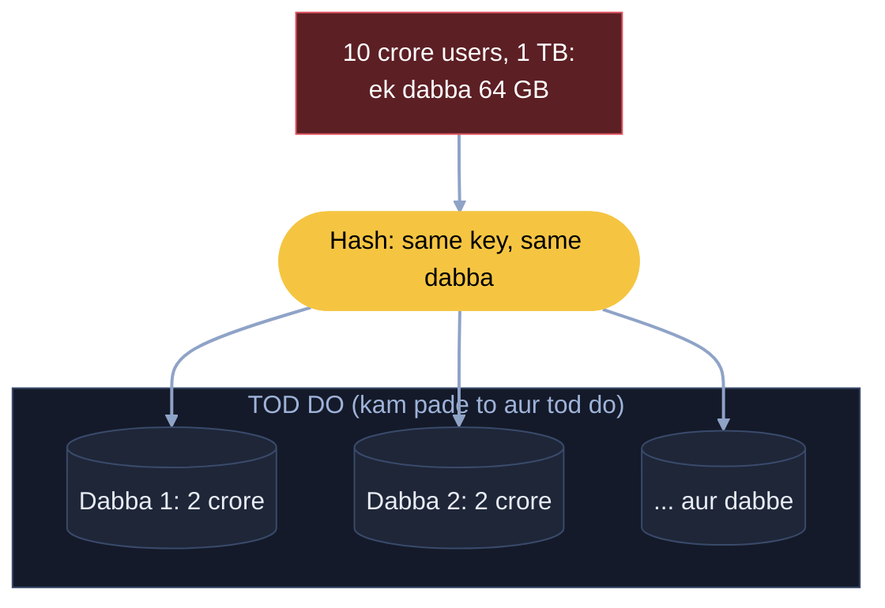
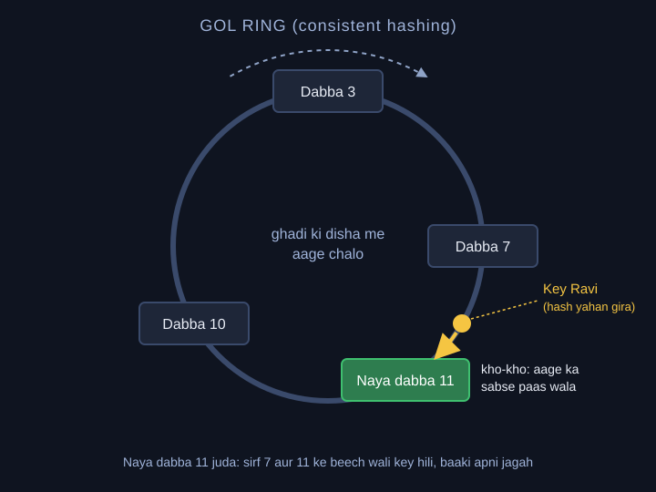
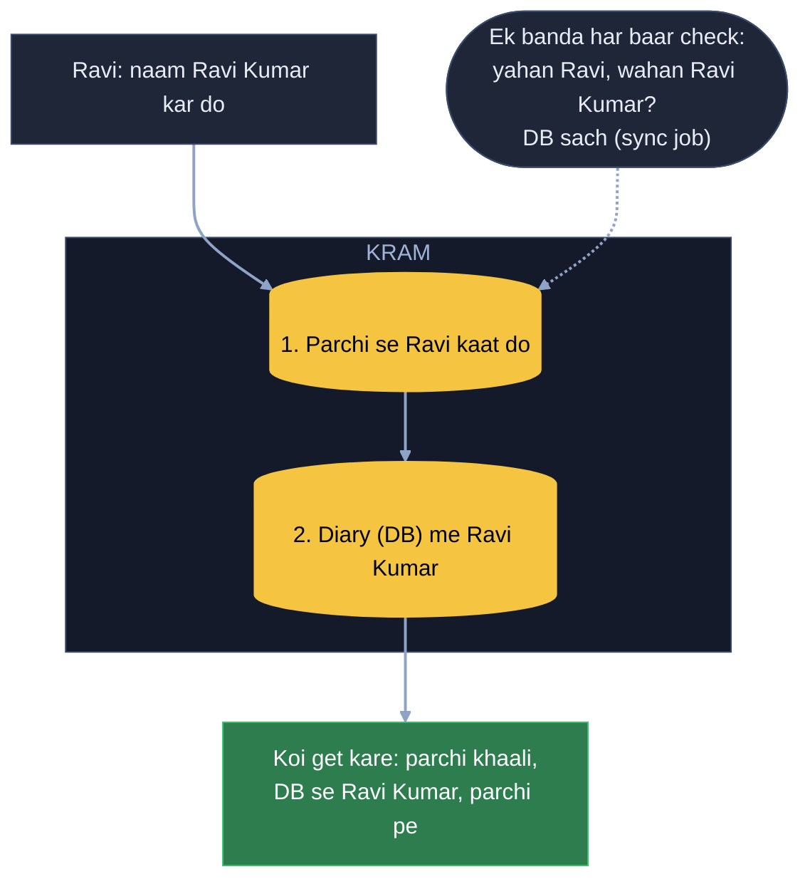
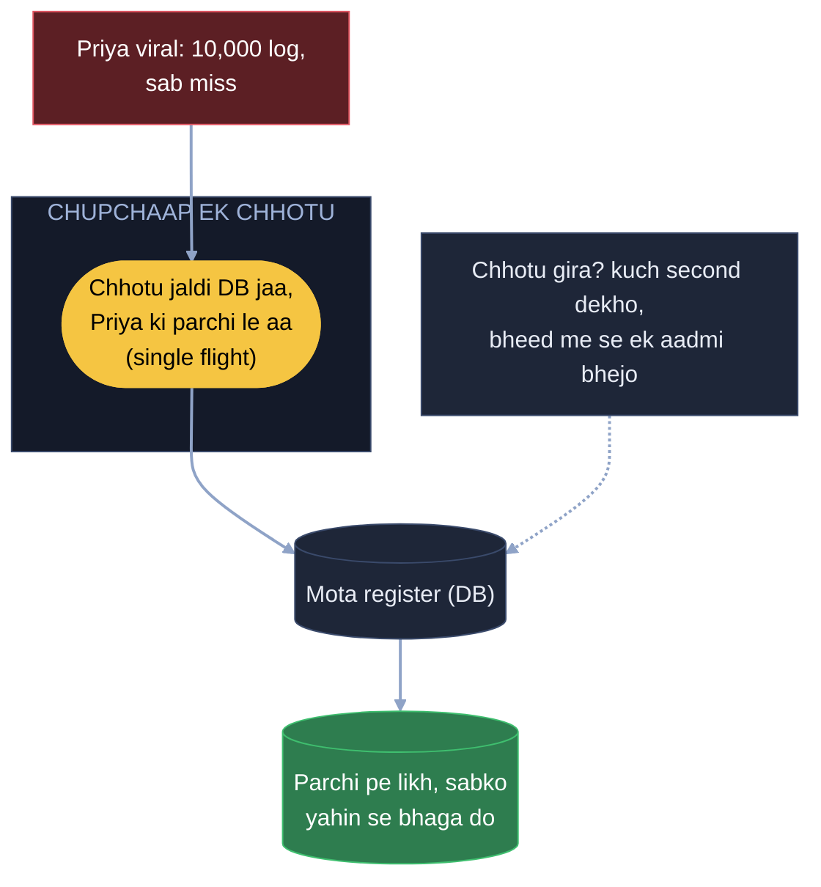
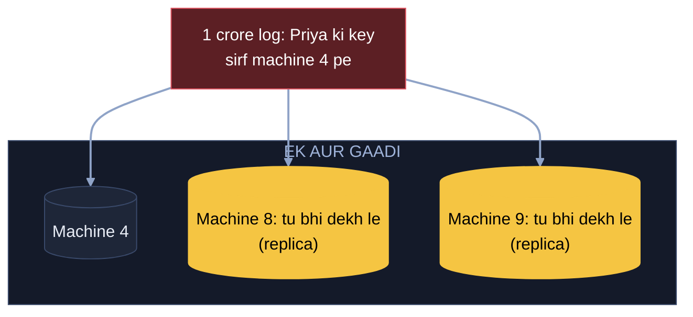

# Distributed cache: Arpan aur Ravi ke profile page ki kahani

Arpan ki app me har bande ka profile page hai (naam, photo, bio). Ravi mashhoor hai, uska profile din me lakhon log
kholte hain. Data DB me hai, aur har baar server DB se padh ke laata hai. Kaam: profile turant khule, DB na baithe,
aur bheed ek jagah toot pade tab bhi chale.

Har kadam = **kahani** (dikkat aur hal, bolne wali bhasha) -> **Asli naam** (interview me yahi shabd) -> tasveer
(kahani ka shabd, bracket me asli naam).

---

## FR / NFR / Numbers (interview me pehle 2 minute)

```
FR      get(key), put(key, value), delete(key) · asli sach DB me, cache sirf tez copy
NFR     tez (~1 ms, DB se 50 ms) · DB pe bojh kam · thodi der purana chalega (profile hai, paisa nahi)
        · jagah bhare to purana nikle · ek hi key pe bheed ho to bhi na gire
Numbers DB ek padhai ~50 ms, kuch hazaar query / sec jhelta · Ravi ka profile hazaaron / sec, badalta din me ek baar
        10 crore user, roz khulne wale profile ~1 TB · ek machine ki RAM 64 GB -> baantna padega
```

---

## 1. DB ki saans phooli (DB se pehle ek dabba)

Ravi ka profile har second hazaaron log khol rahe, aur har baar server DB tak jaata, ek baar me 50 ms. Jabki uska data
din bhar me shayad ek baar badalta. Page dheema, DB ki saans phooli. To information thodi store kar lete hain. DB se
pehle ek dabba rakh lo, jisme aisi information rakho jo famous ho, ya jo padhi bahut ja rahi ho aur update bahut kam
ho rahi ho. Ab koi bhi maange to pehle dabbe me dekho, wahan mila to wahin se de do; nahi mila to DB se laao aur dabbe
me bhi rakh do. Baar-baar DB jaane ki zaroorat hi nahi, dikkat khatam.

**Asli naam:** dabba = cache (Redis, RAM me, ~1 ms), padhi bahut update kam = cache ke laayak data, dabbe me mila =
cache hit, nahi mila to DB se laake rakho = cache-aside. DB = source of truth.



## 2. Dabba bhar gaya, Priya ki jagah nahi (purana nikaalo)

Dabba RAM ka hai, 64 GB. Log profile kholte gaye, sab jama hote gaye, dabba bhar gaya. Aaj Priya ka video viral,
lakhon log uska profile khol rahe, par uske liye jagah nahi. Aur dabbe me 3 saal purane profile pade hain jinhe mahino
se kisi ne nahi khola. To RAM ko thoda khaali karo: jo purana hai, jo kam use ho raha hai, use nikaal do, use
lena-dena hi nahi. Jo ab use nahi ho raha aur RAM me pada hai, wo befaltu ki jagah ghere hai.

**Asli naam:** RAM khaali karo = eviction, jo purana aur kam use ho raha wo nikaalo = LRU (Least Recently Used; andar
HashMap + doubly linked list, sab O(1), wahi LC 146).



## 3. 1 TB ek dabbe me nahi aata (tod do, hash batata kahan)

Ab 10 crore users, roz khulne wale profile hi 1 TB. Ek machine me 64 GB, LRU kitna bhi chalao, 1 TB ek dabbe me nahi
aata. Upar se ek machine ki request ki had hai, bheed usse kai guna. To tod do. 10 crore ko tod do, 2-2 crore ya 3-3
crore ek dabbe me rakh do. Wo bhi kam pade to un 2 crore ko bhi tod do, todte raho. Kaunsa profile kis dabbe me, ye
key ka hash batata hai, same key hamesha same dabbe pe jaayegi.

**Asli naam:** tod do = sharding, hash se dabba = `hash(key) % N`, same key hamesha same machine. Ye hisaab app ke andar ki
cache client library karti, beech me koi alag dabba nahi.



## 4. 11vi machine judi, saare miss (ring, kho-kho, paas ka petrol pump)

10 machine, formula `hash(key) % 10`, Ravi machine 3 pe. 11vi machine judi, formula `% 11`, ab Ravi ke liye machine
7, jahan uska data hi nahi. Lagbhag har key ki jagah badli, saari request miss, sab DB pe, DB baith gaya. To ring
lagao. Ek gol ring me machines paas-paas baithi hain. Key ka hash do khaanon ke beech gira to
aage ke sabse paas wale khaane pe chala jaata. Kho-kho dekha hai? Bada bhaagta hai to main sabse paas wale bande ko
dhakka deta hoon: chal tu pakad jaake. Ya do padaav hain, ek 50 km pe, agla 100 km pe; gaadi ki headlight kharab hui
to main sabse paas wale padaav pe chupchaap ruk jaunga, 100 km pe nahi jaunga. Jaise highway pe petrol 50 km ka bacha
to paas ka pump dhoondhta hoon, door wala nahi; key bhi ring pe jahan giri, uske paas wale dabbe me jaati. Nayi
machine aayi to sirf uske paas wali thodi key hilti hain, baaki apni jagah. (Yahi soch leaderboard kadam 6 me: score
ke aas-paas wale hi maango.)

**Maan lo key 47 pe giri, peeche machine 45 pe (2 door), aage machine 52 pe (5 door):** ise highway maan lo. Petrol
pump peeche paas me hai, par highway pe U-turn nahi lete, ek hi disha me badhna hai. Peeche wala pump nikal gaya, chahe
paas ho, gaadi aage wale pump pe hi jaayegi. Kho-kho me bhi same: usi pe dhyaan jo us disha me baitha. Key bhi
52 pe jaati.

**Asli naam:** ring = consistent hashing, "aage ke sabse paas wale khaane pe" = key ghadi ki disha me agli machine pe
(hamesha aage wali, peeche wali nahi, chahe peeche wali zyada paas ho; ek hi disha tay hai, isliye dhoondhne pe har baar
wahi machine milti). Kho-kho / headlight / paas ka petrol pump = machine giri to uski keys aage wali agli machine
sambhalti, door wali nahi. Machine judi to sirf uske paas ki key hilti, ~1/N key (`%` me lagbhag
saari). Har machine ring pe 100-200 jagah = virtual nodes, taaki hissa barabar aaye.

**Maan lo saare dabbe bhar gaye, to unhe ring se hata ke alag kamre me kyun nahi rakhte:** pehle lagta hai bank locker
jaisa: dabbe bhar gaye to unme ab kuch aana hi nahi, unhe alag kamre me daal do, khaali dabbe doosre kamre me, beech
me ek aadmi jo bataye "teri key is kamre me". Par ring me aise nahi chalta. Dabbe ek-ek karke nahi bharte: hash har
key ko ring pe kahin bhi giraata hai, to saare dabbe ek saath, barabar bharte hain. Koi dabba "khatam" nahi hota, nayi
key purane me bhi aati rehti hai, aur dhoondhne ke liye bhi wahi ring chahiye. Sab bharne lage to naya dabba lagao, wo
paas wale ka kuch hissa le leta hai, dono me jagah. (Do kamre wala tareeka bhi kahin chalta hai, par beech wale aadmi
ko crore key ka hisaab yaad rakhna padta, aur har request ek kadam extra.)
**Asli naam:** bank locker, ek-ek karke bharna = range partitioning; beech ka aadmi = lookup / directory; saare dabbe
ek saath bharte = hash se barabar baant.

**Maan lo ring ke saare dabbe phir bhar gaye:** ring me aur dabbe jodte jao. Ring bada hona dikkat nahi: ring koi
kamra nahi, ek niyam hai; dabbe 10 ho ya lakh, key dhoondhna ek hi hisaab, ring pe ghoomna nahi padta. Har naya dabba
bas paas wale ka thoda hissa leta hai. Consistent hashing ye khud sambhal leta hai, interview me naam kaafi. Cassandra
bhi andar yahi karta hai.
**Asli naam:** dabbe jodte jao = scale out (nayi node ring me), ek hi hisaab = ring pe lookup. Official doc
(Cassandra, "Dataset Partitioning: Consistent Hashing"):
https://cassandra.apache.org/doc/latest/cassandra/architecture/dynamo.html



## 5. Ravi ne naam badla, sabko purana dikh raha (parchi kaato, phir DB, peeche ek banda)

Ravi ne apna naam badal diya. DB me naya naam likh gaya, par cache me abhi bhi purana "Ravi", aur sab cache se padh
rahe. Mere paas ek diary (DB) aur ek cache ki parchi. Ravi aaya: mera naam "Ravi Kumar" kar do. Sabse pehle apni parchi
se "Ravi" kaat dunga, phir DB me "Ravi Kumar" likhunga. Ab koi get karne aaya, parchi pe Ravi hai nahi, to DB se
uthaya "Ravi Kumar" aur parchi pe likh diya. Kaam khatam.

**Asli naam:** parchi se kaato = cache key DELETE (update nahi, taaki do likhai ulte kram me pahunchein to bhi galat
naam na baithe), phir DB me likho (DB = source of truth), agla GET miss -> DB se
naya = cache-aside.

**Maan lo parchi kaatne aur DB likhne ke beech koi request aa gayi:** parchi khaali thi, request DB pe gayi, abhi wala
purana "Ravi" laake parchi pe likh diya, phir DB me "Ravi Kumar" aaya. Iske liye ek banda hai jo har baar check kar
raha: yahan Ravi, wahan Ravi Kumar, to parchi pe Ravi Kumar kar do, kyunki DB hamara source of truth hai. Ho sakta hai
kuch second Ravi dikhe, par ye koi paisa thodi hai jo ekdum consistency chahiye. Chahiye hoti to lock laga lete.
**Asli naam:** banda har baar check kare, farak mila to theek = background sync (reconciliation) job, kuch second
Ravi dikhe, paisa nahi = eventual consistency chalegi.

**Maan lo poochhe "pehle DB phir parchi kaato, ulta kyun nahi?":** wo bhi chalta, chhed thoda chhota, par chhed wahan
bhi hai (dheemi read purana laake likh sakti). Isliye peeche wala banda dono kram me chahiye; kaatna fail to dobara kaato.
**Asli naam:** write-then-invalidate, invalidation retry, pakka chahiye to version check / lock.

**Maan lo cache me 1 TB, sync job ko kaise pata kaunsi key dekhni hai:** wahi jo update hui. Job ko time do: pichhle ek
ghante me DB me jo row badli, sirf unki parchi milao. Ek saath 1 TB nahi badalta. Dikkat lage to 2-3 ghante ya ek din ka kar do.
**Asli naam:** DB me `updated_at` pe query (index), sirf badli key ka cache theek, chhoti time window.

**Maan lo TTL laga ke chhod dein:** TTL alag cheez hai. Sync job tab lagaunga jab data baar-baar update hota ho (din me
100-200 baar). TTL tab jab data thodi der ke liye hi rakhna ho, jaise koi form bhar raha: chhota TTL
laga do, form khaali chhod diya to apne aap gaayab. Har baar TTL se kaam nahi chala sakte, TTL kabhi-kabhi dhokha de
deta hai.
**Asli naam:** thodi der wala data, chhota TTL = TTL; baar-baar badalne wale data ke liye sync job. Sync job ke saath bhi ek lamba TTL rakho, taaki job chooke to purana data hamesha ke liye na atke (safety net).



## 6. Priya viral, 10,000 log ek saath DB pe (ek chhotu bhejo)

Priya aam user thi, uski parchi cache me hai hi nahi. Raat 9 baje video viral, ek second me 10,000 log, sabko miss,
sab ek saath DB pe, Priya ki ek hi query 10,000 baar. 10,000 log ek saath DB jaayenge to DB maar dega, pehle unhe
roko. Main chupchaap ek chhotu bhejunga: chhotu bhai, jaldi se DB me jaa, Priya ki parchi hot hai, le aa. Parchi pe
likh lunga aur sabko yahin se bhaga dunga, mote register ki taraf koi nahi jaayega.

**Asli naam:** 10,000 ek saath DB pe = cache stampede, ek chhotu bhejo baaki yahin ruko = single flight (lock: pehli
request lock leti, DB jaati, cache bharti; baaki thoda ruk ke cache dekhte).

**Maan lo chhotu raaste me gir gaya ya dheema pad gaya:** kuch second dekh lo. Nahi aaya to bheed me se ek aadmi
pakdunga: ae bhai tu idhar aa, mote register pe jaa, jo data tu maang raha wo utha la aur mujhe bhi de dena. Wo laya,
cache me daal diya, sabko bhej diya. Ye mera backup plan.
**Asli naam:** kuch second dekho, phir bheed me se ek = lock ki umar (timeout, jaise 2 sec), agli request lock le leti.

**Maan lo aur raaste pooche:** ek ki jagah do chhotu bhejo, ek gira to doosra le aayega. Hot key ko zyada der tak rakho.
Ya key ki 3 copy rakho aur sabka expire ka time alag, to sab ek saath kabhi expire nahi honge. Ek sahi jawab nahi,
company kya chahti hai us pe.
**Asli naam:** do chhotu = redundant fetch, hot key lambi umar = longer TTL, alag-alag expire = TTL jitter (staggered
expiry).

**Maan lo ek bot har second 10,000 aise user id maang raha jo hain hi nahi (50 crore, 70 crore, 99 crore...). Cache me kuch nahi, DB me bhi kuch nahi, cache me rakhne ko kuch nahi, to har baar seedha DB:** Main khud ko scene me rakh ke dekhta hoon. Mere paas 1 se 10 tak gintee hai. Ek ladka aaya: "11 hai?" Main andar jaake dekhta hoon, nahi hai. Phir aaya: "33 hai?" Phir andar gaya, nahi hai. 2-3 baar aisa hua, har baar andar jaana pada, main pareshaan ho gaya. Aise to wo number badhata jaayega aur main har baar andar bhaagta rahunga. To main parchi pe likh lunga "mere paas 1 se 10 tak hai", isse bada koi maange to wahin mana: "11 nahi hai, nikal", andar jaane ki zaroorat hi nahi. Fayda: sabka naam yaad rakhne ki zaroorat nahi, bas ek range. DB SQL hai, id 1, 2, 3 kram se banti, to DB me 1 se 10 crore user hain to beech wale milenge hi. 50 crore maanga to parchi dekh ke wahin mana, DB tak gaya hi nahi. Range ke andar wala, jaise 500, nahi mila to null de do; null ka kya karna wo uska engineer if-else lagaye. Aur koi 500 baar-baar maange (range ke andar, par hai nahi), to main parchi pe likh lunga "500 = null"; ab koi bhi 500 maange, DB jaaunga hi nahi.
**Asli naam:** "nakli id, har baar andar (DB) bhaagna" = cache penetration. "parchi pe range, bahar wala wahin wapas" = request aate hi id range check (input validation), cache aur DB se pehle; galat id na cache tak pahunchti na DB tak. (Yahan parchi = range ki parchi, cache wali key nahi.) Range ke andar par nahi mila = null ko bhi cache me rakho (negative caching, thodi der ki umar), taaki baar-baar wahi nakli id DB tak na pahunche.



## 7. 1 crore log, akeli machine 4 pe (ek aur gaadi)

Priya ki parchi cache me aa gayi, par ek second me 1 crore log. Ring pe uski key sirf machine 4 pe. Baaki 9 aaram se,
akeli machine 4 pe poori bheed, dheemi hote-hote girne lagi. To baaki machine pe baant do. Machine 4 ka replica bana
do, teen jagah ho gayi, to bheed bat gayi. Ya ring me aur jagah bitha do: machine 8 tu bhi dekh le, machine 9 tu bhi
dekh le. Jaise bheed zyada ho gayi to ek aur gaadi extra kar lo; ek gaadi me sab nahi aa sakte, to ek-do chhoti gaadi
kar lo.

**Asli naam:** machine 4 pe poori bheed = hot key, machine 4 ka replica / 8 aur 9 tu bhi dekh = hot key ki copies kai
machine pe, ek aur gaadi = padhne ki bheed copies me bat-ti (padhne wale koi bhi copy chunte). Machine badhane se akela kaam
nahi chalta, kyunki ek key ek hi machine pe jaati.

**Maan lo Priya ki key machine 4, 8, 9 teeno pe hai (copies), usne naam badla, aur sirf machine 4 ki parchi kati:** Refresh pe kabhi naya naam aayega, kabhi purana, kyunki 8 aur 9 pe abhi purani parchi padi hai. Kadam 5 wala niyam "pehle parchi kaato" sirf ek machine pe nahi, jitni copies hain sab pe lagao. Aur kadam 5 wala peeche ka banda (sync job) bhi sirf ek jagah nahi, saari copies jaanche.
**Asli naam:** copies pe bhi delete = hot key ki har replica invalidate, sync job copies bhi = reconciliation sab replicas pe.



---

Notes (Arpan ke shabd) = [CACHE_HAND_NOTES.md](CACHE_HAND_NOTES.md)
