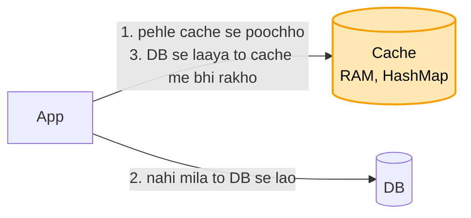
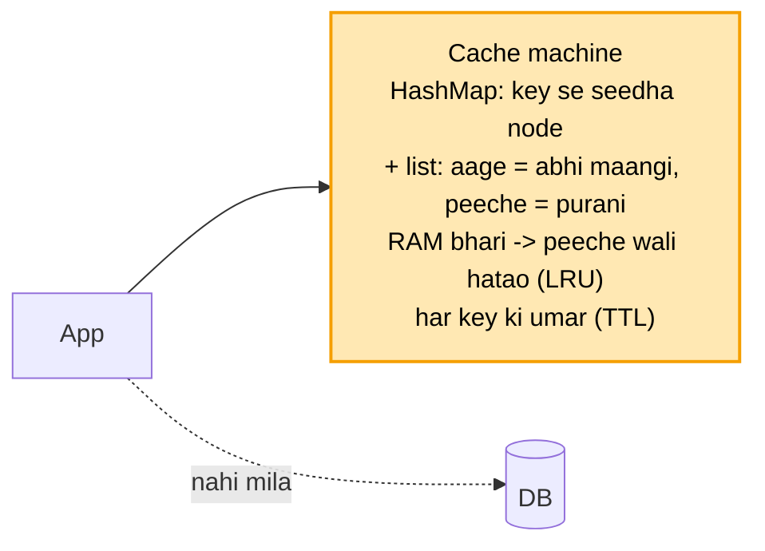
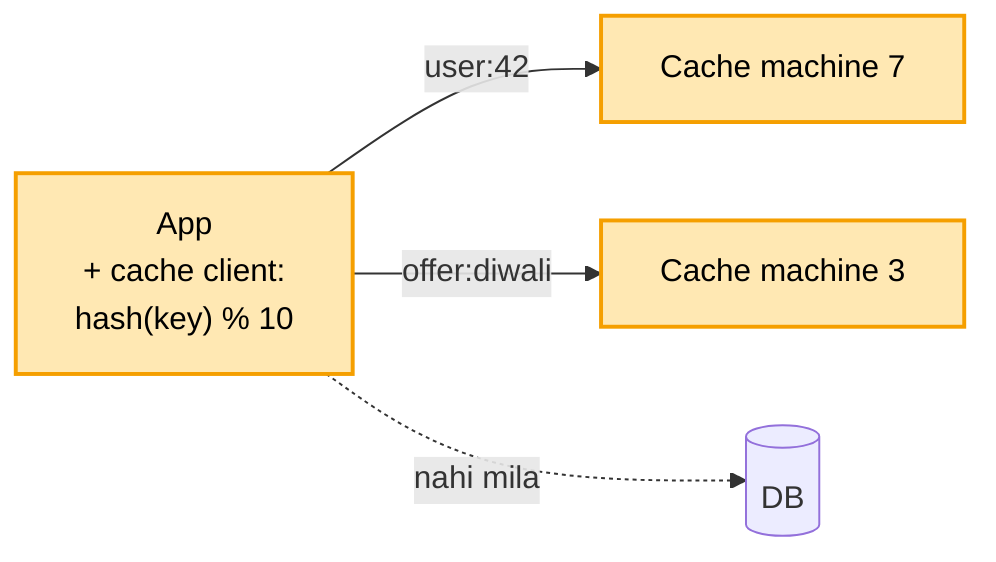
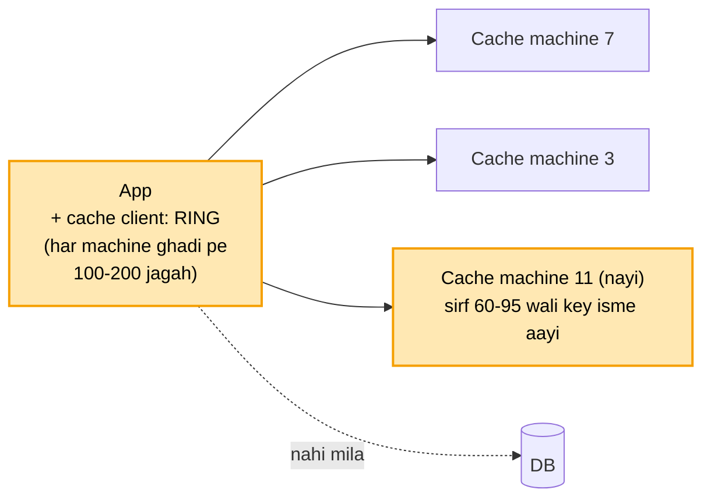
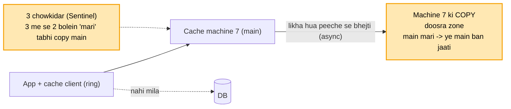
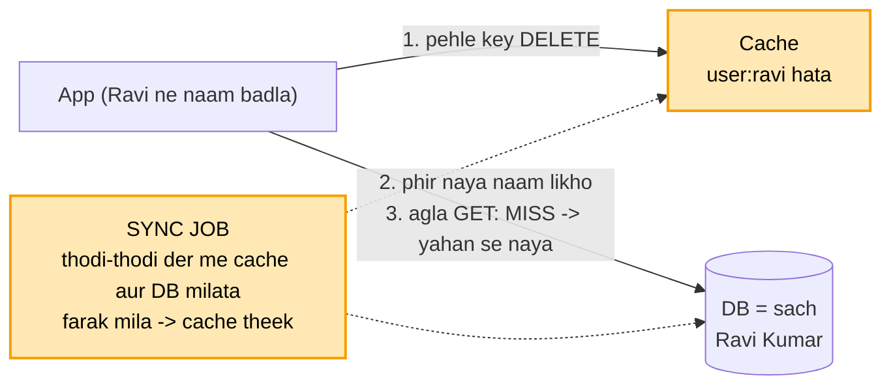
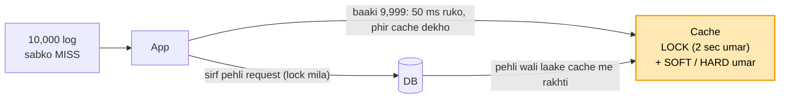
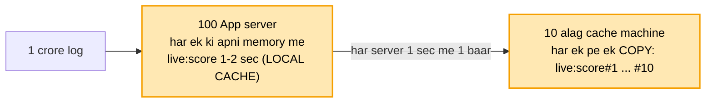

# Distributed cache: shuru se, ek kahani

Kram wahi jo interview me hota hai: **FR, phir NFR, phir numbers, phir design**. Design sabse seedhe dabbe se
shuru hota hai, aur har dikkat aane pe ek naya dabba judta hai. Diagram me peela dabba = abhi juda. Poori file
me ek hi kahani hai: Arpan ka shopping app.

**Arpan aur Ravi (profile page wala scene):** DB se pehle dabba = cache-aside · purani parchi nikalo = LRU · tod do = sharding · kho-kho me paas wala = consistent hashing · parchi kaato + milane wala job = cache DELETE + sync job · chhotu = single flight · ek machine pe bheed = key ki copies

**CUE (yahi shabd yaad rakhne hain, kram se):**
cache-aside (ek machine) -> LRU + TTL -> baanto (hash % N) -> ring + virtual nodes -> copy + quorum
-> cache DELETE + DB likho + sync job -> lock (single flight) + soft / hard -> local cache + key ki copies (garam key)

---

## Cache hai kya, aur kyun chahiye

Arpan ka ek shopping app hai. Har baar koi home page kholta hai, to app DB se poochhta hai: "user 42 ka naam
kya hai, cart me kya hai, aaj ke offer kya hain". DB ye sab disk se padhta hai, aur ek baar padhne me
lagbhag 10 ms lagte hain.

Ab shaam ki bheed me har second 10 lakh baar ye sawaal aate hain. Zyadatar sawaal wahi ke wahi hote hain:
wahi offer, wahi user. DB har baar disk se wahi jawab dobara la raha hai, aur itni bheed me wo ghutno pe aa
jaata hai.

Ilaaj ye hai ki jo cheez baar-baar maangi ja rahi hai, use ek baar laake **RAM me rakh lo**. RAM se jawab 1 ms
se bhi kam me aata hai. Isi RAM wale dabbe ko **cache** kehte hain, jaise Redis.

Ye design "distributed" isliye hai kyunki ek machine kaafi nahi padti. Iske teen kaaran hain, aur ye teeno aage
ke kadam ban jaayenge:

```
DATA     1 TB data hai, aur ek machine ki RAM 128 GB. Saara ek machine me nahi aata  -> BAANTNA padega
BHEED    10 lakh request har second ek machine nahi jhel paati                     -> kai machine
GIRNA    ek hi machine ho aur wo mar jaaye, to saara bojh wapas DB pe              -> COPY rakhni padegi
```

## 1. FR: kya karna hai

```
get(key), put(key, value, kitni der rakhna), delete(key). Bas itna.
scope ke bahar: disk pe bachana. Asli sach DB me hai, cache sirf tez copy hai.
```

## 2. NFR: kaisa chalna chahiye

```
- TEZ: 1 ms se kam (cache ka poora kaam yahi hai)
- ek machine mare to bhi chale
- thodi der purana data chal jaata hai, asli sach DB me hai
```

## 3. Numbers

```
- 1 TB data
- 10 lakh read har second, padhna likhne se bahut zyada
```

Ek baat jo URL design se farak hai: URL me "link hamesha chale" sabse zaroori tha. Yahan sabse zaroori
**tezi** hai, kyunki cache isi kaam ke liye bana hai.

---

## 4. Design

### Kadam 1: sabse seedha (ek cache machine)

**Arpan-Ravi:** Ravi ka profile har second hazaaron baar, har baar DB. DB se pehle dabba, mila to wahin se, nahi to DB se laao aur rakho.

Ek cache machine lagao, jiski RAM me ek HashMap ho: key se value. App ko jab bhi kuch chahiye, wo is kram me
chalta hai:



```
App: "offer:diwali" chahiye
  -> pehle CACHE se poochho
       mila (HIT)    -> turant le lo, DB ko chhua bhi nahi          ~1 ms se kam
       nahi (MISS)   -> DB se lao, cache me bhi rakh do, phir do     ~10 ms, sirf pehli baar
  -> agli baar wahi key maangi to cache me mil jaayegi
```

Is tareeke ka naam **cache-aside** hai, kyunki cache DB ke bagal me baitha hai. App khud dono se baat karta
hai: pehle cache, aur na mile to DB.

Asar ye hota hai ki zyadatar request (lagbhag 90%) cache se hi nikal jaati hain. DB tak sirf 10% pahunchti
hain, to DB ka bojh 10 guna kam ho gaya.

**Maan lo jo key DB me hai hi nahi, use koi bot baar-baar maange:** har baar MISS, har baar DB. Ilaaj: "ye key nahi hai" bhi cache me 1-2 minute ke liye rakh do.

**AWS pe:** Redis hum khud nahi chalate, AWS ka **ElastiCache** lete hain (Redis jise AWS chalata hai). Machine, copy, gira to copy aage karna, ye AWS ka kaam. Hum bas use karte hain. Sirf USE karna ho to ElastiCache; ye design us dabbe ke andar ka hai (copy, Sentinel hum khud samajh rahe hain).

Par cache machine ki RAM sirf 128 GB hai, aur roz naye offer, naye user, naye cart judte ja rahe hain.
Dopahar tak RAM bhar gayi. Ab nayi key rakhni hai, to purani me se kaunsi hatayein?

### Kadam 2: RAM bhar gayi, kaunsi key hatayein (LRU + TTL)

**Arpan-Ravi:** Dabba bhara, viral Priya ki jagah nahi. Jo sabse lambe waqt se kisi ne nahi chhua wo nikalo (LRU).

RAM bhar gayi aur nayi key aayi. Kisi purani key ko nikalna padega. Sawaal ye hai ki kise.

Seedhi baat: jo key **sabse der se kisi ne nahi maangi**, use hatao. Jo abhi-abhi maangi gayi, wo shayad phir
maangi jaayegi, use rakho. Isko **LRU** (Least Recently Used) kehte hain.



```
RAM me 4 key, aage = abhi maangi, peeche = sabse der se nahi maangi
   aage  [offer:diwali] [user:42] [cart:42] [offer:holi]  peeche
nayi key "user:99" aayi, RAM bhari  -> peeche wali "offer:holi" hatao, "user:99" aage lagao
"cart:42" maangi gayi               -> use uthake sabse aage rakh do
```

**Ye tez kaise hota hai:** cache 1 ms me jawab deta hai, to "sabse purani kaunsi" dhoondhne me poori RAM scan
nahi kar sakte. Isliye do cheezein saath rakhte hain:

```
HashMap             key se seedha uske node tak pahuncho           O(1)
Doubly linked list  key ka kram: aage = abhi, peeche = purani      aage lagana / peeche se hatana O(1)
```

Matlab dhoondhna, aage khiskaana aur hatana, teeno O(1). Ye wahi LRU cache hai jo DSA me design pattern me
banaya hai (LC 146).

**Doosra tareeka LFU kyun nahi** (jo sabse kam BAAR maangi gayi, wo hatao): Holi ka offer March me lakhon baar
khula tha, uski ginti bahut badi hai. October me use koi nahi kholta, par LFU use kabhi nahi hatayega kyunki
uski purani ginti badi hai. LRU me wo apne aap peeche khisak ke nikal jaata hai.

**Iske saath TTL (har key ki umar):** LRU sirf jagah ki dikkat sambhalta hai. Par Diwali ka offer raat 12 baje
khatam ho gaya. RAM khaali ho tab bhi wo key cache me padi rahegi aur log purana offer dekhte rahenge. Isliye
har key ke saath umar likhte hain (jaise 1 ghanta). Umar khatam hote hi key mit jaati hai, aur agli baar DB se
taaza aati hai.

**Maan lo pooche umar khatam hui key ko kaun hatata:** do tareeke saath: koi us key ko maange tab dekh ke hatao, aur peeche se thodi-thodi key check karke hatao.

Ab ek machine me jagah ka hisaab ho gaya. Par data hi 1 TB hai, aur ek machine ki RAM sirf 128 GB. Itna data ek
machine me aata hi nahi.

### Kadam 3: data 1 TB, ek machine me nahi aata (baanto)

**Arpan-Ravi:** 10 crore users, 1 TB. Tod do, kai dabbe, key ka hash batata hai kaunsa dabba.

1 TB data hai aur ek machine ki RAM 128 GB. To kai cache machine lagao, maan lo 10, aur data unme baant do. Har
machine pe data ka ek hissa.

Ab sawaal ye hai ki "user:42" kis machine pe hai, ye kaise pata chale? Agar har baar saari 10 machine se
poochein, to 1 ms wali tezi khatam ho jaayegi.

Ilaaj: key se hi machine nikaal lo.

```
machine = hash("user:42") % 10      -> maan lo 7 aaya
PUT  "user:42" -> seedha machine 7 pe rakho
GET  "user:42" -> wahi hash -> seedha machine 7 se poochho, baaki 9 ko chhuna hi nahi
```

Ye hisaab kaun karta hai? App ke andar ek chhoti library hoti hai, **cache client**. Usko pata hota hai ki
kitni machine hain, aur wahi key se machine nikaal ke seedha us machine pe jaata hai. Beech me koi alag dabba
nahi, isliye tezi bani rehti hai.



Par Diwali sale aayi, data aur badha, to 10 se 11 machine kar di. Ab `% 10` ki jagah `% 11` ho gaya, aur
lagbhag har key ki machine badal gayi. "user:42" machine 7 me pada hai, par client ab use machine 4 me
dhoondh raha hai. Lagbhag saare cache ek saath MISS hone lage, aur saari bheed seedha DB pe gir padi.

### Kadam 4: machine judi to saare MISS (ring = consistent hashing)

**Arpan-Ravi:** 11vi machine judi, % 10 se % 11, sab key ki jagah badli. Ring: key sabse paas wali machine pe, jaise kho-kho me paas wale ko dhakka.

Wahi ring jo URL me thi. Ek gol ghadi socho, 0 se 360 tak. Har cache machine ghadi pe ek jagah baithti hai.
Har key bhi hash hoke ghadi pe ek jagah girti hai, aur wahan se ghadi ki disha me chalte hue jo pehli machine
mile, key usi ki hai.

11vi machine aayi aur 95 pe baithi. Ab sirf 60 se 95 ke beech wali key nayi machine pe jaati hain, baaki sab
apni jagah rehti hain. `%` me lagbhag saari key hilti thi, ring me sirf ek tukda (lagbhag 1/11) hilta hai.
Matlab sirf thodi key MISS hoti hain, aur DB pe bas thoda bojh aata hai.



**Virtual nodes:** sirf 11 machine ghadi pe baithi hon to unke beech ki doori barabar nahi hoti. Kisi machine
ke hisse me bada tukda aata hai aur wo zyada bhar jaati hai. Isliye har machine ko ghadi pe ek jagah nahi,
100-200 jagah bithate hain. Tab har machine ke hisse me lagbhag barabar key aati hain.

Cache me ye URL se zyada zaroori kyun hai: URL me machine judne pe data shift hota tha. Cache me data shift
nahi hota, key bas MISS hoti hai aur DB se dobara aati hai. Isliye jitni kam key hilen, DB pe utni kam bheed
girti hai.

Ab data baant diya. Par dopahar ko cache machine 7 mar gayi. Uske hisse ki saari key ab MISS ho rahi hain, aur
un sabka bojh ek saath DB pe aa gaya.

### Kadam 5: cache machine 7 mari (copy + failover)

Machine 7 mari to uski saari key MISS hone lagi, aur un sab ka bojh ek saath DB pe aa gaya. Shaam ki bheed me
ye DB ko gira sakta hai.

Ilaaj: har cache machine ki ek **COPY (replica)** rakho, alag jagah (alag zone), taaki ek zone ki bijli jaaye
to dono saath na jaayein. Machine 7 me jo bhi likha jaata hai, wo uski copy me bhi pahunchta hai. Machine 7
mari to copy uski jagah le leti hai, aur key MISS hi nahi hoti.



```
App ──> machine 7 (main) ──likha hua bhejti──> machine 7 ki copy (doosra zone)
machine 7 mari  ->  copy ko main bana do  ->  cache client ab copy se poochhta
```

**Copy ko likha hua turant kyun nahi (async):** agar har PUT pe ruk ke copy se "likh liya" ka jawab maangein,
to har likhna dheema ho jaayega, aur cache ka kaam tezi hai. Isliye main pehle App ko "ho gaya" bolti hai, aur
copy ko peeche se bhejti hai. Agar main beech me mari to copy me aakhri kuch key nahi pahunchi hongi. Koi baat
nahi, wo key bas MISS hongi aur DB se aa jaayengi, kyunki asli sach DB me hai. Payment jaisi jagah ye nahi
chalta, cache me chalta hai.

**Kaun tay karega ki machine 7 sach me mari:** kabhi network ek pal ke liye atka, aur kisi ek ne galti se "mar
gayi" maan liya, to bina wajah copy ko main bana diya. Phir ek hi hisse ki do main ban jaati hain. Isliye 3
chowkidar (Redis Sentinel) machine 7 pe nazar rakhte hain, aur 3 me se 2 "haan, mari" bolein tabhi copy main
banti hai. Ye bhi "zyada log maane" (majority) wali soch hai, par URL ka R/W **quorum** alag cheez hai.

Ab machine marne se kuch nahi girta. Par Ravi ne app me apna naam "Ravi" se "Ravi Kumar" kiya. DB me naya naam
aa gaya, par cache me purana "Ravi" pada hai, aur sabko purana hi dikh raha hai.

### Kadam 6: Ravi ka naam badla, sabko purana dikh raha (cache key DELETE + DB likho + sync job)

**Arpan-Ravi:** Ravi Kumar bana, parchi pe Ravi. Parchi kaato, DB likho, agla DB se naya utha leta; beech ki purani parchi sync job milata. Naam paisa nahi, thodi der purana chalega.

Ravi ne naam badla. DB me "Ravi Kumar" jaana hai, par cache me abhi bhi "Ravi" pada hai, aur jab tak koi use
hataye nahi, sabko purana naam hi dikhega.

Ilaaj: naam badla to pehle apni parchi se "Ravi" kaat do, yaani **cache se wo key DELETE** kar do, aur phir DB me
"Ravi Kumar" likh do. Agli baar koi "user:ravi" maangega to cache me MISS hoga, wo DB se naya naam laayega aur
cache me rakh dega. DB hi sach hai, cache bas uski tez copy hai.



```
Ravi ne naam badla
  1. cache se:      DELETE user:ravi
  2. DB me likho:   name = "Ravi Kumar"
  3. agla GET:      MISS -> DB se "Ravi Kumar" -> cache me rakho
  peeche se:        sync job cache aur DB milata, farak mila to cache theek
```

**Cache me naya naam seedha likh kyun nahi dete (update), delete kyun:** maan lo do log ek saath naam badal
rahe hain, pehle A ne "Ravi K" kiya, phir B ne "Ravi Kumar". DB me aakhri "Ravi Kumar" pahuncha, par network ki
der se cache me pehle B ka likha pahuncha aur baad me A ka. Ab cache me "Ravi K" reh gaya, jo galat hai. Delete
me ye dikkat nahi aati: cache khaali hota hai, aur agli baar DB se jo sach hai wahi aata hai.

**Maan lo beech me koi padh le (chhota chhed):** parchi kaati, aur DB me naya naam likhne se pehle ke us pal me
ek GET aaya. Use cache me MISS mila, wo DB se abhi ka purana "Ravi" laaya aur cache me wapas baitha diya. Phir DB
me "Ravi Kumar" likha gaya, par cache me purana pada reh gaya. Ye chhed isliye hai kyunki do kaam (cache se
kaatna aur DB me likhna) ek saath nahi hote. Isi ke liye **sync job** hai: wo thodi-thodi der me cache aur DB ko
milata hai, farak mila to cache theek kar deta hai. Profile ka naam paisa nahi hai, thodi der purana dikh gaya to
chalega. NFR me pehle hi likha tha ki thodi der purana chalega.

**TTL yahan kyun nahi:** TTL alag cheez hai. Wo thodi der wale data ke liye hai, jaise adhoora form ya raat 12
baje khatam hone wala offer, jo chhoti umar ke saath apne aap hat jaata hai. Profile jaisa data jo baar-baar
badalta hai, use sync job taaza rakhta hai. Teeno ek hi thaali ke chatte-batte hain: DELETE = hum khud turant
kaatte, TTL = kuch time baad apne aap kat-ti, sync job = cache ko DB se mila ke theek karta.

Ab data taaza rehta hai. Par shaam 7 baje Priya ke profile wali key ki umar khatam hui, aur usi pal Priya viral thi, 10,000 log ek
saath uska profile khol rahe the. Sabko MISS mila, aur 10,000 request ek saath DB pe pahunchi.

### Kadam 7: 7 baje Priya ki key khatam, 10,000 log ek saath DB pe (LOCK = single flight + soft / hard)

**Arpan-Ravi:** Priya ki parchi cache me nahi, 10,000 log ek saath. Ek chhotu DB jaaye, baaki ruke; chhotu gira to kuch second baad bheed me se ek ko bhejo.

Key ki umar khatam hui aur us pal 10,000 log Priya ka profile khol rahe the. Sabko MISS mila, aur sab DB se
wahi profile laane daud pade. Ek hi cheez 10,000 baar ban rahi hai, aur DB pe ek saath 10,000 query aa gayi. Isko
**stampede** (bheed ka toot padna) kehte hain.

Ilaaj: sirf **pehli** request DB jaaye, baaki ruk jaayein (**single flight**).

```
MISS mila -> cache me ek LOCK lene ki koshish (lock ki umar 2 second)
   lock mil gaya (pehli request) -> DB se Priya ka profile lao, cache me rakho, lock hatao
   lock nahi mila (baaki 9,999)    -> 50 ms ruko, phir cache dekho. Tab tak pehli wali bhar chuki hogi
DB pe 10,000 ki jagah sirf 1 query gayi
```



**Lock wali pehli request beech me MAR gayi, to kya hota hai:**

```
7:00:00   pehli request ne lock liya, DB gayi ... aur wahin mar gayi
7:00:00   baaki 9,999 har 50 ms cache dekhte rehte hain, cache khaali hai, wo ruke rehte hain
7:00:02   lock ki umar (2 sec) khatam, lock apne aap khul gaya
7:00:02   baaki 9,999 me se jo pehle pahuncha, usne lock le liya, wo DB gaya, cache bhara
7:00:02+  baaki sabko cache se mil gaya
```

User ko 2 second ki der hui, par DB pe bheed phir bhi nahi aayi, kyunki ek waqt pe ek hi request DB ja rahi
thi.

**Lock wali request mari nahi, par DHEEMI padi (DB 5 second le raha hai):**

Yahan dikkat ye hai ki baaki 9,999 log poore 5 second tak ruke hain, aur sabko profile late dikhta hai. Lock ne
DB to bacha liya, par users ruk gaye.

Soft / hard isi ka ilaaj hai. Seedhi baat: **key ko kabhi poora khaali hone hi mat do.**

```
key ke saath do umar:  SOFT = 1 ghanta   HARD = 1 din
cache key ko 1 din tak rakhta hai, par 1 ghante baad usse "thodi purani" maan leta hai

8:00 baje (soft nikal gaya, hard nahi):
   key cache me abhi bhi padi hai, purana profile
   request aayi -> purana profile turant de do, user ruka hi nahi
   saath me ek request (lock ke saath) peeche se DB jaati hai, naya laake cache me rakh deti hai
```

Ab wo peeche wali request 5 second le, ya mar bhi jaaye, kisi user ko farak nahi padta. Sab purana profile
dekh rahe hain, jo 1 ghanta purana hai, aur NFR me pehle hi likha tha ki thoda purana chalta hai. Agli request
phir se peeche se laane ki koshish kar legi.

HARD (1 din) bas isliye hai ki agar peeche se laana baar-baar fail ho, to bahut purana maal hamesha cache me na
pada rahe.

```
lock (single flight)  -> DB ko bachata hai: 10,000 ki jagah 1 query
soft / hard           -> users ko bachata hai: koi ruke hi nahi, purana turant mile
```

**Umar me thoda random:** saari key ki umar ek jaisi (theek 1 ghanta) ho, to sab ek hi pal khatam hongi aur ek
saath bheed aayegi. Isliye 1 ghanta + 0-5 minute random.

**Maan lo pooche Redis me lock kaise lete (khud mat bolo, poochhe tabhi):** `SET lock:user:priya 1 NX EX 2` (NX = sirf tab bane jab pehle se na ho, EX 2 = 2 second me apne aap hat jaaye).

Ab key khatam hone wali bheed sambhal li. Par raat ko IPL final hai, aur "live:score" wali ek hi key pe 1 crore
log ek saath aa rahe hain. Key khatam nahi hui, wo cache me padi hai. Par wo ek hi machine pe hai, aur saari
bheed usi ek machine pe gir rahi hai. Wo machine dheemi padi, aur us pe padi baaki key bhi atak gayi.

### Kadam 8: IPL final, ek key pe 1 crore log (LOCAL CACHE + key ki copies)

**Arpan-Ravi:** Priya ki key sirf machine 4 pe, 1 crore log. Machine 8, 9 bhi dekho: key ki copies, bheed bat gayi.

"live:score" key cache me padi hai. Par ring ke hisaab se ek key hamesha ek hi machine pe jaati hai. 1 crore log
ek saath us ek machine pe aa gaye. Wo machine dheemi padi, aur us pe jo baaki key padi thi (offer, cart), wo bhi
atak gayi.

Yahan machine badhane se kaam nahi chalta, kyunki ek key ek hi machine pe rehti hai, chahe kitni bhi machine
laga do. Isko **hot key** (garam key) kehte hain.

**Ilaaj 1: LOCAL CACHE (har app server apni memory me rakhe)**

Har app server "live:score" ko apni hi memory me 1-2 second ke liye rakh leta hai. Request aayi to pehle apni
memory me dekho, wahan mil gaya to cache machine tak jaana hi nahi.



```
pehle:  1 crore request -> sab ek cache machine pe
ab:     100 app server, har ek 1 second me sirf 1 baar cache machine se poochhta
        -> cache machine pe 1 second me sirf 100 request, baaki sab app ki apni memory se
```

Score 1 second purana dikhe to chalta hai. NFR me pehle se likha hai ki thoda purana chalega.

**Local cache sab key ke liye kyun nahi:** app server ki memory chhoti hoti hai, 1 TB isme nahi aata. Har server
ka cache alag hota hai, to ek pe naya aur doosre pe purana dikh sakta hai. Isliye sirf kuch garam key, aur sirf
1-2 second ke liye.

**Ilaaj 2: garam key ki COPIES**

Ek key ko kai machine pe rakh do: "live:score#1", "live:score#2" ... "live:score#10". Har app server inme se koi
ek random chunta hai. Ek machine ka bojh ab 10 machine me batt gaya.

```
local cache        -> pehla ilaaj, sabse sasta: request cache machine tak jaati hi nahi
key ki copies      -> jab local cache ke baad bhi ek machine pe bojh zyada ho
```

**Maan lo 10 guna traffic:** cache machine badhao (ring me thodi hi key hilti), garam key ke liye local cache + copies, DB pe bojh hit ratio se kam.

---

## 5. Wrap (30 second me poora design, NFR se milao)

```
App ko key chahiye -> pehle apni memory (local cache, sirf garam key, 1-2 sec)
-> nahi mili to cache client ring se machine nikaalta -> us cache machine se poochho
   (RAM: HashMap + LRU, har key ki umar)
-> wahan bhi nahi (MISS) -> lock leke ek hi request DB jaati, laake cache me rakhti
-> DB me kuch badla -> pehle cache se key DELETE, phir DB me likho, beech ka farak sync job theek karta
-> har cache machine ki copy alag zone me, 3 me se 2 chowkidar bolein tabhi copy main bane
```

```
TEZ (1 ms se kam)    -> RAM + key se seedha machine (ring) + garam key local cache me
MACHINE MARE TO BHI  -> copy alag zone me + quorum
PURANA THODA CHALEGA -> likhne pe delete + sync job + thodi der wale data pe umar (TTL) + soft / hard
```

**Hit ratio kya hai, kaise pata system theek chal raha:** 100 me se kitni request cache se nikli (~90 achha). Achanak gira = kuch toota. Saath me p99 aur kitni key RAM bhari hone se hati (evictions), aur alert.
